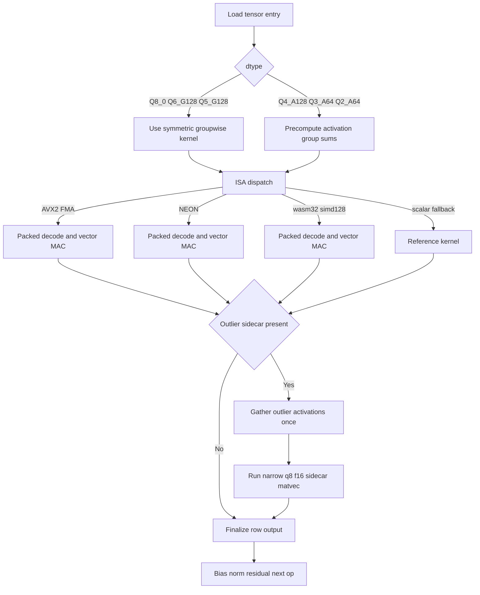

# Advanced Quantization Strategies for TinyRustLM SLM Models

## Executive summary

TinyRustLM’s current `.slm` implementation is unusually clear about its engineering constraints: the runtime currently supports only `F32`, `Q8_0`, and `Q4_0`; it executes direct quantized matrix-vector kernels without materializing full decoded `f32` shadow tensors; the tensor directory already has explicit `scale_offset` and `block_size` fields; the browser path currently copies the whole model artifact into WASM linear memory; and a single JS→WASM transfer is capped at 128 MiB. Those facts point to a very specific design conclusion: the best next-generation `.slm` formats are **weight-only, directly decodable, groupwise formats with simple linear or affine dequantization**, not codebook-heavy or activation-quantized formats as a first step. citeturn39view0turn39view1turn35view0turn37view0

For practical deployment, the strongest default is a **4-bit affine groupwise format with group size 128, optional q8 outlier-column sidecar, and mixed-precision sensitive layers**. That recommendation follows from three independent lines of evidence: LLM-QBench identifies 4-bit weight-only quantization as a strong accuracy/efficiency balance and recommends groupwise weight quantization with group size 128 for most bit-widths; AWQ shows that protecting a very small salient subset can materially reduce quantization error; and SpQR shows that outlier isolation is especially important for smaller models, where naïve 3–4 bit quantization can lose too much quality. citeturn19view3turn32view0turn16view8turn20view0

The safest quality-first ladder is: **`q8_0` as the regression reference**, **`q6_g128` for near-transparent compression**, **`q5_g128` for a more aggressive but still conservative deployment target**, and **`q4_a128+outliers` as the default browser/mobile target**. A **`q3`** format becomes rational only when it lets the user move to a meaningfully larger base model under the same RAM budget; PTQ-Bench found that 3-bit still preserves a useful model-size scaling advantage, while 2-bit often does not. A generic **`q2`** should be treated as experimental only: literature on PTQ-Bench, QuIP#, and AQLM shows that 2-bit can be made viable only with much more sophisticated rotation, vector quantization, or fine-tuning pipelines, and even then it is often a worse trade than running a smaller model at 4-bit. citeturn32view3turn17view10turn20view8turn20view11

For Rust and WASM specifically, the runtime strategy should optimize for **packed-stream reads, separate scale streams, precomputed activation-group sums for affine formats, function multiversioning for AVX2/NEON/`simd128`, and worker-thread execution in the browser**. The fixed-width `v128` SIMD model in WebAssembly strongly favors simple groupwise linear or affine kernels over more irregular codebook decoders, and stable Rust still requires target-specific intrinsics for serious SIMD work because `std::simd` remains nightly-only. citeturn29view4turn29view0turn29view1turn29view7

One important caveat frames the whole report: **MiRust/TinyRustLM has not yet published its own benchmark reports**, so the quality-loss ranges below are not TinyRustLM-native measurements. They are literature-based syntheses from GPTQ, AWQ, SpQR, OmniQuant, QuIP#, AQLM, LLM-QBench, PTQ-Bench, and QLLM-eval, and should be treated as informed priors to validate against TinyRustLM’s own models. citeturn38search1turn16view0turn16view1turn16view2

## TinyRustLM implementation constraints

TinyRustLM’s current `.slm` container already provides most of the metadata needed for richer quantization without redesigning the file format. Each tensor entry is 64 bytes and includes `dtype`, shape fields, `byte_offset`, `byte_length`, `scale_offset`, `block_size`, and 4 bytes of reserved space. The tensor-data section begins on a 64-byte boundary, and the current runtime copies tensor data into Rust-owned vectors rather than relying on borrowed mapped pointers. That is a good fit for adding more quantized dtypes whose payload and scale streams live in separate sections. citeturn39view1

The currently documented storage implementations are enough to expose the baseline tradeoff. `Q8_0` stores signed `i8` values with one scale per row and runs a direct quantized matvec without creating a decoded matrix. The published TinyLM-16M `q8_0` artifact holds 17,048,064 parameters in 17,160,000 bytes, which is about 25.2% of the corresponding `f32` artifact and roughly 8.05 effective bits per weight after scale overhead. `Q4_0` stores two signed 4-bit values per byte with one `f32` scale per fixed-size block; its published TinyLM-16M artifact is 10,657,728 bytes, about 15.6% of `f32` and about 62.1% of `q8`. citeturn26view0turn28view0

Those observed numbers matter because they show that TinyRustLM’s current `q4_0` is **not** close to an information-theoretic 4.0 bpw layout. Its artifact size implies about 5 effective bits per weight, which is exactly what one would expect from a 4-bit payload plus a relatively expensive block-scale overhead. Put differently: there is clear room to shrink `.slm` models substantially further **without dropping below 4 bits nominally**, simply by switching from the current block layout to larger groupwise blocks and smaller auxiliary scalars. That inference is consistent with GGML’s evolution from legacy `Q4_0/Q5_0/Q8_0` blocks to higher-efficiency superblock and k-quant layouts. citeturn28view0turn24view1turn24view3

Browser constraints make artifact size and load-time duplication especially important. MiRust documents that the browser first holds the fetched `ArrayBuffer`, then copies the entire file into WASM linear memory, after which Rust builds runtime-owned tensor storage; peak load memory can therefore exceed the packed artifact size and may temporarily include both packed bytes and expanded runtime tensors. The current ABI rejects transfers larger than 128 MiB. That makes weight-only direct-decoded formats more valuable than in native-only runtimes, because every byte saved helps both network transfer and peak browser memory pressure. citeturn35view0

The runtime’s own performance note says the current path is scalar, matrix-vector operations dominate weight reads, direct q8/q4 kernels reduce memory traffic at the cost of decode arithmetic, and browser overhead includes full-file fetch/copy, WASM allocation, main-thread synchronous execution, result decoding, and diagnostics rendering. In other words, TinyRustLM is presently **memory-traffic-sensitive and browser-overhead-sensitive**, not an environment where elaborate low-bit decode machinery can be assumed to be “free.” citeturn37view0

For a model with variable architecture and tensor shapes, the total packed model size can be expressed cleanly as

\[
B_{\text{model}} = B_{\text{header}} + 64T + B_{\text{tokenizer}} + \sum_{\ell=1}^{T} B_{\ell},
\]

where \(T\) is the number of tensors and \(B_{\ell}\) is each tensor’s packed byte size. Since weight matrices dominate, most design choices reduce to defining \(B_{\ell}\) for a matrix \(W \in \mathbb{R}^{R \times C}\). The tensor-entry semantics and current direct-dispatch design strongly favor layouts where \(B_{\ell}\) decomposes into a **dense payload stream** plus a **small auxiliary stream** referenced by `scale_offset`. citeturn39view1turn39view0

## Quantization tradeoffs and expected quality

The single most important granularity choice is between **per-tensor**, **per-channel**, and **groupwise** scales. LLM-QBench finds that for weight-only quantization, common group sizes such as 64 and 128 work well, that the accuracy drop from channel-wise quantization to group-wise is non-negligible, and that larger models are more robust to low-bit quantization. The same study also says that for weight-activation quantization, per-channel weight quantization is preferred because per-group weights would slow integer matmul kernels. For TinyRustLM’s current weight-only direct matvec path, that evidence points clearly toward **groupwise weight quantization**, not per-tensor or per-channel as the default for large matrices. citeturn19view4turn32view0

Symmetric versus asymmetric quantization is a subtler trade. TinyRustLM’s current `Q8_0` and `Q4_0` are effectively symmetric linear formats. But LLM-QBench reports that at lower bit-widths the advantage of asymmetric quantization becomes much more pronounced, especially in weight-only settings. That means TinyRustLM’s future formats should likely split into two families: **symmetric groupwise formats for q8/q6/q5**, where runtime simplicity matters most, and **affine groupwise formats for q4/q3/q2**, where extra accuracy from a stored minimum or zero-point is worth the small auxiliary overhead. citeturn32view0turn17view2

The literature is consistent on the broad quality frontier. GPTQ established that post-training second-order compensation can preserve good accuracy at 3–4 bits. AWQ showed that protecting roughly 1% of salient weights and learning activation-aware per-channel scaling materially reduces weight-only quantization error. SpQR showed that 3–4 bit quantization loses more quality on smaller models in the 1–10B range unless outliers are explicitly isolated. OmniQuant improved low-bit PTQ further by combining learnable clipping and equivalent transformations, including `W3A16` and `W2A16`. QuIP# and AQLM pushed the frontier further in the extreme \(\le 4\)-bit regime, especially at 2–3 bits, but with more complex representations and offline pipelines. citeturn8search4turn16view8turn20view3turn20view6turn20view8turn20view11

The same literature is also consistent on what **not** to do. PTQ-Bench shows that at 2-bit, salience-based methods such as AWQ can collapse, while rotation-based and compensation-based methods are the viable choices; it also shows that even very large 2-bit models can underperform much smaller 4-bit models from the same family. LLM-QBench’s best-practice summary recommends 4-bit weight-only, `w4a8`, or `w8a8` as strong settings, and its mixed-precision note explicitly points out that lower-bit small LLMs need more full-precision or higher-bit retention in sensitive parts. For TinyRustLM-sized models, which are much smaller and less redundant than the 7B–70B models dominating the literature, these warnings should be taken even more seriously. citeturn18view1turn17view10turn19view3turn32view0

The format comparison below combines observed TinyRustLM artifact data for current `q8_0/q4_0`, proposed direct-decodable groupwise layouts for the missing `q6/q5/q3/q2` points, and literature-based quality expectations. The **size** columns are analytical. The **decode cost** columns are engineering estimates relative to `q8_0`, inferred from payload size, unpack complexity, and the fact that WASM SIMD uses fixed 128-bit vectors. The **quality-loss** ranges are cross-paper syntheses, not TinyRustLM measurements. citeturn26view0turn28view0turn29view4turn16view8turn20view3turn20view11turn16view2

| Format | Quantization rule | Effective bpw | Size vs `f32` weights | Estimated decode cost vs `q8_0` | Expected quality loss |
|---|---|---:|---:|---:|---|
| `q8_0` current | symmetric, per-row scale | \(8 + 32/C\) | about 25.0%–25.2% | 1.0× native, 1.0× WASM | negligible to very small |
| `q6_g128` proposed | symmetric, fp16 scale per 128 weights | 6.125 | about 19.1% | 1.1× native, 1.2× WASM | very small |
| `q5_g128` proposed | symmetric, fp16 scale per 128 weights | 5.125 | about 16.0% | 1.15× native, 1.3× WASM | small |
| `q4_a128` proposed | affine, fp16 scale + fp16 min per 128 weights | 4.25 | about 13.3% | 1.25× native, 1.45× WASM | modest with good PTQ |
| `q4_a128+O` proposed | `q4_a128` plus 0.25%–1% q8 outlier columns | about 4.3–4.6 | about 13.5%–14.5% | 1.30× native, 1.5× WASM | modest, usually better than plain q4 |
| `q3_a64+O` experimental | affine, 64-weight groups, outlier-aware or rotation-assisted PTQ | about 3.6–4.0 | about 11.3%–12.5% | 1.5× native, 2.0× WASM | medium to high |
| `q2_a64` experimental | affine, 64-weight groups | 2.5 | about 7.8% | 1.9× native, 2.6× WASM | often unacceptable |
| `q2_vq` experimental | vector/codebook quantization inspired by QuIP#/AQLM | typically 2–3 | about 6%–9% | highly implementation-dependent | potentially usable, but decoder complexity is much higher |

The practical reading of that table is straightforward. **`q6` and `q5` are “easy wins.”** **`q4` is the default compression sweet spot.** **`q3` is only worth it if it buys a larger base model or a hard browser-memory fit.** **`q2` should not be the mainline browser/WASM format unless TinyRustLM adds a much more sophisticated offline pipeline and accepts more complex runtime kernels.** citeturn19view3turn18view5turn20view0turn20view8turn20view11

## Recommended SLM formats and byte layouts

### Format family recommendations

The recommended `.slm` roadmap is to keep the **current container structure** and add new dtypes that exploit the already-present `scale_offset`, `block_size`, and `reserved` fields. In practice, that means **payload bytes stay at `byte_offset`**, auxiliary data stays at `scale_offset`, `block_size` becomes the logical group size, and `reserved` becomes a small flags field for “affine,” “outlier sidecar present,” and future extensions. That path preserves backward compatibility with the current 64-byte tensor directory while avoiding any need to redesign the container header. citeturn39view1

The recommended shipping set is:

| Proposed dtype | Role |
|---|---|
| `Q8_0` | regression reference and “safe” deployment |
| `Q6_G128` | quality-first compressed default |
| `Q5_G128` | compact-but-safe default |
| `Q4_A128_O1` | main browser/mobile deployment target |
| `Q3_A64_O1` | optional advanced target when a larger base model must fit |
| `Q2_*` | experimental only |

That set is intentionally conservative. It follows the literature’s broad finding that 4-bit weight-only is the best default balance, that 3-bit can still be competitive when model-size tradeoffs are favorable, and that 2-bit requires substantially more sophistication than a simple direct-decoding linear format usually provides. citeturn19view3turn32view3turn17view10

### Byte layout proposals

The core proposal is a **split-stream** layout for all new formats:

- `byte_offset` points to the packed quant payload, row-major by output row and then by group.
- `scale_offset` points to a compact auxiliary stream containing all scales and, if affine, all mins or zero-points.
- `block_size` stores the group size \(G\).
- `reserved` stores small flags, for example:
  - bit 0: affine aux present
  - bit 1: outlier sidecar present
  - bit 2: aux scalars are `fp16`
  - bit 3: experimental codebook format
  - remaining bits reserved

That layout is specifically motivated by TinyRustLM’s current directory semantics, existing separate scale-offset support, and direct-dispatch runtime model. citeturn39view1turn39view0

The proposed payload encodings are:

| Dtype | Group size | Packed payload bytes per group | Aux bytes per group | Dequant rule |
|---|---:|---:|---:|---|
| `Q6_G128` | 128 | 96 | 2 (`fp16 scale`) | \(w \approx s \cdot q,\ q \in [-32,31]\) |
| `Q5_G128` | 128 | 80 | 2 (`fp16 scale`) | \(w \approx s \cdot q,\ q \in [-16,15]\) |
| `Q4_A128` | 128 | 64 | 4 (`fp16 scale`, `fp16 min`) | \(w \approx s \cdot u + m,\ u \in [0,15]\) |
| `Q3_A64` | 64 | 24 | 4 (`fp16 scale`, `fp16 min`) | \(w \approx s \cdot u + m,\ u \in [0,7]\) |
| `Q2_A64` | 64 | 16 | 4 (`fp16 scale`, `fp16 min`) | \(w \approx s \cdot u + m,\ u \in [0,3]\) |

This directly yields the byte formulas for a matrix \(W \in \mathbb{R}^{R\times C}\), assuming \(C\) is divisible by the group size:

\[
B_{\text{sym}}(R,C,b,G,S)= \frac{RCb}{8} + \frac{RC}{G}S
\]

\[
B_{\text{aff}}(R,C,b,G,S,Z)= \frac{RCb}{8} + \frac{RC}{G}(S+Z)
\]

where \(S\) is scale bytes per group and \(Z\) is min/zero-point bytes per group. For the proposed designs, \(S=2\) and \(Z=0\) for symmetric formats, \(Z=2\) for affine formats. These are direct consequences of the packed byte layouts above. citeturn39view1

A worked per-layer example makes the gain concrete. For a \(4096\times4096\) matrix, a dense `f32` tensor is exactly 64 MiB. The proposed formats would store that same matrix at approximately the following sizes:

| Format | Formula | Example size for \(4096\times4096\) |
|---|---|---:|
| `f32` | \(4RC\) | 64.00 MiB |
| `q8_0` current-style | \(RC + 4R\) | 16.02 MiB |
| `q6_g128` | \(0.75RC + 2RC/128\) | 12.25 MiB |
| `q5_g128` | \(0.625RC + 2RC/128\) | 10.25 MiB |
| `q4_a128` | \(0.5RC + 4RC/128\) | 8.50 MiB |
| `q3_a64` | \(0.375RC + 4RC/64\) | 7.00 MiB |
| `q2_a64` | \(0.25RC + 4RC/64\) | 5.00 MiB |

These are analytical weights-only storage numbers. They do not include the tiny tensor-directory overhead, tokenizer payloads, or optional outlier sidecars. Their main purpose is to show that **moving from current `q4_0`-style block scales to `q4_a128`-style groupwise affine scales can save materially more bytes without crossing below 4 nominal bits.** That follows directly from TinyRustLM’s observed current `q4_0` overhead and from the proposed larger-group layout. citeturn28view0turn39view1

### Outlier-aware sidecar proposal

For TinyRustLM, the most SIMD-friendly outlier strategy is **not** a fully sparse unstructured sidecar like SpQR’s runtime representation. It is a **layer-wise outlier-column sidecar**:

- Choose a small sorted set of input columns \(K\) using AWQ saliency, Hessian sensitivity, or large-error residuals.
- Store those columns separately as a dense `q8` or `f16` submatrix.
- Remove them from the low-bit main matrix during offline quantization.
- At runtime, gather the corresponding activation entries once into a scratch vector and run a second narrow matvec.

This is directly inspired by LLM.int8’s outlier feature decomposition, AWQ’s protection of a very small salient subset, and SpQR’s isolation of large-error outliers, but it stays far more SIMD- and WASM-friendly than an unstructured sparse residual path. citeturn8search2turn16view8turn20view4

A compact sidecar layout is:

| Field | Type | Notes |
|---|---|---|
| `k` | `u16` or `u32` | outlier column count |
| `col_ids[k]` | sorted `u16`/`u32` | tensor input-column indices |
| `payload` | row-major `q8` or `f16` matrix of shape `R×k` | dense narrow side matrix |
| `row_scales[R]` | `f32` if q8 sidecar | omitted for `f16` sidecar |

If \(k \le 0.5\%\ C\), the sidecar overhead is usually small relative to the gain in 4-bit or 3-bit accuracy. AWQ’s original observation that protecting about 1% of salient weights can greatly reduce error is the right magnitude guide here, though for TinyRustLM it is better to protect **columns or groups** than arbitrary scattered weights. citeturn16view8

### Mixed-precision layer policy

The mixed-precision rule should be simple enough that the runtime does not need per-token dynamic bit selection:

| Tensor category | Recommended precision |
|---|---|
| token embeddings, output head | `q8_0` or `q6_g128` |
| attention output projection | `q5_g128` |
| attention q/k/v projections | `q4_a128` or `q5_g128` |
| FFN down projection | `q5_g128` or `q6_g128` |
| FFN gate/up projections | `q4_a128` |
| norms, biases, RoPE tables, metadata tensors | `f16` or `f32` |

That policy is motivated by LLM-QBench’s mixed-precision note that lower-bit small LLMs need more full-precision retention, and by its explicit observation that “Down” layers are more sensitive and often deserve a higher bit-width. For TinyRustLM-sized models, the same logic should be applied more aggressively, because smaller models are less robust to quantization noise than larger ones. citeturn19view3turn32view0turn20view0

### Offline PTQ and QAT pipeline for tiny models

For `q6/q5/q4`, the recommended offline pipeline is:

1. **AWQ-style saliency scaling** on calibration activations.
2. **GPTQ-style second-order error compensation** within each row/group.
3. **Outlier-column extraction** if layer error remains heavy-tailed.
4. **Short QAT or quantization-aware fine-tuning** only if `q4` still misses acceptance thresholds.

That is the most practical synthesis of the current literature. AWQ avoids overfitting calibration data and learns activation-aware scaling; GPTQ improves local reconstruction; outlier-aware retention helps smaller models; and lightweight QAT methods such as LR-QAT and L4Q are especially attractive for tiny models because their training cost is far cheaper than for 7B+ models. citeturn16view8turn8search4turn20view0turn16view7turn33search1

For `q3`, the recommendation is stronger: use **AWQ/GPTQ plus outlier columns**, and if quality is still not acceptable, move to **rotation-assisted PTQ or lightweight QAT**. PTQ-Bench shows that 3-bit is still a meaningful target, but low-bit robustness depends much more on the chosen strategy, and compensation-based or rotation-based methods are stronger foundations than naïve salience-only methods. citeturn32view3turn18view2turn17view9

For `q2`, plain linear affine PTQ should be viewed as a debugging or archival target, not a production target. If 2-bit is required, the literature says the serious options are **QuIP#/rotation**, **AQLM/vector quantization**, or **QAT/fine-tuning frameworks such as PV-Tuning or EfficientQAT**. Those methods can be excellent offline compressors, but they are poor first runtimes for TinyRustLM browser/WASM unless a separate experimental dtype family is accepted. citeturn20view8turn20view11turn33search2turn33search0

## Runtime decode strategy for Rust SIMD and WASM

TinyRustLM’s own performance note says matrix-vector work dominates, direct quantized kernels save memory traffic but add decode arithmetic, and the current runtime is still scalar. That means the runtime objective is not “maximum cleverness.” It is **minimum bytes touched per useful MAC while keeping unpack logic cheap, vectorizable, and branch-free**. citeturn37view0

The most important implementation trick for affine low-bit formats is to **avoid explicit per-weight zero-point subtraction**. If a group uses \(w_i \approx s \cdot u_i + m\), then

\[
\sum_i w_i x_i \approx s\sum_i u_i x_i + m\sum_i x_i.
\]

So the runtime should precompute one activation-group sum \(\sum_i x_i\) per group, then compute a packed integer dot on the unsigned codes, followed by two scalar FMAs per group. That turns asymmetric quantization from a decode nightmare into a very manageable overhead, and it aligns directly with the literature showing that lower-bit asymmetric schemes often outperform symmetric ones. citeturn17view2turn32view0

On stable Rust, the implementation should use **target-specific intrinsics in `core::arch`** and **function multiversioning**, not `std::simd`, because `std::simd` is still nightly-only. For WebAssembly, SIMD support requires `#[target_feature(enable = "simd128")]` or `-C target-feature=+simd128`, and the Rust docs note that blanket target-feature compilation does not automatically rebuild the standard library with those features. For x86 and Arm, the same pattern applies with `avx2/fma` or NEON entrypoints and a scalar fallback. citeturn29view1turn29view7turn29view0

A good dispatch structure is:

That flow follows directly from TinyRustLM’s current direct-dispatch design, the browser/WASM execution constraints, and the need to preserve portability across native and web targets. citeturn39view0turn37view0turn29view0turn29view4

For WASM specifically, the fixed 128-bit `v128` model matters. A `v128` can naturally be interpreted as `i8x16`, `i16x8`, `i32x4`, or `f32x4`, which means low-bit kernels should be built around unpacking into 16-byte aligned chunks and then widening into a small number of predictable float lanes. That argues for group sizes that are multiples of 64 or 128 and against highly irregular codebook decoders for the mainline path. It also means there should be **two browser builds** when maximum compatibility matters: one scalar build and one `simd128` build, because Wasm SIMD is supported broadly today but not universally across historical browsers. Current compatibility data shows support in Chrome 91+, Firefox 89+, and Safari 16.4+, with about 93.57% global usage coverage. citeturn29view4turn31view3turn31view1turn31view2

The browser runtime should also separate **load-time** and **decode-time** optimization. MiRust documents that load-time currently includes whole-file fetch and copy into WASM memory, and current execution is synchronous on the main thread. Therefore, the high-priority browser improvements are: chunked or host-backed loading, worker-thread execution, persistent verified caching, and keeping the packed format directly executable so the runtime does not have to inflate weights into a second full resident copy before generation. citeturn35view0turn37view0turn36search5

A concrete Rust kernel strategy for the main formats is:

| Format | Kernel strategy |
|---|---|
| `Q8_0` | load `i8x16`, widen, convert to `f32`, FMA against `x`, apply row scale once per partial sum |
| `Q6_G128` | unpack 4 weights from 3 bytes into a small lane buffer, vectorize after widening, apply one fp16 scale per group |
| `Q5_G128` | unpack 8 weights from 5 bytes, same pattern as q6 with slightly higher unpack cost |
| `Q4_A128` | unpack nibbles, compute vector dot on unsigned codes, add `min * sum_x_group` correction |
| `Q3_A64` | unpack 8 codes from 3 bytes, small-lane dot plus affine correction |
| outlier sidecar | gather once, then run narrow dense q8/f16 matvec |

Because TinyRustLM is currently scalar and weight-read-dominated, the real target is not just a faster unpack loop. It is a kernel family that minimizes memory traffic, keeps the aux stream cache-friendly, and never creates a decoded weight shadow in RAM. citeturn37view0turn39view0

## Validation plan and acceptance thresholds

A good quantization format is not only a byte layout. It is also a test contract. TinyRustLM’s documentation already emphasizes source-backed evidence, range validation, exact encoded-length checks, checksum validation, and quality gates before compatibility claims. Any new dtype should preserve that standard and extend it to numerical and model-quality criteria. citeturn39view1turn39view0

The validation stack should have four layers.

First, **tensor-format unit tests** should verify: pack/unpack correctness for every edge code; group-size and shape divisibility checks; exact `byte_length` computations; exact `scale_offset` bounds; endianness and bit-order invariants; and rejection of malformed tensors. Current TinyRustLM docs already emphasize exact range validation, alignment rules, and format-critical risks in quantized tensors, especially for `q4`. citeturn39view1turn28view0

Second, **kernel-level numerical tests** should compare each SIMD kernel against a scalar reference on randomized tensors and on adversarial edge cases. Useful metrics are relative RMSE, cosine similarity, max absolute error, and row-output ULP drift. The current q8/q4 documentation explicitly limits its claims to kernel-agreement validation rather than language quality, which is the right baseline to preserve. citeturn26view0turn28view0

Third, **logit- and layer-level integration tests** should compare quantized and high-precision model passes on a fixed calibration corpus. The most useful metrics are:
- layer-output cosine similarity,
- mean KL divergence between logits,
- top-1 and top-5 logit agreement,
- perplexity delta,
- and, when relevant, KLD on sampled intermediate tensors.

Those metrics align with llama.cpp’s own quantization tooling, which frames quality loss primarily in perplexity and KLD terms. citeturn24view2

Fourth, **task-level evaluation** should mirror the scope of QLLM-eval and LLM-QBench: language modeling, reasoning, trustworthiness or stability prompts, dialogue-style prompts, and long-context smoke tests if KV-cache quantization is later added. LLM-QBench’s own ablations use MMLU, ARC-e, BoolQ, HellaSwag, and PIQA subsets, while QLLM-eval evaluates five broad categories across many model families. That makes them a very reasonable starting benchmark set for TinyRustLM as well. citeturn19view0turn21view0

The recommended acceptance thresholds should be format-specific and deliberately strict for shipping targets:

| Format | Layer-output cosine | Logit KL drift | Perplexity delta | Task accuracy drop | Ship status |
|---|---:|---:|---:|---:|---|
| `q8_0` | \(\ge 0.999\) | very small | \(\le 1\%\) | \(\le 0.5\) pt | required reference |
| `q6_g128` | \(\ge 0.998\) | very small | \(\le 2\%\) | \(\le 1\) pt | ship |
| `q5_g128` | \(\ge 0.996\) | small | \(\le 3\%\) | \(\le 2\) pt | ship |
| `q4_a128+O` | \(\ge 0.992\) | moderate | \(\le 6\%\) | \(\le 4\) pt | default ship |
| `q3_a64+O` | \(\ge 0.985\) | noticeable | \(\le 12\%\) | \(\le 8\) pt | optional advanced |
| `q2_*` | case-by-case | case-by-case | no fixed general threshold | no fixed general threshold | experimental only |

These are **proposed acceptance thresholds**, not claims from the literature. They are intentionally shaped by the literature’s broad behavior: 4-bit can be strong with good PTQ, 3-bit is viable but clearly riskier, and 2-bit cannot be trusted without stronger offline methods and more extensive validation. citeturn19view3turn18view5turn17view10turn20view11

For TinyRustLM specifically, the browser/WASM test matrix also needs runtime-specific checks:
- successful load under the current 128 MiB transfer limit,
- worker-thread cancellation and restart behavior,
- scalar vs `simd128` numerical equivalence,
- deterministic replay for fixed prompts and seeds,
- artifact caching and integrity checks,
- and peak memory during load and first-token generation.

Those are not generic LLM quantization concerns; they are direct consequences of how TinyRustLM currently loads and runs models in the browser. citeturn35view0turn37view0turn36search5

The strongest overall recommendation is therefore:

- **Keep `q8_0`** as the regression and interchange reference.
- **Add `Q6_G128` and `Q5_G128` first**, because they are easy to decode and low risk.
- **Make `Q4_A128_O1` the default compact format**, using AWQ-style scaling, GPTQ-style compensation, optional q8 outlier columns, and a static mixed-precision layer map.
- **Add `Q3_A64_O1` only after the q4 path is stable**, and only with a stronger offline quantization stack.
- **Treat `Q2_*` as experimental**, ideally gated behind QuIP#/AQLM/PV-Tuning or efficient QAT rather than plain PTQ.

That stack fits TinyRustLM’s current container design, respects its browser/WASM realities, aligns with the strongest published quantization evidence, and gives a clean engineering path from conservative compression to more aggressive low-bit research without forcing the runtime into a decoder architecture that is hostile to Rust SIMD and WASM. citeturn39view0turn39view1turn35view0turn37view0turn16view8turn8search4turn20view0turn16view2