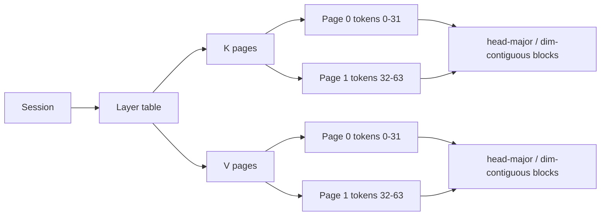
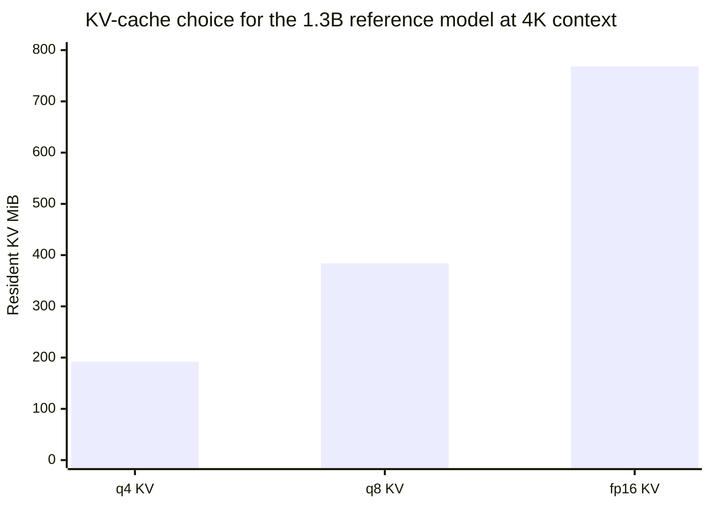
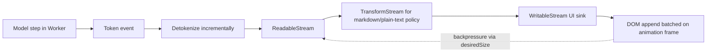

# Best Practices for Running Small LLMs in the Browser with Wasm

## Executive summary

For browser-first inference today, the strongest default architecture is: a small decoder-only model, quantized weights, a pre-sized WebAssembly memory arena, inference isolated in a dedicated Web Worker, SIMD-enabled Wasm, and a streaming API that applies real backpressure end to end. That combination is what usually separates a “demo that sometimes works” from a system that can make defensible public claims about latency, memory use, and privacy. Official runtime guidance points in the same direction: ONNX Runtime Web is deprecating non-SIMD, non-threaded builds, and only enables Wasm multithreading when `crossOriginIsolated` is available; Chrome and MDN likewise tie `SharedArrayBuffer`, precise timers, and memory measurement to COOP/COEP isolation. citeturn8view0turn6view5turn6view6turn28view1

For CPU/Wasm specifically, **q8 is the safest production default**, while **q4 is the memory-first option**. Hugging Face documents `q8` as the default dtype for Wasm and offers `q4` as an option, which matches the practical reality that q8 has broader kernel maturity and is less likely to surprise you on quality or latency. The quantization literature supports the qualitative split: 8-bit quantization is typically close to full precision, while good 4-bit methods can work very well but are more sensitive to calibration, kernel choice, and model family. ONNX Runtime’s web guidance also explicitly prefers uint8 quantized models on the CPU path. citeturn17search4turn21view1turn15search0turn29view0turn10search0turn9search2turn9search3

Once models are small enough to fit, the next limiter is usually **KV cache growth**, not tokenizer speed or even matmul throughput. PagedAttention, StreamingLLM, H2O, and KIVI all exist because long-context generation becomes dominated by cache size, fragmentation, and cache traffic. In a browser/Wasm implementation, the best baseline is not a research-grade cache manager, but a simpler design inspired by those systems: fixed-size KV pages inside a dedicated arena, append-only token-major layout, optional sliding-window eviction with sink tokens for long sessions, and conservative KV quantization—preferably q8 first, q4 only behind a benchmark gate. citeturn9search0turn9search1turn9search2turn9search4

Tokenizer and sampling overhead matter more than many browser implementations assume. Tokenizers built in Rust and compiled to Wasm are dramatically better than pure JS for anything beyond trivial loads, WebAssembly SIMD is now a mainstream optimization target, and the browser streaming stack already gives you the machinery needed for backpressure. The UI path must be treated as part of inference: repeated `textContent += chunk` updates are measurably worse than append-style updates, and `tee()` can hide unbounded queue growth if you duplicate a token stream to multiple consumers. citeturn21view3turn24search12turn8view4turn26view1turn26view2turn25search4

For **TinyRustLM**, the most robust product strategy is: target 125M and 350M models as the default Wasm tier, treat 1.3B as a desktop-first tier, use q8 weights wherever memory allows, reserve q4 weights for memory-constrained devices, store model assets in Cache API or OPFS, pre-size Wasm memory instead of growing it repeatedly, and expose diagnostics as first-class API surface. On browsers that support WebGPU well, use it opportunistically for larger models or long contexts; on unsupported or unstable devices, keep a pure CPU/Wasm fallback. Web platform guidance now explicitly frames WebGPU as the path for larger generative models, while Wasm remains the compatibility baseline for smaller workloads. citeturn24search22turn8view5turn8view1turn8view2

## Assumptions and planning budgets

The budget numbers below are **planning estimates**, not measurements from one exact checkpoint. They assume a dense decoder-only transformer, batch size 1, single active sequence, and representative shapes similar to well-known small GPT/OPT-class models:

| Reference size | Working shape assumption | Notes |
|---|---:|---|
| 125M | 12 layers, hidden size 768 | GPT-2-small-like planning model |
| 350M | 24 layers, hidden size 1024 | OPT-350M-like planning model |
| 1.3B | 24 layers, hidden size 2048 | GPT-Neo/Phi-class planning model |

The KV-cache estimates assume **standard multi-head attention without GQA/MQA reduction**. If your architecture uses grouped-query or multi-query attention, scale KV memory down roughly by `num_kv_heads / num_heads`. The WebAssembly memory facts that matter for planning are stable: Wasm linear memory grows in 64 KiB pages, the traditional `i32` memory model tops out at 4 GiB, and `grow()` invalidates old JS-side buffer views. Newer Wasm features now include 64-bit addressing and multiple memories, but support is still uneven enough that they should be feature-gated, not assumed. citeturn19view0turn19view1turn19view2turn6view7turn6view8turn32view0

For weight sizing, a good browser-planning rule is:

- **q8 weights**: about **1.05 bytes/parameter** after format overhead.
- **q4 weights**: about **0.65–0.70 bytes/parameter** after format overhead.

That q4 planning range is consistent with Chrome’s worked example that a “small” Gemma 2B int4 browser model is still about **1.35 GB**, which is much larger than the idealized 1.0 GB raw 4-bit lower bound. citeturn39view0

Using those assumptions, the approximate **weight-only budgets** are:

| Model | q8 weights | q4 weights |
|---|---:|---:|
| 125M | ~125 MiB | ~80–84 MiB |
| 350M | ~350 MiB | ~225–235 MiB |
| 1.3B | ~1.27 GiB | ~0.82–0.87 GiB |

The **KV-cache** is easier to reason about because it is architecture-derived. For the reference models above, the approximate KV budgets are:

| Model | KV dtype | 2K context | 4K context |
|---|---|---:|---:|
| 125M | fp16 | 72 MiB | 144 MiB |
| 125M | q8 | 36 MiB | 72 MiB |
| 125M | q4 | 18 MiB | 36 MiB |
| 350M | fp16 | 192 MiB | 384 MiB |
| 350M | q8 | 96 MiB | 192 MiB |
| 350M | q4 | 48 MiB | 96 MiB |
| 1.3B | fp16 | 384 MiB | 768 MiB |
| 1.3B | q8 | 192 MiB | 384 MiB |
| 1.3B | q4 | 96 MiB | 192 MiB |

A practical TinyRustLM production budget also needs room for decode scratch, tokenizer state, JS/Worker overhead, and UI buffers. A conservative single-session target is:

| Model | Decode scratch | Tokenizer + detokenizer | JS/Worker/UI overhead |
|---|---:|---:|---:|
| 125M | 32 MiB | 8 MiB | 32 MiB |
| 350M | 64 MiB | 12 MiB | 48 MiB |
| 1.3B | 128 MiB | 16 MiB | 64 MiB |

That yields the following **estimated total resident memory** when using **q8 KV** and a 4K context:

| Model | q8 weights + q8 KV | q4 weights + q8 KV |
|---|---:|---:|
| 125M | ~269 MiB | ~224 MiB |
| 350M | ~666 MiB | ~541 MiB |
| 1.3B | ~1.85 GiB | ~1.40 GiB |

```mermaid
xychart-beta
    title "Estimated resident memory at 4K context"
    x-axis [125M, 350M, 1.3B]
    y-axis "MiB" 0 --> 2000
    bar "q4 weights + q8 KV" [224, 541, 1429]
    bar "q8 weights + q8 KV" [269, 666, 1894]
```



These numbers explain the most important product decision in this report: **125M and 350M are broadly realistic for CPU/Wasm**, while **1.3B in CPU/Wasm is a desktop-first configuration unless you aggressively reduce context, quantize the KV cache, or move hot kernels to WebGPU**. Web platform guidance explicitly notes that WebGPU opens the door to running larger generative models and attention-heavy workloads that are restrictive in Wasm alone. citeturn8view5turn21view2

## Wasm memory architecture

WebAssembly still gives you a **single contiguous linear memory** as the mainstream baseline, and that fact should drive the whole internal design. The browser-visible memory model is simple but unforgiving: linear memory is page-based, growable, little-endian, shared only when explicitly constructed as `SharedArrayBuffer`-backed memory, and any call to `memory.grow()` detaches old JS views—even `grow(0)` does. That means allocator churn and view invalidation are not corner cases; they are core architectural concerns. citeturn19view0turn19view1turn19view2turn19view3

For TinyRustLM, the best Wasm memory pattern is a **manual arena layout** inside linear memory:

1. a read-mostly **weights arena**,
2. a separately managed **KV arena**,
3. a **scratch arena** for layer temps and prompt-prefill workspaces,
4. a tiny **I/O arena** for token IDs, stream events, and stats.

That split is more important than it looks. It matches how LLM-serving systems isolate long-lived and short-lived allocations, and it sharply reduces fragmentation risk. PagedAttention demonstrates why block-based memory management matters for the KV cache, while browser semantics add a further reason: if you must grow memory, you want growth events to be rare and predictable, not interleaved with UI-visible generation. citeturn9search0turn19view2

A strong **linear-memory strategy** for TinyRustLM is:

- For **unshared** Wasm memory, set the initial heap to about **80–90% of the expected steady-state footprint**, then allow at most one emergency growth during warmup. Refresh all JS `TypedArray` views immediately after any growth event.
- For **shared** Wasm memory, remember that `maximum` is mandatory and only a hint to the engine. Pre-size closer to the final target because repeated geometric growth is risky on memory-constrained browsers, especially Safari/iOS. citeturn19view0turn19view2turn30view1

The Safari/I/O story is especially important. WebKit has long acknowledged that browser memory behavior under pressure is hard to predict, and WebKit bug discussions explicitly note that it is the application’s responsibility not to ask for too much memory, because a request that is safe in one browser or session can be risky in another. Real bug reports show iOS Safari sessions that could allocate about 1 GB on first load but only a few hundred MB—or much less—after reload. That is not a stable contract, but it is exactly why Wasm browser apps need conservative resident-memory targets and load-time admission control. citeturn30view1turn30view2turn30view0

For **asset storage**, do not rely purely on implicit HTTP cache behavior. Chrome’s AI guidance is explicit: if you want repeat launches to be fast, cache model data deliberately. For general model delivery, Cache API is the default recommendation; OPFS is also viable and is available across major browsers, with worker-side synchronous access handles for fast file I/O. OPFS is especially attractive for model shards, tokenizer artifacts, and warm-start metadata, while Cache API is often the easiest fit for immutable model blobs served from deterministic URLs. citeturn39view0turn20search1turn35view2turn35view1turn35view3

A practical TinyRustLM layout can therefore look like this:

```rust
/// Long-lived memory partitions inside Wasm linear memory.
struct RuntimeLayout {
    /// Immutable packed weights, loaded once at startup.
    weights: Arena,
    /// Append-only KV pages, reset or compacted per session.
    kv: Arena,
    /// Per-step / per-prefill temporary buffers.
    scratch: Arena,
    /// Small control buffers shared with JS for tokens, events, and stats.
    io: Arena,
}
```

At the byte level, align each arena to **at least 64 bytes** and, for hot matrix and KV regions, prefer **128-byte alignment** when your kernels use wide SIMD loads. That recommendation is architectural rather than browser-specific, but it becomes especially valuable in Wasm because unaligned hot loops are harder to hide behind out-of-order native execution than in optimized native stacks. WebAssembly SIMD exists precisely to make this kind of data-parallel work efficient. citeturn24search8turn24search12

## Quantization and KV cache

The most useful way to think about **q8 versus q4** in the browser is not “which is better,” but “which failure mode do I prefer.”

- **q8** trades more memory for much lower operational risk.
- **q4** trades quality margin and kernel complexity for a materially smaller footprint.

That split is consistent with the state of browser tooling. Hugging Face documents `q8` as the usual Wasm default and exposes `q4` as an option; ONNX Runtime Web advises using quantized CPU models and specifically prefers uint8 on its Wasm path; llama.cpp’s quantization tooling explicitly frames lower-precision conversion as a size/speed/quality tradeoff measured in perplexity and divergence. citeturn17search4turn21view1turn29view0turn15search1

### q8 versus q4

| Dimension | q8 | q4 |
|---|---|---|
| Weight memory | ~1.05 B/param planning | ~0.65–0.70 B/param planning |
| Output quality | Usually closest to full precision | Often good, but more model- and method-sensitive |
| Wasm CPU defaultability | Best default today | Good opt-in where kernels are proven |
| Toolchain maturity in browser runtimes | Broad | Good, but more backend-specific |
| Best use | 125M/350M default, quality-sensitive chat | 350M mobile mode, 1.3B desktop-first mode |
| Main risk | Memory pressure | Accuracy drift, dequant overhead, backend inconsistency |

The research literature backs the quality side of that table. LLM.int8 showed that 8-bit inference can preserve performance well, while GPTQ, AWQ, and QLoRA helped establish that carefully designed 4-bit methods can remain strong—but “4-bit works” is not the same as “all q4 formats behave the same on all small browser-deployed models.” In other words, q4 is viable, but it is much less forgiving of poor calibration, weak kernels, or architecture-specific sensitivity. citeturn15search0turn9search2turn10search0

For TinyRustLM, the clean recommendation is:

- **125M**: default to **q8 weights**. Use q4 only for low-memory mobile fallback.
- **350M**: default to **q8** on desktop and **q4** on memory-constrained devices.
- **1.3B**: default to **q4 weights** on desktop if you must stay CPU/Wasm; reserve **q8** for high-RAM desktop targets or WebGPU. citeturn17search4turn29view0turn39view0

### KV-cache layout, eviction, compression, and sharding

KV-cache strategy matters more than an extra quantization point on small models once context lengths grow. PagedAttention showed that cache fragmentation and poor allocation policy can destroy throughput. StreamingLLM showed that attention-sink tokens make sliding-window generation much more stable. H2O showed that “recent + important” retention beats purely recency-based retention, and KIVI showed that KV quantization should treat keys and values differently because their distributions differ. citeturn9search0turn9search1turn9search4turn9search2

The best TinyRustLM baseline is:

- **Separate K and V storage**, not an interleaved structure.
- **Token-major pages inside each layer**, so appends are contiguous and reads over prior tokens have predictable stride.
- **Fixed-size pages** such as 16 or 32 tokens per page.
- **Session-local page tables**, so compaction and reset are cheap.
- **No eviction** until a session crosses a configured context ceiling.
- Then a **sliding window + sink tokens** policy.
- Add heavier “importance-aware” retention only after the basic path is stable.



The default **TinyRustLM KV policy** should be:

- **Desktop default**: q8 KV.
- **Mobile default**: q8 KV, lower context ceiling before considering q4.
- **Long-context or 1.3B mode**: optional q4 KV behind benchmark and quality gates.
- **Asymmetric future path**: keep **K at q8** and experiment with **V at q4** first if your kernels support it cleanly, because KIVI’s results argue for asymmetric thinking rather than naive symmetric compression. citeturn9search2

This chart shows why KV quantization matters so much for decode performance in memory-bound CPU/Wasm decoders: resident KV size is also a good proxy for cache traffic per token.



### Preferred TinyRustLM quant formats

For a custom Rust/Wasm runtime, the preferred order is:

1. **q8 weight-only** format with simple per-block scales.
2. **q4 weight-only** format with straightforward dequant math and no exotic per-group metadata.
3. **q8 KV** support.
4. **q4 KV** support.
5. Only then, more advanced mixed K/V or research-grade cache quantization.

That order is not because q4 is unimportant; it is because every additional quantization mode multiplies the number of code paths that must be benchmarked, profiled, and explained in public claims. The browser environment is already variable enough without adding avoidable kernel complexity. citeturn15search1turn29view0turn21view1

## Tokenization, sampling, and streaming

Tokenization in the browser should be treated as a real performance subsystem, not a utility function. Hugging Face’s tokenizer stack exists in Rust specifically for speed and supports normalization, preprocessing, truncation, and alignment tracking; that is exactly the sort of implementation that ports well to Wasm. Pair that with Wasm SIMD and you get a practical answer to the common browser bottleneck of “lots of tiny scalar string-processing work.” Safari’s recent SIMD work and ONNX Runtime’s plan to drop non-SIMD/non-threaded builds both point the same way: don’t optimize the non-SIMD path first. citeturn21view3turn8view0turn8view4turn24search12

Tokenizer best practices for TinyRustLM are:

- Keep the tokenizer in **Rust/Wasm**, not JS.
- Separate **normalization**, **pre-tokenization**, and **BPE/merge lookup** into cacheable stages.
- Cache recent **prompt prefixes**, not just full strings.
- Cache normalized/pre-tokenized spans for repeated system prompts, chat templates, and tool schemas.
- Return token IDs as a **single contiguous typed array** per request to avoid chatty JS↔Wasm crossings.

A good internal shape is:

```rust
/// Caches hot prompt fragments such as system prompts and chat templates.
struct PrefixTokenCache {
    /// Hash of normalized UTF-8 bytes -> token id vector.
    entries: LruMap<u64, Vec<u32>>,
}
```

On the detokenization side, use streaming decode semantics correctly. The browser’s `TextDecoder.decode()` supports `stream: true`, and `TextDecoderStream` exists specifically for chunked decoding. That means partial output should be buffered until it forms a valid boundary for your output encoding and token-decoding scheme, rather than flushed blindly on every token. citeturn34search3turn34search4turn34search5

Sampling is mostly a quality problem in papers, but in Wasm it also becomes a micro-architectural problem. Holtzman’s nucleus-sampling paper is still the canonical reason to prefer top-p style truncation for open-ended generation quality. In a browser runtime, the additional engineering lesson is that **candidate reduction saves work**: the smaller the post-filter candidate set, the less sorting, scanning, and random-selection work you do per token. Sampling should therefore stay **inside Wasm over a contiguous logits buffer**, with SIMD-accelerated temperature scaling, top-k selection, and probability normalization where practical. citeturn10search0turn24search12

For TinyRustLM:

- Use **greedy** for deterministic utility tasks.
- Use **top-k + top-p + temperature** for chat.
- Apply **temperature before truncation** in one fused pass.
- Avoid copying logits to JS for sampling.
- Avoid full-vocabulary JS sorting.
- If exposing batched generation, batch **only the sampler**, not the UI path.

Streaming generation should use the browser’s backpressure model directly. MDN’s Streams guidance is clear: `desiredSize` is the signal for whether the downstream consumer is keeping up, and both `ReadableStream` and `WritableStream` are designed to carry that pressure through the pipeline. Also avoid `tee()` for long-running token streams unless you tightly control downstream consumption, because unread data in a teed branch can grow without meaningful backpressure from the slow consumer. citeturn26view2turn26view3turn25search4



The UI update policy matters. Chrome’s streaming-render guidance explicitly recommends append-style updates and warns against repeatedly rewriting `textContent` or `innerText` as chunks arrive. TinyRustLM should therefore buffer small token bursts and flush them on a controlled cadence—typically once per animation frame or on punctuation/newline boundaries—rather than on every token. citeturn26view1

A practical streaming surface is:

```ts
interface GenerationEvent {
  kind: "token" | "text" | "stats" | "warning" | "error" | "done";
  seq?: number;
  tokenId?: number;
  text?: string;
  stats?: {
    prefillMs?: number;
    decodeTps?: number;
    kvBytes?: number;
    samplerUs?: number;
  };
}
```

That interface is intentionally small. It exposes enough for UI, telemetry, and reproducibility without forcing the client to understand the model internals.

## Workers, browser limits, and compatibility

If you want acceptable latency **and** a responsive page, heavy inference should not run on the main thread. ONNX Runtime Web exposes this directly with its proxy-worker mode and notes that the feature helps responsiveness even when it does not improve raw model speed. More importantly, the browser platform reserves the best concurrency features for isolated contexts: `SharedArrayBuffer`, Wasm threads, and `measureUserAgentSpecificMemory()` all depend on cross-origin isolation. citeturn8view6turn6view5turn6view6turn28view1

The minimum isolation checklist is:

- `Cross-Origin-Opener-Policy: same-origin`
- `Cross-Origin-Embedder-Policy: require-corp` or `credentialless`
- Feature detection through `self.crossOriginIsolated`
- No dependency on third-party resources that break COEP

That is not optional if you want reliable threaded Wasm. Chrome’s guidance makes clear that `SharedArrayBuffer` and Wasm multithreading ride on this isolation boundary because of side-channel mitigations. citeturn6view5turn6view6turn27search2turn27search1

For thread count, use `navigator.hardwareConcurrency` as a ceiling, not a target. ONNX Runtime Web defaults to half of `navigator.hardwareConcurrency`, capped at four, which is a sensible product heuristic for browser inference too: beyond a few threads, contention, thermals, and memory bandwidth often erase benefits on laptops and phones. TinyRustLM should default to:

- **1 thread** if not cross-origin isolated,
- **2 threads** on low-end or mobile devices,
- **min(4, floor(hw/2))** on desktop,
- and a hard escape hatch to force single-thread mode. citeturn8view6turn27search0

### Browser memory heuristics and compatibility

The browser platform does **not** expose a trustworthy “you may safely use X bytes of RAM” API. What it does expose is:

- coarse device RAM via `navigator.deviceMemory`, supported mainly in Chromium-based browsers,
- logical core count via `navigator.hardwareConcurrency`,
- origin storage estimates via `navigator.storage.estimate()`,
- and, in some environments, app memory estimates via `measureUserAgentSpecificMemory()`. The latter is useful for regression tracking, but MDN explicitly warns that results are highly implementation-dependent and not comparable across browsers. citeturn12search0turn38view0turn36search0turn28view1

That means the right way to talk about browser limits is not hard caps, but **engineering ceilings**. The table below is therefore a **recommended TinyRustLM deployment ceiling**, not a browser guarantee.

| Browser / device tier | Relevant platform facts | TinyRustLM practical stance |
|---|---|---|
| Chrome desktop | Strong Wasm + threads + memory APIs; WebGPU shipped on major desktop platforms; Device Memory available in Chromium | Best target for 350M and desktop 1.3B; budget ~1.5–2.0 GiB resident before treating a config as risky |
| Edge desktop | Same engine family as Chrome | Treat like Chrome unless enterprise policy disables features |
| Firefox desktop | Strong Wasm path; WebGPU officially shipped first on Windows in Firefox 141 | Solid CPU/Wasm target; WebGPU path should be feature-gated and OS-specific |
| Safari macOS | WebGPU shipped in Safari 26; SIMD is now broadly enabled in WebKit; memory behavior still conservative | Good for 125M/350M; 1.3B should be treated cautiously unless WebGPU path is stable |
| Chrome Android | WebGPU available only on supported Android 12+ GPU/device combinations; Wasm fallback remains essential | 125M and some 350M configs are realistic; keep contexts smaller |
| Safari iPhone / iPad | WebGPU shipped in Safari 26, but iOS memory pressure remains the strictest and most variable | Treat as strictest environment; keep resident memory conservative, prefer 125M, use 350M only with reduced context and careful admission checks |

These platform statements are grounded in current browser documentation: Chrome documents WebGPU shipping on desktop and later on supported Android GPUs; Firefox documents WebGPU shipping on Windows in Firefox 141; Safari/WebKit documents WebGPU shipping in Safari 26 across macOS, iOS, and iPadOS. The memory caution on iOS is based on real WebKit bug reports and comments acknowledging unpredictable behavior under pressure. citeturn8view1turn31search5turn8view2turn30view0turn30view1turn30view2

A useful admission policy for TinyRustLM is:

- If `deviceMemory` exists and is **≤ 2**, refuse 1.3B and default 350M to q4 with reduced context.
- If `deviceMemory` is **4**, allow 350M q8 or 1.3B q4 only on desktop-class browsers.
- If `deviceMemory` is absent, fall back to browser family + platform + warmup measurements. Chromium’s own adaptive-loading guidance shows why: `deviceMemory` is coarse and not universally available, while `hardwareConcurrency` is much more broadly available. citeturn38view0turn12search0turn27search0

WebGPU should be used opportunistically, not dogmatically. The web platform now explicitly positions WebGPU as the right path for larger ML workloads and attention-heavy generative models, but browser support and stability still vary. TinyRustLM should therefore probe `navigator.gpu`, adapter features and limits, and device-loss signals, then select a GPU path only after a short self-test. If the device is lost or initialization fails, fall back to CPU/Wasm without killing the session. citeturn8view5turn31search7turn31search15turn31search13

## Diagnostics, privacy, and TinyRustLM recommendations

Diagnostics have to exist at three levels: **runtime profiling**, **product telemetry**, and **reproducibility metadata**.

For browser-native profiling, the strongest standard tools are:

- `performance.mark()` / `performance.measure()` in both window and worker scopes,
- `PerformanceObserver`,
- Long Tasks and long-frame detection on the UI thread,
- and `measureUserAgentSpecificMemory()` where available and isolated. Chrome DevTools also has specific support for Wasm debugging and direct inspection of `WebAssembly.Memory`. ONNX Runtime Web adds a very practical model for inference-specific diagnostics: profiling, verbose logs, trace events, and explicit debug mode. citeturn14search18turn14search7turn14search2turn14search14turn28view1turn14search0turn14search6turn29view0

A TinyRustLM diagnostics API should always expose:

| Metric | Why it matters |
|---|---|
| model hash + quant format | Reproducibility |
| browser / version / platform | Browser variance is real |
| worker count + COI state | Explains threading behavior |
| load ms / cache hit / compile ms | Startup cost |
| prefill throughput | Prompt processing bottlenecks |
| decode tok/s | User-visible responsiveness |
| tokenizer tok/s | Input-path cost |
| sampler µs/token | Output-path CPU overhead |
| KV bytes + arena high-water marks | Memory pressure |
| grow count | Detects allocator mistakes |
| UI flush latency | Distinguishes model slowness from render slowness |

A **local-only telemetry policy** should never send these metrics by default. Keep a bounded in-memory ring buffer and allow explicit export as JSON. That matters for both privacy and credibility.

### Reproducible failure modes to test first

The most common browser-specific failure classes are well understood:

- **Detached JS views after `memory.grow()`**, causing silent corruption or empty arrays. citeturn19view2
- **Missing COI**, which disables threads and some memory APIs. citeturn6view5turn8view6
- **CSP blocking Wasm**, because `script-src` must allow `'wasm-unsafe-eval'` if you compile/instantiate Wasm under CSP. citeturn37search0turn37search1
- **iOS/Safari OOM or reload under memory pressure**, especially with shared memory and aggressive growth. citeturn30view0turn30view1turn30view2
- **UI jank from main-thread token rendering**, especially if plain-text updates rewrite the whole node repeatedly. citeturn26view1turn14search2
- **Streaming fan-out memory growth** when `ReadableStream.tee()` is used carelessly. citeturn25search4
- **WebGPU worker/proxy mismatches** in some toolchains. ONNX Runtime, for example, documents that its proxy worker does not work with the WebGPU execution provider. citeturn8view6

### Local-only privacy guarantees

A truthful “local-only” claim needs a threat model.

**What you can credibly guarantee**:

- prompts and generated text are processed on-device rather than sent to a remote inference API,
- after warm start, the application can be configured to make **no outbound network requests**,
- model assets can be cached locally in browser storage,
- telemetry can remain local-only unless explicitly exported,
- and cross-origin isolation plus CORP/COOP reduce important classes of cross-origin leakage and Spectre-style risks. citeturn21view2turn13search1turn13search3turn6view5

**What you cannot honestly guarantee**:

- confidentiality against malicious first-party scripts,
- browser extensions or a compromised browser/OS,
- extraction of model files stored client-side,
- or absolute immunity from side channels. Chrome’s own model-caching guidance explicitly notes that once a model is stored on the client, it is trivial to extract with browser tools; MDN and web.dev also make clear that isolation helps with side-channel risk but is not a cure-all. citeturn39view0turn13search15turn13search3

For a strong local-only posture, TinyRustLM should deploy with something close to:

- `Content-Security-Policy: default-src 'self'; script-src 'self' 'wasm-unsafe-eval'; connect-src 'none'; frame-src 'none'; object-src 'none'; base-uri 'none'`
- `Cross-Origin-Opener-Policy: same-origin`
- `Cross-Origin-Embedder-Policy: require-corp`

Use `ReportingObserver` for local diagnostics instead of server reporting endpoints if you want to preserve the “no egress” claim. MDN’s CSP docs note that enforcement can report either locally via observer or remotely via Reporting API endpoints; for local-only apps, only the former is compatible with a strong privacy claim. citeturn13search1turn13search6turn14search3turn37search11

### TinyRustLM implementation recommendations

The highest-confidence implementation package is:

| Area | Recommendation |
|---|---|
| Weight format | Start with q8 weight-only; add q4 after kernels and eval harness are stable |
| KV cache | Token-major fixed pages, separate K/V pools, q8 default |
| Memory layout | Four arenas: weights, KV, scratch, I/O |
| Worker model | Dedicated inference worker; optional tokenizer worker only if profiling proves value |
| Threading | Use Wasm threads only when `crossOriginIsolated`; default to `min(4, hw/2)` |
| Model storage | Cache API first; OPFS for large-file workflows or warm-state artifacts |
| Streaming API | `ReadableStream<GenerationEvent>` plus async iterator wrapper |
| Diagnostics | Built-in marks, counters, memory high-water marks, local ring buffer export |
| Browser fallback | Probe WebGPU, then Wasm threads+SIMD, then single-thread Wasm |

And the model-by-model recommendation is:

| Model class | Preferred weights | Preferred KV | Recommended browser target |
|---|---|---|---|
| 125M | q8 | q8 | All major desktop browsers, many mobile browsers |
| 350M | q8 desktop / q4 mobile | q8 | Desktop-first, mobile with stricter context limits |
| 1.3B | q4 | q8 first, q4 optional | Desktop-first; use WebGPU where available |

## Validation matrix and limitations

Before making any public claims about “acceptable latency,” “runs fully locally,” or “works across browsers,” the following tests should be completed in priority order.

### Highest-priority release tests

- **Cold start / warm start**: first load, cached reload, offline reload after cache priming. Use Cache API and OPFS variants separately. citeturn39view0turn35view2
- **Isolation matrix**: with and without COOP/COEP to verify graceful fallback from threaded to single-thread inference. citeturn6view5turn8view6
- **Memory stability**: 30–60 minute generation soak with repeated sessions, especially on Safari/iOS, validating no hidden high-water creep and no reloads after repeated page refreshes. citeturn30view0turn30view2
- **Quantization matrix**: q8 vs q4 for each model class, measuring startup, prefill throughput, decode throughput, and task-level output quality on a fixed benchmark prompt suite. citeturn15search1turn21view1
- **KV stress**: 512, 1K, 2K, 4K, and max supported contexts, with and without sliding-window mode. citeturn9search0turn9search1turn9search2
- **Streaming correctness**: multi-byte characters, markdown/code fences, long whitespace runs, cancellation, abort, and downstream backpressure. citeturn26view2turn34search3turn34search4
- **CSP and local-only verification**: enforce `connect-src 'none'` after warm start and verify no network egress in DevTools during prompt submission and generation. citeturn13search1turn37search0

### Recommended browser test matrix

| Browser | Desktop | Mobile | CPU/Wasm | Threads | WebGPU | Notes |
|---|---|---|---|---|---|---|
| Chrome | Yes | Android | Primary target | Yes with COI | Yes on supported devices | Best overall browser baseline |
| Edge | Yes | Android variant | Primary target | Yes with COI | Yes | Same Chromium caveats |
| Firefox | Yes | Android variant | Strong fallback | Yes with COI | Windows-first today | Verify non-Windows fallback behavior |
| Safari | macOS | iOS/iPadOS | Required fallback | Yes if isolated and supported | Safari 26+ | Most conservative memory target |

### Open questions and limitations

This report intentionally uses **reference architectures** rather than one pinned model family. If TinyRustLM targets a model with GQA/MQA, rotary variants with unusual head geometry, or a tokenizer with byte-fallback-heavy behavior, the KV and tokenization budgets will shift materially. The browser memory ceilings described here are **engineering heuristics**, not contractual browser limits, because the web platform does not expose a stable per-tab RAM budget. Finally, Memory64 and multi-memory are important future directions for richer Wasm memory layouts, but they are still best treated as feature-gated enhancements rather than baseline deployment assumptions. citeturn6view8turn32view0turn28view1