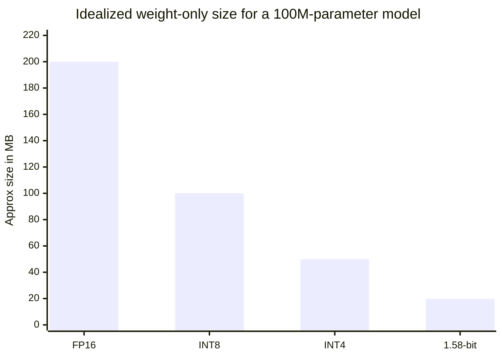
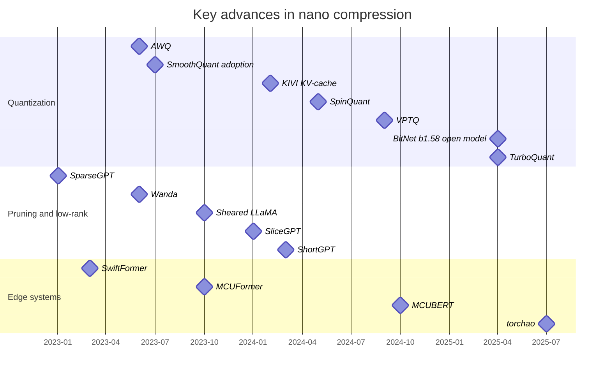

# Bleeding-Edge Nano Model Compression

## Executive summary

This report uses **“nano compression” as an operational term**, not a formal standard. In practice, it means compression pipelines aimed at models that are small enough to be deployed under severe edge constraints, especially **sub-50MB artifacts** and, in the strictest tier, **sub-10MB artifacts**. The recent literature does not converge on a single formal definition of “nano”; instead, recent surveys and systems papers organize the space by **quantization, pruning, distillation, compact architecture design, low-rank methods, and hardware-aware inference** rather than by a universal size threshold. citeturn22academia3turn23academia1turn23academia3

Across the last three years, the biggest technical shift has been from “compress after training” as a single step to **multi-stage co-design**: architecture shrinking or distillation, then weight/activation/KV quantization, then backend-aware packing and kernel selection, then runtime scheduling and cache compression. In LLMs, the frontier has moved from 8-bit linear quantization to **4-bit weight-only PTQ**, **4-bit W/A/KV schemes**, **vector quantization**, and even **native 1.58-bit training**; in small vision and speech models, the strongest practical results still come from pairing **compact students or latency-driven architectures** with **INT8 QAT/PTQ** and optionally **structured pruning**. citeturn0academia0turn2academia0turn2academia1turn2academia2turn5academia0turn6academia1turn7academia2turn32academia0turn32academia2turn33academia0

The clearest practical conclusion is this: **sub-10MB and sub-50MB deployment is very realistic for CNNs, encoder transformers, keyword spotting transformers, and task-specific students; it is usually not realistic for broadly capable decoder-only chat LLMs unless the base model is already extremely small or natively low-bit.** In a browser-first or WebAssembly-first setting, the constraint becomes even tighter: uploaded project research for TinyRustLM notes that q4 is the practical “memory-first” floor, q8 is the safer baseline, and many attractive small chat models still miss browser/runtime limits because of memory transfer ceilings, tokenizer/runtime constraints, and attention-layout incompatibilities. citeturn33academia1turn21academia0turn16academia0turn40view0turn41view1 fileciteturn0file10 fileciteturn0file13

For **ultra-small deployment**, the recommended pipeline is usually: **choose a compact student or latency-driven architecture first**, then apply **structured pruning or low-rank factorization only where the backend can exploit it**, then use **INT8 or INT4 quantization**, and finally compile for the target runtime, such as ONNX Runtime, TensorFlow Lite / LiteRT, CMSIS-NN, ExecuTorch, or a vendor NPU backend. For **mobile or edge LLMs**, the current best-practice stack is **AWQ/GPTQ-style 4-bit weights**, often combined with **KV-cache compression** and **backend-specific runtimes** rather than generic eager inference. citeturn14view0turn15view0turn17view0turn18view0turn18view1turn39view0turn39view2

## Nano compression definitions and taxonomy

A useful working definition is:

> **Nano compression** = compression strategies intended to make a model deployable under stringent footprint, latency, and power limits, typically on edge CPUs, mobile SoCs, MCUs, NPUs, or browser/WASM runtimes, with explicit artifact-size and runtime-memory targets.

That framing is consistent with how the current literature talks about edge deployment problems, even when it does not use the word “nano.” Recent surveys on LLM and transformer compression emphasize that the important distinctions are **what is compressed** and **whether the runtime can exploit the compressed structure**, not just the nominal bit-width. citeturn22academia3turn23academia1turn23academia3

```mermaid
flowchart TD
    A[Nano compression goal] --> B[Quantization]
    A --> C[Pruning]
    A --> D[Distillation]
    A --> E[Efficient architecture and NAS]
    A --> F[Low-rank factorization]
    A --> G[Weight-sharing and vector quantization]
    A --> H[Mixed precision]
    A --> I[Hardware-aware co-design]

    B --> B1[PTQ]
    B --> B2[QAT]
    B --> B3[Weight-only INT4 and INT8]
    B --> B4[W8A8 and W4A8]
    B --> B5[KV-cache quantization]
    B --> B6[Native 1.58-bit training]

    C --> C1[Unstructured sparsity]
    C --> C2[Structured layer-head-channel pruning]
    C --> C3[Semi-structured 2:4 sparsity]

    D --> D1[Teacher-student pretraining]
    D --> D2[Task-specific distillation]
    D --> D3[Pseudo-label distillation]

    E --> E1[Latency-driven architecture search]
    E --> E2[MCU-aware search]
    E --> E3[Dimension or depth slimming]

    F --> F1[SVD and rank truncation]
    F --> F2[Low-rank plus sparse residual]

    G --> G1[Codebooks]
    G --> G2[Vector quantization]
    G --> G3[Additive quantization]
```



The taxonomy below is the most useful way to reason about real deployment pipelines.

| Technique family | What is compressed | Typical gain | Main upside | Main downside | Recent exemplars |
|---|---|---|---|---|---|
| **Quantization** | Weights, activations, embeddings, KV cache | Often **2x to 8x** memory reduction depending on bit-width | Usually the fastest path to deployability | May not improve latency unless kernels/backend are optimized | AWQ, SmoothQuant, SpinQuant, KIVI, VPTQ, BitNet, TurboQuant citeturn0academia0turn2academia0turn7academia2turn6academia1turn32academia0turn5academia0turn30academia0 |
| **Pruning / sparsity** | Weights, channels, heads, layers | Parameter and FLOP reduction | Can cut both size and compute | Unstructured sparsity often gives weak real-world speedups without backend support | SparseGPT, Wanda, ShortGPT, Sheared LLaMA, torchao 2:4 citeturn2academia1turn34academia3turn33academia0turn33academia1turn12academia0turn19view0 |
| **Distillation** | Entire model function | Strong size/latency reductions with modest accuracy loss | Best route to truly tiny students | Requires teacher, training data, and training budget | Distil-Whisper, MCUBERT-style student design, compact BERT families citeturn25view0turn21academia0turn38academia0turn38academia1 |
| **Low-rank** | Dense matrices | Useful parameter and memory shrinkage | Preserves dense execution; often backend-friendly | Too much rank truncation harms function | SliceGPT, LoSparse, recent SVD variants citeturn2academia2turn28academia1 |
| **Structured sparsity** | Groups, rows, columns, channels, heads, 2:4 patterns | Modest-to-large gains if hardware supports it | More realizable latency gains than random sparsity | Search and recovery are harder | SparseGPT 2:4, torchao 2:4, Sheared LLaMA citeturn2academia1turn12academia0turn19view0turn33academia1 |
| **Weight-sharing / vector quantization** | Weight blocks replaced by codebook indices | Extreme low-bit without scalar-quantization failure | Better quality at very low bits | Decompression cost and codebook handling complicate systems | GPTVQ, VPTQ, SpQR-like hybrid formats citeturn32academia2turn32academia0turn8academia1 |
| **Mixed-precision** | Bit-width varies by layer, block, or tensor | Better size/accuracy tradeoff than uniform quantization | Preserves sensitive layers | Harder compilation and kernel selection | OWQ, FineQ, MoQAE, torchao mixed low precision citeturn0academia1turn29academia1turn29academia0turn12academia0 |
| **Hardware-aware methods** | Architecture and runtime jointly | Often the biggest realized latency/energy win | Matches real target hardware | Less portable across targets | llm.npu, QServe, MCUBERT, CMSIS-NN, LiteRT, ExecuTorch citeturn2academia3turn26academia4turn21academia0turn17view0turn18view0turn18view1 |

A useful rule of thumb for raw weight storage is simple arithmetic: **size ≈ parameters × bits / 8**, excluding metadata, codebooks, external data files, tokenizer assets, and runtime caches. That means a **100M-parameter** model is roughly **200MB at FP16**, **100MB at INT8**, **50MB at INT4**, and about **19.8MB at 1.58 bits** in an idealized weight-only representation. The catch is that actual deployable artifacts also include embeddings, scale tensors, codebooks, graph metadata, and runtime overheads, so real packages are usually larger than those bounds. citeturn4academia3turn5academia0turn41view1



The chart is arithmetic from bit budgets; it is a lower-bound intuition, not a full-package measurement. The practical reason this matters is that **sub-50MB** is reachable for many compact CNNs and encoder transformers, while **useful decoder-only LLMs** usually need either **very small base architectures** or **native low-bit training** to get anywhere near that regime. citeturn33academia1turn5academia0 fileciteturn0file10

## Recent advances and the current ecosystem

The most important LLM quantization papers in the last three years are still the backbone of the practical toolchain. **AWQ** introduced activation-aware search that protects only a small set of salient channels while keeping the runtime hardware-friendly; **SmoothQuant** showed how to migrate activation outliers into weights to make full **W8A8** practical; **SpinQuant** improved low-bit PTQ by learning rotations; **KIVI** pushed **2-bit KV-cache** quantization; **VPTQ** and **GPTVQ** advanced vector quantization for extreme low-bit regimes; and **BitNet / BitNet b1.58** made native sub-2-bit training a serious design alternative rather than just a PTQ curiosity. citeturn0academia0turn2academia0turn7academia2turn6academia1turn32academia0turn32academia2turn5academia1turn5academia0turn5academia2

On the pruning side, the major shift has been from generic magnitude pruning to **structure-aware or retraining-light pruning**. **SparseGPT** showed one-shot pruning at up to **50%+ sparsity** with minimal loss, including semi-structured patterns; **Wanda** made activation-aware no-retrain pruning simple and effective; **SliceGPT** shrank dense matrices by deleting rows and columns in a way current hardware can exploit; **ShortGPT** highlighted large layer redundancy; and **Sheared LLaMA** demonstrated that pruning an existing pretrained LLM into a smaller dense model can be drastically cheaper than training a similarly sized model from scratch. citeturn2academia1turn34academia3turn2academia2turn33academia0turn33academia1

For weight-sharing and extremely low-bit compression, the field is moving toward **vector quantization and codebook-based schemes** rather than only scalar quantization. **SpQR** combines sparse outlier handling with low-bit quantization; **GPTVQ** explicitly shows that higher-dimensional vector quantization can improve the size/accuracy frontier and even reports **mobile CPU decompression timings**; **VPTQ** pushes vector PTQ deeper into the 2-bit regime with better perplexity and throughput than prior baselines. citeturn8academia1turn32academia2turn32academia0

The runtime ecosystem has consolidated around a few high-impact OSS and vendor stacks. On the PyTorch side, **torchao** now exposes PTQ, QAT, FP8, and **2:4 sparsity**, integrates with the broader PyTorch ecosystem, and reports **INT4 Llama-3-8B** inference that is **1.89x faster with 58% less memory** than the unoptimized reference. **bitsandbytes** remains the standard gateway to **LLM.int8()** and **QLoRA/NF4** workflows. **ExecuTorch** is now the most visible open on-device pipeline in the PyTorch ecosystem for exporting LLMs to `.pte` and running them with mobile backends, including Qualcomm, Core ML, Ethos-U, and Cortex-M-class paths. citeturn11academia1turn19view0turn20view0turn4academia3turn18view1

Outside PyTorch, the most important deployment stacks are **ONNX Runtime**, **TensorFlow Lite / LiteRT**, **CMSIS-NN**, **AIMET**, and specialized edge LLM runtimes such as **TinyChat/AWQ** and **bitnet.cpp**. ONNX Runtime supports dynamic and static INT8 quantization and now also **block-wise INT4/UINT4** quantization for certain operators, including `MatMulNBits`; LiteRT/LiteRT-Micro exposes PTQ, integer quantization, float16 quantization, and GPU/NPU paths; CMSIS-NN provides bit-exact Arm Cortex-M kernels aligned to TensorFlow Lite Micro quantization contracts; AIMET exposes a mature stack including cross-layer equalization, AdaRound, SVD, channel pruning, and AutoQuant. citeturn14view0turn41view1turn15view0turn18view0turn17view0turn15view1turn39view2turn4academia0



The timeline emphasizes original papers and official systems rather than every follow-on implementation. The important pattern is that **algorithms and runtimes have converged**: papers increasingly target not just compression ratio, but **compile-time lowering, block packing, NPU offload, and edge-specific kernels**. citeturn27academia1turn35academia3turn21academia0turn11academia1turn2academia3turn26academia4

## Benchmarks and tradeoffs across tasks and hardware

Cross-paper benchmarking is still noisy. Batch size, prompt length, prefill/decode split, calibration data, energy instrumentation, and backend maturity vary widely, so the table below should be read as **best available directional evidence**, not a fully normalized leaderboard. That caveat is consistent with the compression surveys and with edge benchmark papers that explicitly separate platform effects from pure algorithm effects. citeturn22academia3turn23academia1turn7academia3turn26academia1

| Task | Model / method | Hardware | Key result | What it means |
|---|---|---|---|---|
| **NLP LLM inference** | **AWQ + TinyChat** | **Jetson Orin** | Official repo reports **38 tok/s** on Jetson Orin with new quantized kernels and **2.9x faster** than FP16 for Llama-3-8B in TinyChat examples. citeturn39view2 | Strong evidence that low-bit compression only pays off when paired with backend-specific kernels. |
| **NLP LLM inference** | **BitNet / bitnet.cpp** | **ARM CPUs and x86 CPUs** | bitnet.cpp reports **1.37x to 5.07x** speedups on ARM CPUs and **2.37x to 6.17x** on x86 CPUs for ternary inference. citeturn4academia1turn4academia0 | Native low-bit models can be more deployable than trying to PTQ dense FP16 checkpoints into ultra-low bits. |
| **NLP long-context** | **KIVI** | Server GPUs | **2.6x less peak memory** and **2.35x to 3.47x throughput** on real workloads while preserving quality. citeturn6academia1 | KV-cache compression is now a first-class deployment lever, especially at long context. |
| **NLP long-context** | **TurboQuant** | H100-class GPU | Paper reports **quality neutrality at 3.5 bits/channel** and only marginal degradation at **2.5 bits/channel**; follow-on reporting summarizes **6x+ KV-memory reduction** and **up to 8x** speedup for attention-logit computation on H100. citeturn30academia0turn30news5 | This is one of the sharpest current frontiers in memory-bound inference. |
| **Mobile NPU LLM** | **llm.npu** | Smartphone NPU | **22.4x faster prefill** and **30.7x energy savings on average**, with **1,000+ tok/s prefill** for a billion-scale model. citeturn26academia4 | Hardware-aware split execution and outlier handling can dominate raw bit-width wins. |
| **MCU NLP** | **MCUBERT** | Commodity MCUs | **5.7x / 3.0x parameter reduction**, **3.5x / 4.3x execution-memory reduction**, and **1.5x latency reduction** for BERT-tiny / BERT-mini; supports **>512 tokens with <256KB memory**. citeturn21academia0 | True MCU transformer deployment is now practical, but only with architecture and schedule co-design. |
| **Vision mobile** | **SwiftFormer-S** | iPhone 14 | **78.5%** ImageNet top-1 at **0.8 ms** latency. citeturn27academia1 | Tiny mobile transformers can beat older hybrid designs when architecture is latency-driven. |
| **Vision mobile** | **EfficientFormer-L1** | iPhone 12 | **79.2%** top-1 at **1.6 ms**. citeturn27academia0 | “Transformer at MobileNet speed” is now a real deployment point, not just a FLOP claim. |
| **Vision CPU/GPU** | **EfficientViT-M2 / M5** | Intel Xeon / V100 | **5.8x / 3.7x faster** than MobileViT-XXS on GPU/CPU for M2; M5 beats MobileNetV3-Large by **1.9% accuracy** with **40.4% / 45.2% higher throughput** on V100 / Xeon. citeturn27academia2 | Memory-efficient operator design matters as much as parameter count. |
| **Speech ASR** | **Distil-Whisper distil-small.en** | General on-device / edge settings | Model card reports **49% smaller**, **5.6x faster**, and within roughly **1% WER** on OOD evaluation sets versus Whisper teacher families; 166M parameters. citeturn25view0turn40view0 | Distillation remains one of the highest-value compression moves for speech models. |
| **Speech MCU** | **KWT-Tiny** | RISC-V embedded target | Model shrunk from **2.42 MB to 1.65 kB**, with **5x speedup** and about **5x power reduction** after retraining + quantization + custom instruction support. citeturn16academia0 | For sub-megabyte speech deployments, architecture redesign beats trying to squeeze a large teacher. |

A second practical benchmark dimension is **what the runtime stack itself supports**. ONNX Runtime documents **dynamic and static INT8** workflows and now also **block-wise weight-only INT4** for certain operators; LiteRT/LiteRT-Micro documents PTQ, integer quantization, float16 quantization, and mobile GPU/NPU paths; CMSIS-NN aligns to TensorFlow Lite Micro’s INT8/INT16 quantization specification on Cortex-M; ExecuTorch exposes export-and-run flows for mobile LLMs and multiple edge backends. citeturn14view0turn41view1turn18view0turn17view0turn18view1

For browser or WASM deployments, the runtime constraints often dominate the algorithm choice. Uploaded project research for TinyRustLM emphasizes that browser-native inference can be bottlenecked by **main-thread scalar CPU execution, full-artifact memory transfer, custom tokenizer/container assumptions, and fixed transfer ceilings**; in that environment, even nominally “small” decoder models can be poor fits, while q4/q8 tradeoffs and <200M-parameter Llama-style models become the realistic operating range. fileciteturn0file10 fileciteturn0file11 fileciteturn0file13

## End-to-end recipes and concrete examples

The recipes below are intended as **reference pipelines**. The user prompt did not specify a single base model family, dataset, acceptable accuracy loss, calibration budget, or energy-measurement protocol, so each recipe is designed to be conservative and reproducible rather than universally optimal.

### Workflow pattern


This ordering reflects the dominant lesson in current systems work: **architecture first, quantization second, kernel/backend third**. Trying to “save” an oversized or backend-misaligned model with quantization alone is usually the wrong move. citeturn23academia1turn27academia2turn26academia4turn21academia0

### Encoder transformer recipe for sub-10MB to sub-50MB

This is the most reliable current recipe for **compact NLP transformers** such as BERT-Tiny, MiniLM, TinyBERT-class students, or other small encoders.

**Why this recipe works**

ONNX Runtime documents both **dynamic and static INT8** quantization and, for eligible constant-weight operators, **block-wise weight-only INT4** quantization using `MatMulNBits` and `GatherBlockQuantized`. It explicitly recommends **symbolic shape inference** for transformer models before quantization. citeturn14view0turn41view1

**Recommended pipeline**

1. Start from a compact student or compact-pretrained encoder.  
2. Export to ONNX with fixed task head.  
3. Run ONNX pre-processing and symbolic shape inference.  
4. Use **dynamic INT8** first for CPU baselines.  
5. If matmul-heavy and operator-compatible, test **INT4 weight-only**.  
6. Benchmark not only accuracy, but also **load time**, **RSS memory**, and **P95 latency**. citeturn14view0turn41view1

```python
# export_and_quantize_bert.py
from pathlib import Path
import torch
from transformers import AutoTokenizer, AutoModelForSequenceClassification
from onnxruntime.quantization import quantize_dynamic, QuantType
from onnxruntime.quantization import matmul_4bits_quantizer, quant_utils

MODEL_ID = "prajjwal1/bert-tiny"   # replace with your compact encoder
OUT_DIR = Path("artifacts")
OUT_DIR.mkdir(exist_ok=True)

tokenizer = AutoTokenizer.from_pretrained(MODEL_ID)
model = AutoModelForSequenceClassification.from_pretrained(MODEL_ID)
model.eval()

sample = tokenizer(
    "nano compression on device",
    return_tensors="pt",
    padding="max_length",
    truncation=True,
    max_length=128,
)

onnx_fp32 = OUT_DIR / "model_fp32.onnx"
torch.onnx.export(
    model,
    args=(sample["input_ids"], sample["attention_mask"]),
    f=str(onnx_fp32),
    input_names=["input_ids", "attention_mask"],
    output_names=["logits"],
    dynamic_axes={
        "input_ids": {0: "batch", 1: "seq"},
        "attention_mask": {0: "batch", 1: "seq"},
        "logits": {0: "batch"},
    },
    opset_version=17,
)

# Safe first step: dynamic INT8 for CPU
onnx_int8 = OUT_DIR / "model_int8.onnx"
quantize_dynamic(
    model_input=str(onnx_fp32),
    model_output=str(onnx_int8),
    weight_type=QuantType.QInt8,
    per_channel=True,
)

# Optional second step: INT4 weight-only for eligible operators
quant_config = matmul_4bits_quantizer.DefaultWeightOnlyQuantConfig(
    block_size=128,
    is_symmetric=True,
    accuracy_level=4,
    quant_format=quant_utils.QuantFormat.QOperator,
    op_types_to_quantize=("MatMul", "Gather"),
    quant_axes=(("MatMul", 0), ("Gather", 1)),
)

model_with_shapes = quant_utils.load_model_with_shape_infer(onnx_fp32)
quantizer = matmul_4bits_quantizer.MatMul4BitsQuantizer(
    model_with_shapes,
    nodes_to_exclude=None,
    nodes_to_include=None,
    algo_config=quant_config,
)
quantizer.process()
quantizer.model.save_model_to_file(str(OUT_DIR / "model_int4.onnx"), True)
```

The INT4 block is adapted from the current ONNX Runtime documentation for supported operators and configuration fields. ONNX Runtime notes that these INT4 flows are **block-wise weight-only**, that `MatMulNBits` is used for the QOperator path, and that **HQQ, GPTQ, and RTN** are supported algorithms in this pathway. citeturn41view1

**Size guidance**

- A **~4M-parameter** BERT-Tiny-style encoder is roughly **~4MB** at idealized INT8 and **~2MB** at idealized INT4 before overheads.  
- A **~20M-parameter** encoder is roughly **~20MB** at INT8 and **~10MB** at INT4 before overheads.  

That is why sub-10MB encoder deployment is realistic today in a way sub-10MB general chat LLM deployment usually is not. citeturn38academia0turn41view1

A simple config file for this tier:

```yaml
model: compact_encoder
target:
  max_artifact_mb: 10
  max_p95_latency_ms: 25
  batch_size: 1
  seq_len: 128
compression:
  distill: true
  prune:
    enabled: false
  quantization:
    first_try: dynamic_int8
    fallback: weight_only_int4
    per_channel: true
runtime:
  backend: onnxruntime
  ep_preference:
    - xnnpack
    - cpu
validation:
  metrics:
    - accuracy
    - p95_latency_ms
    - peak_rss_mb
    - model_file_mb
```

### CNN recipe for sub-10MB using pruning plus INT8 QAT

For CNNs, the most reliable small-model path is still **compact backbone + QAT or PTQ**, with structured pruning only if the target backend benefits. TensorFlow Model Optimization Toolkit explicitly supports **post-training quantization, quantization-aware training, pruning, clustering, and collaborative optimization** for combining techniques. LiteRT/LiteRT-Micro then provides the deployment side for mobile, embedded, and MCU targets. citeturn15view0turn18view0

```python
# tfmot_cnn_recipe.py
import tensorflow as tf
import tensorflow_model_optimization as tfmot

base = tf.keras.applications.MobileNetV3Small(
    input_shape=(224, 224, 3),
    include_top=True,
    weights="imagenet",
    classes=1000,
)

# Optional structured-ish sparsity schedule
prune_low_magnitude = tfmot.sparsity.keras.prune_low_magnitude
pruned = prune_low_magnitude(
    base,
    pruning_schedule=tfmot.sparsity.keras.PolynomialDecay(
        initial_sparsity=0.0,
        final_sparsity=0.50,
        begin_step=2000,
        end_step=12000,
    ),
)

pruned.compile(
    optimizer=tf.keras.optimizers.Adam(1e-4),
    loss=tf.keras.losses.CategoricalCrossentropy(from_logits=False),
    metrics=["accuracy"],
)

# train / fine-tune here ...

# Strip pruning wrappers before QAT / export
stripped = tfmot.sparsity.keras.strip_pruning(pruned)

# Quantization-aware training
qat_model = tfmot.quantization.keras.quantize_model(stripped)
qat_model.compile(
    optimizer=tf.keras.optimizers.Adam(1e-5),
    loss=tf.keras.losses.CategoricalCrossentropy(from_logits=False),
    metrics=["accuracy"],
)

# short QAT fine-tune here ...

# Export fully integer TFLite
converter = tf.lite.TFLiteConverter.from_keras_model(qat_model)
converter.optimizations = [tf.lite.Optimize.DEFAULT]
converter.representative_dataset = representative_dataset  # define this
converter.target_spec.supported_ops = [tf.lite.OpsSet.TFLITE_BUILTINS_INT8]
converter.inference_input_type = tf.int8
converter.inference_output_type = tf.int8

tflite_model = converter.convert()
with open("mobilenetv3_small_qat_int8.tflite", "wb") as f:
    f.write(tflite_model)
```

**Why this is still strong in 2026**

Small CNNs remain unusually compression-friendly because the deployment toolchain is mature and hardware support is broad. LiteRT exposes **post-training integer quantization**, **float16 quantization**, **mobile GPU/NPU execution**, and **embedded/IoT** workflows; CMSIS-NN gives Arm Cortex-M implementations that track the TensorFlow Lite Micro quantization contract. citeturn18view0turn17view0

A practical size-driven config:

```yaml
model: mobilenetv3_small
target:
  max_artifact_mb: 4
  max_latency_ms: 8
  platform: android_arm
compression:
  pruning:
    final_sparsity: 0.5
  quantization:
    mode: qat_int8
  clustering:
    enabled: false
runtime:
  export: tflite
  accelerator_preference:
    - npu
    - gpu
    - cpu
validation:
  metrics:
    - top1
    - p50_latency_ms
    - p95_latency_ms
    - peak_memory_mb
    - joules_per_1000_inferences
```

### Decoder-only LLM recipe for edge devices using AWQ

This is **not** the route to sub-10MB or, in most cases, sub-50MB. It is the route to **smallest practical on-device generative models** once you accept that the artifact will often be in the **hundreds of MB** rather than tens of MB.

The official AWQ repository exposes a canonical four-step flow: **search**, **evaluate pseudo-quantized**, **generate real INT4 weights**, then **load/evaluate real quantized weights**. The same repository also documents that the system is now integrated in multiple production inference stacks and that TinyChat reaches **38 tok/s** on Jetson Orin in its updated quantized kernel path. citeturn39view0turn39view2

```bash
# Step 1: AWQ search
python -m awq.entry --model_path /PATH/TO/LLAMA3/llama3-8b \
    --w_bit 4 --q_group_size 128 \
    --run_awq --dump_awq awq_cache/llama3-8b-w4-g128.pt

# Step 2: evaluate pseudo-quantized model
python -m awq.entry --model_path /PATH/TO/LLAMA3/llama3-8b \
    --tasks wikitext \
    --w_bit 4 --q_group_size 128 \
    --load_awq awq_cache/llama3-8b-w4-g128.pt \
    --q_backend fake

# Step 3: generate real INT4 weights
mkdir -p quant_cache
python -m awq.entry --model_path /PATH/TO/LLAMA3/llama3-8b \
    --w_bit 4 --q_group_size 128 \
    --load_awq awq_cache/llama3-8b-w4-g128.pt \
    --q_backend real --dump_quant quant_cache/llama3-8b-w4-g128-awq.pt

# Step 4: load and evaluate real quantized weights
python -m awq.entry --model_path /PATH/TO/LLAMA3/llama3-8b \
    --tasks wikitext \
    --w_bit 4 --q_group_size 128 \
    --load_quant quant_cache/llama3-8b-w4-g128-awq.pt
```

This is the best current “practical edge LLM” recipe when the model is **too large for INT8** but still within a mobile or embedded GPU envelope. It is not, however, a true nano recipe by the strict <50MB definition. In browser-first work, uploaded TinyRustLM research notes that even a **160M** Llama-style chat model in q4 comes out around a **~76MiB lower-bound package scale**, which is already above the strict <50MB tier. citeturn39view0turn39view2 fileciteturn0file10

### Speech recipe for on-device ASR or KWS

There are two very different tracks:

**ASR track**: distill first, then quantize if needed.  
**MCU keyword spotting track**: redesign the architecture for the embedded budget.

For ASR, **Distil-Whisper distil-small.en** is a strong modern baseline because it is already **49% smaller**, **5.6x faster**, and still close in WER to the teacher on OOD evaluation sets. The model card also documents local operation in **whisper.cpp** and **Transformers.js**, which makes it useful for CPU-native or browser-native prototypes. citeturn25view0turn40view0

```bash
git clone https://github.com/ggerganov/whisper.cpp.git
cd whisper.cpp
python -c "from huggingface_hub import hf_hub_download; hf_hub_download(repo_id='distil-whisper/distil-small.en', filename='ggml-distil-small.en.bin', local_dir='./models')"
make -j && ./main -m models/ggml-distil-small.en.bin -f samples/jfk.wav
```

For browser inference, the same model card shows a **Transformers.js** local pipeline pattern:

```javascript
import { pipeline } from '@huggingface/transformers';

const transcriber = await pipeline(
  'automatic-speech-recognition',
  'distil-whisper/distil-small.en'
);

const output = await transcriber('audio.wav');
console.log(output.text);
```

For **ultra-small KWS**, recent evidence points in a different direction. **KWT-Tiny** shows that retraining plus quantization plus hardware acceleration can shrink a transformer KWS model from **2.42MB to 1.65kB**, with **5x speedup** and roughly **5x power reduction**, on a 64KB-RAM embedded target. That is what true nano speech deployment looks like today. citeturn16academia0

## Recommended pipelines by target size and latency

The most useful way to choose a pipeline is by **target envelope**, not by favorite algorithm.

| Target envelope | What is realistic | Recommended pipeline | Avoid |
|---|---|---|---|
| **Under 1MB, sub-50ms, MCU** | KWS, tiny vision classification, sensor models | Start with **TinyML / MCU-aware NAS** or hand-designed tiny architecture, then **INT8**, then **CMSIS-NN / LiteRT Micro**; only use pruning if the kernel library benefits. citeturn16academia0turn35academia0turn17view0turn18view0 | Generic BERT/LLM PTQ; unstructured sparsity without backend support |
| **Under 10MB, mobile CPU / embedded ARM** | Small CNNs, compact encoder transformers, lightweight KWS transformers | **Distill or compact-pretrain first**, then **INT8** with ONNX Runtime or LiteRT; test **INT4 weight-only** for matmul-heavy encoders if operator support is available. citeturn14view0turn41view1turn15view0 | Starting from a too-large teacher and hoping quantization alone will save it |
| **Under 50MB, mobile / browser** | Efficient CNNs, compact ViTs, BERT-Tiny/MiniLM/TinyBERT-class models | **Architecture search or slim student + INT8/QAT + backend tuning**; for browser/WASM, keep artifacts and tokenizer/runtime assumptions simple. citeturn27academia0turn27academia1turn27academia2 fileciteturn0file10 fileciteturn0file13 | Broadly capable chat LLMs; complex sparse formats |
| **Under 500MB, interactive on-device generation** | Small LLMs on mobile GPU/NPU or edge GPU | **AWQ/GPTQ/ONNX INT4**, optionally **KV-cache compression**, and deploy on **ExecuTorch, vLLM/TensorRT-LLM, TinyChat, llama.cpp, or vendor NPU runtimes**. citeturn39view0turn39view2turn18view1turn26academia4turn30academia0 | FP16 baseline serving; generic eager PyTorch on edge |

A simple decision rule emerges:

- If the target is **strictly nano** in the storage sense, use **distillation + compact architecture + INT8/INT4**.  
- If the target is **interactive generative AI on-device**, use **4-bit LLM compression + runtime co-design**, and accept that the result is usually **small**, not truly **nano**.  
- If the target is **browser/WASM**, design around **artifact transfer**, **tokenizer fidelity**, and **runtime/operator support** as much as around theoretical weight size. citeturn25view0turn39view2turn18view1 fileciteturn0file10 fileciteturn0file11

## Open challenges and research opportunities

The first open problem is **realized speedup versus nominal compression**. Papers routinely report strong size reductions, but real latency wins appear only when kernels, memory layout, and runtime scheduling are co-designed with the target hardware. That is why works such as **AWQ/TinyChat**, **QServe**, **llm.npu**, and **bitnet.cpp** are so important: they demonstrate that low-bit methods need to be matched to the backend, rather than treated as a purely numeric transformation. citeturn39view2turn2academia3turn26academia4turn4academia0

The second open problem is **what should be compressed next**. In long-context inference, the bottleneck has moved from just weights to **KV caches** and memory traffic. **KIVI** and **TurboQuant** show that this area has become one of the highest-value frontiers in 2024–2026, especially for batch-heavy or long-context serving. A major research opportunity is bringing those KV methods from server GPUs into mobile and browser-class deployments with stable quality and mature tooling. citeturn6academia1turn30academia0turn30news5

The third open problem is **ultra-low-bit quality retention**. Native low-bit training, such as **BitNet b1.58**, looks increasingly competitive, but it requires new training recipes and usually new kernels. PTQ at 2 bits or lower remains fragile, which is why vector quantization, codebooks, and outlier-aware formats like **VPTQ**, **GPTVQ**, and **SpQR** are attracting so much attention. A productive research direction is to unify these schemes with deployment-friendly decompression and compiler support on mobile CPUs and NPUs. citeturn5academia0turn32academia0turn32academia2turn8academia1

The fourth open problem is **faithful benchmark reporting**. Compression papers still vary too much in calibration data, task mix, prompt shape, warm-up policy, and energy methodology. Recent benchmark papers acknowledge this explicitly, and the deployment literature increasingly separates model quality from system-level behavior under thermal throttling, scheduler behavior, and backend constraints. Better shared reporting standards for **artifact size, peak RSS, prefill/decode split, energy per token, and thermal stability** would make the field much easier to compare. citeturn7academia3turn26academia1turn26academia2

The fifth open problem is **browser-native tiny model deployment**. Uploaded TinyRustLM research points to the difficulty of maintaining tokenizer identity, exact stop-token semantics, chat-template fidelity, and memory-safe artifact loading in highly constrained browser runtimes. That is a concrete research opportunity: building **verifiable, compressed, tokenizer-faithful, browser-safe nano model containers** with chunked loading, richer metadata, and truthful evaluation gates. fileciteturn0file11 fileciteturn0file12 fileciteturn0file14 fileciteturn0file16

### Open questions and limitations

Some requested details are still inherently incomplete:

- There is **no single accepted formal threshold** for “nano compression”; this report used an operational definition because the prompt did not specify one.  
- Many benchmark numbers are **not apples-to-apples**, especially for energy and latency, because source papers use different models, prompts, sequence lengths, kernels, and devices. citeturn22academia3turn26academia1
- For several OSS stacks, the **documentation is ahead of or behind some published benchmarks**. ONNX Runtime, LiteRT, ExecuTorch, and torchao expose current capabilities, but not every capability has a paired peer-reviewed mobile or MCU benchmark in the same document set. citeturn14view0turn18view0turn18view1turn19view0
- Truly useful **decoder-only chat models under 50MB** remain rare; the best evidence gathered here suggests that sub-50MB is still mostly an **encoder / TinyML / task-specific** regime rather than a general chat regime. citeturn33academia1turn21academia0turn16academia0 fileciteturn0file10