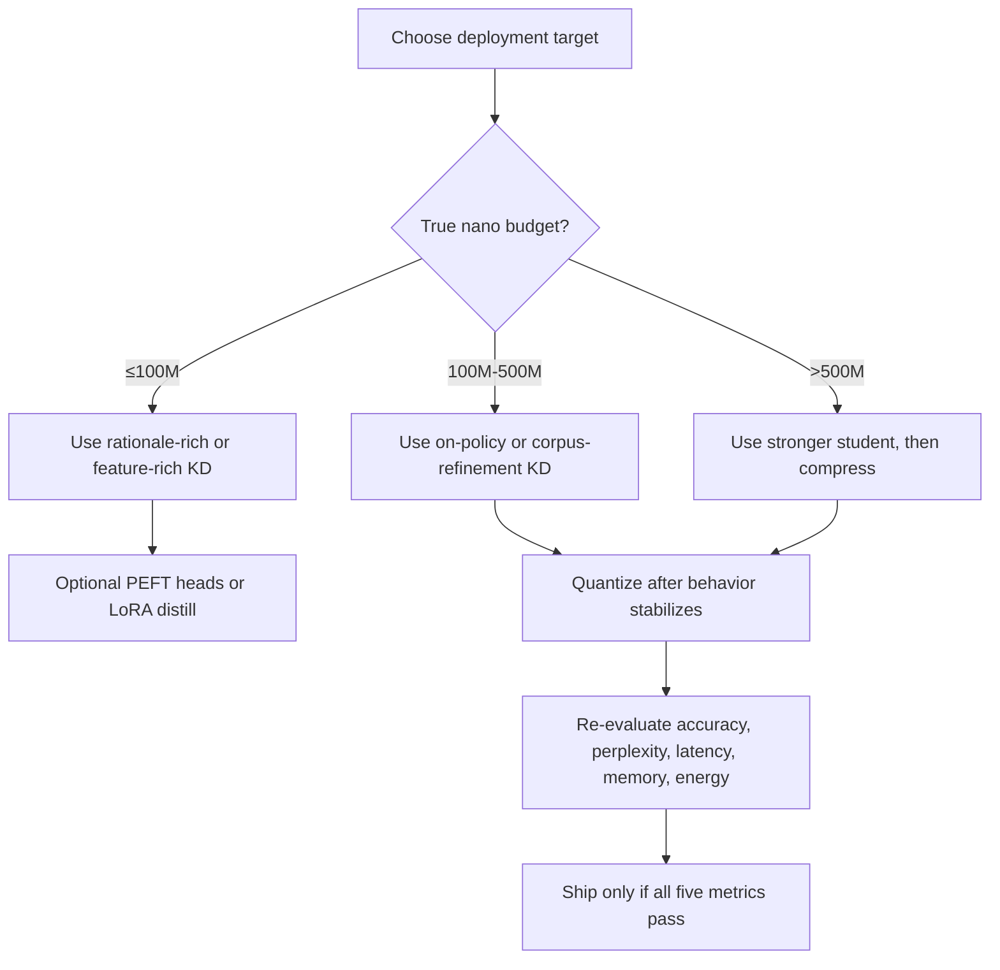

# Bleeding-Edge Nano Model Distillation

## Executive Summary

“Nano model” is not a standardized scientific label. In current research, the more common umbrella term is **small language model**, and recent surveys often scope SLMs at roughly **100M to 5B parameters**; meanwhile, industry product naming is looser and may label **~1B to ~3B on-device models** as “Nano,” as in public descriptions of Gemini Nano and edge-oriented Gemma variants. For this report, the most useful practitioner definition is a **working** one: **ultra-nano** at **≤100M parameters**, **nano** at **100M–500M**, and **edge-small** at **500M–2B**. That taxonomy better matches today’s distillation practice, where the most reproducible “true nano” successes are often in the **80M–500M** band, while many commercial on-device systems still live closer to **1B–2B**. citeturn25academia0turn25academia1turn24search5turn16search1

The strongest recent progress is no longer plain “teacher logits + cross-entropy.” The frontier since 2023 has moved toward **on-policy distillation** that lets the student learn from its own mistakes, **multi-teacher rationale distillation** for reasoning, **pre-training-data distillation** that changes the corpus rather than only the loss, **quantization-aware self-distillation** for sub-4-bit deployment, and **parameter-efficient distillation** that combines LoRA/adapter ideas with KD. These methods directly target the gaps that matter most in nano students: train–test mismatch, weak reasoning traces, tokenizer/family mismatch, and deployment-time memory ceilings. citeturn2academia2turn1academia2turn0academia1turn34view0turn8academia3turn9academia0

At the recipe level, three families stand out for practitioners. **TinyLLM** is a strong template for sub-1B reasoning students, using **multi-teacher rationales** and **teacher-forcing CoT** to train **80M, 250M, and 780M** students that beat both LoRA and full fine-tuning on six reasoning datasets. **MiniLLM** is the cleanest recipe for **white-box generative distillation** of **120M–760M** students, using **reverse KL**, **teacher-mixed sampling**, and a PPO-style on-policy loop. **MiniPLM** is the most promising pre-training recipe for nano students, because it distills by **reshaping the corpus** offline and reports benefits for **200M, 500M, and 1.2B** students, including lower pre-training compute and better cross-family transfer. For ultra-low-memory deployment, **BitDistiller** shows that **QAT + self-distillation** materially improves 3-bit and 2-bit models, though its published demonstrations are mostly above the strict nano range. citeturn42view0turn32view0turn33view1turn33view3turn34view0turn37view0turn38view0turn39view0

Practically, the best current pipeline is usually: **start with a strong open teacher**, **generate or score reasoning-rich data**, **distill into a student that is intentionally tiny**, **quantize only after the student is behaviorally good**, and then **re-evaluate with a fixed, public harness** that measures **task accuracy, perplexity, latency, memory, and energy** together. The papers and tooling increasingly agree on the need for **reproducible prompts and benchmarks** via **lm-evaluation-harness**, explicit scenario-based latency reporting in the spirit of **MLPerf**, and hardware/energy tracking with tools like **CodeCarbon**. citeturn19view0turn20view1turn23view0

## What Nano Model Means in Practice

The main definitional problem is that research and product marketing use different scales. Recent SLM surveys frame the field around **decoder-only models roughly in the 100M–5B range**, emphasizing the trade space among capability, latency, and memory. At the same time, public product descriptions place “Nano” well above that lower bound, including on-device Gemini Nano variants and edge-oriented Gemma lines. So “nano” is better understood as a **deployment intention** than a universally agreed parameter cutoff. citeturn25academia0turn25academia1turn24search5turn16search1

For practitioners, a working scope that is both analytically useful and implementation-friendly is:

| Working band | Practical meaning | Typical use cases |
|---|---|---|
| Ultra-nano | ≤100M params | mobile classifiers, small reasoning heads, local judges, edge retrieval/reranking |
| Nano | 100M–500M params | browser or CPU-only assistants, distilled reasoning students, embedded copilots |
| Edge-small | 500M–2B params | stronger on-device chat, local coding help, higher-context local agents |

That taxonomy is an inference from recent SLM surveys plus public on-device branding, not an official standard. It aligns well with the strongest examples in the literature: **80M**, **125M**, **200M**, **250M**, **340M**, and **500M** students recur frequently in successful distillation papers, while “Nano” in commercial systems often stretches into the **1B–3B** range. citeturn25academia0turn25academia1turn42view0turn32view0turn34view0turn24search5

Latency targets are similarly contextual rather than universal. For encoder-like on-device NLP, **MobileBERT** remains a useful anchor: Google reported **62 ms latency on a Pixel 4** while staying close to BERT-base accuracy on GLUE and SQuAD. For decoder-only nano students, papers increasingly report quality first and leave latency to downstream deployment studies, which is why practitioners should define latency separately for **prefill** and **decode**, measure **p50 and p95**, and evaluate at **batch size 1** before making deployment decisions. citeturn5academia1turn20view1turn17academia4

## Distillation Methods at the Frontier

The biggest methodological shift has been from **off-policy imitation of teacher outputs** toward **student-centered distillation**. **Generalized Knowledge Distillation** and later **MiniLLM** both attack exposure bias by letting the student generate trajectories and then receiving dense teacher feedback on those trajectories. In MiniLLM specifically, the core idea is to replace the usual forward KL with **reverse KL**, which is better matched to generative modeling because it discourages the student from over-allocating probability mass to low-quality tails. The paper further stabilizes training with **single-step regularization**, **teacher-mixed sampling**, **length normalization**, and a PPO-style clipped update. citeturn2academia2turn1academia2turn32view0turn33view1turn33view3

A second frontier is **reasoning distillation with rationales rather than answers alone**. **Distilling Step-by-Step** showed that rationale supervision can let a much smaller student beat a much larger prompted teacher with less labeled data, and **TinyLLM** extended that logic with a **multi-teacher** setup. TinyLLM specifically combines **multiple teacher LLMs**, an **in-context example generator**, and a **teacher-forcing chain-of-thought** strategy so the student learns both answers and explanation patterns. That matters for nano students because they do not have enough capacity to rediscover reasoning structure reliably from answers alone. citeturn16academia6turn42view0

A third frontier is **distillation during pre-training**, not only post-training. **MiniPLM** is important here because it avoids expensive online teacher inference at student training time. Instead, it uses **offline Difference Sampling** to **refine the corpus** based on disagreement between a large teacher and a small reference model, then pre-trains the student from scratch on that refined corpus. This tackles three hard problems at once: training-time compute overhead, cross-family distillation, and the tendency of small models to overfit easy/common patterns. It is one of the strongest recent ideas for building truly tiny decoder-only students from first principles. citeturn34view0

Quantization-aware distillation has also moved forward materially. **BitDistiller** combines **QAT** with **self-distillation**, using the full-precision model as teacher for its own low-bit student, and introduces **Confidence-Aware KL** plus asymmetric quantization/clipping to keep 3-bit and 2-bit models useful. Closely related work such as **L4Q** shows that fusing **LoRA-style PEFT** with **QAT** can reduce the cost of producing deployable quantized models. For nano deployment, the practical implication is simple: **distillation and quantization should be co-designed**, not run as totally separate stages. citeturn8academia3turn37view0turn38view0turn39view0turn9academia1

Other important branches are less mature but increasingly relevant. **Data-free distillation** methods such as **PromptDFD** and **DFKD-T3** aim to work when original data are unavailable, but open, reproducible decoder-only nano recipes are still scarcer here than in white-box and corpus-refinement methods. **LoRA/adapter distillation** is becoming more serious with work like **LLM-Neo** and **Budgeted LoRA**, both of which treat low-rank pathways as part of the compression/distillation design itself rather than just fine-tuning convenience. On the representation side, **MiniLMv2** and newer **Flex-KD** show that **feature-level and relation-level distillation** remain highly competitive, especially when teacher and student hidden sizes differ. Finally, **pruning + distillation** remains a strong lever: **oBERT** shows large speed and size gains for BERT-class models, while **Sheared-LLaMA** provides strong evidence that structured pruning of a larger teacher can be far cheaper than training a small model from scratch. citeturn10academia2turn10academia0turn9academia0turn9academia3turn11academia3turn1academia3turn4academia2turn3academia1



## Concrete End-to-End Examples and Recipes

### Multi-Teacher Reasoning Distillation

**TinyLLM** is one of the cleanest ultra-nano and nano reasoning recipes currently available. The student models are **FLAN-T5 small (80M)**, **base (250M)**, and **large (780M)**. The teachers are **FLAN-T5 xlarge (3B)** and **LLaMA 2-chat (7B)**. The training data covers six reasoning datasets spanning commonsense and biomedical reasoning: **OpenBookQA, ARC, PIQA, RiddleSense, PubMedQA, and BioASQ**. The training recipe uses **multi-task instruction tuning** over both answers and teacher rationales, with **batch size 16**, **max input length 1024**, and **1 epoch**; the paper says it explores task weights over **{0.01, 0.1, 0.5, 1, 2, 3}** and ran on **four NVIDIA Tesla H100 GPUs**. On aggregate accuracy, TinyLLM beats both LoRA and full fine-tuning across all three student sizes, and the **250M** and **780M** students even surpass the teacher averages reported in the paper. citeturn42view0

A practical recipe adapted from TinyLLM looks like this. Start with a reasoning dataset where answers are verifiable. For each example, sample one to a few in-context examples from the same dataset, then prompt several teachers to produce **rationales conditioned on the correct answer** rather than zero-shot free-form CoT. Train the student with one answer-generation task plus one rationale-generation task per teacher, each with its own prefix or task token. At inference time, the student does **not** need the teachers’ rationales anymore; the rationale supervision was used only during training. This is especially attractive when the deployed student must stay very small. citeturn42view0

### White-Box Generative Distillation

**MiniLLM** is the strongest simple recipe for compressing a generative teacher into a much smaller decoder-only student. The paper reports teacher–student pairs including **GPT-2-1.5B → GPT-2 125M / 340M / 760M**, **GPT-J 6B → GPT-2 760M / 1.5B / GPT-Neo 2.7B**, and **OPT-13B → OPT 1.3B / 2.7B / 6.7B**. Training uses **databricks-dolly-15k** for instruction tuning, with **14K train / 500 validation / 500 test**, plus **OpenWebText** or **the RoBERTa training corpus** for the auxiliary language-modeling loss. The published training details include a **3-epoch SFT warm start**, then MiniLLM training at **learning rate 5e-6**, **4 inner epochs**, **PPO clip 0.2**, **temperature 1**, **max length 512**, and **up to 5000 steps**; the experiments were run on **NVIDIA V100 32G GPUs**, although the exact GPU count is not stated in the surfaced excerpt. citeturn32view0turn33view1turn33view3

For practitioners, the core implementation lesson is to train against the **student’s own rollouts**, not only teacher-generated sequences. That is what makes MiniLLM meaningfully different from ordinary sequence-level KD. In small students, this directly reduces the train–test mismatch that otherwise shows up as repetitive, low-confidence, or over-dispersed generation. The paper also reports a teacher-mix-in mechanism and shows that a mix strength around **0.1** is generally robust across model families and sizes. citeturn32view0turn33view4

### Corpus-Refinement Distillation for Pre-Training

**MiniPLM** is the most interesting recipe if the goal is not just a fine-tuned mini-assistant but a better **foundation nano model**. The setup uses a **1.8B teacher** and students at **200M, 500M, and 1.2B**, and it proposes **Difference Sampling**, which rescores the pre-training corpus using both a large teacher and a small reference LM. The refined corpus then feeds standard pre-training from scratch. Critically, this is done **offline**, so the student training loop is not slowed by continual teacher inference; the paper emphasizes that this enables distillation across model families and reports improvements on **nine downstream tasks**, better language-modeling behavior, and a **2.4× reduction in effective data demand**. citeturn34view0

This recipe is especially relevant if you want a **100M–500M decoder-only student** that will later be instruction-tuned on many domains. The practical implementation is: choose a strong teacher, choose a smaller reference model that approximates your target scale, score the corpus by teacher–reference preference gaps, upweight hard/valuable examples, downweight overly easy/common sequences, and filter noisy/harmful ones. Then pre-train the student on the refined corpus exactly as you would pre-train any small LM. Architecturally, that is much easier to maintain than a permanently teacher-coupled online KD system. citeturn34view0

### QAT Plus Distillation for Extreme Compression

**BitDistiller** is the strongest concrete example of **quantization-aware distillation** in the recent literature. It is not a pure nano-parameter example—the main demonstrations span **3B to 34B** models and LLaMA-2 **7B/13B**—but it is still highly relevant because the technique transfers directly to nano students after architecture shrinkage. The recipe uses **group-wise 3-bit and 2-bit quantization**, **group size 128** by default (or **64** for 3B models), **asymmetric clipping** at initialization, **self-distillation** from the full-precision model, **AdamW with zero weight decay**, a **constant learning rate of 8e-6**, and sequence length **1024** for code tasks and **512** otherwise. Training data includes **Alpaca + WikiText-2** for general language, **Evol-Instruct-Code** for code, and **MetaMathQA** for math; teacher outputs are sampled at **temperature 0.7**. citeturn37view0turn38view0turn39view0

The reason this matters for nano work is that very small students are often deployed at **INT8 or 4-bit**, and some use cases demand even more compression. BitDistiller’s results show materially better perplexity and reasoning performance than prior PTQ and QAT baselines at **2-bit and 3-bit**, which strongly suggests that “distill first, quantize later” is no longer the only sensible sequence. In many cases, **distill while quantization is in the loop** is the better recipe. citeturn37view0turn38view0turn39view0

### A Minimal Practitioner Code Skeleton

A practical training loop for nano distillation usually combines a hard-label objective with a soft teacher objective and, optionally, a feature loss:

```python
# PyTorch-style sketch for KD on a tiny student
student.train()
teacher.eval()

for batch in loader:
    input_ids = batch["input_ids"].to(device)
    labels = batch["labels"].to(device)

    with torch.no_grad():
        t_out = teacher(input_ids=input_ids)

    s_out = student(input_ids=input_ids, labels=labels)

    # hard-label loss
    ce = s_out.loss

    # soft-label KD
    T = 2.0
    t_log_probs = torch.log_softmax(t_out.logits / T, dim=-1)
    s_log_probs = torch.log_softmax(s_out.logits / T, dim=-1)
    kd = torch.nn.functional.kl_div(
        s_log_probs, t_log_probs.exp(), reduction="batchmean"
    ) * (T * T)

    # optional hidden-state or attention loss
    loss = 0.5 * ce + 0.5 * kd

    optimizer.zero_grad(set_to_none=True)
    loss.backward()
    optimizer.step()
```

For **TinyLLM-style** training, replace the plain label-only batches with `(question, answer, rationale_from_teacher_i)` tasks and add a task prefix per teacher. For **MiniLLM/GKD-style** training, replace the static teacher pass with **student-generated sequences** that are rescored by the teacher. For **BitDistiller-style** workflows, quantize the forward pass and keep the full-precision weights as the optimization source. These adaptations are directly aligned with the published methods above. citeturn42view0turn32view0turn37view0

## Evaluation and Reproducibility

A nano distillation result is not credible if it reports only one quality metric. At minimum, practitioners should measure **task quality**, **language modeling quality**, **latency**, **memory**, and **energy**. For language modeling, **perplexity** on a held-out corpus such as **WikiText-2** remains standard. For task accuracy, recent distillation papers use combinations of **MMLU, PIQA, HellaSwag, WinoGrande, ARC, GSM8K, HumanEval**, and task-specific QA datasets. The literature increasingly mixes both broad and specialized tasks because tiny students can otherwise overfit a single narrow benchmark. citeturn38view0turn39view0turn42view0turn25academia0

For reproducible benchmarking, **EleutherAI’s lm-evaluation-harness** is the most practical common denominator. Its README emphasizes a unified framework for generative language model evaluation, support for dozens of academic benchmarks, local and adapter evaluation, and public prompts for reproducibility and cross-paper comparability. That makes it the right default for comparing a newly distilled student against open baselines. citeturn19view0

Latency and throughput should be measured with the same rigor. **MLPerf Inference** is useful here mainly as a methodology reference: it separates scenarios, defines latency constraints and throughput metrics, and also specifies **power/energy** reporting based on measured wall power in benchmark runs. Even if you are not submitting to MLPerf, its framing is a good template: report **scenario**, **batch size**, **sequence lengths**, **warm-up policy**, **p50/p95 latency**, and **throughput** separately. citeturn20view1

For local energy and carbon tracking during training or evaluation, **CodeCarbon** is a lightweight standard tool. Its project documentation states that it estimates hardware electricity consumption from **CPU, GPU, and RAM**, maps that to regional carbon intensity, and offers both Python and CLI workflows. For nano-model comparisons, this is especially useful because two students with similar accuracy can differ sharply in deployment energy once quantization and architecture are taken into account. citeturn23view0

A simple, reproducible evaluation workflow therefore looks like this:

```bash
# benchmark quality
python -m lm_eval \
  --model hf \
  --model_args pretrained=YOUR_STUDENT_MODEL \
  --tasks mmlu,piqa,hellaswag,arc_easy \
  --batch_size 8 \
  --output_path results.json

# benchmark energy for a local run
codecarbon monitor --no-api -- python run_eval.py
```

That should be paired with a fixed inference script that reports **tokens/s**, **peak memory**, **prompt length**, **generated length**, and **quantization format**. The important point is not the exact toolchain, but that the protocol be public, stable, and repeatable. citeturn19view0turn23view0turn20view1

## Comparative Table of Distilled Nano and Near-Nano Examples

| Model name | Teacher | Student size | Method | Dataset | Hyperparams | Compute | Eval metrics | Repo/link |
|---|---|---:|---|---|---|---|---|---|
| TinyLLM-80M | FLAN-T5 xlarge 3B + LLaMA 2-chat 7B | 80M | Multi-teacher rationale KD; teacher-forcing CoT; multi-task instruction tuning | OBQA, ARC, PIQA, RiddleSense, PubMedQA, BioASQ | Batch 16; max len 1024; 1 epoch; task weights searched over `{0.01,0.1,0.5,1,2,3}` | 4× NVIDIA Tesla H100 | Accuracy over 6 datasets; total score 54.27 vs 48.21 for full FT | Paper + repo citeturn42view0 |
| TinyLLM-250M | FLAN-T5 xlarge 3B + LLaMA 2-chat 7B | 250M | Same as above | Same as above | Same surfaced settings as above | 4× NVIDIA Tesla H100 | Total score 64.94; beats both teachers in paper average | Paper + repo citeturn42view0 |
| MiniLLM GPT-2 student | GPT-2-1.5B | 125M / 340M / 760M | Reverse-KL white-box KD; on-policy rollouts; teacher-mixed sampling; PPO-style clipped update | Dolly-15K split; OpenWebText auxiliary LM loss | SFT warm start 3 epochs; KD LR 5e-6; 4 inner epochs; clip 0.2; temp 1; max len 512; up to 5000 steps | NVIDIA V100 32G GPUs; exact count not surfaced | GPT-4 feedback, Rouge-L, human judgment; lower exposure bias and better long-text performance | Paper + repo citeturn32view0turn33view1turn33view3 |
| MiniPLM student | 1.8B LM teacher + small reference LM | 200M / 500M / 1.2B | Offline corpus-refinement KD via Difference Sampling | Large pre-training corpus; 9 downstream tasks for eval | Offline teacher inference; corpus reweighting by teacher/reference disagreement; exact training hparams not fully surfaced in excerpt | Reported lower pre-train compute and 2.4× lower effective data demand | Zero-shot performance on 9 tasks; improved LM capability | Paper + repo citeturn34view0 |
| Distilling Step-by-Step T5 student | PaLM 540B | 770M | Rationale distillation with multi-task supervision | 4 NLP benchmarks | Uses teacher rationales and far less labeled/unlabeled data than standard finetuning or label-only distillation; full hyperparams not surfaced here | Not fully surfaced in abstract excerpt | Paper reports the 770M student outperforming few-shot PaLM on a benchmark using 80% of the data | Paper + repo citeturn16academia6 |
| BitDistiller-derived low-bit student | Full-precision same-model teacher | 3B / 7B / 13B / 34B | QAT + self-distillation; CAKLD; asymmetric clipping/quantization | Alpaca + WikiText-2; Evol-Instruct-Code; MetaMathQA | 3-bit/2-bit group-wise quantization; g128 default, g64 for 3B; LR 8e-6; seq len 1024 code / 512 others; AdamW no WD; teacher output temp 0.7 | DeepSpeed + HF stack; supports models up to 34B | PPL, MMLU, PIQA, HellaSwag, WinoGrande, ARC, HumanEval, GSM8K | Paper + repo citeturn37view0turn38view0turn39view0 |

## Best Practices, Open Challenges, and Recommended Pipelines

The best current practice is to choose the pipeline by failure mode, not by fashion. If the student mainly fails on **reasoning**, use **rationale supervision** and preferably **multiple teachers**. If it fails on **free-form generation stability**, use **on-policy / reverse-KL distillation**. If you are building a new tiny foundation model rather than a task head, use **corpus-refinement pre-training KD**. If the deployment budget is the core bottleneck, add **quantization-aware distillation** instead of treating quantization as an afterthought. These recommendations follow directly from what the strongest recent papers actually improved. citeturn42view0turn32view0turn34view0turn37view0

A strong practitioner pipeline for a **true nano student** usually looks like this:

1. **Pick a teacher that is much better than your target student on the exact downstream behavior you care about.** White-box open teachers are preferable when possible because they allow logit- and feature-level KD. citeturn1academia1turn32view0  
2. **Fix the deployment budget first.** Decide whether your real target is ≤100M, 100M–500M, or “edge-small.” This determines architecture, sequence length, and whether aggressive QAT is mandatory. citeturn25academia0turn25academia1  
3. **Use high-quality supervision, not only answers.** For reasoning tasks, produce verified rationales or teacher-forced explanations; for generic generation, prefer on-policy teacher rescoring. citeturn42view0turn32view0turn2academia2  
4. **Keep the student architecture simple and hardware-friendly.** Shrinking depth/width is often more deployment-friendly than exotic modules unless the deployment target explicitly benefits from them. Older but still relevant mobile work like MobileBERT is evidence that architecture matters as much as the loss. citeturn5academia1  
5. **Quantize with the student in the loop.** Especially for 4-bit and below, do not assume PTQ will preserve the behavior you just distilled. citeturn37view0turn38view0turn9academia1  
6. **Evaluate with public prompts and full systems metrics.** Use lm-eval-harness for quality, MLPerf-style scenario discipline for latency, and CodeCarbon or wall-power tooling for energy. citeturn19view0turn20view1turn23view0

The biggest open challenge is that **nano-model quality often becomes data quality–limited before it becomes optimizer-limited**. Tiny students are highly sensitive to noisy synthetic data, teacher bias, and recursive-training collapse. The MiniPLM paper explicitly tries to solve this by reshaping the corpus, and the model-collapse literature is a warning that indiscriminate synthetic data reuse will become more dangerous as more web text is machine-generated. citeturn34view0turn44view0

A second open challenge is that the field still lacks a widely accepted **distillation scaling law for nano students**. We know that on-policy KD, rationale supervision, and corpus refinement help, but the literature is not yet unified on when the best extra dollar goes to a bigger teacher, a better corpus, more rollouts, longer rationales, or integrated QAT. Recent surveys of LLM KD and on-policy distillation both identify exactly this fragmentation as a central unresolved problem. citeturn1academia1turn2academia3

A third challenge is **cross-family transfer under tokenizer and hidden-size mismatch**. MiniPLM explicitly highlights cross-family flexibility, and new work like Flex-KD and LoRA-based distillation is attacking the same problem from different angles. But this is still one of the least “solved” parts of nano distillation—especially if you want a tiny student architecture that is not a scaled-down clone of the teacher. citeturn34view0turn1academia3turn9academia0

## Open Questions and Limitations

Some otherwise relevant examples are still not fully reproducible from the publicly surfaced snippets alone. In particular, several papers expose the headline methods and results more clearly than the full per-run hyperparameter grid, exact GPU counts, or full data compositions in the lines available here. I have therefore prioritized **high-confidence examples** where the method, sizes, datasets, and at least some training details are explicit, and I have labeled partially surfaced fields as such rather than guessing. citeturn42view0turn32view0turn34view0turn37view0

The term **“nano”** itself remains a working taxonomy in this report rather than a community standard. The literature is much more consistent about **small language models** than about **nano models**, and industry branding often stretches the label far beyond what practitioners would consider “tiny.” That ambiguity is real, and any procurement or deployment decision should therefore pin the budget in concrete terms: parameters, quantization format, peak memory, and latency target. citeturn25academia0turn25academia1turn24search5turn16search1