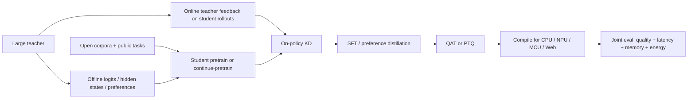

# Distilling and Using Nano Models

## Executive summary

“Nano models” do not yet have a single community-standard definition. The literature instead clusters around adjacent bands: TinyML models that run in kilobytes-to-megabytes of memory on microcontrollers, “tiny language models” below about 10 million parameters, and mobile/on-device language models in the roughly 100M–500M range, with many recent papers treating “sub-billion” as the practical on-device frontier. For this report, I use an **operational definition**: **MCU-class nano models** are typically **up to about 10M parameters** and roughly **10^6–10^8 MACs per inference**; **edge/mobile nano language models** are typically **about 10M–500M parameters**, usually quantized, and designed so that **memory footprint, latency, and energy remain compatible with phones, laptops, browsers, or compact accelerators**. Under that definition, TinyStories-scale models, SmolLM2-135M/360M, and MobileLLM-125M/350M are “nano”; models beyond about 1B parameters are better described as “small” rather than “nano.” This is an inference-based taxonomy, but it matches the regimes targeted by TinyStories, TinyML frameworks, MobileLLM, and recent small-model releases. citeturn20academia0turn12academia0turn19academia0turn22view1turn31academia1

The strongest current research trend is that **distillation is no longer just “soft-label KL”**. The frontier now mixes **token-level KD**, **layer/representation matching**, **on-policy distillation** that trains on student-generated trajectories, **cross-tokenizer distillation**, **quantization-aware distillation**, and **pruning-plus-recovery / pruning-plus-distillation**. In practice, the best nano-model pipelines are increasingly **multi-stage**: pretrain or continue-pretrain a small backbone; distill logits and selected hidden states from a stronger teacher; instruction-tune with synthetic or mixed supervision; optionally add preference-level distillation; then finish with quantization-aware training or hardware-aware PTQ/QAT. Representative recent papers include MiniLM/MiniLMv2, MobileBERT, CoFi, ZeroQuant, MiniLLM, GKD, DPKD, AlignDistil, Cross-Tokenizer Distillation, LLM-QAT, and MobileLLM-Flash. citeturn3academia2turn3academia1turn1academia0turn1academia1turn8academia0turn4academia2turn41academia0turn0academia0turn10academia2turn41academia2turn32academia1turn19academia1

The deployment story is equally clear. If the target is a **CPU or browser**, success depends on **SIMD/WebAssembly SIMD, weight packing, operator fusion, and aggressive quantization**; if the target is a **mobile NPU**, success depends on **static-shape-friendly graphs, backend-supported ops, and hardware-in-the-loop architecture search**; if the target is a **microcontroller**, the model must be designed around **arena allocation, int8/int16 kernels, tight SRAM limits, and simple operator sets**, typically using LiteRT for Microcontrollers and CMSIS-NN. Open deployment stacks that matter in practice now include **ExecuTorch**, **ONNX Runtime Mobile/Web**, **TensorFlow Lite Micro**, **XNNPACK**, **CMSIS-NN**, **TVM**, **IREE**, **MLC-LLM**, **llama.cpp**, and quantization toolchains such as **bitsandbytes**, **AWQ**, **GPTQ**, and **HQQ**. citeturn15view0turn13view0turn36view0turn37view1turn36view2turn13view6turn13view5turn38view0turn13view7turn29view0turn37view2turn37view3turn29view3

The main practical recommendation is this: for a serious 2026 nano-model program, do **not** choose between distillation, pruning, and quantization. Use them together in a **hardware-first, evaluation-heavy loop**. Start with a student architecture sized for the device, distill from a teacher using **token-level KL plus selective hidden-state losses**, add **on-policy distillation** for generative stability, run **QAT or carefully calibrated 4-bit/8-bit PTQ**, and benchmark not only accuracy but also **TTFT, decode tokens/s, peak RSS, joules/token, and compile/load time**. For browser-first runtimes specifically, your uploaded notes are directionally aligned with the public ecosystem: they emphasize fail-closed metadata, low-copy packaging, explicit memory planning, and browser/WASM constraints that closely mirror what ORT Web, MLC-LLM, and XNNPACK-compatible deployments reward in practice. citeturn41academia0turn32academia1turn39academia1turn39academia0turn28view0turn15view0turn38view0turn37view1 fileciteturn0file12 fileciteturn0file15

## Definitions and scope

The term **nano model** is used inconsistently across research. TinyML work focuses on models that fit microcontrollers and often stresses **few-kilobyte to low-megabyte memory footprints**, while TinyStories demonstrates coherent English generation below **10M parameters**, and mobile LLM papers frame **sub-billion** models as deployable on devices. Recent open releases reinforce this continuum: SmolLM2 has **135M, 360M, and 1.7B** variants, while MobileLLM explicitly studies **125M and 350M** models for on-device use. citeturn36view0turn20academia0turn22view1turn19academia0

For analytical clarity, this report uses three bands. **MCU-class nano**: up to roughly **10M parameters**, designed for few-kilobyte to few-megabyte memory environments, usually int8/int16, and evaluated with TinyML-style latency/energy protocols. **Edge/mobile nano**: about **10M–500M parameters**, typically Transformer-based, usually quantized, and intended for CPUs, mobile GPUs/NPUs, or browser runtimes. **Small-but-not-nano**: roughly **0.5B–2B+**, which are still edge-usable in some settings but usually no longer fit the strongest nano constraints. The parameter thresholds are partly inferential rather than standard-setting, but they are directly motivated by the regimes emphasized by TinyStories, Tiny language models, MobileLLM, and SmolLM2. citeturn36view0turn20academia0turn31academia1turn19academia0turn22view1

The motivating use cases are stable across sources: **low latency**, **privacy / keeping data on-device**, **reduced cloud cost**, **robustness when connectivity is poor**, and **energy-constrained inference**. TinyML papers frame these needs around embedded intelligence and ultra-low-power systems; mobile LLM papers frame them around user experience and cloud cost; distillation papers frame them around turning expensive teachers into deployable students. citeturn36view0turn12academia0turn26academia3turn19academia0turn39academia1

A useful mental model is that nano-model design is a **three-way optimization problem** over **capability**, **inference efficiency**, and **deployment fit**. Distillation and compression matter because these three objectives do not line up automatically: a model can be small in parameters but still be slow because of KV-cache pressure, unsupported operators, or hardware-unfriendly sparsity; conversely, a model can be fast after quantization but lose instruction-following quality or calibration. That is why recent papers increasingly treat architecture search, distillation, and hardware-aware optimization as a single loop rather than separate steps. citeturn19academia0turn19academia1turn33academia3turn34academia1turn12academia5

The emerging philosophy shown above is exactly what the current literature rewards: **offline KD for scale**, **on-policy KD for generative behavior**, **post-training preference alignment**, and **hardware-aware compression** before deployment. citeturn4academia2turn41academia0turn0academia0turn10academia2turn32academia1turn39academia1

## Distillation techniques

### Standard knowledge distillation

The canonical objective minimizes divergence between teacher and student output distributions, usually with temperature scaling:
\[
\mathcal{L}_{KD} = \alpha \tau^2 \, \mathrm{KL}\!\left(\sigma(z_t/\tau)\,\|\,\sigma(z_s/\tau)\right) + (1-\alpha)\,\mathcal{L}_{task}.
\]
For classifiers, \(\mathcal{L}_{task}\) is often cross-entropy on labels; for language models, it is next-token loss. In modern LLM work, standard forward-KL is no longer the only default: MiniLLM, AKL, and DPKD all argue that the objective should better reflect generation dynamics and teacher preference information. citeturn3academia0turn4academia2turn0academia3turn0academia0

The main advantage is simplicity and broad applicability. The main weakness is that pure offline KD trains on trajectories the **teacher** likes, whereas at inference the system must cope with trajectories the **student** itself generates; this exposure-bias mismatch is especially painful for generative nano models. Data requirements are usually **moderate to high** because output-level KD works best with large unlabeled or synthetic corpora. Training cost is also moderate because the teacher must either run online or be cached offline. citeturn41academia0turn4academia2turn4academia3

Representative papers from the requested window are **MobileBERT** for compact on-device transfer, **MiniLM/MiniLMv2** for Transformer-aware distillation, **MiniLLM** for generative reverse-KL-style distillation, **AKL** for adaptive KL mixing, and **DPKD** for preference-aware KD. citeturn1academia0turn3academia2turn3academia1turn4academia2turn0academia3turn0academia0

### Teacher-student architecture distillation

Teacher-student distillation becomes architecture-aware when the student is designed jointly with the transfer method. A typical formulation adds feature matching between mapped teacher and student layers:
\[
\mathcal{L}_{feat}=\sum_l \lambda_l \left\|P_l h_t^{m(l)} - h_s^{(l)}\right\|_2^2,
\]
where \(m(l)\) maps teacher layers to student layers and \(P_l\) is an optional projector. MobileBERT is a clean example: it trains a specialized teacher with inverted bottlenecks and then distills into a thin student intended for mobile devices. MiniLM also shows that a **teacher assistant** can reduce the architecture gap when teacher and student capacities differ sharply. citeturn1academia0turn3academia2

The benefit is high accuracy retention at a fixed parameter budget, particularly when the student is “deep and thin” and the teacher is adapted to that geometry. The drawback is engineering complexity: architecture-aware KD is less plug-and-play than output-only KD, and hidden-state projector design can become brittle when tokenizers, widths, or attention-head layouts differ. Data needs remain similar to standard KD, but total training cost rises because feature tensors are larger than logits and require careful layer mapping. citeturn1academia0turn3academia1turn4academia0

Representative papers are **MobileBERT**, **MiniLM**, **MiniLMv2**, and the more recent **Flex-KD**, which removes the assumption that teacher and student hidden sizes must match directly. citeturn1academia0turn3academia2turn3academia1turn4academia0

### Layer-wise and token-level distillation

Layer-wise distillation asks the student to match internal structure, not just final outputs. TinyBERT and MiniLMv2 are archetypal: they distill embeddings, hidden states, attention maps, or self-attention relations, often over selected teacher layers. Token-level distillation is especially important for autoregressive models:
\[
\mathcal{L}_{tok} = \sum_{i=1}^{T} \mathrm{KL}\!\left(p_t(y_i \mid y_{<i}) \,\|\, p_s(y_i \mid y_{<i})\right).
\]
Recent work pushes this further: AlignDistil treats alignment as adaptive policy distillation at token granularity, while Delta-KD and multi-granularity semantic revision add corrective structure at token, span, and sequence levels. citeturn3academia0turn3academia1turn10academia2turn10academia1turn10academia3

This family is usually the **best quality-preserving choice** for nano students because small models need help learning both **what** to predict and **how** the teacher organizes information internally. The cost is training complexity and memory: hidden-state matching requires more I/O than top-k logit KD, and token-level sequence losses are expensive on long contexts. In practice, this is the right default for **100M–500M generative students**. citeturn3academia0turn3academia1turn4academia2turn10academia2

Representative papers are **TinyBERT**, **MiniLM**, **MiniLMv2**, **MiniLLM**, **AlignDistil**, **Delta-KD**, and **Multi-Granularity Semantic Revision**. citeturn3academia0turn3academia2turn3academia1turn4academia2turn10academia2turn10academia1turn10academia3

### Contrastive and representation distillation

Contrastive distillation replaces or augments KL with a representation objective; the student is trained to stay close to the paired teacher representation while remaining far from negatives. A standard form is InfoNCE:
\[
\mathcal{L}_{con} = -\log \frac{\exp(\mathrm{sim}(h_s,h_t^+)/\tau)}
{\exp(\mathrm{sim}(h_s,h_t^+)/\tau)+\sum_j \exp(\mathrm{sim}(h_s,h_{t,j}^-)/\tau)}.
\]
WCoRD and related methods show that contrastive transfer can preserve structure that logit KD misses, especially across heterogeneous architectures. In language-model distillation, this idea increasingly appears implicitly through relation or feature-subspace matching rather than classical batch-contrastive setups. citeturn9academia0turn9academia2turn4academia0

The strength of contrastive KD is that it often improves **representation quality and robustness**, especially when teacher/student architectures differ. The downside is compute and memory overhead from negatives and projector heads, which can be nontrivial when the student is already tiny. For nano-model programs, contrastive losses are usually most useful as a **small auxiliary term**, not the whole objective. citeturn9academia0turn9academia2turn9academia3

Representative papers are **WCoRD** and the 2024–2025 line of heterogeneous and multi-scale contrastive KD methods; in LLM practice, related benefits are often recovered through representation-level methods like **Flex-KD** or relation distillation rather than pure contrastive pipelines. citeturn9academia0turn9academia2turn9academia3turn4academia0

### Quantization-aware distillation

Quantization-aware distillation introduces fake quantization during training so that the student learns under deployment-time precision constraints:
\[
\mathcal{L}_{QAD} = \mathcal{L}_{task}\big(q_\phi(\theta_s)\big) + \beta\,\mathcal{L}_{KD}\big(q_\phi(\theta_s), \theta_t\big),
\]
where \(q_\phi\) represents the quantizer or fake-quant operator. For Transformers, this is especially valuable below 8 bits, where naive PTQ often collapses quality. **Teacher Intervention** stabilizes ultra-low-precision Transformer QAT with teacher-guided signal replacement, and **LLM-QAT** uses data-free teacher generations to preserve output distributions while quantizing weights, activations, and even the KV cache. **ZeroQuant** adds affordable layer-by-layer KD for data-limited Transformer quantization. citeturn7academia3turn32academia1turn8academia0

The strength is obvious: among all compression tools, this is the one most directly tied to **actual latency, memory, and energy wins** on target hardware. The limitation is retraining cost and backend dependence. QAT is more expensive than PTQ, and the “best” quantization format depends on the target runtime. Data needs can be low if teacher generations or layerwise reconstruction are used, but compute is still meaningful because QAT loops are slower than pure KD or PTQ calibration. citeturn32academia1turn7academia3turn39academia3turn39academia1

Representative papers are **Teacher Intervention**, **ZeroQuant**, **LLM-QAT**, and adjacent deployment-focused quantization work such as **SmoothQuant**, **AWQ**, and **GPTQ**. citeturn7academia3turn8academia0turn32academia1turn39academia3turn39academia1turn39academia0

### Pruning plus distillation

Pruning compresses by removing weights, channels, heads, or layers; distillation is then used to recover behavior. A generic objective is:
\[
\mathcal{L}=\mathcal{L}_{task} + \alpha\,\mathcal{L}_{KD}\!\left(f_{\theta_t}(x), f_{m\odot\theta_s}(x)\right) + \gamma\,\Omega(m),
\]
where \(m\) is a structured or unstructured mask and \(\Omega\) penalizes complexity. **CoFi** combines coarse- and fine-grained structured pruning with layerwise distillation; **Sheared LLaMA** uses targeted structured pruning plus continued training to create smaller models from larger ones at far lower cost than full retraining. SliceGPT and ShortGPT, while not always paired with explicit KD, show the same frontier logic: compression must be **structure-aware** if it is to produce measurable speedups. citeturn1academia1turn33academia3turn34academia1turn34academia0

The gain is that pruning can reduce **both** parameters and decode cost when the sparsity or slicing matches hardware capabilities. The risk is “paper sparsity” that does not convert into real speed. Unstructured pruning often looks good analytically but disappoints in deployment, while structured pruning gives better realized gains but is harder to optimize without quality loss. Data requirements can be lower than pure KD in some setups; compute ranges from low for one-shot approaches to moderate/high for prune-and-recover pipelines. citeturn1academia1turn33academia0turn33academia1turn33academia3turn34academia1

Representative papers are **CoFi**, **Sheared LLaMA**, **SparseGPT**, **Wanda**, **SliceGPT**, and recent efficiency-focused variants such as **HWPQ** and **Wanda++**. citeturn1academia1turn33academia3turn33academia0turn33academia1turn34academia1turn32academia0turn33academia2

### Data-free distillation

Data-free KD replaces original training data with synthetic inputs or teacher-generated continuations. In classifier settings, a generator is trained to produce inputs that expose teacher behavior:
\[
\min_{\theta_s}\mathbb{E}_{\hat{x}\sim G}\left[\mathrm{KL}(p_t(\hat{x})\|p_s(\hat{x}))\right], \qquad
\max_G \; \mathcal{D}(p_t(\hat{x}),p_s(\hat{x})) + R(G).
\]
For LLMs, **LLM-QAT** offers an important bridge: it uses the teacher’s own generations as a data-free proxy for QAT-style distillation. Data-free methods are especially relevant when privacy, licensing, or retention policy prevents reuse of original corpora. citeturn6academia0turn6academia1turn32academia1

The attraction is strong for enterprise and privacy-sensitive settings. The downside is that data-free KD still tends to be less robust than using real training distributions, and in many language settings the synthetic distribution may be too narrow or too “teacher-centered.” For tiny or nano models, this often shows up as reduced tail-task coverage and oversmoothing. Data needs are minimal by design, but compute can be high because synthetic data generation itself is expensive. citeturn6academia0turn6academia1turn6academia3turn32academia1

Representative papers are **Data-Free Network Quantization with Adversarial KD**, **Large-Scale Generative Data-Free Distillation**, **SSD-KD**, and **LLM-QAT** for the LLM-specific extension. citeturn6academia0turn6academia1turn6academia3turn32academia1

### Comparative view

The table below is intentionally **directional rather than pooled-numeric** because cross-paper comparisons mix different datasets, model scales, and hardware. It is more reliable to compare **tendencies** than to pretend that one paper’s latency or energy number transfers to another setup. citeturn12academia5turn26academia3

| Method family | Accuracy retention | Latency effect | Memory effect | FLOPs effect | Energy effect | Data / compute requirements | Best use case | Representative sources |
|---|---|---:|---:|---:|---:|---|---|---|
| Output KD | High for classifiers; moderate-to-high for generative students | Indirect; depends on smaller student | Strong if student is much smaller | Strong if student shrinks | Usually favorable | Needs large corpora or synthetic data; moderate teacher cost | First-pass compression | citeturn3academia0turn4academia2turn0academia0 |
| Architecture-aware teacher-student | Usually better than output-only at same size | Indirect | Strong | Strong | Favorable | Higher engineering and feature-transfer cost | Deep-thin mobile students | citeturn1academia0turn3academia2turn3academia1 |
| Layer-wise + token-level | Often best quality retention for nano LMs | Indirect | Strong | Strong | Favorable | Higher memory/I/O during training | 100M–500M generative students | citeturn3academia0turn10academia2turn10academia3 |
| Contrastive / representation KD | Good when architectures differ | Indirect | Small-to-moderate | Small-to-moderate | Mild-to-good | Extra projector / negatives | Heterogeneous transfer | citeturn9academia0turn9academia2turn4academia0 |
| Quantization-aware distillation | High at 8-bit; crucial below 4–8 bits | Often the most direct deployment win | Very strong | Moderate-to-strong | Very strong | Low-to-moderate data; moderate retraining cost | Integer or low-bit deployment | citeturn7academia3turn32academia1turn8academia0 |
| Pruning + distillation | Good if pruning is structured and recovered | Strong when hardware supports structure | Strong | Strong | Strong | Moderate; can be cheap for one-shot or higher for recovery | CPU/NPU speedups with structure | citeturn1academia1turn33academia3turn34academia1 |
| Data-free distillation | Useful but less reliable than data-rich KD | Indirect | Follows student size | Follows student size | Favorable | Minimal original data; synthetic generation overhead | Privacy-restricted compression | citeturn6academia0turn6academia1turn32academia1 |

## Benchmarks, models, and deployment ecosystem

For **quality benchmarks**, the safest recommendation is to use a **portfolio** rather than a single leaderboard. Small-model papers and model cards still report **ARC, HellaSwag, PIQA, MMLU, GSM8K, and instruction-following metrics such as IFEval/MT-Bench**, but each benchmark measures a different slice of capability and some widely used ones have known weaknesses. SmolLM2’s public card is a good example of balanced reporting across knowledge, commonsense, math, and instruction metrics, and MobileLLM uses multi-benchmark evaluation for sub-billion on-device models. citeturn22view1turn19academia0turn24academia2turn24academia3turn25academia2

For **efficiency benchmarks**, use **MLPerf Tiny** when targeting microcontrollers or ultra-low-power edge systems, because it explicitly measures **accuracy, latency, and energy** across standardized tiny workloads. For more general tiny/edge optimization work, the “Measuring what Really Matters” study is a useful guardrail: latency and energy are implementation-dependent, so the benchmark stack must be close to the target runtime and kernel library. citeturn26academia3turn12academia5

For **reproducible language-model evaluation**, the two most practical public harnesses today are **EleutherAI’s lm-evaluation-harness** and **Hugging Face lighteval**. The former is widely used in papers and leaderboards and supports dozens of standard academic benchmarks and multiple backends; SmolLM2’s card explicitly uses lighteval. For holistic or risk-oriented evaluation, HELM and MLCommons AI safety work are the right complementary frameworks, especially once the nano model is instruction-tuned and exposed to users. citeturn28view0turn28view1turn22view1turn26academia1

A robust evaluation protocol for nano models should report, at minimum, **task accuracy**, **perplexity or loss on held-out text**, **TTFT**, **steady-state decode throughput**, **peak resident memory / arena use**, and **joules per inference or joules per generated token**. For generative models, fix the prompt template, tokenizer, sequence length, batch size, and sampling parameters; run multiple seeds where stochastic decoding matters; and separate **prefill** from **decode**, because these often stress different hardware bottlenecks. This protocol is consistent with MLPerf Tiny’s emphasis on modular measurement and with modern edge runtimes’ profiling tools. citeturn26academia3turn15view0turn13view0turn12academia5

Open-source nano-model options worth tracking fall into a few clusters. **TinyStories** is still one of the cleanest research platforms for extremely small language models below 10M parameters. **SmolLM2** offers a practical modern family at **135M and 360M** for nano-scale research, with open recipes and datasets around the release. **MobileLLM** remains one of the most relevant architecture papers for the 125M/350M on-device regime. **OpenELM** is especially important because Apple released not just weights but also training/evaluation framework and recipes. At the 2026 edge of the spectrum, papers like **VectraYX-Nano** show that domain-specific sub-50M models are now viable for carefully bounded tasks. citeturn20academia0turn22view1turn40academia0turn19academia0turn19academia3turn43view3turn31academia2

On the tooling side, the current stack is mature enough that most nano-model teams should not build from scratch. **bitsandbytes** provides k-bit quantization and QLoRA-oriented primitives; **AWQ**, **GPTQ**, and **HQQ** cover strong PTQ paths; **ExecuTorch** focuses on edge deployment with backends for XNNPACK, Core ML, Qualcomm, MediaTek, Arm Ethos-U, and Cortex-M; **ONNX Runtime** spans mobile and web with multiple execution providers; **LiteRT for Microcontrollers** and **CMSIS-NN** are the core MCU path; **TVM**, **IREE**, **MLC-LLM**, and **llama.cpp** cover compilation/runtime optimization across desktop, mobile, and web. citeturn29view0turn37view2turn37view3turn29view3turn15view0turn13view0turn36view0turn36view2turn13view6turn13view5turn38view0turn13view7

For browser-first deployments specifically, the public stack increasingly converges on **WebGPU or WebAssembly SIMD**, compact packaging, and careful memory planning. XNNPACK explicitly supports **WebAssembly SIMD**; MLC-LLM explicitly supports **WebGPU and WASM** in the browser; and your uploaded browser-native notes emphasize the same operational constraints: strict metadata, low-copy transfer, arena-like memory discipline, and fail-closed packaging. Those notes are highly consistent with where browser-side nano inference is moving. citeturn37view1turn38view0 fileciteturn0file12 fileciteturn0file15

## Hardware constraints and optimization

On **CPUs**, nano-model performance is dominated less by parameter count alone than by **memory bandwidth, cache locality, and vectorization quality**. The practical optimizations are: pack weights for the target microkernel, favor kernels compatible with **AVX2/AVX512/NEON/WebAssembly SIMD**, fuse norm/linear/activation where the runtime allows it, pin threads conservatively, benchmark prefill and decode separately, and prefer compression formats with proven kernels rather than theoretically elegant but unsupported ones. XNNPACK, bitsandbytes, and MLC-LLM are all good signals of what actually works in production-like settings. citeturn37view1turn29view0turn38view0

On **mobile NPUs**, the limiting factors are usually **operator support, shape/static-graph constraints, activation formats, and compile pathways**, not just raw TOPS. This is why recent work such as MobileLLM-Flash uses **hardware-in-the-loop search** and avoids exotic attention mechanisms when standard mobile runtimes would pay a penalty for them. In practice: keep the graph exportable, prefer backend-supported attention/norm patterns, use int8 or hybrid low-bit formats the backend can lower, and expect architecture choices that are optimal on GPUs to be suboptimal on NPUs. ExecuTorch and ONNX Runtime both expose the relevant backend surface area, while Qualcomm-focused compiler work like Hexagon-MLIR shows how much deployment quality depends on the compilation stack. citeturn19academia1turn15view0turn13view0turn16academia2

On **microcontrollers**, the rules are far stricter: a runtime must survive in **few kilobytes to low megabytes of memory**, avoid dynamic allocation, and use a small, hardware-tuned operator subset. LiteRT for Microcontrollers states that its core runtime fits in **16 KB on an Arm Cortex-M3** and is designed for devices with only a **few kilobytes of memory**; CMSIS-NN provides efficient kernels optimized across Cortex-M variants and follows the int8/int16 quantization spec used by TensorFlow Lite for Microcontrollers. In this regime, full causal LMs are usually the wrong abstraction; distilled encoders, classifiers, keyword spotters, and tiny multimodal pipelines are the realistic targets. citeturn36view0turn36view2turn12academia0

For **tiny accelerators** such as Arm Ethos-U and ultra-low-power RISC-V clusters, the story is promising but hardware-aware. CMSIS-NN and PULP-NN show how much performance depends on matching kernels to the ISA and vector/DSP features, while recent work on MCU/NPU systems reports large latency and energy benefits from NPU offload. At the same time, reliability and safety are not free: resilience studies of Ethos-U55 show that accelerator deployment in safety-critical settings requires explicit fault-tolerance engineering rather than assuming the accelerator path is inherently robust. citeturn36view2turn14academia0turn16academia0turn16academia3

The most useful **microbenchmarks** for nano-model programs are fivefold. First, **prefill latency** at 128, 512, 2k, and 8k tokens. Second, **single-token decode latency** at the same context lengths. Third, **quantized GEMM throughput** for the actual deployed kernel shapes. Fourth, **KV-cache bandwidth tests** if the model is autoregressive. Fifth, **energy-per-inference or energy-per-token** with fixed clocks and thermal conditions. These are the measurements most likely to reveal whether you have a model problem, a compiler problem, or a kernel problem. citeturn26academia3turn12academia5turn15view0turn38view0

## Reproducible distillation recipes

The recipe below is the one I would recommend for a **serious nano language model** in 2026: distill a **135M–360M decoder-only student** from a **7B–14B open teacher** using **offline token-level KD**, **selective hidden-state matching**, a short **on-policy GKD stage**, and then **QAT or calibrated 4-bit PTQ**. This is not copied from any single paper; it is a synthesis of what the strongest recent papers and public recipes suggest works best. citeturn4academia2turn41academia0turn32academia1turn43view1turn22view1

Use a student architecture sized for the target runtime first, not the benchmark table. A good default is either a **~150M** student for browser/mobile CPU deployment or a **~300M–360M** student when an NPU/GPU path exists. Prefer a **deep-thin decoder**, tied embeddings, RoPE, and either conservative MHA or GQA depending on backend support. If the target runtime is immature or browser-first, favor simpler attention layouts over maximal theoretical efficiency; if the target is a modern mobile runtime, allow more deployment-aware architectural search. That trade-off is exactly what MobileBERT, MobileLLM, and MobileLLM-Flash collectively argue for. citeturn1academia0turn19academia0turn19academia1

A practical training schedule is: **stage one**, offline KD on open corpora and prompt-response data; cache only the teacher’s **top-32 or top-64 logits** plus selected layer states to control storage. Use a loss such as
\[
\mathcal{L}=0.45\mathcal{L}_{NTP}+0.35\mathcal{L}_{tokKD}+0.15\mathcal{L}_{layer}+0.05\mathcal{L}_{con},
\]
with temperature \(\tau\) around **1.5–2.0** early, decayed toward **1.0**. Match every other teacher block rather than every block to cut memory pressure. **Stage two**, run **on-policy GKD** for sequence tasks so the teacher scores **student-generated continuations**. **Stage three**, do SFT or preference-level KD / DPO-style post-training on the final instruction mix. **Stage four**, either run **QAT** if you need int4/W4A8-class deployment quality, or use **AWQ/GPTQ/SmoothQuant** if PTQ is enough for the target hardware. citeturn41academia0turn0academia0turn10academia2turn7academia3turn32academia1turn39academia1turn39academia0turn39academia3

For **data**, blend real and synthetic sources. A sensible mixture for a general-purpose nano assistant is roughly **open web / educational text** plus a smaller share of **math, code, and instruction data**, with teacher-generated synthetic examples specifically targeted at weak skills. SmolLM2 and OpenELM both reinforce the lesson that small models are unusually sensitive to **data quality, stage-wise mixing, and recipe transparency**. For task-specific nano models, use Distilling Step-by-Step-style rationales when the task benefits from explicit intermediate reasoning, but do not assume rationale distillation is always worth the extra latency or token budget at deployment time. citeturn40academia0turn22view1turn19academia3turn43view3turn10academia0

A concrete **lab-scale** budget is reasonable even without frontier infrastructure: **8×80GB H100/A100** for **24–72 hours** is enough for a serious post-training distillation run on a **135M–360M** student if teacher outputs are cached offline. A **full from-scratch data-centric program** is much larger, as SmolLM2’s public materials make clear, but that is no longer necessary to learn a large fraction of the teacher’s useful behavior. If the target is MCU-class rather than mobile-class, shrink the ambition dramatically: distill to **encoder or classifier architectures** using TinyML-style data and MLPerf Tiny-style evaluation instead of trying to force a causal LM into an MCU envelope. citeturn22view1turn40academia0turn42view0turn26academia3turn36view0

The final evaluation gate should look like this: academic benchmarks via **lm-evaluation-harness or lighteval**; held-out instruction evaluation; hardware profiling on the actual target runtime; then a regression suite for tokenizer fidelity, prompt formatting, and quantized-vs-float drift. Your uploaded notes on honest evaluation and browser-native runtime quality are especially relevant here: they correctly emphasize that a tiny local model can appear to “work” while still failing on state reset, tokenizer identity, or hidden runtime assumptions. That warning is highly compatible with the public evaluation literature. citeturn28view0turn28view1turn26academia1 fileciteturn0file13 fileciteturn0file14

## Risks, failure modes, and ethics

The biggest technical failure mode is **confusing compression metrics with deployment value**. A distilled or pruned nano model can look excellent on headline benchmarks while failing on realized latency, KV-cache growth, browser memory ceilings, or operator support. This is exactly why structured pruning, implementation-aware benchmarking, and hardware-in-the-loop design have become much more important than raw parameter-count reduction. citeturn12academia5turn33academia3turn34academia1turn19academia1

The second major failure mode is **distribution mismatch**. Offline KD trains on the teacher’s trajectories; inference happens on the student’s trajectories. On-policy distillation exists precisely because this mismatch degrades generation quality in compressed autoregressive models. Tokenizer mismatch is another underappreciated form of distribution mismatch: cross-tokenizer distillation is only now becoming practical, and without explicit handling it can quietly damage quality while appearing to save vocabulary memory. citeturn41academia0turn41academia2turn41academia1

A third risk is **safety and bias inheritance**. Distillation can compress capabilities, but it also compresses **teacher errors, hidden biases, and unsafe preferences**. Preference-aware distillation helps, but it does not remove the need for downstream safety evaluation. For chat-tuned nano models intended for real interaction, MLCommons-style safety testing should be treated as a release gate, not an optional extra. citeturn0academia0turn10academia2turn26academia1

A fourth risk is **privacy leakage and legal uncertainty**. Data-free KD is attractive because it avoids original training sets, but inversion-style synthetic generation can still leak training-distribution artifacts. More broadly, black-box distillation from proprietary teachers raises unresolved policy and licensing questions that are not purely technical. The most conservative rule is to prefer teachers, datasets, and recipes with clear redistribution and derivative-use permissions. citeturn6academia0turn6academia1turn0academia2turn41academia3

A fifth risk is **reliability on constrained hardware**. Quantization and NPU offload can improve energy per inference dramatically, but edge deployment can introduce silent numerical issues, backend-specific graph rewrites, and even hardware-level resilience problems in safety-critical contexts. This matters more, not less, for nano models because they are often deployed where connectivity is poor and human oversight is limited. citeturn16academia0turn16academia3turn12academia5

### Open questions and limitations

Some parts of the frontier are still unresolved. There is **no universally accepted definition** of “nano model,” so any boundary around parameter count or compute is partly operational. Cross-paper comparisons of **energy and latency** remain weak unless the hardware, compiler, runtime, and batch/context settings are matched. And several promising 2025–2026 directions — especially **cross-tokenizer KD**, **privacy-preserving on-policy distillation**, and **feature-subspace distillation for heterogeneous students** — are still early enough that best practices may shift quickly. citeturn31academia1turn12academia5turn41academia2turn5academia2turn4academia0

The highest-confidence conclusion, however, is already stable: **nano-model success is not achieved by a single trick**. The best results come from **co-designing student architecture, distillation objective, quantization path, compiler/runtime, and evaluation protocol together**. That is the pattern that repeats across the strongest papers and the strongest open tooling stack, and it is the pattern I would use for any serious nano-model program today. citeturn19academia0turn19academia1turn32academia1turn15view0turn13view0turn38view0