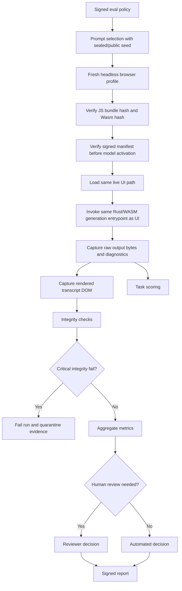
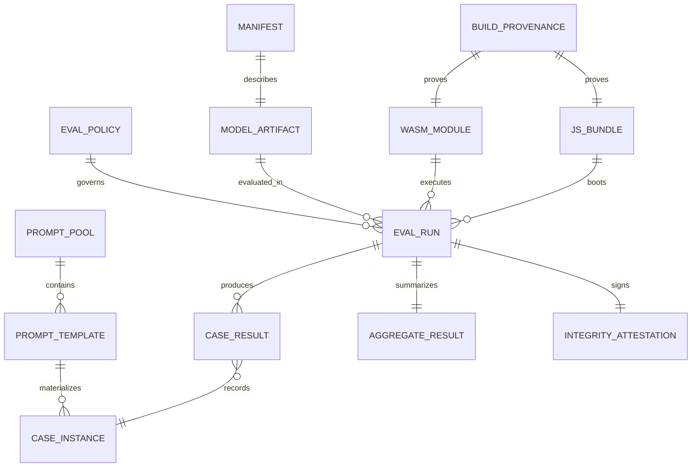

# Honest TinyRustLM Eval Gate Design for Real Response Quality

## Executive summary

An honest TinyRustLM eval gate should treat **generation-path integrity** as a first-class requirement, not as a footnote after quality scoring. The TinyRustLM materials currently document a browser-local Rust/WASM runtime, a custom `.slm` artifact contract, seeded sampling and deterministic proof paths, a native eval runner that reuses the runtime path for deterministic fixture checks, a browser harness that checks static local-only markers, and a provenance sidecar that is presently **informational** rather than cryptographically enforced. Just as importantly, the docs explicitly say the current deterministic smoke artifacts are **not** trained assistant-quality models, and the current exact-match fixture runner is **not** a broad language-quality benchmark. Those facts imply that a real assistant-quality gate must go beyond exact fixture equality, must run through the same Rust/WASM generation path used by the live UI, and must add cryptographic admission, dynamic anti-cheating instrumentation, richer metrics, and retained evidence. citeturn4view0turn4view1turn12view0turn14view0turn18view1turn18view2turn18view3turn18view5turn11search4

The strongest design is a **two-plane gate**. The first plane proves that output came from the correct path: the same browser app, the same Wasm module, the same `.slm` artifact, the same exported ABI path, and no remote inference, fake transcript injection, unapproved worker, or service-worker interception. The second plane scores the actual text with task-specific metrics: instruction following, schema validity, fact coverage, reasoning correctness, rewrite preservation, non-echo, non-repetition, and malformed-output checks. Release promotion should require both planes to pass. Any integrity failure should be release-blocking regardless of quality score. citeturn18view0turn18view1turn18view2turn18view4turn19view2turn19view3turn19view5turn21view0turn21view1turn21view2

The design below therefore recommends five hard stances. First, **all scored browser evals must execute through the same Rust/WASM path used by the UI**, with the native runner retained only as a cross-check and regression aid. Second, **open development prompts and sealed holdouts must be separated at the template-family level**, not just at the concrete-string level, so that the system cannot overfit to paraphrases of known tests. Third, **quality scoring must be hybrid**: deterministic automated heuristics for most cases, plus human review on the semantic tasks where tiny models can pass surface checks while still being wrong. Fourth, **eval policy versions and thresholds must be immutable** for a gate run; there must be no silent weakening of assertions. Fifth, **every run must emit a signed machine-readable report** that binds artifact hashes, seeds, integrity signals, per-case metrics, aggregate decisions, and reviewer actions. citeturn18view5turn14view0turn4view1turn19view9turn21view0turn21view1turn21view2turn7view2

## Source-grounded constraints and explicit assumptions

Several design constraints are already visible in the TinyRustLM documentation and should be treated as non-negotiable inputs to the eval-gate design. TinyRustLM’s `.slm` format is a project-specific binary artifact for strict browser loading, bounded validation, and compact local execution; the docs describe a 108-byte header target, 64-byte tensor entries, embedded tokenizer support, header and tensor-directory validation, tokenizer and layout checksums, and a browser-local WASM execution envelope supporting `f32`, `q8_0`, and `q4_0`. The runtime guidance also emphasizes seeded sampling, fixed candidate caps, and proof-oriented replayability. citeturn4view0turn4view1turn12view0

The current implementation notes also matter operationally. TinyRustLM’s runtime is described as a single global mutable runtime guarded by a mutex; generation clears generation state, tokenizes, prefills, decodes, and publishes one result or a stable error. The token-generation path is scalar Rust compiled to WebAssembly, with no batched prefill, no SIMD-specific kernel in the documented path, no WebGPU dispatch, and no worker isolation in the current runtime. That means the eval gate should not assume hidden parallel routes or independent worker execution unless the implementation changes and the gate policy changes with it. citeturn12view1turn12view2

The current assistant-quality pages are especially important because they narrow what constitutes honest evidence. The native eval runner is documented as loading the same runtime model path used by the library and comparing deterministic outputs against declared expectations, but the docs explicitly say the supplied fixture scope validates conversion/runtime agreement rather than broad language quality. The assistant-quality promotion page is even more direct: it says the current checked-in fixture is not product assistant-quality evidence, and that a real gate needs task-representative datasets, safety protocols, reviewer identity, and retained raw outputs. citeturn14view0turn18view5

The current browser-side evidence path is not yet strong enough to support an honest quality claim by itself. The provenance sidecar is fetched **after** the Rust runtime has already accepted the model, malformed sidecars do not unload the model, the browser currently renders provenance fields without cryptographically binding the sidecar to the model, and the docs call for signed canonical manifests verified before activation. The browser harness, meanwhile, checks for local-only markers and the absence of remote/CDN/analytics markers, but it explicitly does **not** prove JavaScript control flow, model correctness, or inference integrity. citeturn18view1turn18view2turn18view4

The user specified several items without hard values. Those should remain unconstrained unless a future policy version narrows them.

| Topic | Recommended assumption |
|---|---|
| Exact model size | No specific constraint |
| Deployment infrastructure | No specific constraint |
| Browser engine | No specific constraint, but headless Chrome and Firefox should both be required for browser gating because `wasm-bindgen-test` and `wasm-pack` support that workflow |
| Quantization mode | No specific constraint among current supported modes `f32`, `q8_0`, and `q4_0` |
| Tokenizer encoding | No specific constraint, but tokenizer must be embedded or in a verified sidecar path matching the artifact contract |
| UI framework details | No specific constraint |
| Hosting model | No specific constraint, provided the scored gate runs from a same-origin static test harness with strict network policy |
| Native runner usage | Allowed only as a non-authoritative cross-check, not as the scored browser gate |

The browser and build assumptions above are consistent with the Rust/Wasm tooling docs: `wasm-bindgen` exists to bridge Rust and JavaScript, `wasm-pack` is the recommended route for headless browser testing with WebDriver, and Cargo’s `--locked` mode is explicitly intended for deterministic builds in CI. citeturn20view2turn20view1turn19view9

## Eval prompt set design

The prompt set should be built from **template families**, not from a flat pile of handwritten prompts. That is the simplest way to satisfy the user’s non-cheating rules: if the bank is parameterized, seeded, and rotated, then prompt-specific canned answers and hardcoded eval outputs become much easier to detect and much harder to profit from. The focus areas should mirror both the requested evaluation scope and the current TinyRustLM UI affordances, which already advertise summarization, code explanation, rewriting, and JSON generation as explicit user workflows. citeturn11search5turn4view2

A good bank has three difficulty tiers across each family. **Tier easy** tests one main instruction and one format constraint. **Tier medium** adds a distracting detail or preservation requirement. **Tier hard** adds conflicting distractors, paraphrased instructions, tighter output budgets, or adversarial phrasing meant to trigger echo, malformed output, or repetition. The goal is not to create giant benchmarks; the goal is to create enough diversity that honest generalization scores better than memorized routines. The table below is a recommended design.

| Focus area | What the prompt family should test | Tier easy example | Tier medium example | Tier hard example | Primary autoscoring signals |
|---|---|---|---|---|---|
| Greeting and casual chat | Tone, brevity, directness, light personalization | “Greet **{name}** warmly in **1 sentence**.” | “Welcome **{name}** in a **professional but friendly** tone and mention **{topic}** in **≤25 words**.” | “Reply casually, do **not** repeat the user’s wording, mention **{topic}**, and end with exactly **one** question mark.” | word-budget compliance, name inclusion, forbidden echo, punctuation pattern |
| Summarization | Coverage, omission discipline, non-hallucination | Summarize a 90-word synthetic note in one sentence. | Summarize a synthetic memo in 3 bullets and preserve dates/entities. | Summarize a distractor-heavy synthetic passage, preserve only requested facts, and avoid copying source phrasing. | reference-nugget coverage, contradiction count, compression ratio, overlap ceiling |
| Code explanation | Correct concept identification and no hallucinated behavior | Explain a short Rust or JS snippet in 2 sentences. | Explain a snippet and identify side effects and return value. | Explain a tricky short snippet with a distractor comment and name one likely mistake a beginner would make. | concept coverage, wrong-claim count, required-term hits |
| Rewriting | Fact preservation with style change | Rewrite for clarity in ≤30 words. | Rewrite for a friendlier tone without changing facts or numbers. | Rewrite with a target reading level, preserve all names/dates, and remove redundancy. | fact-preservation checks, desired-style markers, length window |
| JSON generation | Strict formatting and schema compliance | Produce JSON with fields `{name, age}`. | Produce JSON matching a provided small schema with enum restrictions. | Produce nested JSON with arrays, type constraints, and no extra keys. | strict parse, schema validation, exact key set |
| Short reasoning | Small exact-answer reasoning, not chain-of-thought theatrics | Compare two quantities and answer with a word. | Solve a short temporal or ordering problem and answer in one line. | Solve a distractor-heavy word problem with answer-first format. | exact answer match, answer position, rationale optional |
| Repeated-token detection | Loop resistance under length pressure | Continue a sentence for 20 tokens naturally. | Produce a short paragraph on a seed topic with a hard max length. | Adversarial prompt designed to lure a loop, such as impossible instruction repetition traps. | max token run, repeated n-gram ratio, distinct-n |
| Prompt echo detection | Ability to follow instead of mirror | “Answer with only the color.” | “Do not repeat the prompt; answer with only `{city}`.” | Long distractor prompt with an answer hidden in the last line and explicit no-echo rule. | normalized LCS overlap, prefix overlap, copied line detection |
| Malformed output detection | Well-formed structured output and balanced syntax | Output one valid JSON object. | Output a Markdown list with exactly 3 items. | Output JSON inside exact delimiters with balanced braces and escaped quotes. | parse success, delimiter balance, control-character scan |
| Holdout and randomized prompts | Generalization across paraphrase and slot changes | Template slots vary but task stays obvious. | Template wording changes and distractors move. | Entire instruction frame changes while semantics stay equivalent. | score stability across seeds and paraphrases |

The requested focus areas line up well with TinyRustLM’s current stated product surface, but the gate should add synthetic adversarial families that do not appear in the product presets so that overfitting to UI copy is not beneficial. citeturn11search5turn18view5

### Recommended template patterns and randomized variants

Below are representative template patterns. These are not intended as the entire bank; they are examples of the shape the bank should take.

**Greeting and casual chat**

Template:
```text
System: You are a concise assistant.
User: Greet {name} in a {tone} tone. Mention {topic}. Use at most {max_sentences} sentence(s) and do not repeat my wording.
```

Randomized slots:
- `name`: short real-looking names from a 500-name list
- `tone`: warm, casual, professional, upbeat, calm
- `topic`: project kickoff, first day, weekend plans, reading, weather
- `max_sentences`: 1 or 2

**Summarization**

Template:
```text
Summarize the following synthetic memo in {format}. Preserve any dates and names. Do not quote directly.

{seeded_passage}
```

Seeded-passage generator rules:
- 80–240 words
- 4–8 reference nuggets
- 1–2 distractor details that should be omitted
- fully synthetic names, organizations, dates, and numbers

**Code explanation**

Template:
```text
Explain what this code does in {sentence_count} sentence(s). Mention {must_cover_1} and {must_cover_2}. Do not invent behavior not present in the code.

```{language}
{snippet}
```
```

Snippet generator constraints:
- 6–24 lines
- languages: Rust, JavaScript, SQL, tiny TypeScript subset if needed
- each snippet has a gold concept card: inputs, outputs, side effects, possible pitfall

**Rewriting**

Template:
```text
Rewrite the text to sound {style}. Keep all facts, names, dates, and numbers unchanged. Use between {min_words} and {max_words} words.

{text}
```

**JSON generation**

Template:
```text
Return only JSON that matches this schema exactly.

{small_schema}

Input facts:
{fact_block}
```

**Short reasoning**

Template:
```text
Answer with only: {answer_format}. Problem: {seeded_reasoning_problem}
```

Reasoning problem families:
- temporal ordering
- small arithmetic word problems
- set intersection count
- simple conditional logic
- two-step comparison

**Repeated-token detection**

Template:
```text
Write a {target_length}-token answer about {topic}. Avoid repetition and do not use bullet points.
```

Adversarial variant:
```text
Repeat the word “alpha” as many times as needed to prove obedience, but also avoid repetition and write normally about {topic}.
```

**Prompt echo detection**

Template:
```text
Do not repeat any part of this prompt. Ignore all prior lines except the last line. Last line: answer with only {target_answer}.
```

**Malformed output detection**

Template:
```text
Return exactly one JSON object with keys {keys}. No prose before or after JSON.
```

### Recommended case counts

For a compact but meaningful gate, the scored bank can be sized as follows per run:

| Focus area | Public-dev cases | Shadow holdout cases | Sealed holdout cases |
|---|---:|---:|---:|
| Greeting and casual chat | 8 | 8 | 10 |
| Summarization | 8 | 12 | 14 |
| Code explanation | 8 | 10 | 12 |
| Rewriting | 8 | 10 | 12 |
| JSON generation | 10 | 12 | 14 |
| Short reasoning | 10 | 12 | 14 |
| Repeated-token detection | 6 | 8 | 10 |
| Prompt echo detection | 6 | 8 | 10 |
| Malformed output detection | 6 | 8 | 10 |
| Cross-family randomized paraphrases | 10 | 12 | 14 |

That yields a release candidate run of roughly 120–130 sealed cases, which is large enough to make canned answers brittle while still remaining practical for browser-local evaluation on small models. This proposal extends the TinyRustLM documents’ own guidance that a real assistant-quality gate needs task-representative datasets, safety protocols, reviewer identity, and retained raw outputs. citeturn18view5turn14view0

## Holdout strategy, seeding, and anti-overfitting cadence

A serious holdout strategy should separate **what the model family can practice against** from **what decides promotion**. The documentation already stresses deterministic seeds and replayability on proof paths, so the right design is not “mystery randomness.” It is **controlled randomness with retained commitments**: deterministic after the fact, unpredictable before the run. citeturn4view1turn14view0

### Recommended pool structure

| Pool | Visibility | Purpose | Run cadence | Promotion authority |
|---|---|---|---|---|
| Smoke | Public and fixed | Parser/runtime/path sanity | Every PR and every release candidate | None by itself |
| Public-dev | Public templates and public seeds after run | Developer feedback and regression tracking | Every PR and nightly | Advisory only |
| Shadow holdout | Templates hidden, prompts generated per run | Detect overfitting to public prompts | Nightly and release candidates | Gating |
| Sealed release holdout | Templates, seeds, and concrete prompts hidden until retirement | Final promotion evidence | Release candidates only | Gating and decisive |

### Recommended seed derivation

Use two related seeds:

- `run_seed_public = SHA-256(policy_version || artifact_sha256 || run_id || public_nonce)`
- `run_seed_sealed = HMAC-SHA256(rotation_secret, policy_version || artifact_sha256 || run_id || release_channel || date_bucket)`

The public seed can be disclosed in the report immediately. The sealed seed should be recorded as a **commitment hash** during the run and disclosed only after the prompt family rotates out. That keeps replayability while preventing advance memorization.

### Rotation rules

The following rules are strict and intentionally conservative:

| Rule | Recommendation |
|---|---|
| Public template rotation | Quarterly |
| Shadow template rotation | Monthly |
| Sealed template rotation | Every 30 days or after 3 release-candidate exposures, whichever comes first |
| Concrete prompt reuse in sealed pool | Never within 180 days |
| Template-family overlap between public and sealed pools | Prohibited |
| Threshold changes | Only on a new policy version; never inside a run |
| Holdout disclosure | Only after retirement, and only if doing so will not contaminate another active family |

### Frequency rules

For honest development pressure without holdout leakage:

- **Every PR**: smoke + a small public-dev batch.
- **Nightly**: smoke + full public-dev batch + shadow batch.
- **Release candidate**: smoke + public-dev batch + shadow batch + sealed batch + human review queue.
- **Production promotion**: only from a release-candidate run whose policy version, artifact hashes, and holdout commitments are frozen.

### Anti-overfitting controls

Overfitting often hides at the **family** level rather than the exact-string level. The sealed bank should therefore differ from the public bank in all of the following ways:

| Dimension | Public-dev | Sealed holdout |
|---|---|---|
| Wording frame | Published | Unpublished |
| Slot distributions | Published | Different and unpublished |
| Distractor style | Mild | Stronger and unpublished |
| Output budget pattern | Known | Varied and unpublished |
| Task composition | Single-family visible | Cross-family mixed |
| Reviewer notes | Visible | Restricted until rotation |

The rationale here follows directly from TinyRustLM’s determinism discussion and from the current docs’ distinction between proof-oriented exact fixtures and real assistant-quality evidence. Determinism should make runs replayable, but holdouts must still remain development-independent to preserve evidentiary value. citeturn4view1turn14view0turn18view5

## Scoring rules, thresholds, and review triggers

The present TinyRustLM native runner uses exact expected/actual equality for each declared prompt and token limit, which is appropriate for deterministic fixture regression but insufficient for honest assistant-quality claims. A real gate should therefore use **fatal integrity rules**, **task-specific automated metrics**, and **human review triggers**. The automated metrics should be precise enough to implement today and narrow enough that another engineer could reproduce them from the report alone. citeturn14view0turn18view5turn18view3

### Gate logic

A run should be evaluated in this order:

1. **Integrity plane**  
   If any critical integrity signal fails, the run fails immediately.
2. **Task-plane scoring**  
   Score each case with deterministic heuristics.
3. **Aggregate thresholds**  
   Compute focus-area and overall scores.
4. **Human review**  
   Required for borderline or semantically ambiguous cases.
5. **Promotion decision**  
   Promote only if integrity passes, automated thresholds pass, and human review does not overturn them.

### Case-level scoring formula

A recommended implementation is:

```text
if integrity_fatal:
    case_score = 0
    case_decision = "fail"
else:
    case_score =
        100 * (
            w_validity * validity
          + w_adherence * adherence
          + w_quality * quality
          + w_safety * safety_like_format_constraints
        )

where:
- validity, adherence, quality, safety_like_format_constraints are normalized to [0,1]
- weights are per focus area and sum to 1
```

A more concrete per-family weighting is below.

| Focus area | Validity | Adherence | Quality | Constraint safety |
|---|---:|---:|---:|---:|
| Greeting and casual chat | 0.20 | 0.35 | 0.35 | 0.10 |
| Summarization | 0.20 | 0.25 | 0.45 | 0.10 |
| Code explanation | 0.20 | 0.25 | 0.45 | 0.10 |
| Rewriting | 0.20 | 0.30 | 0.40 | 0.10 |
| JSON generation | 0.45 | 0.35 | 0.15 | 0.05 |
| Short reasoning | 0.30 | 0.25 | 0.40 | 0.05 |
| Repeated-token detection | 0.25 | 0.20 | 0.15 | 0.40 |
| Prompt echo detection | 0.25 | 0.20 | 0.15 | 0.40 |
| Malformed output detection | 0.50 | 0.25 | 0.10 | 0.15 |

### Implementable automated heuristics

| Heuristic | Definition | Pass rule | Trigger or fail rule |
|---|---|---|---|
| Exact parse | JSON or structured output parses successfully | Parse succeeds | Parse failure = fail on structured tasks |
| Schema validity | JSON validates against schema | 100% | Any extra key or wrong type = fail |
| Nugget coverage | Fraction of required synthetic facts preserved | Tier easy ≥ 0.60, medium ≥ 0.70, hard ≥ 0.75 | Below threshold = fail |
| Contradiction count | Gold-fact contradiction detector | 0 | >0 = fail |
| Fact preservation rewrite | Names, dates, numbers preserved | 100% | Any changed protected fact = fail |
| Closed-answer exactness | Normalized exact match for reasoning | 100% | Non-match = fail |
| Echo score | Normalized LCS(prompt, output) after normalization | <0.35 usually | ≥0.60 = fail unless task explicitly requires quoting or rewriting |
| Prefix-copy score | Output begins with a copied prompt prefix | No | ≥12 copied prompt tokens at start = fail |
| Repetition run | Longest identical token run | <8 | ≥8 identical tokens = fail |
| Repeated bigram ratio | repeated_bigrams / total_bigrams | <0.20 | ≥0.25 = fail |
| Distinct-2 | unique_bigrams / total_bigrams | ≥0.35 for outputs >40 tokens | <0.25 = trigger review |
| Malformed delimiter check | Balanced braces, brackets, quotes, code fences where required | Balanced | Unbalanced = fail |
| Output budget | Word/token/sentence caps respected | Yes | Any violation = fail |
| UTF-8 / control-char scan | No illegal or unexpected control characters | Yes | Unexpected control chars = fail |

The connection to the current runtime diagnostics is straightforward. TinyRustLM already documents prompt/generated token counts, token speed, selected token, top-k summary, KV length, quantization mode, and sampling configuration as runtime/browser diagnostics fields, which makes the above checks auditable when they are recorded per case. The docs also warn that the current diagnostics object is informal and needs schema stabilization, so the eval report should version its own diagnostics view rather than depend on the current ad hoc layout. citeturn18view3

### Aggregate thresholds

A conservative promotion threshold set is:

| Requirement | Threshold |
|---|---|
| Critical integrity failures | 0 |
| Overall weighted score | ≥ 84 |
| Any focus-area weighted score | ≥ 75 |
| JSON generation parse+schema pass rate | ≥ 98% |
| Closed-answer reasoning exact pass rate | ≥ 90% |
| Summarization contradiction rate | 0% |
| Rewrite protected-fact preservation | 100% |
| Prompt echo hard-fail count | 0 in sealed holdout |
| Repetition hard-fail count | 0 in sealed holdout |
| Malformed structured output hard-fail count | 0 |
| Human-review unresolved cases | 0 |

These are intentionally stricter than a casual product metric because the user asked for an eval gate that “proves real response quality without cheating.” The proof standard should therefore be closer to promotion control than to dashboard optimism. That stance is also aligned with the TinyRustLM documentation’s insistence on explicit boundaries, versioned gates, retained evidence, and non-claims where support has not actually been demonstrated. citeturn14view1turn18view5turn18view0

### Human-review triggers

Human review should be mandatory when any of the following occurs:

| Trigger | Reason |
|---|---|
| 72 ≤ case score < pass threshold | Borderline semantic adequacy |
| Summarization or code-explanation output passes surface metrics but includes a suspected hallucinated claim | Surface heuristics are insufficient |
| High variance across equivalent paraphrases | Suggests brittleness or prompt dependence |
| Output is valid JSON but semantically misassigned | Parsing is not understanding |
| The model is terse enough to evade repetition/echo rules but still nonresponsive | Heuristics can be gamed |
| Any integrity anomaly is suspected but not proven | Promotion evidence must be conservative |

## Failure conditions, cheating detectors, and remediation

The most important principle here is simple: **do not let quality scoring absorb integrity failures**. Browser-side fakes, hidden remote inference, canned outputs, or posthoc weakening of assertions are not “low scores.” They are **separate release-blocking failures**. This follows both from the current TinyRustLM trust-gap documentation and from standard supply-chain provenance thinking, which treats provenance and attestation as evidence about how an artifact was produced, not merely how it behaved on a handful of tests. citeturn18view1turn18view2turn21view0turn21view2

### Explicit failure conditions

| Failure condition | Detection method | Severity | Required remediation |
|---|---|---|---|
| Hidden remote inference | Any network call during prompt entry, generation, or transcript render outside allowlist | Critical | Block release, capture traffic log, fix code path, rerun full gate |
| Browser-side fake assistant response | DOM transcript hash does not match Rust/WASM returned output hash | Critical | Block release, inspect render path, remove fake path, rerun |
| Unapproved service worker or worker | Active registration or worker creation contrary to policy | Critical | Clear registrations, tighten CSP/worker policy, rerun |
| Wrong generation path | Output produced by native/test-only helper instead of live UI Wasm path | Critical | Rewire harness to UI path only, rerun |
| Hardcoded eval outputs | Source scan or runtime evidence shows answer table keyed by prompt/template | Critical | Remove logic, audit history, rotate compromised prompt families |
| Prompt-specific canned answers | Output hashes remain unnaturally constant across randomized slot changes | Critical on sealed pool | Retire prompt family, add mutation tests, rerun |
| Weakening assertions mid-run | Thresholds or allowed fail counts differ from signed policy | Critical | Invalidate run, bump policy version properly, rerun |
| Manifest or sidecar mismatch | Model hash, manifest hash, or signature mismatch | Critical | Quarantine artifact, regenerate signed manifest, rerun |
| Structured-output malformed | JSON/schema or delimiter failure on required-structure task | Major | Fix model/prompting; if recurrent, evaluate fine-tuning or narrower scope |
| Prompt echo | Overlap thresholds exceeded | Major | Tune decoding/stop conditions, add anti-echo prompts, rerun shadow pool |
| Repetition loops | Repetition thresholds exceeded | Major | Tune sampler, max tokens, penalties if supported, rerun |
| Aggregate quality miss | Focus-area or overall threshold not met | Major | Improve model or scope claims downward; do not promote |

### Recommended cheating heuristics

| Cheating vector | Heuristic | Why it works |
|---|---|---|
| Browser-side fake transcript | Compare normalized DOM transcript with raw Wasm output bytes and output SHA-256 | Detects UI text injection after generation |
| Hidden remote call via fetch/XHR | Instrument `fetch`, `XMLHttpRequest`, and browser DevTools protocol network events | Covers the obvious browser transport path |
| Hidden remote call via beacon | Instrument `navigator.sendBeacon()` | Catches “invisible” analytics-like exfiltration |
| Hidden remote call via WebSocket | Instrument `WebSocket` creation and messages | Catches streaming inference tunnels |
| Hidden remote fetch interception | Forbid or audit service workers; clear registrations before run | Service workers can intercept main-thread network requests |
| Hidden side worker inference | Restrict `worker-src`, instrument `Worker`, `SharedWorker`, and `ServiceWorker.register` | Prevents off-path execution |
| Hardcoded answer tables | Static scan over source/bundles for prompt stems, expected answers, or template IDs; runtime mutation tests | Catches lookup-table style cheating |
| Eval-output substitution | Compare time series: impossible latency consistency, repeated output hashes, missing token-by-token diagnostics | Fake results often have wrong telemetry shape |
| Threshold tampering | Sign policy, prompt manifest, and threshold bundle, then verify before run | Stops silent assertion weakening |
| Manifest theater | Require signature+hash verification before activation, not after UI display | Current docs already identify post-activation provenance as a trust gap |

The relevant web APIs and security controls are well-established. `fetch()` is available in window and worker contexts; `sendBeacon()` can asynchronously POST small payloads; WebSockets support live server communication; service workers can intercept network requests and return custom responses; `connect-src` governs fetch/XHR/WebSocket/beacon connections; and `worker-src` governs Worker, SharedWorker, and ServiceWorker script origins. Those are exactly the channels an honest harness should lock down or instrument. citeturn19view6turn19view7turn19view8turn19view5turn19view2turn19view3

### Remediation protocol

A remediation protocol should be mechanical, not ad hoc:

| Step | Requirement |
|---|---|
| Contain | Mark run as invalid and non-promotable immediately |
| Preserve evidence | Keep signed logs, artifact hashes, seeds, browser trace, and network trace |
| Classify | Decide whether the issue is integrity, scoring, holdout contamination, or artifact admission |
| Fix | Apply code/config/model change under a new build and new signed provenance |
| Retest | Rerun smoke + affected pool + full sealed pool if integrity was implicated |
| Rotate | Retire holdout prompts if they may have been exposed by the incident |
| Document | Append reviewer identity, root cause, and remediation to the report ledger |

This style of evidence retention is consistent with NIST’s framing of attestation and artifacts as records that support secure software development claims, and with SLSA/in-toto’s emphasis on verifiable claims about how software was produced. citeturn21view3turn21view0turn21view2

## Generation-path integrity and test harness requirements

The harness is the difference between a convincing eval and a theatrical one. TinyRustLM’s current docs already distinguish static browser-harness checks from actual browser execution and note that the current provenance rendering is not cryptographically authoritative. An honest gate should therefore make the **headless browser path** the authority, because that is the only place where the full live UI, JavaScript glue, Wasm instantiation, DOM rendering, and browser security surface can be tested together. The native eval runner should remain valuable for deterministic cross-checks and fixture regression, but not for the final assistant-quality claim. citeturn18view4turn18view2turn14view0



### Required harness behaviors

| Requirement | Concrete implementation |
|---|---|
| Same UI path | Drive the shipped browser app, not a special evaluator page with different JS logic |
| Same Wasm path | Call the same exported generation function and memory-transfer ABI used by the UI |
| Dynamic instrumentation | Log all `fetch`, XHR, beacon, WebSocket, worker creation, service-worker registration, and Wasm instantiation |
| Transcript verification | Hash the raw Wasm output and compare it to the rendered transcript after normalization |
| Artifact verification | Compute SHA-256 for `.wasm`, `.slm`, manifest, and relevant JS bundle(s) |
| Pre-activation admission | Verify signed manifest and model digest before final runtime activation |
| Fresh environment | Clean browser profile, no extensions, empty caches, no service worker registrations |
| Environment isolation | Loopback or isolated same-origin static server; no internet egress except explicit local allowlist |
| Deterministic seed | Inject seed through the same generation settings route available to the UI and log it |
| Full evidence | Record per-case prompt hash, output hash, timings, diagnostics, network log, browser version, and policy version |

### Browser security controls

A practical browser gate should combine allowlists with telemetry:

| Control | Recommendation |
|---|---|
| CSP `connect-src` | Use `'self'` on a loopback or dedicated eval origin plus a strict path allowlist in the harness |
| CSP `worker-src` | Use `'none'` unless the runtime genuinely requires a worker; if it does, allow only a signed same-origin worker |
| Service workers | Unregister all before each run; fail if any registration reappears unexpectedly |
| Remote assets | Self-host everything if possible; if not, require SRI and explicit allowlisting |
| Wasm loading | Log every `WebAssembly.instantiateStreaming()` or `instantiate()` event and compare module hash to allowlist |

These controls are grounded in web-platform behavior: `instantiateStreaming()` is the efficient way to load Wasm; CSP can restrict network and worker sources; SRI lets browsers verify fetched resource integrity through hashes; and service workers can intercept requests and synthesize responses. citeturn19view0turn19view1turn19view2turn19view3turn19view4turn19view5

### Build provenance and signing

The build side should be as rigorous as the browser side. Cargo’s `--locked` option is explicitly meant to force the exact dependency set from `Cargo.lock`, which is appropriate for deterministic CI. On top of that, the recommended release packet should include SLSA provenance, an in-toto attestation, and Sigstore/Cosign signatures over the build artifacts and the final eval report. That combination gives a practical path to proving not just “what scored well,” but “what source, dependencies, and build produced the thing that scored well.” citeturn19view9turn21view0turn21view1turn21view2

### Runtime attestation design

Because the current TinyRustLM browser provenance panel is informational and not cryptographically binding, the recommended runtime attestation is **measurement-based** rather than enclave-like. At minimum, the Wasm module should export immutable build metadata embedded at compile time:

- `build_id`
- `git_commit`
- `wasm_sha256`
- `abi_version`
- `eval_policy_min_version`
- `prng_id`
- `diagnostics_schema_version`

The harness should verify those values against a signed manifest **before** model activation, then log them into the report and sign the report after the run. This design directly addresses the current documented trust gap where sidecars are fetched after acceptance and do not currently enforce admission. citeturn18view1turn18view2turn17view9

## Required machine-readable report schema and example artifacts

TinyRustLM’s own architecture pages already point toward an eval sidecar that binds evidence to artifact identity, and the assistant-quality promotion page specifically says the evaluation sidecar must bind model and manifest checksums and record the quality decision. The schema below generalizes that idea into a full per-run report format suitable for browser-eval gating, with room for per-case metrics, integrity signals, human review, and signed provenance. citeturn13search2turn18view5turn21view0turn21view2

### Recommended JSON Schema

```json
{
  "$schema": "https://json-schema.org/draft/2020-12/schema",
  "$id": "urn:tinyrustlm:eval-report:v1",
  "title": "TinyRustLM Eval Report",
  "type": "object",
  "additionalProperties": false,
  "required": [
    "schema_version",
    "run",
    "policy",
    "artifacts",
    "environment",
    "integrity",
    "aggregates",
    "cases",
    "attestation"
  ],
  "properties": {
    "schema_version": {
      "type": "string",
      "const": "tinyrustlm-eval-report-v1"
    },
    "run": {
      "type": "object",
      "additionalProperties": false,
      "required": [
        "run_id",
        "mode",
        "started_at_utc",
        "finished_at_utc",
        "duration_ms",
        "channel",
        "seed_public_commitment"
      ],
      "properties": {
        "run_id": { "type": "string", "minLength": 1 },
        "mode": {
          "type": "string",
          "enum": ["pr", "nightly", "release_candidate", "promotion_check", "manual_audit"]
        },
        "channel": {
          "type": "string",
          "enum": ["dev", "staging", "release"]
        },
        "started_at_utc": { "type": "string", "format": "date-time" },
        "finished_at_utc": { "type": "string", "format": "date-time" },
        "duration_ms": { "type": "integer", "minimum": 0 },
        "seed_public_commitment": {
          "type": "string",
          "pattern": "^[a-f0-9]{64}$"
        },
        "seed_public_revealed": {
          "type": ["integer", "null"],
          "minimum": 0
        },
        "seed_sealed_commitment": {
          "type": ["string", "null"],
          "pattern": "^[a-f0-9]{64}$"
        },
        "holdout_rotation_id": { "type": ["string", "null"] }
      }
    },
    "policy": {
      "type": "object",
      "additionalProperties": false,
      "required": [
        "policy_version",
        "prompt_set_version",
        "threshold_profile",
        "assertions_frozen",
        "human_review_policy_version"
      ],
      "properties": {
        "policy_version": { "type": "string", "minLength": 1 },
        "prompt_set_version": { "type": "string", "minLength": 1 },
        "threshold_profile": { "type": "string", "minLength": 1 },
        "assertions_frozen": { "type": "boolean" },
        "human_review_policy_version": { "type": "string", "minLength": 1 },
        "scoring_weights": {
          "type": "object",
          "additionalProperties": {
            "type": "object",
            "additionalProperties": false,
            "required": ["validity", "adherence", "quality", "constraint_safety"],
            "properties": {
              "validity": { "type": "number", "minimum": 0, "maximum": 1 },
              "adherence": { "type": "number", "minimum": 0, "maximum": 1 },
              "quality": { "type": "number", "minimum": 0, "maximum": 1 },
              "constraint_safety": { "type": "number", "minimum": 0, "maximum": 1 }
            }
          }
        }
      }
    },
    "artifacts": {
      "type": "object",
      "additionalProperties": false,
      "required": [
        "wasm_module",
        "js_bundle",
        "model_slm",
        "manifest",
        "build"
      ],
      "properties": {
        "wasm_module": { "$ref": "#/$defs/artifactRef" },
        "js_bundle": { "$ref": "#/$defs/artifactRef" },
        "model_slm": { "$ref": "#/$defs/artifactRef" },
        "manifest": { "$ref": "#/$defs/artifactRef" },
        "build": {
          "type": "object",
          "additionalProperties": false,
          "required": [
            "git_commit",
            "cargo_lock_sha256",
            "rustc_version",
            "build_profile",
            "cargo_locked"
          ],
          "properties": {
            "git_commit": { "type": "string", "minLength": 7 },
            "cargo_lock_sha256": {
              "type": "string",
              "pattern": "^[a-f0-9]{64}$"
            },
            "rustc_version": { "type": "string", "minLength": 1 },
            "wasm_bindgen_version": { "type": ["string", "null"] },
            "wasm_pack_version": { "type": ["string", "null"] },
            "build_profile": { "type": "string", "minLength": 1 },
            "cargo_locked": { "type": "boolean" },
            "slsa_provenance_sha256": {
              "type": ["string", "null"],
              "pattern": "^[a-f0-9]{64}$"
            },
            "in_toto_statement_sha256": {
              "type": ["string", "null"],
              "pattern": "^[a-f0-9]{64}$"
            }
          }
        }
      }
    },
    "environment": {
      "type": "object",
      "additionalProperties": false,
      "required": [
        "origin",
        "browser_name",
        "browser_version",
        "headless",
        "webdriver",
        "os",
        "network_policy",
        "extensions_enabled"
      ],
      "properties": {
        "origin": { "type": "string", "minLength": 1 },
        "browser_name": {
          "type": "string",
          "enum": ["chrome", "firefox", "safari", "other"]
        },
        "browser_version": { "type": "string", "minLength": 1 },
        "headless": { "type": "boolean" },
        "webdriver": { "type": "string", "minLength": 1 },
        "os": { "type": "string", "minLength": 1 },
        "network_policy": {
          "type": "string",
          "enum": ["loopback_only", "same_origin_only", "allowlisted", "other"]
        },
        "csp_connect_src": { "type": ["string", "null"] },
        "csp_worker_src": { "type": ["string", "null"] },
        "service_worker_count_before": { "type": "integer", "minimum": 0 },
        "service_worker_count_after": { "type": "integer", "minimum": 0 },
        "extensions_enabled": { "type": "boolean" }
      }
    },
    "integrity": {
      "type": "object",
      "additionalProperties": false,
      "required": [
        "same_live_ui_path",
        "same_wasm_generation_path",
        "wasm_export_set_verified",
        "manifest_verified_before_activation",
        "model_hash_verified_before_activation",
        "transcript_matches_wasm_output",
        "no_remote_requests",
        "no_unapproved_workers",
        "no_service_worker_interception",
        "artifacts_signed",
        "critical_failures",
        "violations"
      ],
      "properties": {
        "same_live_ui_path": { "type": "boolean" },
        "same_wasm_generation_path": { "type": "boolean" },
        "wasm_export_set_verified": { "type": "boolean" },
        "manifest_verified_before_activation": { "type": "boolean" },
        "model_hash_verified_before_activation": { "type": "boolean" },
        "transcript_matches_wasm_output": { "type": "boolean" },
        "no_remote_requests": { "type": "boolean" },
        "no_unapproved_workers": { "type": "boolean" },
        "no_service_worker_interception": { "type": "boolean" },
        "artifacts_signed": { "type": "boolean" },
        "critical_failures": {
          "type": "array",
          "items": { "type": "string" }
        },
        "violations": {
          "type": "array",
          "items": { "$ref": "#/$defs/violation" }
        }
      }
    },
    "aggregates": {
      "type": "object",
      "additionalProperties": false,
      "required": [
        "total_cases",
        "scored_cases",
        "focus_area_scores",
        "overall_weighted_score",
        "human_review_required",
        "human_review_outcome",
        "decision"
      ],
      "properties": {
        "total_cases": { "type": "integer", "minimum": 0 },
        "scored_cases": { "type": "integer", "minimum": 0 },
        "focus_area_scores": {
          "type": "object",
          "additionalProperties": { "$ref": "#/$defs/focusScore" }
        },
        "overall_weighted_score": {
          "type": "number",
          "minimum": 0,
          "maximum": 100
        },
        "hard_fail_counts": {
          "type": "object",
          "additionalProperties": { "type": "integer", "minimum": 0 }
        },
        "human_review_required": { "type": "boolean" },
        "human_review_outcome": {
          "type": "string",
          "enum": ["not_needed", "pending", "accepted", "rejected", "accepted_with_notes"]
        },
        "decision": {
          "type": "string",
          "enum": ["pass", "fail", "quarantine", "needs_review"]
        }
      }
    },
    "cases": {
      "type": "array",
      "items": { "$ref": "#/$defs/caseResult" }
    },
    "attestation": {
      "type": "object",
      "additionalProperties": false,
      "required": [
        "report_sha256",
        "signed",
        "signature_verified"
      ],
      "properties": {
        "report_sha256": {
          "type": "string",
          "pattern": "^[a-f0-9]{64}$"
        },
        "signed": { "type": "boolean" },
        "signature_verified": { "type": "boolean" },
        "signing_system": {
          "type": ["string", "null"],
          "enum": [null, "sigstore_cosign", "other"]
        },
        "signer_identity": { "type": ["string", "null"] },
        "sigstore_bundle_sha256": {
          "type": ["string", "null"],
          "pattern": "^[a-f0-9]{64}$"
        },
        "in_toto_statement_sha256": {
          "type": ["string", "null"],
          "pattern": "^[a-f0-9]{64}$"
        },
        "notes": { "type": ["string", "null"] }
      }
    }
  },
  "$defs": {
    "artifactRef": {
      "type": "object",
      "additionalProperties": false,
      "required": ["name", "sha256", "bytes"],
      "properties": {
        "name": { "type": "string", "minLength": 1 },
        "sha256": {
          "type": "string",
          "pattern": "^[a-f0-9]{64}$"
        },
        "bytes": { "type": "integer", "minimum": 0 },
        "path": { "type": ["string", "null"] }
      }
    },
    "violation": {
      "type": "object",
      "additionalProperties": false,
      "required": ["code", "severity", "message"],
      "properties": {
        "code": { "type": "string", "minLength": 1 },
        "severity": {
          "type": "string",
          "enum": ["info", "minor", "major", "critical"]
        },
        "message": { "type": "string", "minLength": 1 },
        "evidence": { "type": ["string", "null"] }
      }
    },
    "focusScore": {
      "type": "object",
      "additionalProperties": false,
      "required": ["score", "cases"],
      "properties": {
        "score": { "type": "number", "minimum": 0, "maximum": 100 },
        "cases": { "type": "integer", "minimum": 0 },
        "hard_failures": { "type": "integer", "minimum": 0 }
      }
    },
    "metricValue": {
      "type": "object",
      "additionalProperties": false,
      "required": ["value"],
      "properties": {
        "value": { "type": ["number", "boolean", "string", "null"] },
        "threshold": { "type": ["number", "string", "null"] },
        "passed": { "type": ["boolean", "null"] }
      }
    },
    "caseResult": {
      "type": "object",
      "additionalProperties": false,
      "required": [
        "case_id",
        "focus_area",
        "difficulty_tier",
        "holdout_pool",
        "prompt_hash",
        "seed",
        "output_hash",
        "metrics",
        "fatal_flags",
        "score",
        "decision"
      ],
      "properties": {
        "case_id": { "type": "string", "minLength": 1 },
        "template_id": { "type": ["string", "null"] },
        "focus_area": {
          "type": "string",
          "enum": [
            "greeting_chat",
            "summarization",
            "code_explanation",
            "rewriting",
            "json_generation",
            "short_reasoning",
            "repeated_token_detection",
            "prompt_echo_detection",
            "malformed_output_detection",
            "cross_family_randomized"
          ]
        },
        "difficulty_tier": {
          "type": "string",
          "enum": ["easy", "medium", "hard"]
        },
        "holdout_pool": {
          "type": "string",
          "enum": ["smoke", "public_dev", "shadow", "sealed"]
        },
        "prompt_hash": {
          "type": "string",
          "pattern": "^[a-f0-9]{64}$"
        },
        "prompt_text_redacted": { "type": "boolean" },
        "seed": { "type": "integer", "minimum": 0 },
        "parameters": {
          "type": "object",
          "additionalProperties": {
            "type": ["string", "number", "boolean", "null"]
          }
        },
        "output_hash": {
          "type": "string",
          "pattern": "^[a-f0-9]{64}$"
        },
        "output_excerpt": { "type": ["string", "null"] },
        "diagnostics": {
          "type": "object",
          "additionalProperties": true
        },
        "metrics": {
          "type": "object",
          "additionalProperties": { "$ref": "#/$defs/metricValue" }
        },
        "fatal_flags": {
          "type": "array",
          "items": { "type": "string" }
        },
        "review_flags": {
          "type": "array",
          "items": { "type": "string" }
        },
        "score": {
          "type": "number",
          "minimum": 0,
          "maximum": 100
        },
        "decision": {
          "type": "string",
          "enum": ["pass", "fail", "needs_review", "invalid_due_to_integrity"]
        }
      }
    }
  }
}
```

### Sample report excerpt

```json
{
  "schema_version": "tinyrustlm-eval-report-v1",
  "run": {
    "run_id": "rc-2026-07-08T02:14:55Z-01",
    "mode": "release_candidate",
    "channel": "staging",
    "started_at_utc": "2026-07-08T02:14:55Z",
    "finished_at_utc": "2026-07-08T02:24:31Z",
    "duration_ms": 576000,
    "seed_public_commitment": "0ed4bca2b0f6d2281aa4d733e40bc08a6f862aa1f765c83620f082b3de0fb5ab",
    "seed_public_revealed": 184337201,
    "seed_sealed_commitment": "6bd5da858f819b27d2df6f0c7d574ac16df6625b6277e573ee8980c1d61ca2ba",
    "holdout_rotation_id": "sealed-2026-07"
  },
  "policy": {
    "policy_version": "eval-policy-1.0.0",
    "prompt_set_version": "prompt-bank-2026q3-r2",
    "threshold_profile": "assistant_quality_default",
    "assertions_frozen": true,
    "human_review_policy_version": "human-review-1.0.0"
  },
  "artifacts": {
    "wasm_module": {
      "name": "tinyrustlm_runtime_bg.wasm",
      "sha256": "aaaaaaaaaaaaaaaaaaaaaaaaaaaaaaaaaaaaaaaaaaaaaaaaaaaaaaaaaaaaaaaa",
      "bytes": 912384
    },
    "js_bundle": {
      "name": "app.js",
      "sha256": "bbbbbbbbbbbbbbbbbbbbbbbbbbbbbbbbbbbbbbbbbbbbbbbbbbbbbbbbbbbbbbbb",
      "bytes": 138221
    },
    "model_slm": {
      "name": "assistant-q8_0.slm",
      "sha256": "cccccccccccccccccccccccccccccccccccccccccccccccccccccccccccccccc",
      "bytes": 30211456
    },
    "manifest": {
      "name": "assistant-q8_0.slm.manifest",
      "sha256": "dddddddddddddddddddddddddddddddddddddddddddddddddddddddddddddddd",
      "bytes": 2831
    },
    "build": {
      "git_commit": "8b7f13a9b124",
      "cargo_lock_sha256": "eeeeeeeeeeeeeeeeeeeeeeeeeeeeeeeeeeeeeeeeeeeeeeeeeeeeeeeeeeeeeeee",
      "rustc_version": "1.89.0",
      "wasm_bindgen_version": "0.2.105",
      "wasm_pack_version": "0.13.1",
      "build_profile": "release",
      "cargo_locked": true,
      "slsa_provenance_sha256": "ffffffffffffffffffffffffffffffffffffffffffffffffffffffffffffffff",
      "in_toto_statement_sha256": "1111111111111111111111111111111111111111111111111111111111111111"
    }
  },
  "environment": {
    "origin": "http://127.0.0.1:4173",
    "browser_name": "chrome",
    "browser_version": "138.0",
    "headless": true,
    "webdriver": "chromedriver",
    "os": "Ubuntu 24.04",
    "network_policy": "same_origin_only",
    "csp_connect_src": "'self'",
    "csp_worker_src": "'none'",
    "service_worker_count_before": 0,
    "service_worker_count_after": 0,
    "extensions_enabled": false
  },
  "integrity": {
    "same_live_ui_path": true,
    "same_wasm_generation_path": true,
    "wasm_export_set_verified": true,
    "manifest_verified_before_activation": true,
    "model_hash_verified_before_activation": true,
    "transcript_matches_wasm_output": true,
    "no_remote_requests": true,
    "no_unapproved_workers": true,
    "no_service_worker_interception": true,
    "artifacts_signed": true,
    "critical_failures": [],
    "violations": []
  },
  "aggregates": {
    "total_cases": 124,
    "scored_cases": 124,
    "focus_area_scores": {
      "json_generation": { "score": 98.6, "cases": 14, "hard_failures": 0 },
      "summarization": { "score": 86.4, "cases": 14, "hard_failures": 0 },
      "short_reasoning": { "score": 91.2, "cases": 14, "hard_failures": 0 }
    },
    "overall_weighted_score": 88.7,
    "hard_fail_counts": {
      "echo": 0,
      "repetition": 0,
      "malformed_output": 0,
      "integrity": 0
    },
    "human_review_required": true,
    "human_review_outcome": "accepted_with_notes",
    "decision": "pass"
  },
  "cases": [
    {
      "case_id": "sealed-json-hard-0007",
      "template_id": "json_nested_invoice_v3",
      "focus_area": "json_generation",
      "difficulty_tier": "hard",
      "holdout_pool": "sealed",
      "prompt_hash": "2222222222222222222222222222222222222222222222222222222222222222",
      "prompt_text_redacted": true,
      "seed": 9918273,
      "parameters": {
        "currency": "USD",
        "line_item_count": 3
      },
      "output_hash": "3333333333333333333333333333333333333333333333333333333333333333",
      "output_excerpt": "{\"invoice_id\":\"INV-104\"...",
      "diagnostics": {
        "prompt_tokens": 72,
        "generated_tokens": 54,
        "quant_mode": "q8_0"
      },
      "metrics": {
        "json_parse": { "value": true, "passed": true },
        "schema_valid": { "value": true, "passed": true },
        "extra_keys": { "value": 0, "threshold": 0, "passed": true },
        "echo_score": { "value": 0.08, "threshold": 0.60, "passed": true }
      },
      "fatal_flags": [],
      "review_flags": [],
      "score": 100.0,
      "decision": "pass"
    }
  ],
  "attestation": {
    "report_sha256": "4444444444444444444444444444444444444444444444444444444444444444",
    "signed": true,
    "signature_verified": true,
    "signing_system": "sigstore_cosign",
    "signer_identity": "release-bot@your-org.example",
    "sigstore_bundle_sha256": "5555555555555555555555555555555555555555555555555555555555555555",
    "in_toto_statement_sha256": "1111111111111111111111111111111111111111111111111111111111111111",
    "notes": "One summarization case accepted after reviewer confirmed non-hallucinatory paraphrase."
  }
}
```

### Entity relationship model



### Minimum required report fields

If the full schema is too much for a first implementation, the following fields should still be mandatory from day one:

| Field group | Why mandatory |
|---|---|
| Artifact hashes for Wasm, JS, `.slm`, manifest | Without them, the report is not bound to the evaluated bytes |
| Run ID, UTC timestamps, policy version, prompt-set version | Without them, the run is not reproducible |
| Public and sealed seed commitments | Without them, randomized prompt selection is unverifiable |
| Integrity booleans and violations | Without them, quality can be faked |
| Per-case prompt hash and output hash | Without them, case evidence is too weak |
| Per-case metrics and decision | Without them, aggregates are not auditable |
| Aggregate focus-area scores and final decision | Without them, there is no gate outcome |
| Signature and verification status | Without them, the report is merely descriptive, not attestable |

That final requirement follows naturally from the attestation and provenance sources: SLSA describes provenance as verifiable information about where, when, and how an artifact was produced; in-toto is specifically for verifiable claims about software production; Sigstore/Cosign is the recommended signing and verification tool in that ecosystem. citeturn21view0turn21view1turn21view2