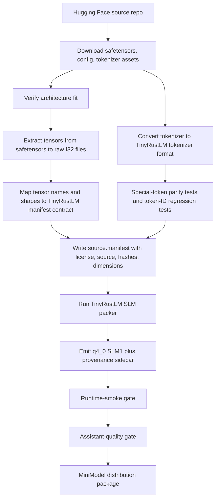

# Real Tiny Model Candidate Research

## Executive summary

The short version is that **TinyRustLM’s current browser/runtime constraints are more restrictive than the small-model market itself**. The present implementation loads only custom `.slm`, runs scalar CPU inference on the main thread, transfers the entire artifact into WASM memory in one shot, rejects transfers above **128 MiB**, and currently **rejects GQA/MQA** because it requires `head_count == kv_head_count`. It also documents custom tokenizer formats (`BTOK` and `BPE1`) rather than direct Hugging Face tokenizer ingestion. In practice, that makes many attractive modern “small” instruct models — especially SmolLM2, Qwen2.5 0.5B, H2O Danube3 500M, and OpenELM 270M — poor current fits even when their licenses and model cards look good. citeturn12view0turn13search0turn12view1turn10view2turn15view0

With those constraints, the **best current first production-quality `.slm` target is `Felladrin/Llama-160M-Chat-v1` in `q4_0`**, not because it is the strongest tiny model in the broader ecosystem, but because it is the strongest **currently researchable, Llama-style, MHA-compatible, Apache-2.0, safetensors-backed, already chat-tuned** candidate that appears to fit TinyRustLM’s present loader model. It also has published GGUF/ONNX/MLC derivatives, which lowers operational risk. Its biggest weakness is straightforward: quality is still modest for a 160M chat model. citeturn37view0turn40view0turn13search0turn12view1

After that, the most realistic path is not another off-the-shelf chat model, but **a technically clean base model plus a compact instruct tune**. `JackFram/llama-160m` is the cleanest such base in the fetched evidence: Apache-2.0, safetensors, explicit tokenizer assets, Llama architecture, and — crucially — `num_attention_heads == num_key_value_heads == 12`, which satisfies TinyRustLM’s current restriction. `amd/AMD-Llama-135m` is also promising as a base because AMD benchmarked it against GPT-2, OPT-125M, and JackFram’s 160M model, but the fetched evidence did not surface its exact config blob, so its dossier below is slightly more provisional. citeturn40view0turn39view0turn41view2

The major strategic conclusion is this: **if TinyRustLM stays as-is, the platform should optimize around roughly sub-160M to sub-200M Llama-style MHA models, preferably with Apache-2.0 licensing and tokenizer assets that can be converted deterministically**. If TinyRustLM later adds **GQA support** and **streamed/chunked artifact admission**, the candidate universe expands immediately to substantially better modern models. Under the current implementation, though, the best recommendation is:

| Rank | Candidate | Feasibility score | Why it ranks here |
|---|---|---:|---|
| Best current target | `Felladrin/Llama-160M-Chat-v1` | **81/100** | Best off-the-shelf balance of architecture fit, permissive license, safetensors, chat readiness, and alternate artifact ecosystem. Quality is limited but usable for short assistant tasks. citeturn37view0turn40view0 |
| Best clean base | `JackFram/llama-160m` | **74/100** | Excellent structural fit for TinyRustLM and strong conversion clarity; needs LoRA/SFT to become a real assistant. citeturn39view0turn40view0 |
| Best provisional base | `amd/AMD-Llama-135m` | **69/100** | Strong size tier, Apache-2.0, safetensors, and competitive-for-size base benchmarks; exact config details were not surfaced in the fetched primary snippets, so conversion should start with one verification pass before committing. citeturn41view2turn44search2 |

## Runtime constraints that dominate feasibility

TinyRustLM’s current implementation details matter more than model-card marketing. The inspected MiRust implementation notes say the browser path currently parses **custom `.slm`**, not GGUF; performs **main-thread**, **scalar CPU** inference; **fetches and copies the complete artifact into WASM memory**; and rejects any single model transfer above **128 MiB**. There is no range loading, sharding, persistent model store, or memory-mapped loading path in the current browser implementation. citeturn12view0turn13search0

The second gating factor is the attention implementation. TinyRustLM’s current forward path rejects models where `head_count != kv_head_count`, even though the container header can describe them. That means **Grouped Query Attention and Multi-Query Attention are out today**. Many of the best sub-1B modern models now use GQA, which is why so many otherwise attractive candidates fail. citeturn12view1

The third gating factor is tokenizer compatibility. TinyRustLM currently documents custom tokenizer/container formats and raw trained-source admission into SLM1 through its own packer flow rather than direct Hugging Face import. The packer accepts trained f32 sources and emits `f32`, `q8_0`, or `q4_0` SLM1 artifacts with provenance sidecars, while tokenizer handling is documented separately through TinyRustLM’s own tokenizer formats rather than “drop in `tokenizer.json` and go.” That means tokenizer conversion is a first-class engineering task, not a clerical step. citeturn10view2turn15view0

The quantization math explains the size ceiling. TinyRustLM’s current `q8_0` stores **one byte per matrix element plus one f32 scale per row**; `q4_0` stores **two 4-bit values per byte plus one f32 scale per block**. In best-case size terms, `q8_0` is roughly **1 byte/parameter** and `q4_0` is roughly **0.5 byte/parameter**, before modest overhead for scales and headers. That means the current 128 MiB transfer ceiling effectively pushes browser-safe candidates toward roughly **<128M params for q8** and **<~256M params for q4**, with some safety margin needed in practice. citeturn15view0turn13search0

Peak RAM is not just model size. TinyRustLM’s documented formulas show scratch memory as `4 × (10 × hidden_size + 3 × ffn_size + max_context)`, and KV cache as `2 × layers × max_context × kv_heads × head_dim × 4`. That means small models with large contexts can still have surprisingly large runtime memory footprints. For a 160M Llama-style model with 12 layers, 12 KV heads, head dimension 64, and 2048 context, the KV cache alone is about **144 MiB** by formula; with a q4 model artifact of about **76 MiB best-case lower bound**, total live memory is already around **220 MiB+** before logits, tokenizer state, and allocator overhead. This is still feasible on desktops, but it is no longer “tiny” in browser terms. citeturn12view1turn12view2turn40view0

## Ranked candidates

The table below uses the current TinyRustLM implementation as the scoring baseline. “Browser fit” means “fit for the implementation that exists,” not “fit for an ideal future WebGPU runtime.”

| Candidate | Params and disk starting point | Browser and WASM fit | Tokenizer compatibility | Artifacts | License | Instruction readiness | Quantization recommendation | Expected runtime footprint | MiniModel.org suitability proxy | Score |
|---|---|---|---|---|---|---|---|---|---|---:|
| `Felladrin/Llama-160M-Chat-v1` | 0.2B params on the model card; same basic parameter tier as `JackFram/llama-160m`, whose safetensors file is 650 MB. citeturn37view0turn39view0 | **Good enough in q4 only.** Best-case q4 lower bound is about 76 MiB; q8 lower bound is about 153 MiB, so q8 is out under the current 128 MiB transfer ceiling. Full 2048-context runtime is heavy because KV cache is large. citeturn37view0turn40view0turn15view0turn13search0turn12view1 | **Medium risk.** Llama-family tokenizer pattern and chat special tokens; safest path is tokenizer export plus parity tests. The model card exposes a custom chat prompt format using `<|im_start|>` / `<|im_end|>`. citeturn37view0turn32search18turn10view2 | Safetensors on the main repo; GGUF, ONNX, MLC, and MLX variants are linked from the card. citeturn37view0 | Apache-2.0. citeturn37view0 | Already chat-tuned. citeturn37view0 | `q4_0` first. Keep original f32/safetensors for conversion source and provenance. citeturn15view0turn10view2 | At 2048 ctx: about 76 MiB q4 model lower bound + 144 MiB KV + negligible scratch/logits = about 220–240 MiB practical budget; at 1024 ctx, KV falls to about 72 MiB. citeturn12view1turn12view2turn40view0turn15view0 | **Strongest current fit** if the distribution criteria are “small enough, permissive, redistributable, and provenance-complete.” citeturn10view2turn37view0 | 81 |
| `JackFram/llama-160m` | 160M params; `model.safetensors` is 650 MB. citeturn39view0turn40view0 | **Good in q4, not q8.** Same size profile as the Felladrin fine-tune. citeturn15view0turn13search0turn40view0 | **Medium risk.** The repo definitely exposes `tokenizer.json` and `tokenizer.model`, which is very helpful, but TinyRustLM still needs its own tokenizer conversion path. citeturn39view0turn10view2 | Safetensors confirmed. citeturn39view0 | Apache-2.0. citeturn40view0 | Base model only; needs LoRA/SFT for assistant behavior. citeturn40view0turn41view2 | `q4_0` for browser. Keep f32 source for PTQ and optional LoRA branch. citeturn15view0turn10view2 | Same as above: about 220–240 MiB practical at 2048 ctx, closer to ~150 MiB if capped around 1024 ctx. citeturn12view1turn12view2turn40view0turn15view0 | Good if MiniModel-style distribution can tolerate “base-only” plus metadata; weaker than Felladrin because it is not assistant-ready. citeturn10view2turn39view0 | 74 |
| `amd/AMD-Llama-135m` | Model card reports 0.1B-class size, safetensors, and Apache-2.0. The repo definitely has `tokenizer.json`. Exact config lines were not surfaced in the fetched snippets. citeturn41view2turn44search2 | **Likely q4-only for portable browser use; q8 is probably too close or above the 128 MiB limit.** Best-case lower bound is about 64 MiB q4 and about 129 MiB q8. citeturn15view0turn13search0 | **Unknown-to-medium risk.** `tokenizer.json` is confirmed, but I did not fetch the config/tokenizer internals directly, so one verification pass is still required. citeturn44search2 | Safetensors confirmed; GGUF availability was not verified in the fetched primary sources. citeturn41view2 | Apache-2.0. citeturn41view2 | Base model only; there is also a code fine-tune variant, but not a general chat variant in the fetched material. citeturn41view2turn38search4 | `q4_0` for browser; use the f32 source as the PTQ base and apply a compact instruct LoRA if the target is assistant behavior. citeturn15view0turn10view2 | Model-only lower bound is favorable; total runtime footprint still needs exact config verification before publishing a hard number. citeturn41view2turn15view0 | Good license and provenance story; not as turnkey as Felladrin. citeturn41view2 | 69 |

A more important comparative conclusion than the scores themselves: **today’s best TinyRustLM candidates are structurally constrained candidates, not benchmark winners**. That is why the highest-ranked model here is a 160M community chat tune rather than a much stronger 360M–500M official instruct model. citeturn12view0turn12view1turn17view0turn25view0turn31view0

## Candidate dossiers

### Felladrin Llama 160M Chat

This is the strongest current choice if the goal is “ship a `.slm` that already behaves like a chat model.” Its model card is unusually useful for deployment work: it names the base model (`JackFram/llama-160m`), lists the fine-tuning datasets, publishes prompt formatting, and links GGUF, ONNX, MLC, and MLX derivatives. That combination materially lowers conversion risk. It is also Apache-2.0. citeturn37view0

**Why it fits TinyRustLM:** the base model config shows a standard Llama-style architecture with **12 layers**, **hidden size 768**, **12 attention heads**, and **12 KV heads**. That exact equality of attention heads and KV heads is the decisive compatibility trait under TinyRustLM’s current implementation. citeturn40view0turn12view1

**Tokenizer handling:** the prompt format uses chat boundary tokens `<|im_start|>` and `<|im_end|>`. Because TinyRustLM uses its own tokenizer/container conventions, the safest route is to treat tokenizer conversion as a validation-heavy step: export vocabulary and merges from the original tokenizer assets, map the special tokens explicitly, and compare token IDs on a regression corpus covering whitespace, punctuation, Unicode, system messages, and assistant prefixes. The risk is not “out-of-vocabulary” in the classic sense; it is **tokenization drift**, especially around whitespace normalization and special-token segmentation. citeturn37view0turn10view2turn32search18

**Recommended conversion start files:** start from `model.safetensors` in the fine-tuned repo, plus tokenizer assets resolved by `AutoTokenizer`; if you want the most explicit artifact grounding, the base repo definitely exposes `tokenizer.json` and `tokenizer.model`, which can be used as the tokenizer source of truth. citeturn37view0turn39view0

**Quantization recommendation:** use **`q4_0` first**. `q8_0` is effectively disqualified by the current 128 MiB browser transfer ceiling, while `q4_0` gives a best-case model lower bound near 76 MiB for the 160M tier. citeturn15view0turn13search0

**Expected RAM and WASM footprint:**  
At full 2048 context, the model is not tiny in live memory. By TinyRustLM’s documented formula, KV cache at 2048 is about **144 MiB**, while scratch is tiny by comparison. A q4 model artifact adds about **76 MiB best-case lower bound**, so practical live memory is around **220–240 MiB**. If you cap browser context at **1024**, KV cache drops to about **72 MiB**, which is a much healthier operational target for first release. citeturn12view1turn12view2turn15view0turn40view0

**Quality expectations:** the model card publishes old-leaderboard values like **MMLU 26.13**, **HellaSwag 35.29**, **TruthfulQA 44.16**, and an overall legacy average of **30.27**; it also shows a very low score on the newer Open LLM Leaderboard. The practical interpretation is simple: it can support **short reformulation, lightweight Q&A, templated assistance, and toy chat**, but it is not a serious reasoning, coding, or long-context model. citeturn37view0

### JackFram llama 160M

This is the cleanest base checkpoint for a TinyRustLM-native assistant if you are willing to do a compact instruct tune. The repository clearly surfaces `config.json`, `model.safetensors`, `tokenizer.json`, and `tokenizer.model`, and the config is as straightforward as it gets for TinyRustLM: Llama architecture, **12/12 attention/KV heads**, 2048 context, and 32k vocabulary. citeturn39view0turn40view0

**Why it fits TinyRustLM:** architecturally, it matches the current runtime’s implemented path: Llama-style RMSNorm/SwiGLU/RoPE structure and MHA rather than GQA/MQA. That is exactly the shape of checkpoint TinyRustLM can plausibly target through its packer path today. citeturn40view0turn12view1turn10view2

**Tokenizer handling:** because both `tokenizer.json` and `tokenizer.model` are surfaced, this model is a good engineering target for building a repeatable Llama-tokenizer-to-`BPE1` converter. The likely failure modes are prefix-space handling, special token alignment, and any SentencePiece-specific segmentation behavior that does not flatten perfectly into TinyRustLM’s tokenizer representation. That is manageable, but it requires test coverage. citeturn39view0turn32search18turn10view2

**Recommended conversion start files:** `model.safetensors`, `config.json`, `tokenizer.json`, `tokenizer.model`, `tokenizer_config.json`, and `special_tokens_map.json`. Those are all orthogonal, useful provenance inputs even if the final `.slm` embeds or references a transformed tokenizer. citeturn39view0turn40view0

**Quantization recommendation:** again, **`q4_0`** is the current browser target; q8 is too large for TinyRustLM’s present transfer ABI. Because this is a base model, it is also a good **LoRA/QLoRA parent checkpoint** if you want to produce a custom small instruct model first and only then convert to `.slm`. citeturn15view0turn13search0turn10view2

**Expected RAM and WASM footprint:** identical to the Felladrin fine-tune at the architecture level — about **220–240 MiB** practical live memory at 2048 context with q4, and materially safer if you clamp context to **512 or 1024** for browser release. citeturn12view1turn12view2turn15view0turn40view0

**Quality expectations:** the best benchmark evidence fetched here is indirect but useful: AMD’s model card compares `JackFram/llama-160m` against GPT-2 124M, OPT-125M, and AMD-Llama-135M and reports weak-to-modest small-model results such as **MMLU 0.2299**, **HellaSwag 0.3094**, and **ARC-Easy 0.4335**. That is consistent with “usable base model for narrow fine-tuning,” not “good general assistant out of the box.” citeturn41view2

### AMD Llama 135M

`amd/AMD-Llama-135m` is the strongest **provisional** candidate in this report. It has an Apache-2.0 license, safetensors, a tokenizer JSON file on the model repo, and unusually solid base-model benchmark reporting for its size class. AMD’s model card shows it slightly ahead of or competitive with GPT-2 124M, OPT-125M, and JackFram’s 160M model on several tasks, even if the absolute scores remain small-model-limited. citeturn41view2turn44search2

**Why it is only provisional:** I did not fetch its exact `config.json` contents during the web phase, so I cannot state its layer/head geometry with the same confidence as the JackFram/Felladrin pair. The model is described as Llama-based and it clearly has the right packaging qualities, but before committing engineering time I would verify one thing first: **that `num_attention_heads == num_key_value_heads`**. If that check passes, it immediately becomes one of the cleanest TinyRustLM candidates in the entire sub-150M tier. citeturn41view2turn12view1

**Recommended conversion start files:** `model.safetensors`, `config.json`, `tokenizer.json`, and standard tokenizer metadata. The presence of `tokenizer.json` is already a practical advantage because it gives you a more direct route to deterministic tokenizer conversion than a model that depends only on opaque external tokenizer references. citeturn44search2turn41view2

**Quantization recommendation:** use **`q4_0`** for browser-facing deployment. At about 135M parameters, the optimistic q8 lower bound is still about **129 MiB**, which is already too close to or slightly over the current transfer ceiling before overhead; q4 is much safer. citeturn15view0turn13search0

**Expected RAM and WASM footprint:** model-only size is favorable — about **64 MiB best-case lower bound** in q4 — but I am not giving a precise total runtime footprint because the exact config values needed for KV/scratch arithmetic were not surfaced in the fetched primary snippets. That uncertainty should be resolved in the first engineering pass. citeturn41view2turn15view0

**Quality expectations:** AMD reports `AMD-Llama-135M` at **SciQ 0.761**, **PIQA 0.642**, **Lambada 0.333**, **ARC-Easy 0.4364**, and **HellaSwag 0.3048**, broadly in the same neighborhood as the JackFram 160M base but sometimes ahead on data-heavy language modeling tasks. That makes it a sensible compact base for **one high-quality LoRA/SFT pass** if your goal is a domain-specific or tightly-scaffolded assistant rather than open-ended chat. citeturn41view2

## Excluded models and why

Several models look excellent on paper and still fail under the current TinyRustLM implementation.

| Model | Why it looked promising | Why I exclude it for TinyRustLM today |
|---|---|---|
| `HuggingFaceTB/SmolLM2-135M-Instruct` | Small, Apache-2.0, safetensors, Transformers.js support, marketed for on-device use. citeturn17view1turn29view0 | The config shows **9 attention heads and 3 KV heads**, so it uses GQA; TinyRustLM currently rejects `head_count != kv_head_count`. Also, even its q8 lower bound is about **128.7 MiB**, already beyond the present transfer ceiling. citeturn30view0turn12view1turn13search0turn15view0 |
| `HuggingFaceTB/SmolLM2-360M-Instruct` | Better quality than 135M; Apache-2.0; safetensors; on-device positioning. The card even reports it ahead of Qwen2.5-0.5B on some zero-shot tasks. citeturn17view0 | The config shows **15 attention heads and 5 KV heads**, again GQA, and the q4 lower bound is already around **172 MiB**, so it fails both architecture and artifact-size gates. citeturn28view0turn12view1turn13search0turn15view0 |
| `Qwen/Qwen2.5-0.5B-Instruct` | Apache-2.0, safetensors, strong sub-1B instruct model, chat-ready. citeturn17view2turn22search0 | The config shows **14 attention heads and 2 KV heads**; q4 lower bound is about **238 MiB**; and the tokenizer is large and special-token-heavy (`vocab_size 151,936` plus many control tokens), which amplifies tokenizer-porting risk. citeturn25view0turn18view3turn13search0turn15view0 |
| `h2oai/h2o-danube3-500m-chat` | Apache-2.0, safetensors, chat-tuned, and officially released GGUF variants. citeturn17view3turn20search3 | The config shows **16 attention heads and 8 KV heads**, so GQA/MQA-style incompatibility applies, and q4 lower bound is again about **238 MiB**. citeturn31view0turn12view1turn13search0turn15view0 |
| `apple/OpenELM-270M-Instruct` | Tiny-ish instruct model, on-device positioning, Llama tokenizer family. citeturn32search0turn33search9 | The config exposes variable **query-head / KV-head** counts and `num_gqa_groups`, so it is incompatible today; its q4 lower bound is already about **128.7 MiB**; and Apple’s own notes say the model depends on the **Llama 2 tokenizer**, which created loading/gating friction in practice. The fetched ecosystem evidence also surfaced Apple-sample-code licensing in the wider OpenELM package family, so the legal story is weaker than Apache-2.0 candidates. citeturn33search0turn32search11turn33search5turn32search12turn13search0turn15view0 |

The practical implication is blunt: **TinyRustLM is currently blocked not by lack of tiny models, but by a mismatch with where small open-model design has gone**. The field has largely moved toward GQA and somewhat larger “small” models, while TinyRustLM currently wants very small **MHA** models with conservative tokenizer and artifact properties. citeturn12view1turn17view0turn25view0turn31view0turn33search0

## Conversion pipeline and recommendation

The current `.slm` conversion path should be treated as a controlled packaging pipeline, not a generic “convert any Hugging Face checkpoint” utility. TinyRustLM documents a **trained-source admission** step centered on a line-based `source.manifest`, with source identity, tokenizer information, license/dataset fields, tensor records, byte validation, checksums, and f32 finite-value checks. The packer then emits `f32`, `q8_0`, or `q4_0` SLM1 plus provenance sidecar data. citeturn10view2

A good first implementation pipeline is:

The engineering recommendation is to **gate conversion in this order**:

Start by checking **architecture fit** against the current runtime: Llama-like block structure, no unsupported tensor tricks, and especially **MHA rather than GQA/MQA**. Then build a tokenizer regression harness before spending time on quantization. Tokenizer drift is one of the easiest ways to make an apparently “successful” conversion silently wrong. After that, generate a q4 artifact, run TinyRustLM’s smoke path, and only then benchmark assistant behavior. citeturn12view1turn10view2turn15view0

For a first release, the best target is:

**Recommended first production-quality `.slm` target: `Felladrin/Llama-160M-Chat-v1` in `q4_0`, with browser context clamped to 512–1024 tokens.**  
That recommendation is driven by current implementability, not by prestige. It is Apache-2.0, already chat-tuned, structurally compatible through its base model, supported by safetensors, and surrounded by alternative deployment artifacts. Keeping context lower than the full 2048 window keeps KV memory from dominating the runtime. citeturn37view0turn40view0turn12view1turn13search0turn15view0

If you want the **best longer-term production route**, the answer is slightly different: use `JackFram/llama-160m` or `amd/AMD-Llama-135m` as the base, perform one compact **LoRA/QLoRA instruct tune** on a small, carefully curated assistant dataset, then convert the merged checkpoint into `.slm`. That gives you cleaner control over chat template, tokenizer behavior, and domain style than relying on an unknown-quality community fine-tune. citeturn39view0turn40view0turn41view2turn10view2

## Open questions and limitations

A few things remain unresolved in the fetched evidence and should stay explicit.

I did **not** find a public, first-party MiniModel.org packaging specification in the fetched sources, so I treated “MiniModel suitability” as a proxy for three things that *are* evidenced: artifact smallness under TinyRustLM’s present browser loader, a permissive redistributable license, and enough provenance metadata to satisfy TinyRustLM’s documented trained-source admission flow. citeturn10view2turn12view0

For `amd/AMD-Llama-135m`, the fetched primary sources clearly establish license, safetensors presence, tokenizer JSON presence, and benchmark position, but they did **not** surface the full config blob. That means its final ranking is slightly provisional until one config verification pass confirms attention/KV-head equality and context geometry. citeturn41view2turn44search2

Finally, the ranking would change materially if TinyRustLM adds even two features that its own documentation already marks as missing: **GQA support** and **streamed/chunked artifact admission or persistent browser storage**. If those land, stronger models like SmolLM2-135M-Instruct and eventually some 270M–500M-class models move from “excluded” to “serious candidates.” Under the implementation that exists today, though, the narrow recommendation above is the rigorous one. citeturn12view0turn12view1turn13search0