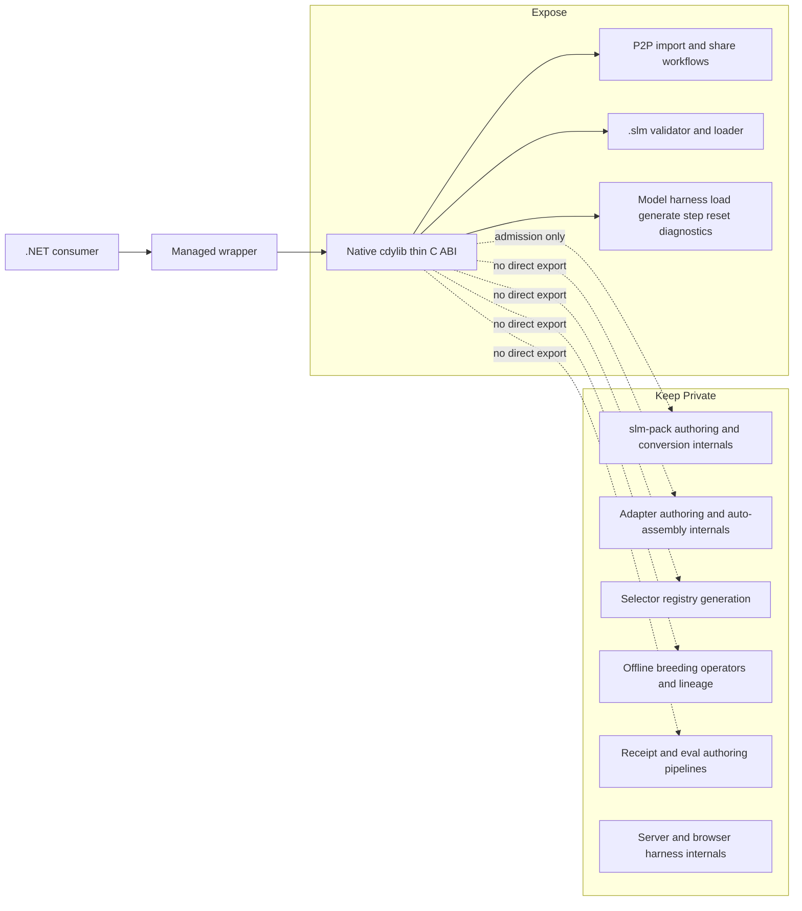
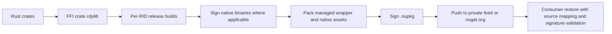

# TinyRustLM to NuGet Packaging Plan for Protected .NET Distribution

## Executive summary

TinyRustLM, as publicly documented today, is a browser-local Rust/WASM small-language-model system with a deliberately narrow runtime envelope: a fixed 33,554,432-byte model budget, zero third-party runtime stack, `.slm` as its project-specific model artifact, and a public stance that servers do not host runnable model bytes or perform remote inference. The inspected implementation also shows a four-crate Rust workspace: `tinyrustlm-runtime`, `tinyrustlm-slm-pack`, `tinyrustlm-local-server`, and `tinyrustlm-browser-harness`; the runtime currently exposes a raw C-style ABI in WASM for allocation, model loading, generation, diagnostics, reset, stepping, and model release, and the current runtime ownership model is a process-global `Mutex<Option<Runtime>>`. That evidence strongly supports a packaging strategy that exports only a very thin native contract for `.slm` loading, inference harness operations, and selected P2P workflows, while keeping packer internals, adapters, selector assembly logic, offline breeding, provenance/eval authoring, and any orchestration logic private. citeturn4view0turn5view2turn5view3turn35view0turn36view0turn38view0turn38view1turn39view0

The right interop target for .NET is **not** the Rust ABI. Rust’s reference explicitly states that the Rust ABI offers no stability guarantees; for a distributable native boundary, use `extern "C"` and package a `cdylib`, whose symbol visibility is intentionally narrower than Rust-native library forms. On the .NET side, Microsoft recommends `[LibraryImport]` on .NET 7+ and `SafeHandle` for unmanaged lifetimes. For NuGet packaging, Microsoft’s native-package guidance is explicit: compile assets go in `ref/{tfm}/`, managed runtime assets in `runtimes/{rid}/lib/{tfm}/`, and native libraries in `runtimes/{rid}/native/`. Portable RIDs such as `win-x64`, `win-arm64`, `linux-x64`, `linux-arm64`, `linux-musl-x64`, `osx-x64`, and `osx-arm64` are the recommended basis for cross-platform packages. citeturn22view3turn22view0turn22view4turn23view0turn23view2turn24view0turn24view2turn25view0

The most important anti-theft finding is that **obfuscation is only a speed bump**. Rust’s own compiler documentation states that symbol stripping cannot be relied on as a meaningful security or obfuscation measure, even though stripping, ThinLTO, and narrow export surfaces still materially reduce casual reverse engineering and accidental symbol leakage. Real protection has to come from architectural minimization: export only task-safe APIs, use opaque handles, keep manifest/eval/breeding/adapter authoring private, ship only admitted `.slm` and P2P receiver/share workflows, sign NuGet packages, restrict feeds and views, require trusted signers where feasible, map package sources to prevent dependency confusion, and layer legal controls such as a commercial EULA/license file over private distribution. citeturn31view0turn31view1turn32view0turn27view0turn27view1turn27view3turn26view2turn26view6turn15search0turn15search3

## Current TinyRustLM inventory and exposure strategy

The public documentation gives enough evidence to separate TinyRustLM into distributable core capabilities versus strategically private capabilities. The architecture page identifies the system as a static browser UI plus Rust/WASM runtime, `.slm` format, offline packer, local server, browser harness, and model-breeding evidence path. Additional pages describe adapters, selector registries, P2P metadata/share-kit flows, and metadata-only catalogs that intentionally keep `.slm` bytes off project servers. citeturn38view1turn36view1turn37view0turn37view1



### Shareability, risk, and protection table

| Module or capability | Observable basis | Recommendation | Risk level | Rationale and required protections |
|---|---|---|---|---|
| `tinyrustlm-runtime` core inference surface | Runtime crate contains parser, tokenizer, tensors, quantized kernels, transformer execution, sampling, diagnostics, eval runner; runtime is the verified execution surface. citeturn4view0turn34view0turn38view0 | **Expose a subset** | High | Expose only `.slm` admission, load/unload, tokenize/generate/step/reset, bounded diagnostics, and version/capability queries. Do **not** expose tensor layouts, packer hooks, eval authoring, adapter application internals, or registry mutation. Use opaque handles and typed errors. citeturn20view0turn22view3turn22view4 |
| `.slm` artifact validation and loading | `.slm` is project-specific, strict, bounded, 108-byte header, 64-byte tensor entries, checksums, tokenizer inclusion, bounded validation. citeturn36view0turn4view6 | **Expose** | Medium | This is a natural product boundary because it preserves TinyRustLM’s narrow artifact contract while withholding packer internals. Export validator/load APIs, but not format-authoring helpers. Keep write/convert/publish tools private. citeturn36view0turn34view0 |
| P2P import and local share-kit workflows | TinyRustLM documents P2P import, metadata-only catalogs, announcement feeds, receiver kits, share kits, and keeping `.slm`/peer pieces off project servers. citeturn17view0turn36view1turn39view0 | **Expose selected workflows** | High | P2P is strategically valuable, but only the receiver/share orchestration should be public. Hide piece-store layout, admission logic, peer-companion internals, and any server-side tooling. Export manifest/receipt-gated import plus local share preparation only. citeturn39view0 |
| `tinyrustlm-slm-pack` authoring and conversion | Packer writes fixtures, validates admission, validates provenance manifests, converts raw f32 sources, emits quantized variants, enforces gates. citeturn4view0 | **Keep private** | Very high | This is the fastest path to clone enablement. Shipping conversion/quantization/provenance tooling materially lowers rehosting and derivative-product risk. Prefer operating it as an internal build service or internal-only package. citeturn4view0turn38view1 |
| Adapter sidecars and auto-assembly | ADP1/ASP1/ALR1 are typed local sidecars; Rust validates before apply; module-plan and receipt verification precede apply. citeturn37view0turn35view0 | **Mostly private** | Very high | If exposed at all, expose only *apply admitted adapter sidecar* using a pre-validated package format. Keep authoring, stack planning, budget rules, receipt generation, and family-specific tooling private. citeturn37view0 |
| Selector registry generation | Selector registry declares eligible admitted model routes and requires byte counts, budgets, manifests, adapter fields, module-plan receipts, and strategy metadata. citeturn39view0 | **Keep private** | High | Registry generation is product logic. Public consumers may read allowed routes through a query API, but should not author or mutate registry state. citeturn39view0 |
| Offline model breeding and candidate lineage | Model breeding is an offline evidence pipeline with operator suites, receipts, manifests, runtime-smoke gates, eval sidecars, selector admission. citeturn37view1 | **Keep private** | Very high | This is proprietary differentiation. Publish none of the breeding operators, lineage templates, or promotion ledgers. At most, allow consumers to read lineage metadata already attached to an admitted artifact. citeturn37view1 |
| `tinyrustlm-local-server` | Loopback-only static server, GET/HEAD, traversal rejection, app/WASM/model route surface. citeturn4view0 | **Keep private or split separately** | Medium | Not needed for .NET library consumption. If ever released, make it a separate operational package, not part of the core inference NuGet. citeturn4view0 |
| `tinyrustlm-browser-harness` | Static contract crawler, loopback probe, route/content-type/WASM-call checks; browser harness validates app contracts. citeturn4view0turn35view0 | **Keep private** | Low to Medium | Valuable for your internal QA; low user value as a package dependency. Ship its outputs as proof artifacts, not the harness itself. citeturn35view0 |

The highest-confidence product boundary is therefore: **public NuGet = native runtime harness + `.slm` admission/inspection + P2P import/share receiver flows**; **private = authoring, conversion, quantization tooling, adapter authoring, selector assembly, breeding, and proof-pipeline internals**. That boundary fits the observable TinyRustLM architecture and minimizes the amount of implementation logic that a consumer can repurpose into a wholesale clone. citeturn38view1turn37view0turn37view1turn39view0

## Native ABI and package design

Rust is the wrong thing to expose directly at the ABI boundary. The Rust reference says the Rust ABI offers no stability guarantees; use `extern "C"` for a stable native boundary, and package the export crate as a `cdylib`. The `cdylib` RFC is particularly useful here because it formalizes the symbol-visibility advantage: Rust `pub` items are not exported unless you explicitly mark C-facing entry points, and the compiler may further hide Rust symbols. citeturn22view3turn22view0

### Recommended build outputs

| Layer | Recommendation | Why |
|---|---|---|
| Internal crates | Keep existing Rust crates, but add a dedicated FFI crate such as `tinyrustlm-native` | Separates distributable ABI from implementation crates and lets you audit the public surface independently. This follows from Rust’s unstable native ABI and the visibility model of `cdylib`. citeturn22view3turn22view0 |
| Export crate type | `cdylib` | Appropriate for foreign-language consumption; narrower symbol surface than Rust-native dylibs. citeturn22view0 |
| Calling convention | `extern "C"` for cross-platform exports; optionally `extern "system"` only when specifically binding Windows APIs internally | `extern "C"` is the cross-language default; `extern "system"` is mainly for calling Windows APIs, not for a general product ABI. citeturn22view3 |
| Export style | Explicitly named exports only, via `#[unsafe(no_mangle)] pub extern "C"` | Keeps the symbol table intentionally small and predictable. citeturn22view0turn31view0 |
| Object ownership | Opaque handles, never Rust structs across the boundary | Rustonomicon guidance favors opaque FFI structs or `c_void` handles when internals must stay hidden. citeturn20view0turn20view1 |
| Panic behavior | `panic = "abort"` for release FFI builds, or catch panics internally and convert to error codes | Panics must not cross FFI unpredictably; Cargo exposes `panic` strategy control, and the Nomicon shows `catch_unwind` if you need conversion instead of abort. citeturn31view1turn20view0 |
| Link-time hardening | ThinLTO, strip debuginfo or symbols, low codegen-units, release-only | Reduces accidental disclosure and improves size/perf, but Rust explicitly warns this is not a meaningful obfuscation measure by itself. citeturn31view1turn32view0 |

### Minimal exported APIs

The public ABI should be smaller than TinyRustLM’s current raw WASM surface and should group operations into three capabilities: **P2P**, **`.slm`**, and **model harness**.

| Capability | Public functions to expose | Keep private behind these functions |
|---|---|---|
| `.slm` | `trlm_slm_validate_file`, `trlm_slm_inspect_file`, `trlm_model_load_file`, `trlm_model_unload` | Header parsing details, tensor directory loaders, checksum algorithms, tokenizer internals, quantization kernels. citeturn36view0turn4view6 |
| Model harness | `trlm_runtime_create`, `trlm_runtime_destroy`, `trlm_generate`, `trlm_step`, `trlm_reset`, `trlm_get_last_error`, `trlm_get_diagnostics_json`, `trlm_get_version`, `trlm_get_caps` | Internal runtime state, scratch arenas, logits buffers, KV cache implementation, eval runner details. citeturn38view0turn5view3 |
| P2P | `trlm_p2p_import_from_manifest`, `trlm_p2p_prepare_share`, `trlm_p2p_write_announcement`, `trlm_p2p_apply_announcement`, `trlm_p2p_export_share_metadata` | Piece-store formats, peer-companion internals, catalog merge logic, drift-check authoring, operational scripts. citeturn39view0 |

A recommended C ABI shape is below. It deliberately uses only POD types, raw pointers, lengths, and opaque handles.

```rust
// tinyrustlm-native/src/lib.rs

use core::ffi::{c_char, c_int, c_uchar, c_void};

#[repr(C)]
pub struct TrlmRuntimeHandle {
    _data: (),
    _marker: core::marker::PhantomData<(*mut u8, core::marker::PhantomPinned)>,
}

#[repr(C)]
pub struct TrlmBuffer {
    pub ptr: *const c_uchar,
    pub len: usize,
}

#[repr(C)]
pub struct TrlmGenerateOptions {
    pub max_tokens: u32,
    pub temperature: f32,
    pub top_k: u32,
    pub top_p: f32,
    pub seed: u64,
}

pub const TRLM_OK: c_int = 0;
pub const TRLM_E_INVALID_ARG: c_int = 1;
pub const TRLM_E_VALIDATION: c_int = 2;
pub const TRLM_E_IO: c_int = 3;
pub const TRLM_E_RUNTIME: c_int = 4;
pub const TRLM_E_UNSUPPORTED: c_int = 5;

#[unsafe(no_mangle)]
pub extern "C" fn trlm_runtime_create() -> *mut TrlmRuntimeHandle {
    core::ptr::null_mut()
}

#[unsafe(no_mangle)]
pub extern "C" fn trlm_runtime_destroy(_handle: *mut TrlmRuntimeHandle) {}

#[unsafe(no_mangle)]
pub extern "C" fn trlm_model_load_file(
    _handle: *mut TrlmRuntimeHandle,
    _path_utf8: *const c_char
) -> c_int {
    TRLM_E_UNSUPPORTED
}

#[unsafe(no_mangle)]
pub extern "C" fn trlm_generate(
    _handle: *mut TrlmRuntimeHandle,
    _prompt_utf8: *const c_char,
    _opts: *const TrlmGenerateOptions,
    _result: *mut TrlmBuffer
) -> c_int {
    TRLM_E_UNSUPPORTED
}

#[unsafe(no_mangle)]
pub extern "C" fn trlm_buffer_free(_ptr: *const c_void, _len: usize) {}

#[unsafe(no_mangle)]
pub extern "C" fn trlm_get_last_error_utf8(
    _handle: *mut TrlmRuntimeHandle,
    _result: *mut TrlmBuffer
) -> c_int {
    TRLM_E_UNSUPPORTED
}
```

That design is intentionally **instance-oriented**, even though the observed TinyRustLM runtime is currently process-global. This is a recommendation, not a claim about the current codebase: given the documented process-global `Mutex<Option<Runtime>>`, moving the NuGet-facing ABI to opaque instance handles would reduce .NET concurrency friction, improve test isolation, and leave room for later multi-model support without breaking the managed API. citeturn5view2

## NuGet layout, RIDs, and CI/CD

Microsoft’s native-package guidance for .NET is clear and should be followed exactly: put compile-time managed assets under `ref/{tfm}/`, runtime managed assets under `runtimes/{rid}/lib/{tfm}/`, and native libraries under `runtimes/{rid}/native/`. The same API surface must compile on every RID; if a platform is unsupported, the managed layer should fail at runtime with an explicit platform error. For package portability, favor the portable RID graph rather than distro-specific RIDs. citeturn24view0turn24view2turn25view0

### Recommended package layout

```text
TinyRustLM.Core/
  ref/
    net8.0/
      TinyRustLM.Core.dll
  runtimes/
    win-x64/
      native/
        tinyrustlm_native.dll
      lib/
        net8.0/
          TinyRustLM.Core.dll
    win-arm64/
      native/
        tinyrustlm_native.dll
      lib/
        net8.0/
          TinyRustLM.Core.dll
    linux-x64/
      native/
        libtinyrustlm_native.so
      lib/
        net8.0/
          TinyRustLM.Core.dll
    linux-arm64/
      native/
        libtinyrustlm_native.so
      lib/
        net8.0/
          TinyRustLM.Core.dll
    linux-musl-x64/
      native/
        libtinyrustlm_native.so
      lib/
        net8.0/
          TinyRustLM.Core.dll
    osx-x64/
      native/
        libtinyrustlm_native.dylib
      lib/
        net8.0/
          TinyRustLM.Core.dll
    osx-arm64/
      native/
        libtinyrustlm_native.dylib
      lib/
        net8.0/
          TinyRustLM.Core.dll
  buildTransitive/
    TinyRustLM.Core.targets
  LICENSE.txt
  README.md
```

| RID | Rust target triple | Priority |
|---|---|---|
| `win-x64` | `x86_64-pc-windows-msvc` | Must-have |
| `win-arm64` | `aarch64-pc-windows-msvc` | Must-have |
| `linux-x64` | `x86_64-unknown-linux-gnu` | Must-have |
| `linux-arm64` | `aarch64-unknown-linux-gnu` | Must-have |
| `linux-musl-x64` | `x86_64-unknown-linux-musl` | Should-have for Alpine/container consumers |
| `osx-x64` | `x86_64-apple-darwin` | Must-have |
| `osx-arm64` | `aarch64-apple-darwin` | Must-have |

The RID choices above align with Microsoft’s recommended portable RIDs and Rust’s officially supported target model. citeturn25view0turn13search0turn13search7turn13search12

### Packaging flow



### Example `.csproj` packing snippet

```xml
<Project Sdk="Microsoft.NET.Sdk">
  <PropertyGroup>
    <TargetFramework>net8.0</TargetFramework>
    <AllowUnsafeBlocks>true</AllowUnsafeBlocks>
    <GeneratePackageOnBuild>false</GeneratePackageOnBuild>
    <PackageId>TinyRustLM.Core</PackageId>
    <Version>0.1.0</Version>
    <Authors>MiRust</Authors>
    <Description>Protected .NET bindings for selected TinyRustLM runtime capabilities.</Description>
    <PackageLicenseFile>LICENSE.txt</PackageLicenseFile>
    <PackageReadmeFile>README.md</PackageReadmeFile>
    <IncludeBuildOutput>true</IncludeBuildOutput>
  </PropertyGroup>

  <ItemGroup>
    <None Include="LICENSE.txt" Pack="true" PackagePath="" />
    <None Include="README.md" Pack="true" PackagePath="" />

    <None Include="artifacts/win-x64/tinyrustlm_native.dll"
          Pack="true"
          PackagePath="runtimes/win-x64/native/" />
    <None Include="artifacts/win-arm64/tinyrustlm_native.dll"
          Pack="true"
          PackagePath="runtimes/win-arm64/native/" />
    <None Include="artifacts/linux-x64/libtinyrustlm_native.so"
          Pack="true"
          PackagePath="runtimes/linux-x64/native/" />
    <None Include="artifacts/linux-arm64/libtinyrustlm_native.so"
          Pack="true"
          PackagePath="runtimes/linux-arm64/native/" />
    <None Include="artifacts/linux-musl-x64/libtinyrustlm_native.so"
          Pack="true"
          PackagePath="runtimes/linux-musl-x64/native/" />
    <None Include="artifacts/osx-x64/libtinyrustlm_native.dylib"
          Pack="true"
          PackagePath="runtimes/osx-x64/native/" />
    <None Include="artifacts/osx-arm64/libtinyrustlm_native.dylib"
          Pack="true"
          PackagePath="runtimes/osx-arm64/native/" />
  </ItemGroup>
</Project>
```

### Example build profile for the FFI crate

```toml
[lib]
crate-type = ["cdylib"]

[profile.release]
opt-level = 3
lto = "thin"
codegen-units = 1
panic = "abort"
strip = "symbols"
incremental = false
```

Cargo officially supports `lto`, `panic`, and `strip` in profiles, including ThinLTO and stripping symbols, but Rust also warns that stripping is not a true security control. citeturn31view0turn31view1turn32view0

### Recommended CI/CD sequence

| Stage | Actions |
|---|---|
| Rust build | Build `tinyrustlm-native` for each target triple in release mode; produce SBOM/build manifest if you already have internal tooling for it. Rust target support and target selection are standard Cargo workflows. citeturn13search17turn13search19 |
| Native verification | Run ABI smoke tests, `.slm` validation tests, deterministic generation smoke, and P2P manifest/import tests. TinyRustLM already emphasizes Rust tests, WASM ABI smoke, route drift, and performance soak. citeturn35view0 |
| Managed build | Build the AnyCPU wrapper, interop tests, and reference assembly. Microsoft recommends AnyCPU compile assets for best consumer experience. citeturn24view0turn24view2 |
| Package | `dotnet pack` the SDK-style wrapper project. `dotnet pack` is the standard command for producing `.nupkg`. citeturn29search0 |
| Sign | Sign the `.nupkg` and, on Windows, sign native DLLs. NuGet package signing protects integrity and authenticity. citeturn27view0turn27view1turn11search0 |
| Publish | Push with `dotnet nuget push` to a private feed or to nuget.org. Trusted Publishing is preferable on nuget.org because it replaces long-lived secrets with short-lived tokens and temporary API keys. citeturn28search1turn26view5 |

## Security, licensing, telemetry, and anti-theft controls

The public TinyRustLM posture already helps you: the project emphasizes browser-local inference, no project-hosted runnable `.slm` routes, metadata-only catalogs, local manifests/receipts, and P2P workflows that keep model bytes on consenting user machines rather than public project servers. Your NuGet strategy should preserve that product boundary instead of weakening it. citeturn17view0turn36view1turn39view0

### What actually protects you

| Control | Effectiveness | Notes |
|---|---|---|
| Thin C ABI + opaque handles | High | Best technical anti-clone control because it withholds internal structures and algorithms from the public API. citeturn20view0turn22view0 |
| Signed, private feeds | High | Azure Artifacts supports controlled access and feed/view permissions; GitHub Packages requires tokens for install/publish. citeturn26view1turn26view2turn26view3turn26view4 |
| Package source mapping | High | Prevents ambiguous restores and helps reduce dependency-confusion risk when public and private feeds coexist. citeturn26view6 |
| License file / EULA in package | High legally, low technically | Use `PackageLicenseFile` for commercial terms if the package is not open-source licensed. citeturn15search0turn15search3 |
| Symbol stripping | Medium against casual inspection | Helpful for hygiene, but Rust explicitly says it is not a meaningful obfuscation measure. citeturn32view0 |
| Remote license / feature checks | Medium | Useful for commercial control, but they must fail gracefully and respect privacy law. This is policy/architecture, not a substitute for private distribution. |
| Binary code signing | Medium | Adds integrity/authenticity, not secrecy. citeturn11search0turn27view1 |

### Licensing and distribution controls

For the highest-protection SKU, publish the package to a **private feed** first. Azure Artifacts feeds are built for shared package storage with access control, and feed/view permissions can be restricted so packages remain fully hidden unless both feed and view access are granted. GitHub Packages likewise requires tokens for package install/publish. For public distribution, NuGet.org is viable, but only after you accept that binaries will be broadly available and reverse engineering risk rises materially. citeturn26view1turn26view2turn26view3turn26view4turn21search10

If you do publish publicly, combine author signing and Trusted Publishing. NuGet package signing adds tamper evidence and origin assurance; repository signatures on nuget.org add another integrity layer; and Trusted Publishing replaces long-lived secrets with short-lived tokens and temporary API keys. citeturn27view0turn27view1turn26view5turn27view2

### Privacy-aware telemetry and remote gating

TinyRustLM’s current public runtime messaging emphasizes local-only diagnostics and no external analytics. If you add telemetry to the NuGet package, keep it sparse and opt-in by default: package version, RID, feature flags used, anonymous installation fingerprint, coarse feature counters, and error buckets. Do **not** collect prompt text, model outputs, local file paths, peer URLs, or raw manifests unless your commercial agreements and consent model explicitly require it. GDPR-style data minimization and privacy-by-design principles, plus California privacy requirements, all push in that direction. citeturn38view0turn12search1turn12search2turn12search3turn12search15

A practical pattern is: local runtime works offline by default; a separate optional licensing/gating service returns signed entitlement claims such as “P2P enabled,” “enterprise diagnostics enabled,” or “adapter-apply enabled.” Cache those claims locally with expiry, and design the package so lack of a network only disables premium gates rather than breaking core `.slm` load/inference. That approach is an architectural recommendation consistent with privacy-by-design and TinyRustLM’s local-first positioning; it is not something the public docs state already exists. citeturn12search1turn12search3turn38view0turn39view0

## Developer experience, validation, and implementation timeline

Microsoft’s guidance points to `[LibraryImport]` for modern .NET interop, matching native signatures exactly, and `SafeHandle` for lifetime management. The wrapper should therefore be intentionally boring: one internal `NativeMethods` class, one `SafeHandle` per native runtime/model handle type, UTF-8 strings, byte-buffer helpers, and high-level APIs that return immutable DTOs or JSON documents rather than surfacing native layouts. citeturn22view4turn23view0turn23view2turn23view3turn33view2turn33view1

### Example C# wrapper pattern

```csharp
using System;
using System.Buffers;
using System.ComponentModel.DataAnnotations;
using System.Runtime.InteropServices;
using System.Runtime.CompilerServices;

internal static partial class NativeMethods
{
    private const string LibraryName = "tinyrustlm_native";

    [StructLayout(LayoutKind.Sequential)]
    internal readonly struct TrlmBuffer
    {
        public readonly IntPtr Ptr;
        public readonly nuint Len;
    }

    [StructLayout(LayoutKind.Sequential)]
    internal readonly struct TrlmGenerateOptions
    {
        public readonly uint MaxTokens;
        public readonly float Temperature;
        public readonly uint TopK;
        public readonly float TopP;
        public readonly ulong Seed;

        public TrlmGenerateOptions(uint maxTokens, float temperature, uint topK, float topP, ulong seed)
        {
            MaxTokens = maxTokens;
            Temperature = temperature;
            TopK = topK;
            TopP = topP;
            Seed = seed;
        }
    }

    [LibraryImport(LibraryName, EntryPoint = "trlm_runtime_create")]
    internal static partial IntPtr RuntimeCreate();

    [LibraryImport(LibraryName, EntryPoint = "trlm_runtime_destroy")]
    internal static partial void RuntimeDestroy(IntPtr handle);

    [LibraryImport(LibraryName, EntryPoint = "trlm_model_load_file", StringMarshalling = StringMarshalling.Utf8)]
    internal static partial int ModelLoadFile(SafeRuntimeHandle handle, string path);

    [LibraryImport(LibraryName, EntryPoint = "trlm_generate", StringMarshalling = StringMarshalling.Utf8)]
    internal static partial int Generate(
        SafeRuntimeHandle handle,
        string prompt,
        in TrlmGenerateOptions options,
        out TrlmBuffer result);

    [LibraryImport(LibraryName, EntryPoint = "trlm_buffer_free")]
    internal static partial void BufferFree(IntPtr ptr, nuint len);

    [LibraryImport(LibraryName, EntryPoint = "trlm_get_last_error_utf8")]
    internal static partial int GetLastError(SafeRuntimeHandle handle, out TrlmBuffer result);
}

public sealed class SafeRuntimeHandle : SafeHandle
{
    public SafeRuntimeHandle() : base(IntPtr.Zero, ownsHandle: true) { }

    public override bool IsInvalid => handle == IntPtr.Zero;

    protected override bool ReleaseHandle()
    {
        NativeMethods.RuntimeDestroy(handle);
        return true;
    }
}

public sealed class TinyRustLmRuntime : IDisposable
{
    private readonly SafeRuntimeHandle _handle;

    public TinyRustLmRuntime()
    {
        var raw = NativeMethods.RuntimeCreate();
        _handle = new SafeRuntimeHandle();
        Marshal.InitHandle(_handle, raw);
        if (_handle.IsInvalid)
        {
            throw new InvalidOperationException("Failed to create TinyRustLM runtime.");
        }
    }

    public void LoadModel(string path)
    {
        var rc = NativeMethods.ModelLoadFile(_handle, path);
        ThrowIfFailed(rc);
    }

    public string Generate(string prompt, uint maxTokens = 256, float temperature = 0.7f, uint topK = 40, float topP = 0.9f, ulong seed = 0)
    {
        var options = new NativeMethods.TrlmGenerateOptions(maxTokens, temperature, topK, topP, seed);
        var rc = NativeMethods.Generate(_handle, prompt, in options, out var buffer);
        ThrowIfFailed(rc);

        try
        {
            return Marshal.PtrToStringUTF8(buffer.Ptr, checked((int)buffer.Len)) ?? string.Empty;
        }
        finally
        {
            NativeMethods.BufferFree(buffer.Ptr, buffer.Len);
        }
    }

    public void Dispose() => _handle.Dispose();

    private void ThrowIfFailed(int rc)
    {
        if (rc == 0) return;

        _ = NativeMethods.GetLastError(_handle, out var buffer);
        try
        {
            var message = buffer.Ptr == IntPtr.Zero
                ? $"TinyRustLM native error {rc}."
                : (Marshal.PtrToStringUTF8(buffer.Ptr, checked((int)buffer.Len)) ?? $"TinyRustLM native error {rc}.");
            throw new InvalidOperationException(message);
        }
        finally
        {
            if (buffer.Ptr != IntPtr.Zero)
            {
                NativeMethods.BufferFree(buffer.Ptr, buffer.Len);
            }
        }
    }
}

public sealed class TinyRustLmGenerateRequest
{
    [Display(Name = "prompt")]
    public string Prompt { get; set; } = string.Empty;

    [Display(Name = "max tokens")]
    public uint MaxTokens { get; set; } = 256;

    [Display(Name = "temperature")]
    public float Temperature { get; set; } = 0.7f;

    [Display(Name = "top k")]
    public uint TopK { get; set; } = 40;

    [Display(Name = "top p")]
    public float TopP { get; set; } = 0.9f;

    [Display(Name = "seed")]
    public ulong Seed { get; set; }
}
```

### Test and documentation expectations

The package should ship with: a minimal getting-started sample; a `.slm` load/inspect sample; a P2P receiver/share sample; cross-platform restore instructions for private feeds; signed-package verification instructions; and a troubleshooting guide around native library resolution. TinyRustLM’s existing public testing posture already emphasizes contract tests, smoke tests, drift rejection, determinism, and performance soak, so the NuGet release process should mirror that proof-first stance. citeturn35view0turn30view0turn27view2

### Prioritized implementation checklist and timeline

| Window | Priority | Deliverable |
|---|---|---|
| Immediate | P0 | Add dedicated FFI crate; define stable C ABI; convert global runtime exposure into opaque handles at the FFI layer, even if internals remain singleton initially. |
| Immediate | P0 | Freeze public API scope to `.slm` validate/load/inspect, model harness generate/reset/diagnostics, and P2P import/share prep only. |
| Immediate | P0 | Build managed wrapper with `[LibraryImport]`, `SafeHandle`, UTF-8 marshalling, and explicit error translation. |
| Immediate | P0 | Create per-RID release builds for `win-x64`, `win-arm64`, `linux-x64`, `linux-arm64`, `osx-x64`, `osx-arm64`; add `linux-musl-x64` if Alpine/container support matters. citeturn25view0 |
| Near term | P1 | Implement package signing, package-source mapping guidance, private-feed publication, and consumer verification documentation. citeturn27view0turn26view6turn27view3 |
| Near term | P1 | Strip symbols, enable ThinLTO, sign native binaries where applicable, and verify that no unintended exports remain. citeturn31view1turn32view0turn11search0 |
| Near term | P1 | Add opt-in licensing/feature-gating channel with offline cache and privacy-minimized events. citeturn12search1turn12search15 |
| Later | P2 | Split higher-risk capabilities into separate SKUs or feeds: `TinyRustLM.Core`, `TinyRustLM.P2P`, `TinyRustLM.Enterprise`, with the latter two gated commercially. |
| Later | P2 | Consider NativeAOT-friendly samples and custom marshalling for advanced scenarios. citeturn33view0turn33view2 |

## Open questions and prioritized references

The biggest limitation is that the exact private source layout, current native builds beyond WASM, and the exact implementation details of the P2P/MiniModel tooling are not fully available in the public material I reviewed. The plan above is therefore anchored to the **publicly documented architecture and implementation evidence** and makes conservative recommendations where internals are unknown. In particular, the proposed instance-oriented FFI model and SKU split are recommendations inferred from the current documented singleton runtime and the risk profile of the public product surface, not claims that the current code already does this. citeturn5view2turn39view0

### Prioritized references

| Priority | Reference | Why it matters |
|---|---|---|
| Highest | Rust Reference on external ABIs and Rust ABI stability citeturn22view3 | Confirms you should not expose Rust ABI to .NET. |
| Highest | Rust RFC for `cdylib` visibility citeturn22view0 | Best primary source for why `cdylib` is the right export form. |
| Highest | Microsoft native-files-in-NuGet guidance citeturn24view0turn24view2 | Defines package layout that actually works for .NET. |
| Highest | Microsoft native interop best practices and `SafeHandle` docs citeturn22view4turn23view0turn23view2turn23view3 | Governs the managed wrapper shape. |
| Highest | TinyRustLM implementation and architecture pages citeturn4view0turn5view2turn38view1 | Establish the actual observed component inventory and current runtime posture. |
| High | TinyRustLM `.slm`, runtime, testing, adapters, and browser-runtime pages citeturn36view0turn38view0turn35view0turn37view0turn39view0 | Define the product boundary, P2P behavior, and what should stay private. |
| High | Cargo profiles and rustc strip guidance citeturn31view0turn31view1turn32view0 | Supports hardening recommendations and explains their limits. |
| High | NuGet signing, verification, trusted signers, and Trusted Publishing citeturn27view0turn27view1turn27view2turn27view3turn26view5 | Core anti-tamper and secure-publish controls. |
| High | Azure Artifacts and GitHub Packages docs citeturn26view1turn26view2turn26view3turn26view4 | Primary sources for private-feed distribution and token gating. |
| High | Package Source Mapping guidance citeturn26view6 | Important supply-chain control for mixed public/private feeds. |
| High | ICO / GDPR / CCPA sources citeturn12search1turn12search2turn12search3turn12search15 | Basis for privacy-aware telemetry and remote feature gating. |

The bottom-line recommendation is to ship **one thin, signed, instance-oriented native core package for `.slm` + model harness + tightly bounded P2P workflows**, keep all authoring and orchestration internals off the public ABI, and prefer private-feed commercial distribution unless broad public reuse is a strategic goal that outweighs cloning risk. That approach is the best fit for the TinyRustLM system that is publicly documented today. citeturn38view1turn39view0turn22view0turn24view0turn27view0