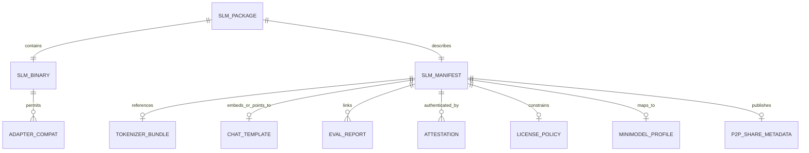
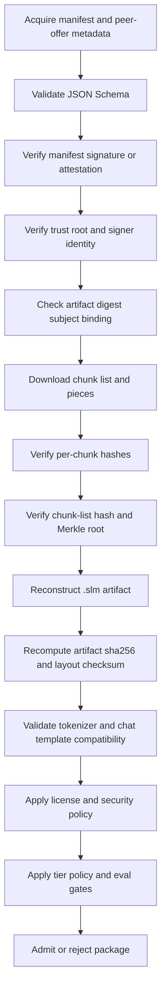

# Trustworthy Metadata and Verification Framework for .slm Model Packages

## Executive summary

The current public `.slm` description in TinyRustLM already points in the right direction: the format is intentionally narrow, uses strict header and tensor-directory validation, binds artifacts with checksums, includes tokenizer identity checks, and is designed for bounded local loading rather than a broad, permissive “load anything” runtime. TinyRustLM’s public UI and developer docs also show that MiniModel interoperability is already treated as metadata-first, with local `.slm` admission, metadata-only catalogs, peer-offer proof, chunk hashes, Merkle fields, and local re-verification before a model becomes runnable. That combination strongly suggests that the next step for `.slm` should not be a looser all-in-one metadata blob, but a **fail-closed trust envelope** around a strict binary artifact. citeturn1view0turn4view0turn6view0turn27view0

This report therefore proposes a two-layer design. The first layer is the existing or minimally extended `.slm` binary ABI, which should remain compact and loader-critical: magic, format version, byte count, tensor layout, tokenizer digest, quantization facts, and artifact checksum. The second layer is a signed `slm.manifest.v1.json` sidecar, validated with JSON Schema Draft 2020-12, canonically hashed for signatures, and bound to the `.slm` blob through in-toto subjects and digest equality. This split preserves TinyRustLM’s bounded loader contract while allowing richer claims such as capability tier, tokenizer compatibility, chat template, provenance, evaluation evidence, machine-readable license restrictions, MiniModel compatibility, and P2P verification metadata. citeturn16view0turn17search1turn16view6turn31search1turn25view0

The central trust decision should be **policy-based and fail-closed**. If a package claims to be instruction-tuned but omits a compatible chat template, loading should stop. If it claims “quality” but has no reproducible provenance or no evaluation sidecar, it should not be loadable as a quality model. If tokenizer identity is unknown, if native code is required but undeclared, if signatures do not chain to a trusted root, or if chunk/Merkle verification fails for P2P transfer, the runtime should refuse admission rather than silently downgrade behavior. This approach aligns with Hugging Face’s separation of model config, tokenizer files, and chat templates, with in-toto’s subject-binding model, with SLSA provenance expectations, and with TUF/Sigstore trust-root practice. citeturn9view0turn9view1turn16view2turn18view0turn30search2turn16view3

The clearest operational distinction is between three policy tiers. A **demo fixture** is safe to load for smoke-testing the loader and UI, but is explicitly non-claiming: no capability marketing, no “assistant quality” implication, and no ambiguous instruction-tuned status. An **experimental** model is runnable, but evidence is incomplete: maybe provenance is partial, evals are self-reported, or chat-template compatibility is declared but not independently reproduced. A **quality** model is only one that has complete loader metadata, tokenizer and template agreement, signed provenance, reproducible or at least auditable build details, and evaluation reports specific enough that a third party could rerun them. TinyRustLM’s own public docs already distinguish runtime-smoke admission from true quality claims, stating that assistant-quality claims require evaluation sidecars with exact case evidence. citeturn5view2turn4view0

## Design basis and packaging model

TinyRustLM’s public `.slm` description makes two architectural choices that are worth preserving. First, the runtime is designed around **strict browser loading**, bounded validation, and compact local execution. Second, the format records explicit structural invariants: non-zero critical header fields, in-file tensor entry bounds, payload-count checks, checksums, and “no NaN or Infinity payloads.” TinyRustLM also explicitly states that tokenizer data belongs inside the model artifact or a verified sidecar path so runtime generation does not depend on Python-only tokenizer files. Those are not cosmetic details; they are the basis for a load-time trust boundary. citeturn1view0

At the same time, adjacent ecosystems show why richer metadata cannot live only in the raw tensor container. Hugging Face commonly spreads semantically important information across `config.json`, `generation_config.json`, `tokenizer.json`, `tokenizer_config.json`, and `special_tokens_map.json`. Chat templates are stored with the tokenizer, and the wrong control tokens can “drastically” degrade performance even for models derived from the same base. Safetensors improves on pickle-based formats by providing a safer tensor container with parseable metadata and optional text-only header metadata, but even safetensors still does not solve higher-level questions like license restrictions, provenance, or P2P policy by itself. citeturn9view0turn9view1turn9view3turn9view4turn34view0

For comparison, GGUF demonstrates the benefits of an extensible metadata key-value store inside a model file: single-file deployment, extensibility, `mmap`-friendly loading, and “full information” sufficient to load the model. But the same GGUF documentation also exists because generalized extensibility can otherwise produce ambiguity. TinyRustLM’s `.slm` posture is intentionally tighter than that. The best synthesis is therefore **not** “turn `.slm` into GGUF,” but “keep `.slm` narrow and add a formally validated, signed manifest layer around it.” citeturn25view0turn1view0

The proposed package model is:

```text
model.slm
slm.manifest.v1.json
slm.attestations.intoto.jsonl
eval/
  capability-report.v1.json
  safety-report.v1.json
tokenizer/
  tokenizer.json
  tokenizer_config.json
  special_tokens_map.json
p2p/
  chunk-list.v1.json
  peer-offer.v1.json
license/
  use-policy.odrl.json
```

This structure is intentionally metadata-centric. The `.slm` blob remains the immutable subject. The manifest describes it. Attestations authenticate the manifest or the `.slm` blob itself. Tokenizer, eval, and P2P files are all digest-addressed sub-artifacts. The design follows in-toto’s statement/envelope model, where artifacts are bound by digest and are assumed to be immutable, while richer claims live in typed predicates. citeturn16view6turn31search1



The signature-bearing manifest should itself be canonicalized before hashing. JSON Schema Draft 2020-12 is the right validation basis for the manifest because it is current, stable, and expressly designed for vocabularies, dynamic references, and strict validation. For canonical signing of JSON, RFC 8785 JSON Canonicalization Scheme is a pragmatic fit because it exists precisely to make hashing and signature verification repeatable. citeturn16view0turn17search1

## Proposed metadata schema

The proposed manifest should be structured, namespaced, and explicitly typed. A useful top-level shape is:

```json
{
  "$schema": "https://example.org/slm/manifest/v1/schema.json",
  "manifest_version": "1.0.0",
  "package": {},
  "artifact": {},
  "runtime": {},
  "capability": {},
  "tokenizer": {},
  "chat": {},
  "quantization": {},
  "eval": {},
  "provenance": {},
  "license": {},
  "security": {},
  "minimodel": {},
  "p2p": {},
  "attestations": []
}
```

This proposed layout is grounded in four existing patterns. TinyRustLM exposes loader-critical facts such as checksums, tokenizer import, validation, quality, eval cases, and admission; Hugging Face separates model, tokenizer, generation, and chat-template metadata; in-toto shapes authenticated claims around typed statements and immutable subjects; and SPDX plus ODRL together provide a workable split between license expression and machine-readable restrictions. citeturn27view0turn9view0turn9view1turn16view6turn16view1turn16view5

### Recommended field matrix

The table below is normative for this proposal. “Fail-closed” means the loader must refuse admission, not merely warn.

| Field | Type | Required | Validation and cross-field rules | Fail-closed behavior |
|---|---|---:|---|---|
| `package.schema_version` | string semver | Yes | Must equal supported major version, e.g. `1.x.y` | Reject manifest on unsupported major |
| `package.manifest_id` | string URI-safe | Yes | Stable identifier for manifest instance | Reject if missing |
| `package.created_utc` | RFC 3339 UTC string | Yes | Must end in `Z`; cannot be in distant future beyond policy skew | Reject if malformed |
| `artifact.kind` | enum | Yes | `model`, `adapter`, `tokenizer_only`, `demo_fixture` | Reject unknown kinds |
| `artifact.id` | string | Yes | Reverse-DNS or MiniModel-compatible stable ID | Reject if empty |
| `artifact.version` | string semver | Yes | Required for cache and policy pinning | Reject if malformed |
| `artifact.file_name` | string | Yes | Must match actual file name loaded | Reject mismatch for P2P/import |
| `artifact.size_bytes` | uint64 | Yes | Must equal actual bytes on disk | Reject mismatch |
| `artifact.digest.sha256` | 64-hex string | Yes | Must equal actual `.slm` digest and all attestation subjects | Reject mismatch |
| `artifact.layout_checksum` | 64-hex string | Yes | Must equal runtime-computed tensor/layout checksum | Reject mismatch |
| `runtime.format` | enum | Yes | Example: `slm.v1`; must match binary header | Reject mismatch |
| `runtime.architecture` | string | Yes | Must match actual tensor naming/layout family understood by runtime | Reject unknown architecture |
| `runtime.context.prompt_max_tokens` | integer | Yes | `1..runtime.context.total_max_tokens` | Reject if invalid |
| `runtime.context.total_max_tokens` | integer | Yes | Positive; cannot exceed runtime or policy cap unless explicitly allowed | Reject or policy-block |
| `runtime.weights_dtype` | enum | Yes | Must agree with quantization fields and tensor payloads | Reject mismatch |
| `capability.tier` | enum | Yes | `demo_fixture`, `experimental`, `quality` | Reject unknown tier |
| `capability.demo_only` | boolean | Yes | Must be `true` when tier is `demo_fixture`; must be `false` for `quality` | Reject inconsistency |
| `capability.instruction_tuned` | boolean | Yes | If `true`, `chat.template` or documented prompt format is required | Reject if template missing |
| `capability.chat_capable` | boolean | Yes | If `true`, chat template + required special tokens must validate | Reject if unresolved |
| `capability.eval_status` | enum | Yes | `none`, `smoke_only`, `self_reported`, `reproduced`, `verified` | Downgrade or reject depending on tier |
| `tokenizer.family_id` | string | Yes | Stable compat family, e.g. `llama3-bpe-v1`; must match runtime expectations | Reject if absent |
| `tokenizer.primary_artifact` | descriptor object | Yes | Digest, size, media type, path | Reject if missing or mismatch |
| `tokenizer.format` | enum | Yes | `tokenizer.json`, `sentencepiece`, `bpe_merges_vocab`, `tiktoken_converted`, `byte_fallback`, `custom_compiled` | Reject unknown formats unless runtime plugin explicitly allowed |
| `tokenizer.digest.sha256` | 64-hex string | Yes | Must match actual tokenizer artifact or embedded tokenizer region | Reject mismatch |
| `tokenizer.vocab_size` | integer | Yes | Must agree with tokenizer artifact and model embeddings policy | Reject hard mismatch |
| `tokenizer.special_tokens` | object | Yes | IDs and strings must be unique and consistent | Reject duplicate or conflicting IDs |
| `tokenizer.compatibility.strict` | boolean | Yes | If `true`, exact digest match required; if `false`, family match can be allowed by policy | Reject if strict and digest mismatches |
| `chat.template_format` | enum | Conditional | Required when `chat_capable` or `instruction_tuned` is true | Reject if required and absent |
| `chat.template_source` | enum | Conditional | `embedded`, `inline`, `sidecar`, `tokenizer_config` | Reject if source missing |
| `chat.template_digest.sha256` | 64-hex string | Conditional | Required unless fully inline and signed with manifest | Reject if mismatch |
| `chat.required_roles` | array enum | Conditional | Typically `user`, `assistant`, optional `system` | Reject if template cannot render declared roles |
| `chat.eos_token_ids` | array int | Conditional | Must exist in tokenizer vocab and not collide with forbidden control IDs | Reject mismatch |
| `quantization.scheme` | string | Yes | Examples: `f32`, `q8_0`, `q4_0`, `gptq`, `awq`, `bnb-nf4` | Reject unknown scheme |
| `quantization.weight_bits` | integer | Yes | `1..32` | Reject invalid |
| `quantization.activation_bits` | integer or null | No | Null if not activation-quantized | Reject if out of range |
| `quantization.group_size` | integer or null | No | Positive when scheme requires grouped quantization | Reject missing required group size |
| `quantization.per_channel` | boolean | Yes | If `true`, channel axis metadata must be present where applicable | Reject if scheme needs axis and it is absent |
| `quantization.toolchain.name` | string | Yes | Converter or library name | Reject for `quality` if absent |
| `quantization.toolchain.version` | string | Yes | Version string or commit | Reject for `quality` if absent |
| `quantization.dequantization_risks` | array enum | Yes | From controlled vocabulary | Reject if omitted for experimental/quality |
| `eval.summary.claimed_quality` | boolean | Yes | If `true`, tier cannot be `demo_fixture` | Reject inconsistency |
| `eval.reports` | array descriptors | Conditional | Required for `quality`; optional otherwise | Reject `quality` if absent |
| `provenance.author` | string | Yes | Human or service identity | Reject for `quality` if absent |
| `provenance.organization` | string or null | No | Recommended | Warning only unless required by policy |
| `provenance.source_repo` | URI | Yes | Source or parent artifact origin | Reject for `experimental`/`quality` if absent |
| `provenance.source_commit` | string | Yes | Immutable revision or digest | Reject for `experimental`/`quality` if absent |
| `provenance.build_pipeline` | object | Yes | Builder ID, run ID, pipeline URI | Reject for `quality` if absent |
| `provenance.container_image_digest` | string or null | No | OCI digest if build used a container | Warning for experimental; reject for quality if pipeline says containerized but digest absent |
| `provenance.reproducible_build` | boolean | Yes | If `true`, reproduce info and attestation must exist | Reject inconsistency |
| `provenance.slsa_attestation` | descriptor | Conditional | Strongly required for `quality` | Reject by policy for `quality` if absent |
| `license.expression` | string | Yes | Valid SPDX expression or `LicenseRef-*` form | Reject invalid expression |
| `license.custom_refs` | object | Conditional | Required if expression uses `LicenseRef-*` | Reject missing referenced texts |
| `license.use_policy_odrl` | descriptor or inline object | No | Recommended for non-SPDX usage restrictions | Warning unless policy requires |
| `license.restrictions` | array enum | Yes | Controlled vocabulary mirrors ODRL/SPDX profile semantics | Reject if tier/claim requires restrictions but this field is absent |
| `security.requires_native_code` | boolean | Yes | Must be `false` for browser-local TinyRustLM-style safe load unless sandbox policy says otherwise | Reject if true and policy disallows |
| `security.custom_ops` | boolean | Yes | If `true`, list of ops and libraries required | Reject if undeclared or disallowed |
| `security.external_network` | enum | Yes | `none`, `loopback_only`, `declared_endpoints`, `unrestricted` | Reject any value above policy ceiling |
| `security.filesystem_access` | enum | Yes | `none`, `read_package_only`, `read_user_selected_only`, `broad` | Reject above policy ceiling |
| `security.serialization_risk` | enum | Yes | `none`, `pickle_like`, `native_plugin`, `custom_loader` | Reject unsafe or undeclared modes |
| `security.sandbox_required` | boolean | Yes | Must be `true` if high-risk execution features are declared | Reject inconsistency |
| `minimodel.profile_version` | string | No | Declares mapping profile version | Warning if absent |
| `minimodel.model_id` | string | No | Must equal or deterministically derive from `artifact.id` | Reject mismatch when MiniModel import path is used |
| `minimodel.catalog_state` | enum | No | `metadata_only`, `proof_ready`, `p2p_ready` | Reject impossible states |
| `p2p.chunk_size_bytes` | integer | Conditional | Required for chunked P2P transfer | Reject if chunked mode and absent |
| `p2p.chunk_hashes` | array hashes | Conditional | Required if transfer is chunked | Reject mismatch |
| `p2p.chunk_list_sha256` | 64-hex string | Conditional | Must hash canonical chunk list | Reject mismatch |
| `p2p.merkle_root` | 64-hex string | Conditional | Required for resumable or multi-peer import | Reject mismatch |
| `p2p.peer_offer_attestation` | descriptor | Conditional | Required for peer import | Reject if P2P import and absent |
| `attestations` | array descriptors | Yes | At least one manifest or artifact attestation required outside fully local trust mode | Reject if policy requires signatures and none exist |

### Recommended tokenizer storage policy

Tokenizer metadata deserves special treatment because it is one of the most common hidden failure modes. Hugging Face documents that `tokenizer.json` stores the learned vocabulary, `tokenizer_config.json` stores special tokens and often the maximum input length, and `special_tokens_map.json` maps special tokens. Chat templates are also stored with tokenizer metadata and can be written back into `tokenizer_config.json`. At the same time, not every tokenizer family is fully captured by a single file: some models are fully described by `tokenizer.json`, while some model-specific settings are not; and `tiktoken`’s `tokenizer.model` lacks added tokens and pattern strings unless converted to `tokenizer.json`. citeturn9view0turn29view4turn29view3turn29view2

Accordingly, this report recommends that `.slm` packages either embed a fully compiled tokenizer representation inside the `.slm` file or include a verified tokenizer bundle with at least `tokenizer.json`, `tokenizer_config.json`, and `special_tokens_map.json` whenever the provenance chain originates from Hugging Face-style assets. The manifest should carry both a **strict digest** and a **compatibility family identifier**. Exact digest match should be required for instruction-tuned or quality packages; family-level compatibility should only be permitted for explicitly marked experimental packages. citeturn9view0turn29view3turn29view2

## Validation and fail-closed policy

The loader should make trust decisions in three phases: **integrity**, **semantic compatibility**, and **policy admission**. Integrity verifies bytes, checksums, chunk hashes, Merkle roots, and signatures. Semantic compatibility verifies that architecture, tokenizer, special tokens, context limits, and chat template agree with one another. Policy admission then applies the local trust policy: whether native code is allowed, whether network access is acceptable, whether the package can occupy the requested tier, and whether the user’s trust anchors validate the signatures present. This separation keeps the runtime honest about *what is true*, *what is compatible*, and *what is permitted*. citeturn1view0turn18view0turn16view3turn30search2

Fail-closed behavior is particularly important for chat models. Hugging Face’s own documentation explains that chat models are still causal LMs expecting a token sequence, that different models use different control tokens, and that applying the wrong chat format can severely degrade results. It also notes that chat templates live with the tokenizer and that special control tokens should be added as special tokens so they are not split incorrectly. That means a package cannot safely claim `instruction_tuned=true` or `chat_capable=true` unless tokenizer, special tokens, and chat template are all present and mutually validated. citeturn9view1turn29view4

The same logic applies to context length. In common ecosystems, “how long the model can really accept” is spread across architecture config and tokenizer metadata: `config.json` describes the model blueprint, while tokenizers expose `model_max_length`, and tokenizer config may also surface the maximum acceptable input length. A trustworthy `.slm` package should therefore declare its own explicit runtime limits rather than forcing the loader to reconstruct them from multiple conventions. If context length is missing or contradictory, the loader should reject quality admission and at minimum refuse automatic loading. citeturn9view0turn29view0

### Criteria for demo fixture, experimental, and quality tiers

A **demo fixture** is a model package whose purpose is to validate the loader, UI, conversion pipeline, or P2P pathway. It may be structurally valid and safe to load, but it must not imply usable assistant quality. That means `capability.tier=demo_fixture`, `demo_only=true`, and `eval_status` limited to `none` or `smoke_only`. TinyRustLM’s public UI already surfaces “Tiny Fixture” variants alongside tiny quantized forms, which is a strong precedent for making this tier explicit instead of leaving users to infer it. citeturn27view0

An **experimental** package is a runnable artifact with enough metadata to validate structure and compatibility, but with incomplete trust evidence. Typical reasons include self-reported evals instead of reproduced evals, missing reproducible-build evidence, family-level rather than exact tokenizer compatibility, or incomplete safety reporting. TinyRustLM’s own public docs reflect this intermediate state by distinguishing “runtime-smoke” and admission from stronger “assistant-quality” claims. citeturn5view2turn4view0

A **quality** package should satisfy all of the following: successful loader-critical integrity validation; exact tokenizer and chat-template agreement when instruction tuning is claimed; complete provenance including source revision and build pipeline identity; signed attestation for artifact or manifest; valid license expression plus any extra restrictions; and at least one evaluation report with identifiable benchmarks, datasets, metrics, run date, and execution environment. The exact benchmark suites are open-ended and should remain policy-configurable, but the reporting structure must be fixed enough that a third party can replay or at least audit the claim. citeturn5view2turn32view0turn32view1turn16view2

### Diagnostics and user-facing messages

Diagnostics should explain *why* a model was trusted, downgraded, or refused. The messages should expose evidence rather than generic “invalid package” text.

| Code | Condition | Decision | User-facing message |
|---|---|---|---|
| `SLM-I100` | All structural checks passed | Informational | “Package integrity verified: header, tensor layout, tokenizer digest, and artifact checksum all match.” |
| `SLM-W220` | Tokenizer family matches but exact digest missing | Degrade to experimental | “Tokenizer appears compatible by family, but exact tokenizer bytes were not verified. Chat quality claims are downgraded.” |
| `SLM-E230` | Instruction-tuned claim without valid chat template | Reject | “This package claims instruction tuning, but no compatible chat template could be verified. Loading is blocked to avoid misleading output quality.” |
| `SLM-E310` | `quality` tier with no signed eval report | Reject quality admission | “Quality tier requested, but reproducible evaluation evidence is missing or unsigned.” |
| `SLM-E420` | P2P chunk, chunk-list, or Merkle mismatch | Reject import | “Peer transfer verification failed. At least one chunk hash or Merkle proof did not match the declared package.” |
| `SLM-E510` | Native code, custom ops, or network access above local policy | Reject | “This model requires execution privileges beyond your trust policy. It was not loaded.” |
| `SLM-W610` | SPDX custom license reference without ODRL policy | Degrade | “License terms were partially machine-readable. Usage restrictions may require manual review.” |
| `SLM-I700` | Demo fixture with successful smoke pass | Informational | “Demo fixture loaded successfully. This package is for validation and demonstration only; capability quality is not asserted.” |

These messages should also be reflected in a machine-readable decision record so that P2P imports, local catalogs, and MiniModel snapshots can preserve the reasoning chain across systems. TinyRustLM’s public UI already exposes diagnostic, provenance, validation, admission, quality, and eval fields, which makes a decision ledger a natural extension rather than a new concept. citeturn27view0

## MiniModel compatibility and migration

There does not appear to be a fully public standalone MiniModel specification page indexed on the public web. What *is* public is TinyRustLM’s developer documentation and runtime UI, both of which describe MiniModel as a metadata-first exchange layer using local `models.v0.json`, peer-source announcements/feeds, “proof-ready” and “P2P-ready” states, `prepare-peer-share`, `import-peer-request`, and a local share-metadata bundle carrying artifact SHA-256, fixed-size chunk hashes, chunk-list SHA-256, and Merkle roots. Because of that, the mapping below should be treated as a **compatibility profile inferred from current public TinyRustLM materials**, not as a claim about a formal independent MiniModel standard. citeturn4view0turn6view0turn27view0

### Recommended compatibility map

| TinyRustLM or MiniModel-facing concept | Proposed `.slm` manifest field | Migration rule |
|---|---|---|
| `model_id` | `artifact.id` / `minimodel.model_id` | Preserve exact ID; if absent, derive from reverse-DNS + artifact version |
| `models.v0.json` local catalog entry | `minimodel.catalog_entry` | Export metadata only; never embed runnable bytes in a catalog snapshot |
| “proof-ready” state | `minimodel.catalog_state=proof_ready` | Require signed artifact/manifest + eval or provenance proof, but no peer source yet |
| “P2P-ready” state | `minimodel.catalog_state=p2p_ready` | Require proof-ready plus at least one verified peer source |
| Share metadata JSON | `p2p.share_metadata` | Normalize artifact hash, chunk hashes, chunk-list hash, Merkle root |
| Peer-source announcement/feed JSON | `p2p.peer_sources[]` | Treat as availability metadata only, never as proof of artifact integrity |
| Peer-offer proof | `p2p.peer_offer_attestation` | Require signature and subject digest binding |
| Conversion request / receipt | `provenance.conversion` | Preserve source model ID, source snapshot, toolchain, output digest |
| TinyRustLM UI “Quality” / “Eval Cases” / “Eval Checksum” | `eval.summary`, `eval.reports[]` | Map to structured eval reports, not free text |
| TinyRustLM UI “Tokenizer Import” / “Source Validation” | `tokenizer.*`, `security.*` | Normalize tokenizer identity and source review into strict fields |

### Migration rules

For existing MiniModel-facing inventories, the safest migration policy is additive and conservative. A metadata-only `models.v0.json` entry should migrate into the new schema even if evaluation and provenance are sparse, but such entries should default to `experimental`, never to `quality`. A peer-source announcement should never upgrade a package past `proof_ready`; only verified chunk/Merkle and signature checks should do that. And any imported local `.slm` without exact tokenizer identity should be eligible for “local structural validation” but not for quality or chat-capable admission. This mirrors TinyRustLM’s own public status buckets: `P2P-ready`, `proof-ready-needs-peer`, `local-.slm-needed`, `external-.slm-review`, and `Rust-conversion-needed`. citeturn6view0turn27view0

A practical migration recommendation is to preserve old MiniModel files as source documents and generate a new `slm.manifest.v1.json` plus a translation receipt. That receipt should record: source file names, source digests, translation time in UTC, fields that mapped exactly, fields inferred by policy, and fields left unresolved. This keeps the trust model auditable and avoids “silent enrichment” of a legacy catalog entry. The underlying idea is borrowed from supply-chain attestation practice, where transformed metadata should remain traceable back to immutable source subjects. citeturn16view6turn16view2

## P2P import verification and provenance

P2P import is the place where ambiguity is most dangerous, so it should use the strictest path. TinyRustLM’s public docs already establish the key pattern: peer networking remains metadata-gated, users must consent before transfer or import, rows are not runnable until evidence exists, empty announcement feeds do not create P2P availability, and local Rust validation remains the final authority before admission. The right generalization is that **availability metadata and integrity metadata must never be conflated**. A peer URL says where bytes might be fetched; only digests, chunk proofs, signatures, and policy validation say whether the resulting package can be trusted. citeturn6view0turn4view0

The recommended verification protocol is:



For signatures and attestations, the most interoperable choice is an in-toto attestation framework statement in a DSSE envelope, because in-toto is expressly designed for authenticated metadata about software artifacts, with statements that bind digests in `subject`, and DSSE-style envelopes that authenticate both payload and type. Sigstore can then be used as the operational signature system where online or organizational trust infrastructure exists, while preserving offline verification through signed bundles and pinned trust roots. citeturn31search1turn16view6turn31search0turn16view3turn30search2

For trust anchors, the best current model is TUF-style root management. TUF’s root metadata names trusted keys and signature thresholds; targets metadata lists hashes and sizes; snapshot and timestamp metadata protect against freeze and mix-and-match attacks; and all signed metadata expires. Sigstore itself distributes its root of trust via TUF and documents both offline bundle verification and air-gapped trust-root scenarios. That makes TUF a strong template for `.slm` P2P import, especially for catalogs or organizations that need threshold trust, expiration, and key rotation. citeturn18view0turn18view1turn30search2turn30search3turn30search6turn30search7

For offline verification, the report recommends two modes. In the **organizational mode**, use Sigstore-compatible bundles plus a pinned TUF root snapshot distributed out-of-band. In the **portable-share mode**, allow detached Ed25519 signatures over the canonical manifest and over the chunk list, with an out-of-band keyring that is itself signed or otherwise pinned. The key insight is that offline verification must not require live access to a transparency log. Sigstore explicitly supports bundle-based proof of log inclusion without querying the log, and its tooling supports offline verification with trusted roots. citeturn16view3turn11search13turn30search8

### Provenance requirements

The provenance section should include at minimum: `author`, `organization`, `source_repo`, `source_commit`, `build_pipeline.id`, `build_pipeline.run_uri`, `container_image_digest` when containerized, `builder_platform`, `reproducible_build`, and a pointer to a SLSA provenance attestation. SLSA specifically defines provenance as verifiable information describing where, when, and how an artifact was produced. That aligns almost perfectly with the needs of a trustworthy `.slm` package. citeturn16view2

If reproducibility is claimed, the manifest should also include a deterministic build recipe digest and the exact converter/toolchain versions used for tokenization and quantization. This matters because quantization is often not a semantically invisible step, and because even adjacent local-model ecosystems have already observed practical reproducibility drift across machines and toolchains. The standard posture should therefore be: reproducible if demonstrably reproducible; otherwise explicitly non-reproducible, with exact builder evidence still required for experimental and quality claims. citeturn33view0turn33view1turn16view2

## Evaluation, quantization, licensing, and security declarations

### Evaluation reporting format

Model cards remain the best high-level precedent for evaluation reporting. Google’s model-card paper recommends documentation of intended uses, performance characteristics, and details of evaluation procedures. Hugging Face’s model-card docs similarly call out intended uses and limitations, training parameters, datasets used, and evaluation results, and treat model cards as metadata-bearing documentation essential for discoverability and reproducibility. Those principles should be kept, but `.slm` packages need a stricter machine-readable evaluation sidecar for gating trust decisions. citeturn32view1turn32view0

A recommended `eval.report.v1.json` schema should include:

- `suite_name`
- `suite_version`
- `benchmark_ids[]`
- `dataset_ids[]`
- `dataset_versions[]`
- `task`
- `metric_name`
- `metric_value`
- `higher_is_better`
- `confidence_interval`
- `sample_count`
- `random_seed`
- `date_utc`
- `runner.name`
- `runner.version`
- `hardware`
- `software_stack`
- `prompt_template_digest`
- `tokenizer_digest`
- `artifact_digest`
- `evaluator_type` such as `exact_match`, `human`, `LLM_judge`, `unsafe_content_classifier`
- `notes`

The exact suites should remain open-ended. That is the right policy choice because benchmark ecosystems are changing quickly, and TinyRustLM itself leaves room for local quality evidence rather than prescribing a single benchmark canon. What should *not* be open-ended is the evidence envelope: every quality claim should say what was measured, on what data, with what metric, under what runtime conditions, on what date in UTC, and against which exact artifact and tokenizer digests. Where a suite supports it, confidence intervals should be reported instead of point estimates alone; contemporary benchmark ecosystems such as MLCommons explicitly discuss tightening confidence intervals and versioning evaluators to preserve comparability. citeturn5view2turn21search4turn21search6

For safety reporting, one capability-focused report and one safety-focused report should both be allowed, because “quality” is multidimensional. A package can be strong on summarization or coding yet poorly characterized on hazardous content behavior. MLCommons’ AILuminate family is a useful example of a benchmark family that distinguishes hazard categories and publishes public results with hazard-specific grading. This report does not propose AILuminate as mandatory, only as an example of the kind of structured safety reporting that quality-grade packages should link or embed. citeturn19search2turn19search13turn21search6

### Quantization metadata

Quantization metadata should be more explicit than “q4” or “q8.” TinyRustLM already names `f32`, `q8_0`, and `q4_0` and explains that `q4_0` saves bytes but requires unpacking and dequantization work in WASM. Elsewhere in the serving ecosystem, Hugging Face documents a wide range of quantization schemes, including GPTQ, AWQ, bitsandbytes, EETQ, Marlin, EXL2, and fp8, and distinguishes pre-quantized from on-the-fly quantization. Bitsandbytes further exposes 8-bit and 4-bit modes, including NF4 and FP4, and documents hardware compatibility. A trustworthy package therefore needs to declare not only the nominal precision, but also the *operational form* of quantization. citeturn5view0turn33view0turn33view1

The minimal recommended quantization fields are:

- `scheme`
- `weight_bits`
- `activation_bits`
- `group_size`
- `block_size`
- `per_channel`
- `mixed_precision_components[]`
- `toolchain.name`
- `toolchain.version`
- `quantized_from_digest`
- `calibration_dataset` when applicable
- `on_the_fly` boolean
- `dequantization_required_for_runtime` boolean
- `known_risks[]`

`known_risks[]` should come from a controlled vocabulary such as: `quality_loss`, `kernel_specific_behavior`, `requires_prequantized_weights`, `on_load_requantization`, `nondeterministic_repack`, `reduced_numerical_reproducibility`, `hardware_limited`, and `dequantize_before_eval`. The purpose is not to scare users away from quantized models, but to prevent a “quality” label from hiding quantization details that materially affect the user’s trust decision. citeturn33view0turn33view1turn5view0

### License expression and machine-readable restrictions

License metadata should use **SPDX expressions** as the primary field because SPDX expressions already define single identifiers, `AND`, `OR`, `WITH`, and `LicenseRef-*` syntax for custom terms. That makes them the best baseline for machine-readable licensing. However, AI model licenses often include operational restrictions not easily captured by plain SPDX alone. For those, the best complementary layer is ODRL, which is expressly designed to model permissions, prohibitions, and duties over assets. citeturn16view1turn16view5

The recommended license block is therefore:

```json
"license": {
  "expression": "Apache-2.0 OR LicenseRef-Model-Use-Restricted",
  "custom_refs": {
    "LicenseRef-Model-Use-Restricted": {
      "text_digest": "sha256:...",
      "uri": "..."
    }
  },
  "use_policy_odrl": {
    "...": "..."
  },
  "restrictions": [
    "no_military_use",
    "no_biometric_surveillance",
    "research_only"
  ]
}
```

Validation rules should be strict. If `expression` is syntactically invalid, reject. If it references `LicenseRef-*` entries that are not defined, reject. If `restrictions[]` is non-empty but no ODRL or equivalent structured policy is present, downgrade to experimental and require manual review for sensitive deployment paths. This prevents a package from carrying legal restrictions only in prose while still being auto-labeled “safe to load.” citeturn16view1turn16view5

### Security checks

Security policy should assume that model packages can be dangerous even when weights themselves are inert. PyTorch’s documentation warns that `torch.load()` uses an unpickler under the hood and says to “never load data from an untrusted source.” PyTorch’s security guidance goes further, stating that models are effectively programs and that running untrusted models is equivalent to running untrusted code, recommending secure isolated environments such as containers or virtual machines. ONNX Runtime similarly exposes custom operators and execution-provider plugins, which are legitimate extension points but also an attack-surface signal if they are declared or required by a model package. Safetensors, by contrast, exists specifically as a safer tensor serialization alternative to pickle-like formats. citeturn22search2turn23search0turn22search1turn22search7turn22search19turn9view3

For `.slm`, the security declaration should therefore minimally include:

- `requires_native_code`
- `custom_ops`
- `custom_op_libraries[]`
- `external_network`
- `filesystem_access`
- `serialization_risk`
- `sandbox_required`
- `sandbox_profile`
- `unsafe_capabilities[]`
- `declared_endpoints[]`
- `loopback_only`
- `telemetry_behavior`
- `dynamic_code_loading`

The default safe `.slm` posture for TinyRustLM-like browser-local loading should be:

```json
{
  "requires_native_code": false,
  "custom_ops": false,
  "external_network": "none",
  "filesystem_access": "read_user_selected_only",
  "serialization_risk": "none",
  "sandbox_required": false,
  "dynamic_code_loading": false,
  "telemetry_behavior": "none"
}
```

Any package that deviates upward from that baseline should not be eligible for silent auto-load. If `requires_native_code=true`, `custom_ops=true`, `serialization_risk!=none`, or `external_network` exceeds local policy, admission should fail closed unless the loader is running in a compatible sandbox profile and the user has explicitly consented. TinyRustLM’s own public posture—local-only inference, no project-hosted model bytes, loopback-only endpoint checks for local control, and “Local Connect asks before app control”—supports exactly this conservative direction. citeturn6view0turn27view0

### Example quality package manifest excerpt

The example below is illustrative and proposed, not an existing standard.

```json
{
  "manifest_version": "1.0.0",
  "artifact": {
    "kind": "model",
    "id": "org.example.tinychat",
    "version": "1.2.0",
    "file_name": "tinychat-16m-q8_0.slm",
    "size_bytes": 16777216,
    "digest": { "sha256": "8f4c..." },
    "layout_checksum": "b731..."
  },
  "capability": {
    "tier": "quality",
    "demo_only": false,
    "instruction_tuned": true,
    "chat_capable": true,
    "eval_status": "reproduced"
  },
  "tokenizer": {
    "family_id": "llama3-bpe-v1",
    "format": "tokenizer.json",
    "digest": { "sha256": "aa92..." },
    "compatibility": { "strict": true }
  },
  "chat": {
    "template_format": "jinja",
    "template_source": "tokenizer_config",
    "template_digest": { "sha256": "de45..." },
    "required_roles": ["system", "user", "assistant"],
    "eos_token_ids": [128009]
  },
  "quantization": {
    "scheme": "q8_0",
    "weight_bits": 8,
    "per_channel": false,
    "toolchain": { "name": "tinyrustlm-packer", "version": "0.9.3" },
    "dequantization_risks": ["quality_loss"]
  },
  "license": {
    "expression": "Apache-2.0",
    "restrictions": []
  },
  "security": {
    "requires_native_code": false,
    "custom_ops": false,
    "external_network": "none",
    "filesystem_access": "read_user_selected_only",
    "serialization_risk": "none",
    "sandbox_required": false
  }
}
```

What matters here is not the exact field spelling, but the fact that the trust decision can be made without guessing. That is the central design goal of the framework. It is also exactly the opposite of the failure mode seen in older or broader ecosystems, where a model’s actual runtime behavior depends on unstated Python code, unstated tokenizer conventions, or unstated template assumptions. citeturn9view0turn9view1turn22search2turn23search0

## Final recommendations

The most defensible way to evolve `.slm` is to treat the `.slm` blob as the **immutable executable weight artifact** and to treat trust metadata as a **signed, versioned, schema-validated manifest and attestation bundle**. That preserves what `.slm` already does well—strict loading, bounded validation, tokenizer checks, and compact local execution—while adding enough structured evidence for users and policy engines to answer the questions that actually matter: Is this only a demo? Is it really instruction-tuned? Does the tokenizer actually match? Is the claimed context length grounded? Was the package built from a known source? Is it safe to load under this runtime policy? citeturn1view0turn4view0turn27view0

The most important normative rules are these: never infer capability from file name alone; never infer instruction tuning without a verified chat template; never infer tokenizer compatibility from architecture family alone when `strict=true`; never allow peer availability metadata to stand in for integrity proof; never allow “quality” without signed provenance and structured eval evidence; and never silently load a package that broadens execution privileges beyond the local policy baseline. Those rules are consistent with prevailing model-packaging practice, with modern software supply-chain verification, and with the explicitly conservative direction already visible in TinyRustLM’s public design documents. citeturn9view1turn16view2turn18view0turn16view3turn6view0

In short, the recommended `.slm` trust model is: **strict binary ABI, rich signed sidecar metadata, explicit compatibility declarations, reproducible provenance, policy-aware tiering, and fail-closed admission**. That combination gives users a practical and explainable answer to the question they are really asking at import time: not merely “can this file be parsed,” but “should I trust what this package claims to be?” citeturn1view0turn31search1turn16view1turn16view5turn30search2