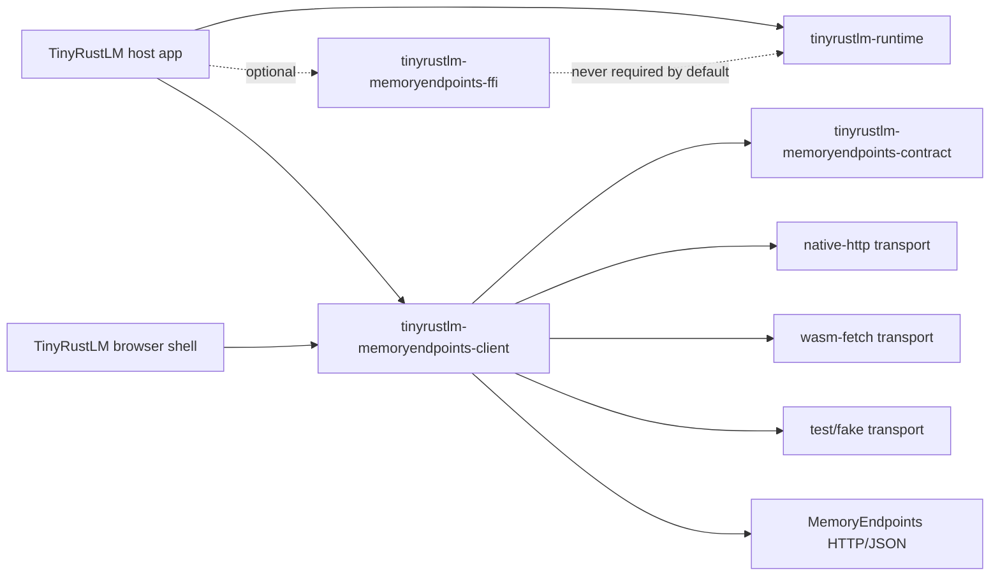
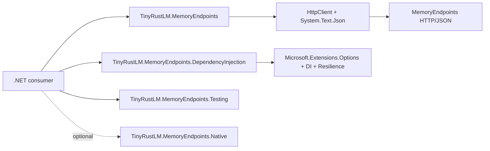

# Rust and .NET Memory Connector Production Architecture Review

## Scope and evidence

I was asked to review `E:\Source\Rust\TinyRustLM.com`, but that specific local path was not mountable in this session, so I could not do a line-by-line audit of the exact local repository contents or inspect locally packed `.nupkg` and `.snupkg` files. The report below is therefore grounded in the public TinyRustLM implementation evidence published by MiRust and TinyRustLM, the live MemoryEndpoints connector contract and readiness surfaces, and official Rust and .NET platform guidance. Where I recommend repo changes, I am describing the production architecture I would require before I would sign off on the connector as release-ready. citeturn39view0turn35view0turn8view0turn10view0turn20search4turn24search0

The most important observed TinyRustLM facts are these: the June 25, 2026 implementation snapshot describes a **four-crate, zero-dependency Rust workspace**; the runtime exposes a **raw C-style ABI** for allocation, model loading, generation, diagnostics, reset, stepping, and model release; execution is **browser-local WASM**; the current path is **main-thread scalar CPU inference** with **no Web Worker execution**, **no WebGPU/WebNN**, **no GGUF loader**, **no modular model system**, and **no adapters or router** in the inspected source snapshot. The current browser shell also presents a **UAIX memory deck** as optional, keeps prompts in the browser, and indicates that **Local Connect asks before app control**. Those facts strongly constrain where a hosted memory connector should live and what it must not leak into. citeturn39view0turn40view0turn35view0turn36view0turn41view0

The most important observed MemoryEndpoints facts are also clear. The published connector contract describes a **public-safe MATM connector surface** over HTTP/JSON, with protected routes for workspace loading, agent registration, memory submit/search, review queue, meeting rooms/messages, routing decisions, current messages, acknowledgements, receipts, and audit log. It explicitly says the connector must not print workspace keys, must not send raw credentials or private payloads inside memory, must not treat public discovery routes as proof of authorization, and should store the raw workspace key only in a user-approved secure local secret store. It also defines supported scopes, supported memory types, maximum summary lengths, browser CORS guidance, a `schemaVersion`, and a safe failure envelope. citeturn8view0turn29view0turn29view1turn9view3turn10view0

## Current-state findings

The public TinyRustLM evidence does **not** show a MemoryEndpoints connector crate among the four inspected Rust crates. The observed crates are `tinyrustlm-runtime`, `tinyrustlm-slm-pack`, `tinyrustlm-local-server`, and `tinyrustlm-browser-harness`. That means either the connector is newer than the public snapshot or it is not part of the inspected authority package reflected in the MiRust evidence. Either way, the public evidence supports treating the connector as a **strictly optional, out-of-core subsystem**, not something that belongs inside `tinyrustlm-runtime` itself. That is especially important because the runtime is currently intentionally narrow, single-model, and zero-dependency. citeturn39view0turn35view0turn38search9

The runtime also exposes several sharp edges that should **not** be mirrored into the connector’s public API. The browser currently blocks on direct WASM exports from handwritten JavaScript; the raw ABI has pointer/capacity ownership semantics and a documented single-transfer ceiling; runtime ownership is described as one process-global `Mutex<Option<Runtime>>`; and the next declared milestone is to move execution off the UI thread and expose cancellation and token streaming. Those are runtime implementation details, and surfacing them as connector concepts would be a leaky abstraction. The connector should be built around HTTP contract semantics, not around TinyRustLM’s raw ABI semantics. citeturn40view0turn32view1turn32view0

On the MemoryEndpoints side, the contract already gives a strong separation of concerns. It says local `.uai` startup memory stays active and should remain usable when MemoryEndpoints is unreachable; hosted short-term and long-term memory use public-safe summaries; short-term coordination can live in meeting rooms or current messages; long-term decisions and evidence go through memory events and review/promotion; and unsupported actions return safe no-op responses with human review guidance. That means the connector must preserve TinyRustLM’s local-first memory model and treat hosted MATM as augmentation, not substitution. citeturn8view0turn9view1turn9view2turn12view0turn29view2

The strongest current weakness, therefore, is not one malformed method signature. It is architectural: the runtime, browser, and hosted memory system already have distinct authority boundaries, but a naïve connector could collapse them by importing proprietary model-management logic, exposing raw runtime ABI behavior to .NET consumers, or making startup memory depend on a hosted service. The public TinyRustLM evidence explicitly says adapters, routers, registries, modular orchestration, and Teleodynamic control are **not implemented** in the observed source snapshot, while the MemoryEndpoints contract explicitly excludes proprietary training data, model weights, hidden prompts, raw credentials, and private optimization logic from connector payloads. The NuGet and crates packages must preserve that line. citeturn40view0turn35view0turn8view0turn33search10

## Recommended package architecture

The connector should be shipped as a **layered subsystem**. For Rust, that means one crate for the stable contract and validation types, one crate for the async client abstraction and transport wiring, and an optional FFI crate only if a native interop use case proves necessary. For .NET, the primary package should be a **pure managed HTTP client** with idiomatic DI support, while any Rust-native bridge should be a separate, explicitly optional package. That recommendation follows directly from three observed facts: TinyRustLM’s runtime is intentionally narrow and raw-ABI based, MemoryEndpoints is already a stable HTTP/JSON contract, and .NET native assets introduce extra RID, probing, trimming, AOT, and single-file complexity that should not be imposed on every consumer by default. citeturn39view0turn8view0turn18search4turn24search0turn24search2turn24search7turn24search11turn18search20





I would name the packages this way:

- Rust: `tinyrustlm-memoryendpoints-contract`, `tinyrustlm-memoryendpoints-client`, and only if justified later, `tinyrustlm-memoryendpoints-ffi`.
- .NET: `TinyRustLM.MemoryEndpoints`, `TinyRustLM.MemoryEndpoints.DependencyInjection`, `TinyRustLM.MemoryEndpoints.Testing`, and only if justified later, `TinyRustLM.MemoryEndpoints.Native`.

That naming keeps the MemoryEndpoints connector discoverable while making the package boundary self-evident. It also prevents “connector” code from becoming a back door for proprietary conversion, quantization, ranking, training, routing, or orchestration features that the public TinyRustLM evidence says are either absent today or still next-system work. citeturn40view0turn35view0turn23search0turn20search4

For .NET specifically, I would **not** make the first production package depend on a Rust native binary. A managed HTTP-first package is the correct default because the server contract is HTTP/JSON, browser compatibility is already a first-class concern for both TinyRustLM and MemoryEndpoints, and official .NET guidance makes clear that native assets are RID-specific and require dedicated loading and packaging rules. A separate native add-on can still exist later if you decide there is measurable value in reusing Rust-side validation or transport internals from desktop hosts. citeturn41view0turn8view0turn18search0turn18search4turn24search0turn24search2turn28search0

## Proposed public APIs

The Rust public API should be purpose-built for connector semantics, not route mirroring. The top-level façade should expose **save short-term**, **save long-term**, **tiered search**, **meeting coordination**, and **scoped model-context retrieval**. Separate, lower-level route DTOs can still exist for contract fidelity, but they should not be the primary ergonomic surface. That is particularly important because the MemoryEndpoints contract already distinguishes short-term coordination from durable memory promotion, and because TinyRustLM itself is local-first and should degrade cleanly when the hosted service is unavailable. citeturn8view0turn12view0turn41view0

```rust
use std::collections::BTreeMap;
use std::future::Future;
use std::pin::Pin;
use std::time::Duration;

pub type JsonMap = BTreeMap<String, serde_json::Value>;

#[derive(Clone, Debug, Eq, PartialEq)]
pub struct MemoryEndpointsOptions {
    pub base_url: String,
    pub workspace_id: WorkspaceId,
    pub agent_id: AgentId,
    pub timeout: Duration,
    pub retry: RetryPolicy,
    pub diagnostics: DiagnosticsPolicy,
}

#[derive(Clone, Debug, Eq, PartialEq)]
pub struct WorkspaceId(String);

#[derive(Clone, Debug, Eq, PartialEq)]
pub struct AgentId(String);

#[derive(Clone, Debug, Eq, PartialEq)]
pub struct ScopeId(String);

#[derive(Clone, Debug, Eq, PartialEq)]
pub enum Scope {
    Company,
    Workspace,
    Project,
    Goal,
    Task,
    Unknown(String),
}

#[derive(Clone, Debug, Eq, PartialEq)]
pub enum MemoryType {
    Fact,
    Decision,
    Status,
    Procedure,
    Risk,
    Evidence,
    Handoff,
    Note,
    Unknown(String),
}

#[derive(Clone, Debug, Eq, PartialEq)]
pub enum MemoryTier {
    HostedShortTerm,
    HostedLongTerm,
}

#[derive(Clone, Debug)]
pub struct RetryPolicy {
    pub max_attempts: u32,
    pub base_delay: Duration,
    pub max_delay: Duration,
    pub honor_retry_after: bool,
    pub retry_mutations_with_idempotency_key_only: bool,
}

#[derive(Clone, Debug)]
pub struct DiagnosticsPolicy {
    pub include_operator_summary: bool,
    pub redact_headers: bool,
    pub redact_bodies: bool,
    pub emit_unknown_fields: bool,
}

#[derive(Clone, Debug)]
pub struct SaveMemoryRequest {
    pub tier: MemoryTier,
    pub scope: Scope,
    pub scope_id: Option<ScopeId>,
    pub memory_type: MemoryType,
    pub title: Option<String>,
    pub subject: Option<String>,
    pub summary: String,
    pub tags: Vec<String>,
    pub source: Option<String>,
    pub confidence: Option<f64>,
    pub idempotency_key: Option<String>,
    pub extension_data: JsonMap,
}

#[derive(Clone, Debug)]
pub struct SearchMemoryRequest {
    pub query: String,
    pub scope: Option<Scope>,
    pub scope_id: Option<ScopeId>,
    pub memory_type: Option<MemoryType>,
    pub tags: Vec<String>,
    pub actor_agent_id: Option<AgentId>,
    pub limit: u32,
    pub include_review_pending: bool,
    pub extension_data: JsonMap,
}

#[derive(Clone, Debug)]
pub struct MemoryRecord {
    pub canonical_memory_event_id: Option<String>,
    pub scope: Option<Scope>,
    pub scope_id: Option<String>,
    pub memory_type: Option<MemoryType>,
    pub title: Option<String>,
    pub subject: Option<String>,
    pub summary: String,
    pub tags: Vec<String>,
    pub operator_summary: Option<OperatorSummary>,
    pub extension_data: JsonMap,
}

#[derive(Clone, Debug)]
pub struct OperatorSummary {
    pub persisted: Option<bool>,
    pub visible_in_search: Option<bool>,
    pub visible_in_review_queue: Option<bool>,
    pub values_redacted: Option<bool>,
    pub raw_credential_exposed: Option<bool>,
    pub raw_payload_exposed: Option<bool>,
    pub extension_data: JsonMap,
}

#[derive(Debug)]
pub enum MemoryConnectorError {
    Validation(ValidationProblem),
    Authentication(AuthenticationProblem),
    Authorization(AuthorizationProblem),
    Transport(TransportProblem),
    Timeout,
    Cancelled,
    Contract(ContractProblem),
    Server(ServerProblem),
    Platform(PlatformProblem),
}

pub trait WorkspaceKeyProvider: Send + Sync {
    fn get_workspace_key<'a>(
        &'a self,
    ) -> Pin<Box<dyn Future<Output = Result<String, MemoryConnectorError>> + Send + 'a>>;
}

pub trait MemoryTransport: Send + Sync {
    fn send<'a>(
        &'a self,
        request: TransportRequest,
        cancellation: CancellationHandle,
    ) -> Pin<Box<dyn Future<Output = Result<TransportResponse, MemoryConnectorError>> + Send + 'a>>;
}

pub trait MemoryConnector: Send + Sync {
    fn save_short_term<'a>(
        &'a self,
        request: SaveMemoryRequest,
        cancellation: CancellationHandle,
    ) -> Pin<Box<dyn Future<Output = Result<MemoryRecord, MemoryConnectorError>> + Send + 'a>>;

    fn save_long_term<'a>(
        &'a self,
        request: SaveMemoryRequest,
        cancellation: CancellationHandle,
    ) -> Pin<Box<dyn Future<Output = Result<MemoryRecord, MemoryConnectorError>> + Send + 'a>>;

    fn search<'a>(
        &'a self,
        request: SearchMemoryRequest,
        cancellation: CancellationHandle,
    ) -> Pin<Box<dyn Future<Output = Result<Vec<MemoryRecord>, MemoryConnectorError>> + Send + 'a>>;

    fn get_scoped_context<'a>(
        &'a self,
        request: SearchMemoryRequest,
        cancellation: CancellationHandle,
    ) -> Pin<Box<dyn Future<Output = Result<Vec<MemoryRecord>, MemoryConnectorError>> + Send + 'a>>;
}
```

The transport layer should be abstract enough to support native HTTP, browser `fetch`, fake transports, and a future loopback/LocalEndpoints bridge without changing the connector façade. That recommendation is consistent with the current MemoryEndpoints browser contract, which explicitly documents preflight/CORS behavior and browser credential handling, and with the Rust/WebAssembly cancellation model, where browser requests are typically canceled through `AbortController`/`AbortSignal`, while native async tasks are commonly wired through cancellation tokens or equivalent futures-based cancellation signals. citeturn8view0turn22search0turn22search2turn22search4turn26search0turn26search7

The .NET API should feel like an idiomatic SDK, not like a Rust wrapper wearing a C# costume. The managed package should expose a typed client, an options object, a credential provider, and a service-registration extension. If a native package ever exists, it should sit behind an internal strategy implementation, not in the public API surface. Official .NET guidance strongly supports `HttpClient` factory usage, options validation, and resilience pipelines for this kind of package, and `LibraryImport` is the modern interop approach if native bindings are eventually added. citeturn19search1turn19search4turn18search1turn18search21turn43search1turn43search5

```csharp
using System.ComponentModel.DataAnnotations;
using System.Text.Json;
using System.Text.Json.Serialization;

namespace TinyRustLM.MemoryEndpoints;

/// <summary>
/// Provides the workspace key for the current call without persisting it in package-owned configuration.
/// </summary>
public interface IMemoryEndpointsCredentialProvider
{
    /// <summary>
    /// Gets a workspace key for the current operation.
    /// </summary>
    /// <param name="cancellationToken">Cancels credential acquisition.</param>
    /// <returns>The current workspace key.</returns>
    ValueTask<string> GetWorkspaceKeyAsync(CancellationToken cancellationToken);
}

/// <summary>
/// Configures the managed MemoryEndpoints client.
/// </summary>
public sealed class MemoryEndpointsOptions
{
    [Required]
    [Url]
    [Display(Name = "base url")]
    public string BaseUrl { get; init; } = "https://memoryendpoints.com";

    [Required]
    [Display(Name = "workspace")]
    public string WorkspaceId { get; init; } = string.Empty;

    [Required]
    [Display(Name = "agent")]
    public string AgentId { get; init; } = string.Empty;

    [Range(1, 200)]
    [Display(Name = "search limit")]
    public int DefaultSearchLimit { get; init; } = 20;

    [Display(Name = "request timeout")]
    public TimeSpan Timeout { get; init; } = TimeSpan.FromSeconds(30);

    [Display(Name = "retry")]
    public MemoryEndpointsRetryOptions Retry { get; init; } = new();

    [Display(Name = "diagnostics")]
    public MemoryEndpointsDiagnosticsOptions Diagnostics { get; init; } = new();
}

/// <summary>
/// Configures retry behavior for transient failures.
/// </summary>
public sealed class MemoryEndpointsRetryOptions
{
    [Range(1, 10)]
    [Display(Name = "max attempts")]
    public int MaxAttempts { get; init; } = 3;

    [Display(Name = "base delay")]
    public TimeSpan BaseDelay { get; init; } = TimeSpan.FromMilliseconds(250);

    [Display(Name = "max delay")]
    public TimeSpan MaxDelay { get; init; } = TimeSpan.FromSeconds(5);

    [Display(Name = "honor retry after")]
    public bool HonorRetryAfter { get; init; } = true;

    [Display(Name = "retry mutations with idempotency key only")]
    public bool RetryMutationsWithIdempotencyKeyOnly { get; init; } = true;
}

/// <summary>
/// Controls safe diagnostics behavior.
/// </summary>
public sealed class MemoryEndpointsDiagnosticsOptions
{
    [Display(Name = "include operator summary")]
    public bool IncludeOperatorSummary { get; init; } = true;

    [Display(Name = "redact headers")]
    public bool RedactHeaders { get; init; } = true;

    [Display(Name = "redact bodies")]
    public bool RedactBodies { get; init; } = true;
}

/// <summary>
/// Represents a memory save request.
/// </summary>
public sealed class SaveMemoryRequest
{
    [Required]
    [Display(Name = "tier")]
    public MemoryTier Tier { get; init; }

    [Required]
    [Display(Name = "scope")]
    public MemoryScope Scope { get; init; }

    [Display(Name = "scope")]
    public string? ScopeId { get; init; }

    [Required]
    [Display(Name = "memory type")]
    public MemoryKind MemoryType { get; init; }

    [Display(Name = "title")]
    public string? Title { get; init; }

    [Display(Name = "subject")]
    public string? Subject { get; init; }

    [Required]
    [StringLength(4000, MinimumLength = 1)]
    [Display(Name = "summary")]
    public string Summary { get; init; } = string.Empty;

    [Display(Name = "tags")]
    public IReadOnlyList<string> Tags { get; init; } = Array.Empty<string>();

    [Display(Name = "source")]
    public string? Source { get; init; }

    [Display(Name = "confidence")]
    public double? Confidence { get; init; }

    [Display(Name = "idempotency key")]
    public string? IdempotencyKey { get; init; }

    [JsonExtensionData]
    [Display(Name = "extension data")]
    public IDictionary<string, JsonElement>? ExtensionData { get; init; }
}

/// <summary>
/// Represents a search request.
/// </summary>
public sealed class SearchMemoryRequest
{
    [Required]
    [Display(Name = "query")]
    public string Query { get; init; } = string.Empty;

    [Display(Name = "scope")]
    public MemoryScope? Scope { get; init; }

    [Display(Name = "scope")]
    public string? ScopeId { get; init; }

    [Display(Name = "memory type")]
    public MemoryKind? MemoryType { get; init; }

    [Display(Name = "tags")]
    public IReadOnlyList<string> Tags { get; init; } = Array.Empty<string>();

    [Display(Name = "actor agent")]
    public string? ActorAgentId { get; init; }

    [Range(1, 200)]
    [Display(Name = "limit")]
    public int Limit { get; init; } = 20;

    [Display(Name = "include review pending")]
    public bool IncludeReviewPending { get; init; }

    [JsonExtensionData]
    [Display(Name = "extension data")]
    public IDictionary<string, JsonElement>? ExtensionData { get; init; }
}

public enum MemoryTier
{
    HostedShortTerm,
    HostedLongTerm
}

public enum MemoryScope
{
    Company,
    Workspace,
    Project,
    Goal,
    Task
}

public enum MemoryKind
{
    Fact,
    Decision,
    Status,
    Procedure,
    Risk,
    Evidence,
    Handoff,
    Note
}

/// <summary>
/// High-level connector interface for TinyRustLM consumers.
/// </summary>
public interface IMemoryEndpointsClient
{
    /// <summary>
    /// Registers the configured agent with the remote workspace.
    /// </summary>
    /// <param name="cancellationToken">Cancels the operation.</param>
    /// <returns>The registration result.</returns>
    Task<AgentRegistrationResult> RegisterAgentAsync(CancellationToken cancellationToken = default);

    /// <summary>
    /// Saves short-term hosted memory using a public-safe summary.
    /// </summary>
    /// <param name="request">The memory save request.</param>
    /// <param name="cancellationToken">Cancels the operation.</param>
    /// <returns>The persisted memory result.</returns>
    Task<MemorySaveResult> SaveShortTermAsync(SaveMemoryRequest request, CancellationToken cancellationToken = default);

    /// <summary>
    /// Saves long-term hosted memory using a public-safe summary.
    /// </summary>
    /// <param name="request">The memory save request.</param>
    /// <param name="cancellationToken">Cancels the operation.</param>
    /// <returns>The persisted memory result.</returns>
    Task<MemorySaveResult> SaveLongTermAsync(SaveMemoryRequest request, CancellationToken cancellationToken = default);

    /// <summary>
    /// Searches hosted memory using scope and type filters.
    /// </summary>
    /// <param name="request">The search request.</param>
    /// <param name="cancellationToken">Cancels the operation.</param>
    /// <returns>The matching memory records.</returns>
    Task<SearchMemoryResult> SearchAsync(SearchMemoryRequest request, CancellationToken cancellationToken = default);

    /// <summary>
    /// Retrieves scoped memory suitable for model-context assembly.
    /// </summary>
    /// <param name="request">The search request.</param>
    /// <param name="cancellationToken">Cancels the operation.</param>
    /// <returns>A bounded set of context records.</returns>
    Task<ModelContextResult> GetScopedContextAsync(SearchMemoryRequest request, CancellationToken cancellationToken = default);
}
```

## Serialization, validation, safety, and compatibility

The stable wire contract should follow the currently published MemoryEndpoints shapes and routes: agent registration (`/api/matm/agents/register`), memory submission (`/api/matm/memory-events/submit`), search (`/api/matm/search`), meeting room creation (`/api/matm/meeting-rooms`), meeting messages (`/api/matm/meeting-messages`), meeting promotion (`/api/matm/meeting-messages/promote`), routing decisions (`/api/matm/routing-decisions`), current messages (`/api/matm/agent-messages` and `/api/matm/current-message`), and acknowledgements (`/api/matm/notifications/ack`). The contract already publishes the required fields for setup, memory submission, meeting room creation, and routing decisions, and it already defines post-confirmation fields such as `persisted`, visibility markers, canonical IDs, query URLs, and redaction flags. The SDK should model those fields explicitly and preserve unknown fields separately. citeturn8view0turn9view3turn29view0

For forward compatibility, both Rust and .NET should accept unknown JSON fields by default and capture them in extension maps. Serde ignores unknown fields unless you opt into `deny_unknown_fields`, and `System.Text.Json` also ignores extra properties by default, while `[JsonExtensionData]` can preserve unmapped JSON members. That is the right posture here because MemoryEndpoints already version-stamps some surfaces with `schemaVersion`, and the connector must survive additive server-side changes without a forced client upgrade. I would require `schemaVersion` on all connector-owned DTOs and a three-part compatibility matrix: package API version, FFI ABI version if present, and wire-contract schema version. citeturn25search1turn25search3turn25search0turn25search2turn25search6turn8view0turn10view0turn29view0

The validation boundary should be explicit and fail-fast:

| Field | Production rule |
|---|---|
| `baseUrl` | Absolute HTTPS URL by default; allow HTTP only for explicit loopback/dev exceptions |
| `workspaceId` | Required, non-empty, normalized, no whitespace trimming surprises |
| `agentId` | Required, public-safe, stable, length-bounded, no secrets |
| `scope` | Must be one of `company`, `workspace`, `project`, `goal`, `task` |
| `memoryType` | Must be one of `fact`, `decision`, `status`, `procedure`, `risk`, `evidence`, `handoff`, `note` |
| `summary` | Required, length-bounded to current published maximum, never raw private payload |
| `currentMessage.safeSummary` | Length-bounded to current current-message maximum |
| `meetingSummary` | Length-bounded to current meeting-summary maximum |
| `limit` | Positive and bounded by package policy even if server is more permissive |
| tags | Trimmed, deduplicated, bounded count and length |
| idempotency key | Required for any retryable mutation except one-time setup |

Those rules are not arbitrary. They come directly from the published supported scopes, supported memory types, maximum character limits, public-safe rule, and idempotency guidance. citeturn8view0turn9view3turn29view3

Secret handling should never rely on persistent connector-owned configuration. The contract already says the workspace key should live only in a user-approved secure local secret store and must never be echoed or logged. Therefore the public SDK surface should accept secrets through delegates or provider interfaces, not through long-lived serializable options objects. In Rust that means a `WorkspaceKeyProvider`; in .NET that means `IMemoryEndpointsCredentialProvider`; in browser builds that means an explicit in-memory/session credential flow with user opt-in and no `localStorage` persistence. citeturn8view0turn9view3

Retry, timeout, cancellation, and circuit breaking should also follow the server contract. Official .NET resilience guidance now treats retry, timeout, circuit breaker, and related patterns as first-class `HttpClient` concerns, and the HTTP resilience APIs specifically disable retries for unsafe methods unless you opt in. Because MemoryEndpoints says protected mutation routes support `Idempotency-Key` except one-time setup, the SDK should only retry `POST` mutations when an idempotency key is present and the mutation is documented as idempotent. The browser transport should map cancellation to `AbortSignal`, and the native Rust transport should accept a cancellation token/future without hard-coupling the public API to Tokio. citeturn19search1turn19search5turn19search7turn19search9turn19search17turn8view0turn22search0turn22search2turn26search0

Diagnostics must be structured and redacted. That is non-negotiable here because both TinyRustLM and MemoryEndpoints are explicit about privacy and bounded authority. TinyRustLM keeps prompts local and exposes runtime provenance and diagnostics in the browser, while MemoryEndpoints publishes redaction flags, safe failure envelopes, and a truth boundary that says raw private payloads are not accepted or stored. The connector’s diagnostic objects should therefore include route name, HTTP status, elapsed time, retry count, cancellation source, canonical IDs, and redaction booleans, while explicitly excluding workspace keys, authorization headers, raw summaries, raw memory bodies, raw meeting text, and arbitrary response-body dumps. citeturn41view0turn8view0turn10view0turn29view3

On packaging and compatibility, the rules should be equally strict. If a native Rust bridge is ever shipped, package RID assets under the standard native-asset layout, declare only the RIDs you actually test, and use explicit native-library resolution rather than assumptions about probing. .NET documentation is clear that native dependencies are RID-based, loading rules are specific, Native AOT targets specific runtime environments, trimming requires analyzer-clean libraries, and single-file packaging has native-library search caveats that changed again in .NET 10. A connector package should not advertise “cross-platform” or “AOT-friendly” until those publish modes are exercised in CI for every advertised target. citeturn24search0turn24search2turn18search4turn18search2turn18search6turn24search7turn24search11turn18search20

For NuGet metadata, I would require embedded README, repository metadata, license metadata, symbols, and Source Link before calling the package discoverable or supportable. Official guidance recommends strong package metadata, embedded readme/license/icon content where relevant, Source Link repository metadata, and `.snupkg` symbol packages. The package should also ship `SECURITY.md` guidance in the repository, and the README should state the public/private boundary in plain language: this package talks to MemoryEndpoints and manages public-safe summaries only; it does not ship conversion, quantization, training, router, ranking, premium routing, hidden-prompt logic, model weights, or TinyRustLM proprietary orchestration. citeturn23search0turn23search4turn23search6turn20search0turn20search2turn20search4

## Test matrix and CI release gates

The public evidence already shows that TinyRustLM and MemoryEndpoints are both operated with explicit verification surfaces rather than “it probably works” claims. TinyRustLM documents Rust tests, browser harness checks, WASM ABI smoke tests, browser smoke modes, drift tests, and soak cycles. MemoryEndpoints documents repeatable local gates, bounded live checks, route verification, static-site verification, repository-boundary audits, secret scanning, packaging checks, and explicit warnings that point-in-time reports must not be treated as self-proving after later commits. The connector should inherit that discipline. citeturn32view0turn42view0

I would require the following CI matrix.

| Job | Environment | Command set | Required artifact | Release gate |
|---|---|---|---|---|
| `rust-unit` | ubuntu-latest, windows-latest | `cargo test -p tinyrustlm-memoryendpoints-contract -p tinyrustlm-memoryendpoints-client --all-features` | JUnit/XML + coverage + test log | Must pass |
| `rust-property` | ubuntu-latest | `cargo test -p tinyrustlm-memoryendpoints-contract proptest_ --all-features` | property-test log | Must pass |
| `rust-no-default` | ubuntu-latest | `cargo test -p tinyrustlm-memoryendpoints-client --no-default-features` | feature matrix log | Must pass |
| `rust-wasm-build` | ubuntu-latest | `cargo build -p tinyrustlm-memoryendpoints-client --target wasm32-unknown-unknown --no-default-features --features wasm-fetch` | `.wasm`/build log | Must pass |
| `rust-wasm-browser` | ubuntu-latest | headless browser tests via Playwright or `wasm-bindgen-test` | browser test report | Must pass |
| `rust-fake-transport` | ubuntu-latest | integration tests against fake transport and malformed payload corpus | corpus report | Must pass |
| `dotnet-unit` | ubuntu-latest, windows-latest, macos-latest | `dotnet test -c Release /p:ContinuousIntegrationBuild=true` | TRX + coverage | Must pass |
| `dotnet-browser` | ubuntu-latest | Blazor/WebAssembly or browser-host harness against mock server | browser contract report | Must pass before browser claim |
| `dotnet-pack` | ubuntu-latest | `dotnet pack -c Release -o artifacts/nuget` | `.nupkg` + `.snupkg` | Must pass |
| `dotnet-package-audit` | ubuntu-latest | unzip and inspect package contents, nuspec metadata, README, Source Link, symbols | package inventory JSON | Must pass |
| `dotnet-clean-consumer` | ubuntu-latest, windows-latest | create new console/web consumer, install package from local feed, restore, build, run smoke | install smoke log | Must pass |
| `dotnet-trim-aot` | ubuntu-latest, windows-latest | `dotnet publish` with trim, single-file, and AOT permutations | publish report per mode | Required before those claims |
| `native-rid-pack` | windows-latest, ubuntu-latest, macos-latest | if native package exists, pack and smoke load on each advertised RID | RID inventory + load log | Required before native claim |
| `live-optin` | manually triggered only | authenticated against MemoryEndpoints using secret store | redacted live verification report | Optional, never blocking routine PRs |
| `boundary-audit` | ubuntu-latest | grep/package inspection to ensure no proprietary runtime code enters connector packages | boundary audit JSON | Must pass |

The test content should cover all of the scenarios you asked for:

| Area | Minimum test cases |
|---|---|
| Rust unit and property tests | DTO round-trips, enum unknown-value preservation, scope/type/url validation, idempotency-key logic, redaction helpers |
| Malformed JSON and schema evolution | unknown top-level fields, unknown enum strings, missing optional fields, extra nested objects, future `schemaVersion` values |
| URL and scope validation | invalid scheme, missing host, trailing slash normalization, unsupported scope, missing `scopeId` for `goal`/`task` |
| Session-only secret handling | provider-only secret acquisition, no serialization of keys, no logging of auth headers, no exception-message leaks |
| Retry and idempotency | GET retry, `429`/`503` with `Retry-After`, POST retry denied without key, POST retry allowed with key |
| Cancellation and timeout | browser abort, native task cancellation, timeout before body read, timeout during retry delay |
| Fake transport integration | deterministic responses for submit/search/meeting/message/ack routes, safe-no-op handling |
| Real optional live verification | setup, register, submit, search, meeting post, promote, current message, ack, receipt readback, all secrets injected from runner secret store |
| C# unit and contract tests | options validation, typed client methods, `JsonExtensionData`, DI registration, resilience pipeline configuration |
| Native loading across RIDs | only if native package exists; verify load success/failure path on every advertised RID |
| NuGet content and proprietary-boundary tests | nupkg contains only connector assemblies/assets/docs; no runtime weights, no conversion binaries, no private orchestration files |
| Symbols and Source Link verification | pdb presence, source index validity, repository metadata, snupkg contents |
| Clean consumer install | new app restore/build/run against local package feed |
| Browser/WASM connector tests | preflight/CORS behavior, no cookie auth, no localStorage secret persistence, fetch cancellation |

I would also make the release gates explicit and hard:

- **No live credentials in unit tests.**
- **Live tests are opt-in only** and run only from environment-backed secret stores.
- **No cross-platform claim** unless every advertised RID or browser target passes its own install and smoke path.
- **No NuGet readiness claim** until CI stores the exact `.nupkg` and `.snupkg`, unzips them, and verifies their contents.
- **No defensive safe-success stub** for unsupported operations; unsupported must return an explicit capability error or explicit safe no-op response object that surfaces `safeNoOp=true`.
- **No browser claim** unless browser tests validate CORS, fetch cancellation, and secret non-persistence.
- **No AOT/trim/single-file claim** until those publish modes are exercised successfully on CI. citeturn32view0turn42view0turn18search2turn18search6turn24search7turn24search11

## Priority changes

The highest-value changes, in order, are these.

First, keep the connector **outside** the TinyRustLM runtime core and make it **optional** everywhere. The current public runtime evidence is too narrow and too raw-ABI-oriented to justify coupling hosted memory into the core transformer crate. citeturn39view0turn40view0

Second, ship a **managed HTTP-first .NET package** and treat any Rust-native bridge as optional future work. That gives you the best path for desktop, service, browser, trimming, and AOT compatibility at the same time. citeturn8view0turn19search4turn24search0turn24search7

Third, make **public-safe summaries** the only connector-owned payload model. Do not let raw chats, logs, prompts, source files, model weights, or private optimization details cross the connector boundary. citeturn8view0turn9view1

Fourth, put **credential acquisition behind providers/delegates**, not serializable settings. The published contract already tells you that is the correct trust model. citeturn8view0turn9view3

Fifth, design **forward-compatible DTOs** now: `schemaVersion`, unknown-field capture, unknown-enum preservation, explicit idempotency, and redacted diagnostics. That is much cheaper to add before a public package exists than after consumers compile against the first release. citeturn8view0turn25search1turn25search0

Sixth, enforce the **package-boundary audit** in CI. The fastest way for this subsystem to become unmaintainable is to let conversion tools, quantization logic, runtime internals, or future routing logic leak into the connector packages “for convenience.” The public TinyRustLM evidence already documents those capabilities as either absent or future-gated, and the published MemoryEndpoints contract already excludes them from connector payloads. Keep it that way. citeturn40view0turn35view0turn8view0

On the evidence I could access, that is the production architecture I would approve: a local-first TinyRustLM runtime with a strictly optional, public-safe, contract-driven MemoryEndpoints connector; a Rust contract/client split; a .NET managed-first package; a future native bridge only if justified; and CI gates that verify packaging, secrecy, compatibility, and boundary integrity before any public release claim is made. citeturn41view0turn8view0turn39view0turn42view0