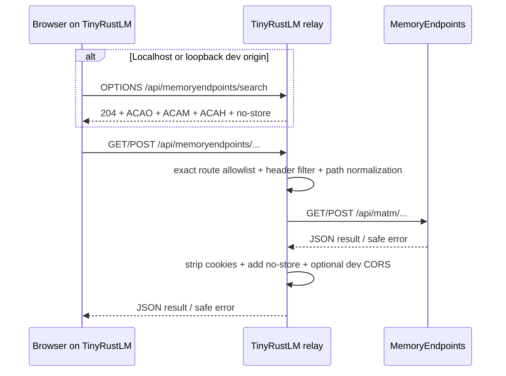

# TinyRustLM Production Browser Connectivity and Relay Deployment Report

## Evidence Basis and Current Gap

TinyRustLM’s live application is a browser-local runtime: the live UI on both the apex host and `www` states that prompts stay in the browser and that the “memory deck” path is optional, which is consistent with a design where hosted memory must remain additive and non-disruptive rather than becoming a hard dependency for the main UI. Publicly reachable copies of the UI exist on both `tinyrustlm.com` and `www.tinyrustlm.com`, so any production relay design has to preserve both hostnames without disturbing the existing static/browser-local experience. citeturn15view2turn49view0

MemoryEndpoints now publishes a live connector contract and a live route inventory. That contract advertises browser CORS support with `GET`, `POST`, and `OPTIONS`, and it explicitly allowlists `Authorization`, `Content-Type`, `Idempotency-Key`, and `X-MemoryEndpoints-Key`. The route inventory also makes the protected MATM surface concrete, including workspace setup, search, memory submission, message lanes, inbox, receipts, audit-log, and meeting-room flows. That is valuable because it gives a stable upstream contract for a TinyRustLM relay to target. citeturn54view0turn55view0

The critical production problem is not “can a relay be written?” but “where can a same-origin relay be attached on the live TinyRustLM hostnames with low blast radius?” Public evidence does **not** prove that `tinyrustlm.com` is already on Cloudflare or any other programmable edge. By contrast, adjacent live project evidence shows two different deployment patterns elsewhere in the same estate: the TinyRustLM developer portal is a plain-PHP site intended for Apache or Nginx with clean-route rewrites, and MemoryEndpoints is deployed through FTPS to a cPanel/Passenger WSGI host with Passenger restarts as the live application reload mechanism. That means the current hosting estate is compatible with traditional shared hosting and cPanel-style application hosting, but it does **not** by itself prove Cloudflare Worker routes are already available for the production TinyRustLM apex zone. citeturn34search0turn34search1turn50view0turn42search0turn42search4turn42search8

Because I could not access the local Windows path directly from this environment, any item that depends on unpublished TinyRustLM repository files should be treated as a bounded recommendation derived from live public evidence, the user-provided artifact names, and the published MemoryEndpoints contract. The definition of done in this report therefore relies on live route evidence and production verification, not on merely assuming the local repo contents are already wired correctly. That standard is consistent with the MemoryEndpoints project’s own public distinction between local proof and live proof. citeturn18view0turn50view0turn56view0

## Browser and Relay Request Flow

The browser flow that closes the production gap is straightforward in principle: TinyRustLM must call a **relative same-origin** path such as `/api/memoryendpoints/search`, the relay must validate that the requested subpath is on an exact allowlist, and the relay must then forward the request to the corresponding MemoryEndpoints MATM upstream route under `/api/matm/...`. The browser should never construct cross-origin calls to `memoryendpoints.com` in production; even if upstream CORS currently describes itself as live, the relay remains the correct boundary because it removes cross-origin variability, centralizes route isolation, and prevents upstream credential semantics from leaking into the browser networking model. citeturn54view0turn43search0turn43search2

For production UI traffic served from `tinyrustlm.com` or `www.tinyrustlm.com`, using a relative API path means the request is same-origin and therefore does not rely on CORS at all. CORS only matters for development flows where a localhost or loopback origin talks to a deployed relay. That distinction matters operationally: production success should be gated on relative-path same-origin relay behavior, while localhost and loopback should be treated as explicitly allowed developer-origin exceptions. citeturn43search0turn43search1turn49view0

MemoryEndpoints’ public contract gives the upstream route set that the relay can safely expose. The minimum useful production relay table is below. The table is intentionally strict: it forwards only exact MATM routes, not arbitrary `/api/matm/*` patterns, and it blocks non-MATM families such as model downloads, `.slm` assets, Hugging Face fetches, or arbitrary URLs. The route list should be mirrored into the TinyRustLM allowlist exactly rather than using prefix-only matching. citeturn55view0turn54view0

| Browser route on TinyRustLM | Methods | Upstream route on MemoryEndpoints | Purpose |
|---|---:|---|---|
| `/api/memoryendpoints/connector-contract` | `GET` | `/api/matm/connector-contract` | Public connector contract |
| `/api/memoryendpoints/agent-setup/free-account` | `GET`,`POST` | `/api/matm/agent-setup/free-account` | Workspace setup |
| `/api/memoryendpoints/workspace` | `GET` | `/api/matm/workspace` | Workspace status/quota |
| `/api/memoryendpoints/agents/register` | `POST` | `/api/matm/agents/register` | Agent registration |
| `/api/memoryendpoints/memory-events/submit` | `POST` | `/api/matm/memory-events/submit` | Durable memory submit |
| `/api/memoryendpoints/memory-events` | `GET` | `/api/matm/memory-events` | Memory event listing |
| `/api/memoryendpoints/search` | `GET` | `/api/matm/search` | Workspace search |
| `/api/memoryendpoints/review-queue` | `GET` | `/api/matm/review-queue` | Review readback |
| `/api/memoryendpoints/review-queue/decide` | `POST` | `/api/matm/review-queue/decide` | Idempotent review decision |
| `/api/memoryendpoints/meeting-rooms` | `GET`,`POST` | `/api/matm/meeting-rooms` | Room list/create |
| `/api/memoryendpoints/meeting-messages` | `GET`,`POST` | `/api/matm/meeting-messages` | Transcript read/write |
| `/api/memoryendpoints/meeting-messages/promote` | `POST` | `/api/matm/meeting-messages/promote` | Message→memory promotion |
| `/api/memoryendpoints/meeting-rooms/read` | `POST` | `/api/matm/meeting-rooms/read` | Read cursor update |
| `/api/memoryendpoints/routing-decisions` | `GET`,`POST` | `/api/matm/routing-decisions` | Structured routing |
| `/api/memoryendpoints/agent-messages` | `POST` | `/api/matm/agent-messages` | Current-message send |
| `/api/memoryendpoints/current-message` | `GET` | `/api/matm/current-message` | Current-message read |
| `/api/memoryendpoints/agent-inbox` | `GET` | `/api/matm/agent-inbox` | Inbox read |
| `/api/memoryendpoints/notifications/ack` | `POST` | `/api/matm/notifications/ack` | Ack + receipt |
| `/api/memoryendpoints/receipts` | `GET` | `/api/matm/receipts` | Redacted receipts |
| `/api/memoryendpoints/audit-log` | `GET` | `/api/matm/audit-log` | Redacted audit log |

Any path outside that allowlist should return a safe opaque failure such as `404` or `403` with a small JSON envelope and `Cache-Control: no-store`. The relay should not support wildcard upstream routing, URL parameters that select arbitrary origins, model asset paths, Hugging Face mirrors, or any proxying of `.slm` bytes. MemoryEndpoints’ route inventory is explicit enough that path enumeration is unnecessary and dangerous. citeturn55view0turn42search15turn42search3

The request/response sequence should behave as follows:



This sequence matches how browsers perform CORS preflight with `OPTIONS`, how same-origin calls avoid CORS entirely, and how the upstream MATM contract exposes protected and public operations with header-auth rather than browser cookies. citeturn43search2turn43search5turn54view0

## Header Policy, Path Normalization, and CORS Rules

The header policy should be narrow and mechanical. MemoryEndpoints explicitly supports `Authorization`, `Content-Type`, `Idempotency-Key`, and `X-MemoryEndpoints-Key` for browser connectors. `Accept` should also be permitted by the relay, but it does **not** need to appear in `Access-Control-Allow-Headers` because `Accept` is a CORS-safelisted request header; by spec, safelisted request headers are already allowed and usually do not need to be enumerated. `Authorization`, by contrast, is **not** covered by the wildcard shortcut in credentialed contexts and should always be listed explicitly when a preflight requests it. citeturn54view0turn58search0turn58search2

The relay’s request transformation should therefore be:

| Incoming browser header | Forward upstream? | Rule |
|---|---:|---|
| `Authorization` | Yes | Forward exactly if present |
| `X-MemoryEndpoints-Key` | Yes | Forward exactly if present |
| `Content-Type` | Yes | Forward exactly if present |
| `Accept` | Yes | Forward exactly if present, default to `application/json` when absent |
| `Idempotency-Key` | Yes | Forward for `POST`; reject blank values when header is supplied |
| `Origin` | No | Use only for relay-side CORS decision; do not forward |
| `Cookie` | No | Strip always |
| `Referer` | Optional | Prefer stripping to reduce passive leakage |
| `Host` | No | Let the platform set it for upstream |
| `X-Forwarded-*` | No by default | Add only if operationally required; otherwise strip |

The response transformation should be just as strict:

| Upstream response header | Return to browser? | Rule |
|---|---:|---|
| `Content-Type` | Yes | Preserve |
| `Cache-Control` | Overwrite | Force `no-store` |
| `Set-Cookie` | No | Strip always |
| `WWW-Authenticate` | Usually no | Replace with generic relay error if exposed to browser UI |
| `Access-Control-*` | No | Relay emits its own dev-CORS headers |
| `Content-Length` | Platform-managed | Do not synthesize manually if the body changes |
| `X-Relay-Version` | Optional | Safe to add for verification if it contains only a release ID or SHA |

`Cache-Control: no-store` is the right default here. MDN defines `no-store` as forbidding storage by any cache, and Cloudflare documents that responses with `private`, `no-store`, `no-cache`, or `max-age=0` are not cached by default; non-`GET` requests are also not cached. That is exactly what this relay wants: no credential-bearing memory responses in browser caches or shared CDN caches. citeturn42search15turn42search3turn42search7

The path-normalization bug called out in the prompt is real and worth gating directly. The `URL.pathname` property always includes an initial slash for hierarchical URLs, and URL resolution with a base URL is **not** simple string concatenation. That creates two failure modes. First, naive concatenation like `base + "/" + pathname` can yield a double slash such as `/api/matm//search` when the suffix already begins with `/`. Second, using `new URL("/search", "https://memoryendpoints.com/api/matm/")` makes the suffix root-relative and discards `/api/matm`, producing `/search` instead of `/api/matm/search`. The fix is to normalize the suffix to a slashless relative segment before joining, or to set the upstream pathname from explicit segments instead of mixing raw `pathname` strings with base-URL resolution. citeturn57search0turn57search3turn57search4

The regression tests for that bug should be table-driven and must cover at least these cases:

1. Empty suffix: `/api/memoryendpoints` → reject or map only if an explicit route exists.
2. Leading slash: `/search` → `/api/matm/search`, never `/search`, never `/api/matm//search`.
3. Nested path: `/meeting-messages/promote` → `/api/matm/meeting-messages/promote`.
4. Query preservation: `/search?scope=project&tag=risk` → the same query string upstream.
5. Trailing slash normalization: `/search/` should be rejected unless an exact canonical trailing-slash route is intentionally allowed.
6. Forbidden parent traversal and encoded slash ambiguity should be rejected before upstream fetch.

CORS policy should be split by environment. In production, the browser should use a relative path on the current hostname, so there is no cross-origin dependency. For development-only cross-origin use against the deployed relay, the relay should echo only four origin families: `https://tinyrustlm.com`, `https://www.tinyrustlm.com`, `http://localhost:<approved-port>`, `http://127.0.0.1:<approved-port>`, and `http://[::1]:<approved-port>`. The preflight response should include `Access-Control-Allow-Origin` with an exact echo value, `Access-Control-Allow-Methods: GET, POST, OPTIONS`, `Access-Control-Allow-Headers: Authorization, X-MemoryEndpoints-Key, Content-Type, Idempotency-Key`, and `Vary: Origin, Access-Control-Request-Method, Access-Control-Request-Headers`. `Access-Control-Allow-Credentials` should be omitted because the connector contract is cookie-free and directs clients to send the workspace key in headers instead. citeturn54view0turn43search1turn43search3turn43search4turn43search5

## Hosting Constraints and Recommended Architecture

The decisive constraint is authoritative DNS and request interception authority on the TinyRustLM hostnames. Cloudflare Worker routes are an excellent fit **if and only if** the `tinyrustlm.com` zone is already active in Cloudflare or can be moved there. Cloudflare’s own documentation is clear: most application services such as proxying and caching require Cloudflare nameservers to be authoritative in a primary “full” setup on Free and Pro plans, while partial CNAME setup is Business/Enterprise only and is materially more awkward for apex records unless the authoritative DNS provider supports CNAME flattening. Worker routes also require a DNS record on the zone and run only on matching paths, which is ideal for isolating `/api/memoryendpoints*` while leaving the rest of the origin untouched. citeturn47search0turn47search5turn42search1turn47search2turn48search0turn48search1

That leads to the recommended architecture:

**Preferred architecture:** a Cloudflare Worker attached only to the TinyRustLM relay paths on both apex and `www`, with all other paths falling through to the existing origin unchanged.

```toml
# wrangler.toml
name = "tinyrustlm-memoryendpoints-relay"
main = "tinyrustlm/deploy/memory-endpoints-relay-worker.js"
compatibility_date = "2026-07-10"
workers_dev = false

[vars]
MEMORYENDPOINTS_BASE_URL = "https://memoryendpoints.com"
RELAY_UPSTREAM_PREFIX = "/api/matm"
RELAY_ALLOWED_ORIGINS = "https://tinyrustlm.com,https://www.tinyrustlm.com,http://localhost:3000,http://127.0.0.1:3000,http://[::1]:3000"
RELAY_CANARY_PREFIX = "/api/memoryendpoints-canary"

[[routes]]
pattern = "tinyrustlm.com/api/memoryendpoints*"
zone_name = "tinyrustlm.com"

[[routes]]
pattern = "www.tinyrustlm.com/api/memoryendpoints*"
zone_name = "tinyrustlm.com"

[[routes]]
pattern = "tinyrustlm.com/api/memoryendpoints-canary*"
zone_name = "tinyrustlm.com"

[[routes]]
pattern = "www.tinyrustlm.com/api/memoryendpoints-canary*"
zone_name = "tinyrustlm.com"
```

The deployment commands are correspondingly small and path-isolated:

```bash
# authenticate wrangler beforehand with a zone-scoped Cloudflare token
npx wrangler deploy
npx wrangler tail tinyrustlm-memoryendpoints-relay
```

That architecture keeps TinyRustLM’s existing static/browser-local app where it is and overlays compute only on the relay paths. Cloudflare routes are specifically designed for “run code on these URL patterns, otherwise fetch the origin,” which is exactly the behavior needed here. Cloudflare also gives large request-body limits relative to expected MATM traffic, no enforced response-body limit, and no hard wall-time limit for HTTP-triggered Workers while the client remains connected, though CPU limits and isolate-memory limits still apply. citeturn42search1turn42search9turn44search0turn45search0turn45search4turn45search13

**Fallback architecture:** if Cloudflare authority cannot be obtained, the only viable same-origin alternative is an origin-side reverse proxy or application mount on the current TinyRustLM host. Public project evidence shows cPanel/Passenger application hosting and Apache/Nginx route handling elsewhere in the same environment, so an origin-admin implementation is possible in principle. But it requires host-level control over rewrites, reverse proxy rules, or a mounted application path that typical static-only shared hosting accounts may not expose. If that control is absent, the production gap cannot be closed at the required same-origin path without first changing DNS/edge authority. citeturn34search0turn50view0turn42search0turn42search8

Two alternatives should be explicitly rejected.

The first rejected alternative is **direct browser calls to `memoryendpoints.com` from TinyRustLM**. Even with the upstream connector contract now advertising live browser CORS support, your production requirement is not merely “CORS happens to work today.” It is stable same-origin behavior with route isolation, no credential persistence in browser state, and a production verification gate under your control. Direct upstream browser calls leave all of that dependent on upstream CORS behavior and expose you to future preflight regressions. citeturn54view0turn43search0turn43search2

The second rejected alternative is **migrating TinyRustLM wholesale to another front-end platform just to gain a relay path**, such as Vercel or Netlify. Vercel can rewrite to external origins and run functions, but Vercel functions do not add CORS headers automatically, and Vercel’s Edge runtime is now deprecated in favor of Node.js functions; either way, that is a hosting migration with a much larger blast radius than the narrow path-level relay problem requires. Netlify can proxy with rewrites, but that again implies a platform move and different routing/header semantics instead of solving the current authority problem in place. citeturn46search0turn46search2turn46search5turn46search6turn46search1turn46search4

## Reliability, Security, Monitoring, and Failure Behavior

MemoryEndpoints’ own public contract already tells us the traffic profile is small, structured, and text-oriented: current messages are capped at 1,000 characters, meeting summaries at 2,000, memory summaries at 4,000, and the recommended fields are metadata-rich JSON summaries rather than file uploads. That means the relay should **not** be sized or designed like a general-purpose file proxy. Even though Cloudflare Worker request limits are 100 MB on Free and Pro and 200 MB on Business, the relay should enforce a much tighter application-level cap such as 64 KiB request body size and a soft response alarm at 2 MiB. If these thresholds are exceeded, the relay should fail closed with a non-cached JSON error and leave TinyRustLM in local-only mode. citeturn54view0turn44search0

Retries should be conservative. The safest behavior is **no automatic relay retry** for `POST` and at most one relay-side retry for `GET` on connection-reset or `502/503/504` if, and only if, the user experience requires it. Mutation semantics belong with the client and must rely on `Idempotency-Key`; MemoryEndpoints’ contract states that protected mutation routes support `Idempotency-Key` except one-time setup. Therefore the TinyRustLM UI should retry only user-safe mutation flows and should preserve the same idempotency key across a retry. The relay should forward the header exactly and never synthesize a new one. citeturn54view0

Connection reuse should be delegated to the edge runtime or origin proxy rather than reimplemented in application logic. The relay should remain a transparent HTTP boundary with low CPU and low memory usage. In a Worker-based deployment, that means avoiding body buffering beyond the small JSON caps above and streaming the upstream response through when practical. Worker isolate memory is limited, so the relay should explicitly reject large payload classes rather than accidentally becoming a buffer-heavy proxy. citeturn45search0turn44search0

Degraded-state UI behavior must preserve the approved TinyRustLM interface. When the relay returns a timeout, `5xx`, or validation failure, the hosted-memory feature should move to a visible “unavailable” or “degraded” state while the rest of the browser-local runtime continues to function unchanged. This is aligned with the live TinyRustLM positioning that the runtime is browser-local and that hosted memory is optional. The user should never lose local inference, local model import, or non-memory features because the relay path is unhealthy. citeturn15view2turn49view0

Log redaction rules need to be enforced at the relay boundary, not only at the UI. MemoryEndpoints’ contract is unusually explicit here: workspace keys must not be printed, raw credentials must not be persisted inside memory or summaries, and connectors should store the workspace key only in a secure local secret store. The relay therefore should log only method, normalized route ID, status code, latency, bytes in/out, host, origin-class, and a request correlation ID. It should **never** log `Authorization`, `X-MemoryEndpoints-Key`, raw request JSON, raw response JSON, search terms, message contents, or full query strings if they can contain user content. citeturn54view0

Monitoring should record four dimensions only: request count, status code family, latency buckets, and blocked-path count. It is reasonable to add a route ID dimension and a host dimension (`apex` vs `www`) because those are operationally useful and non-sensitive. The relay should also maintain explicit counters for preflight success, preflight rejection, upstream timeout, upstream `5xx`, path-normalization rejection, and forbidden-route rejection. That gives enough production visibility to understand health without capturing memory content or credentials. citeturn54view0turn42search3

## Deployment Ordering, Environment Inventory, and Rollback

The environment inventory should separate true deployment secrets from configuration clearly.

| Name | Secret | Purpose |
|---|---:|---|
| `CLOUDFLARE_API_TOKEN` | Yes | Deploy Worker and bind routes if Cloudflare is chosen |
| `CLOUDFLARE_ACCOUNT_ID` | No | Wrangler targeting |
| `CLOUDFLARE_ZONE_ID` | No | Optional explicit zone targeting |
| `MEMORYENDPOINTS_BASE_URL` | No | Upstream service base URL |
| `RELAY_UPSTREAM_PREFIX` | No | Fixed `/api/matm` prefix |
| `RELAY_ALLOWED_ORIGINS` | No | Dev-origin allowlist |
| `RELAY_VERSION` | No | Release SHA or build marker exposed via header for verification |
| `PRODUCTION_VERIFIER_WORKSPACE_ID` | No | Live verification account/workspace id |
| `PRODUCTION_VERIFIER_AGENT_ID` | No | Live verification agent id |
| `PRODUCTION_VERIFIER_WORKSPACE_KEY` | Yes | Live verification secret, never committed, never logged |

The most important omission from that table is intentional: the relay should **not** have a production shared workspace key baked into deployment configuration. MemoryEndpoints’ public guidance forbids printing or persisting raw workspace keys unsafely, and the browser connector model is explicitly header-driven and user-key-based. The relay should simply forward user-supplied auth headers for approved routes. Only the production verifier needs its own dedicated test workspace key, and that belongs in a secret store outside source control and outside browser storage. citeturn54view0

The deployment order should be dependency-driven:

1. Capture current live evidence for apex and `www`: response headers, HTML parity, static asset parity, and whether both hostnames already serve the same UI.
2. Determine whether the TinyRustLM zone is already active in Cloudflare. If not, decide whether full-zone migration is acceptable. If it is not acceptable, stop and use the origin-admin fallback path instead.
3. If Cloudflare is used, import the full DNS zone *without* the relay route first and verify that the site still serves correctly through Cloudflare with origin parity.
4. Deploy the relay to the **canary path** only: `/api/memoryendpoints-canary/*` on apex and `www`.
5. Run the production gate scripts against canary with a live verifier workspace.
6. Promote the same Worker to `/api/memoryendpoints/*`.
7. Re-run the production gate on both hostnames.
8. Begin monitoring and leave the canary path in place for a short soak period.
9. Only then mark the feature done.

This ordering contains failures to a path-level canary until the very last promotion step. The dangerous operation, if Cloudflare is not already authoritative, is the nameserver move itself; Cloudflare’s own docs make clear that most application services require Cloudflare’s nameservers in full setup on Free/Pro, while partial setup has Business/Enterprise and apex constraints. That nameserver move is therefore the real infrastructure gate, not the Worker code. citeturn47search0turn47search5turn48search0turn48search1

The rollback procedure must not take down the existing TinyRustLM interface. In the recommended Cloudflare design, rollback is simply removing or narrowing the Worker route patterns for `/api/memoryendpoints*` while leaving the rest of the zone, DNS records, and static origin mappings unchanged. Because Worker routes are path-specific, everything outside the relay path continues to fall through to the existing origin both before and after rollback. That makes route removal the correct first rollback action for relay incidents. citeturn42search1turn42search9turn47search7

If the zone itself had to be moved to Cloudflare for the first time and the nameserver cutover caused broader impact, rollback becomes a registrar-level nameserver revert. That is inherently higher risk and slower because it depends on DNS propagation. For that reason, if full-zone Cloudflare adoption is politically or operationally unacceptable, the project should not treat Cloudflare as “obviously available”; it should instead pursue origin-admin reverse proxying on the current host. That conclusion follows directly from Cloudflare’s zone-setup model rather than from the relay code. citeturn47search0turn47search5turn48search0

## Verification Matrix, Test Plan, and Definition of Done

The production verification matrix should be concrete and machine-checkable.

| Scenario | Expected result |
|---|---|
| Apex UI load | `tinyrustlm.com` serves the existing TinyRustLM UI unchanged |
| `www` UI load | `www.tinyrustlm.com` serves the existing TinyRustLM UI unchanged |
| Apex relay GET public route | `GET /api/memoryendpoints/connector-contract` returns `200`, `no-store`, JSON |
| `www` relay GET public route | Same as apex |
| Apex relay protected GET | `GET /api/memoryendpoints/current-message` with verifier auth returns `200` or expected safe protected result |
| Apex relay protected POST | `POST /api/memoryendpoints/agent-messages` with verifier auth and `Idempotency-Key` returns success envelope |
| Mobile browser smoke | Same-origin relay calls succeed on mobile browser for apex and `www` |
| Localhost preflight | Allowed localhost origin gets `204` with correct allow headers |
| Loopback preflight | `127.0.0.1` and `[::1]` variants behave identically |
| Direct browser call to upstream | Still considered non-gating; if it fails CORS, production still passes because relay path is authoritative |
| Forbidden model route | `/api/memoryendpoints/models/...` returns safe rejection |
| Forbidden arbitrary URL proxy | Query or path attempting arbitrary upstream routing returns safe rejection |
| Double-slash regression | No request produces upstream `//` in MATM path |
| Cache bypass | Every relay response returns `Cache-Control: no-store` |
| Secret hygiene | No `Set-Cookie`, no auth header leakage, no credentials in verifier report |

The verifier report should be intentionally redacted and small. The expected fields are:

```json
{
  "timestampUtc": "2026-07-10T00:00:00Z",
  "host": "tinyrustlm.com",
  "pathCase": "current-message-get",
  "method": "GET",
  "normalizedRelayPath": "/api/memoryendpoints/current-message",
  "normalizedUpstreamPath": "/api/matm/current-message",
  "statusCode": 200,
  "latencyMs": 123,
  "cacheControl": "no-store",
  "cors": {
    "originEvaluated": "http://localhost:3000",
    "allowOriginEchoed": true,
    "allowMethodsOk": true,
    "allowHeadersOk": true
  },
  "headerLeak": {
    "authorizationEchoed": false,
    "workspaceKeyEchoed": false,
    "setCookiePresent": false
  },
  "body": {
    "contentType": "application/json",
    "length": 842,
    "sha256": "redacted-or-hash-only"
  },
  "result": "pass"
}
```

Pass/fail rules should be hard gates, not advisory warnings. A run fails if any required route on apex or `www` is missing, if the UI path changes, if a forbidden route proxies successfully, if `Cache-Control: no-store` is absent, if a preflighted dev-origin request does not return the exact allowlist the relay expects, if a protected mutation lacks idempotency forwarding, if any response leaks `Set-Cookie`, `Authorization`, or `X-MemoryEndpoints-Key`, or if normalized-upstream-path validation detects a dropped `/api/matm` prefix or a double slash. Those rules reflect the same “live proof, not local proof” discipline MemoryEndpoints exposes publicly for its own deployment status. citeturn18view0turn50view0turn56view0

The TDD plan should proceed in four layers.

First, **worker unit tests** should be exhaustive and table-driven: route allowlist acceptance, forbidden-route rejection, path normalization, query preservation, `OPTIONS` handling, header passthrough, cookie stripping, no-store enforcement, and exact handling of `Idempotency-Key`. These tests prove the relay logic only.

Second, **local integration tests** should exercise the live MemoryEndpoints upstream from a local relay instance using a dedicated verifier workspace. Those tests should cover agent setup, agent registration, search, current-message, agent-messages, notifications/ack, receipts, and an explicit forbidden-route case. The upstream is real here; there should be no fake server in the acceptance path. That matches the MemoryEndpoints project’s own emphasis that local tests are not equivalent to live deployment proof. citeturn18view0turn56view0

Third, **live staging tests** should hit the canary relay path on both apex and `www`, from desktop Chromium, desktop Firefox, mobile Safari/Chrome, localhost, `127.0.0.1`, and `[::1]`. These tests prove actual DNS, TLS termination, edge routing, and same-hostname path behavior.

Fourth, **production smoke tests** should hit the final `/api/memoryendpoints/*` routes immediately after promotion and again after a soak window. The gate scripts named in your brief should become the single source of truth for promotion decisions; a passing unit test or a successfully uploaded source file is not production proof.

The implementation tasks, in dependency order, are therefore:

1. Prove current TinyRustLM authority path: registrar, nameservers, DNS record set, TLS terminator, and whether Cloudflare is already authoritative.
2. Decide platform: Cloudflare full-zone route overlay or origin-admin reverse proxy.
3. Freeze the production route manifest and forbidden-path manifest.
4. Add unit tests for path normalization, header policy, `OPTIONS`, and forbidden routes.
5. Bind a dedicated verifier workspace and keep its key in a secret store only.
6. Deploy canary only.
7. Run canary verifier on apex and `www`.
8. Promote the production route patterns.
9. Run production verifier matrix.
10. Turn on redacted metrics and incident alerting.
11. Keep rollback instructions one command away from operators.

The final definition of done is intentionally strict:

Done means that `tinyrustlm.com` **and** `www.tinyrustlm.com` both continue serving the unchanged TinyRustLM interface; `/api/memoryendpoints/*` succeeds for the approved MATM routes through the live same-origin relay; localhost and loopback preflight behavior is correct; forbidden model and arbitrary-proxy routes are blocked; all relay responses are `no-store`; no credentials or memory content appear in logs or verifier output; and the production gate scripts produce redacted live evidence from the actual public hostnames. It does **not** mean “the worker source exists,” “a local fake server worked,” or “the repo contains a script named deploy.” citeturn15view2turn49view0turn55view0turn54view0turn50view0turn56view0