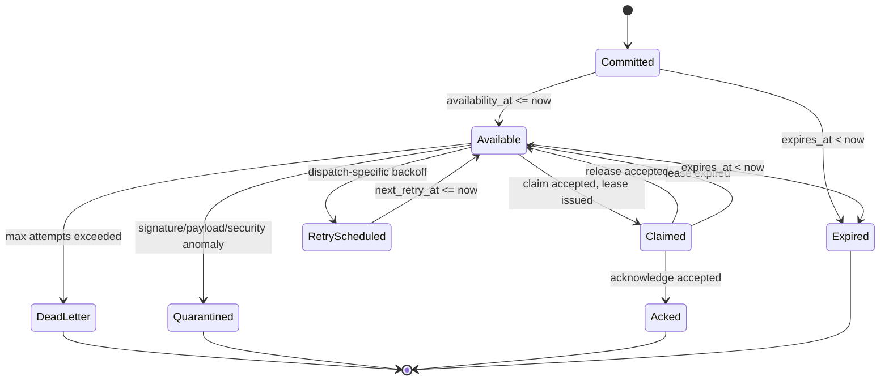
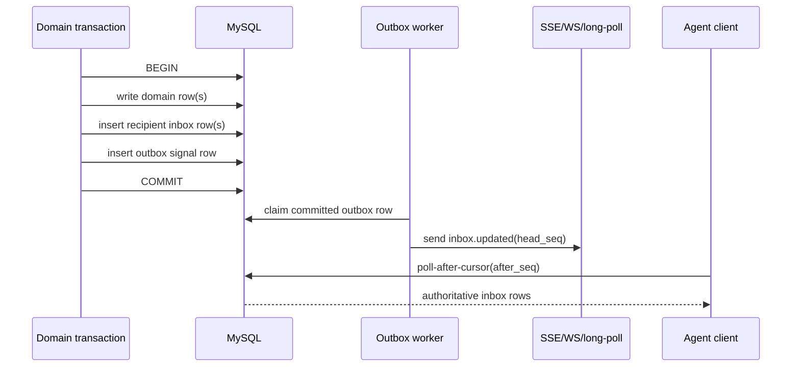
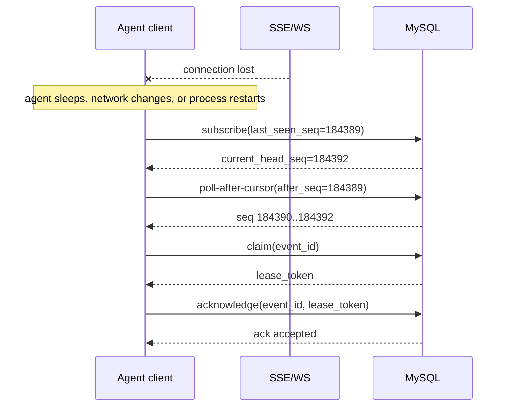

# Disconnected-Agent Notifications for Self-Hosted MATM Coordination

## Executive recommendation

The production-quality design I recommend is a **durable pull-based inbox as the source of truth**, with **best-effort real-time signals layered on top**. In concrete terms: every work item, meeting-room post, routing decision, memory update, or assignment should first be committed to a recipient-scoped inbox in the same database transaction as the domain change; connected agents should then receive an immediate hint over an outbound transport; disconnected agents should recover by polling from a cursor when they return. This cleanly separates **“notification that work exists”** from **durable message delivery**. The durable inbox delivers correctness; the real-time hint improves latency. This pattern aligns with the transactional outbox approach used to couple state change and message publication atomically, without requiring an external broker. citeturn13search1turn13search16turn13search18turn20search9turn20search14

For defaults, use **adaptive cursor-based polling everywhere**, add **long polling** as the lowest-friction real-time upgrade for CLI and desktop agents, use **Server-Sent Events** as the browser default for one-way “work exists” hints, and reserve **WebSockets** for clients that truly need bidirectional low-latency interaction such as presence, typing, routing negotiations, or multiplexed control messages. **Authenticated webhooks** should be optional accelerators for managed deployments only, and **a local wake daemon** should also be optional, mainly for desktop and server-class machines where you control installation and can run an operating-system service. citeturn0search3turn1search1turn1search10turn0search1turn24search8turn8search4turn8search13turn8search6

**Opening an inbound port on each agent is not viable as the universal delivery mechanism.** It fails the stated constraints for too many environments: many agents will be behind NAT or corporate firewalls, direct inbound reachability can be impossible without relays in some cases, browser-based agents do not expose a generic server-socket model, stable public addressing is often absent, and certificate lifecycle management for edge listeners is operationally heavy. Even where an inbound listener is technically possible, it still does nothing while the host is asleep, the browser tab is closed, or the agent process is stopped. Publicly trusted ACME automation also assumes domain control and, for HTTP-01, port 80 reachability. citeturn2search0turn2search15turn1search1turn24search8turn10search1turn9search9turn9search2

**Opinion:** if you need one sentence to anchor the design, it is this: **treat every push transport as a hint channel, never as the durable record.**

## Constraints and transport evaluation

The core transport facts are straightforward. HTTP conditional requests using `ETag` and `If-None-Match` are standardized and efficient for change detection. Long polling is a well-known bidirectional-HTTP pattern, but RFC 6202 warns that intermediary behavior and timeout selection matter, and notes that about 30 seconds is a safer timeout target in practice than very long holds. Server-Sent Events define a unidirectional server-to-client stream over HTTP with built-in reconnection support and `Last-Event-ID`. WebSockets provide a client-initiated full-duplex channel over TCP with an origin-based browser security model. Browser push in the W3C Push API relies on a **push service**, which your constraints explicitly disallow, and Periodic Background Sync remains experimental rather than a portable production wake mechanism. citeturn0search4turn0search16turn0search3turn18search0turn1search1turn11search1turn0search1turn24search8turn9search9turn9search2

The matrix below is a **synthesis** of those specs and mature engineering docs, plus the deployment constraints in your prompt.

| Transport or mechanism | Works behind NAT and corporate proxies | Browser fit | Can wake a stopped process or sleeping machine | Durable by itself | Operational complexity | Recommended role |
|---|---|---:|---:|---:|---:|---|
| Cursor-based polling | Usually yes | Excellent | No | Yes, if backed by inbox | Low | **Universal baseline** |
| Adaptive polling | Usually yes | Excellent | No | Yes, if backed by inbox | Low to medium | **Default baseline** |
| Conditional HTTP requests | Usually yes | Excellent | No | No, but reduces empty polls | Low | **Optimization on polling** |
| Long polling | Often yes, but sensitive to intermediary timeouts | Good | No | No | Low to medium | **Best first real-time upgrade** |
| Server-Sent Events | Good when outbound HTTP streams are allowed | Very good | No | No | Medium | **Default browser signal channel** |
| WebSockets | Often yes, but some enterprises/proxies are stricter | Good | No | No | Medium to high | **Optional for bidirectional clients** |
| Authenticated webhooks | Only if agent endpoint is publicly reachable or reverse-proxied | Poor for browsers | No | No | High | **Optional accelerator only** |
| Local wake daemon | Yes, if daemon uses outbound polling/streaming | Not applicable directly | Can wake local apps, not sleeping hardware | No | Medium | **Excellent optional desktop/server helper** |
| OS service manager | Yes, if service itself uses outbound polling/streaming | Not applicable directly | Can keep a helper alive or trigger on-demand | No | Medium | **Packaging and lifecycle support** |
| Inbound listener on each agent | Frequently no | Essentially no for browsers | No | No | High | **Not a default transport** |

For webhook-style delivery, mature first-party providers consistently document that endpoints must be verified, kept lightweight, and given a recovery path for missed deliveries. GitHub recommends secrets, HTTPS, minimum subscriptions, quick responses, and handling missed deliveries; it explicitly supports reverse-proxying into private systems and documents redelivery flows. Stripe signs webhook deliveries with a timestamped signature and uses retry/idempotency patterns heavily. Those are not proofs that webhooks are wrong; they are strong evidence that **webhooks are an optimization layer, not a correctness layer**. citeturn19search1turn19search0turn6search1turn6search20turn7search0turn7search1turn7search2

### Inbound port viability

The answer is **conditionally viable for a narrow subset of managed desktop or server deployments, but not viable as the default or sole delivery mechanism**. NAT standards document that direct communication across NATs can fail depending on topology, and TURN exists precisely because direct peer reachability is sometimes impossible. Browsers only expose client APIs such as `EventSource` and `WebSocket`; they do not expose a general-purpose network listener API analogous to a server socket. For publicly trusted TLS, edge listeners need stable DNS or other certificate validation arrangements; ACME HTTP-01 requires port 80, which is often a non-starter at the edge. citeturn2search0turn2search15turn1search1turn24search8turn10search1

**Inference:** even where you can force port openings and solve DNS/TLS, an inbound listener still loses its main argument the moment the process exits or the machine sleeps. That makes it insufficient for your problem statement, which is specifically about agents that may not be connected at publication time. The inbox-and-cursor model is what closes that gap. citeturn0search1turn1search1turn8search4turn22search2

## Reference architecture and protocol

The recommended architecture has three layers.

First, the **durable inbox layer** is authoritative. A work-producing transaction writes domain facts and one durable inbox row per recipient. Second, the **signal layer** attempts immediate notification to currently connected sessions through long poll release, SSE, WebSocket, or an optional callback. Third, the **recovery layer** lets every client resume from a cursor, regardless of which signal channel was used or missed. This matches the strongest parts of HTTP’s conditional and streaming models, and avoids relying on any third-party push infrastructure. citeturn0search4turn0search3turn1search1turn0search1

### Event envelope

**Proposed envelope**

```json
{
  "event_id": "0197f0ab-44f7-7f1a-b0ef-1f5d0f9a1c70",
  "tenant_id": "tenant_42",
  "recipient_kind": "agent",
  "recipient_id": "agent_alpha",
  "inbox_seq": 184392,
  "event_type": "meeting_room.message_posted",
  "availability_at_utc": "2026-07-12T16:22:03Z",
  "expires_at_utc": "2026-08-11T16:22:03Z",
  "priority": "normal",
  "deduplication_key": "msg:room_7:920155",
  "ack_state": "available",
  "delivery_attempts": 0,
  "visibility_lease_until_utc": null,
  "next_retry_at_utc": null,
  "dead_letter_state": "none",
  "correlation": {
    "company_id": "co_9",
    "workspace_id": "ws_12",
    "project_id": "proj_88",
    "meeting_room_id": "room_7",
    "message_id": "920155",
    "routing_decision_id": null,
    "memory_update_id": null,
    "assignment_id": null
  },
  "payload_ref": {
    "kind": "meeting_room_message",
    "id": "920155"
  }
}
```

**Recommendation:** use **UUIDv7** for `event_id`, because it keeps UUID semantics while giving better sort locality than purely random UUIDs. RFC 9562 defines UUIDs and includes UUIDv7. citeturn21search0turn21search1

### Signal payload

Signals should be intentionally thin. They are not the durable record.

```json
{
  "signal_type": "inbox.updated",
  "tenant_id": "tenant_42",
  "recipient_id": "agent_alpha",
  "head_seq": 184392,
  "approximate_unacked": 3,
  "sent_at_utc": "2026-07-12T16:22:04Z",
  "delivery_id": "0197f0ab-4623-7d52-a87e-27afcf0d9a92"
}
```

This mirrors the operational lesson from mature webhook systems: notify quickly, verify authenticity, then let the receiver fetch what it needs rather than depending on the push body as the only copy. citeturn19search1turn6search17turn7search0

### API contract

**Subscribe**

`POST /v1/agent-sessions/subscribe`

```json
{
  "tenant_id": "tenant_42",
  "agent_id": "agent_alpha",
  "device_id": "desktop_01",
  "supported_transports": ["sse", "websocket", "long-poll", "poll"],
  "last_seen_seq": 184389,
  "wants_claims": true
}
```

```json
{
  "session_id": "sess_01J2M7YGF41B5B2N0T3W3D7SM2",
  "recipient": {
    "tenant_id": "tenant_42",
    "recipient_kind": "agent",
    "recipient_id": "agent_alpha"
  },
  "current_head_seq": 184392,
  "recommended_transport": "sse",
  "poll_after_cursor_url": "/v1/inbox/poll-after-cursor",
  "sse_url": "/v1/streams/sse?session_id=sess_01J2M7YGF41B5B2N0T3W3D7SM2",
  "websocket_url": "wss://coord.example.net/v1/streams/ws",
  "heartbeat_interval_seconds": 30,
  "lease_default_seconds": 120,
  "retention_days": 30
}
```

**Poll after cursor**

`POST /v1/inbox/poll-after-cursor`

```json
{
  "tenant_id": "tenant_42",
  "recipient_id": "agent_alpha",
  "after_seq": 184389,
  "limit": 100,
  "wait_seconds": 25,
  "include_claimable_only": true
}
```

```json
{
  "head_seq": 184392,
  "events": [
    {
      "event_id": "0197f0ab-44f7-7f1a-b0ef-1f5d0f9a1c70",
      "inbox_seq": 184390,
      "event_type": "routing.decision_ready",
      "priority": "high",
      "availability_at_utc": "2026-07-12T16:22:03Z",
      "expires_at_utc": "2026-07-19T16:22:03Z",
      "deduplication_key": "route:job_5521:v4",
      "ack_state": "available",
      "delivery_attempts": 0
    },
    {
      "event_id": "0197f0ab-4521-7227-a2f1-5b34bd0ad973",
      "inbox_seq": 184391,
      "event_type": "meeting_room.message_posted",
      "priority": "normal",
      "availability_at_utc": "2026-07-12T16:22:03Z",
      "expires_at_utc": "2026-08-11T16:22:03Z",
      "deduplication_key": "msg:room_7:920155",
      "ack_state": "available",
      "delivery_attempts": 0
    }
  ],
  "next_cursor": 184391,
  "more_available": true
}
```

**Claim**

`POST /v1/inbox/claim`

```json
{
  "tenant_id": "tenant_42",
  "recipient_id": "agent_alpha",
  "session_id": "sess_01J2M7YGF41B5B2N0T3W3D7SM2",
  "event_ids": [
    "0197f0ab-44f7-7f1a-b0ef-1f5d0f9a1c70"
  ],
  "lease_seconds": 120
}
```

```json
{
  "claims": [
    {
      "event_id": "0197f0ab-44f7-7f1a-b0ef-1f5d0f9a1c70",
      "lease_token": "lease_01J2M7Z7JCC7M5VVM0P7AN0F8J",
      "visibility_lease_until_utc": "2026-07-12T16:24:12Z",
      "ack_state": "claimed"
    }
  ]
}
```

**Acknowledge**

`POST /v1/inbox/acknowledge`

```json
{
  "tenant_id": "tenant_42",
  "recipient_id": "agent_alpha",
  "session_id": "sess_01J2M7YGF41B5B2N0T3W3D7SM2",
  "acks": [
    {
      "event_id": "0197f0ab-44f7-7f1a-b0ef-1f5d0f9a1c70",
      "lease_token": "lease_01J2M7Z7JCC7M5VVM0P7AN0F8J",
      "result": "completed"
    }
  ]
}
```

**Release**

`POST /v1/inbox/release`

```json
{
  "tenant_id": "tenant_42",
  "recipient_id": "agent_alpha",
  "event_id": "0197f0ab-44f7-7f1a-b0ef-1f5d0f9a1c70",
  "lease_token": "lease_01J2M7Z7JCC7M5VVM0P7AN0F8J",
  "reason": "transient_dependency_failure",
  "retry_after_seconds": 60
}
```

**Heartbeat**

`POST /v1/inbox/heartbeat`

```json
{
  "tenant_id": "tenant_42",
  "recipient_id": "agent_alpha",
  "session_id": "sess_01J2M7YGF41B5B2N0T3W3D7SM2",
  "leases": [
    {
      "event_id": "0197f0ab-44f7-7f1a-b0ef-1f5d0f9a1c70",
      "lease_token": "lease_01J2M7Z7JCC7M5VVM0P7AN0F8J",
      "extend_by_seconds": 120
    }
  ]
}
```

**Optional callback registration**

`POST /v1/callback-registrations`

```json
{
  "tenant_id": "tenant_42",
  "recipient_id": "agent_alpha",
  "callback_url": "https://agent-alpha.example.net/matm/callback",
  "auth_mode": "hmac-sha256",
  "secret_id": "cbksec_2026_07",
  "delivery_scope": ["signal_only"],
  "max_rate_per_minute": 30
}
```

```json
{
  "registration_id": "cbreg_01J2M84JZ6P4JR1Q0S8W4R1G8W",
  "status": "pending_verification",
  "challenge_delivery_id": "0197f0ab-47af-7be1-b2e8-0f6cd4d6e1d5",
  "expires_at_utc": "2026-07-12T16:35:00Z"
}
```

### Conditional requests, long polling, SSE, and WebSockets

HTTP conditional requests belong in front of the poll path. A companion endpoint such as `GET /v1/inbox/head` can return `ETag: "tenant_42:agent_alpha:184392"`, and clients can send `If-None-Match` to get `304 Not Modified` when the head cursor has not advanced. That is a low-cost optimization rooted directly in HTTP semantics. citeturn0search4turn0search16

Long polling is just `poll-after-cursor` with `wait_seconds` set, typically around 20–30 seconds to survive intermediaries more reliably. SSE is ideal for browsers because it is server-to-client only, reconnection-aware, and carries `Last-Event-ID`; browsers can reconnect quickly and then call `poll-after-cursor` using the authoritative cursor. WebSockets are best when the browser or desktop client also needs to send control messages upstream frequently, not merely receive nudges. citeturn18search0turn1search1turn11search1turn1search10turn0search1turn24search8

**Inference:** for browser authentication, prefer same-origin cookies or a prior authenticated session bootstrap over putting long-lived bearer tokens into SSE or WebSocket URLs. The standard browser constructors expose URL-centric connection APIs, while RFC 6750 warns against bearer tokens in URLs because they leak through histories, logs, and intermediaries. citeturn11search11turn24search8turn16search1

### State machine

**Proposed state machine**



### Sequence diagrams

**Publish then signal**



**Reconnect and recover**



## MySQL schema and transaction boundaries

A dependency-free implementation in MySQL should use four main data sets: a **domain table or tables** for the actual MATM objects, an **agent inbox** table for durable recipient-visible work items, an **outbox** table for post-commit signaling, and **session / delivery-attempt** tables for transient transport state. The important property is atomicity between domain change and inbox/outbox creation. MySQL’s InnoDB transaction model, `START TRANSACTION`, and locking reads are sufficient for this. `FOR UPDATE` / `FOR SHARE` locks are released on commit or rollback, and `SKIP LOCKED` is available for queue-worker style scans. citeturn20search14turn20search1turn20search0turn20search8

**Proposed schema**

- `agent_inbox`
  - `tenant_id`
  - `recipient_kind`
  - `recipient_id`
  - `inbox_seq`
  - `event_id`
  - `event_type`
  - `priority`
  - `availability_at_utc`
  - `expires_at_utc`
  - `deduplication_key`
  - `ack_state`
  - `delivery_attempts`
  - `visibility_lease_until_utc`
  - `lease_token_hash`
  - `lease_owner_session_id`
  - `next_retry_at_utc`
  - `dead_letter_state`
  - `company_id`
  - `workspace_id`
  - `project_id`
  - `meeting_room_id`
  - `message_id`
  - `routing_decision_id`
  - `memory_update_id`
  - `assignment_id`
  - `payload_json` or `payload_ref_type` + `payload_ref_id`
  - `created_at_utc`
  - `acked_at_utc`

- `outbox_signal`
  - `outbox_id`
  - `tenant_id`
  - `recipient_id`
  - `head_seq`
  - `signal_type`
  - `status`
  - `attempt_count`
  - `next_attempt_at_utc`
  - `last_error_code`
  - `created_at_utc`

- `agent_session`
  - `session_id`
  - `tenant_id`
  - `agent_id`
  - `device_id`
  - `transport`
  - `connected_at_utc`
  - `last_heartbeat_at_utc`
  - `last_seen_seq`
  - `auth_subject`
  - `status`

- `callback_registration`
  - `registration_id`
  - `tenant_id`
  - `recipient_id`
  - `callback_url`
  - `verification_state`
  - `auth_mode`
  - `key_id`
  - `secret_hash` or `public_key`
  - `replay_window_seconds`
  - `max_rate_per_minute`
  - `created_at_utc`
  - `rotates_after_utc`

**Opinion:** in MySQL, make `(tenant_id, recipient_id, inbox_seq)` the primary retrieval key, and a separate unique key on `(tenant_id, recipient_id, deduplication_key)` when idempotent publish semantics are required for that event family.

### Transaction boundaries

The safest publish path is:

1. `BEGIN`
2. Write domain mutation.
3. Allocate recipient `inbox_seq` values.
4. Insert `agent_inbox` rows.
5. Insert one or more `outbox_signal` rows.
6. `COMMIT`

A separate worker then scans committed outbox rows and attempts live notification. Because that worker only sees committed rows, it cannot legally signal work that has not committed yet. That is the database-native answer to the “notification before transaction commit” race. This is exactly the problem the transactional outbox pattern is meant to solve. citeturn13search1turn13search18turn20search9turn20search14

For claim and ack:

- A batch claimer can select visible rows with `FOR UPDATE SKIP LOCKED` inside a transaction, mark them `claimed`, set `visibility_lease_until_utc`, increment `delivery_attempts`, and commit.
- An ack should be **idempotent**: the server accepts repeated `acknowledge` calls with the same `event_id` and matching lease token, returning success if the row is already acked. Stripe documents idempotency as the practical way to make retries safe; the same principle applies here. citeturn20search0turn20search2turn7search1

Do **not** use MySQL advisory locks such as `GET_LOCK()` as the primary work-lease mechanism. MySQL documents that these locks are session-scoped and are released when the session terminates, but not when transactions commit or roll back. That makes them a poor fit for durable message ownership semantics compared with explicit lease columns in inbox rows. citeturn4search1turn4search9

### Race conditions and their handling

The protocol should treat duplicate and out-of-order signals as normal.

- **Notification before transaction commit:** prevented by writing outbox and inbox rows in the same DB transaction and signaling only from committed outbox rows. citeturn13search1turn20search9
- **Reconnect during delivery:** reconnecting clients must ignore transport-local ordering and recover from `last_seen_seq` using the durable inbox. SSE’s `Last-Event-ID` helps stream resumption, but correctness still comes from the cursor poll. citeturn11search1turn1search1
- **Duplicate delivery:** accept it. Use `event_id` and `deduplication_key` for receiver-side idempotence, and use idempotent ack semantics. citeturn7search1
- **Out-of-order receipt:** order by `inbox_seq`, not by callback arrival time or WebSocket frame timing.
- **Lost acknowledgement:** make `acknowledge` idempotent and lease-based; if ack is lost, a retry should succeed without duplicating work.
- **Expired lease:** if `visibility_lease_until_utc` passes without heartbeat or ack, return the item to `available` with backoff.
- **Two processes using one agent identity:** allow multiple sessions to receive hints, but serialize actual consumption through row-level claims. If shared identities are undesirable, add a concurrency policy of `single-active-session`.
- **Offline longer than retention:** return `cursor_reset_required` with `oldest_available_seq` and a domain resync route. If the inbox no longer has historical rows, the client must reconstruct current state from authoritative domain tables, not guess from missing notifications.

## Security model and inbound-port viability

Transport security is non-negotiable. OWASP’s REST guidance says secure REST services must use HTTPS, and bearer tokens belong in authorization mechanisms with confidentiality protections rather than in URLs. TLS 1.3 is the current IETF transport standard, and bearer-token guidance in RFC 6750 remains the baseline warning that possession is authorization; if a bearer token leaks, it can be replayed. citeturn3search4turn12search1turn16search1

### Token storage and least privilege

**Opinion:** use short-lived access tokens and rotating refresh credentials where possible. CLI and desktop installations should prefer an OS secret store when available; failing that, use a file with strict local permissions. Browser clients should use same-origin secure cookies for stream bootstrap where feasible instead of URL tokens. For scopes, keep them separate:

- `inbox.poll`
- `inbox.claim`
- `inbox.ack`
- `inbox.release`
- `inbox.heartbeat`
- `stream.subscribe`
- `callback.register`
- `callback.rotate`
- `tenant.read:{tenant_id}`

For especially sensitive agents, sender-constrained tokens are a real hardening lever. OAuth DPoP exists specifically to bind tokens to a client proof-of-possession key and detect replay. citeturn17search1turn15search1turn16search1

### Callback verification, signed notifications, rotation, and replay windows

The safest callback flow is:

1. Client registers a callback URL and key material.
2. Registration remains `pending_verification`.
3. Service sends a **challenge** request containing a unique `delivery_id`, timestamp, nonce, and short expiry.
4. Receiver must prove possession of the configured secret or private key.
5. Service marks the registration active only after verification.

GitHub’s `ping` event and secret verification are good operational precedents for registration verification and signature checking, while Stripe’s timestamped signature model is a good precedent for replay windows. For your own protocol, either use HMAC-SHA256 over the raw body and selected headers or adopt RFC 9421 HTTP Message Signatures. Include at least a key ID, nonce, creation time, expiry time, request target, and content digest. Cache nonces or delivery IDs for the replay window. NIST defines a nonce precisely for live-data / anti-replay purposes. citeturn6search2turn6search20turn7search0turn14search0turn14search19

**Recommended callback headers**

- `MATM-Delivery-Id`
- `MATM-Timestamp`
- `MATM-Nonce`
- `MATM-Key-Id`
- `Content-Digest`
- `Signature-Input`
- `Signature`

**Key rotation recommendation:** support `current` and `next` keys simultaneously, require all outbound deliveries to carry `key_id`, and allow a bounded overlap window before retiring the old key. That keeps rotation operationally safe even when some agents reconnect slowly.

### SSRF, denial of service, and callback scope

Callback registration is an SSRF surface. OWASP’s SSRF prevention guidance applies directly: only allow `https://`, reject localhost, link-local, private, reserved, and metadata-service IP ranges after DNS resolution and after any redirects, and preferably require a preapproved allowlist or an explicit reverse-proxy endpoint instead of arbitrary user-supplied URLs. Also, never let a callback registration become a generic outbound fetch capability. citeturn3search0turn3search16

Denial-of-service controls belong in both directions. OWASP notes that features triggering outbound HTTP calls are DoS vectors unless rate-limited. Apply per-tenant and per-recipient registration limits, cap callback fanout, cap long-poll waiters, and throttle failed signature checks and failed auth attempts. For webhook-style callbacks, keep the payload to “cursor advanced” hints so the receiver can acknowledge quickly and fetch durable data asynchronously. GitHub explicitly recommends fast webhook responses and minimal event subscriptions. citeturn3search8turn3search5turn19search1

### Operating-system services and local wake daemons

A local wake daemon is the most practical optional enhancement for CLI and desktop environments. On Windows, services are designed as long-running background executables and can start automatically; Windows also supports service trigger events so a service need not always run at boot. Linux `systemd` and macOS `launchd` perform analogous service-management roles, and both support on-demand patterns; `systemd` uses `.socket` units for socket activation, and Apple documents launchd on-demand launching and socket-driven activation. This makes a small local helper realistic even when the main agent process is transient. citeturn8search4turn22search2turn8search13turn23search0turn23search1turn8search6

That said, a local daemon should still use **outbound** polling or streaming to the coordination service. If it binds an inbound local port, keep it loopback-only and use it for local IPC with the transient CLI or desktop UI, not for internet-origin callbacks.

### Browser limitations

Browsers are the hardest environment here. The Push API depends on a push service, so it violates your constraint set. Periodic Background Sync is still experimental. Standard browser SSE and WebSocket APIs are client-initiated, not listener APIs, and the `EventSource` constructor exposes only URL plus `withCredentials`; similarly, the WebSocket constructor is URL plus optional subprotocols. The practical implication is that a pure browser agent cannot be reliably “woken” while closed without some other installed helper or a disallowed push service. Therefore, browser agents must rely on active-tab SSE/WS or polling while open, and on durable cursor recovery when reopened. citeturn9search9turn9search2turn1search1turn11search11turn24search8

**Unresolved tradeoff:** if browsers are a first-class agent type and low-latency wake while closed is a hard requirement, your constraints leave only two realistic options: relax the “no push provider” rule or introduce an installed local helper. There is no standards-based browser-only substitute that is as reliable.

## Failure modes, metrics, and testing

The likely failures are not exotic; they are the ordinary edge cases of asynchronous distributed systems.

- A signal is sent, but the agent reconnects before receiving it. The fix is simple: session reconnect is advisory; cursor poll is authoritative.
- A signal arrives twice. The client deduplicates by `event_id`; the server treats duplicate acks as success.
- A long poll times out behind a proxy. The client immediately reissues it with jittered backoff and still has the durable cursor.
- An SSE or WebSocket drops during sleep or network change. On reconnect, the client polls by cursor and ignores stream-local gaps.
- A callback endpoint responds after the timeout. The delivery is recorded as failed and retried according to retry schedule, but the durable inbox remains untouched.
- A lease expires while the worker is still running. The worker must heartbeat; if it fails, another process may reclaim. Final side effects therefore also need idempotency.
- The agent stays offline beyond retention. The server returns an explicit reset-required error and points the client at a full-state resync path.

**Recommended operational metrics**

- publish-to-inbox commit latency
- publish-to-signal latency
- current head sequence per inbox
- oldest unacked age
- long-poll timeout ratio
- conditional `304` ratio on head checks
- SSE / WebSocket reconnect rate
- duplicate claim rate
- lease-expiry rate
- ack latency percentile
- callback verification failure rate
- callback replay rejection count
- dead-letter / quarantine counts
- cursor reset required count
- per-tenant backlog depth
- per-tenant hint-to-fetch success ratio

**Recommended integration and chaos test plan**

- Kill worker after `claim` but before side effect.
- Drop `acknowledge` response after DB commit.
- Force duplicate `acknowledge` and duplicate `claim` retries.
- Simulate two processes using the same agent identity.
- Expire a lease mid-processing and verify idempotent takeover.
- Delay domain transaction commit while signal worker is active; verify no premature signal.
- Break SSE / WebSocket connections during active delivery and verify cursor recovery.
- Put a desktop host to sleep and resume; verify session reconnect and cursor replay.
- Register malicious callback URLs resolving to localhost, RFC 1918, and metadata IPs; verify rejection.
- Replay old signed callbacks inside and outside the nonce window.
- Exhaust callback rate limits and verify graceful degradation to poll-only recovery.
- Hold an agent offline longer than retention and verify reset-required behavior and domain resync.
- Test browser tabs across multiple open windows and HTTP/1.1 vs HTTP/2 SSE behavior. MDN notes practical SSE connection limits under HTTP/1.x and negotiated stream counts under HTTP/2. citeturn18search1turn18search10

## Phased implementation plan

**Phase one** should ship the correctness core only: durable inbox rows, recipient cursors, claim/ack/release/heartbeat APIs, and adaptive polling. Add a cheap `head` endpoint with `ETag` and `If-None-Match`. This phase is already production-credible because it works for every agent type and every network posture allowed by your constraints. citeturn0search4turn0search16

**Phase two** should add long polling and an outbox-driven notifier. Long polling gives most of the perceived real-time improvement with little protocol complexity, and RFC 6202 gives a strong operational basis for timeout choices and intermediary awareness. citeturn0search3turn18search0

**Phase three** should add SSE for browsers and optionally for other one-way clients. Use it only as the signal channel; keep `poll-after-cursor` authoritative. Implement `Last-Event-ID` for cleaner resume semantics, but continue to treat cursor polling as the durable recovery path. citeturn1search1turn11search1

**Phase four** should add WebSockets only if you have a demonstrated need for two-way live control traffic. If the only requirement is “tell me work exists,” SSE or long polling is usually the cleaner choice. citeturn0search1turn1search10

**Phase five** should add optional managed-deployment accelerators: authenticated callbacks, reverse-proxy patterns for private systems, and local wake daemons packaged as Windows services, `systemd` units, or `launchd` jobs. At this point, also add RFC 9421-style signatures or equivalent HMAC signing, nonce caching, key rotation, SSRF defenses, and dead-letter/quarantine flows. citeturn19search0turn19search1turn14search0turn3search0turn8search4turn8search13turn8search6

**Final recommendation:** ship **durable inbox + adaptive polling** first, make **long polling** the first latency upgrade, use **SSE as the browser-default signal channel**, treat **WebSockets as optional**, and keep **webhooks and inbound listeners strictly optional accelerators** for managed installs. That is the design that best fits your self-hosted, multi-tenant, NAT-heavy, browser-inclusive, dependency-free constraints while remaining production-grade and security-auditable. citeturn0search3turn1search1turn0search1turn2search0turn9search9