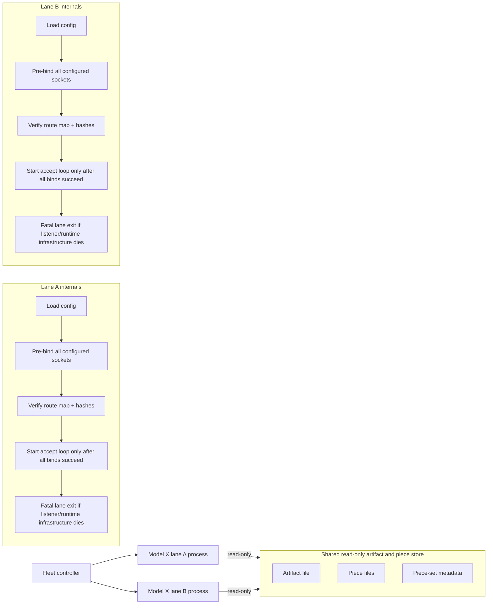
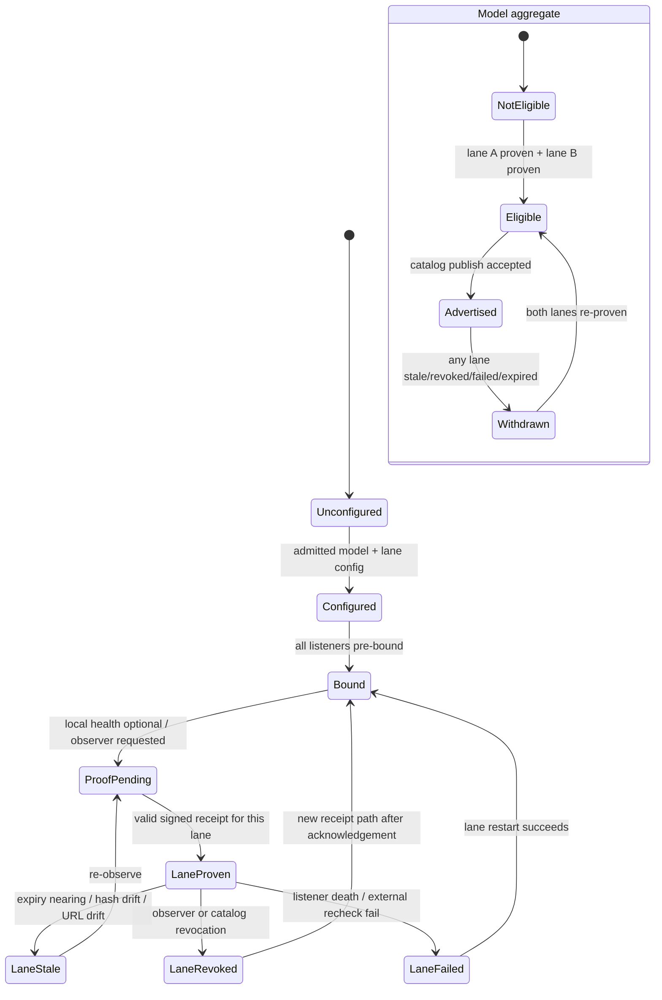

# Two-Lane Direct P2P Seed Fleet Architecture for TinyRustLM and MiniModel

## Boundary conditions and key findings

### Scope, assumptions, and non-goals

This report covers a production architecture for a direct peer-to-peer seed host that serves fixed model pieces directly from consenting user-run peers, with TinyRustLM as the browser chat UI and MiniModel as catalog and discovery only. It assumes up to 20 admitted model identities, exactly two independently restartable lanes per admitted model, a shared read-only artifact and piece store, direct HTTP serving per lane, no project-site byte proxying, no background relay dependency in the first release, and a catalog that must fail closed when proofs or announcements become stale. It does **not** assume access to private repositories, private infrastructure, unpublished packages, router settings, logs, credentials, or test hosts. Recommendations are separated below into public observations, standards-backed conclusions, and items that require local validation. citeturn37view0turn2view0turn3view0

Two public observations are especially important. First, TinyRustLM’s public site describes itself as a browser-local Rust/WASM runtime, exposes P2P import flows based on “peer proof and manifests,” and explicitly distinguishes loopback-only endpoint checks from broader peer import flows and approval-mediated local app control. Second, MiniModel’s public site describes itself as a catalog/discovery surface, says the site does not proxy or host production model weights, and states that early P2P use is direct known-peer HTTP or local files while broader discovery and NAT traversal come later. Those observations line up closely with the deployment boundary in your constraints. citeturn37view0turn2view0turn3view0

The largest standards-backed risk is **transport context ambiguity**. TinyRustLM is publicly served over HTTPS. Modern browsers block mixed-content fetches from a secure page to insecure `http://` resources unless the content can be auto-upgraded, and the Fetch and Mixed Content standards make clear that CORS is a separate permission mechanism, not a bypass for mixed-content enforcement. That means direct **browser-initiated** cross-origin fetches from `https://www.tinyrustlm.com` to peer lanes on plain HTTP would be blocked by the browser even if the lane’s CORS policy is correct. So one of two things must be true in production: either the actual byte fetch is performed by the companion/native side outside the page context, or public peer lanes must use HTTPS rather than plain HTTP. This is the single most important item that requires immediate local/product validation because it affects every network and proof decision downstream. citeturn37view0turn27search0turn27search1turn33view2

A second standards-backed conclusion is that reverse proxies and HTTP tunnels are not equivalent to direct-hosted peers. RFC 9110 defines a reverse proxy as a gateway/intermediary that receives and forwards requests to another server. For a “direct peer host” product slice, that is operationally and architecturally different from a user’s own origin server receiving the request directly. In this report, operator-managed reverse proxies or tunnels are therefore treated as diagnostics or future alternate edge modes, not as first-release “direct” announcement targets. citeturn40view3

### Public observations, standards-backed conclusions, and local-validation items

| Category | Item | Implication |
|---|---|---|
| Public observation | TinyRustLM publicly exposes peer-proof, manifest, receipt-ledger, companion-inventory, and loopback-only endpoint checks | Public product language already distinguishes local health from public proof |
| Public observation | MiniModel publicly states catalog/discovery only and no hosted production model-byte proxy | Catalog should contain metadata and announcement state only, not byte fallbacks |
| Standards-backed conclusion | CORS controls browser sharing, not general network access | Treat lane data as public-by-URL; never place secrets in status or metadata docs |
| Standards-backed conclusion | Mixed-content rules block HTTPS pages from fetching insecure HTTP subresources | Plain HTTP lanes only work if the companion/native side fetches bytes; browser-page fetches need HTTPS |
| Standards-backed conclusion | Reverse proxies are intermediaries | Do not treat a reverse-proxied edge as equivalent to a direct peer lane |
| Requires local validation | Whether bytes are fetched by page JavaScript or by the native companion | Determines whether remote peer transport can remain HTTP |
| Requires local validation | Target OS mix and minimum supported versions | Affects dual-stack defaults, symlink defense, sendfile path, and graceful restart behavior |
| Requires local validation | DNS management, dynamic IP handling, and whether A + AAAA are both published | Determines receipt route checks and announcement eligibility |

The rest of this report assumes the architectural boundary remains: MiniModel never carries model bytes, TinyRustLM remains the UI, and the companion or peer lane is the actual byte host. citeturn37view0turn2view0turn3view0

## Lane processes and HTTP serving surface

### Process and socket architecture diagrams

The recommended shape is a **fleet controller plus 40 maximum lane processes** at full capacity: two sibling lane processes per admitted model, with no shared listening socket ownership and no “two URLs in one process” substitution. Each sibling points to the same read-only artifact and piece store, but each lane owns its own listeners, accept loop, connection budget, and lifecycle. That keeps failure domains aligned with the two-lane requirement: one lane can die without taking down its sibling, while any fatal loss inside a lane process causes that lane to exit completely. The shared store is data-shared, not process-shared. This also lines up with platform socket semantics, where shared bind behaviors such as `SO_REUSEPORT` and Windows `SO_REUSEADDR` materially complicate exclusive ownership. citeturn30view1turn35view1turn32view3



Within each lane, startup should be strictly phased. The lane loads immutable config, verifies the admitted model identity, opens the shared artifact root read-only, builds an exact route map for status, companion state, piece-set metadata, and allowlisted piece names, then attempts to bind **every** configured listener for that lane before calling `listen()` or starting any accept loop. If any bind fails, the lane closes all already-opened sockets and exits non-zero. That gives the lane an atomic startup contract: “all route endpoints for this lane are live” or “nothing is live.” Linux and Windows both have platform-specific bind semantics that make this worth doing deliberately rather than relying on library defaults. citeturn30view1turn32view2turn32view3turn30view2

I recommend **explicit dual-stack handling with separate sockets**, not “bind `::` and hope.” Linux commonly defaults `IPV6_V6ONLY` from `/proc/sys/net/ipv6/bindv6only`, whose default is `0`, while Windows defaults an IPv6 socket to IPv6-only unless `IPV6_V6ONLY` is cleared before bind. The safest cross-platform rule for this product is: bind one IPv4 socket and one IPv6 socket when both families are intended, set IPv6 sockets to `IPV6_V6ONLY=1`, and treat each family as an independently observable route in proofs and diagnostics. That eliminates accidental IPv4-mapped acceptance, avoids family-collision surprises, and makes route-specific proof receipts meaningful. citeturn32view1turn32view2

Socket ownership should stay exclusive. On Linux, `SO_REUSEADDR` is reasonable for restart behavior but does **not** permit replacing an active listening socket bound to the same address/port. On Windows, `SO_REUSEADDR` is much more dangerous because a second socket can forcibly bind to an already-used port and the resulting behavior is explicitly indeterminate; Microsoft documents `SO_EXCLUSIVEADDRUSE` as the safer option for exclusive ownership. So the lane policy should be: Linux/Unix-like hosts may set `SO_REUSEADDR` for restart friendliness, but should avoid `SO_REUSEPORT`; Windows lanes should set `SO_EXCLUSIVEADDRUSE` and should not use `SO_REUSEADDR` for listeners. citeturn30view1turn32view3turn35view1

Listen backlog should be requested explicitly and treated as an operator-visible tuning parameter. Linux silently caps application backlog by `/proc/sys/net/core/somaxconn`; current Linux man pages note a typical default of 4096 on modern kernels, with earlier historical defaults of 128. Winsock allows `SOMAXCONN` or `SOMAXCONN_HINT(N)` with a documented adjustable range. For a first release on consumer hosts, requesting backlog 256 or 1024 is reasonable, but the controller should log that backlog is still kernel-capped and therefore not a guarantee of accepted-connection capacity. citeturn30view2turn13search2

Each lane should use an evented runtime, not `select()`. Linux documents `FD_SETSIZE` 1024 as an unreasonably low fixed limit for many modern applications and recommends `poll()` or `epoll()` instead; Windows has its own historical `fd_set` baggage. For a Rust implementation, that means a standard async runtime using epoll/kqueue/IOCP-backed polling is appropriate, but the key requirement is simple: no per-lane implementation should degrade into `select()`-limited connection handling. citeturn30view6turn14search2

A lane should treat **infrastructure** failure as fatal and **client** failure as ordinary. If the accept loop exits unexpectedly, if the bound-listener task dies, if the event runtime loses the ability to service any configured route family, or if the lane’s route map can no longer resolve its admitted store, the lane exits. A single slow or malformed client request, by contrast, is just a connection error. This distinction is what satisfies “exit if any endpoint thread dies” without turning ordinary network noise into a self-DoS.

Graceful shutdown should be drain-based. On termination, the lane stops accepting, closes listeners, refuses new work, and permits in-flight responses to finish for a short drain window before force-closing the rest. Windows documentation is explicit that aggressive linger usage can create undesirable resets; a clean `shutdown` plus drain is the safer pattern. I recommend a default drain window of 30 seconds, with exponential restart backoff per lane starting at one second and capping at one minute with jitter. Backoff must be **per lane**, never fleet-wide, so that one lane’s crash loop does not suppress its sibling. citeturn32view3

### Recommended socket and lifecycle profile

The lane profile below is the shortest production profile I would ship for version 0:

| Area | Recommended v0 behavior |
|---|---|
| Process model | One OS process per lane; sibling lanes always separate processes |
| Listener binding | Pre-bind all lane sockets before any accept loop starts |
| Port collision | Atomic startup failure for that lane |
| Socket options on Linux | `SO_REUSEADDR=yes`, `SO_REUSEPORT=no`, explicit `IPV6_V6ONLY=1` on v6 listener |
| Socket options on Windows | `SO_EXCLUSIVEADDRUSE=yes`, `SO_REUSEADDR=no`, explicit dual-stack decision before bind |
| Families | Prefer separate IPv4 + IPv6 sockets rather than implicit v4-mapped dual-stack |
| Accept model | Evented runtime, bounded semaphores for header-read slots and active response slots |
| Fatal errors | Listener task death, route-infra death, store invalidation, unrecoverable config mismatch |
| Non-fatal errors | Client disconnect, parse error, timeout, per-request file-open failure |
| Shutdown | Stop accepting, drain in-flight responses, then force-close |
| Restart | Per-lane exponential backoff with jitter |

This profile is deliberately conservative. It gives up some handler cleverness and some socket reuse tricks in exchange for very predictable failure boundaries.

### HTTP protocol profile with an allow/deny table

The safest version-0 profile is **small HTTP/1.1 only, no bodies, no transfer codings, exact paths, and deterministic close**. RFC 9112 makes message framing the core risk area for request smuggling, especially around `Transfer-Encoding`, `Content-Length`, invalid duplicates, and ambiguous persistence. RFC 3986 is equally relevant because percent-encoding, dot-segments, and path/query separation are precisely where route matching and traversal mistakes tend to appear. On the browser side, Fetch defines the CORS contract, including `Origin`, preflight via `OPTIONS`, response headers like `Access-Control-Allow-Origin`, and the need for `Vary: Origin` when the returned origin is dynamic. citeturn40view1turn34view0turn34view1turn33view2turn36view2

The most important version-0 omission is **persistent connections**. Because this service only needs immutable metadata and fixed-size piece files, it can safely return `Connection: close` on every response and close after exactly the advertised `Content-Length`. That one choice materially shrinks request-smuggling and connection-state attack surface at the cost of extra handshakes. For a first slice oriented toward correctness over maximum throughput, I think that trade is worth it. RFC 9112 explicitly warns that framing ambiguities and extra buffered data are dangerous on persistent connections. citeturn40view1

The next major omission is **request bodies of any kind**. GET content has no generally defined semantics in HTTP, and RFC 9112/9110 make clear that message framing is independent of method semantics. For this product, GET and OPTIONS requests should be accepted only when they have no request body. Any `Transfer-Encoding` header, any `Content-Length` header on GET or OPTIONS, any duplicate `Content-Length`, or any `Content-Length`/`Transfer-Encoding` combination should be rejected as a parse error, followed by connection close. That is stricter than the RFC minimum in some cases, but attack-surface reduction is the point here. citeturn22search0turn40view1turn17search0

A strict route matcher should operate on **exact admitted route keys**, not filesystem joins. The cleanest v0 implementation is to reject any request target containing a query string, any `%` in the path, any backslash, any empty path normalization ambiguity, and any route not present in a precomputed in-memory map. That means piece files are not opened by “join path onto directory”; they are opened by “lookup admitted key, then open the exact bound store object.” Percent-decoding must happen at most once and only after path/query splitting; RFC 3986 explicitly warns that decoding at the wrong stage can change delimiter interpretation. citeturn34view1turn40view2

CORS should be narrow and boring. Fetch is explicit that CORS is an opt-in browser sharing mechanism and that if a resource is public to `curl`/`wget`, an `Access-Control-Allow-Origin` response is fine; if it is not, then the header should not be there. For this service, that means lane resources must be treated as publicly readable to anyone who knows the URL, and therefore the lane must never expose secrets, local paths, router details, or privileged control state in public JSON. I recommend no cookies, no authentication, no credentials mode, an exact `Access-Control-Allow-Origin` for each allowed UI origin, `Access-Control-Allow-Methods: GET, OPTIONS`, no credential allowance, and `Vary: Origin` whenever the origin is selected dynamically. OPTIONS should return `204 No Content` only for recognized resources, recognized origins, and `Access-Control-Request-Method: GET`; everything else should return `403` or `405` and close. citeturn33view2turn36view2

For public response types, use `application/json; charset=utf-8` for status and metadata, `application/octet-stream` for piece files, and add `X-Content-Type-Options: nosniff`. Fetch’s `nosniff` handling is mainly relevant for script/style destinations, but setting it costs little and prevents accidental MIME ambiguity if these endpoints are ever embedded or inspected through general browser tooling. citeturn36view0

For path-to-file safety, Linux and Windows need different hardening hooks. On Linux, `openat2()` with `RESOLVE_NO_SYMLINKS` is the strongest modern primitive, and ordinary `open()`/`openat()` with `O_NOFOLLOW` is still useful where applicable. On Windows, reparse-point-safe handling means opening with `FILE_FLAG_OPEN_REPARSE_POINT` and validating what is actually being opened. For version 0, I recommend a defense-in-depth combination: immutable piece-store ownership, read-only service account access, startup admission scan that rejects symlinks/reparse points anywhere in the served tree, and platform-specific “no-follow” open behavior where available. This is a place where OS/version support absolutely requires local validation. citeturn8search0turn8search1turn8search4turn8search19

| HTTP feature | v0 decision | Reason |
|---|---|---|
| Protocol version | Allow HTTP/1.1 only | Smaller parser surface; no downgrade complexity |
| Methods | Allow `GET`, narrow `OPTIONS` only | Everything else unnecessary for the product slice |
| `POST` / `PUT` / `DELETE` / `PATCH` / `TRACE` / `CONNECT` | Reject | No write operations; TRACE/CONNECT are pure attack surface here |
| `HEAD` | Omit in v0 | Not needed; keeps metadata behavior smaller and more testable |
| Request body | Reject for all accepted methods | No legitimate need |
| `Content-Length` on request | Reject | Avoid framing ambiguity in a no-body protocol |
| `Transfer-Encoding` on request | Reject | Avoid chunked/request-smuggling surface |
| Duplicate `Content-Length` | Reject | Stricter than RFC minimum; better security posture |
| Query strings | Reject | Exact resource semantics only |
| Percent-encoding in path | Reject in v0 | Eliminates decode-order traversal issues |
| Directory listing | Never expose | Fixed allowlist only |
| Range requests | Omit in v0 | Piece protocol already provides resumable granularity |
| Response transfer coding | Omit | Use exact `Content-Length` only |
| Persistence | Disable | `Connection: close` on every response |
| Compression | Omit | CPU/caching complexity not worth it in v0 |
| Upgrade / trailer / chunk extensions | Omit | Unneeded framing surface |

Recommended numeric bounds for v0: request line up to 2 KiB, total header bytes up to 8 KiB, maximum 32 headers, header-read timeout 5 seconds, total connection lifetime 30 seconds unless actively sending, and write-idle timeout 15 seconds. Those numbers are engineering recommendations rather than standards constants, so they should be validated under realistic browser and companion behavior before final lock.

## Capacity, scheduling, and reachability operations

### Fleet resource and bandwidth model with quantitative examples

Because the system can reach **40 lane processes** at full admission, bandwidth and connection fairness need to be **fleet-scoped**, not lane-local. A pure per-lane limiter is too naive: it either starves hot lanes or lets a set of cold lanes consume far more aggregate upload than a consumer host can sustain. The simplest correct model is a small local fleet governor process that grants upload tokens and active-response slots to lanes over a loopback-only control channel. If the governor is unavailable, each lane should fall back to a conservative local cap, not to unlimited serving.

The correct scheduling primitive here is a **hierarchical token bucket plus deficit round robin**:

- global upload cap at the fleet level
- per-model weight and floor
- per-peer concurrency cap across both sibling lanes
- per-lane active-slot ceiling
- per-response backpressure from the socket write path

That structure is mechanical rather than exotic, but it solves the important problem: fairness is enforced globally while each lane remains independently restartable.

A practical default is to set the global upload cap to **about 80% of measured upstream throughput**, leaving headroom for ACKs, browsing, and observer traffic. Using that rule, a 100 Mbps upstream link yields an application cap of about **9.54 MiB/s**, while a 20 Mbps upstream link yields about **1.91 MiB/s**. citeturn23calculator1turn23calculator3

For piece sizing, my recommendation is **8 MiB default**, with 4 MiB as the low end and 16 MiB as the high end. Using the 925 MiB test size from your request, 8 MiB pieces produce **116 pieces**, while 16 MiB pieces produce **58 pieces**. At a per-peer cap of 2 MiB/s, one 8 MiB piece completes in roughly **4 seconds**; at 0.5 MiB/s, it completes in **16 seconds**. That is a useful compromise: large enough to avoid metadata explosion, small enough that stalled peers don’t monopolize a lane for long. citeturn25calculator0turn25calculator1turn24calculator0turn24calculator1

For concurrency, I recommend the following starting point:

| Scope | Starting cap |
|---|---|
| Per peer across both lanes | 2 active piece responses |
| Per lane active body responses | `clamp(floor(global_cap_mib_s / 0.5), 4, 32)` |
| Per lane accepted connections | 2 × active-body cap |
| Fleet-wide accepted connections | 256 default |
| Per remote IP active cap | 8 default, with operator override |

The per-IP cap must stay modest because NATed households can legitimately put many peers behind one address. It should therefore be enforced as a soft token bucket, not as a permanent ban trigger.

Shared read-only storage plus OS page cache is a major win and one of the reasons not to duplicate artifacts per lane. Linux `sendfile()` can transfer from file descriptor to socket with zero-copy support, while Windows `TransmitFile()` uses the operating system cache manager and explicitly recommends `FILE_FLAG_SEQUENTIAL_SCAN` for better caching when reads are sequential. In practice that means hot pieces requested by both lanes and by multiple peers should tend to converge on the page cache rather than multiplying user-space copies. citeturn30view4turn33view0turn33view1

File-descriptor planning cannot be left to defaults. Linux `RLIMIT_NOFILE` governs the maximum number of descriptors a process may open, and ordinary defaults are frequently too low for multi-lane serving. Even a relatively cautious profile of 40 lanes with 256 aggregate accepted connections per fleet, plus listeners, logs, pipes, and a rolling file-handle cache, is enough to justify a **minimum** host target of 16,384 descriptors and a preferred target of 32,768. And because `select()` has a hard 1024-ish `FD_SETSIZE` problem, any runtime or dependency that silently falls back to `select()` becomes unacceptable. citeturn30view3turn30view6

For hot/cold model prioritization, I recommend three classes:

| Model class | Default weight | Typical use |
|---|---|---|
| Hot and advertised | 8 | Recently active, catalog-visible |
| Warm and known-peer | 3 | Recently requested but not currently catalog-visible |
| Cold retained | 1 | Everything else |

Each active model should still receive a non-zero floor so that a hot model cannot starve all others indefinitely. If the product later adds richer health or demand signals, this weight map can become adaptive, but a static initial policy is easier to reason about.

For metrics without a proprietary backend, use **three layers**:

- public minimal lane status JSON
- local structured JSON logs on disk
- optional loopback-only metrics emitted either as Prometheus/OpenMetrics over localhost or as atomic textfiles for a node-exporter textfile collector

Prometheus’ text exposition format and textfile collector are good fits precisely because they do not require a hosted telemetry platform. citeturn15search2turn15search11turn15search1

Recommended operator-visible fleet metrics:

| Metric | Why it matters |
|---|---|
| active peers per lane / model / fleet | Capacity and fairness |
| bytes sent per lane / model / fleet | Billing and scheduling |
| median / p95 piece latency | Detect slow disks or slow readers |
| header parse failures by class | Smuggling/fuzz abuse signal |
| local bind failures by route family | Config and port diagnostics |
| observer-proof success/failure by family | Reachability truth |
| revocation reason counts | Announcement safety |
| page-cache hit proxy metrics if available | Storage efficiency |
| open FDs / handle count | Resource exhaustion warning |
| backpressure drops / timeout closes | Slowloris and slow-read visibility |

### NAT, firewall, and reachability taxonomy

Home and small-office reality is not uniform. RFC 5382 exists because TCP NAT behavior materially affects P2P correctness, while RFC 6886 and RFC 6887 exist because port mapping often has to be requested explicitly from an upstream device. RFC 6598 formalizes shared address space used by carrier-grade NAT. Meanwhile, IPv6 does not magically mean “reachable from the Internet”; consumer and managed residential IPv6 gateways often apply stateful filtering or explicit exceptions. citeturn38view2turn38view3turn38view4turn26search0turn35view3turn38view7

The first-release policy should therefore be:

- **Manual port forwarding:** supported and preferred for IPv4
- **Native IPv6 with explicit firewall rule:** supported and preferred when available
- **UPnP / NAT-PMP / PCP:** compare and detect if useful, but do **not** auto-change anything in v0
- **Reverse proxies / operator-approved tunnels:** not announcement-eligible for the “direct lane” slice
- **CGNAT / double NAT:** detect and explain; outside proof usually fails unless the operator controls both upstream devices or has public IPv6

That “never silently modifies a router or firewall” rule is the right call. NAT-PMP and PCP are real standards for automated mapping, but using them silently would produce a router-side state change that many operators would consider surprising or unsafe. In version 0, the product should at most detect probable support and show instructions or an explicit future opt-in path. citeturn38view3turn38view4

Hairpin, loopback, and LAN tests remain useful, but only as **local health**. RFC 5382 requires TCP hairpinning in compliant NATs, but that is still an internal-NAT behavior; it is not evidence that the public Internet can reach the endpoint. TinyRustLM’s own public UI already distinguishes loopback-only endpoint checks, which is a very good precedent to keep. citeturn26search2turn37view0

The product should expose the following status labels exactly and consistently:

| Label | Meaning |
|---|---|
| Configured | Model/lane config is syntactically valid and admitted, but no listeners are bound yet |
| Listener-bound | Every configured listener for that lane is bound and listening |
| Locally reachable | A loopback/LAN/hairpin test succeeded; **not** public proof |
| Externally reachable | An outside observer reached the normalized public URL and required resources for that lane |
| Announcement eligible | Both lanes have current valid receipts matching current URL and hashes |
| Advertised | MiniModel catalog has accepted and published the current announcement |
| Stale | Published or cached state exists, but receipt/config/route/hash freshness is no longer sufficient |
| Revoked | A prior receipt or announcement has been explicitly invalidated |
| Failed | Bind, local probe, external probe, proof verification, or catalog operation failed |

Operator workflow should follow this exact order:

1. admit model locally  
2. configure lane URLs and local listeners  
3. bind listeners atomically  
4. run local-only checks (loopback/LAN/hairpin if desired)  
5. obtain outside-network receipts for **both** lanes  
6. publish to catalog only after both receipts validate  
7. revalidate on restart, URL change, or proof expiry before any republish

The key operational rule is simple: **local success never upgrades state past “locally reachable.”**

## External proof and catalog control

### Canonical external-proof schema and signature procedure

I recommend **one signed receipt per lane**, with the catalog requiring a valid pair for model-level advertisement. That keeps receipts identity-bound and individually revocable while preserving the “both lanes or no catalog advertisement” rule at the model layer.

Use canonical JSON with JCS (RFC 8785) and sign the UTF-8 canonical bytes with Ed25519 (RFC 8032). JCS exists specifically to make JSON hashing and signing deterministic by constraining the data to I-JSON and sorting object properties deterministically. Ed25519 is mature, deterministic, and broadly implemented. citeturn39view0turn38view1

I recommend this exact unsigned receipt payload shape:

```json
{
  "schema": "minimodel.reachability-receipt.v1",
  "receipt_id": "01JZ...ULID...",
  "fleet_id": "fleet-...",
  "lane_id": "lane-a",
  "model_id": "model-identity-...",
  "public_url": "https://peer.example.net:443",
  "public_url_normalized": "https://peer.example.net/",
  "artifact_sha256": "lowercasehex64",
  "piece_set_sha256": "lowercasehex64",
  "checked_routes": [
    {
      "family": "ipv4",
      "resolved_ip": "203.0.113.24",
      "port": 443,
      "tcp_connect_ok": true,
      "http_get_ok": true
    },
    {
      "family": "ipv6",
      "resolved_ip": "2001:db8::24",
      "port": 443,
      "tcp_connect_ok": true,
      "http_get_ok": true
    }
  ],
  "response_identities": {
    "status_sha256": "lowercasehex64",
    "companion_state_sha256": "lowercasehex64",
    "piece_set_metadata_sha256": "lowercasehex64",
    "allowlist_sha256": "lowercasehex64"
  },
  "observer_key_id": "observer-2026-q3-01",
  "observer_impl_version": "observerd/1.0.0",
  "issued_at": "2026-07-13T00:00:00Z",
  "observed_at": "2026-07-13T00:00:00Z",
  "expires_at": "2026-07-13T00:15:00Z",
  "nonce": "128-bit-random-hex"
}
```

And this signature envelope:

```json
{
  "alg": "Ed25519",
  "canon": "JCS-RFC8785",
  "sig": "base64-std-no-wrap"
}
```

Signature procedure:

1. Build the unsigned receipt object using I-JSON-safe values only.  
2. Normalize the public URL before insertion.  
3. Canonicalize the unsigned object with JCS.  
4. Create the signed message as:  
   `ASCII("minimodel.reachability-receipt.v1\n") || canonical_jcs_utf8_bytes`  
5. Sign those bytes with the observer’s Ed25519 private key.  
6. Append the detached signature envelope.  
7. Verify using the observer key identified by `observer_key_id`. citeturn39view0turn38view1

The domain-separation prefix in step 4 is a recommendation, not an RFC requirement, but it is good practice because it prevents the same canonical JSON bytes from being misinterpreted in some different signing context. If the implementation stack has reliable support for Ed25519ctx, that is another option, but plain Ed25519 plus an explicit context prefix is typically easier to implement consistently across languages.

For URL normalization, use RFC 3986 rules conservatively: lowercase scheme and host, normalize percent-encoding case, remove dot-segments where applicable, omit default port only if the scheme defines one and the runtime agrees, and keep path/query separation exact. Because query strings are rejected in the serving profile, normalized public URLs should not contain queries. If a hostname resolves to more than one route, the observer should record every checked route explicitly. citeturn34view0turn34view1

The receipt should only be valid if it proves **identity and availability together**. That means the observer does not just fetch any one file. It should fetch and hash:

- status document
- companion state document
- piece-set metadata document
- at least one small representative piece file, plus verify that the allowlist in metadata matches the served namespace

If the lane later changes URLs, piece-set hash, allowlist, or artifact hash, the old receipt must stop matching immediately even if its expiry has not yet elapsed.

For clock handling, use UTC everywhere in receipts. Because clocks drift in real deployments, the catalog verifier should allow only a small skew tolerance and should require `observed_at <= issued_at <= expires_at`. The exact skew window is a policy choice and should be validated against the expected observer and catalog time discipline.

Replay resistance should be **catalog-enforced and single-use**. A receipt is valid for announcement only once. On successful consumption, MiniModel should persist `receipt_id` and reject any second use of the same receipt ID, even before expiry. That prevents replay of a once-valid but later-unpublished proof. A short expiry window further reduces the blast radius if a receipt leaks.

Key rotation and revocation should be explicit. The catalog must maintain an allowlist of active observer public keys keyed by `observer_key_id`, plus a denylist or revocation list for compromised keys. Receipts signed by revoked observer keys are invalid immediately, regardless of receipt expiry. For future work, multi-observer quorum is the right answer to observer compromise or censorship risk, but it is not necessary for the first slice if the catalog is fail-closed and revocation is immediate.

A particularly important future enhancement is **route completeness**. If a normalized hostname publishes both A and AAAA records, an observer should either verify all advertised routes or the catalog should publish explicit family capability derived from the receipt. Otherwise, a broken AAAA can make an endpoint look “reachable” to the proof system but fail in real browser or companion connection selection.

### Announcement and revocation state machine

At the **lane level**, state should be simple: configured, bound, externally proven, stale, revoked, failed.

At the **model level**, state must be stricter: the model is announcement-eligible only when **both** lanes are simultaneously proven with receipts that match the current config and current served identities. If one lane fails, expires, or drifts, the model leaves the advertised state entirely. That is the only fail-closed interpretation that preserves the two-lane contract and guarantees you never leave a stale endpoint advertised.



I recommend these transition rules:

| Event | Lane effect | Model/catalog effect |
|---|---|---|
| Startup with cached old receipt | receipt revalidated against current URL/hash and expiry | no publish unless both lanes still valid |
| URL rotation | invalidate old receipt immediately | withdraw announcement until both lanes re-proven |
| Piece-set or artifact hash change | invalidate old receipt immediately | withdraw announcement immediately |
| Model removal | revoke both lanes | withdraw, then delete |
| Explicit endpoint revocation | mark lane revoked | withdraw whole model |
| Receipt expiry | mark lane stale | withdraw whole model |
| One lane listener failure | mark failed | withdraw whole model |
| One lane restart + fresh proof | return lane to proven | only republish when sibling also proven |

MiniModel’s public site currently emphasizes metadata, catalog boundary, and explicit availability checking, which fits this fail-closed catalog role well. Publicly it also shows no active peers today, which means there is no legacy behavior here that needs to be preserved over correctness. citeturn2view0turn3view0

The publication contract should be **withdraw-first, republish-second**. If anything relevant changes, the controller sends a withdrawal or revocation to the catalog before it attempts replacement proofs. That ordering is what prevents stale edge URLs from lingering in discovery results during transitional states.

## Threats and verification

### Threat model covering remote peers, malicious metadata, compromised observers, and local unprivileged users

Remote peers should be modeled as potentially malicious from the first packet. Their main attacks are malformed requests, slowloris header dribble, slow-read response stalling, connection floods, path fuzzing, bogus preflights, piece scraping, and route enumeration. RFC 9112’s warnings about framing ambiguity are central here, and slow-HTTP variants remain a practical class of application-layer resource exhaustion. The mitigations in this design are exact-route matching, no request bodies, no persistence, bounded headers, short header timeouts, active-slot quotas, and deterministic close. citeturn40view1turn17search0turn13search6

Malicious metadata is a different class of threat. Because TinyRustLM and MiniModel publicly expose manifests, share metadata, peer status, and receipt-ledger concepts, the product will inevitably ingest externally supplied JSON and route information. That means metadata must be size-bounded before parsing, schema-validated before admission, and treated as adversarial. MiniModel’s public catalog already rejects overly large JSON before parsing, which is a good precedent to copy for lane-side metadata ingestion. I recommend hard caps such as 64 KiB for status, 256 KiB for companion state, and 1 MiB for piece-set metadata unless local evidence says larger is unavoidable. citeturn37view0turn3view0

Compromised observers are a distinct trust-boundary risk. A malicious or compromised observer can falsely mark dead endpoints as reachable, selectively withhold receipts, or backdate/forward-date receipts. Short expiries, single-use catalog consumption, explicit observer key rotation, immediate revocation, and future multi-observer quorum are the right defense sequence. The first release can safely defer quorum if catalog behavior is fail-closed and observer compromise triggers immediate key withdrawal.

Local unprivileged users are a meaningful risk on a host that serves from a shared local store. Their likely actions are symlink or reparse-point swaps, opening the same port first to induce collision, exhausting descriptors, editing public JSON docs, or tampering with piece files if ACLs are weak. That is why the piece store should be owned by a dedicated service account or root-owned equivalent, mounted or ACLed read-only to lane processes, and opened via no-follow semantics where the OS supports it. It is also why the lane must never trust preexisting bind state, inherited sockets, or mutable filesystem paths. citeturn8search0turn8search1turn32view3turn30view3

A subtle but important browser-side threat is misunderstanding CORS as access control. Fetch explicitly notes that if a resource is already reachable by `curl` or `wget`, exposing it with `Access-Control-Allow-Origin` is fine; conversely, if it is **not** intended to be public to arbitrary network clients, the CORS header should not be there. So the lane’s public metadata and piece files must be designed as public-by-URL. No auth tokens, no local file paths, no OS usernames, no internal metrics, and no administrative controls should ever appear in public responses. citeturn36view2

### Verification plan with unit, integration, fuzz, fault-injection, and live deployment tests

The verification plan should mirror the threat model and the announcement safety model.

**Unit tests** should cover:

- exact route matching and hostile-path rejection
- percent-decoding order and query/path separation
- `Content-Length` / `Transfer-Encoding` rejection logic
- duplicate-header detection
- URL normalization
- JCS canonicalization stability
- Ed25519 signing and verification interop
- receipt expiry, skew tolerance, and single-use consumption rules
- per-lane and per-model state-machine invariants

That is the layer where you prove the parser, canonicalization, and state machine are deterministic.

**Integration tests** should cover the real lane contract:

- sibling lanes for one model, two separate processes
- atomic failure on port collision
- one-lane crash while sibling remains available
- shared read-only artifact store with no duplication
- IPv4-only, IPv6-only, and dual-stack binding
- route mismatch between configured URL and incoming `Host`
- graceful drain on shutdown
- restart backoff behavior
- proof invalidation on URL drift or piece-set drift

**Fuzzing** should target the HTTP parser and request-target handling aggressively. Inputs should include truncated headers, invalid methods, overlong request lines, embedded NULs, duplicate framing headers, chunked requests, malformed chunk extensions, percent-encoded delimiters, path confusion cases, and suspicious whitespace. RFC 9112’s malformed-framing cases are a good seed corpus. citeturn40view1turn17search0

**Fault injection** should include:

- forced `EMFILE` / low `RLIMIT_NOFILE`
- disk-open failures
- delayed or partial file reads
- simulated listener task death
- observer timeout or signature verification failure
- dynamic DNS drift between observation and publication
- controller restart during catalog withdrawal

**Slow-client tests** should be explicit and repeatable:

- slowloris header trickle against each lane
- slow-read client that drains a piece response extremely slowly
- many short-lived connect/disconnect bursts
- many concurrent requests for the same hot piece
- many concurrent requests for different cold pieces

**NAT lab tests** should be run in a controlled matrix:

| Scenario | Expected outcome |
|---|---|
| Manual IPv4 port forward | outside proof should succeed if host firewall allows |
| Native IPv6 + firewall pinhole | outside proof should succeed on IPv6 route |
| UPnP/NAT-PMP/PCP available but unused | no automatic mapping; operator status should explain |
| Double NAT | likely fail unless both devices are configured |
| CGNAT with no IPv6 | fail for direct inbound; status should say upstream NAT likely blocks proof |
| Hairpin-only success | remain local-only, not proof eligible |

For the **real 925 MiB model test**, run at least one full artifact through the actual piece protocol, not only fixtures. Measure:

- time to first piece
- sustained throughput under 1, 2, 4, and 8 concurrent peers
- RSS growth per lane
- open descriptor count
- p95 response completion time
- proof revalidation after restart
- catalog withdrawal latency after one-lane failure

CI should never require an inbound production port and should never publish fixture announcements to the live catalog. That means CI uses a non-public staging observer key, non-routable test URLs or localhost/namespaces, and a staging catalog or mock catalog. Authorized outside-network tests belong in a separately approved deployment stage, not in ordinary CI.

## Priorities, tradeoffs, unresolved issues, and primary sources

### Prioritized recommendations and explicit tradeoffs

The highest-priority recommendation is to **resolve the browser-versus-companion fetch path** before finalizing the transport layer. If remote bytes are fetched by browser JavaScript from the HTTPS TinyRustLM page, peer lanes cannot remain plain HTTP because of mixed-content blocking. If the native companion fetches bytes directly, plain HTTP may still be acceptable for the first slice, though HTTPS would still improve integrity and operator trust. This is a product architecture decision, not a minor transport tweak. citeturn37view0turn27search0turn27search1

The next priority is to keep the lane design **boringly strict**:

- two lanes means two processes
- exact-route HTTP only
- no request bodies
- no persistence
- no range support
- no proxy/tunnel substitution
- fail closed on announcement state

The tradeoff is reduced convenience and some lost throughput efficiency in v0. The gain is that proofs, failures, and security boundaries remain understandable.

Third, enforce **fleet-level fairness** even though the serving units are lane processes. The tradeoff is a small amount of local coordination complexity. The gain is that 40 possible lane processes cannot silently overrun a residential uplink or starve cold-but-valid models.

Fourth, make the catalog model **withdraw-first** and **both-lanes-or-none**. The tradeoff is lower catalog availability during transient single-lane failures. The gain is a very strong guarantee that the catalog never advertises stale or half-valid endpoints.

Fifth, keep NAT automation **diagnostic only** in the first release. The tradeoff is more manual operator work. The gain is no surprising router mutations, fewer support ambiguities, and a clean alignment with operator consent.

### Questions that cannot be answered without local evidence

The following questions are materially important and cannot be answered from public sources alone:

1. Does the production byte transfer originate in page JavaScript, the local companion, or both?  
2. Which operating systems and minimum versions are in scope for the companion and peer lane?  
3. Are remote peer lane URLs intended to be HTTP only, HTTPS only, or transport-pluggable?  
4. If HTTPS is in scope, how will certificate issuance, hostname ownership, and renewal work on consumer hosts?  
5. What is the exact piece filename grammar, and are piece names content-derived or merely positional?  
6. Must every published hostname pass on all advertised DNS routes, or is family-specific reachability metadata acceptable?  
7. What uplink bandwidth and memory/disk baselines are assumed for supported hosts?  
8. Is a degraded one-lane advertisement ever acceptable to product stakeholders, or is two-lane public eligibility mandatory at all times?  
9. How will observer public keys and revocations be distributed to catalog consumers and to companions?  
10. Does the catalog store receipt IDs for single-use consumption and anti-replay enforcement already, or must that be added?  
11. Are operator-managed reverse proxies or tunnels considered legally/product-acceptable in any mode, or are they entirely out of scope?  
12. What exact public fields are required in status, companion-state, and piece-set documents for TinyRustLM interoperability?

### Current, directly linked primary sources with dates

The report above relied most heavily on the following primary or official sources:

- **TinyRustLM homepage**, accessed July 13, 2026; public lines show browser-local runtime, peer proof/manifests, loopback-only endpoint checks, and approval-mediated local app control. citeturn37view0
- **MiniModel homepage and public docs pages**, accessed July 13, 2026; public lines describe catalog/discovery boundaries, direct known-peer HTTP as the early path, and no hosted production weight proxying. citeturn2view0turn3view0
- **RFC 9110 HTTP Semantics**, June 2022; used for method semantics and proxy/gateway definitions. citeturn20search18turn40view3
- **RFC 9112 HTTP/1.1**, June 2022; used for framing, `Content-Length`, `Transfer-Encoding`, invalid duplicates, request smuggling, and connection close behavior. citeturn40view1
- **Fetch Standard**, living standard accessed July 2026; used for CORS request/response behavior, preflight semantics, `Vary: Origin`, and the reminder that CORS is not general access control. citeturn33view2turn36view2
- **Mixed Content specification and MDN mixed-content guidance**, accessed July 2026; used for the HTTPS-page-to-HTTP-peer incompatibility analysis. citeturn27search0turn27search1
- **RFC 3986 URI Generic Syntax**, January 2005; used for percent-encoding, dot-segments, and normalization/decoding order. citeturn39view0turn40view2
- **RFC 8785 JSON Canonicalization Scheme**, June 2020; used for receipt canonicalization. citeturn39view0
- **RFC 8032 EdDSA**, January 2017; used for Ed25519 signing guidance. citeturn38view1
- **RFC 5382 NAT Behavioral Requirements for TCP**, October 2008; used for TCP NAT and hairpin behavior context. citeturn38view2turn26search2
- **RFC 6886 NAT-PMP** and **RFC 6887 PCP**, April 2013; used for automated port mapping comparison. citeturn38view3turn38view4
- **RFC 7084 IPv6 CE Router Requirements**, November 2013, plus **RFC 6092 Simple Security for IPv6 Gateways**, January 2011, and **RFC 9099 IPv6 Operational Security Considerations**, August 2021; used for IPv6 home-network reality and the “global addressability is not guaranteed reachability” conclusion. citeturn38view5turn38view6turn38view7
- **Linux man pages** for `socket(7)`, `listen(2)`, `getrlimit(2)`, `sendfile(2)`, `IPV6_V6ONLY(2const)`, and `select(2)`; used for bind semantics, backlog caps, file-descriptor limits, zero-copy serving, dual-stack defaults, and the `FD_SETSIZE` warning. citeturn30view1turn30view2turn30view3turn30view4turn32view1turn30view6
- **Microsoft Learn** documentation for dual-stack sockets, `SO_REUSEADDR`/`SO_EXCLUSIVEADDRUSE`, `TransmitFile`, and reparse-point-safe file operations; used for Windows-specific bind safety, dual-stack defaults, cache-manager-backed file serving, and reparse-point defense. citeturn32view2turn32view3turn33view0turn33view1turn8search1turn8search4