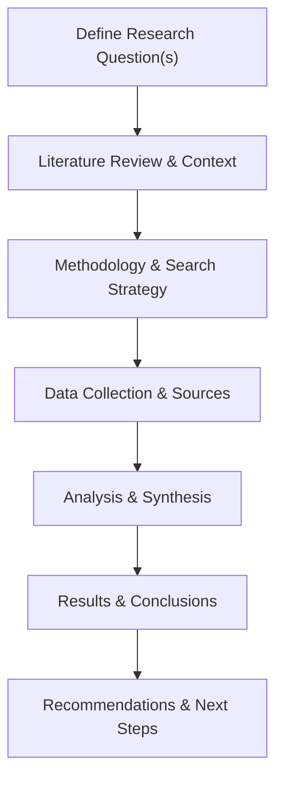

# Deep Research Plan for an Unspecified Topic

**Executive Summary:** No specific research topic was provided, so this brief outlines a general framework for conducting a deep, systematic inquiry on virtually any subject.  We first note that in such cases it is useful to identify promising topic areas based on current trends. For example, analyses of recent scientific publishing suggest that *artificial intelligence (AI) and machine learning*, *cybersecurity and data privacy*, *healthcare and pandemic preparedness*, *sustainable development and climate action*, and *biotechnology/genomics* are likely to attract significant research attention. These are merely illustrative; the actual topic should align with the researcher’s interests and needs. 

Given this unspecified query, our approach is to assume the user desires a *template* or *methodology* for a comprehensive research plan. We therefore outline the key components any deep research brief should include: clear **research question(s)** and objectives; background **context** and literature; identification of **subtopics** to explore; a detailed **methodology and search strategy**; plans for **prioritizing sources** (with emphasis on primary and authoritative data); assessment of **data needs**; anticipated **uncertainties or gaps**; and **next steps** or recommendations. Throughout, we will cite authoritative guidance and examples to support each component. Where possible we give bullet lists or tables to summarize key points. This structured approach follows best practices for research planning. 

**Topic Suggestions:** Because no topic was specified, below are five representative areas that could serve as a starting point for a deep research project (illustrating how we might generate focused questions):

- **Artificial Intelligence and Society:** e.g. AI ethics, AI in healthcare, or AI-driven business processes.
- **Cybersecurity and Data Privacy:** e.g. threats in cloud computing, personal data regulations, or national cybersecurity strategy.
- **Public Health and Pandemic Preparedness:** e.g. post-COVID lessons, vaccine distribution logistics, or mental health trends.
- **Climate Change and Sustainability:** e.g. urban climate adaptation, renewable energy technologies, or environmental policy impact.
- **Biotechnology and Genomics:** e.g. gene editing (CRISPR) ethics, precision medicine outcomes, or agricultural biotechnology.  

Each suggested area aligns with current global challenges. Depending on the researcher’s interest, any one could be chosen and refined into a concrete research question. 

## Research Questions and Objectives

Formulating clear research question(s) is the critical first step.  A good research question is *focused, researchable, and relevant*.  It should address a single specific issue or problem, be answerable with available methods, and be significant in its field.  In practice, researchers often start with a broad topic and then *narrow it down* through preliminary reading.  Effective questions usually meet criteria such as: focused on one issue, answerable with available data or literature, feasible to address within constraints, and suitably complex to warrant deep study. 

As a rule of thumb, one should aim for around **3–4 overarching objectives or aims** and then derive specific research questions that support those aims. For example, if the broad aim is to assess the effectiveness of remote work policies, specific questions might include “How has employee productivity changed under remote work?” or “What challenges do managers report in a hybrid model?”.  Frameworks like FINER (Feasible, Interesting, Novel, Ethical, Relevant) or PICOT (Population, Intervention, Comparison, Outcome, Time) can guide question formulation, especially in social or medical fields. 

In summary, we would **assume our research questions** as a starting hypothesis for planning the study.  We might write them in the proposal as: “This research aims to answer the following key questions: [list of 2–4 questions]”.  These guide the entire project, as literature emphasizes that “clearly articulated research questions are key ingredients that guide the entire review methodology”.  The questions inform what information to seek, what data to collect, and what analyses to perform. 

## Background and Context

Before diving into new work, a thorough background review is essential.  This involves surveying existing literature and context to understand what is already known and where gaps remain.  In practice, one would gather authoritative sources (peer-reviewed papers, books, reputable reports) to map the field.  A good literature review serves multiple purposes: (a) **identifying existing work** on the topic; (b) highlighting gaps or controversies; (c) establishing the theoretical or empirical foundation for the study; and (d) justifying why new research is needed. 

According to research methodology guides, this stage is when you connect the proposed study to the body of knowledge: it “must be justified by linking its importance to already existing knowledge about the topic”. Thus, we would summarize key findings from earlier work and explain how our question is distinct.  We should also gather relevant background data or definitions. The IFF guide on research briefs notes that you should “include enough background information… to enable [analysts] to understand your needs”.  Avoiding jargon at this stage is wise, so that any collaborator or reviewer can follow the context. 

**Key tasks in this phase** include: outlining the topic’s history or evolution; noting current theories, debates or applications; and listing the stakeholders or affected populations.  The outcome is a clear narrative of *what is known* and *what remains unknown*, which naturally leads to refining the research questions.  (Any assumptions made about the scope or focus of the project should be stated here. For instance, if we assume the topic is technology-focused, we assume a multidisciplinary literature including technical and social sources.) 

## Key Subtopics to Investigate

A broad topic typically breaks down into several subtopics or dimensions.  Identifying these sub-areas ensures the research is comprehensive.  For example, a topic like “AI in Healthcare” might include subtopics such as technical AI methods, patient data privacy, regulatory issues, clinical outcomes, and cost implications.  In general, you might categorize subtopics as: 

- **Theoretical/Conceptual:** Fundamental principles or frameworks related to the topic (e.g. relevant theories, models).  
- **Technical/Methodological:** Tools, technologies, or methodologies in use (e.g. software, equipment, analytical techniques).  
- **Applications and Use Cases:** Real-world contexts where the topic applies (e.g. industry sectors, demographic groups, geographic regions).  
- **Stakeholder Perspectives:** Views of different groups (e.g. practitioners, policy-makers, customers, communities).  
- **Temporal or Comparative Aspects:** Trends over time or comparisons across cases (e.g. before/after interventions, region A vs B).  
- **Challenges and Risks:** Known barriers, controversies, ethical or legal issues.  

These categories are illustrative. The specific subtopics depend on the chosen field. Structuring the brief around such sections helps ensure *no important aspect is missed*. For instance, IFF advises to “consider all the information and sections you need to include, to structure your thinking and ensure you don’t miss anything important”. We would outline each subtopic as a bullet or subheading and list what to look for in each area. 

Often it helps to tabulate or list these subtopics. For example:

| **Potential Subtopic**         | **Focus/Questions**                               |
|-------------------------------|---------------------------------------------------|
| Current State of Knowledge    | What are established facts or consensus?          |
| Related Technologies/Methods  | What methods or tools are commonly used?         |
| Policy/Regulation             | What laws or guidelines govern this topic?        |
| Stakeholder Needs             | Who is impacted and how?                         |
| Data Sources/Metrics          | What data or metrics exist?                      |
| Historical Trends             | How has the topic evolved over time?             |

We would populate this based on preliminary reading and expert input. This also aids in planning the search (e.g. identifying keywords by subtopic).

## Methodology and Search Strategy

With questions and subtopics defined, the next step is to plan *how* to gather information. Our methodology here is not an experiment but a structured literature and data search. We must develop a comprehensive search strategy. In a systematic approach, one typically follows steps like: **(1) Decide where to search** – identify databases, archives, and information sources relevant to the field; **(2) Formulate and refine search queries** – compile keywords, synonyms and subject headings (controlled vocabulary) and use Boolean logic to combine them; **(3) Run and document searches** – record which queries and sources yield relevant results; and **(4) Screen and manage the results** – sift for the most relevant references and track them systematically.  

For example, Covidence’s guide suggests listing *appropriate databases or repositories* first. In medicine these might be MEDLINE/PubMed or Embase, in engineering IEEE Xplore or arXiv, in social sciences JSTOR, SSRN, etc. It also recommends including “grey literature” sources (e.g. conference proceedings, theses, government reports) to avoid publication bias.  We would create a working list of databases, academic search engines (Google Scholar), and relevant organizational websites. 

Next, we devise *search terms*: these come from our key concepts. We would identify synonyms and related terms for each concept. For example, if one concept is “sustainable energy,” synonyms might include “renewable energy” or “clean power”. We use truncation and wildcards (e.g. “sustainab*” to cover sustainable, sustainability) and Boolean operators (AND, OR, NOT) to build queries.  As Covidence notes, a good search includes both keywords and controlled vocabulary (e.g. MeSH terms in PubMed) to be comprehensive.  We would iteratively test queries: run them, see if they capture known key papers, and then refine the terms.  

**Search strategy steps (example):**  
1. **Identify databases and sources:** e.g. Google Scholar, Scopus, specialized databases, organizational websites (UN, WHO, etc).  
2. **Develop keywords and queries:** brainstorm terms for each concept, combine with AND/OR.  
3. **Perform searches:** execute the searches, one concept at a time or combined, capturing broad results (favoring recall).  
4. **Screen and filter:** review titles/abstracts to pick relevant items; adjust queries if needed.  
5. **Snowballing:** check references of key papers (“citation chaining”) and use Google Scholar’s “cited by” feature.  

This iterative process ensures we identify as much relevant material as possible.  Consulting a librarian or subject expert during this stage can improve the strategy, as suggested by experts: *“Talk to your librarian and do it early!”*. The search plan should also record all sources and date of access, since currentness matters (the instructions remind us to use up-to-date information).  

*Figure: High-level flowchart of the research process from question to recommendations.* 

## Prioritized Sources

Given the emphasis on authoritative information, we prioritize **primary sources and official data**. This means looking for original research papers, technical reports, or datasets rather than secondhand summaries. For a given subtopic, one would seek *peer-reviewed articles*, *conference proceedings*, or *patents* (for technology topics). For policy or demographic data, official sources like UN databases, government reports, or industry white papers are ideal. For example, national statistics offices or international agencies often have datasets or trend reports. 

We will also rely on **review articles or meta-analyses** as starting points (these synthesize prior findings). The eHealth handbook notes that high-quality review articles serve as excellent overviews and point to key primary studies. Such review papers help us quickly locate seminal works. 

To minimize bias, we include grey literature: dissertations, conference abstracts, technical standards, and reputable news/press releases if relevant. As Covidence emphasizes, relying only on published journals can skew results (publication bias). 

In practice, our prioritized list might look like: 
- **Scholarly databases:** (Scopus, Web of Science, IEEE Xplore, etc.)  
- **Academic search engines:** (Google Scholar, Semantic Scholar).  
- **Professional organizations:** (e.g. IEEE, ACM libraries, World Bank data, WHO, climate data archives).  
- **Statistical databases:** (e.g. OECD, World Bank, CDC, IPCC for climate, etc.).  
- **Patent databases:** (if technology development is relevant).  
- **Industry reports:** (McKinsey, Gartner, tech blogs) for market trends.  
- **Grey literature:** (conference proceedings, reports, standards bodies, thesis repositories).  

Each source will be evaluated for credibility, relevance, and date. We will keep track of citations for all important points, as required. 

## Data Requirements

Depending on the research questions, identify what **data** or evidence is needed. Data may be *quantitative* (statistics, experimental data, survey results) or *qualitative* (interviews, case studies, expert commentary). The strategy is: first exhaust existing sources, then determine if *new data collection* is needed. 

For example, if our topic involves human subjects or surveys, we might use existing datasets (like census data, health surveys, transactional data) before planning a new survey. If it’s a technical topic (e.g. software performance), we might identify benchmark datasets or simulate data. 

Key tasks: list required variables or metrics (e.g. “revenue growth”, “infection rates”, “carbon emissions”), then find if they are available in public datasets or literature. If gaps exist, note how to obtain them (field experiments, surveys, web scraping, partnerships). We should also consider data quality: check sampling methods, biases, and coverage in those sources. 

If necessary, we would propose designs for new data collection (e.g. sample size estimation, randomization plan, etc.), though this goes beyond an initial brief. The brief should at least mention the nature of the data needed, and any specialized tools (labs, software) required to generate or analyze it.

## Uncertainties and Gaps

No research is without uncertainties. We must explicitly note **where the information is lacking or uncertain**. Common issues include:

- **Literature gaps:** Maybe the question is too new (e.g. technologies still emerging) and few studies exist. We would acknowledge this and possibly broaden the search temporally or by adjacent fields. 
- **Conflicting findings:** If sources disagree (e.g. one study says A, another says the opposite), we note that as an uncertainty to be resolved. 
- **Data limitations:** Some data may be proprietary, outdated, or of unknown quality. We might not find up-to-date figures for certain trends, which we must highlight as a limitation. 
- **Assumptions needed:** If we must assume certain conditions (e.g. ceteris paribus, stable market) in absence of data, we document these assumptions. 

Recognizing uncertainties guides risk mitigation. For example, if key data is lacking, we might plan qualitative interviews as a fallback, or use proxy indicators. The plan should mention these contingencies. 

We also note the *scope* limitations. Since our topic was unspecified, we assume a broad initial scope. If needed, we will refine it (e.g. focusing on a region or sector) once preliminary findings suggest the volume of material. 

Throughout, we will keep a skeptical eye: as the eHealth handbook notes, the review process “can be iterative” and one may need to go back and refine questions or strategy if new evidence (or lack thereof) demands it.

## Timeline and Resources

While not explicitly requested, a realistic research plan often includes a tentative timeline and needed resources. We would outline phases: e.g. *Weeks 1–2:* background review and question refinement; *Weeks 3–5:* systematic literature search; *Weeks 6–8:* data collection (analysis of findings or new data); *Weeks 9–10:* synthesis and writing.  Dependencies (e.g. waiting for survey results) and deliverables should be noted. If team members or collaborators are involved, roles should be clarified. 

## Conclusions and Next Steps

In summary, our deep research briefing would conclude by reaffirming the research questions and summarizing what has been learned so far from the initial scan of sources. We would then recommend the *next steps*, such as:
- Conducting the full systematic literature search as planned.
- Possibly meeting with stakeholders or experts to refine focus.
- Detailing any preliminary analysis or pilot that should be done.
- Outlining the timeline for completing each section of the brief (introduction, literature review, methodology, analysis, conclusions).

Ultimately, the goal is to have a clear research proposal or detailed plan ready for execution. 

**Next steps example:** Assemble the core team, finalize the research proposal document, begin accessing databases, and schedule a kickoff meeting with advisors to verify scope. If the topic decision remains open, decide on one of the suggested areas above before proceeding.

By following this structured approach—defining questions, surveying context, planning the search, and recognizing gaps—we ensure a thorough foundation for deep research. All sources and steps will be documented with citations to maintain transparency and replicability.  

**Sources:** The approach above draws on best practices in research design and literature review methodology, as well as recent discussions of emerging research trends.