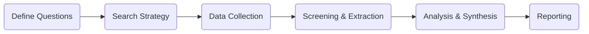
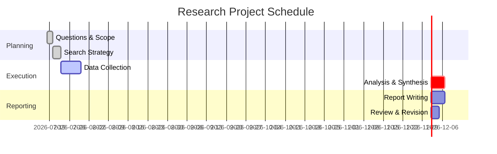

# Executive Summary  
A comprehensive research plan defines clear objectives, methodology, data sources, and a timeline before work begins. It will propose example research questions at varying scope (broad, medium, narrow), refine them (e.g. using the FINER criteria), and outline the methods for answering them. Key components include the search strategy (databases, keywords), data-collection criteria, and synthesis methods (narrative summary or meta-analysis) to reconcile conflicting evidence. The plan concludes with a detailed deliverables/timeline table, plus identified risks, limitations, and next steps to ensure rigor and feasibility.

## Research Questions & Scope  
- **Broad scope:** Questions covering general trends or relationships across a field (e.g. *“What are the global trends in X?”*). Broad questions risk being unfocused if not well-defined.  
- **Medium scope:** Questions targeting several related variables or contexts (e.g. *“How do factors A and B interact in region Y?”*).  
- **Narrow scope:** Very specific questions about particular relationships or outcomes (e.g. *“Does intervention A improve outcome B in population C?”*). A too-narrow question may limit data and impact.  
Formulating clear questions is essential: *“clearly articulated research questions are key ingredients that guide the entire review methodology”*. We would provide examples of each scope (broad, medium, narrow) and ensure they align with a genuine gap or decision need. Strong questions should be focused, answerable, and meet the FINER criteria (Feasible, Interesting, Novel, Ethical, Relevant).

## Methodology and Data Sources  
 *Figure: Researchers gathering data from academic journals, industry reports, and official documents (image)*. Secondary research will combine **scholarly** and **non-scholarly** sources for breadth: academic databases (e.g. PubMed, IEEE, JSTOR), government/official repositories (e.g. WHO, census), **industry reports** (market research firms, white papers), **news archives** (reputable outlets), and patent databases (USPTO, Lens) for innovation trends. We prioritize credible, primary sources. Grey literature (e.g. technical reports, conference proceedings, dissertations, trial registries) is included to minimize publication bias. Combining diverse sources ensures comprehensive coverage. 

Key steps:  
- Conduct a **literature review** of existing studies to map the state of knowledge and identify gaps.  
- Define the **methodological approach** (qualitative, quantitative, or mixed methods) based on the research question. For example, meta-analysis if enough quantitative data, or thematic analysis of qualitative reports.  
- Collect **data** from chosen sources. For patents or technical standards, query specialized databases. For industry trends, consult market analysis platforms.  
- Maintain a **project log** and use quality checks: for example, “soft-launch” pilot searches to validate search terms and early data extraction. A pre-mortem (“What could cause failure?”) is recommended to identify issues early.  

*Suggested visualization:* A flowchart of the research workflow can clarify the process, for example:  

This diagram (placeholder) outlines the major phases from question formulation through reporting. 

## Search Strategy & Keywords  
We will implement a systematic search. The four main steps are: **(1) Decide where to search**, **(2) Write and refine queries**, **(3) Run and record searches**, and **(4) Manage results**. 

- **Choose databases and sources:** Identify relevant bibliographic databases (e.g. MEDLINE/PubMed, Scopus, IEEE Xplore, Google Scholar) and industry/government portals. Also plan searches of grey literature (e.g. clinical trial registries, theses repositories) to minimize bias.  
- **Develop keywords:** Derive terms from key concepts in the research questions and eligibility criteria. Use synonyms and controlled vocabulary (e.g. MeSH, Emtree) as appropriate. **Truncate** terms (e.g. `therap*` to capture therapy/therapies) and use **wildcards** (e.g. `wom#n` for woman/women) to broaden searches.  
- **Boolean logic:** Combine synonyms with OR to maximize sensitivity, then narrow with AND/NOT. For example, use `(“social media” OR “online platforms”) AND (“mental health” OR “anxiety”)` to focus results.  
- **Pilot and refine:** Test the strategy by checking if known key papers are found; iteratively adjust terms. Keep precise records of each database search. Searches should be logged in full (e.g. PRISMA flowchart later) for transparency. 

## Data Collection Plan and Inclusion/Exclusion Criteria  
We will collect candidate sources according to predefined criteria to ensure relevance and quality. *Inclusion criteria* might specify date ranges (e.g. last 10 years), language (e.g. English), study types (e.g. peer-reviewed articles, reports), populations or contexts of interest. *Exclusion criteria* might omit sources outside scope (unrelated topics, low-quality outlets, opinion pieces). Clear criteria are critical: poorly defined criteria undermine a study’s validity and generalizability. 

The plan will include:  
- A **screening process** (e.g. title/abstract followed by full-text review) to apply inclusion/exclusion filters systematically.  
- A **PRISMA-style log** (or equivalent) to track how many records were found and how many were included/excluded at each step.  
- Quality checks (e.g. removing duplicates, verifying authoritativeness).  

This ensures only the most relevant data sources feed into the synthesis, and that bias is minimized. For example, we will explicitly exclude sources that do not answer our research questions or do not meet methodological standards.

## Synthesis Approach and Handling Conflicts  
We will synthesize findings narratively and, where possible, quantitatively. First, key data (study characteristics, outcomes, etc.) will be extracted into tables grouped by theme or context. Descriptive summary tables (e.g. of study design, populations, interventions) help readers compare evidence side-by-side. Narrative synthesis will highlight patterns and themes across sources. 

If quantitative data (effect sizes, metrics) are available, a **meta-analysis** could be performed: combining results from multiple studies into a pooled estimate. Meta-analysis increases statistical power and can *“resolve controversies when study results conflict”* by identifying overall effects. If heterogeneity is high, subgroup analyses or meta-regression may explain differences. Visual aids (forest plots, charts) will illustrate aggregated outcomes. Any conflicting evidence will be carefully examined: we will note study quality, context differences, or biases that might explain discrepancies. The goal is a balanced conclusion that acknowledges uncertainty.

## Deliverables and Timeline  

| Task                                    | Est. Hours | Milestone/Deliverable                                |
|-----------------------------------------|-----------:|------------------------------------------------------|
| Define research questions and scope     |        5h  | Document with proposed questions and scope           |
| Develop search strategy (sources, terms) |        5h  | Search protocol and keyword list                     |
| Execute searches and gather sources     |       10h  | Bibliography of retrieved records                    |
| Screen records & apply criteria         |       10h  | Screening log (PRISMA flow summary)                  |
| Extract data into tables                |       15h  | Data extraction tables (studies and findings)        |
| Analyze/synthesize findings             |       20h  | Summary of key findings (textual and graphical)      |
| Create visualizations (charts, diagrams)|        5h  | Draft figures (tables, charts, flowcharts)           |
| Write report draft                      |       15h  | First complete draft of report                       |
| Review & finalize report                |       10h  | Final report with revisions and all references       |

*Mermaid Gantt chart example of timeline:*  

This Gantt chart (conceptual) illustrates task sequencing and buffers. Each task’s length is an estimate; calendar time includes built-in buffers for delays (e.g. stakeholder reviews or recruitment). 

## Risks, Limitations, and Next Steps  
- **Common Risks:** Incomplete coverage (missing relevant studies), publication bias, or stakeholder delays. For example, recruitment or data retrieval may take longer than expected, so we plan buffers. We will document known risks (e.g. hard-to-find data, changing priorities) and mitigation strategies. Conducting a **pre-mortem** (“What could cause failure?”) is a best practice to anticipate problems early.  
- **Limitations:** Relying on secondary sources means being limited by what is published or available. Search strategies may miss grey or proprietary data. Results may be biased if non-English sources or unpublished data are excluded. We assume no budget constraints, but time and scope remain finite. Findings will be framed with these caveats.  
- **Next Steps:** Begin with a pilot search to refine keywords and ensure key literature is captured. If the domain is later specified (e.g. healthcare vs. technology), we will tailor sources (specialized databases, domain experts). Depending on results, follow-up research (e.g. expert interviews or primary data collection) might be needed to address any gaps. Final deliverables include the research plan and draft report by the milestones above, with opportunities for stakeholder review throughout. 

*Visual note:* Besides the Gantt above, we might include additional charts—such as a process flow diagram of research stages—at relevant points in the report to aid understanding.  

