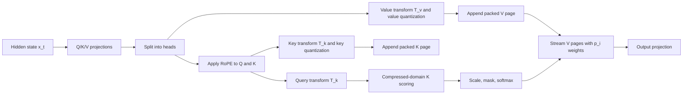

# TurboQuant Family Design Study for CPU and Browser WASM KV Caches

## Executive summary and scope

The original user request left the topic unspecified, so this report assumes the uploaded assignment is the intended scope: a design study for applying TurboQuant-family ideas to **transformer KV-cache quantization** in a **small-model Rust and browser-WASM runtime**. The assignment also explicitly separates this topic from **static model-weight quantization** and **persistent embedding or vector-index quantization**, and it forbids any claim that private TinyRustLM code or artifacts were inspected. fileciteturn0file0

The central recommendation is to **not** begin with the full paper-style “TurboQuant everywhere” stack. For a CPU-first and browser-WASM runtime, the best staged design is: **post-RoPE, per-head, structured-rotation key quantization with direct compressed-domain scoring; a separate value path optimized for MSE rather than unbiased inner products; a recent-token FP16 window; fixed-size cache pages; and no decoded FP shadow cache**. Dense random rotations, GPU-specific fused-kernel assumptions, and claims of “3-bit or 3.5-bit quality neutrality” should all be treated as **paper-author claims that require local verification on TinyRustLM** rather than product assumptions. TurboQuant’s authors claim strong KV-cache compression and speedups, but those claims were presented on open-source models and hardware such as H100, while vLLM’s public documentation also shows that quantized KV storage alone does not automatically produce latency gains unless the attention path itself is fused or quantized-aware. citeturn0academia48turn1search0turn9search2turn9search4turn4academia24

A careful reading of the public literature strongly supports a **keys-versus-values split**. QJL is mathematically attractive for **keys** because it targets inner-product estimation with an unbiased estimator, while KIVI, KVQuant, QServe, and related systems all show that **values** behave differently and often need different granularity, outlier handling, or mixed-precision policies. KIVI explicitly quantizes keys per-channel and values per-token; KVQuant emphasizes pre-RoPE key handling and sparse outlier treatment; QServe adds a GPU-specific SmoothAttention mechanism to stabilize 4-bit KV quantization. citeturn1search1turn2academia7turn6academia0turn10academia22turn20view0

The most important engineering conclusion is this: **generic random rotations do not commute with RoPE**, so a TurboQuant-style transform should be placed **after RoPE** on keys, with the same transform applied to the query at decode time. Pre-RoPE key quantization is possible, but it becomes a different design line, closer to KVQuant, because the query-key interaction becomes position-dependent through the relative RoPE operator. That makes post-RoPE placement the clean default for a portable Rust/WASM implementation. citeturn6academia0turn0academia48turn1search1

Because the topic was initially unspecified, there are still open scope choices. The three plausible deep-research branches are shown below; the uploaded assignment makes the recommended choice unambiguous. fileciteturn0file0

| Plausible topic option | What it covers | Best-fit deliverable | Estimated deeper-dive effort |
|---|---|---|---|
| Static model-weight quantization | Offline weight formats, calibration, model packaging, GEMM kernels | Weight-only PTQ design study | About 2 to 3 researcher-days for literature and architecture, then 1 to 2 implementation weeks |
| Online transformer KV-cache quantization | Runtime K/V append, cache paging, attention scanning, long-context quality | **Recommended** design study for TinyRustLM CPU/WASM | About 4 to 6 researcher-days for design and evaluation plan, then 2 to 4 weeks for scalar prototype and 2 to 4 more weeks for SIMD/WASM hardening |
| Persistent embedding or vector-index quantization | RAG index compression, ANN lookup, offline to online index flow | TurboVec-style retrieval-system study | About 2 to 4 researcher-days for design and source review, then 1 to 2 implementation weeks |

The non-goals are equally important. A lower-bit KV format does **not** shrink static model files; it does **not** make the model “1-bit”; it must not silently alter chat serialization, history, sampler settings, or output selection; and it must be evaluated with untouched model outputs rather than repaired or best-of-N answers. Those constraints come from the assignment itself and should be treated as product requirements. fileciteturn0file0

## Source observation log and methodology

### Observation log

The table below distinguishes **directly observed public facts**, **paper or project-author claims**, and **important caveats**. Retrieval date for all web sources in this report is **2026-07-18**.

| Source | Directly observed public facts | Author or project claim | Caveat for this report |
|---|---|---|---|
| TurboQuant paper | arXiv `2504.19874`, first posted 2025-04-28; frames TurboQuant as an online vector quantizer for MSE and inner-product distortion. citeturn0academia48 | Claims near-optimal distortion and KV-cache quality neutrality at some low bit-rates on evaluated models. citeturn0academia48 | Public paper; not TinyRustLM-specific; no CPU/WASM implementation evidence. |
| Google Research blog | Public blog dated 2026-03-24; identifies TurboQuant, QJL, and PolarQuant as related techniques and explicitly discusses H100 attention-logit speedups and long-context benchmarks. citeturn1search0 | Claims at least 6× KV memory reduction and up to 8× attention speedup on H100 in tested settings. citeturn1search0 | Blog is useful context, but those are still author claims on specific hardware; they must not be generalized to browser WASM. |
| QJL paper and repo | arXiv `2406.03482`; public repo shows a CUDA-oriented implementation with `qjl_kernel`, LongBench scripts, and Llama-2/3 support. citeturn0search0turn17view0 | Claims unbiased inner-product estimation, “zero overhead” relative to per-block scale storage, and 3 bits per float in the cache. citeturn0search0turn17view0 | Repo snapshot was retrieved from `main`; exact Git SHA was not exposed in retrieved HTML. |
| PolarQuant paper | arXiv `2502.02617`, first posted 2025-02-04; presents random preconditioning plus polar transformation, emphasizing removal of normalization overhead. citeturn0academia49 | Claims more than 4.2× KV compression with best quality among compared methods on the authors’ long-context evaluation. citeturn0academia49 | Public paper only; no CPU/WASM reference implementation surfaced in retrieved sources. |
| Fast-TurboQuant paper | arXiv `2606.21448`, first posted 2026-06-19; replaces dense random projection with Rademacher plus FWHT and reports multiplier-free complexity. citeturn0academia50 | Claims 19.7× algorithmic speedup on an embedding benchmark under sequential execution. citeturn0academia50 | Study is on embeddings, not transformer KV cache; useful as transform-engineering evidence, not direct KV validation. |
| KIVI paper and repo | arXiv `2402.02750`; repo exposes asymmetric K/V handling and a configurable FP16 residual window. citeturn2academia7turn21view0turn21view2 | Claims 2-bit tuning-free KV quantization, key per-channel and value per-token quantization, and 2.6× lower peak memory on tested models. citeturn2academia7turn21view0 | Mostly CUDA and HF-oriented implementation; still a key practical baseline. |
| KVQuant paper and repo | arXiv `2401.18079`; emphasizes pre-RoPE key quantization, non-uniform datatypes, and sparse outlier handling. citeturn6academia0turn12search4 | Claims sub-4-bit accuracy advantages and very long context feasibility on A100 systems. citeturn6academia0 | Again, public results are GPU-oriented; the pre-RoPE choice materially changes the online attention design. |
| QuaRot and SpinQuant papers | QuaRot arXiv `2404.00456`; SpinQuant arXiv `2405.16406`. Both treat rotations as a way to suppress outliers in quantized transformers. citeturn6academia3turn6academia1 | QuaRot claims output-preserving random rotations for 4-bit end-to-end quantization; SpinQuant claims learned rotations outperform random ones on hard models. citeturn6academia3turn6academia1 | Useful for rotation design intuition, but much of the benefit is for offline model transformations, not purely online KV append. |
| QServe paper and OmniServe repo | arXiv `2405.04532`; repo explicitly exposes W4A8KV4 and fused CUDA attention kernels. citeturn10academia22turn20view1turn20view2 | Claims 1.2× to 3.5× throughput gains against TensorRT-LLM on A100 and L40S in benchmark settings. citeturn10academia22turn20view2 | Important system lesson: speedups came from a fused, hardware-specific pipeline, not from storage compression alone. |
| vLLM documentation | Public docs across versions show that FP8 KV storage increases capacity; older docs say no latency improvements yet; newer docs add quantized-domain attention paths and per-head scales for some backends. citeturn9search2turn9search3turn9search4 | Recommends calibrated scales for higher quality in FP8 modes. citeturn9search2turn9search4 | Strong evidence that storage format alone is not the whole performance story. |
| FlexGen paper | arXiv `2303.06865` presents throughput-oriented offloading and 4-bit cache compression. citeturn7academia24 | Claims throughput gains in latency-insensitive settings with compression and offloading together. citeturn7academia24 | Good reminder that throughput and interactivity are different optimization targets. |
| TurboVec repo | Public Rust repo describes itself as a vector index, not a transformer KV cache; exposes hand-written NEON and AVX-512BW kernels and direct compressed-domain scoring. citeturn19view2turn19view0 | Claims strong ANN speed and memory characteristics. citeturn19view2turn19view1 | Relevant only as **comparative engineering**, not as evidence of transformer-KV behavior. |
| 2026 critique note | arXiv `2604.19528` publicly compares RaBitQ and TurboQuant and reports reproducibility concerns in symmetric experiments. citeturn4academia24 | Claims TurboQuant did not consistently outperform RaBitQ in the authors’ comparison setup. citeturn4academia24 | This is not the final word, but it is a strong signal against taking public TurboQuant marketing claims at face value. |

One bibliography item in the assignment appears unresolved in public retrieval: the prompt lists a “DRIVE/EDEN comparison note” at arXiv `2604.18555`, while the retrievable 2026 comparison note surfaced as arXiv `2604.19528`, and the verified EDEN source available in this session was the ICML 2022 distributed mean-estimation paper. That means the exact `2604.18555` reference should be treated as an **open citation-resolution issue**, likely a typo or stale identifier, until independently verified. fileciteturn0file0 citeturn4academia24turn2search0

### Method and evidence policy

This report prioritizes **primary papers**, **official project repositories**, and **official documentation**. It explicitly separates: directly observed public facts, paper-author claims, engineering analysis, and unknowns that require local TinyRustLM verification. That separation matters because several public sources make strong performance claims on **H100, A100, L40S, CUDA, or Triton-style stacks**, while the target product here is **portable Rust plus browser WASM**. The assignment itself also bars any implication that private TinyRustLM code was inspected, and this report follows that constraint. fileciteturn0file0 citeturn1search0turn10academia22turn9search2

## KV-cache equations and transform placement

### Capacity model

For an autoregressive transformer with batch size \(B\), layer count \(L\), query heads \(H_q\), KV heads \(H_{kv}\), head dimension \(d\), sequence length \(T\), and storage type size \(s\) bytes per scalar, the per-layer cached tensors are

\[
K \in \mathbb{R}^{B \times T \times H_{kv} \times d}, \qquad
V \in \mathbb{R}^{B \times T \times H_{kv} \times d}.
\]

During decoding, one new token appends **one new key vector and one new value vector** for every layer and KV head. The fundamental payload cost is therefore

\[
\text{bytes per token} = 2 L H_{kv} d s.
\]

That formula is independent of whether the model uses MHA, GQA, or MQA; those architectures differ only by \(H_{kv}\). In MHA, \(H_{kv}=H_q\). In GQA, \(H_{kv}<H_q\). In MQA, \(H_{kv}=1\). The literature and system docs all treat KV growth as one of the dominant long-context scaling terms, which is why methods like KIVI, KVQuant, QJL, TurboQuant, and FP8 KV caches focus on lowering the bytes moved and stored per token. citeturn2academia7turn6academia0turn0search0turn0academia48turn9search2

Because the actual TinyRustLM model shapes were not provided, the worked examples below use **illustrative representative GQA-family assumptions** rather than observed TinyRustLM configs. These are only for capacity planning.

| Representative model | Assumed layers | Assumed query heads | Assumed KV heads | Head dim | FP16 bytes per token | INT8 bytes per token | INT4 bytes per token |
|---|---:|---:|---:|---:|---:|---:|---:|
| ~0.3B | 24 | 16 | 4 | 64 | 24,576 | 12,288 | 6,144 |
| ~0.6B | 28 | 24 | 6 | 64 | 43,008 | 21,504 | 10,752 |
| ~1.0B | 32 | 32 | 8 | 64 | 65,536 | 32,768 | 16,384 |
| ~1.5B | 36 | 40 | 10 | 64 | 92,160 | 46,080 | 23,040 |
| ~2.0B | 40 | 48 | 12 | 64 | 122,880 | 61,440 | 30,720 |

Those numbers explain why even “small” models become cache-heavy at long contexts. For example, a representative 1.0B GQA model at FP16 would consume about **64 KiB per token** of KV state, so 32,768 tokens would imply roughly **2 GiB** of KV payload before allocator slack, metadata, scratch buffers, or recent-token high-precision windows. That broad scaling pattern is exactly what motivates low-bit KV methods in the public literature. citeturn2academia7turn6academia0turn7academia24turn9search2

A more general all-in formula for mixed key and value bit-rates is

\[
M_{\text{payload}}(T) = L H_{kv} d T \cdot \frac{b_K + b_V}{8}.
\]

If the design preserves a recent FP16 window of \(W\) tokens and compresses only older tokens, then

\[
M(T) = L H_{kv} d \left(\max(T-W,0)\frac{b_K+b_V}{8} + \min(T,W)\cdot 4\right) + M_{\text{page}} + M_{\text{scratch}}.
\]

That formula is the right planning surface for this product, because KIVI-style recent-token FP windows are already public practice, and the assignment explicitly asks for scratch and duplicate-layout costs, not just packed payload. citeturn21view2turn2academia7turn0file0

### Why keys and values need different treatment

The key path and value path are not numerically equivalent. Attention logits are formed by

\[
\ell_i = \frac{q^\top k_i}{\sqrt{d}} + m_i,
\]

followed by

\[
p_i = \mathrm{softmax}(\ell)_i,
\qquad
o = \sum_i p_i v_i.
\]

A key-quantization scheme perturbs the **logit geometry**. A value-quantization scheme perturbs the **weighted reconstruction** after softmax. These errors propagate differently. QJL is tailored around unbiased inner-product estimation, which is directly relevant to \(q^\top k_i\). But even a zero-mean logit estimator does **not** imply unbiased attention probabilities, because softmax is nonlinear, so in general \( \mathbb{E}[\mathrm{softmax}(\hat \ell)] \neq \mathrm{softmax}(\ell)\). And even perfect attention weights would still not make quantized values exact, because the final output depends on the actual value vectors, not just their norms or pairwise angles. That is why public systems keep returning to asymmetric K/V choices. citeturn0search0turn17view0turn2academia7turn6academia0turn10academia22

KIVI is the clearest practical example: its public paper and repo explicitly quantize **keys per-channel** and **values per-token**. KVQuant likewise adds key-specific choices such as **pre-RoPE key quantization** and per-vector outlier isolation. QServe goes further on GPU by adding **SmoothAttention** to stabilize low-bit KV behavior. These are all strong signals that a CPU/WASM design should avoid any assumption that “the same quantizer should be used for K and V because both are in the KV cache.” citeturn2academia7turn21view0turn6academia0turn10academia22turn20view0

The design implication is straightforward. For **keys**, the product should optimize for *rank stability* of attention logits, *top-attended-token agreement*, and *low variance in query-key scores*. For **values**, the product should optimize for *low MSE under weighted summation*, *layer-output cosine stability*, and protection of especially sensitive tokens or channels. TurboQuant-family methods are therefore more naturally “split” into a **key estimator track** and a **value reconstruction track** than treated as one monolithic codec. citeturn0academia48turn0academia49turn2academia7turn6academia0

### Placement relative to RoPE and attention

The recommended transform placement is shown below. This is the clean default for TurboQuant-style orthogonal transforms in a RoPE model.

The reason is algebraic. If \(T\) is an orthogonal transform and the runtime stores \(Tk\), then the exact dot product is preserved only if the query is also transformed into the same basis:

\[
q^\top k = (Tq)^\top (Tk).
\]

That is perfectly fine **after RoPE**. But a generic random rotation does **not** commute with RoPE, because RoPE is a blockwise position-dependent rotation over coordinate pairs, and a random dense or Hadamard-style transform does not generally preserve those 2D subspaces. So if keys are quantized **before RoPE**, the decode-time score becomes position-dependent through a relative rotation term, which is much closer to KVQuant’s line of attack than TurboQuant’s. KVQuant explicitly explores pre-RoPE key quantization; TurboQuant and QJL are naturally read as post-conditioning methods for the vector space actually used in attention. citeturn6academia0turn0academia48turn0search0

That gives a crisp product recommendation:

- **Keys** should be quantized **after** Q/K projection, head split, and RoPE.
- The **query** should be transformed into the same rotated basis **after** its RoPE application.
- **Values** can be transformed after head split, since RoPE does not act on \(V\) in the usual architecture.
- Scores should be accumulated directly against packed key codes without reconstructing the full history to FP.
- Value aggregation should stream packed value pages after softmax, again without full-history materialization.

This placement is mathematically clean, preserves attention semantics as much as possible, and aligns with the assignment’s requirement to analyze transform position precisely. fileciteturn0file0 citeturn6academia0turn17view0turn0academia48

## Candidate algorithms and packed formats

### Candidate key and value algorithms

The public methods fall into a few distinct families, which matter differently for a TinyRustLM-style runtime.

| Method family | Public basis | Best fit in this project | Strength | Main concern for CPU/WASM |
|---|---|---|---|---|
| QJL-style key sketch | QJL paper and repo. citeturn0search0turn17view0 | **Keys only**, optional experimental arm | Strong theory for inner-product estimation; no per-block scales | Query-path transform and residual variance may be costly; public implementation is CUDA-oriented |
| PolarQuant or TurboQuant MSE stage | PolarQuant and TurboQuant papers. citeturn0academia49turn0academia48 | **Keys or values**, especially values | Data-oblivious, calibration-free, no classical scale/zero metadata | Dense transforms are expensive unless replaced with structured transforms |
| KIVI-style asymmetric K/V | KIVI paper and repo. citeturn2academia7turn21view0 | Strong baseline for **recent-window and granularity choices** | Practical asymmetry and residual FP window | Public kernel assumptions are CUDA/HF-centric |
| KVQuant-style pre-RoPE and sparse outliers | KVQuant paper and repo. citeturn6academia0turn12search4 | Good source of ideas for **key outliers** | Explicit long-context engineering ideas | Pre-RoPE path is architecturally more complex online |
| QuaRot and SpinQuant rotations | QuaRot and SpinQuant papers. citeturn6academia3turn6academia1 | Mostly comparative background | Show why rotations help outliers | Learned rotations are poor fit for online, training-free append |
| QServe QoQ | QServe paper and repo. citeturn10academia22turn20view1 | System design comparison only | Demonstrates fused quantized attention can be fast | GPU-specific kernel assumptions do not transfer to WASM |

My engineering recommendation is to split the implementation into **three product arms**, not one:

1. **Recommended production candidate**  
   **Structured-TurboKey + MSE-TurboValue + recent FP16 window.**  
   Keys use post-RoPE per-head structured rotation and direct compressed-domain scoring. Values use an MSE-oriented codec, ideally also with structured rotation, but no QJL residual. The most recent \(W\) tokens remain FP16 for both K and V. This arm matches the public evidence best for CPU/WASM portability. citeturn0academia50turn2academia7turn9search2turn9search4

2. **Experimental theory-heavy arm**  
   **Structured-TurboKey with optional residual QJL correction.**  
   This keeps QJL where it is theoretically motivated: on keys. It should remain optional, because public TurboQuant marketing claims and later public critique do not establish that the residual stage is always a net product win in all settings, especially not in small-model CPU/WASM deployments. citeturn0academia48turn4academia24turn17view0

3. **Control baseline arm**  
   **KIVI-like asymmetric baseline.**  
   Even if the final product does not use KIVI’s exact quantizer, a KIVI-style per-channel K / per-token V baseline with an FP16 recent window is an essential control, because it is both conceptually simple and publicly validated. citeturn2academia7turn21view0

The value-path recommendation deserves emphasis. A QJL-style unbiased score estimator does **not** solve value reconstruction. For values, the best first implementation is **MSE-only** with either rotated scalar codebooks or a stable asymmetric per-token scheme, plus selective protection for recent tokens and possibly first or last layers if validation later proves that necessary. That is more consistent with the public evidence base than trying to force “residual QJL for V” into the design. citeturn0academia49turn2academia7turn10academia22

### Dense and structured transform comparison

TurboQuant’s public paper and blog describe random rotation as central to the method. Fast-TurboQuant then argues that the dense projection is too expensive for constrained hardware and replaces it with a Rademacher-sign stage followed by FWHT, i.e. a fast structured transform. That direction is exactly what a Rust/WASM product should adopt. citeturn0academia48turn1search0turn0academia50

The comparison below shows the asymptotic and practical reason. For a per-head transform of size \(d\), dense rotation needs \(O(d^2)\) multiply-add work per vector. A structured Rademacher+FWHT transform needs roughly \(O(p \log_2 p)\) additions, where \(p\) is the next power of two. For common head dimensions, the gap is large even after zero-padding.

| Head dim | Next power of two | Dense work per vector | FWHT-style work per vector | Dense / structured ratio | Padding factor |
|---:|---:|---:|---:|---:|---:|
| 80 | 128 | 6,400 | ~1,024 | ~6.3× | 1.60× |
| 96 | 128 | 9,216 | ~1,024 | ~9.0× | 1.33× |
| 128 | 128 | 16,384 | ~1,024 | ~16.0× | 1.00× |
| 160 | 256 | 25,600 | ~2,304 | ~11.1× | 1.60× |

These figures are engineering calculations, not measured runtimes, but they align with Fast-TurboQuant’s public argument that structured transforms are especially attractive on constrained hardware because they are multiplier-free and map better to simple SIMD. citeturn0academia50

That leads to the following transform policy:

- Use **per-head** transforms by default, not grouped multi-head transforms. Per-head transforms make query-path work predictable and simplify cache identity and portability.
- Use a deterministic **seeded Rademacher pattern plus FWHT**, not a stored dense matrix.
- Treat non-power-of-two head sizes by **temporary zero-padding** during append and query transform; do **not** store padded payload unless a kernel later proves it worthwhile.
- For values, if transform-domain accumulation is used, apply the inverse FWHT **once per layer and head** after the weighted sum, not per token.

TurboVec’s public Rust implementation, while not a KV cache, is still useful evidence that direct compressed-domain scoring plus AVX2, AVX-512BW, and NEON specialization is feasible in Rust. It explicitly advertises NEON and AVX-512BW paths and query-rotation scoring without decompressing the whole database. The important caveat is that TurboVec is an **embedding index**, not a transformer cache. citeturn19view2turn19view0turn19view1

### Packed format and complete bit accounting

A page-based format is the right choice for both native CPU and browser WASM, because it makes growth, truncation, sliding windows, and cache reuse easier to reason about than one monolithic allocation. The recommended format is a **fixed-token page per layer**, with token-major append order and head-major inner layout.

A concrete page header can be specified as a **single 64-byte cache-line-aligned header**:

| Header field | Size |
|---|---:|
| magic | 4 bytes |
| format version | 2 bytes |
| flags | 2 bytes |
| model-hash low bits | 8 bytes |
| tokenizer or template hash low bits | 8 bytes |
| runtime-version hash | 8 bytes |
| layer index | 2 bytes |
| token start | 4 bytes |
| token count | 2 bytes |
| KV heads | 2 bytes |
| head dim | 2 bytes |
| padded dim | 2 bytes |
| key mode | 1 byte |
| value mode | 1 byte |
| transform family | 2 bytes |
| seed hash low bits | 8 bytes |
| reserved or CRC | 6 bytes |

Inside the page, the body should be laid out as:

1. **Recent-window ring marker**, if this page participates in a mixed FP16-compressed design.
2. **Key norms**, if the chosen key mode stores a scalar norm, one byte per token-head in the low-overhead modes, or FP16 in the highest-accuracy mode.
3. **Key main-code stream**, bit-packed.
4. **Optional key residual sign stream**, only for QJL-enabled modes.
5. **Optional key outlier sidecar**, stored as repeated `(u8 index, fp16 value)` pairs plus a count byte.
6. **Value norms or gains**, if the value mode requires them.
7. **Value main-code stream**, bit-packed.
8. **Optional value outlier sidecar**.
9. **Alignment padding to 16 bytes**, to simplify SIMD loads and page scanning.

The key design choice for fractional nominal rates is to use **mixed-channel allocation**, not entropy coding. Entropy coding is hostile to random access, page skipping, deterministic cache identity, and WASM portability. Mixed-channel rates are exact and easy to decode. For \(d=128\):

- **2.5 bits per channel** means 64 channels packed at 2 bits and 64 at 3 bits.
- **3.5 bits per channel** means 64 channels packed at 3 bits and 64 at 4 bits.

That gives exact nominal channel rates with fixed offsets and no decoder state. Public MLX and open-source TurboQuant-style implementations surfaced in search results use the same kind of channel-split idea for fractional rates, which reinforces that this is a practical and portable choice. citeturn22search4

The practical all-in bit accounting, however, must include norms, sidecars, and headers. A useful formula for a page with token count \(P\), head dim \(d\), and \(H_{kv}\) heads is

\[
b_{\text{all-in}} = b_{\text{nominal}} + \frac{b_{\text{norm}} + b_{\text{aux}}}{d} + \frac{64 \cdot 8}{P H_{kv} d}.
\]

For a representative case \(P=32\), \(H_{kv}=8\), \(d=128\):

- header overhead is only about **0.016 bits per channel per tensor stream**, so it is negligible;
- a **u8 norm** adds **0.0625 bpc**;
- one outlier sidecar entry per vector adds about **24/128 = 0.1875 bpc**.

That makes the following practical modes reasonable:

| Mode | Nominal design | All-in use case | Comment |
|---|---|---|---|
| 2.0 bpc | Fixed 2-bit codes | **Values only**, aggressive | Meaningful as a stress mode or low-memory fallback |
| 2.5 bpc | 2/3 split | Values or protected-key ablation | Exact fractional rate without entropy coding |
| 3.0 bpc | Fixed 3-bit codes | Strong default for values | Simpler than 3.5, good decode regularity |
| 3.5 bpc | 3/4 split | Strong default for keys | Good compromise for rank-sensitive key logits |
| 4.0 bpc | Fixed 4-bit codes | High-fidelity fallback | Good for protected layers or difficult models |

The recommended first product mode is therefore:

- **Keys:** 3.5 bpc nominal, per-head structured rotation, u8 log-norm, no outlier sidecar initially.
- **Values:** 3.0 bpc nominal, MSE-oriented codec, no QJL residual.
- **Recent tokens:** last \(W=128\) tokens remain FP16 for both K and V.
- **Experimental protected layers:** keep layer 0, layer 1, and final layer uncompressed only if validation later proves this necessary.

That policy fits the public literature far better than an immediate leap to “all tokens, all layers, both K and V at 2.5 bits.” citeturn0academia48turn0academia49turn2academia7turn6academia0

## Kernel and runtime architecture

### Append cost and memory-bandwidth tradeoffs

The append path runs once per new decode token across all layers, so its arithmetic cost matters more on CPU and especially on browser WASM than it does in H100-style marketing examples. The symbolic append cost for a structured per-head design is roughly

\[
C_{\text{append}} \approx
L H_{kv}
\left[
C_{\text{pack}}(d,b_K,b_V)
+ C_{\text{rot}}(p)
+ C_{\text{rot,V}}(p)
+ C_{\text{quant,K}}(d)
+ C_{\text{quant,V}}(d)
\right],
\]

with \(C_{\text{rot}}(p)\) on the order of \(p \log_2 p + p\) for sign flips plus FWHT. If optional QJL residuals are enabled on keys, add another transform-domain residual stage. For dense random projections, the same term would instead be \(O(d^2)\), which is exactly what Fast-TurboQuant argues against for constrained hardware. citeturn0academia50turn0academia48

The payoff is future bandwidth savings. For one future decode step over a live context of length \(T\), the total bytes saved relative to FP16 are approximately

\[
\Delta B_{\text{step}}(T)
=
T L H_{kv} d
\left(
4 - \frac{b_K+b_V}{8}
\right),
\]

assuming one full K scan and one full V scan per decode step. A simple bandwidth-only break-even criterion is then

\[
G^\* \approx \frac{C_{\text{append}} \cdot \tau_{\text{op}}}{\Delta B_{\text{step}} / BW_{\text{eff}}},
\]

where \(G^\*\) is the number of future generated tokens required to amortize the append cost, \(\tau_{\text{op}}\) is time per effective transform or quantization operation, and \(BW_{\text{eff}}\) is the effective memory bandwidth of the runtime. That formula is more honest than inventing throughput numbers, and it captures the core product truth: **compression helps more when contexts are long and outputs are long; it helps less when chats are short and append overhead dominates**. citeturn7academia24turn9search2turn9search4

Using the representative model assumptions from earlier, the memory effect is large. For a 2.0B-class illustrative model at 32,768 tokens:

| Cache scheme | Approximate KV memory |
|---|---:|
| FP16 | ~3,840 MiB |
| INT8 equivalent | ~1,920 MiB |
| INT4 equivalent | ~960 MiB |
| Recommended mixed scheme: \(b_K=3.5\), \(b_V=3.0\), \(W=128\) FP16 tokens | ~792 MiB |

That mixed example is a calculation from the formula above, not a measured TinyRustLM result. Even so, it shows why a CPU/WASM-aware low-bit design is worth studying: the memory gap is large enough to materially change context capacity and browser viability. citeturn2academia7turn6academia0turn0academia48

### CPU and WASM kernel design

The kernel architecture should be intentionally split by ISA:

| Path | Priority operations | Practical policy |
|---|---|---|
| Portable scalar | Reference correctness, deterministic parity, exact pack/unpack and transform round trips | Must exist first; this is the truth source for every SIMD backend |
| x86 AVX2 | Bit unpack, nibble lookup, horizontal accumulators, FWHT butterflies | Production baseline on many desktops; use cache-line aligned pages and AVX2 fallback everywhere |
| x86 AVX-512 | Wider accumulators, masked tails, more aggressive LUT or sign-dot kernels | Optional fast path; do not make it the design assumption |
| Arm NEON | 128-bit packed decode, narrow-lane accumulation, FWHT-friendly butterflies | Important for laptops and mobile-class devices |
| WASM SIMD128 | `v128` loads/stores, bitwise masks, lane arithmetic, popcount-adjacent sign handling where available | Necessary for browser speedups, but still a 128-bit model with stricter memory behavior |

Public docs confirm that WebAssembly SIMD is built around **128-bit `v128`** operations, and MDN also documents that `memory.grow()` can detach old JS-side buffers, which matters directly for browser cache paging and any JS host views. Arm’s public material likewise describes NEON as a fixed-width 128-bit SIMD ISA, while Intel’s intrinsics guide illustrates AVX2 and AVX-512 widths and mask behavior. citeturn14search1turn16search0turn16search5turn15search0turn15search5turn13search1

The key kernels should be designed around **streaming, not dequantizing entire histories**:

- **Append-time key kernel:** apply per-head sign flips plus FWHT, quantize to code indices, pack to page, store norm, optionally store a residual sign stream.
- **Decode-time key scan:** transform the live query once per layer and head, build tiny per-dimension LUTs for centroid scoring or signed residual accumulation, and stream packed pages. No history-sized dequant buffer.
- **Decode-time value scan:** after softmax, stream value pages and accumulate directly into FP32 per-head outputs. If value rotation is used, inverse-transform only the final head output, not every stored token.

TurboVec’s public Rust README is useful comparative evidence here: it describes rotating the query once, scoring directly against codebook values, and using AVX-512BW or AVX2 fallback with nibble-split LUTs. That is not transformer attention, but the compressed-domain scoring pattern is highly relevant. Meanwhile, vLLM’s docs show the opposite lesson: early quantized KV storage modes improved capacity but not latency because fused quantized attention was absent; later docs introduce quantized-domain attention in specific backends. citeturn19view0turn19view2turn9search2turn9search4

Accumulator width should be **FP32** for score accumulation and output accumulation, even when codes are 2 to 4 bits, because attention is highly sensitive to accumulation error and the assignment places quality on equal footing with latency and memory. Tails should be handled with masked loads on AVX-512, scalar cleanups on AVX2 and NEON, and explicit lane-tail scalar epilogues on WASM SIMD128. Scalar/SIMD parity must be a hard requirement; the assignment explicitly treats the inability to preserve scalar/SIMD parity as a stop condition. fileciteturn0file0

### Paging, lifecycle, and cache identity

The cache should grow in **fixed-size pages**, not by repeated full-buffer reallocation. In native Rust, page slabs can be pooled and recycled. In the browser, the runtime should either pre-grow memory up front or grow in coarse chunks, because public WebAssembly docs state that every `Memory.grow()` call detaches prior `ArrayBuffer` references, even with `grow(0)` on non-shared memory. That makes ad hoc host-side view caching error-prone. citeturn16search0turn16search3turn16search5

The lifecycle policy should cover at least these cases:

- geometric reservation at session start;
- fixed-page append until full;
- sliding-window truncation by page retirement;
- deterministic reset and cleanup on conversation reset;
- model-switch invalidation;
- adapter or LoRA invalidation;
- cancellation-safe partially written page rollback;
- optional prefix reuse only when semantic identity matches exactly.

A reusable cache must carry a strong identity record. At minimum:

- cache format version,
- model hash,
- tokenizer hash,
- chat-template hash,
- layer count and head shape,
- transform family and seed,
- codebook version,
- bit allocation policy,
- outlier policy,
- recent-window policy,
- context-token digest,
- runtime build hash.

The assignment explicitly requires this level of identity discipline, and public docs from vLLM’s KV-transfer compatibility matrix reinforce the same principle: quantized KV cache transfer is only safe when layout and cache dtype agreement are enforced. fileciteturn0file0 citeturn9search5

## Validation and implementation path

### Primitive numerical tests, model evaluation, and performance protocol

The primitive numerical test matrix should start below the model level and move upward:

| Test family | What to measure | Pass criterion type |
|---|---|---|
| Transform correctness | Orthogonality error, FWHT inverse round-trip, deterministic seed reproducibility | Exact or near-machine-precision for structurally exact transforms |
| Codec correctness | Pack/unpack, encode/decode round-trip on code indices, sidecar decode | Exact bitwise round-trip |
| Key estimation | Bias and variance of query-key inner product, logit error, top-attended-token agreement | Distributional error bounds and paired comparisons |
| Softmax behavior | KL or JS divergence of attention probabilities, rank changes in top attention targets | Paired distribution metrics |
| Value reconstruction | MSE, weighted output error, layer-output cosine similarity | Tight paired numeric thresholds |
| End-to-end token prediction | Next-token logit drift, top-k agreement, sequence-level divergence | Task-family regression budgets |

This is the correct order because KV-cache quantization errors can be invisible in one metric and obvious in another. Recent public work on alignment collapse under KV-cache quantization argues that common metrics like perplexity or coarse task accuracy can miss important regressions, especially around safety alignment. That does not mean TinyRustLM will show the same behavior, but it is strong evidence that model-level evaluation must go beyond perplexity alone. citeturn2academia10

The model-level evaluation should compare:

- a source full-precision runtime,
- the existing uncompressed compact runtime,
- each compressed-cache arm,

with **identical prompts, identical token history, identical sampler settings, identical seeds, and untouched outputs**. The assignment specifically requires ordinary chat, long retrieval, source conflict resolution, current-turn precedence, summarization, code, repeated-topic behavior, and boundary cases near context limits. It also explicitly prohibits best-of-N or repaired answers unless that is declared product behavior. fileciteturn0file0

The statistics plan should use **paired comparisons** and confidence intervals, not just benchmark averages. If sampling is part of product behavior, use repeated seeds and pair each compressed run with its exact full-precision counterpart. Control family-wise error or false discovery across benchmark families. A good default is: paired bootstrap confidence intervals on primary metrics; permutation tests on key deltas; Holm correction on a small prespecified family of “ship” metrics; and a preregistered ordinary-chat regression budget. fileciteturn0file0

The performance benchmark protocol should record at least:

- prefill latency,
- first-decode latency,
- steady-state decode latency,
- append-only codec time,
- query-transform time,
- key-scan time,
- value-scan time,
- allocator time,
- WASM memory-growth events,
- peak RSS or peak WASM pages,
- packed payload bytes,
- scratch bytes,
- and end-to-end tokens per second.

This mirrors both the assignment requirements and public lessons from vLLM and QServe: **storage compression alone is not enough**; the attention path, memory system, and allocator behavior must be isolated if you want to know where the gains actually come from. fileciteturn0file0 citeturn9search2turn20view2

The stop rules should be enforced exactly as engineering gates:

- reject any design that raises total peak memory after including scratch or staging buffers;
- reject any design that requires a decoded cache shadow;
- reject any design that breaks scalar/SIMD parity;
- reject any design that causes unstable browser memory growth;
- reject any design that exceeds the preregistered ordinary-chat regression budget.

Those rules are especially important because it is otherwise easy to “win” on nominal packed bits while losing on the real user-visible system. fileciteturn0file0

### Staged implementation plan

The safest path is staged and evidence-gated.

A concise stage plan looks like this:

| Stage | Entry goal | Exit evidence |
|---|---|---|
| Math prototype | Implement transforms and codecs in isolation | Exact FWHT or inverse checks; stable bias and MSE measurements |
| One-layer fixture | Single attention layer with deterministic tensors | Logit and softmax divergence tracked exactly; no full-history dequant |
| Tiny deterministic transformer | End-to-end on a tiny known model | Next-token logit drift and top-k agreement within budget |
| Real source model native scalar | Product-like runtime without SIMD | Task-family quality and memory accounting complete |
| Native SIMD | AVX2 first, then AVX-512 and NEON | Scalar parity and real speedups without new memory spikes |
| Scalar WASM | Browser functionality under fixed pages | Stable memory behavior and deterministic parity |
| WASM SIMD128 | Browser speed optimization | No correctness regressions versus scalar WASM |
| Browser dogfood | Real multi-turn use | Context reuse, reset, truncation, and model-switch semantics validated |

This sequence follows the assignment’s requested path almost exactly, and it is the right one. Skipping straight to a browser SIMD port would make it far too hard to distinguish numerical issues from portability issues. fileciteturn0file0

## Recommendation, unknowns, and annotated bibliography

### Final recommendation and expected gains

The recommended product path is:

1. **Implement a page-based KV subsystem rewrite**, because the assignment explicitly permits a clean rewrite and the cache-identity rules are easier to enforce with pages than with one legacy monolith. fileciteturn0file0  
2. **Use post-RoPE, per-head structured transforms on keys**, with direct compressed-domain scoring and no decoded shadow history. citeturn0academia50turn6academia0turn0academia48  
3. **Use an MSE-oriented value codec**, not QJL-style residual correction, and preserve a short FP16 recent window. citeturn0academia49turn2academia7  
4. **Ship the KIVI-like asymmetric baseline first as a control**, then compare against the structured-Turbo variant. citeturn2academia7turn21view0  
5. **Treat QJL residual correction as an experimental arm**, not the default. citeturn17view0turn4academia24  
6. **Do not generalize H100 or A100 GPU wins to browser WASM**. Public GPU papers are informative, but they are not product evidence for this runtime. fileciteturn0file0 citeturn1search0turn20view2

The expected gains should be expressed as formulas:

- **KV payload compression factor** relative to FP16:

\[
R_{\text{mem}} = \frac{4}{(b_K+b_V)/8}
\]

For the recommended nominal \(b_K=3.5\), \(b_V=3.0\),

\[
R_{\text{mem}} \approx \frac{4}{0.8125} \approx 4.92\times
\]

before small metadata overheads.

- **Context capacity gain** under fixed memory budget \(C\):

\[
T_{\max,\text{new}} \approx
\frac{C - M_{\text{fixed}}}{L H_{kv} d (b_K+b_V)/8}
\]

which is roughly the same multiplicative gain as memory compression if fixed overheads are small.

- **Bandwidth reduction per future decode step** over context \(T\):

\[
\Delta B_{\text{step}}(T)
=
T L H_{kv} d
\left(
4 - \frac{b_K+b_V}{8}
\right).
\]

These are the gains that are justified by the design itself. Latency improvements must then be proven by kernels and benchmarks, not inferred from packed bit-rates. That public lesson is visible both in older vLLM FP8 KV docs, which explicitly said there were not yet latency gains, and in QServe, where speedups appear only once the full fused quantized-attention path is engineered. citeturn9search2turn20view2

### Unknowns requiring local TinyRustLM verification

Several key facts remain unknown because they require the actual local product:

- exact model shapes across the 0.3B to 2B range;
- actual head dimensions and whether 80, 96, 128, or 160 predominate;
- current Rust attention layout and whether a clean page-based rewrite is cheaper than incremental retrofit;
- exact browser targets and whether WASM SIMD128 is enabled in the intended deployment environments;
- whether the product already uses sliding-window or sink-token logic;
- whether protected layers or protected tokens are necessary;
- whether QJL residuals help or hurt the chosen models at the intended context lengths;
- whether recent-token FP16 windows need to be 32, 64, 128, or larger;
- what ordinary-chat regression budget the product team is willing to accept.

Those are the make-or-break local variables. The public literature is strong enough to design the validation plan and the first implementation path, but not strong enough to answer those product-specific questions in advance. fileciteturn0file0

### Annotated primary-source bibliography

- **TurboQuant: Online Vector Quantization with Near-optimal Distortion Rate**, arXiv `2504.19874`, first posted 2025-04-28. Primary source for the TurboQuant family and the strongest public claims about near-optimal distortion and low-bit KV-cache quality. citeturn0academia48

- **TurboQuant: Redefining AI efficiency with extreme compression**, Google Research blog, 2026-03-24. Useful official context on Google’s framing of TurboQuant, QJL, and PolarQuant, including the H100-specific performance narrative that should **not** be generalized to WASM. citeturn1search0

- **QJL: 1-Bit Quantized JL Transform for KV Cache Quantization with Zero Overhead**, arXiv `2406.03482`, 2024, plus the public `amirzandieh/QJL` repository. Best primary source for the key-sketch line, asymmetric query/key estimation, and public implementation scope. citeturn0search0turn17view0

- **PolarQuant: Quantizing KV Caches with Polar Transformation**, arXiv `2502.02617`, first posted 2025-02-04. Primary source for a zero-overhead-style, MSE-oriented quantizer with a strong value-path interpretation. citeturn0academia49

- **Fast-TurboQuant: A Multiplier-Free Online Vector Quantization Approach**, arXiv `2606.21448`, first posted 2026-06-19. Not a transformer-KV paper, but the strongest primary source for replacing dense random projections with structured Rademacher plus FWHT transforms. citeturn0academia50

- **KIVI: A Tuning-Free Asymmetric 2bit Quantization for KV Cache**, arXiv `2402.02750`, plus public repo. Best practical baseline for asymmetric K/V handling and recent-token FP windows. citeturn2academia7turn21view0

- **KVQuant: Towards 10 Million Context Length LLM Inference with KV Cache Quantization**, arXiv `2401.18079`, plus public repo. Essential source for pre-RoPE key quantization, non-uniform quantization, and outlier handling in long-context serving. citeturn6academia0turn12search4

- **QuaRot: Outlier-Free 4-Bit Inference in Rotated LLMs**, arXiv `2404.00456`. Best primary source for random output-preserving rotations as a quantization aid in transformers. citeturn6academia3

- **SpinQuant: LLM Quantization with Learned Rotations**, arXiv `2405.16406`, plus public Meta repo. Important contrast case showing that learned rotations can outperform random ones, but at a cost not well matched to this online runtime problem. citeturn6academia1turn11search1

- **QServe: W4A8KV4 Quantization and System Co-design for Efficient LLM Serving**, arXiv `2405.04532`, plus the public OmniServe repo. Best primary source for the lesson that full-stack fused system design, not storage compression alone, delivers speed. citeturn10academia22turn20view2

- **Quantized KV Cache**, vLLM documentation, public versions `0.14.1`, `0.22.1`, and `0.25.0`. Strong official evidence of how a production serving stack’s KV-quantization story evolved from “more capacity, little latency gain” to more integrated quantized-domain attention. citeturn9search2turn9search3turn9search4

- **FlexGen: High-Throughput Generative Inference of Large Language Models with a Single GPU**, arXiv `2303.06865`. Important for distinguishing throughput-oriented offloading systems from interactive decode optimization. citeturn7academia24

- **TurboVec**, public `RyanCodrai/turbovec` repository. Included only for comparative engineering: Rust, AVX2 or AVX-512BW and NEON ideas, and compressed-domain scoring patterns. Not evidence of transformer-KV behavior. citeturn19view2turn19view0

- **Revisiting RaBitQ and TurboQuant: A Symmetric Comparison of Methods, Theory, and Experiments**, arXiv `2604.19528`. Important cautionary primary source showing that the public TurboQuant narrative is still under active technical debate. citeturn4academia24

- **Alignment Collapse Under KV Cache Quantization: Diagnosis and Mitigation**, arXiv `2606.09864`. A recent primary source supporting broader evaluation beyond perplexity and coarse task accuracy. citeturn2academia10