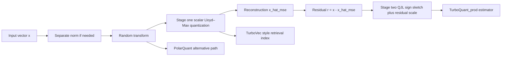

# TurboQuant, TurboVec, and TinyRustLM Quantization Research Assessment

## Executive findings and assumptions

The uploaded brief resolves the otherwise-unspecified topic: this report treats **TurboQuant** as the Google/ICLR research line centered on online vector quantization, **TurboVec** as the public `RyanCodrai/turbovec` project, and it keeps **static model-weight quantization**, **online transformer KV-cache quantization**, and **persistent embedding/vector-index quantization** separate throughout. It also assumes an unreleased browser-local Rust/WASM system named TinyRustLM, with no access to private code, prompts, measurements, or runtime artifacts. fileciteturn0file0

**Directly observed public fact.** The primary TurboQuant paper publicly accessible today is **arXiv v1**, first posted on 2025-04-28, while the OpenReview record shows the work as an **ICLR 2026 poster** published on 2026-01-26 and last modified on 2026-05-13. I could verify the public paper text on arXiv and the conference metadata on OpenReview, but I could not verify a separate final conference manuscript text beyond that metadata. citeturn28view0turn1search1

**Directly observed public fact.** The TurboQuant paper defines its stage-one method as **random rotation plus scalar Lloyd–Max quantization in Cartesian coordinates**. By contrast, the Google Research blog describes TurboQuant’s first stage as “the PolarQuant method.” Those are not the same algorithm description. PolarQuant is a distinct paper built around **recursive polar transformation and angle quantization**, and QJL is a distinct paper built around a **sign-quantized Johnson–Lindenstrauss sketch with an asymmetric estimator**. The blog is valuable context, but the paper is the controlling primary source for the exact TurboQuant algorithm. citeturn20view3turn20view4turn18view5turn18view8turn18view9turn25view0

**Engineering analysis.** For TinyRustLM’s three domains, the current public evidence supports different conclusions. For **persistent local retrieval/vector-index quantization**, the evidence is strongest: TurboVec is explicitly built for that use case and adds practical search-kernel engineering beyond the paper. For **KV-cache quantization**, TurboQuant, QJL, and PolarQuant provide credible public algorithms, but a browser-local Rust/WASM implementation still needs local quality and performance verification. For **static model-weight quantization**, the public TurboQuant line does not presently supply sufficient evidence to justify adoption; that is a different compression regime, and the assignment explicitly warns against conflating these problem classes. fileciteturn0file0 citeturn26search1turn1academia4turn1academia3turn1academia5

**Directly observed public fact with engineering implication.** The public `turbovec` crate is a vector-search implementation, not a public KV-cache or model-weight implementation. Its current Rust crate is `0.9.0`, its Python package is `0.8.0`, it builds a deterministic seeded QR rotation, uses SIMD lookup-table scoring, and as of its 2026-06-10 release explicitly refuses to compile on **non-64-bit targets**. Given the brief’s browser-local Rust/WASM context, that makes TurboVec useful as a design reference, but a poor drop-in dependency for browser deployment. citeturn26search0turn26search1turn26search2turn26search3turn6view1turn4view0turn24view0turn24view4

**Author-claim dispute that materially affects conclusions.** A 2026 arXiv note by the DRIVE/EDEN authors argues that `TurboQuant_mse` is a special case of EDEN with scale parameter \(S=1\), and that `TurboQuant_prod` can be weaker than directly using unbiased \(b\)-bit EDEN. That claim is not settled by the required primary sources, but it is serious enough that any engineering decision should treat TurboQuant’s “near-optimal” and “best-for-inner-product” framing as contestable rather than final. citeturn19view8turn19view9turn19view5turn19view1



The diagram above reflects the public-paper relationships, not the simplified blog wording. In the TurboQuant paper, stage one is the scalar-quantized rotated Cartesian path; in the Google blog, that first stage is described through the lens of PolarQuant; in TurboVec, the public implementation centers on the retrieval-oriented rotated scalar-quantization path plus extra calibration and bias correction. citeturn10view0turn25view0turn26search1turn7view2turn7view0

## Identity verification and source observation log

I used the following evidence classes throughout: **directly observed public fact** for paper text, docs, changelogs, and repository metadata I could inspect directly; **author claim** for performance or superiority claims made by paper/blog/project authors; **externally corroborated fact** for items supported by multiple public primary or near-primary records; **engineering analysis** for my own synthesis; and **local-verification required** for anything that depends on TinyRustLM’s private runtime, artifacts, or benchmark suite. That labeling follows the uploaded brief’s requested separation of evidence classes. fileciteturn0file0

| Artifact | Identity verified | Version or status observed | Notes |
|---|---|---|---|
| TurboQuant paper | Google/NYU paper by Zandieh, Daliri, Hadian, Mirrokni | arXiv v1, submitted 2025-04-28 UTC; OpenReview record says ICLR 2026 poster, published 2026-01-26, modified 2026-05-13 | Directly observed public fact. I verified arXiv text and OpenReview metadata, but not a separate final conference PDF text. citeturn28view0turn1search1 |
| QJL paper | Distinct paper by Zandieh, Daliri, Han | arXiv paper dated 2024-07-19 in PDF header | Directly observed public fact. It is a sign-sketch method for inner products/KV cache, not a model-weight format. citeturn18view4turn20view6 |
| PolarQuant paper | Distinct paper by Han, Kacham, Karbasi, Mirrokni, Zandieh | arXiv paper first posted 2025-02-04 | Directly observed public fact. It uses recursive polar transformation and angle quantization. citeturn1academia5turn18view5turn18view9 |
| Google Research overview | Secondary summary by Google Research blog authors | Published 2026-03-24 | Useful but not controlling for exact algorithm details. It narrates TurboQuant as using PolarQuant plus QJL. citeturn25view0 |
| TurboVec repository | Public `RyanCodrai/turbovec` project | GitHub main; release commit `1e7200c` on 2026-06-10 mentions Rust crate `0.9.0` and Python `0.8.0` | Directly observed public fact. Independent implementation and engineering layer, not official TurboQuant code. citeturn5view0turn6view1turn26search0turn4view0 |
| TurboVec docs | Crate documentation for vector search | docs.rs `turbovec 0.9.0` | Confirms seeded QR rotation, SIMD search kernels, vector-search scope. citeturn26search0turn26search1turn26search2turn26search3 |
| DRIVE | One-bit distributed mean estimation line | NeurIPS 2021 | Primary antecedent for random-rotation plus scaled sign quantization. citeturn2search0turn19view5 |
| EDEN | Multi-bit extension of the distributed mean estimation line | ICML 2022 | Primary antecedent for Lloyd–Max-based rotated scalar quantization with scale choices and Hadamard replacement. citeturn2search1turn19view1turn20view1 |
| DRIVE/EDEN comparison note | Critical note about relation to TurboQuant | arXiv preprint dated 2026-04-20 | Author claim from prior-line authors; important but not adjudicated here. citeturn11academia1turn19view8turn19view9 |
| RaBitQ | ANN quantization line with error bounds | SIGMOD 2024 arXiv preprint | Distinct from TurboQuant; relevant mainly for ANN comparison and TurboVec’s correction step. citeturn15academia1turn27view1turn27view4 |
| Fast-TurboQuant | Structured-transform variant claim | arXiv preprint dated 2026-06-19 | Author claim, not yet broadly corroborated. Relevant to browser/edge transform cost. citeturn11academia0turn12view0 |

On arXiv, TurboQuant currently shows only **v1**. The OpenReview record confirms acceptance and later modification metadata, but because I could not verify a distinct final conference manuscript text, the only defensible material-difference statement is this: **I verified metadata evolution, not a separate revised paper body**. citeturn28view0turn1search1

## Mathematical reconstruction of the public algorithms

The TurboQuant paper defines two formal objectives over randomized quantizers \(Q\): reconstruction **MSE**, \(D_{\text{mse}}=\mathbb{E}\|x-\hat{x}\|_2^2\), and **inner-product error**, \(D_{\text{prod}}=\mathbb{E}|\langle y,x\rangle-\langle y,\hat{x}\rangle|^2\), with an additional requirement that the inner-product estimator be **unbiased**. That is already enough to separate several metrics that the paper does **not** directly optimize: angular error, cosine error, top-\(k\) rank preservation, and downstream language quality are either induced metrics or empirical outcomes, not the theorem objective itself. citeturn10view0turn8view0

For `TurboQuant_mse`, the public derivation is: start with \(x\in S^{d-1}\), apply a random rotation matrix \(\Pi\), and observe that each coordinate of \(\Pi x\) is distributed like a scaled/shifted Beta marginal on \([-1,1]\),
\[
f_X(t)=\frac{\Gamma(d/2)}{\sqrt{\pi}\Gamma((d-1)/2)}(1-t^2)^{(d-3)/2}.
\]
The paper explicitly notes that this marginal converges to a Gaussian \(N(0,1/d)\) in high dimension and relies on a **near-independence** argument for distinct coordinates after rotation, not exact finite-\(d\) independence. That caveat matters in low and medium dimensions. citeturn16view2turn22view3turn20view3

The scalar codebook is then defined by a continuous one-dimensional \(k\)-means/Lloyd–Max problem over that marginal. With \(2^b\) centroids \(c_1\le \cdots \le c_{2^b}\), the optimal bucket boundaries are midpoints between adjacent centroids, and the per-coordinate cost is the paper’s \(C(f_X,b)\). In public pseudocode, encoding is “rotate, then choose nearest centroid index coordinatewise”; decoding is “replace each index by its centroid, then apply \(\Pi^\top\).” The exact choices the paper makes public are therefore: one shared random rotation, one deterministic codebook per \((d,b)\), nearest-centroid assignment, de-rotation by transpose, and no dataset-specific training phase. citeturn17view1turn17view2turn20view4

**Directly observed public fact.** The theorem-level distortion statement for `TurboQuant_mse` is
\[
D_{\text{mse}} \le \frac{\sqrt{3\pi}}{2}\,4^{-b},
\]
while the lower-bound section derives
\[
D(B)\ge 2^{-2B/d}=4^{-b}
\]
for the hypersphere setting, yielding the publicized constant-factor gap \(\sqrt{3\pi}/2\approx 2.7\). This is an **expected distortion-rate** statement, derived using Shannon’s lower bound and Yao’s minimax principle, not a guarantee about every finite-dimensional workload or downstream model task. citeturn16view1turn22view0turn22view1turn22view2turn22view3turn17view0

For `TurboQuant_prod`, the paper explicitly argues that an MSE-optimal scalar quantizer is not enough for unbiased inner-product estimation. Its construction is to spend \(b-1\) bits per coordinate on `TurboQuant_mse`, form the residual
\[
r=x-Q^{-1}_{\text{mse}}(Q_{\text{mse}}(x)),
\]
then quantize that residual with a 1-bit QJL sketch and store a residual scale \(\gamma=\|r\|_2\). Public theorem text states that the output includes an index vector, a sign vector, and a positive scalar; the resulting inner-product estimator is unbiased and satisfies the same exponential \(4^{-b}\) rate up to constants. citeturn21view1turn21view2turn21view3

QJL itself is a distinct asymmetric sketch. In the QJL paper, one applies a Gaussian JL matrix \(S\) to both query and key, but only the key side is reduced to sign bits; the estimator
\[
\mathrm{ProdQJL}(q,k)=\frac{\sqrt{\pi/2}}{m}\,\|k\|_2\,\langle Sq,\operatorname{sign}(Sk)\rangle
\]
is then shown to be unbiased. The asymmetry is essential: applying sign quantization to both sides yields an angle estimator, not an unbiased inner-product estimator. In the original QJL paper the sketch size is \(m\); in the TurboQuant theorem/pseudocode, the residual sign vector is written at length \(d\), so the TurboQuant composition appears to instantiate QJL with \(m=d\). citeturn18view0turn20view6turn20view7turn21view0turn21view4

**Engineering analysis.** The most important finite-dimension caution is that the public proof stack is asymptotic and expectation-based. The Beta-to-Gaussian approximation is better at large \(d\); near-independence is not exact; and the distortion theorems do not imply zero estimator variance, unchanged top-\(k\) recall, or unchanged language quality. Those last properties require empirical verification, and the paper’s own experiments treat them as empirical, not theorem-level, claims. citeturn16view2turn22view0turn10view0turn25view0

## Relationships, critiques, and transform tradeoffs

The public literature separates cleanly into three algorithm families. **TurboQuant** uses random rotation plus scalar Lloyd–Max quantization, with an optional QJL residual stage for unbiased inner products. **PolarQuant** uses recursive Cartesian-to-polar conversion and angle quantization; its core claim is that random preconditioning makes angle distributions analytically tractable enough to avoid explicit normalization overhead. **QJL** uses a Gaussian JL sketch followed by sign quantization on one side of an asymmetric estimator. The Google blog narrates TurboQuant as built from PolarQuant plus QJL, but the TurboQuant paper itself does not replace stage one with the recursive PolarQuant algorithm. citeturn18view5turn18view8turn18view9turn18view0turn20view6turn25view0turn10view0

That distinction becomes especially important when mapping methods to applications. PolarQuant’s paper is explicitly about **KV-cache quantization** and reconstructing/dequantizing key and value embeddings with polar angles. QJL is explicitly about **KV-cache key scoring** through an asymmetric sign sketch. TurboQuant’s paper spans both **KV-cache** and **vector search**. TurboVec, meanwhile, is explicitly a **vector index** for persistent embedding search, with no public claim that it implements the paper’s KV-cache pipeline, and no evidence that it is a model-weight format. citeturn1academia5turn1academia3turn1academia4turn26search1turn3view2

The strongest public criticism comes from the 2026 note connecting TurboQuant to DRIVE/EDEN. DRIVE publicly establishes unbiasedness for rotated one-bit quantization with an appropriate scaling parameter \(S\). EDEN generalizes that line to broader bit budgets and documents both Lloyd–Max usage and a randomized Hadamard transform substitute for dense random rotations. The 2026 note then claims: `TurboQuant_mse` is EDEN with \(S=1\); `TurboQuant_prod` is a biased \((b-1)\)-bit EDEN-like stage plus an unbiased 1-bit QJL residual; and directly using unbiased \(b\)-bit EDEN can outperform that composition. Those are **author claims from a competing line**, but because they are backed by primary DRIVE/EDEN papers and target exactly the same mathematics, they are too relevant to ignore. citeturn19view5turn19view1turn20view1turn19view8turn19view9

For ANN baselines, the public comparison set is genuinely heterogeneous. Classical **PQ** decomposes the space into subspaces and learns sub-codebooks offline; **OPQ** adds an optimized rotation or decomposition, still via offline training. **RaBitQ** quantizes \(D\)-dimensional vectors to \(D\)-bit strings and quantizes queries into small unsigned integers, emphasizing an unbiased estimator and a sharp error bound. **KIVI** is neither a vector-index method nor a generic sign-sketch method: it is a KV-cache quantizer whose abstract emphasizes **per-channel quantization for keys** and **per-token quantization for values**, precisely because keys and values behave differently. Comparing these methods only by “bits per value” is misleading unless metadata, codebooks, query precision, and correction terms are equalized. citeturn14search7turn14search4turn27view1turn27view0turn27view4turn13academia23

The transform choice is where browser-local engineering pressure is strongest. A dense Haar/QR-style orthogonal matrix gives the cleanest match to the paper and exact invertibility, but setup is expensive and storage is \(O(d^2)\) if the matrix is materialized. QJL’s Gaussian JL sketch uses \(O(md)\) arithmetic and is inherently asymmetric, so it is not a drop-in invertible replacement for stage-one rotation. EDEN’s public paper explicitly notes that randomized Hadamard transforms can replace uniform random rotations. Fast-TurboQuant then claims a structured Rademacher-plus-FWHT transform can replace dense rotation with multiplier-free \(O(N\log N)\) arithmetic, but that remains an author claim from a 2026 preprint rather than established primary evidence. citeturn20view3turn26search2turn20view6turn20view1turn12view0

For TinyRustLM specifically, that transform menu suggests a practical ordering. **Engineering analysis.** If the target is browser-local execution, first validate the dense-paper transform on public evaluation slices to confirm quality. If quality is acceptable but encode/search cost is too high, the next candidate is not “rewrite in TurboVec,” but rather “test a deterministic Hadamard/FWHT substitute against the same metrics.” That is the smallest scientifically meaningful way to decide whether the transform can be structured without losing the accuracy behavior that motivated TurboQuant in the first place. fileciteturn0file0 citeturn20view1turn12view0

## TurboVec divergences, storage accounting, and reference implementation choices

**Directly observed public fact.** TurboVec is not a verbatim TurboQuant implementation. Public docs and changelog entries show at least five additions or divergences: a deterministic seeded QR rotation matrix, **TQ+ per-coordinate calibration** fitted on the first add, **length-renormalized scoring** that replaces raw stored norms with a correction scalar, SIMD **nibble-split lookup-table** scoring kernels, and persistent file-format support that appends a TQ+ trailer in on-disk version 3. Those are public implementation choices of TurboVec, not statements in the TurboQuant paper. citeturn26search2turn7view1turn7view2turn7view0turn7view4turn24view3

TQ+ is especially important because it is a public admission that the asymptotic Beta marginal is not enough in finite dimensions for a production-like index. TurboVec’s README and changelog state that it fits a per-coordinate shift and scale using empirical 5th and 95th percentiles on the first add, then freezes that calibration. That is a clear engineering divergence from the paper’s clean data-oblivious story, and also a clue: if a retrieval workload has stubborn low-dimensional or anisotropic embedding structure, the public implementation itself suggests asymptotic theory alone was not sufficient. citeturn7view2turn7view1turn26search0

TurboVec’s length correction is another meaningful divergence. The README explains that scalar quantization shrinks the reconstructed direction norm, so the project stores one scalar per vector equal to \(\|v\|/\langle u_{\text{rot}},\hat{x}\rangle\), and the changelog says this replaced the earlier raw norm scalar and was inspired by a RaBitQ-style correction. That makes TurboVec’s search estimator closer to a practical corrected ANN scorer than to the exact public `TurboQuant_prod` residual-QJL composition. citeturn7view0turn24view3turn26search0turn15academia1

The storage formulas therefore need to be separated by algorithm family:

- **TurboQuant\(_{\text{mse}}\)** on a unit vector stores \(bd\) packed bits. If non-unit vectors are allowed, a norm scalar must also be stored; the paper factors norm separation into the general reconstruction framing, while TurboVec explicitly stores one float-like per-vector scalar. Shared metadata includes a codebook and the random transform. citeturn17view2turn26search0
- **TurboQuant\(_{\text{prod}}\)** stores \((b-1)d\) packed stage-one bits, a \(d\)-bit QJL sign sketch, and a positive residual norm \(\gamma\); for non-unit vectors, a separate original norm must also be accounted for. The public theorem text explicitly says index vector plus sign vector plus scalar. citeturn21view0turn21view2
- **QJL** stores \(m\) sign bits plus one norm-like scalar for the asymmetrically quantized operand; its selling point is “zero overhead” relative to per-block scale/zero constants, not zero total metadata. citeturn18view4turn18view0
- **TurboVec** stores packed coordinate codes plus one correction scalar per vector; shared metadata includes the seeded rotation, deterministic codebook, and from v3 onward two \(d\)-length calibration arrays for TQ+ shift and scale. citeturn24view3turn24view0turn7view1

Using those formulas, and counting one 4-byte scalar per vector where applicable, the effective per-vector storage for several common dimensions is:

| Dimension | TurboQuant\(_{\text{mse}}\) 2-bit + norm | TurboQuant\(_{\text{mse}}\) 4-bit + norm | TurboQuant\(_{\text{prod}}\) 3-bit unit-vector form | TurboVec 2-bit | TurboVec 4-bit |
|---:|---:|---:|---:|---:|---:|
| 64 | 20 B / 2.500 bpc | 36 B / 4.500 bpc | 28 B / 3.500 bpc | 20 B / 2.500 bpc | 36 B / 4.500 bpc |
| 128 | 36 B / 2.250 bpc | 68 B / 4.250 bpc | 52 B / 3.250 bpc | 36 B / 2.250 bpc | 68 B / 4.250 bpc |
| 200 | 54 B / 2.160 bpc | 104 B / 4.160 bpc | 79 B / 3.160 bpc | 54 B / 2.160 bpc | 104 B / 4.160 bpc |
| 256 | 68 B / 2.125 bpc | 132 B / 4.125 bpc | 100 B / 3.125 bpc | 68 B / 2.125 bpc | 132 B / 4.125 bpc |
| 512 | 132 B / 2.062 bpc | 260 B / 4.062 bpc | 196 B / 3.062 bpc | 132 B / 2.062 bpc | 260 B / 4.062 bpc |
| 768 | 196 B / 2.042 bpc | 388 B / 4.042 bpc | 292 B / 3.042 bpc | 196 B / 2.042 bpc | 388 B / 4.042 bpc |
| 1024 | 260 B / 2.031 bpc | 516 B / 4.031 bpc | 388 B / 3.031 bpc | 260 B / 2.031 bpc | 516 B / 4.031 bpc |
| 1536 | 388 B / 2.021 bpc | 772 B / 4.021 bpc | 580 B / 3.021 bpc | 388 B / 2.021 bpc | 772 B / 4.021 bpc |
| 2048 | 516 B / 2.016 bpc | 1028 B / 4.016 bpc | 772 B / 3.016 bpc | 516 B / 2.016 bpc | 1028 B / 4.016 bpc |
| 3072 | 772 B / 2.010 bpc | 1540 B / 4.010 bpc | 1156 B / 3.010 bpc | 772 B / 2.010 bpc | 1540 B / 4.010 bpc |
| 4096 | 1028 B / 2.008 bpc | 2052 B / 4.008 bpc | 1540 B / 3.008 bpc | 1028 B / 2.008 bpc | 2052 B / 4.008 bpc |

The table above is **engineering analysis** from the public formulas: packed bits are rounded to bytes, and the extra scalar is counted as 4 bytes. It does **not** include shared objects amortized across many vectors. Those shared costs can dominate in small indexes: a dense float32 rotation matrix is \(4d^2\) bytes, which is about **9 MiB at \(d=1536\)**, **36 MiB at \(d=3072\)**, and **64 MiB at \(d=4096\)**; TurboVec’s TQ+ trailer adds another \(8d\) bytes shared per index; and PQ/OPQ-style baselines additionally require learned codebooks. Public sources do not document outlier-channel side structures for TurboQuant or TurboVec, so none are counted here. citeturn26search2turn24view0turn7view1turn14search7turn14search4

The following **reference pseudocode** is intended to be unambiguous enough for two independent implementations to produce comparable golden vectors. It combines public-paper steps with a few explicit deterministic conventions where the sources are underspecified. Those conventions are **engineering analysis**, not claims of bitstream compatibility with any private TinyRustLM code. fileciteturn0file0 citeturn17view2turn21view0turn26search2turn26search3

```text
Conventions
- float type: IEEE-754 float32 for stored values, float64 allowed during codebook solve
- matrix orientation: row-major Π and S
- seed: fixed 64-bit seed per index / model artifact
- tie handling: choose smallest centroid index on exact ties
- centroid order: ascending numeric order
- bit packing: little-endian within each byte; zero-fill any unused high bits in the last byte
- norm handling: if input may be non-unit, store original_norm as float32
- query path: query remains high precision for asymmetric scoring

TurboQuant_mse_Encode(x, Π, centroids):
  original_norm = ||x||2
  if original_norm == 0:
      return zero_code, original_norm
  u = x / original_norm
  y = Π * u
  for j in 0..d-1:
      idx[j] = argmin_k |y[j] - centroids[k]|
  packed = pack_bits(idx, b)
  return packed, original_norm

TurboQuant_mse_Decode(packed, original_norm, Π, centroids):
  idx = unpack_bits(packed, b, d)
  for j in 0..d-1:
      yhat[j] = centroids[idx[j]]
  uhat = Π^T * yhat
  return original_norm * uhat

TurboQuant_prod_Encode(x, Π, centroids_bminus1, JL_matrix S):
  original_norm = ||x||2
  if original_norm == 0:
      return zero_idx, zero_signs, 0.0, original_norm
  u = x / original_norm
  idx, unit_norm = TurboQuant_mse_Encode(u, Π, centroids_bminus1)
  uhat = TurboQuant_mse_Decode(idx, 1.0, Π, centroids_bminus1)
  r = u - uhat
  gamma = ||r||2
  if gamma == 0:
      signs = all +1
  else:
      signs[i] = sign((S * (r / gamma))[i]) with sign(0) = +1
  return idx, pack_signs(signs), gamma, original_norm

TurboQuant_prod_ApproxInnerProduct(q, encoded, Π, centroids_bminus1, S):
  idx, signs, gamma, original_norm = encoded
  # stage one
  q_unit = q                # caller decides whether to normalize
  q_mse = dot(q_unit, TurboQuant_mse_Decode(idx, 1.0, Π, centroids_bminus1))
  # stage two asymmetric QJL
  sq = S * q_unit
  signs_vec = unpack_signs(signs)
  q_qjl = sqrt(pi/2) / m * dot(sq, signs_vec)
  return original_norm * (q_mse + gamma * q_qjl)

TurboVec_Search(query, index):
  q = apply_tqplus_if_present(query)
  q_rot = Π * normalize_if_needed(q)
  LUT = build_per-code lookup tables from q_rot and centroids
  for each candidate code row:
      raw = simd_score(LUT, packed_codes[row])
      score = raw * scales[row]   # length-renormalized correction
      push_topk(score, row)
  return topk
```

A good public golden-vector set should include: the zero vector; a basis vector; a uniform vector; a random unit vector; a non-power-of-two dimension example; and an outlier vector with one dominant coordinate. The zero vector tests norm edge handling; the basis and uniform vectors test rotation and code assignment mechanics; the non-power-of-two case tests padding or transform-shape policies; and the outlier vector is the simplest probe for where finite-dimensional theoretical niceness fails operationally. None of these toy vectors, however, can validate asymptotic distortion-rate claims by themselves. citeturn16view2turn22view3turn7view2

## TinyRustLM applicability and recommended experiments

The public evidence maps to TinyRustLM’s three target domains as follows. Because the brief explicitly forbids implying access to private TinyRustLM evidence, the right output here is a decision matrix, not an implementation verdict. fileciteturn0file0

| Domain | Status | Why this is the right status | Minimal local verification needed |
|---|---|---|---|
| Static model-weight quantization | **Not supported by current evidence** | The required TurboQuant/QJL/PolarQuant sources are about online vector quantization, KV cache, and vector search. They do not establish weight-format quality for small browser-local LMs, and the brief explicitly warns not to conflate data classes. A separate 2026 paper named “PolarQuant” is about weights, underscoring the naming ambiguity rather than solving it for TurboQuant proper. fileciteturn0file0 citeturn1academia4turn1academia3turn1academia5turn1academia6 | Local perplexity, exact-token regression, and chat-quality tests on TinyRustLM artifacts |
| Online KV-cache storage | **Credible but requires new research and local verification** | TurboQuant, QJL, and PolarQuant all target KV-cache-like settings in public papers. But the public implementations available here are not a browser-local Rust/WASM KV path, and the public superiority claims are partially disputed by the EDEN note. citeturn1academia4turn1academia3turn1academia5turn19view8turn19view9 | Local quality suite over long context, latency/throughput under browser constraints, and memory-footprint profiling |
| Persistent local semantic retrieval | **Credible** | This is TurboVec’s explicit domain. Public docs show an index structure, persistence, SIMD scoring, calibration, and search-time filtering. The main caveat is platform fit: the current crate rejects non-64-bit targets, so the code is a design reference more than a browser-ready dependency. citeturn26search1turn26search3turn24view0turn6view1 | Local ANN recall, memory-use, filter latency, and WASM-port feasibility |

The smallest no-debt experiment set I would recommend is deliberately narrow.

| Experiment | Baseline | Controlled variable | Quality metric | Performance metric | Stop rule | What evidence justifies expansion |
|---|---|---|---|---|---|---|
| KV stage-one reconstruction only | Current TinyRustLM KV path | Add only rotated scalar quantization, no QJL residual | Long-context downstream score and targeted conversation regressions | Peak KV bytes and decode latency | Stop if any key quality metric drops beyond the team’s existing acceptable threshold at the smallest useful compression point | Stable quality at one compression point plus measurable KV-byte reduction |
| KV dense rotation vs FWHT substitute | The best stage-one setup above | Replace dense QR/Haar-style transform with deterministic FWHT/Rademacher transform | Same as above, plus attention-score correlation | Encode/decode cost per token and end-to-end latency | Stop if quality worsens materially or transform cost is not meaningfully lower | Same quality with clear runtime headroom |
| Retrieval-only TurboVec-style correction | Current local retrieval scorer | Add only per-vector bias/length correction, without adopting full TurboVec | Recall@k and rerank stability | Query latency and index size | Stop if correction adds measurable latency without recall gain | Reproducible recall gain at unchanged or negligible latency |
| Browser-port spike | No port | Port only the minimum stage-one math to the actual TinyRustLM browser target | Numerical parity on golden vectors | Compile success, memory ceiling, and speed | Stop immediately on unacceptable WASM memory or target incompatibility | Golden-vector parity plus acceptable runtime envelope |

**Engineering analysis.** I would not put a TurboVec dependency experiment first. The public crate’s explicit non-64-bit restriction and lazy construction of a dense \(d\times d\) rotation matrix mean that the dependency itself is poorly aligned with a browser-local Rust/WASM runtime. The scientifically cleaner move is to borrow the public math and test a minimal native implementation under TinyRustLM’s own constraints. fileciteturn0file0 citeturn24view0turn6view1turn26search2

## Unverified items, local unknowns, and annotated bibliography

Several important things could not be verified from public sources alone. I could not verify a separate final ICLR TurboQuant manuscript text beyond the OpenReview metadata; I found no official public Google implementation corresponding to the paper among the required primary sources; I found no public evidence that TurboVec validates the paper’s KV-cache claims; and I found no public TinyRustLM artifacts on which to test quality, sampler invariance, memory behavior, or browser-runtime compatibility. Those are exactly the sorts of claims the brief correctly says require local verification rather than inference. fileciteturn0file0 citeturn28view0turn1search1turn26search1

The most important primary source is the **TurboQuant arXiv paper** and its **OpenReview ICLR 2026 record**, because that pair defines the actual objectives, algorithm steps, and public acceptance status. The arXiv text currently available is v1 from 2025-04-28; the OpenReview record shows the conference status and later metadata updates. citeturn28view0turn1search1

The next two primary sources are **QJL** and **PolarQuant**, because they define the two public sub-lines most often conflated with TurboQuant. QJL is the asymmetric sign-sketch inner-product estimator dated 2024-07-19; PolarQuant is the recursive polar-angle quantizer dated 2025-02-04. Both matter directly to KV-cache reasoning, but they are not interchangeable with the exact stage-one algorithm written in the TurboQuant paper. citeturn18view4turn20view6turn18view5turn18view9

The **Google Research blog post** is best treated as a secondary explanatory source. It is useful for product framing and for seeing how Google publicly narrates the relationship among TurboQuant, QJL, and PolarQuant, but it compresses distinctions that the paper keeps separate. In this case, the blog’s explanation is more marketing-oriented than mathematically exact. citeturn25view0

For lineage and criticism, the primary anchors are **DRIVE** and **EDEN**, followed by the **2026 comparison note**. DRIVE establishes scaled unbiased one-bit rotated quantization; EDEN extends the line to more general budgets and discusses Hadamard substitution; the note then argues that TurboQuant is partly a restricted EDEN instantiation. That note is not a final adjudication, but it is essential context for any claim that TurboQuant is unambiguously novel or optimal in the stronger sense. citeturn2search0turn2search1turn19view5turn19view1turn19view8turn19view9

For public implementation evidence, the core sources are the **TurboVec GitHub repository**, **docs.rs crate documentation**, **GitHub changelog**, and the **PyPI/docs.rs release records**. Together they show what the public vector-index project actually does today: seeded QR rotation, TQ+, corrected scoring, SIMD LUT search, versioned file formats, and a non-64-bit restriction. That is the strongest public evidence for persistent vector-index applicability, and also the clearest public warning that the current codebase is not a ready-made browser/WASM dependency. citeturn3view2turn26search0turn26search1turn26search2turn26search3turn6view1turn7view1turn24view0turn4view0

Finally, the comparison baselines that matter most here are **PQ**, **OPQ**, **RaBitQ**, and **KIVI**. They should be used to keep the three engineering problems separate: PQ/OPQ for persistent ANN indexing, RaBitQ for ANN error-bound comparisons and correction ideas, and KIVI for KV-cache-specific quantization geometry. Cross-comparing them without equalizing metadata and query-time precision is not methodologically sound. citeturn14search7turn14search4turn15academia1turn13academia23