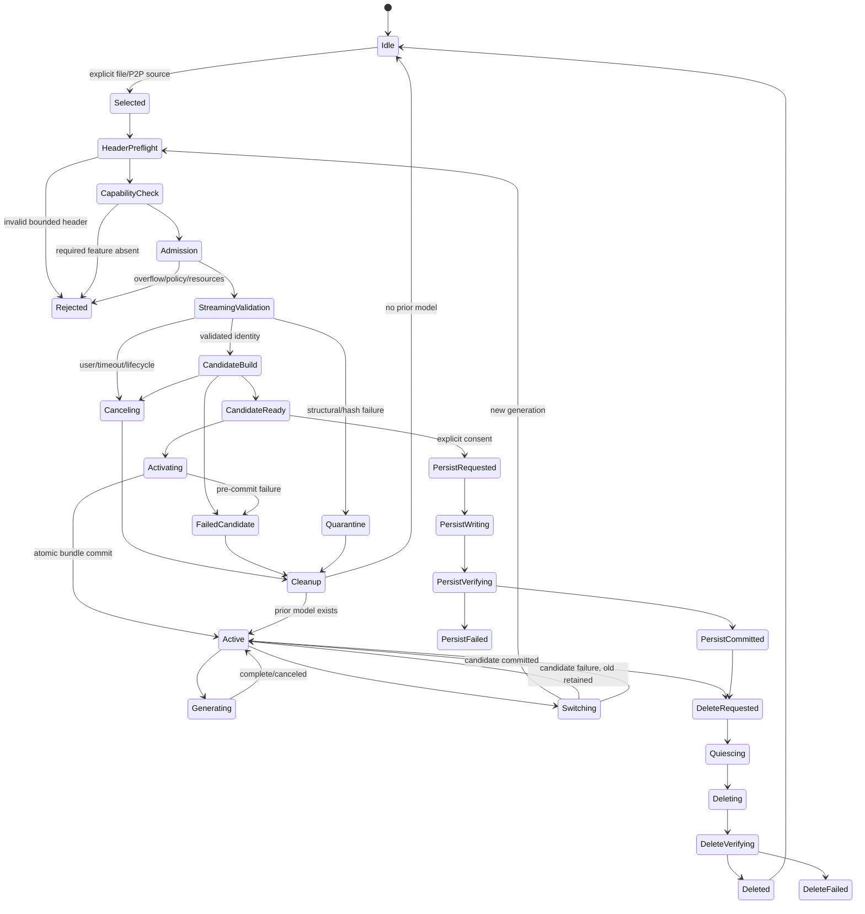

# Browser-Owned Model Ingestion, OPFS Persistence, Workers, and Bounded Memory

## Executive recommendation and research frame

### Executive summary

**[REC] Adopt one worker-owned, transactional lifecycle.** TinyRustLM should use a **dedicated model-lifecycle worker** as the sole owner of ingestion, hashing, structural parsing, candidate WebAssembly state, optional OPFS writes, and optional WebGPU upload. The window should own only user interaction, file selection, progress display, and presentation of committed state. A service worker should cache the application shell only; it should never own, proxy, cache, identify, or validate model bytes.

The lifecycle should be:

> explicit selection → fixed-size header preflight → checked requirement calculation → admission decision → bounded streaming validation and hashing → isolated candidate construction → optional backend upload → atomic bundle commit → optional, separately consented persistence.

Persistence must not be inferred from file selection. After validation establishes the artifact’s SHA-256 identity, an explicit user action may cause the lifecycle worker to write a content-addressed OPFS object under a journaled, initially uncommitted record. A close–reopen–rehash pass must precede the logical commit. The design should not depend on cross-browser atomic rename behavior.

**[REC] Use transferable `ArrayBuffer` chunks, not transferable streams, as the portable transport protocol.** Transferable streams are available in Chromium and Firefox but remain unavailable in current Safari/WebKit, whereas transferring `ArrayBuffer` ownership is standardized and broadly supported. Safari can receive a structured-cloned `File` and open `file.stream()` in the worker; no main-thread model read is necessary. `postMessage()` without a transfer list must be forbidden for model-sized buffers because structured cloning would duplicate the payload. citeturn1search0turn1search3turn1search4turn9search2

**[REC] Treat activation as a single immutable bundle swap.** A committed model is not merely a tensor arena. The atomic unit must bind:

- artifact identity and format version;
- tokenizer and chat template;
- CPU or GPU backend and backend-specific allocations;
- sampling defaults and supported context range;
- an empty, model-bound KV/cache generation;
- loader and runtime identities.

The existing active bundle remains untouched until the candidate has passed parsing, capability checks, allocation, optional upload, and a deterministic smoke operation. A failed candidate leaves the active model, conversation, and generation state unchanged.

**[REC] Coordinate tabs with Web Locks; fail closed without them.** One origin-wide writer lock protects OPFS and metadata commits. A shared per-artifact reader lock is held while a persisted artifact is active; deletion requires the corresponding exclusive lock. `BroadcastChannel` carries invalidation notices, never authority. If Web Locks are unavailable or defective in a target build, disable durable writes and cross-tab deletion rather than introduce a weaker unpublished locking protocol. Web Locks are scoped to a storage bucket and release when the owning agent terminates, while BroadcastChannel delivery is messaging rather than a transactional storage primitive. citeturn0search0turn13search3turn13search13

**[REC] Make bounded memory an invariant, not an estimate.** There is no portable browser API exposing exact available process memory and no universal per-tab memory ceiling. Admission therefore has to combine checked artifact requirements, existing application-owned allocations, platform policy classes, exact candidate-allocation attempts, GPU limits returned by the adapter, storage estimates for persistence, and a nonzero safety margin. Browser storage estimates are approximate and may be padded; quota and eviction policies differ materially among Chromium, Firefox, and Safari. citeturn3search0turn3search1turn4search0

**[REC] Define deletion as logical, application-owned deletion.** A successful deletion receipt may prove that workers and handles were quiesced, application namespaces no longer contain the object, metadata no longer references it, caches contain no model entries, and active application references were released. Browser APIs cannot prove secure physical erasure from RAM, swap, filesystem journals, SSD remapping, backups, or browser-internal transient buffers.

The requested scope, fixed privacy constraints, prohibited shortcuts, and requirement not to imply access to private TinyRustLM implementation are taken from the supplied architecture brief. No TinyRustLM source code, `.slm` artifact, browser trace, or test profile was available for validation. fileciteturn0file0

### Evidence labels and assumptions

| Label | Meaning |
|---|---|
| **[STD]** | Direct guarantee or requirement in a public specification |
| **[OBS]** | Browser-vendor or API-documentation statement about current behavior |
| **[INF]** | Reasoned conclusion from public guarantees; not directly verified on TinyRustLM |
| **[REC]** | Proposed engineering requirement |
| **[ASSUME]** | Necessary assumption because `.slm` and runtime internals are unavailable |
| **[VERIFY]** | Requires authorized execution in target browser builds or against a real artifact |

**[ASSUME]** `.slm` has a bounded, versioned header containing enough metadata to determine structural ranges, tokenizer requirements, tensor lengths, alignment, quantization, backend requirements, and conservative memory demand before model-scale allocation. If the current format does not provide those properties, the format should be revised rather than compensated for with an unbounded parser.

**[ASSUME]** The runtime can construct an isolated candidate arena without mutating globally shared tokenizer, allocator, GPU, adapter, or KV state.

**[ASSUME]** A cryptographic hash identifies the complete artifact bytes, not a normalized or decompressed representation. SHA-256 is recommended for receipts and content addressing because it is interoperable and widely understood; hashing should be implemented as a streaming Rust/WASM operation rather than by accumulating the artifact for a one-shot JavaScript digest.

### Research objectives, questions, and method

The analysis addresses five principal hypotheses:

| Hypothesis | Evaluation criterion |
|---|---|
| A worker-owned design can keep interaction responsive | No model-sized read, hash, parse, allocation, or upload runs on the window event loop |
| A model can be activated atomically | No externally visible state contains components from both active and candidate bundles |
| OPFS persistence can be crash-consistent without assuming native filesystem semantics | Uncommitted files are ignored; committed files have verified length and content hash |
| Peak owned memory can be bounded symbolically | Every application-controlled source, queue, arena, staging buffer, GPU object, and overlap interval appears in the formula |
| Deletion can produce meaningful but limited evidence | Application-owned logical absence is checked without claiming physical-media sanitization |

The literature search prioritized living standards and vendor documentation, followed by browser release records, then compatibility documentation. It covered the File API, Streams, HTML workers and structured cloning, Web Locks, Storage, File System/OPFS, IndexedDB, service workers and Cache Storage, WebAssembly, WebGPU, page lifecycle, and Playwright. Sources were checked through **August 1, 2026**. Current release baselines used here are Chrome 150.0.7871.186/.187 on Windows/macOS and 150.0.7871.186 on Linux, Firefox 153, Safari 26.5, and Playwright documentation through version 1.62. citeturn17search4turn17search11turn17search18turn14search1

For local data extraction, each test run should collect byte counts, chunk and queue maxima, worker protocol transitions, arena sizes, WebAssembly pages, GPU allocation descriptors, storage estimates, quota outcomes, timestamps, browser identities, and bounded error codes. It must not collect payload bytes, prompts, raw paths, invitation URLs, workspace identifiers, or unredacted network bodies.

## Standards baseline and capability matrix

### Current capability matrix

The matrix is an **admission baseline**, not a promise that every OS, GPU, private-browsing mode, enterprise configuration, or embedded web view behaves identically.

**Legend:** **Y** supported baseline; **G** supported only after runtime/security gating; **P** browser policy decision or approximate result; **V** must be verified on the target build/device; **N** not available; **X** experimental and excluded from the core contract.

| Capability | Chromium 150 Windows | Chromium 150 Linux | Firefox 153 Windows | Firefox 153 Linux | Safari/WebKit 26.5 macOS | Chromium Android | Firefox Android | Safari/WebKit iOS/iPadOS |
|---|---:|---:|---:|---:|---:|---:|---:|---:|
| HTML file selection and `File` | Y | Y | Y | Y | Y | Y | Y | Y |
| `Blob.stream()` | Y | Y | Y | Y | Y | Y | Y | Y |
| Transferable `ArrayBuffer` | Y | Y | Y | Y | Y | Y | Y | Y |
| Transferable `ReadableStream` | Y | Y | Y | Y | N | Y | Y | N |
| Dedicated workers | Y | Y | Y | Y | Y | Y | Y | Y |
| Shared workers | Y | Y | Y | Y | Y on current releases; V on older OS | Y | V | V |
| OPFS asynchronous access | Y | Y | Y | Y | Y | Y | Y | Y |
| Worker `FileSystemSyncAccessHandle` | Y | Y | Y | Y | Y | Y | Y | Y |
| `navigator.storage.estimate()` | P | P | P | P | P | P | P | P |
| `navigator.storage.persist()` | P | P | P | P | P | P | P | P |
| Web Locks | Y | Y | Y | Y | Y | Y | Y | Y |
| BroadcastChannel | Y | Y | Y | Y | Y | Y | Y | Y |
| `SharedArrayBuffer` | G | G | G | G | G | G | G | G |
| WASM threads | G | G | G | G | G/V | G | G/V | G/V |
| WASM Memory64 | Y/G | Y/G | Y/G | Y/G | V | Y/G/V for memory | Y/G/V | V |
| Multiple WASM memories | G | G | G | G | G/V | G/V | G/V | G/V |
| Service workers | Y | Y | Y | Y | Y | Y | Y | Y |
| WebGPU API | Y, adapter-dependent | V, adapter/driver-dependent | Y, adapter-dependent | V | Y, adapter-dependent | Y on supported devices | V | Y, adapter-dependent |
| Storage Buckets extensions | X | X | N | N | N | X | N | N |

`Blob.stream()` yields byte chunks through a `ReadableStream`; the File API’s stream construction creates chunk buffers, while chunk size is intentionally not a fixed portable constant. Transferable streams are standardized, but Safari remains the important compatibility gap, making explicit transferred `ArrayBuffer` chunks the more portable application protocol. citeturn0search1turn1search0turn9search2

OPFS is origin-private and quota-managed rather than a user-visible directory. Asynchronous access is available from window and worker contexts; synchronous access handles are confined to dedicated workers and take an exclusive file lock. Clearing site storage removes OPFS data, and the browser does not promise a one-to-one visible native-filesystem mapping. citeturn2search0turn2search1turn2search3turn2search5

Storage persistence is a request, not an entitlement. Browsers may grant or deny it according to user interaction, installation, engagement, or other policy. `estimate()` reports approximate usage and quota, and implementations may pad cross-origin contributions. Best-effort storage can be evicted under pressure; Safari additionally documents proactive eviction behavior. citeturn2search13turn3search0turn3search1

`SharedArrayBuffer` and therefore common WASM-thread configurations require cross-origin isolation in deployed web pages. The usual deployment headers are `Cross-Origin-Opener-Policy: same-origin` and `Cross-Origin-Embedder-Policy: require-corp` or `credentialless`, followed by runtime checks of `crossOriginIsolated` in both window and worker contexts. citeturn14search0turn14search2turn14search6

Memory64 shipped in Firefox 134 and Chrome 133, but its availability does not imply that an application can obtain a huge address space or commit a requested amount of physical memory. A 32-bit WASM memory is limited to 65,536 64-KiB pages, while allocation may still fail below that maximum. Memory64 also entails larger pointers and can have material performance cost, so it should be a format/backend gate rather than the default merely because it exists. citeturn16search6turn18search0turn4search0

WebGPU remains limited-availability and adapter-dependent. Safari 26 introduced WebGPU, Firefox initially shipped it on Windows, and Chromium’s Android availability depends on OS, GPU, driver, and feature level. The only safe admission procedure is to request an adapter and device, inspect limits and required features, and retain a CPU fallback. citeturn10search1turn16search1turn16search4turn16search16

Storage Buckets must not be part of the first production contract. Chromium’s documented Storage Buckets work began as an origin trial, and cross-browser standard support is not sufficient for a clean universal lifecycle. The application can preserve a logical “bucket” layout through namespaced OPFS directories and IndexedDB records without depending on the experimental API. citeturn14search12

### Standards versus implementation observations

| Subject | Portable guarantee | What remains implementation-dependent |
|---|---|---|
| Structured cloning | Messages are cloned unless listed as transferable; transferred buffers become unusable to the sender | Whether cloning a `File` duplicates underlying bytes eagerly, lazily, or not at all |
| Blob slicing | Produces a Blob representing the selected byte range | Whether the engine represents the slice as metadata or copies internally |
| Stream chunks | Consumer receives byte chunks | Chunk size, read-ahead, buffering, and process-boundary copies |
| OPFS | Origin-private namespace with specified file operations | Native layout, caching, journaling, physical durability, eviction timing |
| `flush()` | Requests pending sync-handle changes be flushed through the API | Power-loss guarantees and underlying device write completion |
| WebAssembly memory | 64-KiB pages; growth rules; maximum/address-type checks | Virtual reservation strategy, commit policy, OOM thresholds, process termination |
| WebGPU | Ordered API operations and device/adapter limits | Hidden staging, driver copies, shared versus discrete physical memory, eviction |
| Web Locks | Mutual exclusion/shared locking within scope | Fairness and scheduling latency |
| Page lifecycle | Events such as visibility and pagehide may be observed | Reliable final callback at renderer or process death—none is promised |

The critical architectural consequence is that **“zero copy” cannot be a product-level claim**. The application can prove that it did not request an avoidable JavaScript clone, and it can bound application-visible buffers, but browser-process, IPC, storage, driver, and GPU copies remain outside JavaScript’s complete observability.

## Byte ownership, loading topologies, and memory accounting

### Byte-ownership map

| Boundary or object | Owner and lifetime | Operation semantics | Required accounting |
|---|---|---|---|
| OS-selected file | OS/browser file subsystem; access originates from user selection | No JavaScript byte array yet | File length and metadata only |
| JavaScript `File` | Structured-cloneable immutable Blob-like object | Logical clone may not imply eager byte copy; zero-copy is not guaranteed | Small wrapper plus unknown browser backing |
| `file.slice(a,b)` | New Blob range | Logical byte range; do not assume physical copy or no-copy | Wrapper; underlying behavior unknown |
| `file.stream()` chunk | Stream consumer | File API creates chunk storage delivered as a typed byte chunk | One source chunk `C` plus browser read-ahead |
| JavaScript `ArrayBuffer` | Current realm/worker | Owns a contiguous buffer | Full `byteLength` |
| Transferred `ArrayBuffer` | Receiver after `postMessage(...,[buffer])` | Ownership is transferred and sender buffer is detached | Count once, plus transient IPC implementation overhead |
| Cloned `ArrayBuffer` | Both sender and receiver | Full logical copy | Count source and clone simultaneously |
| Typed-array `subarray()` | View over existing storage | No payload copy | Wrapper only; pins underlying buffer lifetime |
| WASM linear memory view | JavaScript view into `WebAssembly.Memory.buffer` | View only; `.set()` or Rust copy writes bytes into linear memory | Linear-memory committed bytes plus source during copy |
| Rust slice into arena | Borrowed view | No copy if arena-backed | Arena already counted |
| Rust `Vec` or decoded tensor | Rust/WASM allocation | Usually allocates and copies/transforms | Destination plus source and scratch until source release |
| OPFS sync-handle write | Browser storage subsystem | Copies bytes through the storage implementation | Bounded I/O buffer; disk usage separately |
| WebGPU `queue.writeBuffer` | Queue/device | User agent chooses how to copy the supplied data | Source, destination GPU buffer, and conservative host staging |
| Mapped GPU buffer | Application-visible mapped range | Host-visible mapping, not proof of native zero-copy | Entire mapped buffer plus destination if copied |
| GPU storage buffer | GPU/device allocation | Device-owned until destroyed/reclaimed | Declared GPU size plus driver margin |
| KV cache | Active bundle/backend | Model- and context-bound mutable state | Exact formula from layers, heads, dimensions, precision, and context |

A transferred `ArrayBuffer` is detached from its sender and therefore must not be reused, retried, or placed back into a pool by the sender. Structured cloning without a transfer list preserves the sender’s buffer and creates a receiver copy. WebAssembly growth detaches prior fixed-length JavaScript views, requiring every view to be recreated after a successful growth. citeturn1search4turn1search6turn18search2turn18search3

For WebGPU, `queue.writeBuffer()` is expressly a copy-oriented upload interface in which the user agent selects the transfer mechanism. The implementation may use staging or shadow memory that the page cannot directly enumerate; memory accounting must therefore include a configurable driver/staging margin rather than counting only `GPUBuffer.size`. citeturn16search14

### Recommended loading topology

| Topology | UI responsiveness | Avoidable copies | Cancellation | Portability | Recommendation |
|---|---:|---:|---:|---:|---|
| Main-thread `FileReader`/full `arrayBuffer()` | Poor for large artifacts | Highest; often whole-file source plus destination | Coarse | High | Reject |
| Main-thread stream into WASM | Better I/O, but hashing/parser can block | Source chunk → WASM copy | Moderate | High | Reject for heavy work |
| Dedicated worker reads `File` | Strong | One bounded source chunk plus final-placement copy | Strong | High | **Baseline** |
| Window transfers stream to worker | Strong | Similar, but stream transfer machinery involved | Strong | No Safari baseline | Optional optimization only |
| SharedWorker owns model | Cross-tab reuse possible | Potentially lower aggregate memory | Complex ownership and lifecycle | Historically uneven; newly broader | Do not use as initial authority |
| Service worker owns ingestion | Event lifetime unsuitable | Complex copies/storage handoff | Weak for long ownership | High API availability but wrong semantics | Reject |
| Worker streams into pre-sized WASM arena | Strong | One chunk-to-arena copy | Strong | High | Preferred when final layout known |
| Worker builds temporary decoded objects then copies once | Strong | Candidate source plus final copy | Strong | High | Accept only when format requires it |
| Segmented WASM arenas | Strong | Can avoid monolithic contiguous model arena | Strong | Requires runtime support | Preferred for >32-bit-safe segment design |
| Worker uploads to WebGPU | Strong | CPU chunk/arena plus GPU staging and GPU resident copy | Device-loss handling required | Conditional | Optional backend |

A service worker may be terminated when it has no event to process; it is not a durable process or a safe owner for a live model. Service-worker Cache Storage is author-managed and separate from the browser’s ordinary HTTP cache, but both are inappropriate as model-possession evidence. citeturn12search1turn12search2turn12search4

### Peak-memory formulas

Let:

- \(C\) = maximum payload chunk size.
- \(Q\) = maximum number of sent but unacknowledged chunks.
- \(R\) = bounded browser/read-stream read-ahead allowance used by policy.
- \(D\) = `1` when protocol accidentally clones payload buffers, otherwise `0`.
- \(H\) = maximum retained header bytes.
- \(P\) = parser tables and structural metadata.
- \(T\) = tokenizer and chat-template allocations.
- \(A\) = final candidate tensor arena.
- \(X\) = activation or rearrangement scratch.
- \(Z\) = quantization/dequantization scratch.
- \(K\) = KV and prefix-cache allocation.
- \(W\) = total committed WebAssembly linear memory.
- \(J\) = JavaScript wrappers and non-payload bookkeeping.
- \(U\) = bounded OPFS I/O buffering allowance.
- \(G_s\) = host-visible GPU staging.
- \(G_m\) = candidate GPU model buffers.
- \(G_k\) = GPU KV/cache buffers.
- \(G_d\) = conservative unobservable driver/shadow allowance.
- \(B\) = measured or policy-estimated application/browser baseline.
- \(S\) = explicit CPU safety margin.
- \(S_g\) = explicit GPU safety margin.

If model, tokenizer, parser tables, scratch, and KV are allocated **inside** the WASM memory, do not count them twice:

\[
W \geq A + P + T + X + Z + K + F
\]

where \(F\) is allocator fragmentation, alignment, stack, globals, and runtime heap overhead.

A conservative single-candidate CPU peak is:

\[
M_{\text{CPU,candidate}} =
B + H + J + U +
C(1 + Q + R) +
D(CQ) +
W +
G_s +
S
\]

The `1` term represents the chunk currently being consumed. \(Q\) represents chunks in the producer/transport window. \(R\) covers bounded stream/browser read-ahead assumed by policy. If payload buffers are transferred correctly, \(D=0\).

During atomic switching, old and candidate states overlap:

\[
M_{\text{CPU,switch}} =
B + M_{\text{transport}} +
W_{\text{active}} +
W_{\text{candidate}} +
G_{s,\text{candidate}} +
S
\]

Therefore an atomic switch may be inadmissible even when either model fits alone. The application must then offer a **non-rollback switch** only with explicit disclosure—stop, free old, attempt new—or reject the switch. The default should retain rollback and reject if overlap cannot be admitted.

A conservative GPU peak during candidate upload and atomic switch is:

\[
M_{\text{GPU,switch}} =
G_{m,\text{active}} + G_{k,\text{active}} +
G_{m,\text{candidate}} + G_{k,\text{candidate}} +
G_s + G_d + S_g
\]

For CPU KV memory, a model-specific formula should be extracted from the artifact and runtime. A typical uncompressed transformer layout can be represented generically as:

\[
K =
L \times N_{\text{kv-heads}} \times D_{\text{head}}
\times C_{\text{context}} \times 2
\times B_{\text{element}}
\times B_{\text{batch}}
\]

The factor `2` represents key and value arrays. The receipt must record the actual runtime formula and any padding, paging, quantization, sliding-window, or grouped-query reductions; it must not report only the ideal mathematical tensor size.

**[REC] Default protocol bounds:** \(C=4\) MiB and \(Q=2\), with a hard policy range of 1–8 MiB per chunk and 1–4 outstanding chunks. These are engineering starting points, not browser limits. Browser and device tests may lower them; increasing them requires evidence that throughput improves without unacceptable peak memory or cancellation latency.

## Lifecycle state machine, preflight, activation, and switching

### Transactional state model



**Legal invariants**

| Invariant | Enforcement |
|---|---|
| At most one mutable candidate per lifecycle worker | Monotonic `loadGeneration`; new load aborts and drains the previous generation |
| Active state is immutable from candidate code | Candidate receives separate arenas, allocator instance, tokenizer, backend, GPU resources, and KV epoch |
| No activation without complete identity | `artifactHash`, exact byte count, format version, and structural validation must be finalized |
| Persistence is independent of activation | An active model may remain session-only; persistence failure does not deactivate it |
| A failed switch preserves the old active bundle | Commit pointer is unchanged before commit |
| Stale worker messages have no effect | Every message includes worker instance, load generation, active epoch, sequence, and expected state |
| Quarantined bytes cannot activate or persist | Quarantine state has no transition to candidate-ready |
| Delete and persistence cannot overlap | Same exclusive writer lock |
| A receipt follows state, never creates state | Receipts report completed evidence and cannot be used as authority to bypass verification |

### Bounded two-stage preflight

**Stage A: fixed-size metadata preflight**

**[REC]** Read no more than `H_MAX = 1 MiB`, regardless of declarations inside the file. If the format’s header cannot be validated within that bound, redesign the format or reject that version.

The parser must validate:

1. exact magic, supported version, endian marker, header length, declared total length, and optional footer requirements;
2. every count against format maxima before multiplication or allocation;
3. all offsets, lengths, alignments, and index ranges with checked 64-bit arithmetic;
4. `offset + length <= file.size` without wraparound;
5. table ranges for overlap, duplication, ordering rules, and forbidden aliasing;
6. tensor element-count products and byte lengths without narrowing to JavaScript `Number`;
7. tokenizer size, vocabulary count, string-table ranges, template length, and UTF-8 policy;
8. quantization and backend requirements;
9. WASM addressability and segment requirements;
10. context and KV formulas;
11. prospective OPFS space demand if persistence is requested;
12. prospective GPU buffer sizes and WebGPU limit requirements.

Use Rust checked operations such as `checked_add`, `checked_mul`, and checked conversion to `usize`/`u32`. JavaScript metadata crossing the worker boundary should use `BigInt` or validated decimal strings for quantities that may exceed `Number.MAX_SAFE_INTEGER`.

The preflight output is a small immutable `ArtifactPlan`:

```text
ArtifactPlan {
  sourceSize,
  formatVersion,
  declaredPayloadRanges[],
  requiredRuntimeFeatures,
  modelArenaBytes,
  tokenizerBytes,
  parserBytes,
  activationScratchBytes,
  quantizationScratchBytes,
  kvBytesByContext[],
  gpuBuffers[],
  maximumAlignment,
  persistenceBytes,
  expectedWholeArtifactHash?,
  planHash
}
```

**Stage B begins only when all of the following are true:**

- Stage A passed with no arithmetic or structural ambiguity.
- Required browser and runtime features are present.
- A context/backend configuration has passed resource admission.
- The bounded worker protocol is established.
- The user has not canceled.
- The active model remains isolated.
- Any requested persistence has a preliminary quota margin, while acknowledging that a later write can still fail.
- A candidate allocation strategy has been selected.

Stage B streams the entire artifact, updates SHA-256, checks byte count, validates every declared range, rejects unexpected trailing or missing bytes, and either writes directly into final candidate locations or into a bounded transform path. A late hash mismatch discards every candidate allocation and marks any OPFS object uncommitted.

### Resource admission

No browser API reliably states “this page may allocate N more bytes.” `navigator.storage.estimate()` concerns storage, not live RAM. WebGPU reports adapter/device limits, not free physical GPU memory. WASM construction and growth can throw on range or allocation failure, while user agents retain implementation-specific limits. citeturn3search0turn16search2turn18search0

The admission decision should be:

\[
\text{admit} =
\text{formatSafe}
\land \text{featuresPresent}
\land \text{policyCeilingsPass}
\land \text{switchOverlapPass}
\land \text{storageMarginPassIfNeeded}
\land \text{exactCandidateAllocationSucceeds}
\]

**Reject before model-scale reading** when:

- an arithmetic operation overflows;
- the artifact is inconsistent with its actual file size;
- required Memory64, threads, SIMD, WebGPU limits, or format features are absent;
- an individual segment cannot be addressed by the chosen WASM strategy;
- the minimum supported context exceeds policy memory;
- atomic-switch overlap cannot fit and rollback is required;
- persistence demand exceeds estimated available quota after safety margin;
- a platform hard policy excludes the artifact class.

**Offer a smaller context** when KV cache is the variable preventing admission but model weights and minimum runtime state fit.

**Offer CPU fallback** when WebGPU is absent, `requestAdapter()` returns no adapter, required features/limits are missing, device creation fails, or predicted GPU overlap is unsafe.

**User override** may relax conservative soft classes but must never override checked arithmetic, format integrity, mandatory feature absence, protocol queue bounds, or an observed allocation failure. An override receipt should identify the relaxed policy without recording sensitive content.

Small “allocation probes” are not a substitute for admission and can themselves destabilize mobile browsers. Prefer exact candidate allocations performed in an isolated worker after all cheap checks, catch failures, and immediately dismantle the candidate. Do not probe toward failure in repeated large increments.

### Atomic activation and rollback

The candidate is an immutable `ModelBundle`:

```text
ModelBundle {
  artifactSha256,
  artifactLength,
  formatVersion,
  tensorArenaOrSegments,
  tokenizer,
  chatTemplate,
  backend,
  samplingDefaults,
  supportedContexts,
  emptyKvEpoch,
  runtimeIdentity,
  loaderIdentity,
  optionalPersistenceRef
}
```

The commit sequence is:

1. acquire `tinyrustlm:activation` exclusively;
2. confirm candidate generation and source identity;
3. cancel any current generation and await a bounded drain acknowledgement;
4. run a candidate-only deterministic smoke operation;
5. build empty KV and prefix state bound to the candidate’s model epoch;
6. publish one new active-bundle handle and increment `activeEpoch`;
7. notify the UI and other tabs of the new epoch;
8. retain the previous active bundle until the first post-commit health checkpoint;
9. release or destroy the old bundle only after that checkpoint;
10. release the activation lock.

A pre-commit error destroys the candidate. A post-commit error before old-bundle release swaps back to the retained last-known-good bundle under the activation lock. After old-bundle release, a fatal active-backend error transitions to an explicit `no-active-model` or rebuild-from-verified-persistence state; it must not reconstruct a hybrid from surviving tokenizer or GPU objects.

### Model-switch semantics

Switching must:

- cancel token generation and composition;
- increment the generation cancellation epoch;
- drain or reject old worker messages;
- invalidate prefix caches, logits buffers, samplers, adapters, and KV allocations;
- allocate a wholly independent candidate;
- preserve the conversation transcript as UI data only, marking it “not yet composed for new model”;
- commit model, tokenizer, template, defaults, backend, and empty KV together;
- destroy old GPU buffers explicitly and drop old WASM references after rollback safety ends;
- retain persisted bytes only according to the user’s persistence choice;
- show the UI as “switching” until the commit—not as the candidate model merely because validation succeeded.

Switching back must rebuild from the verified artifact and a fresh allocator/backend state or use a still-valid immutable inactive bundle under a strict cache budget. It must not accumulate LoRA/adapters, allocator free lists, previous model globals, or KV pages across repeated loops.

## Worker protocol, persistence, deletion, and coordination

### Worker messaging and backpressure

The baseline design sends the `File` to the dedicated lifecycle worker and performs `file.stream()` there. This avoids main-thread byte handling and avoids dependence on transferable-stream support. A structured-cloned `File` is acceptable as a logical object, but the application must not claim that the browser performs no internal copy.

Each load has:

```text
workerInstanceId: random 128-bit value
loadGeneration: monotonic u64
sourceId: random non-sensitive token
candidatePlanHash: SHA-256 of bounded plan
cancelToken: generation-scoped atomic state
nextSequence: u64
nextOffset: u64
maxChunkBytes: C
maxOutstanding: Q
ackTimeoutMs: bounded policy value
```

Each data message contains:

```text
DATA {
  workerInstanceId,
  loadGeneration,
  sequence,
  offset,
  byteLength,
  planHash,
  finalChunk,
  buffer
}
```

`buffer` must appear in the transfer list. The receiver validates generation, sequence, offset, length, plan hash, and expected state before touching payload bytes.

Each acknowledgement contains:

```text
ACK {
  workerInstanceId,
  loadGeneration,
  sequence,
  consumedThroughOffset,
  rollingByteCount,
  state
}
```

Per-chunk hashes are optional corruption diagnostics, not substitutes for the whole-artifact SHA-256. If included, they must be generated from the exact transferred bytes and verified before placement.

```javascript
// Producer-side sketch: worker-local source reader.
async function produce(file, channel, load) {
  const reader = file.stream().getReader();
  let offset = 0n;
  let sequence = 0n;
  const outstanding = new Map();

  try {
    while (true) {
      await load.cancel.throwIfCanceled();

      while (outstanding.size >= load.maxOutstanding) {
        await waitForAckOrAbort(outstanding, load.ackTimeoutMs, load.cancel);
      }

      const { value, done } = await reader.read();
      if (done) break;

      for (const part of splitToBound(value, load.maxChunkBytes)) {
        await load.cancel.throwIfCanceled();

        const buffer = exactTransferBuffer(part); // Never transfer an oversized backing store.
        const message = {
          type: "DATA",
          workerInstanceId: load.workerInstanceId,
          loadGeneration: load.generation,
          sequence,
          offset,
          byteLength: buffer.byteLength,
          planHash: load.planHash,
          finalChunk: false,
          buffer
        };

        outstanding.set(sequence, { offset, length: buffer.byteLength });
        channel.postMessage(message, [buffer]);

        offset += BigInt(message.byteLength);
        sequence += 1n;

        if (outstanding.size >= load.maxOutstanding) {
          await waitForAckOrAbort(outstanding, load.ackTimeoutMs, load.cancel);
        }
      }
    }

    await drainAllAcks(outstanding, load);
    channel.postMessage({
      type: "END",
      workerInstanceId: load.workerInstanceId,
      loadGeneration: load.generation,
      sequence,
      offset,
      planHash: load.planHash
    });
  } finally {
    await reader.cancel().catch(() => {});
    reader.releaseLock();
  }
}
```

```javascript
// Consumer sketch: parser/WASM side.
function consumeData(message, state) {
  if (message.workerInstanceId !== state.workerInstanceId ||
      message.loadGeneration !== state.generation ||
      message.planHash !== state.planHash) {
    // Stale payload is discarded without parsing or acknowledgement as current.
    return;
  }

  if (state.phase !== "streaming" ||
      message.sequence !== state.expectedSequence ||
      BigInt(message.offset) !== state.expectedOffset ||
      message.byteLength !== message.buffer.byteLength ||
      message.byteLength > state.maxChunkBytes) {
    state.abort("E_PROTOCOL_SEQUENCE");
    return;
  }

  try {
    state.validator.update(new Uint8Array(message.buffer));
    state.destination.writeAt(state.expectedOffset, message.buffer);
    state.expectedOffset += BigInt(message.byteLength);
    state.expectedSequence += 1n;

    postMessage({
      type: "ACK",
      workerInstanceId: state.workerInstanceId,
      loadGeneration: state.generation,
      sequence: message.sequence,
      consumedThroughOffset: state.expectedOffset,
      rollingByteCount: state.validator.byteCount,
      state: state.phase
    });
  } catch (error) {
    state.abort(classifyBoundedError(error));
  }
}
```

```javascript
async function abortLoad(state, code) {
  if (state.phase === "aborted" || state.phase === "committed") return;

  state.phase = "aborting";
  state.cancelToken.abort(code);
  state.loadGeneration += 1n; // Invalidates queued stale messages immediately.

  await state.reader?.cancel().catch(() => {});
  await state.opfsSyncHandle?.close().catch(() => {});
  state.opfsSyncHandle = undefined;

  state.destroyCandidateGpuObjects();
  state.dropCandidateWasmInstance();
  state.clearPendingAcks();
  state.zeroSmallSensitiveScratch(); // Best effort only; not physical-erasure proof.

  state.phase = "aborted";
  postMessage({ type: "ABORTED", code, activeEpoch: state.activeEpoch });
}
```

Timeouts should produce bounded codes such as `E_ACK_TIMEOUT`, not raw exceptions or object dumps. Retry is idempotent only from a new `loadGeneration`; a detached transfer buffer can never be replayed.

### Persistence protocol

OPFS is the permitted durable store for model bytes because it is origin-private, worker-accessible, and designed for application-managed files. A synchronous access handle is worker-only and exclusive; its `flush()` operation is useful but must not be described as a full native `fsync()` or proof against power loss. citeturn2search1turn2search3turn2search5turn2search11

**Recommended namespace**

```text
/opfs/
  tinyrustlm-models-v1/
    objects/
      sha256-<64-lowercase-hex>.slm
    staging/
      <load-generation>.scratch       # only when a transform requires it
```

IndexedDB stores:

```text
artifact {
  sha256,
  byteLength,
  formatVersion,
  objectName,
  state: "writing" | "verifying" | "committed" | "deleting",
  writerInstance,
  journalEpoch,
  bytesWritten,
  loaderIdentity,
  createdAt,
  verifiedAt?
}
```

**Clean, rename-independent commit**

1. User explicitly chooses **Keep on this device**.
2. Acquire `tinyrustlm:model-store:writer` exclusively.
3. Confirm that the validated source hash and length are final.
4. Create/update the IndexedDB journal as `writing`.
5. Open the content-addressed final pathname itself. The object’s name is already known because validation preceded persistence.
6. Write sequentially with a `FileSystemSyncAccessHandle`, never exceeding the bounded queue.
7. Record coarse checkpoints in the journal; do not transact on every chunk.
8. Call `flush()`, close the access handle, and drop all streams.
9. Update journal to `verifying`.
10. Reopen the OPFS file and stream it from byte zero, recomputing SHA-256 and exact length.
11. In one IndexedDB transaction, change the record to `committed` only if hash, length, and artifact plan still match.
12. Release the writer lock.

This protocol does not need rename to establish logical atomicity: the OPFS file is ignored unless a committed metadata record references it. A crash can leave an uncommitted content-addressed object, but recovery can distinguish it from a committed model.

Where `createWritable()` is used instead of a sync handle, changes generally become visible when the writable stream closes, commonly through temporary-file replacement. That behavior is still an API-level file replacement, not evidence of physical durability. citeturn15search11

**Close-before-rename rule:** the baseline does not rename model files. Any future optimized implementation using a browser-specific `move()` must first close every writable stream and sync handle, prove the operation in each target engine, and retain the metadata commit marker. It must not introduce a second durable contract.

**Crash recovery**

At startup, under the writer lock:

- enumerate journal records not marked `committed`;
- enumerate application-owned OPFS objects;
- for `writing` or `verifying` records, close/reopen and verify only when policy explicitly permits recovery;
- otherwise remove the uncommitted object and journal;
- identify unreferenced objects as orphans;
- never infer commitment solely from a content-addressed filename;
- validate each committed object’s existence and length before offering it;
- perform full readback hash before first activation after an unclean shutdown or when the receipt/version is insufficient.

Quota exhaustion is reported as a persistence failure while preserving the session-active model. Persistence must not hold a second full in-memory model copy merely to retry a failed write.

### Storage role matrix

| Store or mechanism | Model bytes | Metadata/receipts | Preferences | Required rule |
|---|---:|---:|---:|---|
| OPFS | **Yes, explicit consent only** | Small sidecars possible, but canonical metadata remains in IDB | No need | Content-addressed, journaled, readback-verified |
| IndexedDB | No large model payload | **Yes** | **Yes** | Transactions bind logical commitment and metadata |
| Cache Storage | **Never** | No artifact receipts | No sensitive state | Static application shell only |
| Browser HTTP cache | Never intentionally | No | No | A cache hit is not possession evidence |
| User-selected `File` | Session source | File name should not enter public receipt | No | Selection does not imply durability |
| User-visible file-system handle | Explicit import/export only | Optional local-only remembered handle with separate consent | No | Do not silently persist permission or bytes |
| Native companion storage | Only under a separate explicit native-store contract | Companion-owned evidence | Possibly | Browser must not misrepresent native ownership as OPFS ownership |
| `localStorage` | Never | Never for transactional state | Only harmless UI choices, preferably not needed | Not suitable for locking, large data, or cleanup proof |
| Storage Buckets API | Not a baseline dependency | Not a baseline dependency | No | Revisit only after cross-browser standard maturity |

An HTTP or service-worker cache hit proves only that a matching response may be available under cache semantics. It does not prove full-byte presence, current artifact identity, `.slm` structural validity, successful hashing, runtime compatibility, or a complete committed model. Cache Storage stores request/response pairs and is managed independently of ordinary HTTP cache behavior. citeturn12search1turn12search2turn12search4

### Multi-tab and restart coordination

Recommended lock names:

| Lock | Mode and holder | Purpose |
|---|---|---|
| `tinyrustlm:model-store:writer` | Exclusive; persistence/recovery/deletion task | Serializes all durable namespace mutations |
| `tinyrustlm:model:<sha256>` | Shared while artifact is active; exclusive for deletion/replacement | Prevents deleting bytes used by another tab |
| `tinyrustlm:activation` | Exclusive for a short commit interval | Serializes active-bundle epoch changes |
| `tinyrustlm:schema-migration` | Exclusive at startup | Ensures one metadata/storage migration |

Web Locks release when their owning agent terminates, which provides crash recovery from abandoned lock ownership without a hand-maintained stale timeout. The application should still place a writer instance and epoch in the journal for diagnosis and recovery decisions. citeturn0search0

`BroadcastChannel` messages should contain only:

```text
{
  protocolVersion,
  senderInstance,
  storeEpoch,
  activeEpoch,
  event: "store-changed" | "delete-requested" | "artifact-deleted" |
         "activation-changed" | "service-worker-updated",
  artifactSha256?
}
```

On receipt, a tab compares epochs and rereads canonical IndexedDB metadata under the appropriate lock. It must not assume that message delivery order equals durable commit order. A stale tab restored from back-forward cache or browser session restore must reacquire locks, reread epochs, validate that its active persistent object still exists, and rebuild state if necessary.

A second tab attempting deletion should acquire the exclusive per-artifact lock. If another tab holds a shared active-reader lock, deletion remains pending or is rejected with “in use by another tab.” It must not ask the other tab to release and then delete before the exclusive lock is actually obtained.

If Web Locks are absent, persistence, recovery mutations, and deletion are disabled. Session-only single-tab loading may continue. This fail-closed gate is preferable to a race-prone localStorage lease or BroadcastChannel election.

### Deletion and deletion evidence

Deletion sequence:

1. acquire the global writer lock and exclusive artifact lock;
2. mark the metadata record `deleting`;
3. broadcast a non-authoritative delete notice;
4. cancel generations using the artifact;
5. wait for local worker and tab acknowledgements within a bound;
6. close sync access handles, writable streams, readers, and OPFS file handles;
7. destroy candidate and active `GPUBuffer` objects and release device-bound references;
8. invalidate model, tokenizer, sampler, prefix, and KV epochs;
9. terminate the lifecycle worker if the artifact was active, providing the strongest application-level release of its WASM instance and JavaScript graph;
10. remove the OPFS object and any application-owned scratch entries;
11. remove journals and IndexedDB records in a transaction;
12. inspect Cache Storage and remove any prohibited model-related entries;
13. verify that OPFS enumeration, IndexedDB queries, and application caches have no matching logical object;
14. increment `storeEpoch`;
15. issue a deletion receipt;
16. release locks.

The standardized parent-directory `removeEntry()` path should be the compatibility baseline; newer direct-handle `remove()` APIs are experimental/nonstandard and should not define the contract. citeturn15search3

**What the receipt can claim:** “No application-owned committed object, staging object, metadata record, cache entry, open application handle, active bundle, or known tab reference remained at verification time.”

**What it cannot claim:** physical-sector overwriting, removal from OS caches, swap, browser crash dumps, hardware remapping, backups, forensic impossibility, or instantaneous release of all browser-process pages.

A page reload, `localStorage.clear()`, or reuse of the same Playwright browser context is not a clean deletion or clean restart.

## WASM, GPU, privacy, and page lifecycle

### WebAssembly memory and allocator design

| Strategy | Benefits | Risks | Decision |
|---|---|---|---|
| Exact initial pre-sizing | Stable addresses; no growth-detached JS views; predictable peak | Admission fails up front; requires accurate plan | **Preferred for fixed candidate arena** |
| Bounded growth | Supports variable tokenizer/parser needs | Every growth invalidates fixed-length JS views; fragmentation and late OOM | Permit only before publishing long-lived views |
| Imported memory | JavaScript controls initial/max declaration | Couples loader and runtime ABI; still subject to engine limits | Accept if Rust/WASM ABI is explicit |
| Runtime-created memory | Simpler Rust ownership | Harder for JS admission and instrumentation | Accept with exported sizing telemetry |
| Shared memory | Enables WASM threads | Requires maximum and cross-origin isolation; more synchronization complexity | Backend gate, not loader requirement |
| Multiple memories | Separates model, scratch, tokenizer, or plugins | Feature/runtime compatibility and toolchain requirements | Strong long-term option after matrix proof |
| Memory64 | Allows 64-bit addresses | Larger pointers, performance cost, and no promise of allocatable huge memory | Use only when artifact requires it |
| Segmented application address space | Keeps each segment under implementation/addressability bounds | Runtime complexity; cross-segment indexing | **Preferred portable large-model design** |
| One monolithic 32-bit arena | Simple addressing | 4-GiB address ceiling and lower practical limits | Suitable only for demonstrably smaller artifacts |

A WASM page is 65,536 bytes. For 32-bit addressing, 65,536 pages correspond to 4 GiB, but a browser may reject allocations below that point. The `maximum` field is not a reservation guarantee; engines may clamp or ignore reservation hints. citeturn18search0turn4search0

**[REC] Allocation layout**

```text
WASM memory or segments
  runtime static/stack
  allocator metadata
  immutable tensor segment(s)
  tokenizer/template segment
  parser/index segment
  activation/quantization scratch
  KV arena, separately recreatable
  small protocol scratch
```

The allocator must expose:

- committed pages;
- high-water mark;
- live bytes by category;
- free bytes;
- largest free span where relevant;
- fragmentation overhead;
- allocation failure category;
- explicit release of candidate arenas;
- generation tags preventing stale pointer use.

Any JavaScript typed array, `DataView`, or Rust-side external pointer derived before `memory.grow()` must be treated as invalid after growth. Prefer completing all growth before streaming final tensor placement. citeturn18search2turn18search3

Every `.slm` offset and size should remain 64-bit in parsing and validation. Conversion to a WASM32 pointer occurs only after proving:

\[
0 \leq \text{offset} \leq 2^{32}-1
\]

and:

\[
\text{offset} + \text{length} \leq \text{segmentSize}
\]

A single artifact may use 64-bit file offsets while storing data in multiple WASM32 segments. This is often safer and faster than selecting Memory64 solely to make a monolithic pointer space.

### GPU activation and device loss

GPU upload is a candidate phase, not part of source validation. The CPU-validated artifact identity remains authoritative.

The backend should:

1. request an adapter with the intended power/compatibility policy;
2. inspect adapter features and limits;
3. request only required device features and limits;
4. allocate candidate GPU buffers under a tracked budget;
5. upload in bounded portions;
6. await queue completion at controlled checkpoints;
7. run a deterministic candidate-only kernel;
8. commit the GPU backend as part of the model bundle;
9. monitor `device.lost`;
10. on device loss, invalidate every buffer and pipeline from that device.

WebGPU features can vary among browsers, adapters, drivers, and physical devices even where `navigator.gpu` exists. Runtime feature and limit checks are mandatory. citeturn16search1turn16search4turn16search7

A device-loss recovery may rebuild the backend from a still-valid CPU bundle or verified OPFS object. It must not reuse GPU handles from the lost device. If CPU fallback is possible, the UI should state that the backend changed and reset model-bound KV state.

### Privacy and exact network policy

**Normative privacy assertion**

> Model bytes, prompt text, generated output, agent tokens, enrollment or invitation URLs, workspace identifiers, raw hosted-memory payloads, and private file paths must not be sent to TinyRustLM project origins or unexpected third parties, and must not enter URLs, cache keys, logs, reports, screenshots, traces, crash annotations, or public receipts.

Recommended response policy for a sealed local-inference route:

```http
Content-Security-Policy:
  default-src 'self';
  script-src 'self';
  style-src 'self';
  img-src 'self' data:;
  font-src 'self';
  worker-src 'self' blob:;
  connect-src 'none';
  form-action 'none';
  object-src 'none';
  base-uri 'none';
  frame-ancestors 'none';

Cross-Origin-Opener-Policy: same-origin
Cross-Origin-Embedder-Policy: require-corp
Permissions-Policy: cross-origin-isolated=(self)
Referrer-Policy: no-referrer
```

A companion-transfer route may use a separate, explicit network policy allowing only the authenticated local/P2P transport endpoint. Project origins remain forbidden as model-byte or prompt destinations. The transfer capability should be disabled after the source has been handed to the lifecycle worker.

The service worker should have no route capable of caching `.slm`, prompt, completion, model receipt, local API response, or dynamically generated private state. Cache names should be versioned application-shell caches with an explicit static allowlist.

**Network test coverage**

| Channel | Test requirement |
|---|---|
| `fetch` and XHR | Instrument constructors and Playwright request events; abort unapproved destinations |
| WebSocket | Observe creation and frames without logging frame bodies; fail on unauthorized endpoint |
| EventSource | Instrument constructor and request events |
| WebTransport | Instrument constructor and destination; block except explicit local transfer profile |
| `sendBeacon` | Replace with a test shim and assert zero sensitive invocations |
| Forms | Assert `form-action 'none'`; dynamically create and attempt form submission |
| Navigation | Instrument popup/navigation calls; inspect destination origin only |
| Service-worker fetch | Run a dedicated Chromium SW-enabled audit; separately run with service workers blocked |
| CSP/COEP reports | Do not attach payload samples or sensitive URLs; prefer local observation over remote reporting |
| Source maps | Do not embed secrets, model metadata, private endpoints, or runtime payloads |
| Telemetry/crash SDKs | Disable in sealed inference mode or enforce a strict schema containing no user/model content |
| Screenshots/traces | Disable or mask chat and file UI in automated artifacts; never capture raw storage viewers |

Playwright can route and monitor fetch/XHR traffic and observe WebSocket creation. Its normal request routing does not see requests intercepted by a service worker, so the test program needs both a service-worker-blocked deterministic suite and a separate SW-enabled audit. Playwright’s direct service-worker inspection remains Chromium-specific. citeturn15search1turn15search5turn15search14turn15search17

The audit logger should record only destination class, origin hash or allowlist identifier, API category, method, response class, and byte count. It must never store request or response bodies, query strings, WebSocket frames, prompt fragments, or model chunks.

### Memory pressure and page lifecycle

Browsers may freeze or discard background pages, and a discarded renderer receives no reliable final callback. The hidden transition is commonly the last practical opportunity for lightweight checkpointing. `unload` is unsuitable and is being deprecated or suppressed for modern lifecycle behavior. citeturn11search0turn11search2

| Event or failure | Required behavior |
|---|---|
| `visibilitychange` to hidden | Stop admitting new heavy work; checkpoint small non-sensitive state; optionally pause generation |
| `pagehide` | Mark session as potentially suspended; do not claim model write completion merely because handler ran |
| Freeze | Release Web Locks not needed for correctness, close idle IDB connections and BroadcastChannels, close OPFS handles |
| Back-forward cache restore | Reacquire channels/locks; reread `storeEpoch` and `activeEpoch`; reject stale worker references |
| Mobile suspension | Assume workers and GPU state may disappear; preserve only already committed OPFS/IDB state |
| Renderer discard/process kill | No callback assumption; rely on journals and lock release at restart |
| Worker termination | Candidate fails; active bundle survives only if owned elsewhere and still coherent |
| Partial OPFS write | Remains uncommitted; recovery verifies or deletes |
| GPU device loss | Destroy logical backend, invalidate KV, rebuild or fall back |
| Storage eviction | Treat missing persisted object as loss of persistence, not model corruption; require reselection |
| OS memory pressure | Browser may terminate the context; avoid trying to “save everything” in a last-moment large allocation |
| Profile deletion/site-data clearing | All origin storage may disappear; UI must recover to no-persisted-model state |

Conversation persistence, if supported at all, should be a separate explicit privacy setting. It must not be entangled with model persistence or inferred from model consent.

## Verification matrix, receipts, and TDD cutover

### Fault-injection and browser automation matrix

Pin Playwright **1.62** for the initial automation baseline and record its exact package lock, bundled browser revisions, and host toolchain. Run stable installed Chrome, Firefox, and Safari tests separately because Playwright’s bundled engines are not identical to the user’s stable browser. Playwright’s current release notes identify version 1.62 as the current documented release. citeturn14search1

| Test | Injection | Required assertion |
|---|---|---|
| Minimum valid fixture | Small structurally complete `.slm` | Every state and byte counter is deterministic |
| Truncated header | EOF at every header byte | No model-scale allocation; bounded structural code |
| Oversized header declaration | Declared header > `H_MAX` | Immediate rejection |
| Arithmetic overflow | Max counts/offsets/products | Checked error; no wrap or allocation |
| Overlapping ranges | Tensor/tokenizer overlap | Structural rejection |
| Odd chunk tails | Every tail length from 1 to `C-1` | Exact byte count and hash |
| Sparse file | Large sparse source where filesystem safely supports it | No preallocation based solely on apparent sparseness |
| Late corruption | Flip final or near-final byte | Candidate discarded; no activation or commit |
| Wrong whole hash | Valid structure, expected hash mismatch | Quarantine; persistence uncommitted |
| Cancellation in every state | Cancel before/after each transition and chunk | Bounded completion; no stale activation |
| Protocol reordering | Reorder, duplicate, omit sequences | `E_PROTOCOL_SEQUENCE`; no destination mutation beyond validated prefix |
| Stale generation | Send old messages after new load | Silently rejected or bounded stale code |
| Missing transfer list | Test-only cloned chunk | Copy detector/test fails |
| Queue overflow | Producer exceeds `Q` | Protocol abort |
| ACK timeout | Withhold acknowledgment | Abort and release handles |
| WASM allocation failure | Constrained policy or test allocator | Active bundle unchanged |
| WASM growth | Force growth with live JS views | Old views rejected/recreated |
| Quota exhaustion | Fill storage or set constrained profile | Active session survives; no committed metadata |
| Storage eviction simulation | Remove OPFS object outside app flow | Startup detects missing object |
| Locked sync handle | Hold handle in another worker/tab | Writer waits/fails boundedly; no second writer |
| Worker crash | Terminate during every phase | Journal recovery and lock release |
| Tab close | Close during write/verify/activation | No partial committed record |
| Browser process kill | Kill test process during writes | New profile launch recovers correctly |
| Service-worker update | Update while candidate loads | No mixed loader/runtime identity |
| Stale restored tab | Suspend/restore older epoch | Canonical metadata reread |
| Second-tab deletion | Active shared reader in first tab | Deletion blocked until exclusive lock |
| WebGPU device loss | Test hook or adapter teardown | Backend invalidated; no stale buffer use |
| Model-switch loop | A→B→A repeatedly | Stable allocation high-water mark; no adapter/KV accumulation |
| Real admitted artifact | One authorized real model | End-to-end proof distinct from fixtures |
| Clean restart | Close all contexts/processes and launch a fresh profile or copied validated profile state | No dependence on in-memory objects |
| Profile deletion | Delete test profile and relaunch | No artifact or metadata discovered |
| Privacy audit | Exercise every transport API | Zero unauthorized sensitive network events |

Desktop coverage should include Windows and Linux for Chromium and Firefox and macOS for Safari. Android requires real-device or emulator browser runs for memory pressure, backgrounding, OPFS, and WebGPU. iOS/iPadOS requires actual Safari/WebKit device testing for suspension, storage eviction, WebGPU, and process termination; desktop Playwright WebKit is not proof of iOS Safari behavior.

A tiny fixture proves parser and state-machine properties, not real-model admission, memory, performance, or GPU behavior. At least one authorized real `.slm` artifact per supported size/quantization class is required before publication.

### Metrics and evidence extraction

Each test should collect:

| Category | Exact evidence |
|---|---|
| Environment | UTC timestamp, browser product/build, engine revision where available, OS/RID, device class, automation version |
| Profile | Run-local profile identity hash; fresh/reused state; private-mode indicator |
| Artifact | SHA-256, exact length, format version; no filename or private path |
| Software | Loader build hash, WASM/runtime hash, schema version, service-worker version |
| State | Ordered state transitions with monotonic timestamps, generation and active epochs |
| Transport | Bytes read, transferred, acknowledged, written, queue high-water mark, chunk maximum |
| CPU memory | WASM pages, arena categories, allocator high-water mark, JS-controlled buffers, stated API limitations |
| GPU | Adapter class, required features/limits, declared buffer bytes, device-loss events; no raw adapter identifiers if fingerprinting-sensitive |
| Storage | Pre/post estimate, bytes attempted/written/read back, persistence grant result, quota error class |
| Network | Event counts and destination classifications only; no payloads or full sensitive URLs |
| Deletion | Handles closed, namespaces checked, entries removed, tab acknowledgements, logical result |
| Failure | Bounded code, phase, retryability, sanitized context |
| Privacy | Explicit excluded-field validation result |

Browser memory observations must identify their source: exact application allocation, WASM page count, WebGPU descriptor, browser-reported estimate, or inference. These categories must not be merged into a falsely precise “total RAM used” number.

### Public-safe receipt schema

```json
{
  "receiptVersion": 1,
  "operation": "activate",
  "result": "success",
  "startedAt": "2026-08-01T18:42:10.000Z",
  "completedAt": "2026-08-01T18:42:27.000Z",

  "environment": {
    "browser": "Chrome",
    "browserBuild": "150.0.7871.186",
    "engine": "Chromium",
    "osRid": "win-x64",
    "profileIdentityHash": "run-scoped-sha256:…",
    "automationIdentity": null
  },

  "artifact": {
    "sha256": "…",
    "byteLength": "…",
    "formatVersion": "…"
  },

  "software": {
    "loaderBuild": "sha256:…",
    "runtimeWasm": "sha256:…",
    "storageSchema": 1,
    "workerProtocol": 1
  },

  "configuration": {
    "backend": "wasm-cpu",
    "contextTokens": 4096,
    "threadsEnabled": true,
    "memory64Enabled": false,
    "webgpuEnabled": false,
    "persistenceRequested": false
  },

  "transport": {
    "bytesRead": "…",
    "bytesTransferred": "…",
    "maximumChunkBytes": 4194304,
    "maximumOutstandingObserved": 2
  },

  "memory": {
    "wasmCommittedPagesPeak": "…",
    "applicationOwnedCpuBytesPeak": "…",
    "declaredGpuBytesPeak": "0",
    "measurementLimitations": [
      "browser and driver internal buffers are not fully observable"
    ]
  },

  "network": {
    "unauthorizedRequestCount": 0,
    "sensitivePayloadInspection": "schema-and-test-instrumentation"
  },

  "stateEvidence": {
    "loadGeneration": "…",
    "activeEpoch": "…",
    "transitionDigest": "sha256:…"
  },

  "deletion": null,
  "error": null
}
```

A deletion receipt replaces the `artifact` activation details with the non-sensitive artifact hash and includes:

```json
{
  "deletion": {
    "opfsObjectAbsent": true,
    "stagingObjectsAbsent": true,
    "metadataAbsent": true,
    "cacheEntriesAbsent": true,
    "localHandlesClosed": true,
    "knownTabsAcknowledged": 2,
    "physicalErasureClaimed": false
  }
}
```

Receipts must exclude model bytes, filenames, paths, prompts, outputs, tokens, credentials, workspace identifiers, invitation/enrollment URLs, query strings, raw storage dumps, screenshots, and browser traces containing page content.

### TDD implementation sequence

| Phase | Tests written first | Implementation result | Stop condition |
|---|---|---|---|
| Checked format foundation | Header bounds, overflow, ranges, fuzz/property tests | Pure Rust `ArtifactPlan` parser with no allocation side effects | Any panic, unchecked cast, or unbounded collection |
| State machine | Legal/illegal transitions, idempotence, cancellation | Explicit reducer/state enum | Any hidden state mutation |
| Worker protocol | Sequence, offset, transfer, queue, stale generation | Bounded producer/consumer | Any cloned model chunk or unbounded queue |
| Streaming identity | Chunk tails, cancellation, late mismatch | Streaming SHA-256 and structural validator | Hash requires whole-file buffering |
| Candidate allocator | Exact pre-size, failure, cleanup, view invalidation | Candidate-only WASM arena | Active allocator touched |
| Atomic bundle | Failure at every pre/post-commit point | One bundle pointer and rollback | Mixed model/tokenizer/KV visible |
| OPFS journal | Crash at every write/checkpoint/verify step | Rename-independent logical commit | Unverified object appears committed |
| Multi-tab locks | Writer conflicts, reader/delete, stale tabs | Web Locks plus epoch notifications | BroadcastChannel used as authority |
| Deletion | Open handles, active tabs, caches, restarts | Logical deletion proof | Physical-erasure claim or incomplete namespace check |
| WebGPU | Feature/limit rejection, upload failure, device loss | Optional candidate backend | CPU active state corrupted |
| Lifecycle pressure | Hide, freeze, discard, worker death | Journal-based recovery | Reliance on unload/process-death callback |
| Privacy | Every network API and telemetry path | Sealed network policy and audit | Any sensitive egress |
| Cross-browser | Pinned builds and real devices | Capability gates | Undocumented browser-specific fallback |
| Real artifact | Authorized admitted model and switch loops | Publication evidence | Only tiny-fixture evidence exists |

Parameter-focused tests should vary `H_MAX`, chunk size, queue depth, acknowledgement timeout, WASM pages, context length, persistence margin, and GPU segment size within hard policy ranges.

**Clean cutover criteria**

The replacement may supersede the unpublished loader/storage path only when:

- all state transitions and error paths are represented by tests;
- no model-sized task runs on the main thread;
- every JavaScript payload crossing a worker boundary is transferred or independently read in the owning worker;
- peak memory formulas reconcile with instrumented application allocations;
- one authorized real artifact succeeds on every supported target class;
- cancellation passes at every state;
- switching never exposes mixed state;
- OPFS crash recovery never promotes an unverified object;
- deletion evidence passes with multiple tabs and open-handle faults;
- sealed-network tests show no sensitive egress;
- service-worker update tests do not mix runtime identities;
- stable-browser and pinned-automation runs pass;
- no target depends on an experimental Storage Buckets or file-observer feature.

After those gates, delete the old loader, old storage schema, legacy cache routes, compatibility reader, dual receipt format, stale service-worker handlers, and migration-only code. Keep one loader protocol and one storage contract. Because the product is pre-publication, do not ship a permanent fallback branch for the superseded path.

## Limitations, open questions, and annotated bibliography

### Unknowns requiring local or authorized verification

| Unknown | Why public research cannot resolve it | Required evidence |
|---|---|---|
| Actual `.slm` header and range model | No artifact specification supplied | Versioned format specification and parser fixtures |
| Whether exact resource requirements are derivable from the header | Depends on TinyRustLM format/runtime | Compare plan with runtime allocations |
| Rust allocator and tensor ownership | Private implementation | Allocation instrumentation and failure injection |
| Whether parsing writes directly into final layout | Private parser behavior | Copy tracing and category high-water marks |
| Existing global tokenizer/KV/backend state | Private application architecture | Atomic-switch tests and code review |
| Real artifact sizes and quantization classes | No authorized model supplied | One real artifact per supported class |
| Browser-specific internal copies | Not fully exposed by web APIs | Browser tracing where authorized, plus formula margins |
| Practical WASM allocation ceilings | Device, build, process, and workload dependent | Per-device admission runs without inventing a universal limit |
| Memory64 and multiple-memory readiness on Safari targets | Public evidence is insufficiently definitive for this workload | Runtime feature tests on supported macOS/iOS builds |
| WebGPU Linux and Firefox Android coverage | Driver and rollout conditions vary | Adapter/device matrix on actual targets |
| iOS background termination and OPFS survival | OS policy and device conditions vary | Repeated real-device suspension/process-kill tests |
| OPFS durability after abrupt OS termination | API flush is not physical durability proof | Kill/power-loss-style testing within authorized limits |
| P2P companion transport | Protocol and trust boundary not supplied | Separate threat model and network audit |
| Browser crash/telemetry integrations | Deployment configuration unknown | Production-build configuration review |
| Service-worker update strategy | Current registration/cache design unavailable | Update-race test against production build |
| Conversation persistence expectations | Product policy unspecified | Explicit privacy/product decision |

### Recommended immediate decisions

The smallest safe foundation is to freeze the `.slm` preflight contract, define checked `ArtifactPlan` arithmetic, implement the state reducer, and establish a dedicated-worker chunk protocol with `C=4 MiB`, `Q=2`, transfer-list enforcement, generation rejection, and cancellation tests.

The next decision should be the WASM layout. If admitted artifacts can exceed a reliably testable contiguous WASM32 arena, adopt segmented arenas now rather than making Memory64 or monolithic growth a late compatibility patch.

OPFS should be introduced only after session-only activation and switching are correct. Persistence adds quota, eviction, crash recovery, multi-tab locking, and deletion obligations; it should not be allowed to obscure the more fundamental active/candidate boundary.

WebGPU should be the last major resource-owning layer added. The CPU lifecycle must already provide exact identity, candidate isolation, rollback, cancellation, and deletion semantics so that the GPU backend is merely another transactional candidate resource.

### Prioritized primary-source bibliography

All sources were retrieved on **August 1, 2026** unless otherwise stated.

| Priority | Source and date/status | Relevance |
|---|---|---|
| Primary specification | [File API, W3C Editor’s Draft](https://w3c.github.io/FileAPI/) | Defines `File`, Blob slicing, and Blob stream behavior, including chunk-buffer construction. citeturn0search1 |
| Primary specification | [Streams Standard, WHATWG Living Standard](https://streams.spec.whatwg.org/), updated July 17, 2026 in the reviewed revision | Defines readable streams and stream transfer through message ports. citeturn1search0 |
| Primary specification | [Web Locks API, W3C Editor’s Draft](https://w3c.github.io/web-locks/), reviewed revision September 24, 2025 | Defines shared/exclusive locks, bucket scope, and release on agent termination. citeturn0search0 |
| Primary specification | [Storage Standard, WHATWG Living Standard](https://storage.spec.whatwg.org/), reviewed revision March 15, 2026 | Defines storage buckets, persistence mode, and quota-estimate primitives. citeturn2search13 |
| Primary specification | [File System Standard, WHATWG Living Standard](https://fs.spec.whatwg.org/) | Defines OPFS-facing file and directory operations used by the logical storage protocol. citeturn2search0turn2search3 |
| Primary specification | [Indexed Database API 3.0](https://w3c.github.io/IndexedDB/) | Defines transaction atomicity, connection/version behavior, and durability hints used for metadata commitment. citeturn12search0 |
| Primary specification | [Service Workers, W3C Editor’s Draft](https://w3c.github.io/ServiceWorker/), reviewed revision July 23, 2026 | Establishes event-driven worker lifetime, registration, fetch interception, and Cache integration. citeturn12search1 |
| Primary specification | [WebAssembly JavaScript Interface](https://webassembly.github.io/spec/js-api/), reviewed draft July 24, 2026 | Defines memory construction, growth, buffers, detachment, address types, and allocation failure surfaces. citeturn4search0 |
| Primary specification | [WebGPU Specification](https://gpuweb.github.io/gpuweb/) | Defines adapters, devices, queues, buffers, mapping, command submission, and device loss. citeturn16search1turn16search14 |
| Vendor documentation | [Origin Private File System, MDN](https://developer.mozilla.org/en-US/docs/Web/API/File_System_API/Origin_private_file_system) | Documents origin privacy, non-user-visible storage, worker access, and site-data-clearing behavior. citeturn15search12 |
| Vendor documentation | [Storage quotas and eviction criteria, MDN](https://developer.mozilla.org/en-US/docs/Web/API/Storage_API/Storage_quotas_and_eviction_criteria), updated January 5, 2026 | Compares current Chromium, Firefox, and Safari quota/eviction policies and estimate limitations. citeturn3search0 |
| Vendor documentation | [Page Lifecycle API, Chrome for Developers](https://developer.chrome.com/docs/web-platform/page-lifecycle-api/) | Describes hidden, frozen, discarded, and termination behavior and the absence of a discard callback. citeturn11search0 |
| Vendor release record | [Chrome Releases](https://chromereleases.googleblog.com/), July 23, 2026 | Establishes the reviewed Chrome 150 stable build baseline. citeturn17search4 |
| Vendor release record | [Mozilla Foundation Security Advisory for Firefox 153](https://www.mozilla.org/en-US/security/advisories/mfsa2026-68/), July 21, 2026 | Establishes the reviewed Firefox 153 release baseline. citeturn17search11 |
| Vendor release record | [Apple security releases](https://support.apple.com/100100), May–June 2026 entries | Establishes Safari 26.5 and iOS/iPadOS 26.5 release baselines. citeturn17search18 |
| Browser-engine analysis | [Is Memory64 actually worth using?, SpiderMonkey](https://spidermonkey.dev/blog/2025/01/15/is-memory64-actually-worth-using.html), January 15, 2025 | Records Chrome/Firefox Memory64 shipping status and explains pointer/performance trade-offs. citeturn16search6 |
| Automation documentation | [Playwright release notes](https://playwright.dev/docs/release-notes) | Establishes Playwright 1.62 as the current reviewed documentation baseline. citeturn14search1 |
| Automation documentation | [Playwright network guide](https://playwright.dev/docs/network) | Defines request routing, WebSocket observation, and service-worker interception limitations. citeturn15search5 |
| Compatibility evidence | [Transferable streams compatibility, Can I Use](https://caniuse.com/mdn-api_readablestream_readablestream_transferable) | Documents the material Safari/WebKit gap that drives the explicit buffer-transfer protocol. citeturn9search2 |
| Security/deployment documentation | [WorkerGlobalScope.crossOriginIsolated, MDN](https://developer.mozilla.org/en-US/docs/Web/API/WorkerGlobalScope/crossOriginIsolated) | Documents COOP/COEP requirements and worker runtime checks for `SharedArrayBuffer`. citeturn14search2 |