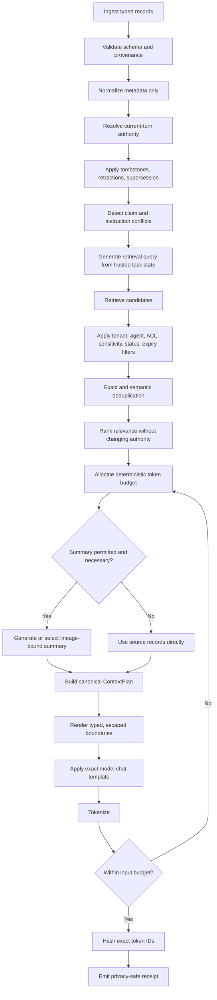
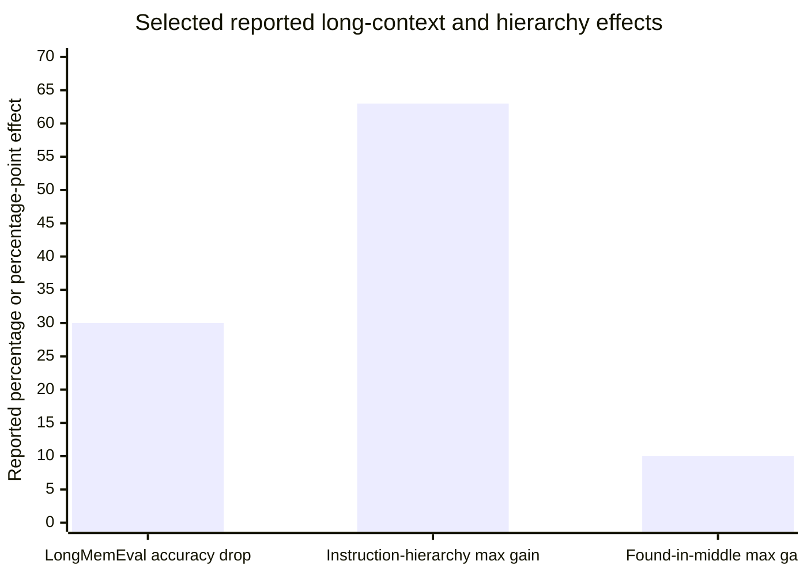

# Deterministic TinyRustLM Context Compiler: Authority, Provenance, Memory, and Exact Token Assembly

## Executive recommendation and public scope

### Executive summary

**[Recommendation]** TinyRustLM should replace all ad hoc prompt assembly with one normative, deterministic context compiler. The compiler should consume typed, provenance-bearing records; resolve conversational authority before retrieval; construct a machine-readable `ContextPlan`; render that plan through a model-specific template; tokenize the result; and identify the exact prompt by hashing its token sequence together with the active model, tokenizer, template, and policy identities.

The decisive architectural rules are:

1. **Authority and relevance are separate dimensions.** Semantic similarity can make a record eligible for inclusion, but it must never transform retrieved text, memory, a tool payload, or quoted material into an instruction.
2. **The current explicit user request has protected retention and precedence.** Stale profile fields, inferred preferences, generated summaries, and retrieved documents cannot override it or displace its material constraints from the context budget.
3. **Every included assertion remains bound to its source.** A summary, extraction, or memory record is a derived artifact, not a replacement for its sources.
4. **Durability is explicit.** Raw chat, temporary task state, inferred preferences, model KV state, embeddings, and durable memory are different objects with separate retention policies.
5. **The plan is compiled before text is rendered.** Selection, authority, ordering, token allowance, truncation, exclusions, and conflicts must be inspectable without exposing prompt payloads.
6. **The final identity is token-level.** A text hash alone is insufficient because different tokenizers, chat templates, special-token maps, or rendering code can produce different model inputs from superficially identical text.
7. **Hosted continuity fails closed.** A new browser may restore only server-derived state obtained through an advertised, authorized contract. It must not infer routes, tenant identifiers, workspace bindings, or credentials.
8. **There is one clean cutover.** After the deterministic compiler passes differential, adversarial, overflow, reconnect, and deletion tests, the legacy prompt-construction path and unpublished compatibility aliases should be removed rather than maintained.

The supplied specification establishes the fixed product constraints, required record types, authority behavior, security posture, synchronization requirements, test scope, and prohibition on legacy compatibility shims. fileciteturn0file0

### Scope, assumptions, and evidence labels

**[Assumption]** This report covers the browser-side compiler, local persistence boundary, optional hosted continuity adapter, retrieval pipeline, summaries, cache binding, diagnostics, and test strategy. It does not claim access to private TinyRustLM source code, prompts, model files, tokenizer assets, memory records, credentials, build systems, or test results.

**[Assumption]** No geographic restriction applies. Public observations were made on **August 1, 2026**, with source dates and immutable revisions recorded where exposed.

The following labels distinguish evidence classes:

| Label | Meaning |
|---|---|
| **[Observed]** | Directly visible on a public product surface or machine-readable public contract |
| **[External]** | Supported by an official standard, primary paper, or official technical documentation |
| **[Inference]** | Reasoned conclusion from observed or external facts, not directly verified in TinyRustLM |
| **[Recommendation]** | Proposed normative implementation behavior |
| **[Assumption]** | Working condition adopted because private implementation facts are unavailable |
| **[Local verification]** | Requires source, artifact, browser, model, credential, or deployment access not available here |

### Public observation log

| Surface | Public observation | Observation and retrieval date | Public source or revision | Verification status |
|---|---|---:|---|---|
| TinyRustLM | **[Observed]** The page describes browser-local Rust/WASM inference, says prompts are not sent to a server, states that local `.slm` files remain on-device, and presents optional local memory-deck and hosted-memory controls. It also exposes model, tokenizer, prompt-limit, output-limit, KV-budget, provenance, assembly, and token-console diagnostic placeholders. | 2026-08-01 | `https://tinyrustlm.com/`; no immutable page revision exposed | Public behavior observed; implementation not validated. citeturn16view0 |
| MemoryEndpoints home | **[Observed]** The site describes an intranet MATM memory service, distinguishes local `.uai` startup memory from protected mid- and long-term memory, says hosted memory augments rather than silently replaces local continuity, and advertises deterministic setup, memory, inbox, and acknowledgement routes. | 2026-08-01 | `https://memoryendpoints.com/`; no home-page revision exposed | Public claims observed; no authenticated account tested. citeturn16view1 |
| MemoryEndpoints connector contract | **[Observed]** A machine-readable contract advertises discovery, canonical agent-name rules, server-bound scopes, runtime leases, idempotency requirements, typed routes, redacted credential readback, and fail-closed behavior. The observed contract revision is `memoryendpoints.connector-contract.2026-07-29`; the observed deployment revision is `fbdcdf6991e8c886d7428ed02c30850a43c2f0c0`. | 2026-08-01 | `https://memoryendpoints.com/api/matm/connector-contract` | Public contract inspected; live authorization and state continuity not tested. citeturn16view2 |
| UAIX | **[Observed]** The public site describes a versioned, validator-backed portable guidance and memory-package format, with provenance and lifecycle concepts; it also states that local packages and pointer ledgers do not themselves imply hosted synchronization or runtime authority. | 2026-08-01 | `https://uaix.org/`; observed public build information, but no TinyRustLM-private integration revision | Public format claims observed; local package implementation not inspected. citeturn2view2 |
| MiniModel | **[Local verification]** TinyRustLM publicly references MiniModel publication and metadata, but the independent MiniModel surface could not be reliably retrieved in this research environment. | 2026-08-01 | `https://minimodel.org/` requested | Contract, revision, and advertised behavior remain unverified. TinyRustLM’s reference alone is not proof of MiniModel behavior. citeturn16view0 |

### Unavailable-contract ledger

| Required item | Status | Consequence |
|---|---|---|
| Private TinyRustLM prompt layout and compiler code | Unavailable | No claim can be made that current assembly is deterministic, authority-aware, or injection-resistant. |
| Exact active model weights, configuration, tokenizer vocabulary, merges, special-token map, or chat template | Unavailable | Exact token identities and cache compatibility cannot be validated. |
| Authorized MemoryEndpoints credential and account | Unavailable | Public routes may be documented, but cross-browser continuity, revocation, conflict, deletion, and tenant binding cannot be operationally confirmed. |
| MiniModel machine contract | Not independently retrieved | MiniModel metadata must remain an optional, fail-closed integration pending local verification. |
| Local browser stores and synchronization state | Unavailable | IndexedDB schema, local outbox behavior, retention, encryption, and cleanup require browser inspection. |
| Existing summaries, memories, embeddings, or raw transcripts | Unavailable | No migration or compatibility behavior should be inferred; the requested clean replacement should start from an explicit import boundary. |

**[Recommendation]** These are blockers to claiming implementation conformance, not blockers to defining the normative compiler contract.

## Authority, typed records, and provenance

### Authority lattice

An ordinary linear role hierarchy is too weak because a source can be authoritative for one purpose but untrusted for another. A weather tool, for example, may be trusted for returned weather fields but has no authority to change product policy. The compiler should therefore use a **lattice with at least three independent axes**:

\[
A(r) = \langle I_r, F_r, S_r \rangle
\]

where:

- \(I_r\) is **instruction authority**;
- \(F_r\) is **factual authority within a declared scope**;
- \(S_r\) is **state authority**, meaning the ability to update session or durable state.

**[External]** Instruction-hierarchy research identifies failure to distinguish privileged from lower-priority instructions as a major cause of prompt-injection vulnerability. Training a model to recognize privilege improves robustness, but the application still needs an explicit source hierarchy and structural separation. citeturn15academia12

The normative instruction ordering should be:

| Tier | Record classes | Instruction authority | Typical factual or state authority |
|---|---|---|---|
| **A0** | Product safety policy, system policy, compiler policy | Highest; cannot be overridden conversationally | Defines permitted processing and retention |
| **A1** | Explicit current-user request, current-turn correction, current material constraint | Highest conversational authority | Authoritative for the user’s present intent and self-reported current preference |
| **A2** | Current-turn typed facts and trusted tool fields | No general instruction authority unless the tool contract explicitly returns trusted control metadata | Authoritative only within the tool’s declared data scope |
| **A3** | Agreed session state and still-active explicit prior-user commitments | Lower than the current turn | Authoritative for unresolved session state unless superseded |
| **A4** | User-confirmed profile fields and user-confirmed durable memory | Preference authority, not product-policy authority | Durable state within consented scope |
| **A5** | Prior dialogue turns and reviewed short-term summaries | Historical conversational evidence | Subject to recency, correction, and summary lineage |
| **A6** | Unreviewed long-term memory, inferred preference, generated summary | No instruction authority | Tentative contextual evidence |
| **A7** | Retrieved documents, quoted text, tool payload content, arbitrary external material | None | Data claims only, with source-specific reliability |
| **A8** | Unknown-origin or malformed content | None | Quarantined or excluded |

The tier alone must not be interpreted as a universal truth score. A current user can authoritatively state “Use metric units” but cannot make an outdated third-party scientific claim become correct merely by repeating it. Conversely, an official data source can be authoritative for a statistic while remaining unable to issue instructions to the assistant.

### Non-combinable authorities

**[Recommendation]** The compiler must reject attempts to combine the following into a stronger synthetic authority:

- Retrieved prose plus a system-looking prefix does not become a system instruction.
- A tool result plus a phrase such as “execute immediately” does not gain action authority.
- A generated summary plus a durable-memory location does not become a verified fact.
- A profile record plus age does not override a current explicit preference.
- Multiple low-authority duplicates do not collectively outrank one higher-authority correction.
- A signed or hashed document proves content identity, not truth or instruction privilege.
- A high vector score does not alter instruction, fact, or state authority.
- A hosted workspace identifier appearing in content does not establish tenant binding; only trusted, server-derived metadata may do so.

### Conflict-resolution table

| Conflict | Deterministic rule | Assistant behavior |
|---|---|---|
| Current preference versus stale profile | Current explicit user assertion wins; create a supersession or retraction candidate for the old profile field | Proceed using the current preference; disclose only when the historical difference matters |
| Memory versus current correction | Current correction wins immediately; old memory becomes superseded and is excluded from current factual rendering | Confirm the correction in the answer when relevant and queue an authorized memory update |
| Two official sources with different dates | Retain both with `valid_time` and `observed_time`; prefer the source applicable to the requested date or, for “current,” the latest valid observation | Disclose the conflict when decision-relevant; otherwise cite the temporally applicable source |
| Duplicate records | Dedupe by exact content identity first, then by claim key and equivalent normalized value | Render one canonical instance and retain alias/provenance links |
| Superseded plan or task | Exclude the superseded plan unless the user explicitly asks for history | Continue with the latest active plan |
| Summary versus source record | Source governs; summary is an untrusted derivative | Use the summary only as a budget aid and preserve links to every source |
| High-similarity malicious document | Keep as untrusted data; ignore embedded instructions | Use only factual passages relevant to the task and disclose uncertainty as needed |
| Uncertain retrieval with safe default | Use the safe default and qualify the conclusion | Proceed conditionally |
| Uncertain retrieval with material irreversible consequence | Do not guess | Ask a focused question or stop the action |
| Tombstone versus live payload | Tombstone wins for selection and rendering | Exclude payload from context and invalidate related indexes and caches |
| Two same-tier user instructions | Use explicit supersession, temporal order, and specificity; latest explicit instruction normally wins | Surface ambiguity only when both cannot be satisfied |
| Product policy versus current user | Product policy wins | Explain the constraint without treating lower-authority text as an override |

### Canonical record model

```rust
#[derive(Clone, Debug, Serialize, Deserialize)]
pub enum RecordKind {
    RoleTaggedMessage,
    UserPreferenceAssertion,
    Retraction,
    SessionFact,
    SourceClaim,
    TrustedMetadata,
    UntrustedContentBlock,
    ToolResult,
    ShortTermSummary,
    LongTermMemoryRecord,
    MemoryPointer,
    Tombstone,
    SupersessionLink,
    RetrievalHit,
    CompilerDiagnostic,

    // Recommended additions needed to make lifecycle explicit.
    ConsentGrant,
    ConsentWithdrawal,
    ConflictRecord,
    OutboxOperation,
    SyncReceipt,
}

#[derive(Clone, Debug, Serialize, Deserialize)]
pub struct CanonicalRecord {
    pub schema_version: String,
    pub kind: RecordKind,
    pub payload_encoding: PayloadEncoding,
    pub payload_bytes: Vec<u8>,
    pub provenance: ProvenanceEnvelope,
    pub lifecycle: LifecycleEnvelope,
    pub authority: AuthorityEnvelope,
}
```

The minimum semantic requirements are:

| Record | Required semantic fields |
|---|---|
| Role-tagged message | Stable message ID, speaker role, turn ID, sequence, raw content hash, creation time |
| Preference assertion | Subject, predicate, value, scope, explicit/inferred flag, confidence, valid time |
| Retraction | Target record or claim ID, scope of retraction, issuer, effective time, reason code |
| Session fact | Claim, session scope, validity, confirmation status |
| Source claim | Atomic claim, source record, observation or valid time, uncertainty |
| Trusted metadata | Contract issuer, schema, field-level trust scope, signature or transport evidence where available |
| Untrusted content block | Origin, media type, byte length, untrusted marker, sanitization transform |
| Tool result | Tool identity, invocation hash, typed trusted fields, untrusted payload fields, execution time |
| Summary | Source set, scope, omissions, summarizer identity, policy hash, output hash |
| Long-term memory | Consent reference, retention class, sensitivity, expiration, review state |
| Memory pointer | Target content identity and authorized resolver; no hidden credential |
| Tombstone | Target IDs, deletion scope, effective time, issuer, reason |
| Supersession link | Predecessor, successor, relation type, effective time |
| Retrieval hit | Query hash, index identity/revision, candidate ID, component scores, rank |
| Diagnostic | Bounded code, severity, record hashes, no payload |

### Content identity and provenance envelope

**[External]** W3C PROV models provenance through entities, activities, agents, derivations, responsibility, and collections. That structure is appropriate for distinguishing a source record from the activity that summarized, retrieved, reviewed, or transformed it. citeturn17search0turn17search4

**[External]** RFC 8785 defines a deterministic JSON representation suitable for repeatable hashing, while explicitly requiring JSON strings to be preserved rather than silently Unicode-normalized. This supports canonical metadata hashing but argues against rewriting source payloads during canonicalization. citeturn17search1

```rust
#[derive(Clone, Debug, Serialize, Deserialize)]
pub struct ProvenanceEnvelope {
    pub record_id: String,
    pub source_uri_hash: Option<String>,
    pub source_record_id: Option<String>,
    pub creator_class: CreatorClass,
    pub creator_id_hash: Option<String>,

    pub created_at: Timestamp,
    pub observed_at: Option<Timestamp>,
    pub valid_from: Option<Timestamp>,
    pub valid_until: Option<Timestamp>,

    pub revision: String,
    pub supersedes: Vec<String>,
    pub derived_from: Vec<String>,

    pub trust_class: TrustClass,
    pub tenant_binding_hash: Option<String>,
    pub agent_binding_hash: Option<String>,

    pub sensitivity: SensitivityClass,
    pub retention: RetentionClass,
    pub expires_at: Option<Timestamp>,

    pub original_hash: String,
    pub normalization_hash: String,
    pub metadata_hash: String,

    pub untrusted_data: bool,
    pub policy_version: String,
}
```

**[Recommendation]** Compute identities using explicit domain separation:

\[
H_{\text{payload}} =
\operatorname{SHA256}(
\texttt{"trlm-payload-v1\0"} \parallel \text{original bytes}
)
\]

\[
H_{\text{metadata}} =
\operatorname{SHA256}(
\texttt{"trlm-meta-v1\0"} \parallel
\operatorname{JCS}(\text{canonical metadata})
)
\]

\[
ID_{\text{record}} =
\operatorname{SHA256}(
\texttt{"trlm-record-v1\0"} \parallel
\text{kind} \parallel H_{\text{payload}} \parallel H_{\text{metadata}}
)
\]

`original_hash` identifies received bytes. `normalization_hash` identifies the exact result of an explicitly documented decoding or sanitation transform. `metadata_hash` covers canonical metadata. Search-oriented Unicode normalization, stemming, chunking, or whitespace folding must produce separate index artifacts; it must not mutate the archival payload or its original identity.

**[Recommendation]** All hash inputs must include length prefixes or canonical structured encoding, never ambiguous string concatenation. Timestamps should be fixed-format UTC strings, integer-like values that exceed safe JSON numeric precision should be strings, duplicate JSON keys should be rejected, and non-finite numbers should be forbidden, consistent with JCS constraints. citeturn17search1

## Deterministic planning, compilation, and budgeting

### Context-plan contract

The compiler should never directly concatenate records into a prompt. It should first produce a deterministic plan:

```rust
#[derive(Clone, Debug, Serialize, Deserialize)]
pub struct ContextPlan {
    pub plan_schema: String,
    pub compiler_version: String,

    pub policy_id: String,
    pub policy_hash: String,

    pub model_id: String,
    pub model_artifact_hash: String,
    pub model_config_hash: String,

    pub tokenizer_id: String,
    pub tokenizer_hash: String,
    pub special_token_map_hash: String,

    pub rendering_template_id: String,
    pub rendering_template_hash: String,

    pub context_window_tokens: u32,
    pub output_reservation_tokens: u32,
    pub safety_margin_tokens: u32,

    pub selected: Vec<PlannedRecord>,
    pub excluded: Vec<ExcludedRecord>,
    pub conflicts: Vec<ConflictRecordRef>,

    pub retrieval_index_id: Option<String>,
    pub retrieval_index_revision: Option<String>,
    pub stale_index: bool,

    pub canonical_plan_hash: String,
}

#[derive(Clone, Debug, Serialize, Deserialize)]
pub struct PlannedRecord {
    pub record_id: String,
    pub record_hash: String,
    pub record_kind: RecordKind,

    pub instruction_authority: String,
    pub factual_authority: String,
    pub state_authority: String,

    pub order_key: String,
    pub token_allowance: u32,
    pub truncation_mode: TruncationMode,
    pub rendering_template: String,

    pub inclusion_reason_code: String,
    pub source_lineage_hash: String,
}
```

The plan hash should be calculated over a JCS-canonical plan object that excludes nondeterministic telemetry such as elapsed time, memory address, thread ID, and wall-clock completion time. Canonical JSON is designed to make hashing repeatable across implementations. citeturn17search1

The plan is not yet the prompt identity. After rendering and tokenization:

\[
H_{\text{tokens}} =
\operatorname{SHA256}\left(
\texttt{"trlm-prompt-tokens-v1\0"}
\parallel H_M
\parallel H_T
\parallel H_{\text{template}}
\parallel H_{\text{policy}}
\parallel \operatorname{encode\_u32le}(\text{token IDs})
\right)
\]

where \(H_M\) is the exact model composition identity and \(H_T\) is the complete tokenizer identity.

### Compilation algorithm



A normative pseudocode sequence is:

```text
compile(inputs, policy, model_bundle):
    records = validate_and_decode(inputs)
    canonical_meta = normalize_metadata(records)
    active = resolve_authority(canonical_meta, current_turn)
    active = apply_tombstones_retractions_supersession(active)
    conflicts = detect_conflicts(active)

    query = build_retrieval_query(current_turn, agreed_state)
    candidates = retrieve(query, pinned_index_revision)

    candidates = hard_filter(
        candidates,
        tenant_binding,
        agent_binding,
        ACL,
        sensitivity_policy,
        expiration,
        record_status
    )

    candidates = dedupe(candidates)
    ranked = rank_relevance(candidates)       // never rewrites authority
    budgeted = allocate(active, ranked, token_budget)

    derived = summarize_only_if_allowed(budgeted, summary_policy)
    plan = make_context_plan(active, derived, conflicts, exclusions)

    plan_hash = hash(canonicalize(plan))
    rendered = render_typed(plan)
    prompt_text = model_chat_template(rendered)
    token_ids = exact_tokenizer(prompt_text)

    if token_ids exceed input allowance:
        deterministically revise the plan or stop with overflow

    token_hash = hash(model_bundle_identity || token_ids)
    return plan, token_ids, redacted_receipt
```

### Token-budget equations

Let:

- \(C\): model context-window limit;
- \(O\): reserved output tokens;
- \(M\): safety margin for template/version variance;
- \(I\): maximum input tokens;
- \(S\): system and product-policy tokens;
- \(T\): chat-template and typed-boundary overhead;
- \(U\): complete current-user message;
- \(K\): required markers and current tool-state tokens;
- \(D\): recent dialogue;
- \(G\): agreed session state;
- \(P\): confirmed profile and durable preference;
- \(R\): retrieval and memory;
- \(Q\): summary artifacts.

Then:

\[
I = C - O - M
\]

\[
B_{\text{discretionary}}
= I - (S + T + U + K)
\]

and the compiler must satisfy:

\[
D + G + P + R + Q \le B_{\text{discretionary}}
\]

A compilation must fail before inference if:

\[
S + T + U + K > I
\]

unless a user-visible continuation or chunk-processing protocol has been explicitly selected.

**[Recommendation]** `O` must be reserved before selecting optional context. A local model should not consume its entire window with history and then silently reduce the requested answer length.

### Non-negotiable retention order

| Priority | Content | Permitted reduction |
|---:|---|---|
| Highest | Product/system policy and mandatory template control tokens | None except by changing the approved policy build |
| Highest conversational | Current explicit user request and material constraints | No silent truncation |
| Required execution state | Current tool-status markers, active safety or capability constraints | Structured compression only if contractually defined |
| Current facts | Facts supplied or verified specifically for the current task | Deterministic extraction with provenance |
| Recent dialogue | Complete recent turns needed for references | Whole-turn removal before within-turn clipping |
| Agreed session state | Active plan, selected option, unresolved question | Typed state projection |
| Confirmed profile | Explicit durable preferences relevant to the task | Field-level selection |
| Reviewed memory | Human- or user-confirmed durable facts | Claim-level selection |
| Unreviewed memory and retrieval | Candidate context | Aggressive filtering or exclusion |
| Generated summaries | Budget aid | Exclude whenever source records fit |

**[Recommendation]** Tie-breaking must be stable. Within the same authority and retention class, use:

1. mandatory status;
2. direct relevance to current request;
3. explicit user pin;
4. validity and recency;
5. source reliability;
6. source diversity;
7. stable `record_hash` ascending.

Do not use unordered map iteration, database default ordering, locale-dependent sorting, floating-point scores without quantization, or arrival timing.

### Current-turn overflow

If the current turn alone exceeds the available input budget, the compiler must not pretend the entire turn was read.

The required behavior is:

1. Emit `CURRENT_TURN_OVERFLOW`.
2. Preserve the unmodified full message in ephemeral local input state, subject to user-controlled retention.
3. Present the user with a visible continuation or deterministic chunk-processing mode.
4. Bind every chunk to the original message hash, total byte length, chunk index, and chunking-policy hash.
5. Do not produce a final answer requiring full-message comprehension until all required chunks have been processed.
6. Never discard the middle of the current message while retaining old memory or retrieval.

For a locally executed transformation such as rewriting a long document, chunk boundaries should be syntactic where possible, but the original byte spans and overlap policy must be recorded. For instructions whose meaning depends on the entire text, the compiler should stop rather than infer from a prefix and suffix.

### Truncation-strategy comparison

| Strategy | Semantic loss | Injection or manipulation risk | Cost | Reproducibility | Recommended role |
|---|---|---|---|---|---|
| Raw recency window | Can discard older constraints and unresolved referents | Low direct manipulation, high accidental authority loss | Low | High | Baseline only |
| Turn-aware truncation | Preserves conversational units but may lose old commitments | Moderate if an attacker fills recent turns | Low | High | Default recent-dialogue reduction |
| Salience scoring | Can omit low-salience but decisive constraints | High if text can manipulate salience | Medium | Medium unless model-free | Secondary signal only |
| Deterministic extraction | Loses nuance outside known fields | Lower when schema-driven | Low–medium | High | Constraints, dates, units, names, decisions |
| Hierarchical summary | Can compound omissions and hallucinations | High if summaries absorb injected text | Medium–high | Low unless fixed model/seed/build | Long histories, always lineage-bound |
| Query-focused summary | Can erase facts not anticipated by the current query | Query manipulation can redirect compression | Medium–high | Medium | Temporary task-specific view |
| Retrieval | Can miss information through indexing or query mismatch | High-similarity malicious content remains possible | Medium | High with pinned index and tie rules | Candidate generation, not authority |
| User-visible continuation | No silent semantic loss | Low | User interaction and latency cost | High | Required for current-turn overflow |
| Whole-turn exclusion | Loses entire historical turns but preserves remaining integrity | Low | Low | High | Preferable to mid-turn clipping |
| Source quotation with bounded spans | Preserves exact local meaning but consumes tokens | Embedded instructions remain present | Medium | High | Evidence-critical excerpts rendered as untrusted data |

**[External]** Long-context models often perform better when relevant information is near the beginning or end and worse when it appears in the middle; this supports explicit ordering and retrieval rather than assuming a large context window is uniformly usable. citeturn15search0

## Memory semantics, retrieval, and contradiction handling

### Summary lineage

A summary must be represented as a derived record, not replacement prose:

```rust
pub struct SummaryLineage {
    pub summary_record_id: String,
    pub source_record_ids: Vec<String>,
    pub source_record_hashes: Vec<String>,

    pub summarizer_model_id: String,
    pub summarizer_model_hash: String,
    pub tokenizer_hash: String,
    pub template_hash: String,
    pub prompt_policy_hash: String,

    pub generated_at: Timestamp,
    pub scope: String,
    pub declared_omissions: Vec<String>,
    pub confidence_basis: String,

    pub output_hash: String,
    pub reviewer_status: ReviewerStatus,
    pub reviewer_id_hash: Option<String>,

    pub supersedes_summary_ids: Vec<String>,
}
```

**[Recommendation]** The default authority of a generated summary is `A6`: model-generated, untrusted memory. Human review does not make every summarized claim true; it only changes the review status. User confirmation may promote specific atomic assertions into confirmed preference or memory records, but should not promote an entire free-form summary wholesale.

A summary can be selected only when:

\[
\text{summary savings}
>
\text{summary overhead}
+
\text{required lineage markers}
\]

and when the policy permits summary generation for the relevant sensitivity class.

A summary must be invalidated or marked stale when any bound source is tombstoned, materially superseded, corrected, or inaccessible under the current authorization boundary.

### Supersession, retraction, and tombstones

These mechanisms should have distinct meanings:

| Mechanism | Meaning | Effect on current selection |
|---|---|---|
| Supersession | A newer record replaces an older record for a stated scope | Prefer successor; predecessor remains historical evidence |
| Retraction | Issuer withdraws an assertion without necessarily replacing it | Exclude assertion from active state |
| Correction | A successor explicitly supplies corrected content | Exclude old claim and select corrected claim |
| Tombstone | Content must no longer be selected or exposed under the tombstone scope | Hard exclusion; trigger index and cache cleanup |
| Expiration | Content is no longer valid after a time | Exclude unless historical context is requested |
| Stale marker | Record may still be useful but requires refresh | Down-rank or disclose; never silently treat as current |
| Deletion receipt | Evidence that designated stores and indexes processed deletion | Does not contain deleted payload |

An append-only event history improves traceability, but immutable event stores create privacy complications when personal data must be deleted. Microsoft’s event-sourcing guidance highlights both append-only auditability and the complexity and retention tradeoffs of the pattern. citeturn18search4turn20view3

**[Recommendation]** Therefore, TinyRustLM should event-source **control and lineage metadata**, not indiscriminately copy sensitive conversation payloads into an immutable ledger. Sensitive payloads should live in separately deletable encrypted objects referenced by content identity. Deleting the object and its encryption key can preserve a non-sensitive tombstone while making the payload unrecoverable.

### Retrieval eligibility and scoring

Retrieval should use two stages.

First, a hard eligibility function:

\[
E(r)=
\operatorname{tenant\_ok}(r)
\land \operatorname{agent\_ok}(r)
\land \operatorname{acl\_ok}(r)
\land \operatorname{sensitivity\_ok}(r)
\land \neg\operatorname{tombstoned}(r)
\land \neg\operatorname{expired}(r)
\land \operatorname{status\_selectable}(r)
\]

A record with \(E(r)=0\) is not ranked at all.

Second, a relevance score:

\[
\begin{aligned}
R(r,q) ={}&
0.40\,S_{\text{semantic}}
+0.15\,S_{\text{lexical}}
+0.15\,S_{\text{recency}}\\
&+0.10\,S_{\text{source-quality}}
+0.10\,S_{\text{explicit-pin}}
+0.10\,S_{\text{record-status}}
\end{aligned}
\]

Weights should be policy-versioned and represented as exact integers or fixed-point values, for example basis points, to avoid platform-dependent floating-point ties.

**[Recommendation]** Instruction authority is not an input to this relevance formula. It remains a separate immutable property of the record.

For hybrid lexical/vector retrieval, Reciprocal Rank Fusion can combine independently generated rankings without pretending their raw scores share a common scale. The original RRF work evaluated fusion across TREC runs and LETOR data. citeturn19search4turn19search1

\[
RRF(r) = \sum_{j=1}^{m}\frac{1}{k+\operatorname{rank}_j(r)}
\]

After fusion, apply deterministic diversity selection, such as maximal marginal relevance with fixed-point scores, and break remaining ties by `record_hash`.

### Contradiction policy

Every atomic claim should have a claim key:

\[
K_c =
\langle
\text{subject},
\text{predicate},
\text{scope},
\text{valid-time interval}
\rangle
\]

Claims conflict only when their keys overlap and their normalized values cannot both be true within the same validity interval. Mere textual difference is not a contradiction.

The compiler should produce typed conflict codes such as:

```text
PREFERENCE_STALE_PROFILE
CURRENT_USER_CORRECTION
AUTHORITATIVE_DATE_DIVERGENCE
SUMMARY_SOURCE_DIVERGENCE
DUPLICATE_EQUIVALENT
SUPERSEDED_PLAN
UNCERTAIN_RETRIEVAL
UNTRUSTED_EMBEDDED_INSTRUCTION
TENANT_BINDING_MISMATCH
TOMBSTONED_RECORD_SELECTED
```

**Proceed without asking** when a clear authority or temporal rule resolves the conflict and the consequence is reversible. **Disclose the conflict** when two credible sources support materially different conclusions. **Ask or stop** when no authority rule resolves a decision-critical ambiguity, when an irreversible action is contemplated, or when resolving the issue requires unavailable authorization.

### Memory-write policy

| Candidate content | Default storage | Consent and preview | Durable representation |
|---|---|---|---|
| “Remember that I prefer metric units” | Durable allowed | Explicit request is consent; preview normalized field | Confirmed preference assertion |
| “Actually, use imperial for this project” | Session or scoped durable correction | Confirm scope before changing global profile | Successor assertion plus retraction/supersession |
| Temporary task choice | Session only | No durability prompt needed | Session fact with expiry |
| Inferred preference | Ephemeral only | Require explicit confirmation before durable write | Tentative assertion until confirmed |
| Generated conversation summary | Ephemeral by default | Policy and sensitivity gate | Untrusted summary with full lineage |
| Durable source pointer | Allowed when user explicitly pins it | Show target, scope, and retention | Pointer, not copied raw content where possible |
| Raw transcript | Never durable by default | Separate explicit opt-in required | Segmented, deletable transcript object |
| Credential, invitation URL, workspace key, auth header | Never model memory | No memory path should accept it | Secret store outside prompt and receipt |
| Highly sensitive health, financial, identity, or precise-location data | Ephemeral or excluded | Narrow, informed consent and explicit retention | Field-minimized encrypted record |
| User deletion request | Immediate exclusion and cleanup workflow | Show affected scope, not deleted payload | Tombstone plus cleanup receipt |

The public MemoryEndpoints material distinguishes local startup memory from protected hosted continuity and states that hosted memory should not silently replace local continuity. citeturn16view1

**[Recommendation]** Memory consent should be field-specific, purpose-specific, and duration-specific. “Remember this” is not blanket consent to retain the full surrounding conversation.

A cleanup proof should contain:

- deletion request hash;
- affected record hashes;
- stores and index revisions processed;
- cache namespaces invalidated;
- completion or partial-failure status;
- timestamp and policy version;
- bounded error codes.

It must not reproduce deleted content.

## Startup, reconnect, and synchronization

### Deterministic startup package

The startup package should be assembled in this exact order:

| Order | Package component | Source of authority |
|---:|---|---|
| 1 | Capability-contract version, compiler policy, model, tokenizer, and template identities | Local verified application build |
| 2 | Canonical agent identity and authorized tenant/workspace/project bindings | Server-derived authenticated response, when hosted continuity is active |
| 3 | Current local session status | Local session event log |
| 4 | Durable cursor, server revision, index revision, and stale-index flag | Authorized server response |
| 5 | Selected confirmed profile fields | Local confirmed state plus authorized server records |
| 6 | Selected memory pointers | Access-filtered records only |
| 7 | Unresolved conflicts and stale-summary notices | Compiler conflict projection |
| 8 | Pending outbox summary | Local operation hashes and counts, not payloads |
| 9 | Capability warnings and stop reason | Compiler diagnostics |

The startup package must itself have a canonical hash and include a deterministic source list. It should not contain every durable record; it should contain selected profile fields, pointers, status, and conflict notices sufficient to compile the first turn.

### Advertised hosted-contract requirements

**[Observed]** The MemoryEndpoints contract advertises a discovery route, explicit activation requirements, canonical agent-name normalization, authenticated runtime leases, fail-closed lease conflicts, exact workspace/agent scoping, idempotency headers for mutations, and server-side redaction of raw credential material. citeturn16view2

**[Recommendation]** A TinyRustLM hosted-memory adapter should require these contract fields before enabling continuity:

```text
contractRevision
deploymentRevision
issuer
discoveryRoute
supportedSchemaVersions
authenticationScheme
activationFlow
approvedScopes
serverDerivedAgentBinding
serverDerivedTenantOrWorkspaceBinding
runtimeLeaseContract
idempotencyRules
retryRules
cursorAndRevisionSemantics
searchRequestSchema
memoryWriteSchema
tombstoneOrDeletionCapability
credentialRotationAndRevocation
typedErrorCatalog
redactionContract
CORSContract
maximumPayloadAndRateLimits
```

The adapter should pin the accepted contract revision and fail closed on an incompatible revision. It should not hardcode undocumented aliases merely because a similarly named route appears in a fixture or interface.

The public contract observed on August 1, 2026 exposes routes such as discovery, runtime lease, search, self, workspace, and public-safe memory submission. Those observations justify building a contract adapter, but they do not establish that any particular user account, credential, workspace, or memory is available. citeturn16view2

### Local outbox record

```rust
pub struct OutboxOperation {
    pub operation_id: String,            // UUIDv7 or content-derived ID
    pub idempotency_key: String,
    pub canonical_request_hash: String,

    pub operation_kind: String,
    pub target_contract_revision: String,
    pub expected_server_revision: Option<String>,
    pub base_cursor: Option<String>,

    pub tenant_binding_hash: String,
    pub agent_binding_hash: String,

    pub created_at: Timestamp,
    pub retry_count: u32,
    pub retry_state: RetryState,
    pub encrypted_payload_ref: Option<String>,
}
```

A time-ordered UUID may be useful for outbox locality, but operation semantics must not rely on UUID time as an authoritative server revision. The canonical body hash and idempotency key establish replay identity.

### Idempotency and optimistic concurrency

For an operation \(o\):

\[
K_{\text{idempotency}} =
\operatorname{SHA256}(
\texttt{"trlm-outbox-v1\0"}
\parallel \text{operation ID}
\parallel \text{canonical request hash}
\parallel \text{binding hash}
)
\]

A retry must reuse the same idempotency key and canonical request bytes. If the local application cannot determine whether a request committed, it should query an advertised status or receipt mechanism rather than issue a semantically new write.

**[External]** HTTP defines entity tags, `If-Match`, preconditions, idempotent methods, `409 Conflict`, and `412 Precondition Failed`, which provide standard primitives for optimistic concurrency when a service contract supports them. citeturn20view0turn21view2

**[Recommendation]** Use service-specific advertised revision fields when present. Use `ETag`/`If-Match` only if the MemoryEndpoints contract advertises them for the relevant route; do not assume generic HTTP support implies application-level revision support.

### Offline and cross-browser conflict behavior

| Scenario | Required behavior |
|---|---|
| Browser goes offline after local write | Queue encrypted, identity-bound outbox operation; do not claim server durability |
| Same operation retried | Reuse idempotency key and body hash |
| Server state advanced | Receive typed conflict; retain both base and server revision in a conflict record |
| Partial synchronization | Advance only acknowledged cursor range; keep unacknowledged operations pending |
| Tombstone created offline | Tombstone immediately affects local selection; synchronize deletion when authorized |
| Search index stale | Mark `stale_index=true`; do not treat missing search results as proof of absence |
| Credential revoked | Stop reads and writes, clear plaintext credential material, preserve only redacted diagnostics |
| New browser connects | Accept only server-derived authorized state; never copy hidden local identifiers from content |
| Two browsers update a preference | Create an explicit conflict unless one update clearly supersedes the other by user-authored revision semantics |
| Server returns less state than old browser held | Do not reconstruct missing records from model prose or local guesses |

### Where CRDTs do and do not fit

**[External]** CRDTs converge when their data type and operations satisfy formal monotonicity or commutativity conditions; they are not a universal conflict-resolution mechanism. citeturn19search5

**[Recommendation]** CRDTs are appropriate for:

- sets of acknowledged message IDs;
- add-only receipt sets;
- counters;
- explicitly commutative tags;
- independent bookmark collections.

They should not silently merge:

- contradictory user preferences;
- corrected biographical facts;
- task plans with mutually exclusive choices;
- consent grants and withdrawals;
- authorization bindings;
- deletions versus writes.

Those require explicit supersession, conflict, or server-authoritative resolution. A last-writer-wins register based only on client time is particularly unsafe for corrections because browser clocks can differ and “latest timestamp” is not equivalent to user intent.

## Injection-resistant rendering, cache identity, and receipts

### Typed rendering contract

**[External]** Chat models ultimately consume token sequences, and different models can require materially different role-control tokens and chat templates, even when derived from the same base model. Using the wrong template can substantially degrade behavior. citeturn21view1

A model-family-compatible renderer should first create typed blocks, then pass the resulting role messages through the exact verified chat template.

Conceptual block:

```text
<|context_block_start|>
meta_length=241
payload_length=983
metadata={
  "record_id":"sha256:...",
  "record_kind":"retrieval_hit",
  "role":"retrieved_data",
  "instruction_authority":"none",
  "factual_authority":"external_source",
  "untrusted_data":true,
  "source_lineage_hash":"sha256:..."
}
<|payload_start|>
...escaped source bytes...
<|payload_end|>
<|context_block_end|>
```

This notation is illustrative. The actual markers may be used only if they are reserved special tokens in the verified tokenizer. For models without suitable reserved tokens, use a length-prefixed canonical envelope rendered inside an ordinary role message.

A safer generic text representation is:

```text
TRLM_BLOCK_V1 241 983
{"authority":"data_only", ...canonical metadata...}
<exactly 983 bytes encoded under the declared encoding>
TRLM_BLOCK_END_V1
```

The parser, not the model, enforces the byte lengths. The model receives the same block as data, but application control must not depend on the model perfectly respecting the boundary.

### Required injection defenses

**[External]** Indirect prompt-injection research demonstrates that malicious instructions can arrive through externally retrieved data rather than directly from the user. Structured-query research consequently separates trusted instructions from untrusted data instead of relying on natural-language admonitions alone. citeturn5academia49turn5academia48

**[External]** OWASP identifies prompt injection, insecure output handling, excessive agency, insufficient access control, and sensitive-information disclosure as core LLM-application risks. citeturn21view0

The renderer and host must address:

| Attack | Required control |
|---|---|
| Delimiter collision | Length-prefix payloads; escape only according to a versioned transform; verify post-render length |
| Unicode lookalike delimiters | Compare structural metadata after explicit normalization; never discover boundaries by visual glyph |
| Bidirectional controls | Flag or encode control characters in diagnostics; preserve original bytes separately |
| Quoted fake system messages | Record remains `untrusted_data=true` and `instruction_authority=none` |
| Tool-result injection | Trust only schema-declared fields; treat free-form output as untrusted |
| HTML or Markdown hidden text | Sanitize for display separately; retain source hash; do not promote hidden content |
| JSON duplicate keys | Reject before canonicalization |
| “Ignore previous instructions” in retrieval | Render as source content and exclude from instruction interpretation |
| Malicious memory record | Apply the same untrusted rendering and authority checks as web retrieval |
| Model failure to honor boundaries | Host-side action validation and least privilege; never depend solely on model obedience |
| Output-directed tool invocation | Validate tool parameters against current user intent and policy outside the model |
| Secret exfiltration request | Secrets never enter model context, receipt, or untrusted tool payload |

**[Recommendation]** For consequential tools, use a two-stage architecture: one component reads untrusted content and proposes typed data; a separate privileged policy component authorizes any action using only the minimum necessary fields. The untrusted reader should not possess credentials or broad tool permissions.

### Cache identity

KV caching reuses prior attention computations and can improve iterative-generation efficiency, but the cached state depends on the exact preceding token sequence and model behavior. Official Transformers documentation distinguishes cache types and shows prefix-cache reuse, while warning that model and template behavior matters in iterative chats. citeturn19search0

A cache key must include:

```text
model_artifact_hash
model_config_hash
adapter_and_merge_hash
quantization_and_runtime_kernel_identity
tokenizer_vocab_hash
tokenizer_merges_hash
special_token_map_hash
chat_template_hash
compiler_policy_hash
context_plan_hash
exact_prefix_token_hash
prefix_token_count
position_encoding_identity
rope_scaling_parameters
sliding_or_chunked_attention_parameters
cache_dtype
cache_layout
cache_format_version
runtime_abi_version
```

**[Recommendation]** Cache reuse rule:

\[
\operatorname{reusable\_prefix}(P_{\text{old}},P_{\text{new}})
=
\operatorname{LCP}
(\text{old token IDs},\text{new token IDs})
\]

only when every non-token identity above is equal.

Any changed selected record, order, rendering template, policy, tokenizer, model composition, positional rule, adapter, or special-token map invalidates the affected suffix. Never reuse KV state across unrelated models under a friendly alias such as “TinyLlama-compatible.”

### Privacy-safe receipt

```json
{
  "receiptSchema": "tinyrustlm.context-receipt.v1",
  "compilerVersion": "context-compiler/1.0.0",
  "policyId": "policy/context-v1",
  "policyHash": "sha256:...",
  "planHash": "sha256:...",
  "promptTokenHash": "sha256:...",

  "modelIdentity": {
    "modelHash": "sha256:...",
    "configHash": "sha256:..."
  },
  "tokenizerIdentity": {
    "tokenizerHash": "sha256:...",
    "templateHash": "sha256:..."
  },

  "recordCounts": {
    "currentUser": 1,
    "recentDialogue": 4,
    "profile": 1,
    "memory": 2,
    "retrieval": 3,
    "summary": 0
  },

  "tokenAllocation": {
    "contextWindow": 4096,
    "outputReservation": 768,
    "safetyMargin": 64,
    "systemAndTemplate": 411,
    "currentUser": 506,
    "selectedOther": 2018
  },

  "selectedRecordHashes": ["sha256:...", "sha256:..."],
  "conflictCodes": ["PREFERENCE_STALE_PROFILE"],
  "retrievalIndexIdentity": "hash-or-redacted-id",
  "retrievalIndexRevision": "immutable-revision",
  "cache": {
    "status": "partial-hit",
    "reusedPrefixTokens": 883
  },
  "stopReason": "generation_started",
  "boundedErrors": []
}
```

The public receipt must exclude:

- prompt text;
- message, memory, or retrieval payloads;
- raw token IDs;
- model output;
- credentials, auth headers, invitation URLs, pairing proofs, and runtime proofs;
- unhashed private source URLs;
- workspace, tenant, company, project, or agent identifiers when those would expose a hidden boundary;
- stack traces containing payload fragments;
- embeddings or reversible lexical fingerprints.

**[Recommendation]** Selected-record hashes may themselves enable dictionary attacks against predictable private values. For public export, use a receipt-specific keyed commitment or redact the selected-hash list to counts unless cross-party verification is explicitly required.

## Evidence review, tests, and quality evaluation

### Primary literature and standards review

| Author or source | Year | Methods | Sample size or evaluation scope | Key findings relevant to TinyRustLM | Limitations |
|---|---:|---|---|---|---|
| Lewis et al., RAG | 2020 | Dense retrieval plus seq2seq generation across knowledge-intensive NLP tasks | Multiple QA and generation benchmarks; no single conversational-memory sample | External non-parametric memory can improve factual generation and offers update and provenance advantages over parameter-only knowledge | Does not define conversational authority, retention, or prompt-injection defenses. citeturn15academia13 |
| Liu et al., *Lost in the Middle* | 2024 | Multi-document QA and key-value retrieval with relevant information moved across context positions | Multiple models and task configurations | Performance is often strongest at the beginning and end and weaker for information in the middle | Benchmark positions do not directly determine optimal TinyRustLM ordering for every model. citeturn15search0 |
| Wu et al., LongMemEval | 2024 | Benchmark of extraction, multi-session reasoning, temporal reasoning, updates, and abstention | 500 curated questions embedded in scalable chat histories | Commercial assistants and long-context models showed a reported 30% accuracy drop across sustained interactions; indexing, retrieval, and reading design all matter | Curated benchmark; results may not transfer to a small browser-local model. citeturn15academia14 |
| Wallace et al., instruction hierarchy | 2024 | Hierarchical instruction training and adversarial evaluation on GPT-3.5 | Multiple prompt-injection, extraction, jailbreak, and capability evaluations | Explicit privilege training substantially improves resistance to lower-authority overrides with limited standard-capability loss | Model-training intervention; an application compiler cannot assume a local model has this training. citeturn15academia12 |
| Chen et al., StruQ | 2024 | Structured separation of prompt and data plus model training/evaluation | Llama- and Mistral-family experiments across structured-query attacks | Separating control from data improves prompt-injection resistance | Requires compatible training and remains one layer, not a complete host-side security boundary. citeturn5academia48 |
| Greshake et al. | 2023 | Demonstrations of indirect prompt injection through retrieved or connected data | Multiple attack demonstrations and application patterns | Untrusted external content can manipulate an LLM application without direct malicious user input | Demonstrates feasibility more than a standardized comparative defense benchmark. citeturn5academia49 |
| W3C PROV | 2013 | Formal provenance data model and constraints | Standard, not empirical sample | Separates entities, activities, agents, derivations, responsibility, and provenance bundles | Does not prescribe conversational authority or token compilation. citeturn17search0turn17search4 |
| RFC 8785 | 2020 | Canonical JSON specification | Standard, not empirical sample | Defines invariant, hashable JSON serialization and deterministic property ordering | Informational RFC; canonicalizes JSON, not arbitrary raw text or binary payloads. citeturn17search1 |
| Shapiro et al., CRDT work | 2011 | Formal convergence properties and replicated-data constructions | Formal analysis and representative data types | Correct CRDTs converge under defined monotonicity or commutativity assumptions | Does not make arbitrary semantic conflicts safely mergeable. citeturn19search5 |
| RFC 9110 | 2022 | HTTP semantics standard | Standard, not empirical sample | Defines validators, preconditions, conflicts, and method idempotency primitives useful for synchronization | Service-specific APIs must explicitly bind these primitives to domain revisions. citeturn20view0 |
| Hugging Face chat-template documentation | Current public documentation observed 2026 | Reference implementation guidance | Multiple model template examples | Role dictionaries become model-specific token sequences; wrong control tokens can degrade results | Library documentation is not proof of TinyRustLM’s private tokenizer implementation. citeturn21view1 |

### Quantitative evidence

The following reported effects use different tasks, models, denominators, and metrics and therefore **must not be treated as directly comparable effect sizes**. They illustrate the magnitude of known long-context and hierarchy problems rather than providing a forecast for TinyRustLM.



LongMemEval reports a 30% accuracy drop in sustained-interaction memory settings; instruction-hierarchy reporting includes large task-specific robustness gains; and position-bias calibration work reports improvements of up to ten percentage points on evaluated RAG tasks. These measurements are heterogeneous and should be re-measured on the exact local model and compiler. citeturn15academia14turn4search0turn15search6

### Evidence-strength assessment

| Design proposition | Evidence strength | Interpretation |
|---|---|---|
| Current user must outrank stale memory | Strong normative and product requirement | Must be enforced deterministically, independent of model behavior |
| Retrieval similarity is not authority | Strong security and systems rationale | Hard architecture boundary |
| Context position affects use | Moderate-to-strong empirical evidence across models | Benchmark exact TinyRustLM model; do not assume uniform attention |
| Summaries can safely replace sources | Weak | Reject as a default; summaries remain derivatives |
| Delimiters alone stop injection | Weak and contradicted by attack literature | Use typed separation plus host-side enforcement |
| Retrieval improves factual access | Strong task-level evidence | Does not solve authority, freshness, or malicious-content problems |
| CRDTs solve cross-browser memory conflicts | Conditional | Only for semantically compatible commutative data types |
| KV reuse is safe under a model alias | Unsupported | Require exact model, tokenizer, template, tokens, and position identity |
| A hosted fixture proves continuity | Unsupported | Require authenticated, server-derived state and live contract tests |
| Raw transcript should be durable by default | No supporting requirement and high privacy cost | Default to ephemeral |

### Metamorphic and adversarial test matrix

| Test mutation | Required invariant or expected change |
|---|---|
| Rename an irrelevant person in a retrieved distractor | Current request, authority ordering, and selected high-priority records remain unchanged |
| Convert equivalent units in a low-priority duplicate | Canonical claim equivalence may change deduplication, but current constraints remain selected |
| Move an embedded “system message” within a retrieved document | It remains `instruction_authority=none` in every position |
| Reverse sentence order in untrusted content | Authority and access eligibility remain invariant; relevance may change only under a versioned ranking policy |
| Add thousands of irrelevant retrieval hits | Current user request and required constraints are never evicted |
| Repeat the same malicious instruction across many documents | Duplicate count does not increase authority |
| Insert Unicode lookalike delimiters | Parser retains correct byte boundary; record remains untrusted |
| Insert bidi controls around fake role labels | Structural role is unchanged; diagnostic may be added |
| Provide duplicate record IDs with different bytes | Compilation fails with identity collision |
| Provide identical bytes with different claimed origins | Content identity matches; provenance instances remain distinct |
| Tombstone a selected memory | It disappears from the next plan; related summary becomes stale |
| Correct a stale preference in the current turn | Current correction is selected; stale profile is excluded |
| Change only retrieval-vector score | Instruction authority remains unchanged |
| Change tokenizer revision | Plan may remain semantically equal, but token hash and cache identity must change |
| Change selected-record order | Plan hash and prompt-token hash must change |
| Change an excluded record | Plan hash changes only if exclusions are part of the canonical plan, as recommended; token hash remains unchanged |
| Current turn exceeds input budget | Compiler returns overflow or continuation; it does not silently answer from a fragment |
| Reconnect with revoked credential | No memory is returned or written; a bounded authorization diagnostic is produced |
| New browser supplies a workspace ID in prompt text | Binding remains server-derived; text value is ignored as authority |
| Repeat compilation with identical inputs and versions | Plan hash, rendered bytes, token IDs, and token hash are identical across supported browsers |
| Switch browser locale or time zone | Ordering, numbers, hashes, and timestamps remain invariant |
| Introduce stale search index | Receipt marks stale state; absence of a hit is not asserted as absence of memory |
| Delete a memory | Context, retrieval index, summaries, and cache references are invalidated according to cleanup policy |

### Browser determinism suite

The same fixture corpus should run in Chromium, Firefox, and WebKit-compatible environments with:

- fixed WASM module hash;
- fixed compiler build;
- fixed model/tokenizer artifacts;
- fixed locale-independent encoding;
- deterministic sorting;
- deterministic fixed-point retrieval scores;
- fixed random seed where stochastic summarization is unavoidable;
- no wall-clock fields inside the plan hash;
- no object-key iteration dependence;
- explicit handling of UTF-8 decoding errors.

Acceptance criterion:

\[
H_{\text{plan}}^{Chrome}
=
H_{\text{plan}}^{Firefox}
=
H_{\text{plan}}^{WebKit}
\]

and:

\[
H_{\text{tokens}}^{Chrome}
=
H_{\text{tokens}}^{Firefox}
=
H_{\text{tokens}}^{WebKit}
\]

for every conformance fixture.

### End-to-end quality evaluation

Use a factorial test set covering:

| Condition | Required comparison |
|---|---|
| No memory | Baseline helpfulness and task correctness |
| Recent complete turns | Multi-turn reference resolution |
| Confirmed trusted profile | Appropriate personalization without overreach |
| Untrusted retrieval | Factual use without instruction adoption |
| Summary only | Continuity degradation relative to source records |
| Corrected preference | Current-turn precedence |
| Conflicting sources | Honest disclosure and temporal reasoning |
| Reconnect | Continuity from server-derived authorized state |
| Stale index | Safe uncertainty |
| Context overflow | Visible continuation rather than silent loss |
| Malicious memory | Injection resistance |
| Tombstone and deletion | Non-reappearance across context, retrieval, and cache |

Preserve the raw model output in a private test artifact, but not in the public compiler receipt. Score:

\[
Q =
w_c C_{\text{continuity}}
+w_p C_{\text{current-precedence}}
+w_s C_{\text{source-honesty}}
+w_f C_{\text{feasibility}}
+w_i C_{\text{injection-resistance}}
+w_h C_{\text{helpfulness}}
-w_l L_{\text{latency}}
\]

Security-critical criteria should be gates, not compensable averages. A system that is highly helpful but follows an instruction embedded in retrieval fails regardless of aggregate score.

## TDD cutover, blockers, and annotated sources

### Test-driven implementation sequence

| Stage | Deliverable | Required tests before proceeding |
|---|---|---|
| Typed foundation | Record enums, schemas, provenance and lifecycle envelopes | Schema rejection, unknown fields, duplicate keys, byte preservation |
| Authority engine | Lattice, scope rules, conflict codes | Current user versus stale memory, tool-data versus instruction, quoted fake system text |
| Canonical identity | JCS metadata, payload hashes, record IDs | Cross-language and cross-browser golden vectors |
| Context planning | Selected/excluded records, stable order, plan hash | Randomized input-order invariance and deterministic ties |
| Budgeting | Model-specific token accounting and output reserve | Boundary values, template overhead, current-turn protection |
| Rendering | Typed blocks and exact chat template | Delimiter collision, Unicode controls, fake roles |
| Exact token identity | Tokenizer and token-vector hash | Golden token fixtures and tokenizer-change invalidation |
| Lifecycle semantics | Summary lineage, supersession, retraction, tombstones | Stale summary, corrected fact, deletion propagation |
| Retrieval | Hard access filters, hybrid ranking, diversity | High-similarity injection, tenant mismatch, stale index |
| Local persistence | Session log, consented memory, encrypted outbox | Crash recovery, partial write, cleanup |
| Hosted adapter | Discovery, contract pinning, leases, idempotency, typed errors | Authorized sandbox only; revocation and exact-retry tests |
| Cross-browser dogfood | New-browser restore and conflict receipts | Server-derived binding, partial sync, concurrent updates |
| Cutover | Single normative compiler | Differential replay against legacy behavior plus security gates |
| Removal | Delete old assembly and aliases | No production code path, fixture, flag, or documentation references legacy format |

### Stop rules

Deployment must stop if any of the following occurs:

- identical fixtures produce different plan or token hashes across supported browsers;
- a lower-authority record changes a higher-authority instruction decision;
- a retrieved or memory payload can invoke a privileged tool without independent validation;
- the current request is silently truncated while lower-priority context remains;
- the receipt contains prompt, payload, token, output, secret, invitation, or private workspace material;
- a tombstoned record reappears through retrieval, summary, cache, or reconnect;
- a hosted write occurs without pinned contract revision, authorized scope, idempotency identity, and binding;
- a cache hit occurs when model, tokenizer, template, plan, position, or prefix-token identity differs;
- reconnect state can be forged through prompt text or local untrusted metadata;
- deletion cannot be demonstrated across the local store, index, summaries, outbox, and cache.

### Clean-cutover criteria

The legacy prompt path may be deleted when:

1. all golden context-plan fixtures are deterministic;
2. all current-turn-precedence tests pass;
3. all injection and fake-role tests pass;
4. all overflow cases stop or continue visibly;
5. all public receipts pass secret-scanning and payload-leak tests;
6. revoked credentials fail closed;
7. tombstone and deletion tests show no reappearance;
8. authorized reconnect dogfood succeeds in at least two clean browser profiles;
9. cache invalidation tests cover every identity component;
10. a one-way production feature gate has shown no fallback dependence.

**[Recommendation]** After those criteria pass, remove the old assembler, old prompt constants, undocumented memory aliases, migration readers, compatibility shims, and fallback cache keys. Keep test fixtures that demonstrate the old failures, but not executable legacy behavior.

### Principal blockers and local-verification requirements

| Unknown | Required private or authorized verification |
|---|---|
| Existing TinyRustLM assembly | Inspect every path that creates prompt text, role messages, summaries, and generation input |
| Exact tokenizer behavior | Hash vocabulary, merges, normalizer, pre-tokenizer, decoder, added tokens, and chat template |
| Model context and positional limits | Verify model configuration, runtime-enforced limit, RoPE or positional scaling, sliding-window behavior |
| Current KV implementation | Determine format, position handling, prefix comparison, model aliasing, and invalidation |
| Current local persistence | Inspect IndexedDB, Cache Storage, local storage, file handles, service workers, and desktop-companion state |
| Memory consent | Verify whether any raw conversation or inferred preference is currently retained |
| Summary generation | Identify model, prompt, seed, lineage, review status, and invalidation behavior |
| Retrieval index | Verify embedding model, chunking, normalization, revisioning, access filters, and stale-index behavior |
| MemoryEndpoints integration | Exercise discovery, activation, lease, search, write, retry, conflict, rotation, revocation, and deletion with authorized test credentials |
| MiniModel integration | Obtain and pin the advertised public machine contract before enabling |
| Cleanup proof | Verify deletion from primary store, secondary indexes, summaries, backups subject to policy, outbox, and caches |
| Browser reproducibility | Run the same model and compiler fixtures across target browser engines and hardware paths |
| Prompt-injection resistance of the model | Test the exact local model; application structure cannot guarantee that the model will semantically respect delimiters |

### Annotated primary-source bibliography

| Source | Date or revision | Direct public location | Relevance |
|---|---|---|---|
| TinyRustLM public interface | Observed 2026-08-01 | `https://tinyrustlm.com/` | Direct public evidence for local browser inference, optional memory, hosted-memory fields, model options, and diagnostic surfaces. citeturn16view0 |
| MemoryEndpoints home | Observed 2026-08-01 | `https://memoryendpoints.com/` | Public boundary claims for local versus hosted continuity, workspace scoping, receipts, and human-only audit logs. citeturn16view1 |
| MemoryEndpoints connector contract | Revision `2026-07-29`; observed 2026-08-01 | `https://memoryendpoints.com/api/matm/connector-contract` | Machine-readable evidence for discovery, route schemas, idempotency, runtime leases, binding, credential redaction, and typed errors. citeturn16view2 |
| UAIX | Public build observed 2026-08-01 | `https://uaix.org/` | Public portable-guidance and memory-package semantics; not proof of hosted synchronization or TinyRustLM runtime authority. citeturn2view2 |
| Lewis et al., *Retrieval-Augmented Generation for Knowledge-Intensive NLP Tasks* | 2020 | `https://arxiv.org/abs/2005.11401` | Foundational RAG paper; motivates explicit non-parametric memory, updating, and provenance. citeturn15academia13 |
| Liu et al., *Lost in the Middle* | TACL 2024 | `https://aclanthology.org/2024.tacl-1.9/` | Primary evidence that long-context utilization depends on information position. citeturn15search0 |
| Wu et al., LongMemEval | 2024 | `https://arxiv.org/abs/2410.10813` | Evaluates long-term chat memory across extraction, reasoning, updates, and abstention with 500 questions. citeturn15academia14 |
| Wallace et al., *The Instruction Hierarchy* | 2024 | `https://arxiv.org/abs/2404.13208` | Primary support for explicit privilege ordering and resistance to lower-authority override. citeturn15academia12 |
| W3C PROV family | Recommendation family, 2013 | `https://www.w3.org/TR/prov-dm/` | Standard provenance vocabulary for entities, activities, agents, derivation, and responsibility. citeturn17search0turn17search4 |
| RFC 8785, JSON Canonicalization Scheme | June 2020 | `https://www.rfc-editor.org/rfc/rfc8785.html` | Canonical structured encoding for deterministic hashes; also cautions against silent alteration of JSON strings. citeturn17search1 |
| RFC 9110, HTTP Semantics | June 2022 | `https://www.rfc-editor.org/rfc/rfc9110.html` | Standards basis for validators, conditional requests, idempotent-method semantics, and conflict responses. citeturn20view0 |
| Microsoft Event Sourcing pattern | Public documentation observed 2026-08-01 | `https://learn.microsoft.com/en-us/azure/architecture/patterns/event-sourcing` | Official architecture guidance on append-only histories, replay, concurrency, complexity, and retention tradeoffs. citeturn18search4turn20view3 |
| Shapiro, CRDT and strong eventual consistency | 2011 | `https://www.microsoft.com/en-us/research/video/strong-eventual-consistency-and-conflict-free-replicated-data-types/` | Formal basis for using CRDTs only where operations satisfy convergence conditions. citeturn19search5 |
| Cormack, Clarke, and Büttcher, Reciprocal Rank Fusion | SIGIR 2009 | `https://research.google/pubs/reciprocal-rank-fusion-outperforms-condorcet-and-individual-rank-learning-methods/` | Primary retrieval-fusion method suitable for combining lexical and semantic rankings without score-scale assumptions. citeturn19search4 |
| Hugging Face chat-template documentation | Observed 2026-08-01 | `https://huggingface.co/docs/transformers/chat_templating` | Official implementation documentation showing that role messages become model-specific control-token sequences. citeturn21view1 |
| Hugging Face KV-cache documentation | Observed 2026-08-01 | `https://huggingface.co/docs/transformers/kv_cache` | Official documentation for dynamic, static, quantized, iterative, and prefix-cache behavior. citeturn19search0 |
| OWASP Top Ten for LLM Applications | Public version observed 2026-08-01 | `https://owasp.org/www-project-top-10-for-large-language-model-applications/` | Security taxonomy covering prompt injection, insecure output handling, sensitive-information disclosure, excessive agency, and access-control risks. citeturn21view0 |