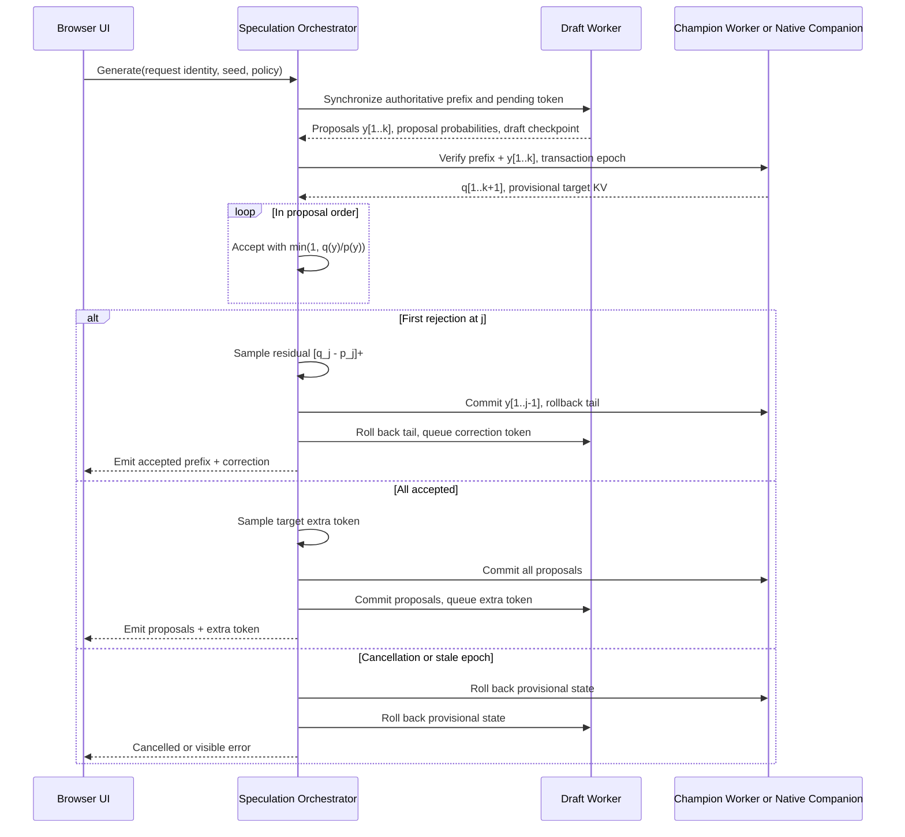

# Exact Speculative and Assisted Decoding for TinyRustLM

## Executive recommendation and evidence boundaries

**Recommendation: conditional go for a narrowly scoped experiment; no product adoption yet.** TinyRustLM should first test exact, linear speculative decoding with one genuinely compatible tiny draft and the qualified champion, plus a model-free prompt-lookup baseline. Shipping should occur only if the implementation preserves the champion’s declared distribution and wins preregistered end-to-end latency, memory, energy, and reliability gates. Published speedups are evidence that the technique can work, not estimates for TinyRustLM. The uploaded specification’s distinctions among artifact bytes, logical composition bytes, incremental bytes, physical deduplicated bytes, and peak resident bytes should be treated as mandatory accounting categories. fileciteturn0file0

The original speculative-sampling and speculative-decoding papers prove that a cheaper proposal model can accelerate generation without changing the target model’s output distribution when proposals are accepted probabilistically and rejections use the correct residual distribution. Their measured speedups arose on particular models, devices, kernels, and workloads and therefore cannot be transferred to TinyRustLM without local measurement. citeturn2view2turn12view0turn12view1turn13view0turn13view1

**Evidence labels used below**

| Label | Meaning |
|---|---|
| **Observed public fact** | Directly found in a cited paper, official documentation, standard, or public repository. |
| **Externally reported result** | A benchmark or conclusion reported by source authors but not independently validated for TinyRustLM. |
| **Inference** | A conclusion derived from cited facts and the stated TinyRustLM constraints. |
| **Engineering recommendation** | A proposed design or gate, not an observed property of private TinyRustLM code. |
| **Assumption** | A temporary premise needed because private artifacts or hardware are unavailable. |
| **Local verification required** | A claim that can be settled only with authorized TinyRustLM models, tokenizers, kernels, and machines. |

**Immediate decision**

| Decision area | Recommendation | Reason |
|---|---|---|
| Product rollout | **Do not ship yet** | No private model pair, tokenizer identities, target verification API, cache behavior, memory profile, or benchmark data were available. |
| Initial prototype | **Proceed** | Exact linear speculation has a compact correctness argument and can be isolated behind a removable target API. |
| First proposal sources | **Prompt lookup and one same-tokenizer tiny draft** | They minimize architectural change and provide a model-free control against which the draft’s extra bytes and energy can be judged. |
| Initial decoding modes | **Greedy first, exact stochastic second** | Greedy provides strong token-identity oracles; stochastic mode adds residual sampling, probability storage, and RNG obligations. |
| Initial lookahead | **Small fixed values, including zero, one, two, and four** | This exposes batch-verification economics without prematurely adding an adaptive policy. |
| Cross-tokenizer assistance | **Defer** | Retokenization, cache realignment, probability transport, and normalization create substantially larger correctness obligations. |
| Medusa, EAGLE, MTP, or LayerSkip | **Defer unless the champion already contains qualified support** | These methods require trained heads, architecture-specific modules, early-exit training, tree verification, or specialized checkpoints. |
| Browser rollout | **After native correctness and cost proof** | Browser memory, WebGPU dispatch, WASM kernels, adapter limits, worker failure, and duplicate model residency add independent risks. |

**Minimum adoption conditions**

TinyRustLM should adopt exact speculation only when all of the following are simultaneously true:

1. The target can score a proposed sequence in one prefill-like operation and return the target distributions for every proposed position plus the position after the proposal.
2. The implementation has a transactional target and draft cache abstraction with logical rollback.
3. The draft and champion compatibility manifest passes strict identity and tokenizer checks.
4. Greedy output is token-identical to the champion baseline under the same declared decoding identity.
5. Stochastic tests support distributional equivalence to the champion after accounting for the implementation’s declared finite-precision arithmetic.
6. End-to-end gains include both model loads, both prefills, both KV caches, synchronization, rejection work, and memory pressure.
7. The implementation can fail before output or fail visibly after output without silently restarting and duplicating answer text.
8. An unsuccessful implementation can be deleted cleanly by removing the speculative orchestrator and optional target-verification API while leaving the champion baseline unchanged.

**Likely outcome by topology.** As an engineering inference, the strongest candidate is a native or native-companion configuration in which the champion remains resident and a truly tiny draft is resident on otherwise underused CPU capacity. A browser-only configuration may still win when the champion’s `q_len > 1` kernels efficiently amortize weight access, but it is more likely to be constrained by duplicate weights, duplicate KV, WebGPU synchronization, and transient loading memory. Prompt lookup may therefore be the best browser-local acceleration even when a neural draft wins natively. Public GPU inference frameworks emphasize that speculative decoding is most beneficial at low batch sizes and depends on efficient collective verification. citeturn16search0turn16search2turn4search0

No assertion in this report implies access to TinyRustLM source code, `.slm` files, models, routing logic, test cases, private prompts, outputs, or machines.

## Exactness taxonomy and compatibility contracts

**The central classification rule is not “small versus large.”** It is whether the proposal mechanism and verifier preserve the champion’s declared token distribution after the complete decoding transformation: temperature, penalties, token suppression, top-\(k\), top-\(p\), grammar masks, stop rules, and any other versioned processor. A proposal source may be weak, deterministic, neural, retrieval-based, or architecturally embedded; exactness comes from verification and correction, not from the proposal’s name.

| Method | Distributional status | Minimum target capability | TinyRustLM assessment |
|---|---|---|---|
| Independent draft model, stochastic speculative sampling | **Exact** when acceptance and residual correction are implemented over the full processed target and proposal distributions | One target verification producing distributions for all proposals and one extra position; transactional KV | **Primary candidate** with strict tokenizer and identity binding |
| Greedy assisted decoding | **Exact for deterministic baseline** when each proposal is accepted only if it equals the target argmax under identical numerical and tie-breaking behavior | Batched target logits for the proposal positions | **Implement first** |
| Dynamic speculation length | Inherits the underlying method’s exactness if it changes only how many tokens are proposed | Same as underlying method | **Add only after fixed-\(k\) profiling** |
| Prompt or generated-prefix n-gram lookup | Exact only when copied candidates remain proposals and are target-verified; not exact if copied blindly | Batched target verification; no draft model | **Required control and likely browser candidate** |
| Self-speculative early exit | Potentially exact when early layers propose and the complete target verifies; practical support generally requires compatible training and cache semantics | Ability to resume target layers and verify multiple positions | **Only if champion was trained and exported for it** |
| Layer-skipping draft | Same principle as self-speculation; exact only with full target verification | Intermediate hidden-state API and later-layer verification | **Not a first implementation** |
| Multi-token prediction heads | Potentially exact when heads generate proposals that undergo exact target verification; relaxed acceptance is approximate | Head execution plus linear or tree target verification | **Checkpoint-dependent** |
| Medusa-style heads and candidate trees | Exact under strict target-token matching or a proved exact rejection sampler; “typical” or relaxed acceptance is **approximate** | Tree attention or flattened branch verification and branch-aware cache commit | **High complexity; defer** |
| EAGLE-style feature drafter | Potentially exact when its outputs are proposals and the target performs the required exact acceptance procedure | Architecture-specific drafter and target verification | **Defer absent qualified checkpoint** |
| Lookahead/Jacobi candidate generation | Potentially exact because candidates can be treated as target-verified proposals | Specialized parallel target execution and n-gram candidate pool | **Interesting but outside minimal core** |
| Grammar-forced token | Exact relative to the grammar-masked target when the valid support contains exactly one target token | Grammar state plus target KV append; LM-head computation may sometimes be skipped | **Worth exploiting after grammar correctness is established** |
| Static target–assistant distribution mixture | **Approximate** because it deliberately replaces the target distribution with a mixture | Both distributions | **Must be separately named and quality-budgeted** |
| Lenient, top-\(k\), or “close enough” acceptance | **Approximate** | Target scores and custom acceptance rule | **Do not expose as exact** |
| Hidden best-of-\(N\) generation | Not speculative decoding and changes system behavior | Multiple complete generations and selector | **Prohibited** |

The exact independent-draft algorithm is established by the original speculative-decoding and speculative-sampling work. Hugging Face currently documents assisted decoding, prompt lookup, self-speculative early exit, multi-token prediction, cross-tokenizer assistance, and an explicitly approximate static-ensemble mode. Medusa, LayerSkip, EAGLE, lookahead decoding, and MTP provide alternative proposal architectures, but each carries different training and verifier requirements. citeturn13view0turn13view1turn2view0turn0academia48turn1academia48turn6academia47turn6academia48turn7academia46

**Tokenizer compatibility contract**

| Relationship | Exact greedy use | Exact stochastic use | Required treatment |
|---|---|---|---|
| Identical tokenizer artifact, vocabulary, IDs, normalization, special tokens, and added-token order | Yes, subject to target numerical identity | Yes | Preferred initial scope |
| Same base tokenizer but different added tokens or reordered IDs | Only after proving an active-support ID mapping and identical prompt encoding | Only after transporting complete proposal probabilities into the target vocabulary | Reject by default |
| Same decoded bytes but different token IDs or segmentation | Possible only with a verified bridge and target-token acceptance | Not by naïve retokenization; requires probability-preserving transport across variable-length tokenizations | Defer |
| Retokenization with longest-common-subsequence cache repair | Can be operationally useful, especially for greedy assistance, but requires target-output and cache proof | Original token-level speculative correction does not automatically remain exact | Treat as a separate algorithm |
| Universal byte-level bridge | Exact in principle only if target-token sequence probabilities are correctly marginalized and the champion remains authoritative | Potentially exact but algorithmically expensive | Research path, not minimal implementation |
| Different or lossy Unicode normalization | Not generally safe | Not generally safe | Incompatible unless a formal reversible transform is proved |
| Different BOS/EOS or byte-fallback conventions | Unsafe without explicit mapping and stop-state proof | Unsafe | Reject by default |

Hugging Face’s Universal Assisted Generation translates context between tokenizers by decoding, re-encoding, identifying a common suffix, and realigning caches. Its later token-level-intersection work addresses heterogeneous-vocabulary sampling. These are material advances, but they should not be treated as evidence that an arbitrary pair of tokenizers is exact under TinyRustLM’s champion distribution. In particular, an ID-level residual distribution \([q-p]_+\) is undefined until both distributions have been expressed on a common sample space. citeturn5search0turn5search2turn2view0

**Engineering recommendation:** the initial compatibility manifest should require byte-identical tokenizer artifacts and explicit equality of:

- vocabulary size, token strings, token IDs, added-token order, merges or unigram scores, normalization, pre-tokenization, byte fallback, unknown-token behavior, and special-token map;
- chat-template bytes and version;
- rendered system, developer, and user prompt token IDs;
- BOS, EOS, padding, stop-token, and stop-string policies;
- context limit, sliding-window behavior, truncation side, RoPE parameters and scaling, position-ID generation, and cache origin;
- model weights, quantization metadata, adapters in ordered composition, logits processors, grammar identity, and sampling policy.

A small output-vocabulary draft can still be exact if it consumes the champion’s tokenization and defines \(p(x)=0\) for omitted output tokens; the residual sampler then retains the champion’s missing mass. Remapping IDs or changing input segmentation is the dangerous part.

**Model and prompt identity.** The target and draft need not share weights, architecture, context length, or probability quality, but they must be evaluated on semantically and positionally aligned prefixes. A shorter draft context can be used only under a versioned draft truncation rule whose proposal probabilities are computed from that truncated prefix while target verification uses the complete champion prefix. Exactness can survive a poor proposal distribution because the draft is merely a proposal, but acceptance may collapse. By contrast, silently applying different chat templates, system prompts, adapter orders, BOS rules, or position IDs can cause both low acceptance and invalid cache alignment.

Different RoPE scaling policies do not mathematically invalidate a proposal model by themselves: the draft may use any proposal distribution. They do invalidate any attempt to share KV, hidden states, positions, or cached prompt transformations between models. **Shared prompt prefill must therefore mean “run the same declared prompt independently through each model,” not “copy one model’s KV into the other,” unless a separately proved cache transform exists.**

**Current implementation landscape.** As of retrieval on August 1, 2026:

- Hugging Face Transformers documents assisted decoding for greedy and sampled generation, prompt lookup, self-speculative early exit, MTP, and cross-tokenizer assistance; documented restrictions and behavior vary by release. citeturn2view0turn2view1turn5search0turn5search2
- TensorRT-LLM 1.3.0 release-candidate documentation covers draft/target, n-gram, EAGLE 3, MTP, suffix-automaton enhancement, parallel drafts, and user-provided drafters. Its relaxed MTP mode is explicitly not strict token-match acceptance. citeturn16search0turn16search9
- vLLM’s current documentation covers multiple speculative techniques and warns that mathematical losslessness does not guarantee bitwise log-probability stability across batching and kernels. citeturn4search0turn4search1turn4search6
- `llama.cpp` publicly exposes local draft/target speculative decoding in its server tooling, making it a relevant native reference, but TinyRustLM should pin and audit a specific commit rather than treating changing `master` documentation as normative. citeturn3search5turn15search1
- WebLLM and Transformers.js publicly provide browser-local inference through WebGPU, WASM, and ONNX-related stacks. In the reviewed public documentation, no implementation-grade exact speculative-sampling API was identified; that negative search result is not proof of absence. citeturn9search0turn9search1turn9search6turn9search7

## Mathematical reconstruction and normative algorithms

Let \(h\) be the current authoritative target-token prefix. Define:

- \(q_i(x)\): the champion’s complete processed next-token distribution at speculative position \(i\), conditioned on \(h,y_1,\ldots,y_{i-1}\);
- \(p_i(x)\): the draft’s actual proposal distribution at that same logical position;
- \(y_i\sim p_i\): the proposed token;
- \(k\): maximum proposal length for this round.

“Processed” means after every declared temperature, mask, grammar, repetition penalty, top-\(k\), top-\(p\), suppression, and other policy transformation. The champion distribution \(q_i\), not the draft, is authoritative.

**Exact stochastic step**

For each proposal \(y_i\), accept it with

\[
a_i(y_i)=\min\left(1,\frac{q_i(y_i)}{p_i(y_i)}\right).
\]

If the first rejection occurs at position \(j\), sample the replacement token from

\[
r_j(x)=
\frac{[q_j(x)-p_j(x)]_+}
{\sum_v [q_j(v)-p_j(v)]_+},
\qquad [z]_+=\max(z,0).
\]

Stop the speculative round after that replacement. If every proposal is accepted, sample one additional token from \(q_{k+1}\). This is the algorithm reconstructed in the original papers. citeturn12view0turn13view0turn13view2

**Correctness argument**

For one position, let

\[
A=\sum_x\min(p(x),q(x)).
\]

The accepted path contributes probability \(\min(p(x),q(x))\) to output token \(x\). Rejection occurs with probability

\[
1-A=\sum_x[q(x)-p(x)]_+.
\]

The corrected path contributes

\[
(1-A)\frac{[q(x)-p(x)]_+}{1-A}=[q(x)-p(x)]_+.
\]

Therefore,

\[
\Pr[\text{output}=x]
=\min(p(x),q(x))+[q(x)-p(x)]_+
=q(x).
\]

Conditioning this identity on every accepted prefix and applying induction gives the champion’s autoregressive joint distribution. The expected single-position acceptance is

\[
A=1-\operatorname{TV}(p,q),
\]

so acceptance measures distributional overlap, not simply model size. citeturn13view1turn13view2

**Normative greedy pseudocode**

```text
function greedy_assisted_round(state, requested_k):
    require state.identity_manifest_is_valid
    require state.target_cache.is_committed
    require state.draft_cache.is_committed

    remaining = state.max_new_tokens - state.emitted_token_count
    if remaining == 0:
        return FINISHED_MAX_LENGTH

    k = min(requested_k, remaining)

    if k == 0:
        token = target_baseline_argmax_one(state)
        commit_and_emit(token)
        return token

    tx_draft = draft_cache.begin_transaction()
    proposals = []

    for i in 0 .. k-1:
        draft_logits = draft.forward_pending_and_get_logits(tx_draft)
        draft_dist = apply_declared_draft_processors(draft_logits, state, i)

        if draft_dist.has_nan_or_no_valid_token:
            tx_draft.rollback()
            token = target_baseline_argmax_one(state)
            commit_and_emit(token)
            return token

        y = argmax_with_declared_tie_break(draft_dist)
        proposals.push(y)
        tx_draft.append_provisionally(y)

        if y is an active stop token:
            break

    tx_target = target_cache.begin_transaction()
    result = target.verify_linear(tx_target, proposals)
    # result.logits[i] predicts proposals[i]
    # result.logits[len(proposals)] predicts the extra token

    accepted = 0

    for i in 0 .. len(proposals)-1:
        q = apply_champion_processors(result.logits[i], state, i)

        if q.has_nan_or_no_valid_token:
            abort_round_without_emitting(tx_target, tx_draft)
            return FATAL_TARGET_NUMERIC_OR_MASK_ERROR

        target_token = argmax_with_declared_tie_break(q)

        if proposals[i] != target_token:
            tx_target.commit_proposal_prefix(accepted)
            tx_target.rollback_proposal_tail()
            tx_draft.rollback_to_authoritative_length(accepted)
            state.set_pending_authoritative_token(target_token)
            emit(proposals[0 .. accepted])
            emit(target_token)
            return accepted + 1 tokens

        accepted += 1

        if proposals[i] is an active stop token:
            tx_target.commit_proposal_prefix(accepted)
            tx_target.rollback_proposal_tail()
            tx_draft.commit_prefix(accepted)
            emit(proposals[0 .. accepted])
            mark_terminal_state()
            return accepted tokens

        if accepted == remaining:
            tx_target.commit_proposal_prefix(accepted)
            tx_target.rollback_proposal_tail()
            tx_draft.commit_prefix(accepted)
            emit(proposals)
            mark_finished_max_length()
            return accepted tokens

    q_extra = apply_champion_processors(
        result.logits[len(proposals)],
        state after proposals,
        len(proposals)
    )

    if q_extra.has_nan_or_no_valid_token:
        abort_round_without_emitting(tx_target, tx_draft)
        return FATAL_TARGET_NUMERIC_OR_MASK_ERROR

    z = argmax_with_declared_tie_break(q_extra)
    tx_target.commit_all_proposals()
    tx_draft.commit_all_proposals()
    state.set_pending_authoritative_token(z)
    emit(proposals)
    emit(z)
    return len(proposals) + 1 tokens
```

**Normative stochastic pseudocode**

```text
function exact_speculative_round(state, requested_k, rng_contract):
    require state.identity_manifest_is_valid
    require state.target_cache.is_committed
    require state.draft_cache.is_committed

    remaining = state.max_new_tokens - state.emitted_token_count
    if remaining == 0:
        return FINISHED_MAX_LENGTH

    k = min(requested_k, remaining)

    if k == 0:
        z = target_baseline_sample_one(
            state,
            rng_contract.target_baseline(state.round_id)
        )
        commit_and_emit(z)
        return z

    tx_draft = draft_cache.begin_transaction()
    proposals = []
    proposal_log_probs = []

    for i in 0 .. k-1:
        draft_logits = draft.forward_pending_and_get_logits(tx_draft)
        p = apply_declared_draft_processors(draft_logits, state, i)

        if p.has_nan_or_no_valid_token:
            tx_draft.rollback()
            z = target_baseline_sample_one(
                state,
                rng_contract.target_baseline(state.round_id)
            )
            commit_and_emit(z)
            return z

        y = sample(
            p,
            rng_contract.draft_sample(state.round_id, i)
        )

        require log(p[y]) is finite
        proposals.push(y)
        proposal_log_probs.push(retain_or_checkpoint(p))
        tx_draft.append_provisionally(y)

        if y is an active stop token:
            break

    tx_target = target_cache.begin_transaction()
    result = target.verify_linear(tx_target, proposals)

    accepted = 0

    for i in 0 .. len(proposals)-1:
        q = apply_champion_processors(result.logits[i], state, i)

        if q.has_nan_or_no_valid_token:
            abort_round_without_emitting(tx_target, tx_draft)
            return FATAL_TARGET_NUMERIC_OR_MASK_ERROR

        p = recover_exact_proposal_distribution(proposal_log_probs[i])

        log_ratio = log(q[proposals[i]]) - log(p[proposals[i]])
        accept_probability = min(1, exp_clamped(log_ratio))

        u = uniform_open_closed(
            rng_contract.accept_uniform(state.round_id, i)
        )

        if u <= accept_probability:
            accepted += 1

            if proposals[i] is an active stop token:
                tx_target.commit_proposal_prefix(accepted)
                tx_target.rollback_proposal_tail()
                tx_draft.commit_prefix(accepted)
                emit(proposals[0 .. accepted])
                mark_terminal_state()
                return accepted tokens

            if accepted == remaining:
                tx_target.commit_proposal_prefix(accepted)
                tx_target.rollback_proposal_tail()
                tx_draft.commit_prefix(accepted)
                emit(proposals[0 .. accepted])
                mark_finished_max_length()
                return accepted tokens

            continue

        residual[x] = max(q[x] - p[x], 0) for every target token x
        residual_mass = stable_sum(residual)

        if residual_mass is not finite or residual_mass <= numeric_floor:
            abort_round_without_emitting(tx_target, tx_draft)
            return FATAL_RESIDUAL_INVARIANT_ERROR

        residual = residual / residual_mass
        z = sample(
            residual,
            rng_contract.correction_sample(state.round_id, i)
        )

        tx_target.commit_proposal_prefix(accepted)
        tx_target.rollback_proposal_tail()
        tx_draft.rollback_to_authoritative_length(accepted)
        state.set_pending_authoritative_token(z)

        emit(proposals[0 .. accepted])
        emit(z)
        return accepted + 1 tokens

    q_extra = apply_champion_processors(
        result.logits[len(proposals)],
        state after proposals,
        len(proposals)
    )

    if q_extra.has_nan_or_no_valid_token:
        abort_round_without_emitting(tx_target, tx_draft)
        return FATAL_TARGET_NUMERIC_OR_MASK_ERROR

    z = sample(
        q_extra,
        rng_contract.target_extra(state.round_id)
    )

    tx_target.commit_all_proposals()
    tx_draft.commit_all_proposals()
    state.set_pending_authoritative_token(z)

    emit(proposals)
    emit(z)
    return len(proposals) + 1 tokens
```

These algorithms follow the acceptance and correction construction in the foundational work, but add explicit cache, identity, stop, cancellation, and failure semantics needed for an implementation. citeturn13view0turn13view1turn13view2

**Normative edge-case behavior**

| Case | Required behavior |
|---|---|
| \(k=0\) | Execute exactly one champion baseline step. This is both a valid operating mode and a fallback control. |
| \(k=1\) | Verify one proposal and obtain the target distribution for the proposal plus the extra position. |
| Full acceptance | Commit every proposal; sample or select the extra champion token unless max length or an accepted stop has already ended generation. |
| First-token rejection | Commit no proposal; sample the correction from \([q_1-p_1]_+\). |
| Later rejection | Commit only the proposals before the first rejection; discard every later draft token. |
| Proposal with \(p(y)=0\) | Impossible under exact sampling. If observed because of underflow or corrupted state, treat it as an invariant failure rather than fabricating a ratio. |
| Numerical underflow | Compute normalized logits and acceptance ratios in log space; compute residuals and sums in at least FP32 or a stronger declared accumulator. |
| All-masked draft logits | Disable speculation for that round and call the champion before emitting output. |
| All-masked target logits | Fail visibly because the champion’s declared decoder has no valid next token; do not allow the draft to override it. |
| NaN or infinity | Abort the uncommitted transaction; a target numerical error must not silently become a draft answer. |
| EOS inside proposal | Verify sequentially. If accepted, commit through EOS, discard the tail, emit no extra token, and terminate. If rejected, sample the correction normally. |
| Rejected EOS | It is just a rejected proposal; the correction can be a non-EOS token. |
| Maximum-token limit | Never emit beyond the limit. Proposals may fill the remaining budget; an extra token is omitted when generation ends by policy. |
| Stop string spanning tokens | Apply the champion’s declared stop-state machine after every committed token; do not emit proposal tokens beyond the first completed stop sequence. |
| Cancellation during drafting | Roll back the draft transaction; target state remains untouched. |
| Cancellation during verification | Commit nothing from the round, roll back both provisional tails, and display “cancelled.” |
| Deterministic replay | Use domain-separated, counter-addressed RNG streams and record the seed, round, proposal index, and RNG-policy version. |
| Baseline comparison under sampling | Do not require ordinary baseline and speculative implementations to emit the same sample sequence when they consume random numbers differently; require distributional equivalence. |
| Cache after EOS | Either materialize EOS KV explicitly or mark the terminal cache non-reusable. Do not leave an ambiguous reusable state. |

**RNG contract.** A counter-based interface should derive independent draws for `draft_sample`, `accept_uniform`, `correction_sample`, `target_extra`, and `target_baseline`. This prevents changes in proposal length from shifting unrelated random draws and makes fault reproduction practical. The exact output distribution does not require the same draft and target random streams, but replay does require a stable, versioned mapping.

**Finite-precision obligation.** Mathematical exactness does not imply bitwise equality between a target’s `q_len=1` and `q_len=k` kernels. Different matrix shapes, reductions, quantized deblocking, and device scheduling may perturb logits. A greedy argmax can flip near a tie; a stochastic probability vector can differ even when all token rankings remain unchanged. TinyRustLM must therefore define whether the champion’s declared distribution is the baseline single-token kernel or a broader numerically tolerated implementation family. The strongest policy is to treat the champion-alone kernel as authoritative and require batched verification to pass logit and output conformance tests against it. vLLM’s documentation similarly distinguishes algorithmic losslessness from floating-point and batching stability. citeturn4search1turn4search6

## Verification, cache, residency, and browser architecture

**Minimum target API**

```text
verify_linear(
    target_identity,
    committed_cache_handle,
    pending_authoritative_token?,
    proposed_target_ids[0..m],
    position_state,
    decoding_state_snapshots
) -> {
    logits_for_proposals[0..m-1],
    logits_after_all_proposals,
    provisional_cache_handle,
    numerical_metadata,
    cancellation_epoch
}
```

The API’s positional contract must be explicit:

- `logits_for_proposals[0]` predicts `proposed_target_ids[0]` from the committed prefix.
- `logits_for_proposals[i]` predicts proposal \(i\) after proposals \(0\ldots i-1\).
- `logits_after_all_proposals` predicts the extra token after every proposed token.
- The target forward pass must use ordinary causal masking, not permit any proposal token to attend to a future proposal.
- The result is provisional until the orchestrator commits an accepted prefix.
- A request identity, sequence number, and cancellation epoch must accompany every worker or native-companion message.

This `k+1`-distribution interface is the key performance prerequisite identified by the original algorithms: the target scores the proposal block in parallel, turning repeated decode operations into a prefill-like verification pass. citeturn12view0turn12view1turn16search0turn16search2

**Cache transaction model**

A cache transaction should expose:

```text
checkpoint = cache.begin(committed_length)
cache.append_provisional(tokens)
cache.commit_prefix(token_count)
cache.rollback_to(logical_length)
cache.finalize()
```

The logical state should distinguish:

1. **Committed KV length:** tokens whose K/V tensors are materialized and authoritative.
2. **Pending authoritative token:** a sampled or selected token already emitted but not yet consumed by the next model forward.
3. **Provisional verification tail:** target K/V for proposed tokens that may be accepted or rolled back.
4. **Terminal marker:** EOS, stop, cancellation, or max-length state.
5. **Content identity:** model, tokenizer, template, adapters, positional policy, prompt, cache layout, and quantization identity.

Suppose proposals \(y_1,\ldots,y_k\) are verified and rejection occurs at \(j\). The target may retain K/V only for \(y_1,\ldots,y_{j-1}\). The replacement token is usually “pending”: it has been sampled from the target-derived residual but has not yet passed through the target transformer. The next target call first consumes that token. The draft must similarly roll back rejected proposals and ingest the authoritative replacement before proposing again.

With paged KV, rollback can be logical: pages containing rejected tokens may remain allocated for reuse, but their token ranges must become unreachable. Page references must not be returned to a pool until all in-flight device work and message epochs that could address them have completed. TensorRT-LLM’s public implementation documentation illustrates request-level rewind and paged-cache handling as a concrete reference, though TinyRustLM must independently validate its own layout. citeturn3search4turn16search0

**Separate-cache rule.** A target and independent draft require separate KV caches. Even if both consume the same token IDs, their layers, hidden widths, head counts, head dimensions, quantization, RoPE, and cache layouts generally differ. Prompt computation may be scheduled together, but cache tensors are not interchangeable.

For a model with \(L\) layers, \(H_{\mathrm{KV}}\) KV heads, head dimension \(D\), sequence length \(S\), and \(b\) bytes per KV element, an approximate batch-one KV payload is

\[
M_{\mathrm{KV}}
=
2SLH_{\mathrm{KV}}Db,
\]

before page tables, alignment, allocator fragmentation, metadata, and provisional speculative tails. TinyRustLM’s peak memory must include \(M_{\mathrm{KV,target}}+M_{\mathrm{KV,draft}}\).

**Logit and residual scratch.** Returning all full-vocabulary distributions requires approximately

\[
M_{\mathrm{target\ logits}}=(k+1)Vb_\ell.
\]

Retaining all draft distributions costs roughly \(kVb_\ell\). Exact rejection correction needs the full \(p_j\) and \(q_j\) at the rejected position. TinyRustLM can trade memory for recomputation by storing only draft checkpoints and recomputing \(p_j\) after rejection, but that recomputation belongs in the latency and energy model. Sparse top-\(k\) representations are exact only when omitted proposal probabilities are known to be zero and the residual calculation still covers all target-supported tokens.

**Suggested architecture visualization — place here**



**Kernel implications**

- **Quantized target kernels:** verification changes the target’s query length from one to a small \(k\). This may convert weight-dominated matrix-vector work into a better-amortized small matrix multiplication, but only if the q4 kernel is optimized for these shapes.
- **WASM SIMD:** standardized 128-bit SIMD can accelerate packed low-bit unpacking and dot products, but it does not eliminate the extra draft weight stream or cache traffic. citeturn8search1turn8search10
- **WebGPU:** use fixed, preallocated maximum-\(k\) buffers and query actual adapter limits at runtime. Avoid returning \((k+1)V\) logits to JavaScript when acceptance and residual computation can occur on-device; CPU readback and synchronization can erase verification gains. WebGPU remained on the W3C Candidate Recommendation track in 2026, so implementation and limit variability must remain part of the compatibility matrix. citeturn16search5turn16search6turn16search10
- **Native CPU:** the principal opportunity is amortizing a full champion-weight traversal across several token positions. The main risks are a draft that also saturates memory bandwidth and a target kernel whose \(q_len=k\) path performs worse than repeated decode.
- **CPU draft plus GPU champion:** proposal IDs and selected probabilities are small transfers, but the GPU cannot verify until drafting completes. This topology helps only when the CPU draft is fast and does not contend with GPU command preparation or unified memory.
- **Tree methods:** Medusa- or EAGLE-style branches require tree attention masks, node-to-parent position maps, branch-aware logit extraction, and more complex cache commit. Linear verification should precede them.

**Residency topology comparison**

| Topology | Fixed and peak costs | Latency profile | Privacy boundary | Assessment |
|---|---|---|---|---|
| Both models resident | Highest weight and KV residency; lowest switching overhead | Best steady-state candidate | Single local process/device boundary | Preferred when memory headroom is proven |
| Draft resident, champion streamed each round | Champion loading or weight streaming dominates | Usually untenable for interactive decoding | Local but high I/O exposure | Reject except unusual mapped-weight hardware |
| Champion resident, draft loaded on demand | Additional first-use delay and transient peak memory | May work only for long sessions with warm draft | Local | Measure session-length break-even |
| Sequential reuse of one arena | Low nominal arena count but repeated weight swaps and cache invalidation | Poor unless model loading is nearly free | Local | Unlikely to win |
| CPU draft, GPU champion | Duplicate residency across devices; small proposal transfer | Promising when CPU is spare and GPU target is underfilled | Local device boundary | Strong native candidate |
| Browser draft, native-companion champion | Browser draft bytes plus native target; IPC synchronization | Can preserve responsive UI if IPC is low-latency | Explicit browser/native consent boundary | Promising, but protocol-hard |
| Browser-only WebGPU target and draft | Highest browser GPU allocation and loading peak | Potentially fast after warm-up | Entirely browser-local | High memory and device-loss risk |
| Prompt lookup, champion resident | No neural draft weights or draft KV | Excellent when text is repetitive | Entirely local | Mandatory baseline |

**Required byte reporting**

| Measure | Definition |
|---|---|
| Artifact bytes | Sum of stored files as distributed, including champion, draft, tokenizer, adapters, and metadata. |
| Logical composition bytes | Sum of logical components selected for the configuration, even where components reference identical content. |
| Incremental bytes | Additional artifact and runtime bytes attributable to speculation over champion-alone operation. |
| Physical deduplicated bytes | Unique content-addressed blocks actually stored after deduplication. |
| Peak resident bytes | Maximum simultaneous weights, KV, provisional tails, logits, scratch, worker heaps, GPU buffers, and transient load overlap during the full lifecycle. |

Peak resident accounting must be timeline-based. Loading a draft while the champion and its old scratch arena remain resident may create a larger peak than steady-state decoding.

## Cost model, scheduling, grammar, and draft selection

Let:

- \(L_t,L_d\): target and draft load costs;
- \(P_t(S),P_d(S)\): prompt-prefill costs for prompt length \(S\);
- \(d_i\): cost to generate proposal \(i\);
- \(V_t(k)\): target cost to verify \(k\) proposals and produce the extra distribution;
- \(C_{\mathrm{sync}}(k)\): worker/device/IPC synchronization and transfer;
- \(C_{\mathrm{rollback}}(j,k)\): logical and physical rollback after rejection at \(j\);
- \(C_{\mathrm{residual}}(j)\): probability recovery, positive-part subtraction, normalization, and sampling;
- \(a_i\): conditional acceptance probability at proposal position \(i\);
- \(S_i=\Pr(\text{first }i\text{ proposals accepted})\), with \(S_0=1\).

No independence assumption is needed for \(S_i\). Empirically,

\[
S_i=\prod_{j=1}^{i}a_j
\]

when \(a_j\) is defined conditionally on survival to position \(j\).

Ignoring terminal truncation, every round emits one authoritative token, plus one token for every accepted proposal. Thus

\[
\mathbb{E}[G(k)]
=
1+\sum_{i=1}^{k} S_i
=
\sum_{i=0}^{k}S_i.
\]

Under a constant conditional acceptance \(\alpha\),

\[
\mathbb{E}[G(k)]
=
\frac{1-\alpha^{k+1}}{1-\alpha}.
\]

This is the standard speculative-decoding throughput structure; TinyRustLM should estimate the position-dependent \(S_i\) rather than assume a constant rate. citeturn13view2

An implementation-grade expected round cost is

\[
\begin{aligned}
\mathbb{E}[C_{\mathrm{round}}(k)]
=&
\sum_{i=1}^{k} d_i
+V_t(k)
+C_{\mathrm{sync}}(k) \\
&+
\sum_{j=1}^{k}
S_{j-1}(1-a_j)
\left[
C_{\mathrm{rollback}}(j,k)
+C_{\mathrm{residual}}(j)
\right] \\
&+
S_kC_{\mathrm{full\ accept}}
+C_{\mathrm{cache\ append}}
+C_{\mathrm{telemetry}}.
\end{aligned}
\]

The steady-state per-token cost is

\[
\bar C_{\mathrm{spec}}(k)
=
\frac{\mathbb{E}[C_{\mathrm{round}}(k)]}
{\mathbb{E}[G(k)]}.
\]

If \(C_t(1)\) is the measured champion-alone cost per generated token, the necessary steady-state break-even condition is

\[
\bar C_{\mathrm{spec}}(k)<C_t(1).
\]

For a session expected to generate \(N\) tokens, define fixed incremental cost

\[
F=L_d+P_d(S)+C_{\mathrm{draft\ initialization}}
+C_{\mathrm{extra\ allocation}}.
\]

A rough minimum generation length is then

\[
N_{\min}
>
\frac{F}
{C_t(1)-\bar C_{\mathrm{spec}}(k)}
\]

when the denominator is positive. If it is nonpositive, no amount of session length amortizes the draft under that configuration.

The full end-to-end comparison should measure

\[
T_{\mathrm{baseline}}
=
L_t+P_t(S)+T_{\mathrm{decode,target}},
\]

\[
T_{\mathrm{spec}}
=
L_t+L_d+P_t(S)+P_d(S)
+T_{\mathrm{draft}}
+T_{\mathrm{verify}}
+T_{\mathrm{reject}}
+T_{\mathrm{sync}}
+T_{\mathrm{rollback}}
+T_{\mathrm{finalize}}.
\]

A reported “tokens per second” that begins after both models and prompts are warm is therefore only one of several views.

**Adaptive speculation length**

| Policy | Exactness | Advantages | Risks | Recommendation |
|---|---|---|---|---|
| Fixed \(k\) | Inherits verifier exactness | Reproducible, easy to benchmark and TDD | Suboptimal across tasks | Start here |
| Acceptance-history heuristic | Exact if it changes only future proposal count | Very cheap | Slow adaptation; workload oscillation | Add after fixed-\(k\) study |
| Draft-confidence threshold | Exact if confidence only terminates proposal generation | Responds within a round | Confidence may be poorly calibrated to target acceptance | Candidate second policy |
| Learned acceptance predictor | Exact if it only schedules and does not alter target probabilities | Can combine task, length, and recent outcomes | Added model, privacy, versioning, training contamination | Defer |
| Oracle lookahead | Offline upper bound only | Quantifies scheduling headroom | Requires future target results and is not free | Evaluation tool, never production claim |

Hugging Face changed its default assisted-generation scheduling toward confidence-based dynamic lookahead in Transformers 4.45 and reported gains over static schedules on its tested model pairs and hardware. Those results support testing the idea but do not determine TinyRustLM’s policy. citeturn2view1turn4academia48

The scheduler must be content-identity-bound and versioned. It may use local counters such as recent position-wise acceptance, draft entropy, remaining context, and measured device timings. It should not upload private prompts or outputs, retain hidden user-history features, or optimize against sealed answer quality. An online policy update that changes behavior during a preregistered evaluation should invalidate the run.

**Grammar and deterministic opportunities**

A grammar mask replaces the unmasked champion distribution \(q\) with

\[
q_G(x)=
\frac{q(x)\mathbf 1[x\in A_G]}
{\sum_v q(v)\mathbf 1[v\in A_G]},
\]

where \(A_G\) is the valid-token set in the current grammar state. Exact speculation is then exact relative to \(q_G\), provided the grammar state and masking order are identical in baseline and speculative execution.

Target probability verification can be skipped only when the declared target decoder has exactly one valid next target token. Even then, the forced token must eventually pass through the target transformer to create KV for subsequent prediction. TinyRustLM may batch a sequence of grammar-forced tokens as a prefill-like append and may omit unnecessary LM-head projection at intermediate forced positions if the target API supports it. It may not skip target state advancement.

Prompt copies, whitespace predictions, closing braces, indentation, and syntax continuations are not automatically forced. Unless the validated grammar’s target-token support is a singleton, they remain proposals and require target verification. Public guided-decoding systems support JSON Schema, regular expressions, and EBNF-like constraints, demonstrating the operational value of grammar masks, but TinyRustLM must qualify its own parser and token-mask generation. citeturn16search8turn9search5

**Draft training and selection**

| Draft option | Likely benefit | Exactness implication | Main qualification requirement |
|---|---|---|---|
| Generic tiny instruct model | Lowest acquisition effort | Exact if probabilities and tokenizer mapping are valid | Acceptance and prompt-format compatibility |
| Draft-specialized model | Better champion overlap for the same size | Exact under normal verifier | Proven provenance and representative training |
| Champion distillation | Can directly reduce \(TV(p,q)\) | Exact under verifier | No sealed evaluation answers; champion data rights |
| Output-vocabulary trimming | Smaller head and artifacts | Exact if omitted tokens receive \(p=0\) in champion vocabulary | Preserve target IDs and residual support |
| Domain specialist | High acceptance in narrow strata | Exact but may collapse elsewhere | Router-independent evaluation and fallback |
| Online adaptation | Could learn local style | Exactness can remain, but behavior becomes nonstationary | Privacy, poisoning, reproducibility, rollback |
| MTP or self-distilled heads | Low draft overhead and shared representation | Exact only with strict target verification | Architecture changes and trained checkpoints |
| Early-exit draft | Shares weights and may reduce resident bytes | Exact only with full-layer verification | Early-exit training and hidden-state API |

LayerSkip specifically combines layer dropout and early-exit training to support self-speculative execution, while MTP and Medusa add future-token heads. EAGLE drafts at a feature level. These are not drop-in properties of an arbitrary champion checkpoint. citeturn1search2turn1academia48turn6academia48turn0academia48turn6academia47

**Contamination boundary.** Draft training may use appropriately licensed public data, nonsealed synthetic prompts, and champion probability traces generated under an authorized process. It must not use sealed product evaluation answers, hidden human-preference labels from the final test, private user prompts without explicit consent, or test-set-derived routing rules. Provenance receipts should bind dataset versions, filters, champion identity, training code, and draft artifact hash.

## Preregistered evaluation, metrics, and promotion gates

**Comparison arms**

| Arm | Purpose |
|---|---|
| Qualified champion alone | Authoritative output, latency, memory, energy, and failure baseline |
| Champion plus prompt lookup | Model-free assisted-decoding control |
| Champion plus one generic tiny draft | Tests whether “small” actually produces useful overlap |
| Champion plus draft-specialized model | Tests whether specialization justifies extra artifact and training cost |
| Self-speculative mode, if the champion supports it | Tests shared-weight alternative |
| Incompatible-tokenizer expected-failure control | Confirms compatibility rejection or explicitly tested bridge behavior |
| Approximate method, if considered | Kept in a separately named quality-budgeted experiment |

Every paired run must bind the same champion artifact, tokenizer, template, rendered prompt IDs, adapters, decoding profile, grammar, stop policy, seed family, context limit, hardware, browser version, worker topology, and thermal/power condition. Speculative policy and draft identity are the intended independent variables.

**Workload strata**

The preregistered corpus should include casual chat, ambiguous requests, source conflict, current-preference questions, prompts requiring distrust of model memory, summaries, rewrites, structured JSON, extraction, code, repetitive text, multilingual text, long context, and adversarial low-acceptance inputs. Each stratum should report acceptance and quality separately; a high aggregate rate dominated by repetitive copying is insufficient evidence for conversational deployment.

Long-context tests should cross page boundaries, draft context limits, target context limits, sliding-window thresholds, and browser-memory pressure points. Multilingual tests should include combining marks, composed and decomposed Unicode, emoji sequences, right-to-left text, CJK segmentation, byte fallback, and scripts in which tokenizer normalization differs.

**Metrics**

| Category | Required measures |
|---|---|
| Proposal efficiency | Accepted proposals per target pass; survival \(S_i\); first-rejection position; acceptance by task, language, context length, and draft confidence |
| Calls and work | Target verification calls; target single-token calls; draft calls; recomputed distributions; cache rollbacks; bytes transferred |
| Latency | Cold start; model load; target prefill; draft prefill; first-token latency; steady decode; total completion; p50, p95, and worst retained case |
| Throughput | User-visible generated tokens per second and champion-forward-equivalent work, not merely accepted tokens |
| Memory | Artifact, logical, incremental, deduplicated, peak resident, target KV, draft KV, provisional tail, logits, scratch, and transient loading peak |
| Energy | CPU package, GPU/device, and whole-system energy where measurable; energy per completed token |
| Exactness | Greedy token identity; stop position; raw byte output; target-processor state; stochastic sequence-distribution tests |
| Quality | Task success, schema validity, code tests, semantic score, blinded human preference, severe-regression count |
| Reliability | Load failures, OOM, device loss, cancellation latency, stale-message rejection, cache-recovery success, duplicate-output incidence |
| Context behavior | Maximum usable context, truncation equivalence, page rollback, position and RoPE conformance |
| Privacy | Receipt fields emitted, prohibited-field scans, prompt/output leakage tests |

**Exactness tests**

For deterministic champion decoding, the acceptance criterion is zero token mismatches against champion-alone output across all retained matched-identity cases. The comparison must include EOS and stop positions, not only visible decoded text.

For stochastic exactness:

1. Build synthetic vocabularies of two to six tokens with rational or exactly representable probabilities.
2. Enumerate all short target and draft distributions, including disjoint supports, equal distributions, tiny overlap, zero target probability, zero proposal probability, and masked tokens.
3. Compare exact sequence probabilities by exhaustive state enumeration.
4. Run Monte Carlo tests against target probabilities with preregistered confidence intervals and correction for multiple comparisons.
5. Test the distribution of first rejection positions and corrected tokens.
6. Test transformed distributions after temperature, top-\(k\), top-\(p\), penalties, and grammar masks.
7. Compare `q_len=1` and `q_len=k` target logits and resulting distributions on the real kernels.
8. Maintain deterministic golden vectors for the reference speculative interpreter and its RNG domains.

Deterministic replay is useful for debugging, but ordinary champion-alone and speculative runs need not produce the same sampled answer because they use random draws differently. Distributional equivalence is the mathematical criterion.

**Suggested promotion gates**

These values are engineering recommendations to preregister before seeing final results, not claimed industry standards.

| Gate | Proposed requirement |
|---|---|
| Greedy correctness | Zero mismatched target token IDs, stop decisions, or raw output bytes across the complete matched suite |
| Stochastic correctness | All exhaustive tests exact within declared arithmetic; Monte Carlo tests remain inside preregistered simultaneous confidence bounds |
| Numerical conformance | Batched-verification distributions remain within a declared tight tolerance of champion-alone distributions, with no argmax flips in deterministic mode |
| End-to-end performance | At least 10% median completion-latency improvement in each designated adoption stratum after cold and warm costs are separately reported |
| Tail latency | No more than 5% p95 regression in a stratum where speculation remains enabled |
| First-token latency | No material regression under the product’s preregistered threshold; otherwise draft loading/prefill must be deferred or amortized |
| Memory | No OOM; at least 15% measured headroom below the enforced device or browser budget during worst-case transient peak |
| Energy | No statistically supported energy-per-completed-token regression in designated hardware classes |
| Exact-mode quality | Zero quality budget: outputs must follow the champion decoder, not a semantic approximation |
| Approximate-mode quality | No severe safety regression; no more than one percentage point absolute automated-task regression and a preregistered human noninferiority margin, such as two preference points |
| Reliability | No duplicate answer streams; all injected failures produce the specified visible state |
| Maintenance | Speculation can be disabled and deleted without changing champion-alone code paths or serialized conversation semantics |

The performance gate should be applied separately to browser-only, browser/native, and native-only classes. It is acceptable for the scheduler to disable speculation on known low-acceptance strata, but that disabling policy must itself be frozen before the final evaluation.

**Suggested result visualizations**

Place these immediately after the preregistered results table:

- A survival curve showing \(S_i\) by proposal position and workload stratum.
- A latency decomposition waterfall with load, both prefills, draft, verification, correction, synchronization, and output handling.
- A break-even plot with session output length on the horizontal axis and total latency ratio on the vertical axis.
- A scatter plot of peak resident bytes versus median completion latency for every topology.
- An acceptance-versus-draft-entropy calibration plot.
- A heat map of method by workload stratum, with separate panels for performance and quality.
- An empirical cumulative distribution of per-request speedup so that regressions are not hidden by a mean.
- A Pareto frontier of latency, energy, and peak resident memory.

## Fault tolerance, privacy, implementation backlog, and deletion rules

**Fault-injection matrix**

| Injected condition | Detection | Required state transition | Fallback behavior |
|---|---|---|---|
| Draft load failure | Artifact I/O or hash failure | Destroy partial draft state | Champion baseline is allowed only before speculative output begins |
| Target load failure | Artifact I/O, allocation, or hash failure | Destroy all generation state | Visible failure; draft must never answer alone |
| Tokenizer mismatch | Compatibility-manifest failure | Disable speculative configuration | Champion baseline before output |
| Chat-template or adapter mismatch | Content-identity check | Invalidate both caches | Re-render and prefill under one identity or fail |
| Cache corruption | Bounds, checksum, generation epoch, or oracle mismatch | Quarantine cache and terminate transaction | Visible error; retry only as a new answer |
| Rejected EOS | Normal acceptance path | Roll back EOS proposal and later tail | Emit correction token normally |
| NaN or infinity | Distribution validator | Abort uncommitted round | Visible target error; no invented token |
| All-masked distribution | Mask validator | Terminate or grammar error | No draft override |
| Proposal beyond context | Preflight capacity check | Reduce \(k\) or disable speculation before drafting | Apply champion’s declared context policy |
| Cancellation during verification | Cancellation epoch | Roll back provisional target and draft tails | Display cancelled; emit no round output |
| WebGPU device loss | Device-lost callback and epoch invalidation | Invalidate GPU buffers and caches | Visible failure; new explicit retry may use baseline |
| Worker death | Heartbeat or message-port close | Reject all outstanding sequence numbers | Visible failure; no silent duplicate restart |
| Stale proposal message | Request ID, round ID, and prefix hash | Drop message | Continue only with current epoch |
| Model or adapter switch | Identity change | Invalidate KV and proposal state | Re-prefill; never reuse old state |
| Insufficient memory | Allocation preflight or OOM | Release draft/provisional resources | Champion baseline only if champion fits and nothing was emitted |
| Residual mass numerical failure | Invariant check | Abort transaction | Fatal exactness error, not silent target sampling |
| Native-companion disconnect | Authenticated channel state | Invalidate remote handles | Visible disconnect; a fresh baseline answer requires new user-visible transaction |

**No-duplicate-output rule.** Fallback to champion-alone execution may be silent only before the answer has emitted its first token. Once output has been streamed, an unrecoverable speculative failure must terminate that answer visibly. Automatically restarting from the prompt could repeat or contradict already displayed text and obscure the failure.

**Privacy-safe receipt**

A local receipt may contain:

```text
receipt_version
request_nonce
champion_artifact_hash
draft_artifact_hash or "none"
tokenizer_hash
chat_template_hash
adapter_chain_hash
sampling_policy_hash
grammar_hash
position_policy_hash
scheduler_policy_hash
hardware_class
browser/runtime version
seed commitment or local replay seed
target-call count
draft-call count
proposal count
accepted-count histogram
rejection-position histogram
cold and warm timing aggregates
peak resident byte categories
bounded numeric errors
failure and fallback code
```

It should exclude prompts, outputs when private, model bytes, decoded token strings, local filesystem paths, credentials, peer identifiers, hidden user history, raw KV, and unrestricted device fingerprints. A receipt intended for sharing can hash or bucket hardware information more coarsely than a local diagnostic receipt.

**Implementation components**

| Component | Minimum responsibility |
|---|---|
| Identity manifest | Content-address every model, tokenizer, template, adapter order, position policy, sampling policy, and grammar |
| Target verifier | Produce position-aligned target logits and provisional KV for a linear proposal |
| Cache transaction | Checkpoint, append, commit prefix, rollback, epoch invalidation, and terminal state |
| RNG contract | Counter-addressed domain separation and replay metadata |
| Probability engine | Stable processor ordering, log-softmax, acceptance ratio, residual normalization, and sampling |
| Tokenizer compatibility checker | Byte-level artifact comparison and active ID-map validation |
| Scheduler | Versioned fixed and later adaptive \(k\); local-only statistics |
| Worker protocol | Request, round, prefix identity, cancellation epoch, stale-message rejection |
| UI state machine | Loading draft, baseline, accelerating, fallback-before-output, cancelled, failed |
| Test oracle | Simple high-precision reference implementation independent from optimized kernels |
| Metrics recorder | Separated cold, prefill, verify, rollback, memory, energy, and output timings |

**Zero-third-party-crate Rust assessment.** A same-tokenizer, linear greedy implementation is feasible in a minimal Rust core. Exact stochastic sampling is also feasible but requires careful implementations of stable log-softmax, categorical sampling, residual arithmetic, and RNG. The following are poor initial fits for a zero-third-party-crate core:

- cross-tokenizer Unicode normalization and retokenization bridges;
- complete JSON Schema, regex, or EBNF grammar compilation;
- GPU portability layers and shader toolchains;
- tree-attention construction for Medusa or EAGLE;
- statistical test frameworks;
- arbitrary model-format parsing and compression;
- cryptographic content hashing if TinyRustLM does not already contain a qualified implementation.

A clean architecture can keep the exact orchestration core dependency-free while generating tokenizer manifests, grammar automata, and test fixtures in audited build tools. Runtime use of an external grammar or GPU component must still be explicitly qualified; “zero crates” must not motivate an improvised, under-tested Unicode or cryptographic implementation.

**TDD and adoption sequence**

| Stage | Tests and deliverable | Exit criterion |
|---|---|---|
| Probability kernel | Tiny rational distributions; exhaustive acceptance and correction | Exact enumerated output probabilities |
| Reference interpreter | Slow scalar greedy and stochastic implementation | Stable golden vectors and replay |
| Cache simulator | Synthetic append, commit, rollback, EOS, cancellation, stale epoch | State invariants under property-based operation sequences |
| Target verifier | Champion synthetic model returning known logits | Correct `k+1` alignment for \(k=0,1,\ldots,K\) |
| Greedy real models | One same-tokenizer draft/champion pair | Zero baseline token mismatches |
| Stochastic real models | Full-vocabulary residual and RNG contract | Distributional tests and numeric conformance pass |
| Prompt lookup | N-gram proposals through same verifier | Exactness plus model-free performance baseline |
| Native benchmark | CPU and GPU/native-companion topologies | End-to-end break-even gate |
| Browser WASM | Worker cancellation, memory pressure, SIMD kernels | Reliability and memory gates |
| Browser WebGPU | `q_len=k` target kernels, device loss, readback minimization | Kernel and tail-latency gates |
| Adaptive scheduler | Fixed-policy comparison, then frozen adaptive policy | Improvement over best fixed \(k\) without regression |
| Sealed quality study | Full workload strata and approximate arms, if any | Preregistered quality budget |
| Promotion | Feature flag and clean baseline fallback | All exactness, performance, memory, privacy, and fault gates |
| Deletion | Remove unsuccessful path and optional artifacts | Champion baseline remains bit-for-bit qualified |

**Clean deletion criteria**

Delete rather than retain the speculative path when any of these remains true after the preregistered optimization budget:

- the target lacks an efficient batched-verification path;
- greedy mismatches persist under matched identities;
- stochastic distribution tests fail;
- draft loading and prefill do not amortize over expected sessions;
- peak memory violates the product’s supported hardware envelope;
- the draft raises energy per completed token without an accepted compensating product benefit;
- gains occur only on repetitive benchmarks and not on designated conversational strata;
- the scheduler must inspect private content in an unapproved way;
- cache rollback or cancellation remains unreliable;
- cross-tokenizer complexity exceeds its demonstrated incremental benefit;
- the feature cannot be cleanly disabled without branching the champion decoder throughout the codebase.

## Unknowns and annotated primary-source bibliography

**Facts requiring authorized local verification**

The following determine adoption and cannot be resolved from public sources:

- champion and candidate draft parameter counts, artifact encodings, quantization layouts, tokenizer hashes, vocabulary IDs, templates, adapters, and licenses;
- whether the target runtime can compute position-aligned \(k+1\) logits in one call;
- numerical differences between TinyRustLM’s single-token and multi-token q4 kernels;
- draft and target KV layouts, page sizes, rollback costs, and pending-token semantics;
- actual browser and native loading peaks, allocator fragmentation, GPU allocation limits, and OOM behavior;
- prompt-prefill cost for both models and whether either prefill can overlap loading;
- acceptance \(S_i\) by the required workload strata;
- whether the draft is bandwidth-bound on the same CPU resources needed by the champion;
- WebGPU command-submission, synchronization, device-loss, and CPU-readback costs;
- WASM SIMD availability and fallback behavior across supported browsers;
- native-companion IPC latency, authentication, cancellation, and privacy boundaries;
- model artifact deduplication at file, tensor, and content-block levels;
- actual session-length distribution needed to amortize draft load and prefill;
- energy measurement availability;
- exact champion stop-string, grammar, top-\(p\), repetition-penalty, and processor order;
- whether a self-speculative, MTP, Medusa, or EAGLE-compatible champion artifact exists;
- whether continuation after EOS requires reusable final KV or always creates a new templated prompt;
- whether private evaluation permits storing token IDs or only aggregate receipts.

**Annotated primary and official sources**  
Retrieval date for every web source below: **August 1, 2026**.

| Source and direct link | Revision or publication | Relevance and caveat |
|---|---|---|
| [Leviathan, Kalman, and Matias, “Fast Inference from Transformers via Speculative Decoding”](https://proceedings.mlr.press/v202/leviathan23a.html) | ICML/PMLR 2023; original arXiv work began in 2022 | Foundational exact speculative-decoding algorithm, correctness, expected-token formula, and target-parallelism argument. Reported speedups are not TinyRustLM estimates. citeturn1search0turn2view2turn12view1turn13view2turn13view3 |
| [Chen et al., “Accelerating Large Language Model Decoding with Speculative Sampling”](https://arxiv.org/abs/2302.01318) | arXiv:2302.01318, initially February 2023 | Foundational stochastic algorithm with draft proposals, target acceptance, positive-part correction, and extra token; primary source for normative reconstruction. citeturn0academia47turn12view0turn13view0turn13view1 |
| [Hugging Face Transformers generation strategies](https://huggingface.co/docs/transformers/generation_strategies) | Stable documentation identified as Transformers 5.14.0 at retrieval | Official current overview of assisted decoding, prompt lookup, self-speculation, MTP, universal assistance, and approximate static ensembling. Exact runtime behavior must be pinned to the version TinyRustLM studies. citeturn2view0 |
| [Hugging Face, “Faster Assisted Generation with Dynamic Speculation”](https://huggingface.co/blog/dynamic_speculation_lookahead) | October 8, 2024; tied to Transformers 4.45.0 | Official implementation account of confidence-based dynamic lookahead. Its benchmarks are model- and hardware-specific. citeturn2view1turn4academia48 |
| Hugging Face Universal Assisted Generation implementation note | October 29, 2024; associated with Transformers 4.46.0 | Describes two-way tokenizer translation, re-encoding, common-suffix alignment, and draft-cache discard. Useful engineering reference, not blanket proof of stochastic exactness across tokenizers. citeturn5search0 |
| Hugging Face token-level-intersection update | March 24, 2025; associated with Transformers 4.50.0 and arXiv:2502.05202 | Addresses heterogeneous-vocabulary sampling through vocabulary intersection. TinyRustLM would still need a formal mapping and local conformance proof. citeturn5search2 |
| [Cai et al., “Medusa: Simple LLM Inference Acceleration Framework with Multiple Decoding Heads”](https://arxiv.org/abs/2401.10774) | arXiv 2024 | Primary source for multiple future-token heads and tree candidates. Distinguish strict acceptance from typical or relaxed acceptance. citeturn0academia48turn0search0 |
| [Elhoushi et al., “LayerSkip”](https://arxiv.org/abs/2404.16710) | 2024 paper and Meta public release | Primary source for early-exit training and self-speculative decoding. Requires checkpoint-level support rather than arbitrary layer skipping. citeturn1search2turn1academia48turn15academia42 |
| [Gloeckle et al., “Better & Faster Large Language Models via Multi-token Prediction”](https://arxiv.org/abs/2404.19737) | 2024; ICML 2024 | Primary source for multiple future-token prediction heads. Reported acceleration does not establish compatibility with a TinyRustLM champion. citeturn6academia48turn6search11 |
| [Li et al., “EAGLE”](https://arxiv.org/abs/2401.15077) | 2024 | Primary source for feature-level speculative drafting with target verification. Requires model-specific training and integration. citeturn6academia47turn6search0turn6search5 |
| [Fu et al., “Lookahead Decoding”](https://arxiv.org/abs/2402.02057) | 2024 | Primary source for Jacobi-style parallel candidate discovery and verification without an independent small draft model. Higher implementation complexity than linear speculation. citeturn7academia46turn7search0turn7search1 |
| [TensorRT-LLM speculative decoding documentation](https://nvidia.github.io/TensorRT-LLM/1.3.0rc20/features/speculative-decoding.html) | Version 1.3.0rc20, current release-candidate documentation at retrieval | Official native/GPU implementation reference covering draft/target, n-gram, EAGLE 3, MTP, suffix automata, and custom drafters. One official example page pins source commit `61cef212a8c59e843521881f45eee262c8f0525d`. citeturn16search0turn16search9 |
| [vLLM speculative decoding documentation](https://docs.vllm.ai/en/latest/features/spec_decode.html) | Current documentation, reported updated June 23, 2026; repository retrieval also exposed SHA `652ba59229499eb65fc4115b7feadeddf9bcb75d` for a contemporaneous code view | Useful reference for current serving-oriented methods and the distinction between algorithmic losslessness and numerical/log-probability stability. Pin the exact feature implementation before reuse. citeturn4search0turn4search1turn4search6turn14view2 |
| [`llama.cpp`](https://github.com/ggml-org/llama.cpp) | Public repository as retrieved August 1, 2026; reviewed speculative documentation was not tied to a sufficiently clear immutable commit | Relevant local/native implementation exposing target plus draft operation. Must be commit-pinned before serving as a test oracle. citeturn3search5turn15search1 |
| [WebLLM](https://github.com/mlc-ai/web-llm) and [MLC-LLM](https://github.com/mlc-ai/mlc-llm) | Public repositories retrieved August 1, 2026; changing main branches | Relevant browser-local WebGPU and universal-deployment references. No reviewed source established an exact speculative-sampling implementation suitable as TinyRustLM’s oracle. citeturn9search0turn9search1 |
| [Transformers.js](https://github.com/huggingface/transformers.js) | Public repository retrieved August 1, 2026; changing main branch | Relevant browser inference reference using JavaScript, ONNX-related runtimes, WASM, and WebGPU. No reviewed source established the required transactional exact verifier. citeturn9search6turn9search7 |
| [W3C WebGPU publication history](https://www.w3.org/standards/history/webgpu/) and [WebGPU specification](https://www.w3.org/TR/webgpu/) | Candidate Recommendation Draft series through May 21, 2026 in the publication history | Authoritative browser GPU API reference. TinyRustLM must query actual adapter limits and qualify supported browser/device combinations rather than hard-code specification minima. citeturn16search5turn16search10 |
| [WebAssembly specifications](https://webassembly.org/specs/) | WebAssembly 2.0 generation and SIMD documentation current at retrieval | Authoritative basis for 128-bit SIMD availability and semantics; performance remains browser- and kernel-specific. citeturn8search1turn8search10 |

**Final adoption position.** TinyRustLM should implement a removable research branch containing a scalar reference algorithm, transactional cache interface, same-tokenizer greedy mode, and exact stochastic mode. It should compare that branch against champion-alone and prompt lookup before investing in cross-tokenizer assistance, trained heads, self-speculation, or trees. The feature should be promoted only when local evidence shows that a clean implementation preserves the qualified champion and wins the full product cost function—not merely a warm tokens-per-second benchmark.