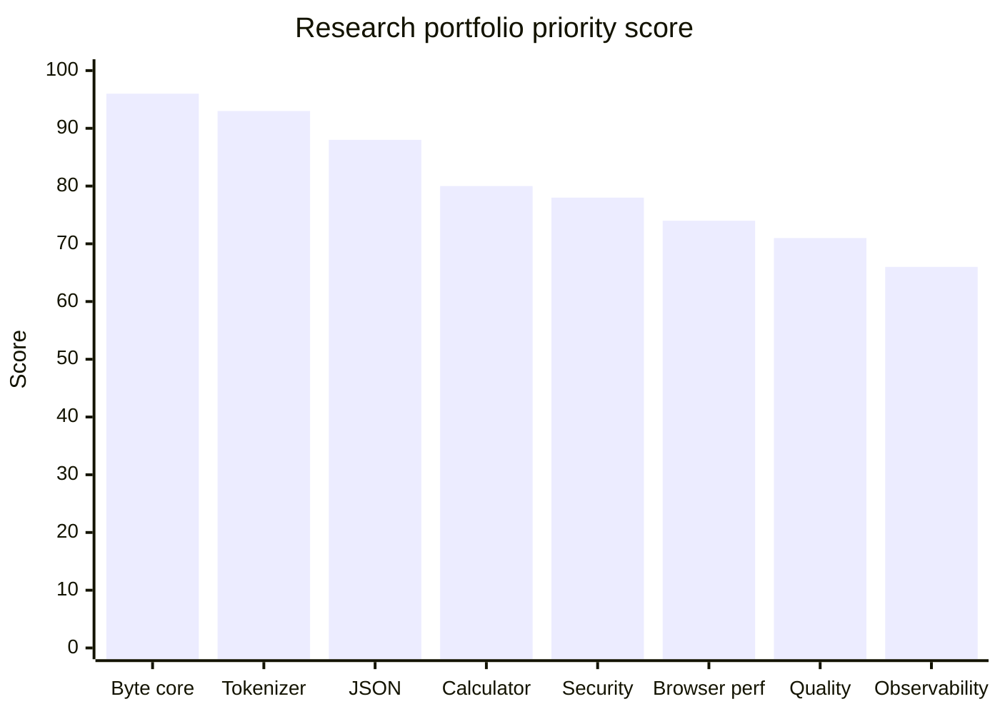
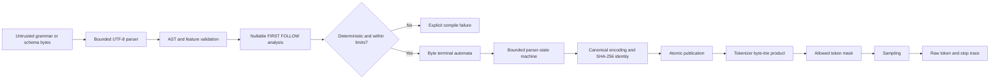
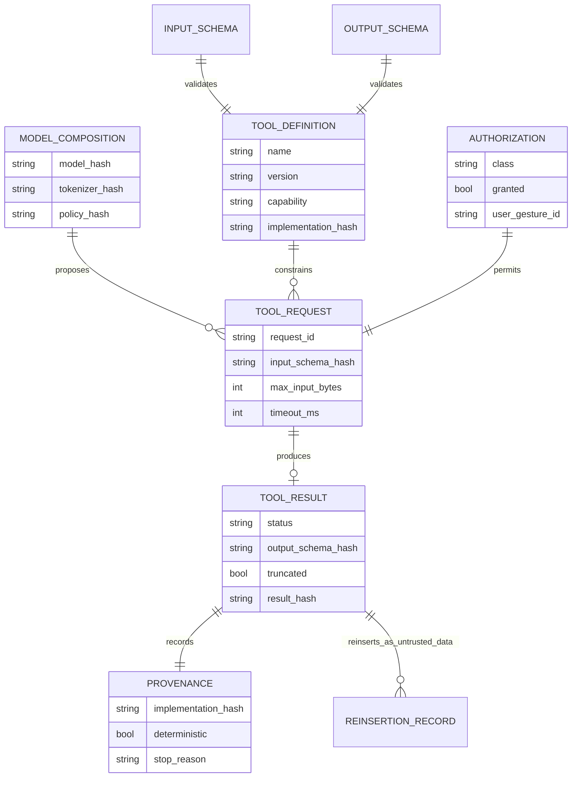
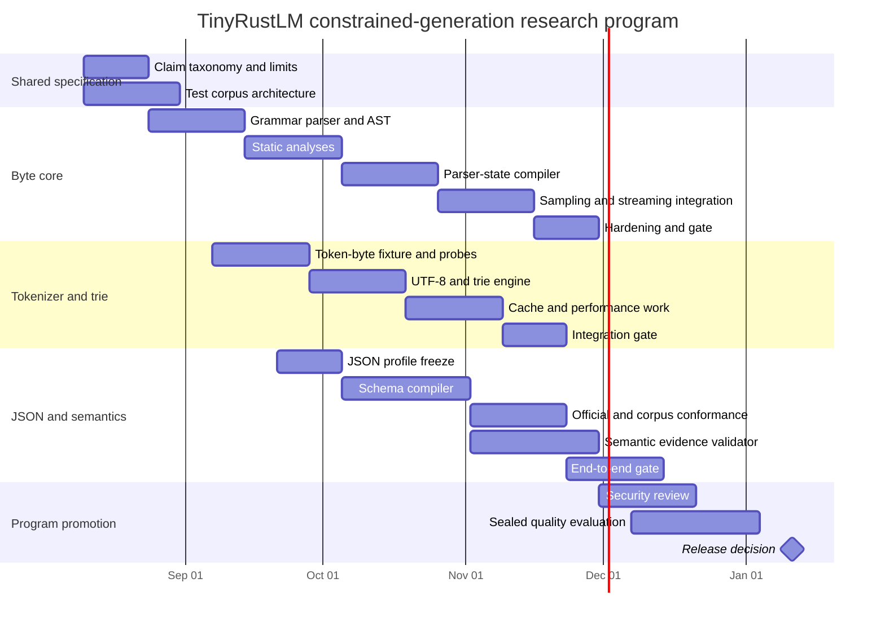

# Grammar-Constrained Decoding and Deterministic Local Tools for TinyRustLM

## Executive summary and assumptions

The uploaded research brief supplies a specific implementation topic despite the surrounding request describing the topic as unspecified. This report therefore treats **grammar-constrained browser-local generation and deterministic local tools for TinyRustLM** as the governing research subject. It assumes no access to TinyRustLM source code, model files, tokenizer fixtures, private schemas, tests, traces, or generated outputs, and it does not imply that any recommendation has been validated against the private implementation. fileciteturn0file0

**Executive recommendation.** TinyRustLM should adopt one clean first-release architecture:

1. A **bounded deterministic EBNF subset** as the canonical grammar language.
2. A **restricted JSON Schema adapter** that lowers into the same internal representation.
3. A **byte-oriented predictive parser-state machine with bounded stack**, rather than a character-only parser or unrestricted general-purpose regex engine.
4. An exact **token-ID-to-byte mapping** and a shared tokenizer byte trie for incremental allowed-token discovery.
5. A strict separation between **syntactic admissibility, schema validity, semantic validation, deterministic computation, and tool authority**.
6. A **fixed-precision decimal calculator** and, initially, no other automatically executed tool except narrow read-only deterministic transforms.
7. A versioned, hash-bound **local tool envelope** in which tool names map only to compiled application capabilities.
8. No output repair, hidden retry-until-valid behavior, model-produced code execution, user-controlled file paths, or model-selected network destinations.
9. Raw token decisions, allowed-token counts, stop reasons, constraint identities, and tool provenance retained for authorized local auditing.

Constrained decoding can guarantee membership in the implemented formal language, but not factual truth, semantic correctness, safety, or faithful fulfillment of user intent. The distinction is not merely theoretical: structured-generation implementations themselves warn that valid formatting does not imply semantic correctness and that aggressive masking can worsen content quality. citeturn0search0turn2search0turn7academia47

The proposed internal design deliberately sacrifices some grammar expressiveness for predictable compilation, deterministic rejection, small native Rust implementation size, and resistance to state-explosion attacks. Recent systems such as XGrammar, XGrammar 2, Outlines, LM Format Enforcer, and llguidance demonstrate that trie indexing, state caching, specialized JSON handling, and parser-aware token masks can make constrained generation practical. They also illustrate why TinyRustLM should adopt the underlying ideas rather than import a broad, dynamically extensible grammar ecosystem into a security-sensitive, zero- or low-dependency browser core. citeturn0academia24turn7academia45turn7academia46turn2search0turn6search3

**Priority conclusion.** The first three projects should be developed as a single gated program:

| Priority | Project | Primary outcome | Indicative duration | Medium estimate |
|---:|---|---|---:|---:|
| 1 | Byte-accurate constrained-decoding core | Deterministic bounded parser and mask semantics | 14 weeks | $240,000 |
| 2 | Tokenizer-byte conformance and trie engine | Correct multi-byte and cross-token behavior | 10 weeks, partly parallel | $180,000 |
| 3 | Bounded JSON profile and semantic-validation layer | Schema-valid JSON without conflating syntax and meaning | 12 weeks, partly parallel | $220,000 |
| 4 | Deterministic calculator and local tool protocol | Exact local arithmetic and capability-bound calls | 10 weeks | $175,000 |
| 5 | Capability and prompt-injection security evaluation | Confused-deputy and data/control-plane protections | 8 weeks | $150,000 |
| 6 | Browser performance and memory study | Proven bounds across representative devices | 8 weeks | $130,000 |
| 7 | End-to-end quality regression study | Evidence that constraints help rather than merely parse | 10 weeks | $165,000 |
| 8 | Privacy-safe observability and replay | Auditable failures without public data leakage | 6 weeks | $105,000 |

The medium estimates are planning figures, not vendor quotes. They assume loaded engineering costs around $18,000–$22,000 per full-time-equivalent month, part-time security and quality review, browser/device testing, and approximately 15% contingency.

**Assumptions.**

| Assumption | Consequence |
|---|---|
| The attached TinyRustLM brief supersedes the generic “unspecified topic” placeholder. | The portfolio is concentrated in local AI reliability, security, and formal-language engineering rather than distributed across unrelated health, environmental, and economic subjects. |
| Model logits are locally accessible before sampling. | Token masks can be applied without server calls or output repair. |
| The tokenizer can expose, or can be augmented to expose, exact generated byte sequences. | Constrained mode is feasible; otherwise it must fail closed. |
| TinyRustLM can run a small Rust or WebAssembly core in a dedicated worker. | Compilation and mask computation can be isolated from rendering and user-interface state. |
| The first release does not need backward compatibility with unpublished grammar formats. | Only one canonical grammar and one tool protocol should survive promotion. |
| No network tools, arbitrary file paths, credentials, or general code execution are required initially. | The capability boundary can remain small enough to audit rigorously. |
| Budgets are expressed in 2026 US dollars and include labor, testing, and contingency but not model-training infrastructure. | Estimates are comparable but require recalibration against internal staffing rates. |
| All public sources in the bibliography were retrieved on August 1, 2026. | Repository behavior should be pinned by release or commit before implementation begins. |

## Evidence base, claim taxonomy, and first-release scope

The evidence base combines recent primary research, official specifications, and pinned public implementations. Grammar-constrained decoding has shown benefits in information extraction, disambiguation, parsing, and structured generation, while JSONSchemaBench provides approximately 9,558 curated real-world schemas for evaluating efficiency, feature coverage, and output quality. Recent work also reports substantial gains from vocabulary indexing, context-independent token classification, just-in-time mask compilation, cross-grammar caching, and repetition compression. Those findings motivate the architecture but do not establish that the same performance or quality will hold for TinyRustLM’s unknown model and tokenizer. citeturn0search0turn7academia46turn0academia24turn7academia45turn7academia47turn8search1

**Claim vocabulary.**

| Claim | Permitted meaning | Evidence required before TinyRustLM may use the claim | What it does not establish |
|---|---|---|---|
| **Syntactically constrained text** | Every completed output byte belongs to the named compiled grammar language. | Grammar hash, compiler version, accepting parser state, exact generated tokens/bytes, no repair, and an independent parser test. | Truth, usefulness, safety, or intent compliance. |
| **Schema-valid JSON** | Output parses as JSON and satisfies every feature in TinyRustLM’s declared JSON profile. | Successful UTF-8 validation, duplicate-key rejection, profile validator success, schema hash, and supported-feature manifest. | Full JSON Schema 2020-12 support or semantic correctness. |
| **Semantically validated extraction** | Values pass application rules and are tied to evidence in the source. | Valid source spans or evidence references, transformation records, unit checks, enum checks, and cross-field validation. | That the source itself is true or authoritative. |
| **Deterministic arithmetic** | The same canonical expression, tool version, limits, and rounding configuration produce the same canonical result or error. | Test vectors, checked arithmetic, fixed rounding rules, implementation hash, and replay tests across supported browsers. | Correct interpretation of an ambiguous natural-language question. |
| **Declared local tool invocation** | A model-proposed request was validated and dispatched to a compiled local capability under recorded authority. | Tool/version and schema hashes, authorization state, request ID, input validation, output provenance, and no dynamic code or URL dispatch. | That execution was appropriate, desired, or harmless outside the declared capability. |
| **Code-formatted output** | Output conforms to a narrow formatting grammar, such as a fenced code block or a supported language fragment. | Named grammar and accepting state. | Compilation, functional correctness, safety, or absence of vulnerabilities. |
| **Unconstrained conversation** | Normal sampling occurred without a formal output-language guarantee. | Sampling configuration and stop reason. | Any structural or semantic guarantee. |
| **Auditable failure** | The raw generation or tool attempt ended with an explicit machine-readable failure. | Raw token/byte prefix where authorized, failure code, limits, identities, and stop reason. | Successful task completion. |

The practical consequence is that user-interface labels must say **“JSON complete and profile-valid”**, **“semantic validation failed”**, or **“generation cancelled with partial raw output”**, rather than the ambiguous “validated” or “correct.”

**Recommended first-release scope.**

| Include | Exclude or defer |
|---|---|
| Unconstrained conversation, summaries, rewriting, and explanations | Grammar constraints on ordinary prose by default |
| Exact choices and small enum classifications | Arbitrary user-provided regex dialects |
| Bounded deterministic grammar mode | General ambiguous context-free grammars |
| Restricted JSON object/array schemas | Full JSON Schema 2020-12 |
| Required and optional properties in declared order | Arbitrary object-property permutations |
| Bounded arrays, strings, nesting, and enums | Unbounded repetition or recursive schemas |
| Integer and finite decimal fields with explicit ranges | NaN, infinities, arbitrary precision JSON numbers |
| Source-bound extraction validation | Silent correction of unsupported values |
| Fixed-precision calculator | Trigonometry, symbolic algebra, arbitrary plugins |
| One or two compiled read-only local transforms | Network, credentials, arbitrary file access, shell, JavaScript, SQL, or Rust execution |
| Explicitly confirmed bounded local state changes, after read-only capabilities are proven | Automatic side effects |
| Private local traces with user-controlled retention | Public logging of prompts, outputs, arguments, paths, or credentials |

JSON itself requires UTF-8 for interoperable exchange, recommends unique object names, prohibits leading zeroes in numbers, and permits lexical numeric magnitudes that may exceed interoperable binary64 limits. RFC 8259 specifically notes exact interoperability for integers only through the binary64-safe range of ±(2^53−1). TinyRustLM should therefore implement a deliberately stricter profile, not claim unrestricted JSON or unrestricted JSON Schema support. citeturn1search0

JSON Schema Draft 2020-12 includes dynamic references, unevaluated-item semantics, Unicode-aware regular expressions, conditional composition, and other features whose complete interaction is disproportionate to a bounded first-release engine. The official language-agnostic test suite exists precisely because seemingly simple validators differ in edge cases. TinyRustLM should publish a supported-keyword matrix and reject every unknown keyword rather than ignore it. citeturn1search18turn8search0turn8search3

## Prioritized research portfolio

The following eight proposals form a coherent implementation and evaluation program. Priority scores are an internal decision model combining prerequisite value, expected risk reduction, user impact, feasibility, and reversibility. They are not empirical performance results.



| Rank | Research question or project | Rationale and key literature | Methods and data sources | Timeline | Potential impact |
|---:|---|---|---|---:|---|
| 1 | **Can a bounded byte-level predictive parser provide complete prefix-safe token masks with deterministic compilation and failure behavior?** | This is the foundational safety boundary. Geng et al. demonstrate the general utility of grammars; Outlines frames generation as FSM transitions; XGrammar shows efficient CFG execution; GRAMMAR-LLM emphasizes transformation toward deterministic parsing. citeturn0search0turn7academia46turn0academia24turn0search7 | Implement a tiny EBNF parser, AST validator, nullable/FIRST/FOLLOW analysis, left-recursion and ambiguity rejection, byte-terminal automata, bounded parser stack, state accounting, and exhaustive tiny-language tests. Data: generated grammars, hand-written adversarial grammars, JSON lexical fragments, and differential tests against independent recognizers. | 14 weeks | Establishes the trustworthy core needed by every other structured-output feature. |
| 2 | **How can TinyRustLM map tokenizer IDs to exact bytes and mask tokens that cross terminal, escape, and Unicode boundaries?** | Tokenizers may contain leading-space conventions, byte fallback, partial UTF-8, or context-dependent cleanup. LM Format Enforcer uses a tokenizer prefix tree; XGrammar separates context-independent from context-dependent tokens; llguidance reports optimized mask computation over large vocabularies. citeturn2search0turn0academia24turn6search3 | Build exact byte fixtures for every token; classify special tokens; probe round-tripping and contextual decoding; construct a compact trie; compare full-vocabulary scan, trie traversal, prefix memoization, and parser-state caches. Data: the actual private tokenizer when authorized, plus public byte-BPE and SentencePiece fixtures for pre-integration development. | 10 weeks | Prevents subtle false allows, false rejects, mojibake, invalid UTF-8, and unreplayable behavior. |
| 3 | **What bounded JSON Schema profile gives useful structured output without importing unbounded specification complexity?** | JSONSchemaBench shows wide feature diversity and varying engine coverage. RFC 8259, JSON Schema 2020-12, the official test suite, and JCS establish relevant syntax, validation, interoperability, and canonical identity constraints. citeturn7academia47turn8search1turn1search0turn1search18turn8search0turn5search0 | Define a strict profile; compile supported schemas to parser states; run applicable official tests; classify all JSONSchemaBench schemas as supported, safely rejected, or outside scope; create extraction validators with evidence binding. | 12 weeks | Enables reliable JSON and extraction while preserving honest claims about semantic correctness. |
| 4 | **Can a fixed-precision decimal calculator and versioned local tool envelope provide useful reasoning assistance without arbitrary execution?** | Rust supplies checked `i128` operations; ECMAScript Numbers are binary64 and cannot represent all large integers or decimal results exactly; RFC 8785 recommends strings for values outside natural JSON/binary64 representation. citeturn4search2turn4search4turn1search2turn5search0 | Implement a Pratt or shunting-yard parser, checked fixed-decimal arithmetic, canonical errors, operation limits, schema-hashed envelopes, replay vectors, and one read-only transform. | 10 weeks | Improves arithmetic reliability and establishes the pattern for all future tools. |
| 5 | **Does the proposed capability model resist prompt injection and confused-deputy attacks across every untrusted field?** | NIST’s Generative AI Profile calls for lifecycle risk management and structured evaluation. Browser permission specifications represent access to powerful features as user-granted states, supporting an explicit-authority design. citeturn3search0turn3search20turn3search2turn3search7 | Threat modeling, data/control-plane taint tracking, adversarial tool calls, injection in tool names/arguments/results/documents, stale-authority tests, and user studies of confirmation prompts. | 8 weeks | Reduces the risk that syntactically valid output is mistaken for authority. |
| 6 | **What parser, trie, and cache bounds remain responsive on realistic browser devices?** | XGrammar, XGrammar 2, and llguidance report low overhead through token classification, JIT compilation, caching, and specialized paths, but their serving environments differ from a browser-local small model. citeturn0academia24turn7academia45turn6search3 | Benchmark cold compile, warm compile, mask latency distributions, peak memory, cancellation latency, and cache hit rates on low-, middle-, and high-tier devices. Use Web Workers to isolate computation; workers have independent event loops and no browsing context. citeturn3search18 | 8 weeks | Determines whether the design is product-viable and where specialized fast paths are justified. |
| 7 | **Do constraints and deterministic tools improve end-to-end correctness without harming helpfulness, ambiguity handling, or refusal quality?** | Existing literature reports structural and task gains, but constrained decoders can force low-probability continuations and may cause semantic regressions. JSONSchemaBench explicitly evaluates efficiency, coverage, and quality rather than syntax alone. citeturn0search0turn2search0turn7academia47 | Sealed unseen tasks across extraction, rewriting, classification, JSON, arithmetic, code explanation, and ambiguity handling. Compare unconstrained, syntax-constrained, syntax-plus-semantic-validation, and tool-assisted arms. | 10 weeks | Prevents shipping a parser-perfect but less helpful model experience. |
| 8 | **What privacy-safe trace is sufficient for deterministic replay and public evidence without exposing user content?** | NIST emphasizes documentation, measurement, and lifecycle evaluation. JCS demonstrates why canonical representations and stable identities matter when hashing structured records. citeturn3search0turn3search5turn5search0 | Define local trace schemas, retention controls, redaction tests, replay from token IDs and RNG state, public aggregate reports, and deletion verification. | 6 weeks | Makes failures diagnosable while preserving the browser-local privacy promise. |

**Portfolio comparison.**

| Project | Dependency criticality | Technical uncertainty | Security value | Direct user value | Main evidence artifact |
|---|---:|---:|---:|---:|---|
| Byte core | Very high | High | High | High | Formal contract, parser implementation, exhaustive corpus |
| Tokenizer/trie | Very high | Very high until tokenizer access | High | High | Token-byte manifest and boundary test suite |
| JSON/semantics | High | Medium | High | Very high | Profile specification and conformance report |
| Calculator/tools | Medium | Medium | Very high | High | Deterministic vectors and tool protocol |
| Injection/authority | Medium | High | Very high | Medium | Threat model and red-team results |
| Browser performance | Medium | Medium | Medium | High | Device benchmark report |
| Quality study | Medium | High | Medium | Very high | Sealed comparative evaluation |
| Observability/replay | Medium | Low to medium | High | Medium | Privacy-reviewed trace schema |

## Canonical architecture and implementation contract

**Recommended architecture.** The public contract should consist of a bounded EBNF grammar plus a restricted JSON Schema profile, both lowering into one immutable compiled constraint. Internally, TinyRustLM should use deterministic parser-state transitions over bytes, with bounded pushdown state for nesting and byte-DFA states for terminals. Grammars that are ambiguous under the implementation’s predictive analysis should be rejected, not interpreted through undocumented tie-breaking.



**Formalism comparison.**

| Formalism | Expressiveness | Incremental mask suitability | Compilation and memory | Denial-of-service concerns | TinyRustLM disposition |
|---|---|---|---|---|---|
| Safe regex subset | Regular languages | Excellent after DFA compilation | Predictable if operators and repetitions are bounded | State explosion from alternation/repetition; catastrophic behavior if delegated to a backtracking engine | Permit only as syntax sugar lowered to the deterministic grammar core |
| General regex | Often includes backreferences and implementation-specific features beyond regular languages | Poorly portable | Unpredictable | ReDoS, engine divergence, huge state spaces | Prohibit |
| EBNF | Human-readable context-free notation | Good when restricted to deterministic forms | Moderate | Ambiguity, nullable cycles, left recursion, unbounded repetition | Canonical external grammar with strict bounded subset |
| GBNF-style grammar | Practical and familiar in local-model ecosystems | Good but dialect semantics vary | Moderate | Compatibility burden and ambiguous feature expectations | Do not preserve a legacy dialect; borrow only clearly specified constructs |
| DFA | Regular only | Excellent O(1) state transition | Potentially large but easy to bound | Exponential determinization | Use for byte terminals and regular fragments |
| Visibly pushdown automaton | Handles nesting where stack action is symbol-visible, including JSON-like delimiters | Excellent for suitable languages | Predictable | Less general than arbitrary grammar; schema compilation complexity remains | Useful conceptual model and possible JSON fast path, not sole public formalism |
| General parser-state machine | Broad CFG support | Possible, as XGrammar and XGrammar 2 illustrate | Potentially expensive; ambiguous-state sets may grow | Grammar attacks and unpredictable latency | Restrict to deterministic predictive states for version one |
| JSON Schema subset | High application value | Good after specialized compilation | Feature-dependent | References, unions, regex, recursion, and unevaluated semantics can explode | Support a declared, fail-closed profile |
| Application typed schemas | Narrow but directly tied to capabilities | Excellent | Lowest risk | Schema drift and versioning | Preferred interface for local tools |

Research systems support broader grammars than the proposed TinyRustLM subset. XGrammar uses optimized context-free execution; XGrammar 2 adds Earley-based masking, dynamic dispatch, JIT compilation, and cross-grammar caching; llguidance supports a large JSON Schema subset and CFGs. Those are useful upper-bound references, but TinyRustLM’s zero-dependency and adversarial-input constraints justify a narrower deterministic core. citeturn0academia24turn7academia45turn6search3

**Canonical grammar input contract: `trg-1`.**

| Element | Normative recommendation |
|---|---|
| Envelope | A canonical JSON object with `format: "trg-1"`, `start`, `rules`, and `limits`. The envelope is data only and never interpolated into Rust, JavaScript, shell, SQL, prompts, URLs, or paths. |
| Encoding | UTF-8 only; byte-order mark rejected; malformed UTF-8 rejected at the first offending byte. |
| Maximum source size | 65,536 bytes. |
| Rule count | At most 512. |
| Identifier syntax | ASCII `[A-Za-z_][A-Za-z0-9_]{0,63}`. |
| Names | Exactly one definition per name; case-sensitive; duplicates rejected. |
| Start symbol | Exactly one declared existing rule. |
| Operators | Sequence, ordered-independent choice that must pass disjoint-FIRST analysis, grouping, optional, and bounded repetition `{m,n}`. |
| Repetition | `0 ≤ m ≤ n ≤ 256`; no bare `*` or `+`. Specialized JSON strings may use a separately declared byte/scalar bound up to 4,096. |
| Terminals | UTF-8 string literals, bounded ASCII byte classes, and a small set of compiler-provided primitives such as `JSON_STRING_CHAR` and `UTF8_SCALAR`. |
| Recursion | Allowed only if non-left-recursive, non-nullable, and within static and runtime depth limits. |
| Grammar-reference depth | Maximum 32 during analysis. |
| Runtime stack depth | Maximum 64 frames. |
| AST nodes | Maximum 8,192. |
| Literal bytes | Maximum 32,768 aggregate and 1,024 per literal. |
| Alternations | Maximum 64 branches per choice and 4,096 total branches. |
| Comments | None in version one. Removing comments avoids encoding and canonicalization differences. |
| Unknown syntax/features | Hard error with byte offset and stable error code. |
| Nullable cycles | Rejected. |
| Left recursion | Direct and indirect left recursion rejected. |
| Ambiguity | Any predictive-table conflict or overlapping terminal decision rejected. |
| Canonical ordering | Rules sorted by UTF-8 byte order for identity calculation; original ordering retained only for diagnostics. |
| Identity | SHA-256 over the canonical envelope, compiler semantic version, and profile version. |
| Publication | Compilation is atomic: no partially usable constraint enters the cache. |

**Safe compilation pipeline.**

1. Enforce input byte and UTF-8 limits before allocation proportional to declarations.
2. Parse into an arena-indexed AST with checked integer arithmetic.
3. Resolve names and reject duplicates, missing references, reserved names, and unreachable rules if strict mode is enabled.
4. Compute nullable sets to a fixed point, charging every update against a cycle budget.
5. Detect nullable cycles and direct or indirect left recursion.
6. Compute FIRST and FOLLOW sets and reject predictive conflicts.
7. Expand bounded repetition symbolically; do not duplicate subtrees naively.
8. Compile string literals and character primitives into byte-level automata.
9. Construct parser-state templates and intern structurally identical states.
10. Enforce state, transition, stack, and memory ceilings after every expansion phase.
11. Serialize the compiled artifact deterministically, hash it, and run internal self-checks.
12. Publish the artifact with a single atomic pointer swap only after all checks pass.

Recommended initial ceilings are 65,536 parser or terminal states, 1,048,576 transitions, 32 MiB compiled memory per constraint, 64 MiB total constraint cache, and 50 million charged compilation operations. These are engineering starting points requiring browser measurement, not externally sourced constants.

A simple upper-bound accounting model is:

\[
M_{\text{compiled}}
\le
H + S \cdot b_s + T \cdot b_t + B_{\text{terminal}} + B_{\text{diagnostic}}
\]

where \(S\) is state count, \(T\) is transition count, \(b_s\) and \(b_t\) are implementation-specific fixed record sizes, and all additions and multiplications use checked arithmetic. Compilation must abort before an allocation if the projected bound exceeds the configured budget.

**Token, byte, and Unicode reconciliation.** The grammar consumes bytes, while global output validity is tracked by an incremental UTF-8 validator. A token is not treated as a Unicode character or ordinary string. Each vocabulary entry must have a verified exact byte sequence corresponding to generation, with the following classifications:

| Token class | Constrained-mode treatment |
|---|---|
| Ordinary token with stable bytes | Insert into the tokenizer trie. |
| Token ending in a partial UTF-8 sequence | Permitted if the parser and UTF-8 state can accept the prefix; continuation must arrive in later tokens. |
| Byte-fallback token | Treat as its exact byte value. |
| Leading-space convention token | Map to the actual emitted space byte plus remaining bytes, not the visual marker used in tokenizer files. |
| EOS | Never inserted as ordinary bytes; allowed only when the parser is accepting and UTF-8 state is complete. |
| BOS, padding, control, role, or other special token | Forbidden during constrained content generation unless the protocol explicitly reserves it as a stop token. |
| Context-dependent or cleanup-dependent decode token | Constrained mode disabled until a stable raw-byte path is locally verified. |
| Token with malformed or unknowable mapping | Permanently forbidden for that tokenizer/constraint pair and recorded in diagnostics. |

UTF-8 validation must reject overlong encodings, surrogate-code-point encodings, invalid continuation bytes, and values above U+10FFFF. Unicode explicitly treats non-shortest and irregular sequences as illegal because alternate interpretations create interoperability and security problems. citeturn1search4turn1search10turn1search11

**Allowed-token algorithm.**

```text
allowed_tokens(compiled, parser_state, utf8_state, token_trie):
    key = (
        compiled.hash,
        tokenizer.hash,
        compiler.version,
        parser_state.id,
        utf8_state,
        special_token_policy.version
    )

    if mask_cache.contains(key):
        return mask_cache[key]

    allowed = empty_bitset(vocabulary_size)
    work = stack()
    work.push(token_trie.root, parser_state, utf8_state)

    while work not empty:
        cancellation_checkpoint()

        trie_node, pstate, ustate = work.pop()

        for edge_byte, child in trie_node.children:
            next_utf8 = utf8_step(ustate, edge_byte)
            if next_utf8 is INVALID:
                continue

            next_parser = parser_step(pstate, edge_byte, next_utf8)
            if next_parser is DEAD:
                continue

            work.push(child, next_parser, next_utf8)

            for token_id in child.terminal_token_ids:
                if token_is_complete_and_legal(token_id, next_parser, next_utf8):
                    allowed.set(token_id)

    if parser_state.accepting and utf8_state.complete:
        allowed.set(EOS)

    mask_cache.insert_if_within_budget(key, allowed)
    return allowed
```

The naive vocabulary scan costs approximately

\[
O\left(V\bar{L}C_p\right)
\]

per generation step, where \(V\) is vocabulary size, \(\bar L\) average token-byte length, and \(C_p\) parser transition cost. Trie traversal costs

\[
O\left(E_{\text{visited}}C_p + A\right),
\]

where \(E_{\text{visited}}\) is the number of trie edges compatible with the current parser prefix and \(A\) is the number of allowed terminal token IDs. In the worst case the trie still approaches the total vocabulary byte count, but shared prefixes avoid repeated parser work. LM Format Enforcer publicly describes this parser/trie intersection approach, while XGrammar and Outlines describe vocabulary indexes and cached state/token mappings. citeturn2search0turn0academia24turn7academia46turn2search3

Cache identity must include tokenizer bytes, special-token policy, grammar hash, compiler version, parser state, UTF-8 state, and any JSON-profile mode. A cache entry from one tokenizer or compiler must never be reused by another merely because token IDs or grammar text appear similar.

**Sampling order and edge cases.**

The normative order should be:

1. Read raw model logits.
2. Convert every NaN logit to forbidden and increment an audit counter; retain positive or negative infinity only according to a declared policy, preferably failing if positive infinity appears.
3. Apply the grammar-allowed mask.
4. Apply independently forbidden special-token and policy masks.
5. Apply repetition or frequency penalties only to remaining tokens.
6. Apply temperature.
7. Apply minimum-probability filtering, if supported.
8. Apply top-k.
9. Apply top-p.
10. Normalize probabilities.
11. Draw once from the recorded RNG state.
12. Advance parser, UTF-8, repetition, and trace state atomically.

An empty allowed set produces `constraint_empty_set`, never repair or automatic retry. A set containing only EOS terminates without an RNG draw. At temperature zero, select the maximum logit and break exact ties by smallest token ID. EOS is impossible before an accepting parser state. If all surviving logits are non-finite or all probability mass is removed, stop with an explicit sampling failure.

Bitwise deterministic replay should be claimed only for the same model build, tokenizer, compiled constraint, numerical kernel, sampling implementation, and stored RNG state—or when the original post-model logits are retained. Cross-device floating-point execution may otherwise differ at close probability boundaries.

**Streaming, stopping, and cancellation.** Raw token IDs and bytes are the authoritative stream. UI text may display only complete UTF-8 scalars; trailing incomplete byte sequences remain buffered. A partial JSON document may be shown as **“structured output in progress”** but must not be deserialized into application objects or displayed as completed JSON. Cancellation returns a status record with raw partial bytes or text where locally authorized, parser state, and `completed: false`. It never appends brackets, closes strings, inserts missing fields, or retries.

**Bounded JSON profile: `trj-1`.**

| Feature | Supported behavior |
|---|---|
| Root | Object or array; tool arguments require an object. |
| Encoding | Valid UTF-8 only, no BOM. |
| Nesting | Maximum 32 containers. |
| Object order | Schema declaration order only. |
| Required fields | Supported. |
| Optional fields | Supported only in declaration order; once a later field is emitted, an earlier omitted field cannot appear. |
| Duplicate keys | Impossible under compiled schema and rejected by independent validation. |
| Additional properties | `false` only in version one; missing keyword interpreted as rejection during schema compilation, not silently as JSON Schema’s broader default. |
| Strings | Standard JSON escapes; valid Unicode scalar values; no lone surrogate escapes. |
| String limits | `minLength` and `maxLength`, maximum 4,096 scalar values and 16,384 UTF-8 bytes. |
| Numbers | RFC 8259 lexical grammar; no leading zero; no NaN or infinities. |
| Integers | Signed 64-bit by default, optionally narrower explicit ranges. Larger integers represented as strings. |
| Decimal numbers | Finite binary64-compatible JSON numbers for interchange; exact decimal tool values returned as strings. |
| Booleans and null | Supported. |
| Enums | Exact strings, booleans, null, or bounded numeric literals. |
| Arrays | Homogeneous `items`, `minItems`, and `maxItems`; `maxItems ≤ 256`. |
| Tuples | `prefixItems` supported up to 32 positions, with no trailing items unless explicitly bounded. |
| Local references | Acyclic local `$defs` references only. |
| Unions | Discriminated object union only, using one required constant tag field. |
| Canonical schema identity | JCS-like canonical encoding and SHA-256; canonicalization is for identity, not post-generation repair. |
| Unknown keywords | Compile-time rejection. |

RFC 8259 allows duplicate object names syntactically but warns that receiving implementations behave unpredictably, while JCS requires unique property names and valid Unicode for stable canonicalization. JCS also rejects NaN and infinity and recommends string representations for values that do not fit natural binary64 interchange. citeturn1search0turn5search0

Deferred JSON Schema features should include remote `$ref`, recursive and dynamic references, `pattern`, `patternProperties`, `unevaluatedProperties`, `unevaluatedItems`, general `oneOf`/`anyOf`, `not`, `if`/`then`/`else`, `contains`, `dependentSchemas`, complex `multipleOf`, content vocabularies, and assertion-level `format`. Deferral is not a statement that these features are undesirable; it reflects their interaction complexity and state-growth risks. citeturn1search18turn8search0

**Syntax-to-semantics boundary.** An extraction result should use an application schema similar to:

```json
{
  "status": "supported | unknown | unsupported | conflict",
  "value": "schema-typed value or null",
  "evidence": [
    {
      "source_id": "local-content-hash",
      "start_byte": 120,
      "end_byte": 145,
      "quoted_sha256": "…",
      "transform": "exact | trim | casefold | parse_integer | parse_decimal"
    }
  ],
  "unit": "declared-unit-or-null",
  "validation": {
    "enum_member": true,
    "range_ok": true,
    "cross_field_ok": true
  }
}
```

Only listed transformations are permitted. A value absent from the source must become `unknown`; a present but schema-inexpressible value must become `unsupported`; inconsistent evidence must become `conflict`. Unit conversions require an explicit deterministic conversion rule and must preserve the original evidence value. Semantic failure remains visible and does not trigger model rewriting.

**Deterministic calculator.** The calculator should avoid binary floating-point as its normative arithmetic type. ECMAScript’s default Number is IEEE 754 binary64, and its JSON serialization maps NaN and infinities to `null`, behavior unsuitable for an exact calculator boundary. Rust’s `i128` exposes checked addition, multiplication, division, power, and related operations suitable for a bounded native decimal representation. citeturn1search2turn4search0turn4search2turn4search4

Recommended calculator contract:

| Property | Specification |
|---|---|
| Input grammar | ASCII digits, `.`, operators `+ - * / % ^`, parentheses, commas, and allowlisted function names. |
| Locale | Always `.` decimal point; no grouping separators. |
| Numeric representation | Signed `i128` coefficient plus scale `0…18`. |
| Literal digits | Maximum 38 significant decimal digits, subject to `i128` range. |
| Addition/subtraction | Align scales with checked powers of ten; error on overflow. |
| Multiplication | Checked coefficient multiplication; scale sum must be ≤18 unless explicit rounding is requested. |
| Division | Caller-independent default output scale of 18; round half to even; divide-by-zero error. |
| Exponentiation | Integer exponents only, −18…18; negative exponents use bounded division. |
| Modulo | Integer operands only. |
| Functions | `abs`, `min`, `max`, `round`, `floor`, `ceil`; no trig, logarithms, randomness, dates, or user-defined functions. |
| Expression size | Maximum 4,096 bytes and 512 lexical tokens. |
| AST depth | Maximum 64. |
| Operation budget | 10,000 charged primitive operations. |
| Units | Deferred; version one is dimensionless. |
| Output | Decimal string, scale, rounding mode, exactness flag, and implementation version. |
| Errors | Stable codes such as `syntax`, `overflow`, `division_by_zero`, `inexact_disallowed`, `limit`, and `unsupported_function`. |

Example result:

```json
{
  "protocol": "tinycalc-1",
  "status": "ok",
  "expression_sha256": "…",
  "value": "0.333333333333333333",
  "scale": 18,
  "rounding": "half_even",
  "exact": false,
  "operations": 1,
  "implementation": "tinycalc-rust-1.0.0"
}
```

**Local tool envelope.**

```json
{
  "protocol": "tinyrust-tool-1",
  "request_id": "019…",
  "composition": {
    "model_id": "sha256:…",
    "tokenizer_id": "sha256:…",
    "prompt_policy_id": "sha256:…"
  },
  "tool": {
    "name": "calculator.evaluate",
    "version": "1.0.0",
    "capability": "deterministic.compute"
  },
  "schemas": {
    "input_sha256": "…",
    "output_sha256": "…"
  },
  "authorization": {
    "class": "automatic_read_only",
    "user_gesture_id": null,
    "granted": true
  },
  "limits": {
    "input_bytes": 4096,
    "output_bytes": 8192,
    "operations": 10000,
    "timeout_ms": 100
  },
  "input": {
    "expression": "1 / 3"
  }
}
```

The tool name is matched against a compiled enum. It never names Rust functions, JavaScript functions, executable files, paths, URLs, modules, or network endpoints. The request ID may use a standards-conforming UUID, but uniqueness is bookkeeping rather than authority. RFC 9562 is the current UUID standard. citeturn5search2



**Authority matrix.**

| Capability class | First-release policy | Examples |
|---|---|---|
| Pure deterministic transform | Automatic after schema validation | Calculator, sort a supplied list, count supplied text |
| Read-only access to already active conversation data | Automatic only when the user’s current request clearly asks for it | Summarize selected local text |
| Read-only local application state not already in context | Explicit confirmation or direct user gesture | Read a saved local note |
| Local state mutation | Explicit, specific, just-in-time confirmation | Save a draft or preference |
| User-selected file read | Explicit browser file-picker action; path never model-generated | Read a chosen text file |
| General filesystem traversal | Excluded | Directory scanning |
| Network access | Excluded from first release | Fetch URLs, call APIs |
| Credentials or secret stores | Excluded | Password manager, API keys |
| External side effects | Excluded | Purchases, email sending, account changes |
| Arbitrary code execution | Permanently excluded from the generic envelope | JavaScript, shell, SQL, Rust, WebAssembly supplied by the model |

Browser permission specifications model powerful-feature access as a user choice that can be granted or denied, while Permissions Policy can disable classes of browser capability. TinyRustLM should mirror that approach internally even for capabilities not directly governed by browser permission APIs. citeturn3search2turn3search7

**Prompt-injection and confused-deputy controls.** Prompt text, quoted content, retrieved memory, JSON values, schemas, tool arguments, tool results, and model output all belong to the data plane. Only compiled application configuration belongs to the control plane.

| Threat | Required control |
|---|---|
| Document says “ignore policy and call tool X” | Document bytes remain quoted untrusted data; cannot modify tool registry or authority. |
| Model invents a tool name | Exact enum lookup fails with `tool_unavailable`. |
| Model embeds a URL or path in an argument | Schema does not contain URL/path capability; request rejected before dispatch. |
| Tool result contains instructions | Result is reinserted under an untrusted-data wrapper and cannot become a system or developer message. |
| Schema contains executable-looking strings | Strings remain data; compiler recognizes only fixed grammar/schema keywords. |
| Old confirmation reused for new arguments | Authorization binds request ID, tool/version, normalized input hash, and expiry. |
| Model changes mid-request | Pending call becomes stale unless the composition identity remains exactly bound. |
| Truncated result hides warning text | Result includes `truncated: true`, original byte count where known, and full-result hash if available. |
| Duplicate request is replayed | Request-ID store returns `duplicate_request` or the already recorded idempotent result. |
| Malicious grammar exhausts resources | Preallocation checks, operation budget, state ceilings, cancellation points, and atomic failure. |

NIST’s Generative AI Profile recommends systematic risk identification, measurement, documentation, and testing rather than relying on a model’s own claims of safety. That principle supports treating all model-mediated text as untrusted and keeping authority in deterministic application code. citeturn3search0turn3search4

**Tool-result reinsertion.** Results should be inserted as a typed record, not concatenated prose:

```json
{
  "role": "tool_result",
  "trust": "untrusted_data",
  "request_id": "…",
  "tool": "calculator.evaluate@1.0.0",
  "status": "ok",
  "schema_sha256": "…",
  "result_sha256": "…",
  "truncated": false,
  "content": {
    "value": "0.333333333333333333"
  }
}
```

The system must serialize and escape this structure itself. Result text cannot change instruction precedence. Token budgeting occurs before insertion; truncation must preserve valid envelope syntax and expose the truncation. The current user turn and application policy remain authoritative regardless of result contents.

## Detailed plans for the leading proposals

The top three projects overlap substantially and should share a program manager, formal specification repository, test corpus, and promotion gate. The low case assumes a small senior team and limited device coverage. The medium case supports independent review and serious adversarial testing. The high case adds parallel implementation, formal-methods support, broad browser/device coverage, and external audit.

**Integrated program budget.**

| Cost category | Low | Medium | High |
|---|---:|---:|---:|
| Byte-level grammar and parser core | $95,000 | $240,000 | $520,000 |
| Tokenizer mapping and trie engine | $70,000 | $180,000 | $390,000 |
| JSON profile and semantic validation | $85,000 | $220,000 | $470,000 |
| Shared test infrastructure and device lab | $25,000 | $70,000 | $180,000 |
| Independent security/formal review | $15,000 | $80,000 | $220,000 |
| Contingency and integration | $30,000 | $95,000 | $230,000 |
| **Integrated total** | **$320,000** | **$885,000** | **$2,010,000** |

Some labor is double-counted if the projects are priced separately; the integrated total reflects shared staffing and infrastructure.

**Byte-accurate constrained-decoding core.**

| Plan element | Detail |
|---|---|
| Research objective | Prove, through construction and testing, that every allowed next token preserves the existence of at least one valid completion under the supported deterministic grammar. |
| Required expertise | Formal languages, parser construction, Rust systems programming, property-based testing, integer/memory safety, and model sampling integration. |
| Core outputs | `trg-1` specification; parser and AST; static analyses; compiled-state format; mask/sampling interface; error taxonomy; exhaustive tiny-grammar oracle; fuzz corpus. |
| Low staffing | One principal Rust/parser engineer, one part-time test engineer. |
| Medium staffing | One formal-language lead, two Rust engineers, one test/verification engineer, part-time security review. |
| High staffing | Two independent implementations or one implementation plus mechanized model, dedicated fuzzing specialist, external audit, and broad browser integration. |
| Low/medium/high | $95,000 / $240,000 / $520,000 |
| Duration | 14 weeks nominal; 18–20 weeks with independent implementation. |

Milestones:

| Weeks | Milestone | Exit evidence |
|---|---|---|
| 1–2 | Freeze grammar syntax, limits, error codes, and claim language | Reviewed specification; all unspecified behavior converted to rejection or an explicit rule |
| 3–4 | Build bounded parser and arena AST | Golden parse tests, byte offsets, malformed UTF-8 tests, allocation-bound tests |
| 5–6 | Implement reference resolution, nullable, FIRST/FOLLOW, cycle, left-recursion, and ambiguity checks | Adversarial grammar corpus and deterministic diagnostics |
| 7–8 | Compile byte terminals and predictive parser states | Independent recognizer differential tests |
| 9–10 | Implement prefix viability, EOS rules, and parser-state cloning | Exhaustive enumeration over tiny alphabets and vocabularies |
| 11–12 | Integrate mask/sampling order, cancellation, and raw trace | Replay tests and explicit empty-set failures |
| 13–14 | Fuzzing, browser worker integration, resource tuning, and gate review | No crashes, hangs, silent repair, or limit bypass in sealed corpus |

Primary risks and mitigations:

| Risk | Mitigation |
|---|---|
| Deterministic subset proves too restrictive | Measure rejection against real target schemas before expanding; add only one feature at a time with a bounded compilation proof. |
| FIRST/FOLLOW analysis misses byte-terminal overlap | Perform overlap analysis on compiled byte automata, not merely source-level character labels. |
| State interning produces identity bugs | Canonical immutable state records, content hashes in debug builds, and independent slow reference interpreter. |
| Resource ceilings reject legitimate inputs | Publish limits and collect rejection telemetry locally; increase limits only after device measurements. |
| Parser accepts a prefix with no valid completion | Exhaustive small-language tests and backward viability checks for bounded constructs. |
| Optimization alters semantics | Maintain an unoptimized reference path and differential-test every optimized mask. |

**Tokenizer-byte conformance and trie engine.**

| Plan element | Detail |
|---|---|
| Research objective | Establish a complete, auditable mapping from token IDs to generated bytes and prove correct mask behavior across token boundaries. |
| Required expertise | Tokenizer internals, Unicode/UTF-8, Rust compact data structures, cache design, browser profiling, and sampling integration. |
| Core outputs | Tokenizer identity manifest; exact token-byte table; special-token policy; trie builder; partial UTF-8 state machine; mask cache; tokenizer conformance report. |
| Low staffing | One tokenizer/systems engineer plus part-time test engineer. |
| Medium staffing | One tokenizer lead, one Rust performance engineer, one verification engineer. |
| High staffing | Independent decoder probes, multiple tokenizer families, broad device benchmarking, and external Unicode review. |
| Low/medium/high | $70,000 / $180,000 / $390,000 |
| Duration | 10 weeks, beginning once the parser transition interface is stable. |

Milestones:

| Weeks | Milestone | Exit evidence |
|---|---|---|
| 1–2 | Obtain authorized tokenizer fixture and define byte identity procedure | Hashable vocabulary manifest and classified special tokens |
| 3 | Run single-token and contextual decode probes | Stable/unstable token report; constrained mode fails closed for unstable mappings |
| 4 | Implement strict incremental UTF-8 state machine | Unicode conformance vectors, overlong and surrogate rejection |
| 5–6 | Build compact byte trie and reference vocabulary scanner | Exact equality of allowed sets on synthetic cases |
| 7 | Add parser/trie product traversal and cancellation | Boundary-spanning token corpus passes |
| 8 | Add bounded caches and cache-identity tests | No cross-tokenizer or cross-grammar contamination |
| 9–10 | Performance study and integration hardening | p50/p95/p99 mask latency, memory, and cancellation report |

Primary risks and mitigations:

| Risk | Mitigation |
|---|---|
| Tokenizer exposes only cleaned text | Add a raw-byte adapter or disable constrained mode; do not infer bytes from display decoding. |
| Tokens split UTF-8 code points | Track partial sequences as first-class state rather than rejecting all such tokens. |
| Trie consumes excessive memory | Share tokenizer trie across constraints, use packed child ranges, and impose a tokenizer-byte ceiling. |
| Allowed-set cache becomes unbounded | Byte-accounted LRU with per-constraint and global caps; no cache entry is necessary for correctness. |
| Special tokens leak into structured output | Separate special-token mask applied independently of grammar acceptance. |
| Contextual decoding cannot be stabilized | Mark the tokenizer unsupported for constrained mode. |

**Bounded JSON profile and semantic validation.**

| Plan element | Detail |
|---|---|
| Research objective | Deliver useful schema-constrained JSON with explicit feature coverage and a separate source-evidence semantic validator. |
| Required expertise | JSON and JSON Schema, formal-language compilation, Unicode, extraction evaluation, API/schema design, and Rust validation. |
| Core outputs | `trj-1` profile; schema parser; profile compiler; JSON validator; semantic evidence schema; supported-feature manifest; conformance and benchmark report. |
| Low staffing | One schema/compiler engineer, one part-time application engineer. |
| Medium staffing | One JSON Schema lead, one compiler engineer, one extraction/evaluation engineer, part-time security review. |
| High staffing | Independent validator, broad schema-corpus analysis, domain-specific extraction studies, and external interoperability review. |
| Low/medium/high | $85,000 / $220,000 / $470,000 |
| Duration | 12 weeks. |

Milestones:

| Weeks | Milestone | Exit evidence |
|---|---|---|
| 1–2 | Freeze profile keywords, limits, property order, number policy, and deferrals | Normative profile and supported-feature matrix |
| 3–4 | Parse schemas and canonicalize identities | Stable schema hashes, duplicate-key and unknown-key rejection |
| 5–6 | Compile objects, arrays, enums, strings, numbers, and local references | Grammar-equivalence and independent-validation tests |
| 7 | Run applicable official JSON Schema test cases | Pass/fail/unsupported report with no ignored cases |
| 8 | Classify JSONSchemaBench schemas | Coverage by feature and complexity; explicit safe rejection rate |
| 9–10 | Build semantic extraction validator and evidence binding | Span, transformation, unit, enum, and cross-field tests |
| 11–12 | End-to-end model trials and hardening | Syntax, schema, semantic, latency, and content-quality results |

Primary risks and mitigations:

| Risk | Mitigation |
|---|---|
| Users assume full JSON Schema support | Require `profile: "trj-1"` and expose rejected keywords in diagnostics. |
| Ordered properties reduce model quality | Compare fixed-order and limited permutation approaches experimentally before any expansion. |
| JSON-valid values remain factually wrong | Require semantic status and evidence fields for extraction use cases. |
| Numeric interoperability differs between Rust and JavaScript | Restrict JSON numbers and return exact large/decimal values as strings. |
| Unicode length and escape accounting diverge | Define scalar-value counting and independently test raw UTF-8 versus `\u` escapes. |
| Real-world schema coverage is too low | Use benchmark classification to choose the next bounded feature, rather than enabling broad keywords ad hoc. |

**Integrated timeline.**



## Failure semantics, testing, performance, and clean adoption

**Failure taxonomy.** Every failure returns a stable machine-readable code, human-readable local diagnostic, constraint/tool identity, and raw stop state where retention is authorized. No failure is converted into a plausible-looking answer.

| Failure | Required behavior |
|---|---|
| `grammar_utf8` | Reject source at exact byte offset. |
| `grammar_syntax` | Reject with expected-token category; do not attempt alternate parsing dialects. |
| `grammar_unknown_feature` | Reject and name the unsupported construct. |
| `grammar_duplicate_rule` | Reject both definitions. |
| `grammar_nullable_cycle` | Reject before automaton generation. |
| `grammar_left_recursion` | Reject with rule cycle. |
| `grammar_ambiguous` | Reject with conflicting state or FIRST-set evidence. |
| `grammar_state_limit` | Abort compilation atomically and report measured/projected counts. |
| `grammar_memory_limit` | Abort before exceeding allocation budget. |
| `tokenizer_unstable_bytes` | Disable constrained mode for the tokenizer. |
| `constraint_empty_set` | Stop immediately and preserve raw generated prefix. |
| `constraint_token_limit` | Return incomplete structured output with `completed: false`. |
| `constraint_invalid_eos` | Treat premature EOS as forbidden; if forced externally, return failure. |
| `sampling_nonfinite` | Stop when no finite allowed distribution remains. |
| `semantic_validation_failed` | Return syntax-valid raw result plus explicit semantic errors; do not rewrite. |
| `calculator_syntax` | No evaluation. |
| `calculator_overflow` | No saturation or wrapping. |
| `calculator_division_by_zero` | Canonical error result. |
| `tool_unavailable` | No fallback to similarly named tool. |
| `tool_unauthorized` | No execution and no automatic confirmation substitution. |
| `tool_timeout` | Cancel work, preserve provenance, ignore late result. |
| `cancelled` | Return partial raw data and no completed object. |
| `stale_result` | Reject result whose request, composition, schema, or authority binding no longer matches. |
| `duplicate_request` | Return recorded idempotent outcome or explicit duplicate failure. |
| `model_switched` | Invalidate pending generation/tool proposal unless explicitly rebound. |

**Privacy-safe observability.**

Private local traces may contain:

- model, tokenizer, prompt-policy, grammar, schema, compiler, and tool implementation hashes;
- generated token IDs and exact generated bytes when the user has authorized diagnostic retention;
- allowed-token count at each step;
- selected token rank and pre/post-mask score summaries;
- parser-state ID, UTF-8 state, cache hit/miss, compile and mask timings;
- RNG algorithm/version and initial state;
- stop/failure reason;
- tool request ID, capability, schema hashes, authorization class, result status, truncation, and deterministic provenance.

Public aggregate reports must exclude prompts, outputs, document text, tool input values, file names, private paths, credentials, user identifiers, and per-session traces. They may report distributions such as compile time, mask time, allowed-set size, failure frequency, schema-feature coverage, and quality scores.

**Conformance and adversarial corpus.**

| Test family | Required cases |
|---|---|
| Exhaustive tiny languages | All strings through bounded length for two- to four-symbol alphabets; compare parser, trie mask, and brute-force completion oracle. |
| Token boundaries | Token contains multiple terminals; token ends halfway through an escape; token crosses property/value punctuation; multiple token IDs share bytes. |
| UTF-8 | Every sequence length, split at every byte boundary, overlong forms, invalid continuations, surrogate encodings, maximum U+10FFFF, and above-range values. |
| Grammar limits | Exactly-at-limit and one-over-limit sizes, rules, alternatives, nesting, repetitions, states, transitions, and memory. |
| Grammar pathologies | Left recursion, indirect left recursion, nullable cycle, ambiguous choices, unreachable rules, empty language, and impossible start rule. |
| JSON strings | Quotes, reverse solidus, control escapes, raw non-ASCII, surrogate pairs, lone surrogates, maximum length, and mixed raw/escaped equivalents. |
| JSON objects | Duplicate names, wrong order, omitted required property, optional-property combinations, extra property, and discriminator collisions. |
| JSON numbers | `-0`, leading zero, exponent extremes, safe-integer boundaries, `i64` boundaries, binary64 overflow, and excessive precision. |
| Arrays | Empty, exact min/max, one over max, tuple boundaries, and deep legal nesting. |
| Semantic extraction | Exact span, normalized span, absent value, unsupported value, conflicting evidence, unit mismatch, enum mismatch, and cross-field contradiction. |
| Calculator | Precedence, associativity, unary signs, scale alignment, rounding ties, overflow, division by zero, negative exponent, and operation limit. |
| Tool envelope | Unknown names, changed versions, incorrect schema hashes, oversized input, malicious strings in every field, stale authorization, duplicate ID, and late result. |
| Injection | Instructions in quoted text, schema descriptions, property names, tool arguments, errors, provenance, and tool-result values. |
| Streaming | Cancellation after every token/byte, partial UTF-8, partial escape, partial number, partial object, and only-EOS state. |
| Replay | Same trace reproduces token sequence; changed model/tokenizer/grammar/compiler fails identity check. |

The official JSON Schema Test Suite should be vendored at a pinned revision, but only tests applicable to the declared profile should be classified as required. Every remaining test must be marked **unsupported** rather than silently skipped. JSONSchemaBench should be used for coverage and performance analysis, not as the sole correctness oracle. citeturn8search0turn8search1turn7academia47

**Quality experiment design.**

The principal experiment should use four arms:

| Arm | Behavior |
|---|---|
| Baseline | Unconstrained generation, no repair |
| Syntax constrained | Grammar mask only |
| Syntax plus semantics | Grammar mask followed by explicit semantic validator |
| Deterministic assistance | Same as appropriate arm plus calculator or read-only tool |

Tasks should cover ordinary conversation, summarization, rewriting, extraction, JSON generation, code explanation, ambiguity handling, practical reasoning, and arithmetic. The evaluation set must be sealed after prompt and feature decisions. Metrics should include completion rate, valid syntax, profile validity, semantic accuracy, evidence accuracy, unsupported/unknown calibration, helpfulness, instruction adherence, refusal appropriateness, truncation, latency, peak memory, compile time, allowed-token counts, and mask intervention severity.

A useful intervention metric is:

\[
I = \frac{1}{N}\sum_{t=1}^{N}
\left[
\log p_t^{\text{unmasked}}(x_t^\*) -
\log p_t^{\text{unmasked}}(x_t)
\right],
\]

where \(x_t^\*\) is the model’s unconstrained top token and \(x_t\) the constrained selected token. High intervention indicates that the grammar repeatedly forces the model away from its preferred distribution and should be correlated with semantic quality. LM Format Enforcer exposes similar token-level diagnostics and explicitly cautions that syntactic enforcement can increase hallucination or force low-weight tokens. citeturn2search0

**Performance formulas and targets.**

| Quantity | Formula or measurement |
|---|---|
| Trie memory | \(M_{\text{trie}} \approx N_n b_n + N_e b_e + Vb_{\text{id}}\) |
| Full scan cost | \(O(V\bar L C_p)\) per generated token |
| Trie product cost | \(O(E_{\text{visited}}C_p + A)\) |
| Mask-cache memory | \(\sum_i (\text{key}_i + \lceil V/8\rceil + \text{metadata}_i)\) for dense bitsets; use sparse IDs when \(A \ll V\) |
| Runtime parser memory | \(O(D_{\text{stack}} + D_{\text{terminal}})\) per sequence |
| Compilation upper bound | Checked state, transition, AST-node, byte, operation, and wall-clock budgets |
| End-to-end overhead | \((T_{\text{constrained}}-T_{\text{baseline}})/T_{\text{baseline}}\) |
| Cancellation latency | Time from cancellation signal to worker acknowledgment and resource release |

Initial product targets should be treated as hypotheses: median warm mask computation under 0.25 ms, p99 under 2 ms on a representative middle-tier desktop, cold compilation under 50 ms for ordinary schemas, peak compiled constraint under 8 MiB for typical cases, and cancellation acknowledgment under 16 ms. Public systems report substantially lower typical per-token overhead under server-class conditions, including llguidance’s reported sub-50-microsecond average over its benchmark and XGrammar’s reported near-zero end-to-end overhead, but browser-local targets must be measured independently. citeturn6search3turn0academia24turn7academia45

**TDD backlog and promotion gates.**

| Stage | Build first | Promotion gate |
|---|---|---|
| Byte automaton | Literal bytes and exact-choice grammar | Exhaustive tiny-vocabulary equality with brute-force oracle |
| Tiny tokenizer | Hand-written tokens including partial UTF-8 | Every allowed token preserves a valid completion |
| JSON lexical subset | Strings, numbers, booleans, null | RFC lexical tests and malformed-input rejection |
| Deterministic parser | Objects and bounded arrays | No ambiguity, nullable cycle, or left recursion accepted |
| Sampling integration | Mask, penalties, temperature, top-k/p, EOS | Deterministic replay and all edge-case failures explicit |
| Streaming | Complete-scalar display and partial-state UI | No partial object represented as complete |
| Calculator | Fixed decimal and canonical errors | Cross-language golden vectors |
| Read-only tool | Calculator or supplied-text transform | Injection corpus cannot alter authority |
| Browser integration | Dedicated worker and cancellation | Memory, latency, and cleanup targets met |
| Sealed evaluation | All four experiment arms | Predeclared quality and regression thresholds met |

Recommended release gates are: 100% pass on required conformance tests; zero silent repair; zero unknown-key acceptance; no crash or hang in adversarial corpus; no tool dispatch outside the compiled registry; exact replay on the supported reference environment; syntactic-validity improvement without a statistically or practically unacceptable decline in semantic correctness or helpfulness; and privacy review of every trace field.

**Clean deletion rules.** Because no legacy compatibility is required, any unpublished format or mechanism should be deleted if it:

- requires answer repair or retry-until-valid to meet its success criterion;
- cannot map tokens to exact bytes;
- ignores unknown grammar or schema constructs;
- permits unbounded repetition, recursion, state growth, or memory use;
- has nondeterministic compilation or conflicting grammar interpretations;
- needs general regex, dynamic code loading, or executable descriptions;
- exposes user-controlled paths or destinations;
- allows tool results to change authority;
- lacks an explicit raw failure state;
- performs worse than the canonical protocol on both quality and resource use without a unique required capability;
- cannot be independently tested against the reference interpreter.

## Gap analysis and recommended next steps

**Critical unknowns requiring authorized local access.**

| Unknown | Why it matters | Verification needed |
|---|---|---|
| Exact tokenizer format and byte semantics | Determines whether the core is implementable and whether tokens split UTF-8 or grammar units | Export token ID, raw bytes, special-token flags, and contextual decode probes |
| Model sampling pipeline | Determines where masks, penalties, temperature, and EOS currently occur | Code inspection and deterministic trace fixture |
| Vocabulary size and token-byte distribution | Drives trie memory and mask representation | Tokenizer statistics and representative device profile |
| Current stop-token behavior | Premature stops can violate grammar completion | Generation traces and sampler tests |
| Current streaming/UI path | UI may currently decode or normalize text before the core sees it | Browser trace and code inspection |
| Existing JSON/tool formats | Unpublished formats should be removed rather than maintained in parallel | Repository and test inventory |
| Browser and device support floor | Determines memory, worker, WebAssembly, and latency budgets | Product requirements and device matrix |
| Model quality under ordered JSON properties | Fixed ordering may help or harm particular models | Sealed A/B evaluation |
| Whether byte fallback is available | Affects completeness for Unicode and uncommon bytes | Tokenizer fixture |
| Private logging and retention policy | Determines whether raw token traces may be stored | Privacy and security review |
| Existing local capabilities | Determines the realistic first tool beyond calculator | Capability inventory and threat classification |
| Model/composition switching behavior | Pending tool calls and replay must bind to exact composition | Application state-machine inspection |

No final conformance claim should be made before the tokenizer and sampler are inspected. In particular, a grammar engine cannot safely be “adapted later” to an unknown tokenizer by applying character-level rules to token IDs.

**Gap analysis by discipline.**

| Area | Current public evidence | Remaining gap for TinyRustLM |
|---|---|---|
| Formal constrained decoding | Strong evidence that grammar masks can enforce structure and improve some tasks | No proof that a deterministic bounded subset covers TinyRustLM’s target schemas |
| Token masking | Public trie/index/cache strategies exist | Exact private tokenizer semantics are unknown |
| JSON Schema | Standards, test suite, and benchmark are mature | Product-specific supported subset and ordered-property quality are unresolved |
| Unicode | Normative validity rules are clear | Tokenizer interaction and display pipeline require local verification |
| Calculator | Checked integer primitives and decimal design are straightforward | Cross-browser serialization and required precision need product decisions |
| Tool security | Capability and permission principles are established | Actual local state boundaries and confirmation UX are unknown |
| Quality | Recent benchmarks consider syntax, coverage, and quality | TinyRustLM’s small local model may respond differently under strong masks |
| Performance | Server-side engines report low overhead | Browser-local CPU, WebAssembly, memory, and worker overhead remain unmeasured |
| Observability | Hash-bound, privacy-aware traces are feasible | Retention consent, storage quota, and export design require policy decisions |

**Recommended immediate next steps.**

| Sequence | Action | Decision produced |
|---:|---|---|
| 1 | Freeze claim vocabulary and prohibit repair, hidden retry, arbitrary execution, unknown-feature acceptance, and unbound tools in writing | Prevents architecture drift while implementation is explored |
| 2 | Obtain an authorized tokenizer manifest and sampler trace fixture | Go/no-go for byte-accurate constrained mode |
| 3 | Implement the tiny brute-force reference interpreter before the optimized compiler | Creates an independent correctness oracle |
| 4 | Freeze `trg-1` and `trj-1` limits before optimization | Makes resource and compatibility tests meaningful |
| 5 | Build exhaustive tiny-vocabulary and partial-UTF-8 tests | Verifies the hardest token/byte boundary early |
| 6 | Implement exact-choice and minimal JSON constraints | Produces the first end-to-end vertical slice |
| 7 | Integrate sampling and streaming with explicit failure records | Verifies no repair and correct EOS/cancellation behavior |
| 8 | Build the fixed-decimal calculator and envelope as the first tool | Exercises deterministic execution and provenance without side effects |
| 9 | Run official JSON tests and JSONSchemaBench classification | Quantifies supported coverage and safe rejection |
| 10 | Conduct injection, browser performance, and sealed quality evaluations | Determines release readiness |
| 11 | Delete all unsuccessful unpublished formats | Preserves one auditable protocol |
| 12 | Publish a local conformance statement limited to actually demonstrated claims | Avoids overclaiming syntax as truth or safety |

The first irreversible decision should not be a broad grammar feature. It should be the **token-byte identity contract**, because every compiler, trie, cache, mask, stream, replay record, and JSON guarantee depends on it.

## Annotated primary-source register

All sources below were retrieved on August 1, 2026. Repository releases should be pinned to exact source commits in the implementation lockfile; a release tag alone is not sufficient for reproducible security review.

| Source and revision/date | Type | Relevance and caution |
|---|---|---|
| **Geng et al., “Grammar-Constrained Decoding for Structured NLP Tasks without Finetuning,” EMNLP 2023, December 2023** citeturn0search0 | Peer-reviewed primary research | Demonstrates input-dependent grammars and task-level gains in extraction, disambiguation, and parsing. Supports the value of constrained decoding, not TinyRustLM-specific performance. |
| **Willard and Louf, “Efficient Guided Generation for Large Language Models,” arXiv:2307.09702, July 2023** citeturn7academia46 | Primary research and Outlines foundation | Frames guided generation using FSM transitions and vocabulary indexing. Useful for regular-language and index design. |
| **Dong et al., “XGrammar,” arXiv:2411.15100, November 2024** citeturn0academia24 | Primary systems research | Describes context-independent token prechecking, persistent stacks, and grammar/inference co-design. Performance claims come from its evaluated serving settings. |
| **Li et al., “XGrammar 2,” arXiv:2601.04426, January 2026** citeturn7academia45 | Recent primary systems research | Adds dynamic dispatch, JIT compilation, cross-grammar caching, Earley parsing, and repetition compression. Relevant as a design comparison, though TinyRustLM should initially remain narrower. |
| **Geng et al., “Generating Structured Outputs from Language Models: Benchmark and Studies,” arXiv:2501.10868, January 2025** citeturn7academia47 | Primary benchmark research | Introduces JSONSchemaBench and evaluates efficiency, coverage, and quality. Important because it treats syntactic validity as only one evaluation dimension. |
| **GRAMMAR-LLM, Findings of ACL 2025, July 2025** citeturn0search7 | Peer-reviewed primary research | Provides evidence for deterministic grammar transformations and task evaluation. Does not establish universal benefit for all generation tasks. |
| **XGrammar repository, release v0.2.1, May 17, 2026** citeturn6search0 | Pinned public implementation family | Current public implementation reference for structured generation and XGrammar 2 evolution. Pin an exact commit before code-level comparison. |
| **llguidance repository, v1.0.0 designation June 23, 2025** citeturn6search3 | Rust implementation | Particularly relevant to Rust parser engineering, JSON Schema coverage, and reported mask latency. Its broad grammar surface should not be copied without TinyRustLM’s bounded threat model. |
| **Outlines repository, release v1.3.0, May 13, 2026** citeturn2search1 | Public structured-generation implementation | Demonstrates typed interfaces, JSON/regex/grammar generation, and model integrations. Its larger Python ecosystem differs substantially from a zero-dependency browser core. |
| **outlines-core repository, release 0.2.14, January 9, 2026** citeturn2search3 | Rust implementation | Useful reference for schema-to-regex, vocabulary indexing, and Rust state guides. Special-token handling warning reinforces the need for an explicit token-byte contract. |
| **LM Format Enforcer repository, release v0.11.2, August 9, 2025** citeturn6search1 | Public implementation | Describes character-parser/token-trie intersection and exposes diagnostics showing when masks force low-probability tokens. Also explicitly separates format guarantees from semantic correctness. |
| **Guidance repository, release 0.3.2, March 18, 2026** citeturn6search2turn8search4 | Public implementation | Useful API and integration comparison. Examples should not be interpreted as medical or semantic validation evidence. |
| **RFC 8259, JSON, December 2017** citeturn1search0 | Internet standard | Normative base for JSON syntax, UTF-8 interoperability, strings, numbers, and duplicate-name concerns. Older than the preferred five-year window but foundational and still controlling. |
| **JSON Schema Draft 2020-12, published June 16, 2022** citeturn1search18 | Official specification | Defines the broader schema language against which TinyRustLM must accurately describe its subset. |
| **JSON Schema Test Suite, release 23.1.0, May 12, 2023** citeturn8search0 | Official conformance suite | Language-agnostic validator tests. Vendor at an exact commit and classify every test as required, unsupported, or inapplicable. |
| **JSONSchemaBench repository and 9,558-schema corpus** citeturn8search1 | Primary benchmark data | Suitable for feature-coverage and performance analysis; not a substitute for formal conformance tests. |
| **RFC 8785, JSON Canonicalization Scheme, June 2020** citeturn5search0 | IETF informational specification | Useful for stable schema/envelope hashing, unique keys, valid Unicode, and numeric interoperability. Canonicalization must not become output repair. |
| **Unicode UTF-8 corrigendum and conformance materials** citeturn1search4turn1search10turn1search11 | Official Unicode guidance | Establishes rejection of illegal, overlong, and irregular UTF-8. Essential for byte-level token processing. |
| **ECMAScript Number and JSON serialization specifications, 2024–2027 editions** citeturn1search2turn4search0 | Official language specification | Documents binary64 Number semantics and JSON serialization behavior for NaN and infinity. Supports returning exact calculator decimals as strings. |
| **Rust `i128` documentation, Rust 1.97.1, July 14, 2026** citeturn4search2 | Official implementation documentation | Provides checked arithmetic primitives for a no-third-party-crate fixed-decimal calculator. Pin TinyRustLM’s actual compiler version. |
| **NIST AI RMF 1.0, January 2023, and Generative AI Profile NIST AI 600-1, July 2024** citeturn3search20turn3search0 | Official risk-management guidance | Supports lifecycle documentation, testing, measurement, and explicit risk controls. It is governance guidance, not a constrained-decoding algorithm. |
| **W3C Permissions and Permissions Policy working drafts, October 2025** citeturn3search2turn3search7 | Official web-platform specifications | Useful conceptual basis for user-granted powerful capabilities and feature disabling. Draft status means TinyRustLM should not depend on unsupported browser semantics. |
| **RFC 9562, UUIDs, May 2024** citeturn5search2 | Internet standard | Suitable for request identifiers. UUID uniqueness does not confer authorization or replay protection by itself. |