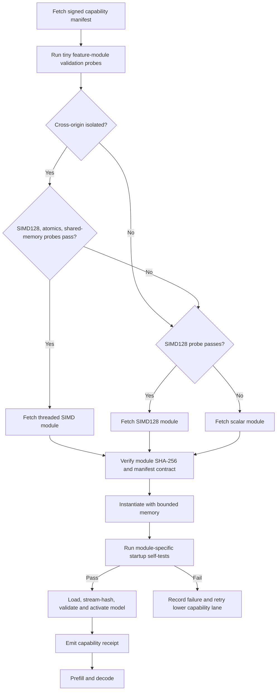
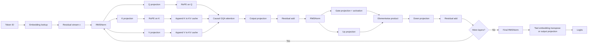
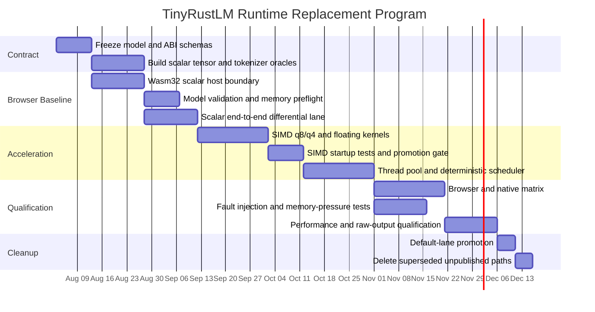

# Portable WebAssembly Runtime Architecture for TinyRustLM

## Executive Summary and Architectural Decision

The uploaded brief defines a privacy-preserving, browser-local transformer runtime written in Rust, with native Windows/Linux targets, browser WebAssembly, a normative scalar implementation, optional stable SIMD and threading, strict numerical-conformance requirements, and no assumed access to private TinyRustLM source, models, benchmarks, traces, build flags, or hardware. This report therefore distinguishes public facts from architectural recommendations and identifies every conclusion that still requires execution against authorized TinyRustLM artifacts. fileciteturn0file0

**Recommended architecture.** Build **one normative Rust inference core and model contract**, but publish **three separately compiled browser modules**:

| Artifact | Required WebAssembly features | Intended use | Deterministic fallback |
|---|---|---|---|
| `tinyrustlm-scalar-wasm32` | Conservative Wasm32 baseline; explicitly selected Core features only | Numerical reference and universal browser fallback | None; this is the fallback |
| `tinyrustlm-simd128-wasm32` | Baseline plus fixed-width `simd128` | Default accelerated single-worker runtime | Scalar module |
| `tinyrustlm-simd128-threads-wasm32` | SIMD128, atomics, bulk memory, imported fixed shared memory | Cross-origin-isolated browser execution with a persistent worker pool | SIMD128 single-worker, then scalar |
| Future experimental artifacts | Relaxed SIMD, Memory64, or other separately contracted features | Explicit opt-in experiments only | One of the three production modules |

A module containing unsupported instructions fails validation even when the unsupported function would never be called. Consequently, a “universal” binary containing scalar, SIMD, atomics, relaxed-SIMD, and Memory64 code cannot serve as the portable baseline merely by branching around unsupported paths. WebAssembly validation covers the module’s instructions before execution, and Rust documents that unsupported Wasm target-feature instructions cause load failure rather than undefined behavior. citeturn0search3turn2search1turn3search0

The loader should perform this sequence:



**Normative semantics.** The scalar implementation defines operator order, tensor shapes, integer-overflow rules, quantization decoding, softmax behavior, pseudorandom-number generation, token filtering, and cache identity. SIMD and threaded paths implement the same operation contracts and are promoted only after differential tests demonstrate their assigned conformance tier. There should not be a permanent “legacy scalar runtime” and a separately evolving “fast runtime.” Scalar is an oracle implementation within the same architecture.

**Key design decisions.**

| Area | Decision | Rationale |
|---|---|---|
| Feature selection | Separate scalar, SIMD, and threaded-SIMD modules | Truthful loadability, smaller validation domains, cacheable artifacts, simpler proof that a path executed |
| Memory | One Wasm linear memory divided into validated typed sub-arenas | Broadest browser portability and simplest ownership model |
| Threaded memory | Imported shared memory with `initial == maximum`, sized by preflight | Avoid growth dependencies and stale-view ambiguity during parallel operation |
| Model loading | Stream directly into an allocated Wasm model region while updating SHA-256 | Avoid an unnecessary full model copy in JavaScript |
| Host boundary | Integer result codes, caller-provided output records, generational opaque handles | No exception-dependent ABI; deterministic resource ownership |
| Floating-point reference | Strict operation order, no fast math, no relaxed SIMD, no implicit dependence on platform `exp`, `sin`, or `cos` | Native/browser reproducibility |
| Attention | Tiled stable softmax; never allocate a full context-by-context score matrix | Bounded prefill memory |
| Parallel decomposition | Own disjoint output rows, heads, or tokens; no cross-worker floating reductions | Deterministic outputs independent of worker scheduling |
| Sampling | Fully specified integer PRNG, stable token-ID tie-breaks, canonical NaN and signed-zero treatment | Shared native/browser decoding behavior |
| Future WebGPU | Separate optional backend contract with explicit copies and its own self-tests | WebGPU is not direct Wasm-linear-memory execution and does not provide standardized zero-copy interoperation |

**Evidence labels used below.**

- **Public fact** means directly documented in a public specification, vendor document, paper, or public implementation.
- **Inference** means a conclusion derived from public facts but not directly stated by them.
- **Recommendation** means the proposed TinyRustLM design.
- **Assumption** means a temporary premise that must be checked against the private model format or product requirements.
- **Local verification required** means the claim cannot be established without authorized TinyRustLM code, model, browser, or physical hardware execution.

No benchmark result from another project is used as evidence of TinyRustLM performance.

## Standards Status and Capability Matrix

The current live WebAssembly language is Wasm 3.0. Its 2025 completion incorporated Memory64, multiple memories, typed references, tail calls, exception handling, and relaxed SIMD; the current online Core Specification identifies itself as release 3.0 dated July 2026. Wasm 2.0 standardized fixed-width SIMD, bulk-memory operations, multivalue results, and simple reference types. The feature-status implementation table nevertheless shows that standardization does not imply universal browser support: Safari is still blank for Memory64, multiple memories, and relaxed SIMD, while threads remain at proposal phase four despite long-standing browser implementations. citeturn0search0turn1search9turn7search0turn7search1

**Capability taxonomy as retrieved August 1, 2026.**

| Capability | Specification status | Browser availability reported by WebAssembly.org | Detection and proof | Build requirement | Security/header requirement | Required fallback |
|---|---|---|---|---|---|---|
| Conservative Wasm32 baseline | Core 1.0 subset; stable | All browsers capable of running the product’s minimum supported baseline | Validate and instantiate actual scalar artifact; run scalar self-test | `wasm32` with explicitly frozen features | Secure delivery and normal web policies | Unsupported-browser error |
| Bulk memory | Standardized in Wasm 2.0 | Chrome 75, Firefox 79, Safari 15 | Validate tiny module containing required bulk-memory opcode, then self-test a copy/fill operation | `+bulk-memory` | None beyond ordinary Wasm use | Scalar loops for copy/fill |
| Reference types | Standardized in Wasm 2.0 | Chrome 96, Firefox 79, Safari 15 | Feature module; inspect imports/exports if used | `+reference-types` | None | Do not require for the core numeric ABI |
| Fixed-width SIMD128 | Standardized in Wasm 2.0 | Chrome 91, Firefox 89, Safari 16.4 | Validate feature-specific module; instantiate selected artifact; execute SIMD golden vectors and increment a kernel execution counter | `+simd128` | None | Scalar module |
| Relaxed SIMD | Standardized in Wasm 3.0 | Chrome 114, Firefox 145, no Safari version listed | Validate feature module and run instruction-specific tolerance tests | `+relaxed-simd`, which implies SIMD128 in Rust | None | Fixed SIMD128; never scalar silently under a “relaxed” receipt |
| Threads and atomics | Proposal phase four; implemented | Chrome 74, Firefox 79, Safari 14.1 | Require all of: `crossOriginIsolated`, `SharedArrayBuffer`, shared-memory module validation, successful worker creation, atomic self-test, and observed worker participation | `+atomics`, normally `+bulk-memory`; imported shared memory with maximum | COOP/COEP and permissions policy must yield actual cross-origin isolation | Single-worker SIMD or scalar |
| Multiple memories | Standardized in Wasm 3.0 | Chrome 120, Firefox 125, no Safari version listed | Validate multi-memory feature module and test intended copy semantics | `+multimemory` | None | Single memory with typed sub-arenas |
| Memory64 | Standardized in Wasm 3.0 | Chrome 133, Firefox 134, no Safari version listed | Validate actual Memory64 artifact; instantiate within an admitted memory budget | Wasm64 target/toolchain contract and 64-bit indices | Resource limits remain browser-specific | Wasm32 segmented tensors or reject oversized model |
| Exception handling with `exnref` | Standardized in Wasm 3.0 | Chrome 137, Firefox 131, Safari 18.4 | Validate feature module and throw/catch self-test | `+exception-handling` | None | Result-code ABI and `panic=abort` |
| Tail calls | Standardized in Wasm 3.0 | Chrome 112, Firefox 121, Safari 18.2 | Validate tail-call module and bounded recursion test | `+tail-call` | None | Ordinary calls or explicit loops |
| WebGPU | Separate W3C Candidate Recommendation, not a Wasm core capability | Availability must be queried through the WebGPU API and may still fail at adapter/device creation | Check API presence, request adapter/device, compile pipeline, execute golden computation and read back result | JavaScript/WebGPU glue plus WGSL; no Wasm target feature | Secure context; device-specific limits and failures | CPU Wasm path |

Browser-version values and feature phases in the table are drawn from the WebAssembly project’s live feature-status matrix, not inferred from marketing claims. citeturn7search0

**Baseline Wasm.** WebAssembly defines a sandboxed virtual instruction set with explicit validation, bounded linear-memory accesses, traps, and no ambient access to the host. The core specification itself does not define browser APIs or system calls; those arrive through the embedding and imported functions. citeturn0search1turn0search2turn7search2turn7search4

**Recommendation.** Define TinyRustLM’s baseline as an explicit feature manifest rather than “whatever `wasm32-unknown-unknown` currently enables.” Rust’s documented default feature set may evolve, while `wasm32v1-none` intentionally fixes a Core 1.0-oriented target and lists later proposals that must be enabled separately. A reproducible production build should therefore use either `wasm32v1-none` where its ABI is sufficient or `wasm32-unknown-unknown -Ctarget-cpu=mvp` with a reviewed allowlist of enabled features. citeturn2search5

**Stable SIMD versus relaxed SIMD.** Fixed-width SIMD defines the `v128` type and deterministic instruction semantics subject to WebAssembly’s floating-point rules. Relaxed SIMD explicitly permits implementation choices for operations such as fused versus unfused multiply-add, NaN behavior, and lane selection. Rust’s intrinsic documentation reflects these alternatives. citeturn0search4turn2search8turn2search9

**Recommendation.** Production conversational equivalence should initially use only fixed SIMD128. Relaxed SIMD may be admitted later for narrowly selected kernels whose output tolerances and decoding invariants have been measured independently. A single receipt field such as `"relaxed_simd": true` is insufficient; it must identify the exact relaxed instructions that can execute.

**Threads and isolation.** Cross-origin isolation is an execution precondition, not a server-configuration intention. A page normally becomes cross-origin isolated through `Cross-Origin-Opener-Policy: same-origin` plus `Cross-Origin-Embedder-Policy: require-corp` or `credentialless`, provided permissions policy does not block the capability. `window.crossOriginIsolated` and the corresponding worker property expose the result. In that state, `SharedArrayBuffer` is available with fewer restrictions. citeturn4search0turn4search1turn4search8

**Recommendation.** The threaded loader must refuse the threaded artifact unless all of the following are true:

1. `self.crossOriginIsolated === true`;
2. `SharedArrayBuffer` construction succeeds;
3. the threaded artifact validates;
4. imported shared memory can be created at the preflight size;
5. every required worker starts and acknowledges the module hash;
6. atomics and barrier self-tests complete within a bounded timeout;
7. the selected threaded kernel executes a test vector and updates a shared path counter.

Feature detection alone is not proof of execution.

**Memory64.** Wasm 3.0 defines 64-bit memory indices, but browser embedding limits remain. The July 2026 JavaScript Interface specifies a maximum 32-bit memory of 4 GiB and a runtime maximum for 64-bit web memory of 16 GiB, while noting that implementations can exhaust resources below normative maxima. citeturn3search0turn7search1

**Recommendation.** Memory64 should not be a production baseline. It should be a separate artifact and model-admission class. TinyRustLM should first determine whether any supported compact model truly needs more than the practical Wasm32 budget; segmented logical tensors or smaller admitted contexts are likely cleaner than immediately doubling pointer and index widths.

**Multiple memories.** Multiple memories could separate immutable weights, mutable state, and host-transfer buffers, but absent Safari support means that adopting them would require another module family. The practical value does not yet justify the packaging and test-matrix cost for a compact CPU runtime.

**Exception handling and tail calls.** Neither is necessary for transformer execution. A stable result-code ABI and explicit loops are easier to share with native Rust and easier to fault-inject. Compile with aborting panics and convert all expected failures into typed errors before they can panic.

**WebGPU.** WebGPU exposes GPU buffers, command encoders, queues, and compute pipelines, but the specification describes script-owned memory and GPU resources as distinct domains. Buffer mapping and queue writes can require staging copies, especially because the GPU driver may reside in another browser process. There is no standardized facility to bind a range of Wasm linear memory directly as a `GPUBuffer`. citeturn8search0turn8search6

**Recommendation.** Treat WebGPU as a separate backend handoff:

```text
Wasm model contract
      |
      +-- CPU scalar
      +-- CPU SIMD128
      +-- CPU SIMD128 + threads
      +-- optional WebGPU adapter
             |
             +-- explicit weight upload
             +-- explicit activation/KV ownership rules
             +-- separate numerical mode and cache identity
             +-- device-loss and readback self-tests
```

A successful `navigator.gpu` check is no more proof of backend execution than a SIMD probe is proof of kernel use.

## Packaging, Typed Boundary, Capability Receipt, and Memory

**Packaging comparison.**

| Approach | Download and cache behavior | Compilation and dead code | Detection and truthfulness | Reproducibility and test burden | Decision |
|---|---|---|---|---|---|
| One baseline-only universal module | One small cache entry; broad compatibility | No advanced kernels | Truthful but no acceleration | Lowest burden | Keep as scalar artifact |
| One advanced module with runtime dispatch | One download for supported engines | Contains all kernels and dispatch code | Cannot load where any included required feature is unsupported; runtime dispatch does not solve validation | Large artifact and opaque executed-path proof | Reject as universal solution |
| Multiple feature-specific core modules | Browser downloads one selected module; each artifact hashes and caches independently | Dead code is minimized within each artifact | Probe, instantiate, self-test, and execution counters align with the selected feature contract | More build outputs, but explicit and auditable | **Recommended** |
| Componentized modules | Potentially reusable components | Depends on component tooling and host integration | Component Model is still listed at proposal phase one in the live feature table | Immature browser deployment matrix | Do not use for the initial runtime |
| Many per-kernel modules | Fine-grained cache and substitution | High call, instantiation, and orchestration overhead | Feature use can be explicit | Excessive combinatorial testing | Reject |

The WebAssembly standard emphasizes modular encoding and streaming compilation, but browser feature validation still applies to each module. The Component Model’s current proposal status makes it unsuitable as the browser deployment foundation for a near-term product. citeturn0search1turn3search2turn7search0

**Recommended artifact manifest.**

```json
{
  "schema": "tinyrustlm.module-manifest.v1",
  "runtime_semantics": 1,
  "abi_version": 1,
  "artifacts": [
    {
      "id": "scalar-wasm32",
      "url": "runtime.scalar.wasm",
      "sha256": "<hex>",
      "required_features": ["mutable-globals"],
      "forbidden_features": [
        "simd128",
        "relaxed-simd",
        "atomics",
        "memory64",
        "multimemory"
      ]
    },
    {
      "id": "simd128-wasm32",
      "url": "runtime.simd128.wasm",
      "sha256": "<hex>",
      "required_features": ["simd128"],
      "forbidden_features": ["relaxed-simd", "atomics", "memory64"]
    },
    {
      "id": "simd128-threads-wasm32",
      "url": "runtime.simd128.threads.wasm",
      "sha256": "<hex>",
      "required_features": ["simd128", "atomics", "bulk-memory"],
      "requires_cross_origin_isolation": true,
      "memory": {"shared": true, "growth": false}
    }
  ]
}
```

**Recommendation.** Cache the manifest and modules with content-addressed filenames. Keep feature probes tiny and embedded in typed JavaScript as immutable byte arrays. Probe definitions themselves should carry hashes and version numbers so a changed probe cannot silently alter capability classification.

**Capability receipt.** A receipt is an auditable account of what the runtime observed and actually selected. It is not a claim about the user’s physical CPU and should not become a hardware fingerprint.

```json
{
  "schema": "tinyrustlm.capability-receipt.v1",
  "created_utc": "2026-08-01T00:00:00Z",
  "runtime_semantics": 1,
  "abi_version": 1,

  "host_reported": {
    "browser_brand": "value exposed by browser",
    "browser_version": "value exposed by browser",
    "os_family": "optional coarse value or unknown",
    "architecture": "optional coarse value or unknown"
  },

  "module": {
    "artifact_id": "simd128-threads-wasm32",
    "sha256": "<hex>",
    "build_manifest_sha256": "<hex>",
    "rustc": "pinned exact version",
    "llvm": "pinned exact version",
    "compile_features": ["simd128", "atomics", "bulk-memory"]
  },

  "observed": {
    "cross_origin_isolated": true,
    "feature_probes": {
      "simd128": {"validates": true, "probe_sha256": "<hex>"},
      "relaxed_simd": {"validates": false, "probe_sha256": "<hex>"},
      "threads": {"validates": true, "probe_sha256": "<hex>"},
      "memory64": {"validates": false, "probe_sha256": "<hex>"}
    },
    "workers_requested": 4,
    "workers_started": 4,
    "memory_mode": "wasm32-shared-fixed",
    "memory_bytes": 1610612736
  },

  "selection": {
    "numerical_mode": "strict-f32-v1",
    "kernel_set": "simd128-threads-v1",
    "quant_layouts": ["q8-block-v1", "q4-block-v1"],
    "kv_format": "f16-or-f32-declared-by-model"
  },

  "self_test": {
    "vector_set_sha256": "<hex>",
    "scalar": "pass",
    "simd128": "pass",
    "atomics": "pass",
    "thread_participation": "pass",
    "tokenizer": "pass",
    "prng": "pass"
  },

  "executed_path_evidence": {
    "scalar_kernel_calls": 3,
    "simd_kernel_calls": 11,
    "worker_ids_participating": [0, 1, 2, 3]
  }
}
```

**Privacy recommendation.** Do not request high-entropy user-agent client hints merely to populate the receipt. Record only coarse values already exposed for normal compatibility, and write `"unknown"` where browser reduction hides OS or architecture. Record the worker count selected by the application, not the device’s advertised total core count. Never record CPU model, clock, GPU identifier, memory capacity, persistent installation ID, or benchmark-derived fingerprint unless a separate, explicit product requirement and privacy review authorize it.

**Typed host/Wasm API.** Use `extern "C"` exports, fixed-width integers, no Rust layout-dependent enums, no pointers retained from JavaScript without an owning handle, and no exceptions as expected control flow. For the Wasm32 ABI, all offsets and lengths are `u32`; a future Memory64 artifact requires an ABI-major change or separate `u64` functions.

| Function | Purpose | Inputs | Outputs and ownership |
|---|---|---|---|
| `tr_preflight` | Parse requested model metadata and compute memory requirements before large allocation | Config and model-header byte ranges | Fixed `PreflightResult` with required bytes, alignment, admitted context, worker limit |
| `tr_arena_create` | Initialize bounded sub-arenas | Total memory and region plan | Runtime handle |
| `tr_buffer_alloc` | Allocate model or transfer region | Runtime handle, length, alignment, class | Generational buffer handle and writable offset |
| `tr_hash_init` | Start SHA-256 stream | Runtime handle | Hash handle |
| `tr_hash_update` | Add uploaded model bytes | Hash handle, checked offset and length | Result code |
| `tr_hash_final` | Finalize identity | Hash handle, caller output offset | 32-byte digest; hash handle consumed |
| `tr_model_validate` | Validate header, tensor directory, bounds, shapes, quant layouts and hashes | Runtime and model-buffer handles | Model-candidate handle |
| `tr_model_activate` | Freeze validated weights and create mutable state | Candidate handle and context policy | Model handle; candidate consumed |
| `tr_tokenize` | Encode UTF-8 input deterministically | Model/tokenizer handle, input range, output token capacity | Token count or required capacity |
| `tr_prefill` | Consume prompt tokens and construct KV state | Model handle, token range, cache handle, cancellation handle | New sequence position, optional logits |
| `tr_decode_one` | Compute logits for one position | Model and cache handles, previous token | Logits handle or internal logits slot |
| `tr_sample` | Apply deterministic decoding policy | Logits handle, sampler-state handle, policy record | Token ID and updated serializable sampler state |
| `tr_cancel` | Set cancellation state | Cancellation handle | Idempotent result |
| `tr_free` | Release any owned handle | Handle | Idempotent only for explicitly allowed null handle; stale handles return error |
| `tr_diag_snapshot` | Copy bounded public diagnostics | Runtime/model handle, output range | Versioned diagnostic record |
| `tr_last_error_copy` | Copy thread-local or instance-local error text | Runtime handle, destination capacity | Required or written UTF-8 length |

**Generational handles.** Encode a handle as a `u64`, exposed to JavaScript as `BigInt`, with the upper 32 bits holding a generation and the lower 32 bits an arena-table slot. All operations validate type, slot occupancy, generation, and owner runtime. The WebAssembly JavaScript API has standardized BigInt integration for `i64`; browser support predates the other features under consideration. citeturn3search0turn7search0

**Recommendation.** Never expose a raw long-lived tensor pointer to JavaScript. A pointer/length pair is valid only during the synchronous call that produced or consumed it, unless it belongs to a buffer handle whose immobility is guaranteed. This prevents stale pointers after free, arena reset, or any permitted memory growth.

**Error taxonomy.**

```rust
#[repr(i32)]
pub enum TrResult {
    Ok = 0,
    InvalidArgument = 1,
    UnsupportedAbi = 2,
    UnsupportedFeature = 3,
    InvalidHandle = 4,
    StaleHandle = 5,
    Bounds = 6,
    Alignment = 7,
    IntegerOverflow = 8,
    OutOfMemory = 9,
    InvalidModel = 10,
    HashMismatch = 11,
    UnsupportedQuantization = 12,
    UnsupportedShape = 13,
    ContextExceeded = 14,
    Cancelled = 15,
    WorkerFailure = 16,
    SelfTestFailed = 17,
    NumericalFailure = 18,
    TrapRecoveredByHost = 19,
    InternalInvariant = 20
}
```

Expected data errors must return a code. A Wasm trap or panic indicates an invariant violation or fault-injection event, not an ordinary malformed-model result.

**Memory architecture comparison.**

| Architecture | Strengths | Weaknesses | Decision |
|---|---|---|---|
| One undifferentiated bump arena | Minimal code | Weak lifetime separation; easy scratch/model overlap mistakes | Improve into typed sub-arenas |
| One memory with typed sub-arenas | Portable, inspectable, deterministic reset, simple shared-memory mode | Requires accurate preflight and explicit planning | **Recommended** |
| Multiple Wasm memories | Strong address-space separation | Missing Safari support and another module family | Future option only |
| Host-managed JavaScript buffers | Convenient streaming | More copies, dual ownership, JS-view lifetime hazards | Use only transient fetch chunks |
| Segmented logical tensors | Can exceed contiguous logical dimensions and simplify large files | More index arithmetic and kernel branches | Use only where Wasm32 admission requires it |

**Recommended sub-arenas.**

```text
linear memory
├── guard / null page
├── runtime metadata and handle table
├── immutable model bytes and tensor directory
├── tokenizer data
├── persistent mutable state
│   ├── sampler state
│   ├── sequence metadata
│   └── KV cache
├── worker control and barriers
├── per-worker stacks and TLS scratch
├── shared operator scratch
├── logits and sampling workspace
├── host streaming-transfer window
└── trailing guard / unused reserve
```

Rust is memory-safe only to the extent that unsafe slices and pointer calculations are correct. WebAssembly bounds checks prevent escape from linear memory, but they do not prevent one logical tensor from overwriting another inside that memory. Therefore every model-derived product and sum must use checked arithmetic before conversion to an offset.

**Memory formulas.** Define:

- \(L\): layer count
- \(D\): model width
- \(F\): gated-FFN width
- \(V\): vocabulary size
- \(H_q\): query-head count
- \(H_{kv}\): key/value-head count
- \(d_h\): head dimension
- \(C\): admitted context length
- \(T\): prefill tile token count
- \(N_w\): instantiated worker count
- \(b_a\): activation bytes per element
- \(b_{kv}\): KV-cache bytes per element
- \(Q(X)\): packed bytes plus all quantization metadata for matrix \(X\)

The following formulas are engineering accounting formulas, not claims about the private TinyRustLM model.

| Resource | Formula or required accounting |
|---|---|
| Token embeddings | \(V D b_e\), or \(Q(E)\) if quantized |
| Per-layer attention weights | \(Q(W_q)+Q(W_k)+Q(W_v)+Q(W_o)\) |
| Per-layer FFN weights | \(Q(W_{gate})+Q(W_{up})+Q(W_{down})\) |
| Norm parameters | Usually \(2LD + D\) scalar gains, multiplied by their storage width; model format must declare exact count |
| Untied output matrix | \(Q(W_{out})\); zero additional storage when output is contractually tied to embeddings |
| KV cache | \(\boxed{2LC H_{kv}d_h b_{kv}}\) |
| Worker stacks | \(N_w S_{stack}\) |
| Thread-local scratch | \(N_w S_{tls}\) |
| Tokenizer | Exact serialized vocabulary, merges, normalization tables, lookup indices, and allocator padding |
| Quantization metadata | Per matrix or block: scales, zero points, block directory, row offsets, checksums, alignment padding |
| Host transfer | One or two bounded chunks, not a whole-model JavaScript duplicate |
| Allocator overhead | Handle slots, free-list or bump metadata, region alignment, guards, and fragmentation reserve |

A dense decoder layer’s logical weight elements are approximately:

\[
D(H_qd_h)+2D(H_{kv}d_h)+(H_qd_h)D+3DF,
\]

where the three FFN matrices represent gate, up, and down projections. Actual packed storage is obtained by applying each matrix’s declared quantization function \(Q\), including tails and metadata.

For tiled prefill, do not allocate a full \(T \times C\) score matrix for every head. A practical upper bound is:

\[
M_{\text{attention-tile}}
=
N_{\text{active-head-tiles}}
\cdot B_q B_k b_a
+
\text{row maxima}
+
\text{row sums}
+
\text{output accumulators}.
\]

Peak prefill memory is:

\[
M_{\text{prefill}}
=
M_{\text{weights}}
+M_{\text{tokenizer}}
+M_{\text{KV}}(C_{\text{result}})
+M_{\text{prefill activations}}(T)
+N_w(S_{\text{stack}}+S_{\text{tls}})
+M_{\text{transfer}}
+M_{\text{allocator}}.
\]

Steady single-token decode memory is:

\[
M_{\text{decode}}
=
M_{\text{weights}}
+M_{\text{tokenizer}}
+M_{\text{KV}}(C_{\text{used}})
+M_{\text{decode scratch}}
+M_{\text{logits}}
+N_w(S_{\text{stack}}+S_{\text{tls}})
+M_{\text{allocator}}.
\]

**Recommendation.** `tr_preflight` must return both values and reject a model/context pair before allocating if either exceeds the configured browser budget. Memory accounting must include duplicate feature modules still resident in JavaScript or browser caches only where they are simultaneously instantiated; the loader should release references to failed module instances promptly.

**Memory growth and JavaScript views.** The JavaScript API refreshes a WebAssembly memory’s buffer on growth and can detach a fixed-length buffer view. Code that caches typed-array views indefinitely is therefore unsafe across growth. citeturn3search1

**Recommendation.**

- Allow growth, if at all, only before model activation.
- Reacquire `memory.buffer` and rebuild all typed views after every successful growth.
- For the threaded artifact, instantiate shared memory at its exact admitted size with `initial == maximum`.
- After activation, treat memory size as immutable.
- Place 64-byte or larger padding between worker-written control records to reduce false sharing.
- Use 16-byte alignment for SIMD data and stricter alignment where a packed format requires it, even though WebAssembly permits unaligned loads. citeturn0search4turn7search2

## Transformer Reference Algorithms and Accelerated Kernels

**Assumed model family.** This design supports dense decoder-only transformers with RMSNorm, RoPE, multi-head or grouped-query attention, gated FFNs, residual connections, tied or untied output embeddings, and declared quantization layouts. The private model header must state every dimension and optional behavior; the runtime must not infer architecture from tensor names.

**Shape invariants.**

\[
D = H_q d_h
\]

for the common full-width query layout, unless the model declares an explicit projection width. For grouped-query attention:

\[
H_q \bmod H_{kv}=0,\qquad
g=H_q/H_{kv},\qquad
h_{kv}=\lfloor h_q/g \rfloor.
\]

Every tensor directory entry must satisfy checked:

\[
\text{offset}+\text{stored\_bytes}\leq\text{model\_length},
\]

with no overlapping mutable tensors, no alignment violation, and no multiplication that wraps `u32` or `usize`.

**Normative execution graph.**



RMSNorm and RoPE follow the operators introduced in their original papers, while GQA maps several query heads to fewer key/value heads to reduce KV-cache requirements. Gated FFNs apply an activated projection elementwise with a second projection before the down projection. citeturn5academia48turn5academia49turn5search9turn5search10

**Reference operator contracts.**

| Operator | Scalar reference algorithm | Edge cases and conformance target |
|---|---|---|
| Embedding lookup | Validate token ID, compute checked row offset, copy or dequantize exactly \(D\) elements | Invalid ID is an error; no implicit unknown-token substitution |
| RMSNorm | Accumulate \(\sum x_i^2\) in fixed index order; compute \(r=1/\sqrt{\sum x_i^2/D+\epsilon}\); output \(x_i r w_i\) | Model-declared epsilon; strict handling of infinities and NaNs |
| RoPE | Rotate declared dimension pairs using model-provided or deterministic sin/cos values | Odd rotary dimension rejected; position overflow checked |
| Linear projection | Row-major or declared layout; each output row owns a fixed-order dot product | Quant block tails explicit; no out-of-range padding reads |
| GQA mapping | `kv_head = query_head / group_size` | Require exact divisibility unless model declares an explicit map |
| Causal attention | Dot Q with eligible K positions, scale, stable softmax, weighted sum of V | Empty eligible set is an error; a one-element set yields probability one |
| Softmax | First pass maximum, second pass deterministic exponent and sum, third pass normalization | NaN score policy explicit; subtract maximum before exponentiation |
| Gated FFN | `down(activation(gate(x)) * up(x))` | Activation variant declared by model |
| Residual | Elementwise addition in ascending index order | No in-place aliasing unless contract explicitly permits it |
| Final logits | Untied output matrix or exact tied embedding matrix transpose | Tying is a model identity property, not a runtime guess |

**Floating-point reference policy.**

1. Store and return model-visible activations as the declared type, initially recommended as `f32`.
2. Use `f32` accumulators in the strict scalar lane when matching existing f32 models, unless authorized golden evidence establishes a different reference.
3. Express accumulation as explicit `sum = sum + a * b` in fixed order.
4. Do not use `mul_add` in strict mode.
5. Do not enable fast-math, reassociation, reciprocal approximations, or flush-to-zero.
6. Canonicalize NaNs at runtime boundaries where bitwise golden vectors are required; arithmetic NaN payloads are not a sound portable identity.
7. Treat `+0.0` and `-0.0` as numerically equal, but specify whether serialized diagnostics canonicalize zero to positive zero.

**Recommendation.** Avoid dependence on platform `libm` for `exp`, `sin`, `cos`, and activation functions if native/browser raw-output reproducibility is required. Use one of:

- packed RoPE tables with exact bytes in the model;
- a versioned deterministic range-reduction and polynomial implementation shared by native and Wasm;
- a versioned lookup/interpolation scheme with golden vectors.

The coefficients, evaluation order, range clamps, and exceptional behavior become part of `runtime_semantics`.

**Stable softmax.**

For eligible scores \(s_0,\dots,s_{n-1}\):

\[
m=\max_i s_i,\qquad
e_i=\operatorname{exp}_{\text{det}}(s_i-m),\qquad
z=\sum_i e_i,\qquad
p_i=e_i/z.
\]

Required cases:

- \(n=0\): return `InvalidAttentionRange`.
- \(n=1\): return probability exactly `1.0` without calling exponential.
- Any permitted `+\infty`: distribute according to the explicitly defined infinite-score rule, recommended uniformly among positive infinities.
- NaN score: strict model execution should return a numerical error; sampling separately maps invalid logits according to its contract.
- `z == 0`, NaN, or infinity after the exponent stage: return `NumericalFailure`.

**Quantized scalar kernels.** A quantization descriptor should contain:

```rust
struct QuantLayout {
    layout_id: u32,
    elements_per_block: u16,
    stored_bytes_per_block: u16,
    scale_kind: ScaleKind,
    zero_point_kind: ZeroPointKind,
    code_bits: u8,
    code_signed: bool,
    code_order: CodeOrder,
    row_alignment: u16,
    tail_policy: TailPolicy,
}
```

The packer should canonicalize public model inputs into a small approved set, ideally one q8 and one q4 layout. The runtime should not support arbitrary executable layout logic from a model file.

For each block:

1. validate the block lies entirely within the matrix storage;
2. load scale and zero-point metadata using endian-stable byte decoding;
3. decode exactly `min(block_size, remaining_elements)` values;
4. accumulate with a declared integer or float equation;
5. never consume padding as a logical weight;
6. apply block scale in a specified order;
7. write the output only after the dot product completes.

**Integer-overflow rule.** Before choosing an `i32` accumulator for integer dot products, prove:

\[
n \cdot \max|a_i| \cdot \max|w_i| \leq 2^{31}-1.
\]

Otherwise subdivide the block, widen to `i64`, or convert partial sums at specified boundaries. Never rely on release-mode wrapping.

**SIMD128 q8 design.**

For q8×q8 integer dot products:

- load 16 signed 8-bit values from each operand;
- widen low and high halves to `i16`;
- multiply to `i16` or widened `i32` according to the available instruction sequence;
- pairwise widen-add into `i32x4`;
- maintain separate `i32x4` accumulators where necessary to avoid overflow;
- reduce lanes in fixed order `0, 1, 2, 3`;
- process the final incomplete block with the scalar block routine.

For q8 weights with f32 activations:

- widen groups of four or eight weights;
- convert to `f32x4`;
- broadcast the scale;
- multiply by activation vectors;
- accumulate with ordinary fixed SIMD multiply and add, not relaxed fused operations;
- reduce lanes in a fixed documented tree;
- accept that the SIMD reduction order differs from left-to-right scalar accumulation and assign an ULP or absolute/relative tolerance rather than claiming bit identity.

**SIMD128 q4 design.**

- Load packed bytes.
- Obtain low nibbles with `x & 0x0f`.
- Obtain high nibbles using an unsigned shift.
- Convert each nibble through the layout’s declared signed-code or zero-point rule.
- Widen before subtraction where needed to prevent 8-bit wrap.
- Pair decoded weights with the exact activation positions defined by `code_order`.
- Use the same accumulator proof as q8.
- Route an odd terminal element through scalar decoding.
- Include vectors whose final dimension is every value from one through at least twice the SIMD block size, ensuring every tail length is exercised.

**SIMD floating-point design.**

| Kernel | Vectorization | Reduction rule | Expected conformance |
|---|---|---|---|
| RMS sum of squares | Four f32 values per `v128` | Extract and add lanes in fixed order; combine chunks in increasing index order | ULP/relative bound |
| Elementwise residual | Four f32 additions | No horizontal reduction | Usually bit-exact with scalar element operation |
| RoPE | Two complex pairs per vector where layout permits | No horizontal reduction | Bit-exact only if sin/cos bytes and operation order match |
| Dot product | Four f32 products per vector | Fixed lane fold after each declared chunk or at row end | ULP/relative bound |
| Gated activation | Four elements | Deterministic polynomial with identical vector/scalar stage order | ULP bound and top-k invariance |
| Softmax | Vector maximum and exponent batches | Final reductions use fixed tree | Relative/absolute bound; next-token invariant |

**Alignment and bounds.** WebAssembly permits unaligned loads, but canonical packer alignment improves implementation freedom and avoids crossing guarded regions. Each SIMD load must be justified by the stored byte extent, not only by the logical tensor dimension. Over-reading up to a vector boundary is forbidden unless the model format declares and hashes that padding.

**Local verification required.**

- Actual TinyRustLM matrix orientation and quantization layouts.
- Whether activations are f32, f16-converted, or dynamically quantized.
- Exact RMS epsilon and activation function.
- RoPE base, scaling, partial rotary dimension, and long-context policy.
- Whether tied output embeddings must be accessed in a transposed packed layout.
- Existing native output behavior, if any, that should become the initial oracle.

## Threads, Scheduling, Cache Identity, and Deterministic Sampling

**Thread-pool architecture.** Instantiate a persistent pool only after the threaded module and atomic self-tests pass. Each worker receives:

- the same compiled module or byte-identical module hash;
- one shared linear memory;
- a stable worker index;
- a fixed stack/TLS region;
- command and completion slots separated to avoid false sharing;
- an atomic cancellation epoch;
- no authority to allocate from global persistent arenas during a kernel.

The WebAssembly thread feature is widely implemented, but browser access to shared memory depends on cross-origin isolation and real worker creation. Background tabs and mobile resource constraints can suspend or throttle workers, so worker availability is an observed runtime condition rather than a permanent capability. citeturn4search0turn4search1turn7search0

**Partitioning decision.**

| Strategy | Determinism | Synchronization | Suitability |
|---|---|---|---|
| Pipeline different transformer layers across workers | Layers are sequentially dependent for one sequence | Frequent dependencies and buffering | Reject for single-sequence decode |
| Split one output row’s dot product among workers | Requires floating cross-worker reduction | High barrier cost; order-sensitive | Avoid in strict mode |
| Assign disjoint output rows | Each worker computes complete rows | One barrier after matrix operation | **Preferred for linear layers** |
| Assign attention query heads | Each worker owns heads and complete softmax reductions | Barrier before output projection | **Preferred where head count is sufficient** |
| Assign prefill token tiles | Independent Q/output rows with read-only K/V tiles after publication | Tile barriers | Useful for batched prefill |
| Parallelize layers across independent requests | Deterministic per request | Scheduler-level isolation | Useful only if product supports concurrent conversations |

**Recommendation.** No floating-point accumulator should be atomically updated by multiple workers. Assign each final output element to exactly one worker. This makes the result independent of worker completion order.

**Cancellation.** The host increments an atomic cancellation epoch. Long operations snapshot the epoch and check it:

- between transformer layers;
- between matrix row tiles;
- between attention query/head tiles;
- before and after each worker barrier;
- during long tokenizer loops;
- before sampling and state commit.

Cancellation must leave persistent state either entirely unmodified or rolled back to the last committed token. A partially written KV position is marked invalid until a commit flag is atomically published.

**Worker failure.** A barrier includes generation, expected participant count, completion count, and error code. If a worker terminates or fails to acknowledge a command within the product’s bounded liveness policy, cancel the operation, invalidate the pool, discard uncommitted sequence state, and reinstantiate in a lower lane. Do not continue with fewer workers inside the same reduction or barrier generation.

**Prefill versus decode.**

| Characteristic | Prefill | Single-token decode |
|---|---|---|
| Input shape | Many prompt tokens | One new token |
| Linear algebra | Can approach matrix–matrix or tiled matrix–matrix | Predominantly matrix–vector |
| Attention | Many query positions over growing causal prefixes | One query over all cached keys |
| Primary opportunity | Token tiling, weight reuse, larger work units | Low overhead, row/head parallelism, cache bandwidth |
| Primary bottleneck | Compute plus temporary activations | Weight and KV-cache bandwidth, synchronization overhead |
| UI concern | Long uninterrupted operation | Repeated short operations and cancellation latency |

**Recommendation.** Implement two schedulers rather than forcing decode through a batched-prefill path.

For prefill:

1. choose a bounded token tile \(T\);
2. project Q/K/V for the tile;
3. apply RoPE and publish K/V;
4. compute causal attention using tiled online softmax;
5. run output and FFN projections;
6. commit the tile;
7. yield or report progress between tiles.

For decode:

1. compute one normalized residual vector;
2. launch Q/K/V row partitions;
3. append one K/V position;
4. partition attention by query heads;
5. synchronize once before output projection;
6. partition output and FFN rows;
7. produce logits and sample.

Token-by-token prefill is the simplest oracle but should not remain the primary optimized prefill path. Batched/tiled prefill must nevertheless be differentially compared with token-by-token reference prefill because different matrix shapes and softmax tiling can alter arithmetic order.

**Fusion policy.** Fuse only operations that have a clear normative composite contract and useful memory-traffic reduction. Good candidates include:

- RMSNorm plus projection input scaling, if the fused operation reproduces the declared reference equation;
- q4/q8 decode plus dot product;
- gate activation plus elementwise multiply;
- attention score scaling plus maximum accumulation.

Avoid giant fused layers whose intermediate states cannot be independently tested. Every fused kernel needs an unfused differential oracle.

**Cache identity.** A reusable prefix cache must be indexed by the entire state-producing identity:

```text
cache_identity =
    hash(
        model_bytes_sha256,
        model_format_version,
        ordered_adapter_identity_list,
        tokenizer_bytes_sha256,
        tokenizer_normalization_version,
        chat_template_sha256,
        exact_prompt_token_prefix,
        BOS/EOS insertion policy,
        positional_encoding_policy,
        context_scaling_policy,
        runtime_semantics_version,
        numerical_mode,
        selected_backend_family,
        KV_element_type,
        KV_layout_version
    )
```

**Exact-prefix rule.** A cache entry is reusable only where its stored prompt tokens are an exact prefix of the requested tokens and every other identity field matches. Text equality is insufficient because tokenization, template insertion, normalization, or special-token policy can differ.

**Composition-bound rule.** Ordered adapters are part of the identity. `[adapter_A, adapter_B]` is not the same as `[adapter_B, adapter_A]`, and adding, removing, or changing any adapter invalidates reuse. The same applies to a change from scalar strict mode to a backend whose numerical contract may produce different K/V values.

**Recommendation.** Do not reuse K/V across CPU and WebGPU modes unless a separate conformance program proves that their serialized K/V representations and arithmetic contract are cache-compatible. Default to backend-bound cache identity.

**Deterministic sampling contract.** Use a fully specified, integer-only PRNG rather than an operating-system RNG after initialization. PCG32 is a suitable compact choice, but its exact transition and output function must be frozen in TinyRustLM’s contract.

Example state:

```rust
#[repr(C)]
struct Pcg32State {
    state: u64,
    increment: u64 // must be odd
}
```

Transition:

```text
old = state
state = old * 6364136223846793005 + increment  (mod 2^64)
xorshifted = ((old >> 18) XOR old) >> 27
rot = old >> 59
output = rotate_right(u32(xorshifted), u32(rot))
```

Seed interpretation:

```text
state = 0
increment = (stream_id << 1) | 1
advance once
state += seed interpreted as little-endian u64
advance once
```

Convert a random word to a portable f32 uniform value using the high 24 bits:

\[
u = (r \gg 8)\cdot2^{-24}.
\]

This conversion is exactly representable and yields \(0 \le u < 1\).

**Sampling order.**

1. Copy or reference logits in token-ID order.
2. Apply forbidden-token mask by replacing values with negative infinity.
3. Apply repetition penalty under an exact formula:
   - recommended common rule: positive repeated logits divide by penalty; negative repeated logits multiply by penalty;
   - reject nonpositive penalty.
4. Canonicalize all NaNs to negative infinity.
5. Canonicalize negative zero to positive zero for comparison and diagnostics.
6. If `temperature == 0`, choose the greatest logit with lowest token ID as the tie-break.
7. Otherwise divide by positive finite temperature.
8. Apply top-k using descending logit and ascending token ID for ties.
9. Compute stable probabilities over surviving tokens.
10. Sort or retain candidates in descending probability, ascending token ID.
11. For top-p, retain the minimal ordered prefix whose cumulative probability is at least \(p\); always retain at least one token.
12. Draw using a cumulative scan in that same order.
13. Return the final token and serialized PRNG state.
14. If the token is in the declared EOS set, emit the token according to the stream contract and then mark the sequence complete.

| Edge condition | Required behavior |
|---|---|
| All tokens forbidden or NaN | Explicit `NoSampleCandidate` error |
| `top_k == 0` | Define as “disabled,” not an empty set |
| `top_k > V` | Clamp to \(V\) |
| `top_p <= 0` | Retain the single best candidate |
| `top_p >= 1` | Disable nucleus truncation |
| Equal logits | Lower token ID first |
| Equal probabilities | Lower token ID first |
| Multiple EOS tokens | Exact declared set; no hard-coded single EOS |
| Infinite positive logits | Select among them according to stable tie/order rules |
| PRNG serialization | Fixed little-endian fields with schema version and checksum |

**Local verification required.** The project must decide whether the initial native behavior already has a PRNG and sampling convention that users expect. If so, changing it can alter conversation behavior even when the new policy is “more deterministic”; migration requires explicit product approval and raw-output comparison.

## Compiler Controls, Instruction Verification, Startup Tests, and Numerical Conformance

**Toolchain pinning.** Freeze exact Rust, LLVM, linker, Binaryen if used, and inspection-tool versions in a build manifest. The Rust compiler documents target features through `-C target-feature` and `#[target_feature]`; its current Wasm target documentation distinguishes baseline, SIMD, atomics, exception handling, multiple memories, relaxed SIMD, and tail calls. citeturn2search0turn2search1turn2search5

**Recommended production profiles.**

```toml
[profile.release]
opt-level = 3
lto = "fat"
codegen-units = 1
panic = "abort"
overflow-checks = true
debug = 0
strip = "symbols"
incremental = false
```

Use explicit `wrapping_*` only where modulo arithmetic is part of the contract, such as the PRNG. Use `checked_*` for model-derived indices and lengths. Global overflow checks may later be performance-reviewed, but disabling them must not change any validation-path behavior.

**Recommended artifact feature controls.**

```text
scalar:
  target = wasm32v1-none or frozen wasm32-unknown-unknown configuration
  target-cpu = mvp
  enabled = only reviewed baseline features

simd128:
  scalar features
  +simd128

simd128-threads:
  simd features
  +atomics
  +bulk-memory
  imported shared memory
  initial == maximum
```

Do not compile the scalar artifact with SIMD and merely promise not to execute it. Conversely, assert that the SIMD artifact actually contains expected vector opcodes.

**Native strict lane.**

- Build explicit targets such as `x86_64-pc-windows-msvc`, `x86_64-unknown-linux-gnu`, and `aarch64-unknown-linux-gnu`.
- Do not enable CPU-wide `-C target-cpu=native` for reproducible release artifacts.
- Keep scalar oracle code free of platform intrinsics.
- Avoid `mul_add` and fast-math in strict mode.
- Verify that the final native code did not contract strict multiply/add sequences or reassociate reductions.
- Give any native SIMD path a capability and numerical-mode identity separate from the scalar oracle.

**Reproducible paths and metadata.**

- Use `--remap-path-prefix` or equivalent to remove developer-machine paths.
- Set a controlled `SOURCE_DATE_EPOCH` where tooling honors it.
- Generate the public build ID as a SHA-256 of the canonical manifest plus final module bytes.
- Keep names, DWARF, and source maps out of the public production module.
- Publish debug artifacts only through access-controlled channels, with their own hashes.
- Review source maps for repository paths, source text, model names, and unpublished feature identifiers.

**Post-link optimization.** Binaryen provides deterministic Wasm transformation and optimization tools, including `wasm-opt`, but some options can change floating behavior or assumptions. It also notes that its optimizer has fast-math-related controls and transforms the final module. citeturn9search0

**Recommendation.** Start without a post-link optimizer. Admit a pinned `wasm-opt` pipeline only after:

1. final bytes are separately hashed;
2. feature sections and opcode inventory remain correct;
3. scalar and accelerated golden vectors remain within their tiers;
4. traps and bounds behavior remain unchanged;
5. load, compile, and execution measurements justify the added tool;
6. the pipeline contains no fast-math option.

**Instruction verification.** CI should parse final modules, not rely on compiler flags.

| Assertion | Scalar artifact | SIMD artifact | Threaded SIMD artifact |
|---|---:|---:|---:|
| Valid under declared features | Required | Required | Required |
| `v128`/SIMD opcodes present | Forbidden | Required in named kernels | Required |
| Relaxed-SIMD opcodes | Forbidden | Forbidden | Forbidden |
| Atomic opcodes | Forbidden | Forbidden | Required |
| Shared imported memory | Forbidden | Forbidden | Required |
| Memory64 | Forbidden | Forbidden | Forbidden initially |
| Multiple memories | Forbidden | Forbidden | Forbidden initially |
| Unexpected imports | Fail build | Fail build | Only reviewed worker/memory imports |
| Name/debug/source-map sections | Removed from public artifact | Removed | Removed |

Use at least two independent tools where practical: one to validate and disassemble, and another small in-repository parser that inventories section types, target-feature declarations, imports, memories, and opcodes. This guards against misunderstanding a single tool’s feature defaults.

**Startup self-tests.** Self-tests must be bounded, deterministic, and specific to the selected artifact.

| Test group | Minimum vectors | Purpose |
|---|---|---|
| Integer and bounds | Checked products near overflow, invalid offsets, exact end-of-buffer access | Validate model-safety primitives |
| f32 scalar | Signed zero, finite extremes, infinities, NaNs, denormals where supported | Confirm arithmetic policy and canonicalization |
| RMSNorm | Zero vector, one element, mixed magnitudes, known epsilon | Reference operator |
| RoPE | Positions zero, one, large admitted position, partial-rotary shape | Position policy |
| Softmax | Empty rejection, one element, equal logits, extreme spread, positive infinity | Stable exceptional behavior |
| q8/q4 | Every tail length, odd rows, scale extremes, zero-point variants | Decode and dot correctness |
| SIMD | Kernel-specific vectors and execution counter | Prove actual accelerated instruction path |
| Shared memory | Atomic store/load/CAS, barrier, cancellation epoch | Prove memory semantics |
| Threads | Every worker computes a disjoint deterministic output segment | Prove participation and scheduler |
| Tokenizer | UTF-8 boundary cases, special tokens, normalization vectors | Native/browser token identity |
| PRNG and sampling | Published state transitions, tie cases, masks, top-k/top-p | Decode identity |
| Optional backend | Upload, compute, readback, device-loss handling | Prove actual backend handoff |

Bound startup cost by using tiny dimensions, for example \(D \le 32\), a few quant blocks, and one short worker command. Record duration but do not fail merely because a slow device exceeds an aggressive performance expectation; fail only on a generous liveness timeout or incorrect result.

**Conformance hierarchy.**

| Tier | Definition | Appropriate uses |
|---|---|---|
| Bit-exact | Identical serialized bits | Integer decoding, PRNG states, tokenization, quant unpacking, masks, cache IDs |
| ULP-bounded | Difference no greater than declared ULP distance | Individual f32 SIMD arithmetic where magnitudes are well behaved |
| Absolute/relative bounded | \(|a-b|\leq A+R|b|\) | Norms, projections, attention outputs, logits |
| Top-k invariant | Same ordered top-k token set | Logit-vector regression |
| Next-token invariant | Same sampled/greedy next token with same sampler state | End-to-end decoding checkpoint |
| Raw-output invariant | Identical token stream and stop position for a prompt corpus | Release promotion target for strict lanes |
| Semantic-regression bounded | Human or model-assisted quality metrics remain within threshold | Secondary guard only, never a substitute for raw evidence |

**Recommended assignments.**

| Component | Scalar browser vs strict native | SIMD128 vs scalar | Threaded vs single-worker same kernels |
|---|---|---|---|
| Tokenizer | Bit-exact | Bit-exact | Bit-exact |
| Quant unpack | Bit-exact | Bit-exact | Bit-exact |
| Integer dot with proven no overflow | Bit-exact | Bit-exact | Bit-exact |
| RMSNorm | Bit-exact where operation sequence matches; otherwise ULP-bound | Relative/ULP bound | Bit-exact to single-worker SIMD if each output is worker-owned |
| Floating dot | Bit-exact only with identical reduction order | Relative/ULP bound | Bit-exact to SIMD when partitioned by rows |
| Softmax | Tight relative/absolute bound | Tight relative/absolute bound | Bit-exact if rows are not split |
| Logits | Relative/absolute bound plus top-k invariant | Same | Same |
| Greedy decode | Next-token and raw-output invariant | Next-token invariant required; raw-output target | Raw-output invariant to same SIMD kernel set |
| Stochastic decode | Same PRNG bits and candidate ordering; next-token invariant | Next-token invariant under approved tolerance corpus | Raw-output invariant expected |

**Golden-vector record.**

```json
{
  "schema": "tinyrustlm.golden-vector.v1",
  "runtime_semantics": 1,
  "operator": "q4_dot_f32",
  "layout": "q4-block-v1",
  "shape": {"rows": 3, "cols": 19},
  "input_sha256": "<hex>",
  "expected": {
    "kind": "f32_bits",
    "values": ["0x...", "0x...", "0x..."]
  },
  "alternate_tolerance": {
    "abs": 1e-6,
    "rel": 1e-5,
    "max_ulp": 4
  },
  "provenance": {
    "oracle": "scalar-rust-v1",
    "source_revision": "<commit>",
    "generated_utc": "<date>"
  }
}
```

Golden vectors must include raw inputs or content-addressed fixtures, not only expected summaries.

## Measurement, Platform Matrix, Fault Injection, and Replacement Roadmap

**Measurement principle.** Performance claims are valid only for the exact module, model, browser build, operating system, architecture, worker count, context, decoding policy, and measurement procedure represented in a receipt. WebAssembly’s portability goals do not make throughput portable between machines, and browser implementations may impose resource limits below specification maxima. citeturn0search10turn7search2

**Required phases.**

| Phase | Start point | End point | Reported metrics |
|---|---|---|---|
| Module fetch | Request issued | Final module byte received | Bytes, cache state, wall time |
| Validation/compile | Compile call | Promise resolution | Wall time, artifact hash |
| Instantiation | Compiled module | Exports ready | Wall time, memory size |
| Worker startup | Pool request | All acknowledgements | Started/requested workers, wall time |
| Startup self-test | Test start | Receipt accepted | Per-test result and wall time |
| Cold model load | First model request | Activated model | Fetch, copy, hash, validation and activation separately |
| Warm model load | Cached bytes available | Activated model | Same subdivisions |
| Prefill | First prompt token submitted | KV complete and first logits ready | Tokens/s, wall time, cancellation points |
| First token | Prompt submitted | First sampled token emitted | End-to-end latency |
| Steady decode | After warm-up | Declared token interval complete | Tokens/s and per-token latency percentiles |
| Long-context decode | Declared context checkpoints | Token complete | Latency versus context and KV memory |
| Cancellation | Cancellation request | Operation acknowledges and state is reusable or discarded | Cancellation latency |
| Free | Free requested | Handles invalid and memory reusable | Wall time and retained memory |

**Browser timing caveat.** Browser wall time is observable through web performance APIs; true per-process CPU time and thermal state are generally not available consistently. Cross-origin isolation can expose higher-resolution timing, but the receipt should state whether timing precision was reduced. citeturn4search0turn4search12

**Report these conditions rather than hiding them:**

- foreground or background page state;
- plugged-in versus battery if voluntarily known, without fingerprinting;
- warm-up count and run order;
- module and model cache state;
- context length and prompt token count;
- exact sampler configuration;
- actual worker count;
- whether the run was interrupted, throttled, or experienced page visibility changes;
- raw generated token IDs and final text;
- peak Wasm memory by planned arena accounting;
- host-side transfer buffers and concurrently live module instances.

Do not claim CPU utilization or thermal stability when the browser does not expose trustworthy measurements.

**Cross-browser and platform matrix.**

| Platform lane | Scalar | SIMD128 | Threads | Required physical execution |
|---|---:|---:|---:|---|
| Chromium on Windows x64 | Required | Required | Required under real isolation headers | Yes |
| Firefox on Windows x64 | Required | Required | Required | Yes |
| Chromium on Linux x64 | Required | Required | Required | Yes |
| Firefox on Linux x64 | Required | Required | Required | Yes |
| WebKit/Safari on a supported Apple platform | Required | Required | Required if product claims it | Yes |
| Chromium on physical Linux arm64 | Required before any arm64 claim | Required before SIMD claim | Required before threaded claim | Yes |
| Native Windows x64 | Scalar oracle | Optional native SIMD lane | Optional native threads | Yes |
| Native Linux x64 | Scalar oracle | Optional native SIMD lane | Optional native threads | Yes |
| Native physical Linux arm64 | Scalar oracle | Optional SIMD | Optional threads | Required before arm64 claim |

Cross-compilation in CI establishes that an artifact was produced. It does not establish that a browser accepted it, that a worker started, that the intended instructions executed, or that a physical arm64 target produced conforming outputs.

**Test dimensions.**

- Context: zero/invalid, one token, ordinary, maximum admitted, and one beyond maximum.
- Shapes: dimensions below, equal to, and above each SIMD width; every quant block tail.
- Model: tied/untied embeddings, MHA/GQA, each supported quant format, each supported context policy.
- Memory: exact fit, one byte/page short, fragmented sequence-state churn, repeated load/free, and browser restart.
- Scheduling: one worker, maximum admitted workers, failed worker creation, worker death, and cancellation at every barrier.
- Cache: exact prefix, near-prefix mismatch, tokenizer change, adapter reordering, numerical-mode change, and KV-format change.
- Sampling: all ties, all masked, NaNs, infinities, negative zero, EOS alternatives, temperature zero, and top-p boundary equality.

**Fault-injection matrix.**

| Injected failure | Expected public behavior | State disposition |
|---|---|---|
| Unsupported feature probe | Select lower artifact | No model state created |
| Correct probe but selected module compile fails | Record compile error and downgrade | Release failed module references |
| Missing COOP/COEP or permissions restriction | Do not offer threaded lane | Single-worker path |
| Worker constructor throws | Downgrade before activation or rebuild runtime | No mixed pool |
| Shared-memory allocation fails | Return memory admission failure or downgrade with recomputed plan | No partial activation |
| Partial model download | Hash cannot finalize; validation rejected | Free candidate buffer |
| SHA-256 mismatch | `HashMismatch` | Never activate |
| Malformed tensor offset | `InvalidModel` or `Bounds` | Never enter kernel |
| Wasm out-of-bounds trap | Host catches instance failure, invalidates runtime | Do not reuse sequence state |
| Rust panic | Instance failure under `panic=abort` | Emit bounded diagnostic; rebuild |
| Memory growth failure | Pre-activation error | Existing handles remain valid only if growth was atomic and unchanged |
| Stale handle | `StaleHandle` | No memory access |
| Cancellation race | Exactly one terminal result: committed token or cancelled | No partially committed KV |
| Worker death during kernel | Cancel generation and invalidate pool | Roll back uncommitted token |
| Page discard or worker suspension | No false completion claim | Session may require reload |
| WebGPU device loss | Invalidate backend-bound caches | Optional CPU restart from exact prompt tokens |

**Public-safe diagnostics.** Expose codes, runtime and ABI versions, artifact hash prefix, feature observations, self-test identifier, selected lane, memory plan, worker count, and failing operator/test ID. Do not expose stack contents, model tensors, prompt text, token history, raw source paths, or detailed device identifiers by default.

**TDD and clean replacement sequence.**



The dates are illustrative, not a promise of future asynchronous work.

**Promotion gates.**

| Lane | Promotion threshold |
|---|---|
| Scalar Wasm | All scalar operator goldens pass; native/browser tokenizer and PRNG bit-exact; admitted models complete raw-output corpus within declared reference policy |
| SIMD128 | Every SIMD kernel passes tails and bounds; no relaxed opcodes; operator errors within tier; top-k and next-token invariants pass; path counters prove SIMD execution |
| Threads | Same outputs as single-worker SIMD for all deterministic fixtures; cancellation and worker-death tests pass; every final output element has single-worker ownership |
| WebGPU future | Separate numerical contract, device-loss behavior, cache identity, upload accounting, and raw-output promotion review |

**Rollback thresholds.** Immediately disable a lane when any of these occurs:

- invalid model input reaches a trap rather than a typed rejection;
- a startup self-test fails;
- selected-path evidence contradicts the receipt;
- memory accounting underestimates peak usage;
- deterministic fixtures differ outside their tier;
- raw conversation output exceeds the approved regression budget;
- worker failure can leave apparently valid but partially modified state;
- a browser update changes capability or numerical behavior without a receipt/version distinction.

**Deletion rule.** Superseded unpublished paths should be deleted after:

1. the new scalar core handles every admitted model shape;
2. end-to-end native and browser differential tests pass;
3. SIMD and threads have independent rollback flags;
4. at least one full browser-process-restart qualification cycle passes;
5. raw evidence and build artifacts are archived;
6. no packer emits the old format;
7. the release branch contains no fallback call into the old execution path.

Do not retain an undocumented legacy implementation “just in case.” Retain fixtures and archived source revisions, not live divergent semantics.

**Effort ranges.** These are engineering-planning estimates based on scope, not measured TinyRustLM productivity.

| Scope | Deliverable | Effort | Typical elapsed duration |
|---|---|---:|---:|
| Narrow | Formal model/ABI contracts, scalar operator prototypes, feature probes, memory formulas, initial goldens | 80–160 engineer-hours | 2–4 weeks for one senior engineer |
| Medium | Browser scalar runtime, deterministic tokenizer/sampling, model validator, SIMD kernels, automated Chromium/Firefox matrix | 320–640 engineer-hours | 2–4 months for one engineer, or 6–10 weeks for a small team |
| Broad | Threaded runtime, physical cross-platform matrix, fault injection, long-context qualification, reproducible release tooling, path replacement | 800–1,400 engineer-hours | 4–8 months for one engineer, or roughly 3–5 months for a focused team |

Unknown private format complexity, tokenizer behavior, quantization diversity, and availability of physical Safari/arm64 test machines can materially change these ranges.

**Deliverable formats.**

| Deliverable | Best format | Required content |
|---|---|---|
| Architecture decision record | Markdown plus diagrams | Selected packaging, rejected alternatives, numerical contract |
| Capability matrix | Versioned CSV/JSON plus human-readable table | Status, probes, artifact requirement, fallback |
| Build manifest | Canonical JSON | Tool versions, flags, hashes, target features |
| Capability receipt | JSON | Observed capabilities and executed-path evidence |
| Memory report | CSV/JSON and stacked chart | Every arena, peak prefill, steady decode |
| Conformance results | Machine-readable JSON Lines | Fixture hash, lane, error metrics, tokens |
| Performance report | CSV/Parquet and charts | Phase-separated timings and conditions |
| Test matrix | CI-generated table | Browser, OS, architecture, lane, result |
| Fault-injection ledger | Table with evidence links | Injection, expected result, actual result |
| Release dossier | Signed manifest bundle | Modules, model-format schema, receipts, raw differential summaries |

A useful memory chart should show separate stacked values for weights, tokenizer, KV, activations, workers, transfer chunks, and allocator overhead at increasing contexts. A latency chart should report prefill and per-token decode separately rather than combining them into one tokens-per-second value.

## Unknowns, Quality Checklist, and Annotated Primary Sources

**Unknowns requiring authorized local evidence.**

| Unknown | Why it matters | Evidence needed |
|---|---|---|
| Current TinyRustLM model container | Determines validator, alignment, hashes, and quant layouts | Format schema and representative authorized files |
| Quantization block definitions | Determines scalar/SIMD arithmetic and tails | Packer source or formal layout specification |
| Existing numerical behavior | Determines whether a new scalar contract changes outputs | Native raw logits, tokens, and fixtures |
| Tokenizer and chat template | Controls exact prompt identity and cache reuse | Tokenizer bytes, special-token policy, template version |
| RoPE and context scaling | Controls K/Q values and cache identity | Model metadata and long-context fixtures |
| Maximum model/context combinations | Determines Wasm32 viability | Product admission policy and model catalog |
| Current server headers | Determines real thread availability | Production/staging response headers and browser observation |
| Browser minimum versions | Determines whether BigInt, SIMD, and other features are baseline | Product support policy |
| Physical arm64 performance | Cannot be inferred from x64 cross-compilation | Authorized physical execution |
| Safari Memory64/relaxed-SIMD plans | Feature table currently shows no support | Future browser releases and direct tests |
| UI cancellation target | Determines tile sizes and check frequency | Product latency requirement |
| Conversation regression budget | Determines lane promotion threshold | Product and evaluation policy |
| Source-map publication policy | Affects debugging and IP/privacy exposure | Security review |
| Model integrity trust model | Determines whether SHA-256 alone or signed manifests are required | Deployment and threat model |

**Research and source-priority table.**

| Priority | Source type | Use | Acceptance rule |
|---|---|---|---|
| Highest | Normative WebAssembly, JavaScript API, Web API, HTML/COEP and WebGPU specifications | Semantics, validation, memory, browser security requirements | Record exact draft/release and date |
| Highest | Rust and LLVM target documentation | Feature flags and code-generation controls | Pin compiler version; verify final bytes |
| Highest | TinyRustLM-authorized schemas, fixtures, traces and machines | Product-specific truth | Required before performance or behavior claims |
| High | Browser-vendor documentation and feature-status data | Deployment support and policy | Confirm through direct browser execution |
| High | Original transformer and numerical papers | Operator definitions and algorithm context | Do not substitute paper benchmarks for product results |
| Medium | Pinned public runtimes and tool repositories | Implementation patterns and failure cases | Cite revision; rederive rather than copy assumptions |
| Lower | Secondary tutorials and compatibility aggregators | Discovery only | Verify against primary source before design adoption |

**Quality, bias, and reproducibility checklist.**

- [ ] Every claim is labeled public fact, inference, recommendation, assumption, or local-verification requirement.
- [ ] Standardized status is separated from browser implementation and from product enablement.
- [ ] Browser support is confirmed by direct execution, not only a compatibility table.
- [ ] Capability probes are versioned and content-hashed.
- [ ] A successful probe is not treated as proof that the selected kernel executed.
- [ ] The receipt records module hash, build features, self-test results, and path counters.
- [ ] Threads are never claimed when `crossOriginIsolated` is false.
- [ ] Worker creation, shared allocation, barriers, and participation are independently tested.
- [ ] Memory totals include weights, metadata, tokenizer, KV, scratch, stacks, TLS, transfers, duplicate live instances, and allocator overhead.
- [ ] Peak prefill and steady decode are measured separately.
- [ ] Every shape multiplication and offset addition is checked.
- [ ] Every supported quant layout has all tail lengths in its fixture set.
- [ ] Scalar loop order, exceptional values, and approximation functions are versioned.
- [ ] No fast-math or relaxed SIMD enters a strict artifact.
- [ ] Final module opcodes are inspected independently of build flags.
- [ ] Native scalar binaries are checked for contraction/reassociation assumptions.
- [ ] Tokenizer, chat template, adapter order, numerical mode, and KV layout are in cache identity.
- [ ] Sampling specifies PRNG state, tie order, masks, NaNs, signed zero, EOS, top-k, and top-p.
- [ ] Raw token IDs are retained in differential evidence.
- [ ] Performance results identify browser, OS, architecture, module/model hashes, context, worker count, and cache state.
- [ ] No third-party benchmark is presented as TinyRustLM performance.
- [ ] Cross-compilation is never represented as physical execution.
- [ ] Failure-injection tests prove no partially committed token or KV state remains valid.
- [ ] Source maps and debug artifacts are reviewed for private paths and source disclosure.
- [ ] Every release can be reconstructed from pinned tools, manifests, and source revision.
- [ ] Superseded unpublished paths are removed after promotion rather than maintained indefinitely.

**Sample annotated bibliography entry format.**

> **WebAssembly Working Group. “WebAssembly Core Specification, Release 3.0.” July 2026. Retrieved August 1, 2026.**  
> **Type:** Normative/editorial primary specification.  
> **Use in this report:** Core instruction, validation, execution, memory, vector, trap, and implementation-limit semantics.  
> **Key limitation:** The online editor’s draft can change and does not alone establish that a particular browser implements every feature. Pair with the implementation matrix and direct execution.  
> **Pinned evidence:** Archive the exact retrieved HTML or repository revision and its SHA-256 in the project research ledger.

**Annotated primary-source bibliography.**

1. **WebAssembly Working Group, [WebAssembly Core Specification, Release 3.0](https://webassembly.github.io/spec/core/), July 2026; retrieved August 1, 2026.** The normative foundation for module validation, execution, numerical instructions, memories, vectors, references, exceptions, and traps. The site labels the current online material as release 3.0, while the W3C-facing editor copy cautions that an editor’s draft can change. citeturn0search0turn0search5

2. **WebAssembly Project, [Wasm 3.0 Completed](https://webassembly.org/news/2025-09-17-wasm-3.0/), September 17, 2025; retrieved August 1, 2026.** Primary project announcement summarizing the integration of Memory64, multiple memories, typed references, tail calls, exception handling, and relaxed vector instructions. Useful for release context, not a substitute for opcode-level specification. citeturn7search1

3. **WebAssembly Project, [Wasm 2.0 Completed](https://webassembly.org/news/2025-03-20-wasm-2.0/), March 20, 2025; retrieved August 1, 2026.** Primary project account of fixed-width SIMD, bulk memory, multivalue, reference types, and related additions. citeturn1search9

4. **WebAssembly Project, [Feature Status](https://webassembly.org/features/), live table retrieved August 1, 2026.** The principal cross-engine implementation matrix used here. It distinguishes proposal phases and reports first browser versions, but still requires local browser tests because live support can depend on build, platform, flags, and resource constraints. citeturn7search0

5. **WebAssembly Working Group, [WebAssembly JavaScript Interface](https://webassembly.github.io/spec/js-api/), July 2026; retrieved August 1, 2026.** Primary source for `WebAssembly.validate`, modules, instances, memories, BigInt integration, buffer refresh and detachment, limits, and JavaScript/Wasm value conversion. citeturn3search1

6. **WebAssembly Working Group, [WebAssembly Web API](https://webassembly.github.io/spec/web-api/), July 2026; retrieved August 1, 2026.** Primary source for browser streaming integration, MIME type, security context, and web embedding. citeturn3search2

7. **Rust Project, [`wasm32v1-none` Target Documentation](https://doc.rust-lang.org/rustc/platform-support/wasm32v1-none.html), retrieved August 1, 2026.** Primary compiler documentation for a conservative Wasm target and its relationship to later target features. It supports the recommendation to freeze the baseline rather than inherit evolving defaults. citeturn2search5

8. **Rust Project, [Code Generation Attributes and Wasm Target Features](https://doc.rust-lang.org/stable/reference/attributes/codegen.html), retrieved August 1, 2026.** Primary language/compiler reference for `#[target_feature]`, SIMD128, relaxed SIMD, and the load-failure behavior of unsupported Wasm features. citeturn2search1

9. **Rust Project, [rustc Codegen Options](https://doc.rust-lang.org/rustc/codegen-options/), retrieved August 1, 2026.** Primary reference for LTO, embedded bitcode, overflow checks, panic behavior, optimization, symbols, and other release controls. citeturn2search0

10. **MDN Web Docs, [`Window.crossOriginIsolated`](https://developer.mozilla.org/en-US/docs/Web/API/Window/crossOriginIsolated), updated March 2025; retrieved August 1, 2026.** Browser-platform documentation consolidating the observable isolation state, COOP/COEP requirements, permissions policy, and SharedArrayBuffer access. It should be read with the underlying HTML and security specifications and confirmed against production responses. citeturn4search0

11. **Chrome for Developers, [SharedArrayBuffer Updates and Cross-Origin Isolation](https://developer.chrome.com/blog/enabling-shared-array-buffer/), January 18, 2021, with later update; retrieved August 1, 2026.** Browser-vendor explanation of why SharedArrayBuffer requires cross-origin isolation and how COOP, COEP, CORS, and CORP affect deployment. citeturn4search1

12. **GPU for the Web Working Group, [WebGPU Specification](https://gpuweb.github.io/gpuweb/), editor’s draft retrieved August 1, 2026.** Primary specification for GPU devices, queues, buffers, mapping, validation, errors, security, and timing. It supports treating WebGPU as a distinct backend with explicit resource movement rather than a Wasm target feature. citeturn8search0

13. **W3C, [WebGPU Publication History](https://www.w3.org/standards/history/webgpu/), retrieved August 1, 2026.** Primary standards-status record showing WebGPU’s 2026 Candidate Recommendation Draft publications. citeturn8search2

14. **Biao Zhang and Rico Sennrich, [Root Mean Square Layer Normalization](https://arxiv.org/abs/1910.07467), 2019; retrieved August 1, 2026.** Original RMSNorm paper. It defines the normalization family but does not determine TinyRustLM’s exact epsilon, accumulator precision, or exceptional-value policy. citeturn5academia48

15. **Jianlin Su et al., [RoFormer: Enhanced Transformer with Rotary Position Embedding](https://arxiv.org/abs/2104.09864), 2021; retrieved August 1, 2026.** Original RoPE paper. Local metadata must still specify rotary dimension, base, scaling, table generation, and long-context behavior. citeturn5academia49

16. **Joshua Ainslie et al., [GQA: Training Generalized Multi-Query Transformer Models from Multi-Head Checkpoints](https://arxiv.org/abs/2305.13245), 2023; retrieved August 1, 2026.** Original GQA work, useful for the query-to-KV-head relationship and KV-cache motivation. It does not prescribe TinyRustLM tensor layout. citeturn5search9

17. **Noam Shazeer, [GLU Variants Improve Transformer](https://arxiv.org/abs/2002.05202), 2020; retrieved August 1, 2026.** Original paper covering gated FFN variants including SwiGLU-related forms. The model header must identify the exact activation and bias policy. citeturn5search10

18. **WebAssembly Project, [Binaryen](https://github.com/WebAssembly/binaryen), revision to be pinned at adoption; retrieved August 1, 2026.** Primary tool repository for `wasm-opt`, parsing, printing, transformations, and deterministic tool behavior. Use only through a pinned and numerically qualified pipeline. citeturn9search0

19. **WebAssembly Project, [Portability](https://webassembly.org/docs/portability/), retrieved August 1, 2026.** Primary project documentation on hardware assumptions, endianness, addressing, floating point, atomics, and the separation between the core ISA and host APIs. citeturn7search2

20. **WebAssembly Project, [Security](https://webassembly.org/docs/security/), retrieved August 1, 2026.** Primary project overview of sandboxing, bounds checks, structured control flow, and embedding policies. It is important to distinguish Wasm sandbox safety from logical memory safety inside TinyRustLM’s own arenas. citeturn7search4