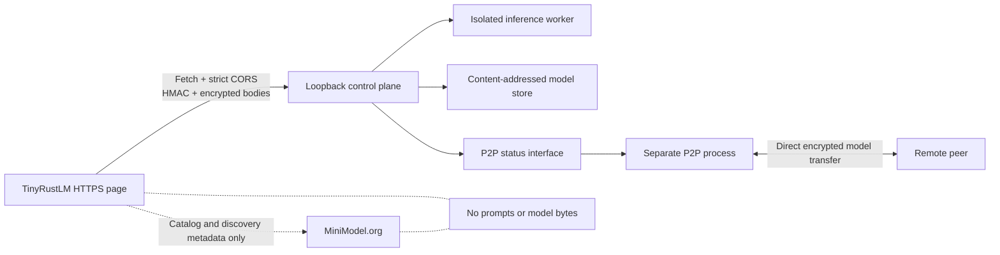
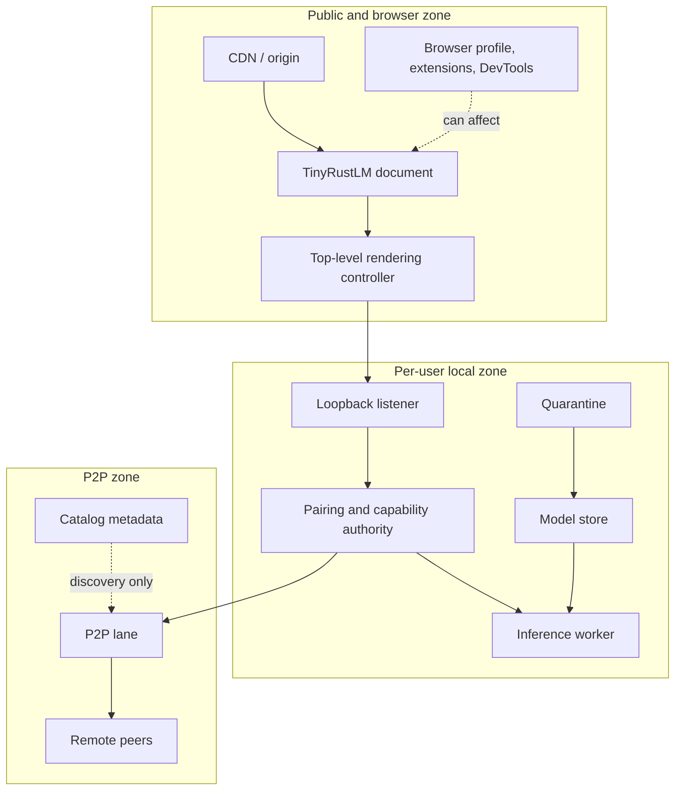
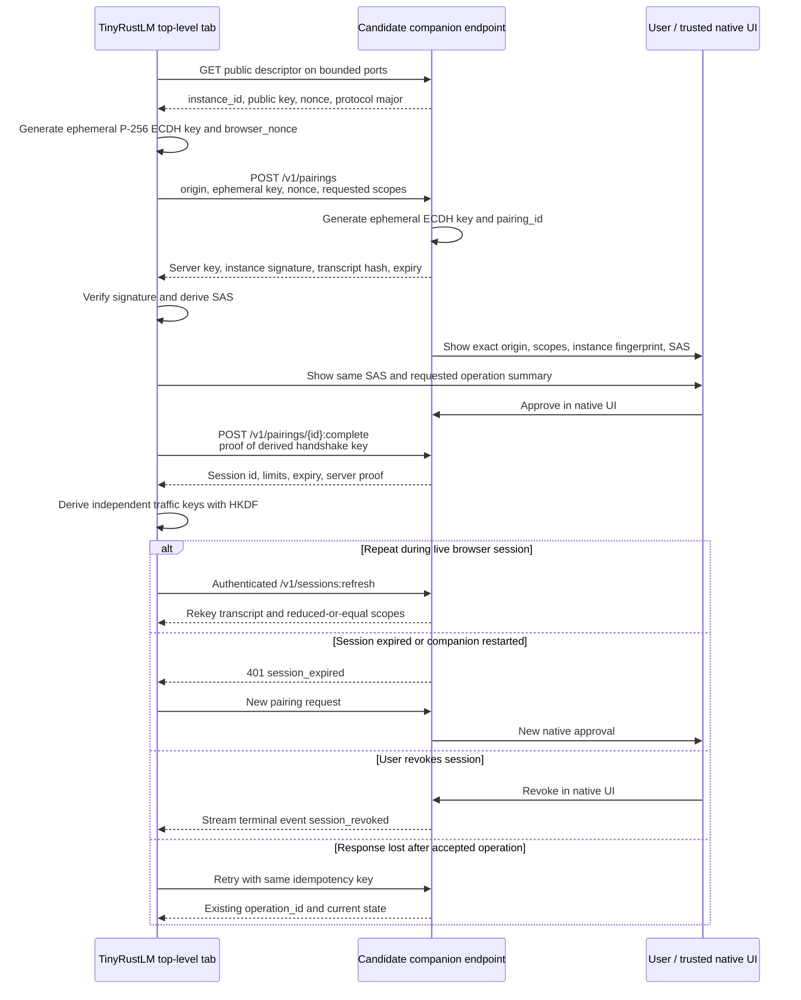

# Secure Browser-to-Companion Protocol for Local Inference and Direct P2P

## Executive protocol recommendation

### Scope, evidence labels, and assumptions

This report treats the uploaded specification as the controlling scope: an HTTPS TinyRustLM browser client must communicate with an independently installed Rust/.NET companion for `.slm` import, local inference, and direct peer-to-peer model transfer, while ensuring that project sites do not receive prompts or model bytes and that publication, administrative, catalog, MemoryEndpoints, and P2P-signing credentials do not cross into page JavaScript. fileciteturn0file0

The following labels distinguish evidence from design:

| Label | Meaning |
|---|---|
| **Public fact** | Directly observable from published standards or vendor documentation |
| **Inference** | A conclusion drawn from multiple public facts |
| **Recommendation** | The proposed TinyRustLM first-release design |
| **Assumption** | A premise not yet verified against private implementation |
| **Verification required** | A fact that needs authorized code, package, host, browser, or network access |

The report assumes the production web origin is exactly `https://tinyrustlm.com`, with no alternate `www`, preview, or staging origins sharing production pairing authority. It assumes the companion can display trusted native UI, maintain per-user protected state, and expose separate loopback control and non-loopback P2P processes. It does **not** assume anything about existing routes, ports, certificates, `.slm` structure, package signatures, logging configuration, model-runtime cancellation behavior, or P2P key handling.

### Recommended first-release architecture

**Recommendation:** use one protocol only:

> **HTTP/1.1 Fetch over numeric loopback, with response streaming, origin-bound interactive pairing, short-lived proof-of-possession session keys, application-layer authenticated encryption, strict CORS, and no cookies.**

The page connects only to:

```text
http://127.0.0.1:43191–43198
http://[::1]:43191–43198
```

Port `43191` is primary; `43192` through `43198` are ordered collision fallbacks. These are proposed product-private values and must receive a final collision and packaging review before release. The companion must bind `127.0.0.1` and, where available, `::1` using separate sockets. It must never bind the control protocol to `0.0.0.0`, `::`, a hostname, a LAN address, or an interface selected through DNS.

Loopback IP literals are classified as potentially trustworthy by the Secure Contexts algorithm, and potentially trustworthy local URLs are treated differently from ordinary insecure mixed content. That browser affordance is not authentication: the Secure Contexts specification itself warns that secure-context isolation is incomplete and that localhost name resolution can be unreliable. Chrome additionally gates public-to-loopback requests behind Local Network Access permission; this began for Fetch in Chrome 142 and expanded to WebSocket and WebTransport in Chrome 147. citeturn14view0turn15view0turn15view1

The browser uses ordinary `fetch()` for control requests and `ReadableStream` response bodies for generation. Fetch supports incremental response consumption and abort-driven cancellation, while the classic WebSocket API does not provide backpressure and can accumulate buffered data faster than an application processes it. citeturn14view2turn14view3

Because HTTP loopback is plaintext, sensitive bodies and generation events are encrypted at the application layer after pairing:

- P-256 ephemeral ECDH for each browser session.
- HKDF-SHA-256 for independent request-encryption, response-encryption, request-MAC, response-MAC, and rekey keys.
- AES-256-GCM for request payloads and individual streaming events.
- HMAC-SHA-256 over canonical HTTP semantics for early authentication and anti-replay.
- A transcript-bound companion identity signature using a per-install P-256 identity key protected outside browser storage.

HKDF is designed to derive multiple cryptographically strong keys from source key material such as a Diffie–Hellman result. HTTP Message Signatures provides a useful model for covering method, target, authority, content digest, creation time, and expiration, while also warning that signatures alone do not provide confidentiality; the proposed protocol therefore adds AEAD rather than relying on MACs alone. citeturn13search0turn13search1



### Principal design decisions

| Decision | First-release position | Reason |
|---|---|---|
| Control transport | HTTP/1.1 Fetch on numeric loopback | Broad browser support, streaming responses, abort support, no local CA |
| Confidentiality | Application-layer AEAD | Loopback and local HTTP are not equivalent to an authenticated private channel |
| Discovery | Eight-port bounded probe, public-safe descriptor only | Browser cannot directly read OS IPC or a local descriptor file |
| Pairing | Native-UI approval with transcript short-authentication string | Defeats silent malicious-origin and port-squatter enrollment |
| Browser credential lifetime | Memory-only, session-scoped | Reduces persistence after tab/profile compromise |
| Durable authorization | Companion-side origin approval only | Keeps reusable secrets out of JavaScript storage |
| Generation stream | Authenticated encrypted NDJSON over Fetch | Incremental, inspectable state machine with bounded buffering |
| Browser model upload | Not present in first release | Avoids duplicate bytes, private-path leakage, and browser buffering |
| Import | Companion-native picker or direct P2P acquisition | Bytes remain between local storage, companion, and peer |
| P2P authority | Never returned to browser | Publication and serving keys remain in the P2P process or OS store |
| Compatibility | One clean major protocol | The product is pre-publication; insecure unpublished routes should be removed |

## Threat model and protected assets

### Trust boundaries

The protocol crosses seven materially different boundaries:

1. The public HTTPS delivery boundary for TinyRustLM JavaScript and WebAssembly.
2. The browser origin and profile boundary.
3. The browser-to-loopback network boundary.
4. The companion control-plane process boundary.
5. The inference worker and model-store boundary.
6. The P2P process and non-loopback network boundary.
7. The OS credential, update, installer, and user-account boundary.

A secure context means the browser delivered the page through an origin meeting the browser’s trust criteria; it does not prove that the delivered application is benign. Secure Contexts explicitly notes incomplete isolation through facilities such as web storage and `BroadcastChannel`. A compromised approved TinyRustLM page, same-origin service worker, or extension that can inspect page state can therefore see prompts before encryption and can exercise whatever session scopes the page possesses. No browser-to-companion protocol can cryptographically hide a prompt from the JavaScript that creates it. citeturn14view0



### Actors, capabilities, and security objectives

| Threat actor or condition | Plausible capability | Required control or residual limitation |
|---|---|---|
| Malicious remote website | Scan loopback ports, submit simple requests, induce preflights | Exact CORS allowlist, exact `Origin`, no unauthenticated side effects, LNA permission, pairing |
| Compromised TinyRustLM page or XSS | Read prompts, call authorized APIs, exfiltrate browser-held keys | Strict CSP, no third-party scripts, short sessions, narrow scopes; **cannot fully protect prompts from the approved page** |
| Malicious browser extension | Read/alter page and network state according to extension permissions | Short-lived capability and native approval limit duration; otherwise residual browser-compromise risk |
| Local unprivileged process, same user | Port-squat, imitate discovery, make direct HTTP calls, read user-accessible files | Native UI pairing, instance key, proof-of-possession, user-only ACLs, application encryption |
| Another OS user | Probe shared listeners or files | Per-user process, loopback-only listener, user-specific ACLs, protected runtime directories |
| Elevated process or malware | Inspect process memory, inject code, capture traffic, replace executable | Signed updates, package identity checks, isolation, receipts; confidentiality is not guaranteed against administrator-level compromise |
| DNS rebinding origin | Resolve attacker-controlled name to loopback or alternate address | Numeric loopback URLs only, exact `Host`, connected-address check, no hostname listener |
| Router or network observer | Observe or modify non-loopback P2P traffic | P2P authenticated encryption, peer identity, signed manifests; control plane never leaves loopback |
| Stale tab or browser profile | Reuse old session or commit a late answer | Short expiry, revocation, renderer lease, event sequence, terminal generation state |
| Downgraded companion | Restore removed routes or weak protocol | Signed update metadata, minimum accepted clean protocol and build floor |
| Stolen session capability | Exercise allowed operations until expiry | Proof-of-possession key, operation scope, origin/instance binding, idle timeout, revocation |
| Port squatter | Return a fake descriptor before the real companion starts | No secret in discovery; trusted native companion UI must approve the transcript |
| Corrupt `.slm` or malicious peer | Resource exhaustion, parser exploit, wrong model identity | Streaming hash, structural admission, quarantine, size limits, atomic promotion |

### Protected-asset inventory

The highest-value assets are the prompt and completion content; model weights and `.slm` artifacts; private local paths; model inventory and usage history; companion identity keys; browser session keys; P2P identity and signing keys; enrollment URLs; MemoryEndpoints tokens; catalog credentials; publication keys; fleet or workspace administrator credentials; update trust roots; diagnostics; receipts; and service availability.

The design deliberately separates key domains:

| Key or credential | Allowed holder | Browser-visible form |
|---|---|---|
| Browser session traffic keys | Browser memory and companion session memory | Non-exportable or in-memory key handles; never serialized to logs |
| Companion instance identity key | Companion OS-protected store | Public key and fingerprint only |
| Receipt-attestation key | Companion or isolated receipt signer | Signed receipt and public identifier only |
| P2P transport/signing key | P2P process or OS-protected store | Status and public peer identifier only |
| Catalog credential | Catalog agent or P2P process | Never |
| Publication key | Native publication workflow | Never |
| MemoryEndpoints token | Dedicated native integration | Never unless a separately reviewed capability explicitly requires a constrained operation |
| Fleet/admin credential | Administrator-managed native component | Never |

A stolen browser session key must not imply possession of the instance identity key, P2P key, update key, publication key, or administrative credential.

## Browser standards and transport decision

### Standards and implementation matrix

| Area | Normative or vendor position as retrieved August 1, 2026 | Protocol consequence |
|---|---|---|
| Secure contexts | `127.0.0.0/8` and `::1/128` are potentially trustworthy; `localhost` is conditional on safe local resolution | Use numeric IP literals, not `localhost` |
| Mixed content | Potentially trustworthy local targets are not treated like ordinary insecure remote content | HTTP loopback can be viable, subject to browser policy |
| Local Network Access | WICG work defines public, local, and loopback address spaces and permission-gated access; Chrome implements permission gating | Treat LNA as browser mediation, not authentication |
| Fetch | Response bodies can be consumed as streams; aborting affects the request and body read | Use Fetch for generation and explicit cancellation |
| CORS | Preflight and response headers determine whether page JavaScript can access cross-origin responses | Exact origin, methods, headers, and bounded cache |
| WebSocket | Browser sends `Origin`; RFC 6455 says servers should validate it, but non-browser clients can forge it | `Origin` is a signal, never request authentication |
| CSP | `connect-src` controls Fetch, XHR, EventSource, WebSocket, and related outbound connections | Enumerate only the approved loopback ports and required public services |
| Permissions Policy | Features can be selectively enabled or denied, but unknown features can be ignored and implementation support varies | Use as defense-in-depth, not the primary boundary |
| WASM shared memory | Cross-origin isolation normally requires COOP and COEP | Deploy COOP/COEP where browser-side WASM threads are used |
| OAuth loopback redirect | Native-app OAuth permits random loopback ports but acknowledges interception by other local apps | Useful contrast only; an OAuth redirect pattern is not sufficient for companion authorization |

These behaviors are documented in Secure Contexts, the Fetch and CSP standards, the LNA proposal, browser release notes, and RFCs for WebSocket and native-app OAuth. citeturn14view0turn14view1turn14view2turn14view4turn14view7turn15view0turn15view1turn15view6

### Candidate-transport comparison

| Candidate | Security properties | Streaming and cancellation | Deployment and UX | First-release decision |
|---|---|---|---|---|
| **HTTP loopback + Fetch** | Strict CORS and origin checks; application authentication/encryption required | Native response stream and `AbortController`; request status through ordinary routes | No certificate installation; affected by LNA and browser policy | **Selected** |
| HTTPS loopback with locally trusted certificate | TLS confidentiality and endpoint authentication if trust is installed correctly | Good Fetch streaming | Certificate issuance, renewal, trust-store modification, revocation, multi-profile behavior, and installer privilege create a large lifecycle burden | Reject for first release |
| HTTPS with shared/public local certificate | Easy browser trust only if private key is distributable or DNS ownership is involved | Good | Shared private keys or public DNS indirection create unacceptable compromise and rebinding risks | Prohibited |
| Classic WebSocket | Persistent bidirectional channel; browser `Origin` available | No built-in backpressure in the classic API; application cancellation required | LNA prompts in current Chromium; browser cannot freely set an arbitrary `Authorization` header in the handshake | Reject |
| Server-Sent Events | HTTP-based, one-way events | Automatic reconnection and `Last-Event-ID`; separate request needed for cancellation | `EventSource` does not provide the desired custom-header and request-envelope model; would introduce a second transport | Reject |
| WebTransport | Multiplexed streams and datagrams over secure transport | Strong streaming model | HTTPS/HTTP/3/QUIC certificate and operational complexity; LNA-gated in current Chromium | Defer |
| Native messaging | Extension identity can constrain which browser extension invokes the host; OS process and framed messages | Good for messages; not directly available to a normal web origin | Requires extension installation, policy, store distribution, and an additional supply-chain component | Future managed/enterprise mode only |
| Custom URI handler | Can launch an application | Not a data-plane transport | URLs and command lines are poor places for secrets; invocation and response correlation are awkward | Non-secret launch hint only, or omit |
| Browser extension bridge | Can use native messaging and mediate local transport | Flexible | Broader privilege, extension compromise risk, browser-store dependency | Not required for first release |

WebSocket servers are expected to validate acceptable browser origins, but RFC 6455 explicitly recognizes that non-browser clients can send fabricated `Origin` values. Classic WebSocket also lacks a backpressure mechanism. Native messaging offers explicit extension-to-native-host allowlisting, but only through an installed extension and host manifest. citeturn14view3turn14view7turn15view5

Server-Sent Events are unidirectional and define automatic reconnection behavior; those semantics are useful for public event feeds but conflict with a clean, explicitly authenticated request/stream lifecycle where generation is never restarted implicitly. citeturn15view2

### Browser support policy

**Recommendation:** qualify each shipped browser family using its current stable release and previous major release. The minimum matrix should include Chromium, Microsoft Edge, Firefox, and Safari on every supported Windows and Linux configuration. Browser family detection must not select a weaker security path. Instead:

- Feature-detect streaming Fetch, Web Crypto primitives, `AbortController`, and any LNA behavior.
- Present an explicit unsupported-browser result when mandatory primitives are absent.
- Never fall back to WebSocket, unencrypted HTTP bodies, permissive CORS, a URL bearer token, or a legacy route.
- Test browser permission denial, permission revocation, incognito/private profiles, profile switching, stale service workers, and top-level versus framed execution.
- Make the application top-level only; do not permit the inference interface to operate inside an iframe.

## Loopback discovery, pairing, and session security

### Binding and listener invariants

The companion must enforce all of the following before reporting readiness:

```text
Required IPv4 listener: 127.0.0.1:<selected-port>
Optional IPv6 listener: [::1]:<same-selected-port>
IPv6 socket option: IPV6_V6ONLY = true
Allowed ports, ordered: 43191, 43192, 43193, 43194,
                        43195, 43196, 43197, 43198
HTTP protocol: HTTP/1.1 only
TLS/ALPN: none on the control listener
```

On Windows, the implementation should use exclusive binding semantics and must not opt into port sharing. On Linux, it must not set `SO_REUSEPORT`. After `accept()`, it must inspect both local and peer socket addresses and reject anything that is not exactly loopback. IPv4-mapped IPv6 addresses should be rejected rather than normalized into an accepted form.

The listener should use these initial resource ceilings:

| Resource | Proposed ceiling |
|---|---:|
| Total control connections | 32 |
| Unauthenticated connections | 4 |
| Authenticated connections | 16 |
| Concurrent generation streams per user | 2 |
| Active generation per renderer lease | 1 |
| Concurrent imports | 1 |
| Request header block | 16 KiB |
| Public descriptor response | 16 KiB |
| Ordinary encrypted control body | 1 MiB |
| Redacted diagnostic response | 256 KiB |
| Per-stream queued plaintext | 256 KiB or 64 events, whichever comes first |
| Header completion timeout | 5 seconds |
| Unauthenticated idle timeout | 5 seconds |
| Authenticated idle timeout, no stream | 30 seconds |

These values are proposed defaults, not observed product limits. They must be load-tested against the actual runtime.

### Discovery without a bearer secret

The browser probes only:

```http
GET /.well-known/tinyrustlm-companion HTTP/1.1
Host: 127.0.0.1:43191
Origin: https://tinyrustlm.com
Accept: application/json
```

The probe iterates the fixed port set with bounded concurrency and jitter. It does not include a token, enrollment URL, user identifier, model identifier, prompt, query string, fragment, cookie, custom URI payload, or secret challenge.

The public descriptor exposes only:

```json
{
  "schema": "https://tinyrustlm.com/schemas/local-probe-v1.json",
  "protocol_major": 1,
  "instance_id": "c2d40ebf-…",
  "instance_public_key": "p256:base64url-public-key",
  "selected_port": 43191,
  "pairing_required": true,
  "pairing_methods": ["native-confirm-sas-v1"],
  "build_channel": "stable",
  "response_nonce": "base64url-128-bit",
  "expires_at": "2026-08-01T18:04:30Z"
}
```

The descriptor is intentionally not trusted until pairing. A malicious local process can occupy a candidate port and return a syntactically valid descriptor. It cannot become the trusted companion without causing the user to approve the same pairing transcript in the authentic companion’s native UI.

Candidate discovery alternatives compare as follows:

| Mechanism | Benefit | Defect | Position |
|---|---|---|---|
| Single fixed port | Simple | Easy collision and squatting; no fallback | Insufficient alone |
| Bounded ordered port set | Browser-accessible, no external helper | Scan surface and possible squatting | Selected with authenticated pairing |
| Filesystem descriptor | Strong local coordination between native processes | Normal web page cannot read it | Use internally, not browser discovery |
| OS IPC bootstrap | Strong access control | Browser cannot use it without extension/native integration | Future extension mode |
| User-entered port | Avoids scanning | Poor UX and still no endpoint identity | Emergency diagnostic only |
| User-mediated code | Strong intent signal | Must not become a low-entropy bearer secret | Selected as transcript comparison |
| mDNS/service registration | Discoverable | Adds network exposure, DNS complexity, and privacy leakage | Reject |
| Custom URI bootstrap | Can launch companion | URL/argv/history leakage if it contains secrets | At most carry a non-secret launch nonce |

OAuth loopback redirect guidance permits ephemeral ports but warns that another local application can intercept a loopback redirect. For TinyRustLM, a callback receipt is therefore not endpoint authentication and cannot replace interactive companion confirmation. citeturn15view6

### First pairing and repeat-session protocol

The first pairing uses an authenticated key-exchange transcript plus explicit native approval. The six-word short-authentication string is a human comparison value derived from a full-entropy transcript; it is not submitted as a password and is not itself a bearer capability.



The pairing transcript must bind:

```text
protocol major and minor
companion instance_id
companion package/build digest
companion long-lived public identity key
exact requesting origin
browser ephemeral public key
companion ephemeral public key
browser_nonce
companion_nonce
pairing_id
requested scopes
approved scopes
creation and expiration times
public discovery descriptor hash
```

The companion UI must display the exact serialized origin, not merely a brand name such as “TinyRustLM.” It must distinguish production, staging, preview, IP-literal, and deceptive Unicode domains.

### Session capability model

A session is identified by a random 256-bit `session_id`, but the identifier is not sufficient to authorize requests. Authorization requires possession of keys derived from the pairing ECDH result. Each session is bound to:

- One companion instance.
- One exact HTTPS origin.
- One protocol major and negotiated minor.
- One random, memory-only `client_context_id`.
- One top-level-tab `renderer_lease_id`.
- A finite set of operation scopes.
- An idle expiry and absolute expiry.
- A minimum accepted browser-app build.
- A companion build and minimum-protocol floor.

Proposed defaults are a 30-minute idle lifetime, an eight-hour absolute lifetime, and traffic-key rotation every 15 minutes or after \(2^{20}\) authenticated messages, whichever occurs first. Companion restart invalidates all in-memory sessions unless an encrypted session journal is explicitly designed and tested; the safer first release is to require re-pairing.

Recommended scopes are:

```text
inventory.read
model.import.native_picker
model.import.p2p
model.activate
generation.start
generation.cancel
model.free
diagnostics.read.redacted
p2p.status.read
session.revoke.self
```

There should be no browser scope for arbitrary file paths, generic URL fetching, shell execution, raw log access, P2P private-key export, catalog credential retrieval, publication signing, fleet administration, or MemoryEndpoints token retrieval.

### Credential storage decision

| Location | Persistence | Main exposure | Decision |
|---|---|---|---|
| JavaScript variable / dedicated controller memory | Until reload, close, or crash | XSS and authorized extension can use it | **Default** |
| `sessionStorage` | Tab session, including reload | Same-origin script and some stale-tab scenarios | Do not store traffic keys |
| IndexedDB non-exportable `CryptoKey` | Durable per origin/profile | XSS may use the key even when it cannot export it | Deferred opt-in |
| `localStorage` | Durable and string-readable | XSS, backup, accidental logging | Prohibited |
| Browser cookie | Automatic request attachment | CSRF and ambient authority | Prohibited |
| Companion user configuration | Durable | Local user/process subject to ACL | Store origin approvals, not browser traffic keys |
| OS credential store | Durable, platform-protected | Platform/account compromise; possible roaming depending API | Instance and P2P keys only |
| Re-pairing | No durable browser secret | User friction | **Required after page-session loss by default** |

The instance identity key, receipt-attestation key, P2P key, publication key, catalog credential, and administrative credentials must never be returned to page JavaScript. Browser memory should hold only the current low-authority session keys.

## Versioned API, authentication, and browser controls

### Discovery and version negotiation

After pairing, the authenticated capabilities document is:

```json
{
  "schema": "https://tinyrustlm.com/schemas/companion-capabilities-v1.json",
  "protocol": {
    "major": 1,
    "minor": 0,
    "minimum_minor": 0
  },
  "instance": {
    "id": "c2d40ebf-…",
    "build_version": "1.0.0",
    "package_digest": "sha256:…",
    "signer_id": "tinyrustlm-release-2026"
  },
  "artifact": {
    "slm_versions": ["1"],
    "max_bytes": 8589934592,
    "required_hashes": ["sha256"],
    "signature_profiles": ["slm-manifest-v1"]
  },
  "runtime": {
    "abi_versions": ["1"],
    "sampling_profiles": ["basic-v1"]
  },
  "streaming": {
    "modes": ["encrypted-ndjson-v1"],
    "resume": "status-only",
    "heartbeat_seconds": 10,
    "max_event_plaintext_bytes": 65536
  },
  "operations": {
    "cancellation": true,
    "idempotency": true,
    "persistent_import_status": true,
    "generation_restart": false
  },
  "limits": {
    "active_generations": 2,
    "active_imports": 1
  },
  "privacy": {
    "prompts_sent_to_project_sites": false,
    "model_bytes_sent_to_project_sites": false,
    "access_log_body_capture": false
  },
  "feature_flags": [],
  "critical": []
}
```

Unknown noncritical JSON fields are ignored. Every extension that changes security interpretation must be listed in `critical`; an unknown critical field causes deterministic failure. An unsupported major version returns `426 Upgrade Required` with a public-safe supported-major list. Minor-version negotiation selects the highest mutually supported minor within the same major. No content-type sniffing is allowed.

### Proposed clean route set

| Method and route | Authentication | Purpose |
|---|---|---|
| `GET /healthz` | None | Process liveness only |
| `GET /readyz` | None, minimal | Local control-plane readiness only |
| `GET /.well-known/tinyrustlm-companion` | None | Public-safe discovery descriptor |
| `POST /v1/pairings` | Origin checks, no session | Begin pairing |
| `GET /v1/pairings/{pairing_id}` | Pairing-bound challenge | Poll native approval state |
| `POST /v1/pairings/{pairing_id}:complete` | Handshake proof | Complete key agreement |
| `GET /v1/capabilities` | Session | Negotiated capabilities |
| `POST /v1/sessions:refresh` | Session | Rekey without increasing scopes |
| `POST /v1/sessions/{id}:revoke` | Same session | Revoke current session |
| `GET /v1/models` | `inventory.read` | Public-safe local inventory |
| `POST /v1/imports` | Import scope | Open native picker or begin approved P2P acquisition |
| `GET /v1/imports/{id}` | Import scope | Import progress and terminal state |
| `GET /v1/operations/{id}` | Matching operation scope | Lost-response recovery |
| `POST /v1/models/{id}:activate` | `model.activate` | Activate a verified model |
| `POST /v1/generations` | `generation.start` | Begin encrypted streaming generation |
| `POST /v1/generations/{id}:cancel` | `generation.cancel` | Idempotent cancellation |
| `POST /v1/models/{id}:free` | `model.free` | Release runtime resources |
| `GET /v1/diagnostics?level=redacted` | Diagnostic scope | Bounded local-safe diagnostics |
| `GET /v1/p2p/status` | `p2p.status.read` | Layered P2P status and receipts |

`/healthz` must return no model inventory, build fingerprint, username, filesystem path, P2P address, key identifier, or public-reachability claim. `/readyz` means only that the local control path can accept authenticated work.

Routes that should **not** exist in the first release include:

```text
/admin/*
/debug/raw
/logs/raw
/metrics
/files/*
/filesystem/read
/shell
/proxy
/fetch-url
/upload
/keys/*
/credentials/*
/publish
/catalog/login
/p2p/private-key
/api/generate
/ws
/events
any legacy alias or versionless mutating endpoint
```

### Canonical request authentication

Each authenticated request carries:

```http
X-TRLM-Protocol: 1.0
X-TRLM-Session: base64url-session-id
X-TRLM-Created: 1785626400
X-TRLM-Expires: 1785626460
X-TRLM-Nonce: base64url-128-bit
X-TRLM-Sequence: 483
X-TRLM-Idempotency-Key: uuid-v4
Content-Digest: sha-256=:base64:
X-TRLM-MAC: :base64:
Content-Type: application/trlm-envelope+json
Origin: https://tinyrustlm.com
```

The signature base is assembled from parsed semantics, not raw header text:

```text
"@method": POST
"@scheme": http
"@authority": 127.0.0.1:43191
"@path": /v1/generations
"origin": https://tinyrustlm.com
"content-type": application/trlm-envelope+json
"content-digest": sha-256=:...:
"x-trlm-protocol": 1.0
"x-trlm-session": ...
"x-trlm-created": 1785626400
"x-trlm-expires": 1785626460
"x-trlm-nonce": ...
"x-trlm-sequence": 483
"x-trlm-idempotency-key": ...
```

This follows the design principle of RFC 9421: sign stable derived components such as method, target, and authority, and avoid ambiguous custom canonicalization. The implementation need not expose the general RFC 9421 negotiation surface; it should adopt a frozen TinyRustLM profile with exactly one accepted serialization and algorithm suite. citeturn13search0

Request processing order is mandatory:

1. Enforce connection, header, body, and deadline limits.
2. Parse exactly one request under strict HTTP/1.1 rules.
3. Validate local destination, `Host`, request-target form, and origin.
4. Reject duplicate security headers.
5. Resolve the session and verify expiry and scope.
6. Verify nonce, sequence window, content digest, and MAC in constant time.
7. Enter the nonce into the replay cache.
8. Decrypt the body with canonical headers as AEAD additional data.
9. Validate schema and operation limits.
10. Apply idempotency and execute.

Clock tolerance should be ±60 seconds. Requests remain valid for at most 60 seconds and never beyond the session expiration. A nonce is accepted once and retained in the replay cache for the session lifetime plus two minutes. Sequence numbers must increase, with only a small bounded out-of-order window where parallel Fetch requests require it.

Idempotency rules are:

- Same session, route, idempotency key, and plaintext request digest: return the original operation or terminal result.
- Same idempotency key with a different route or digest: `409 idempotency_conflict`.
- Repeated cancel: return the existing terminal cancellation or completion state.
- Repeated import request: return the same import operation; never duplicate the artifact.
- Repeated generation start: return the same generation identifier; never launch a second answer silently.
- Idempotency records survive companion restart for imports and state-changing model operations. Generation records survive as metadata, but an interrupted generation is not resumed automatically.

All MAC, digest, key-identifier, and transcript comparisons must use constant-time primitives after validating expected lengths.

### Host, destination, DNS-rebinding, and request-parser rules

Only these authorities are valid:

```text
127.0.0.1:<actual-bound-port>
[::1]:<actual-bound-port>
```

Reject:

- `localhost`, `.localhost`, or any DNS hostname.
- IPv4-mapped IPv6.
- Decimal-integer, octal, hexadecimal, shortened, or otherwise alternative IPv4 notation.
- `0.0.0.0`, `[::]`, link-local, private LAN, public, and zone-scoped IPv6.
- User information in an authority.
- A trailing dot or case-normalized hostname.
- A `Host` that differs from an absolute-form request target.
- `Forwarded`, `X-Forwarded-Host`, `X-Forwarded-For`, and `X-Original-URL`.
- Redirecting requests or responses.
- Multiple `Host`, `Content-Length`, security, or digest fields.
- `Transfer-Encoding` plus `Content-Length`.
- Obsolete folded headers and ambiguous request-target encodings.
- Decoded paths containing dot segments, encoded separators, NUL, or invalid UTF-8 where UTF-8 is required.

RFC 3986 defines bracketed IPv6 literals and conventional dotted-decimal IPv4 syntax; rejecting noncanonical numeric representations reduces disagreement between URL parsers, HTTP libraries, and address validators. citeturn15view7

The companion should accept origin-bearing browser requests only when:

```text
Origin == "https://tinyrustlm.com"
Sec-Fetch-Mode == "cors"             when present
Sec-Fetch-Site == "cross-site"       when present for public-to-loopback
Sec-Fetch-Dest == "empty"            when present
```

`Sec-Fetch-*` fields are supporting signals, not authentication, because a native client can forge them. Mutating and authenticated routes must reject missing `Origin`, `Origin: null`, sandboxed opaque origins, `file:` origins, extension origins, and requests initiated from unapproved preview domains.

### Strict CORS

An approved preflight response is:

```http
Access-Control-Allow-Origin: https://tinyrustlm.com
Access-Control-Allow-Methods: GET, POST, OPTIONS
Access-Control-Allow-Headers: Content-Type, Content-Digest,
  X-TRLM-Protocol, X-TRLM-Session, X-TRLM-Created,
  X-TRLM-Expires, X-TRLM-Nonce, X-TRLM-Sequence,
  X-TRLM-Idempotency-Key, X-TRLM-MAC
Access-Control-Max-Age: 300
Vary: Origin, Access-Control-Request-Method, Access-Control-Request-Headers
Cache-Control: no-store
```

There is no `Access-Control-Allow-Credentials`; requests use `credentials: "omit"`. The origin is never reflected dynamically, and `*` is never used. Preflight validates the requested method and every requested header before returning success. Preflight itself has no side effect and does not reveal inventory, readiness details, or pairing state.

Fetch’s CORS processing requires matching allow-origin and method/header authorization for the browser to expose a cross-origin response. That mechanism restricts browser reads but does not stop a native local client; the session MAC remains the actual authorization boundary. citeturn14view2

Every browser request uses:

```javascript
fetch(url, {
  method: "POST",
  mode: "cors",
  credentials: "omit",
  cache: "no-store",
  redirect: "error",
  referrerPolicy: "no-referrer",
  headers,
  body,
  signal
});
```

Redirects must be prevented at request time; discovering `response.redirected` after following a redirect is too late to protect the original request. citeturn5search10

### Project-site CSP, isolation, and Permissions Policy

A production policy should approximate:

```http
Content-Security-Policy:
  default-src 'none';
  script-src 'self' 'nonce-{per-response-random}';
  style-src 'self';
  img-src 'self' data:;
  font-src 'self';
  connect-src 'self'
    https://minimodel.org
    http://127.0.0.1:43191
    http://127.0.0.1:43192
    http://127.0.0.1:43193
    http://127.0.0.1:43194
    http://127.0.0.1:43195
    http://127.0.0.1:43196
    http://127.0.0.1:43197
    http://127.0.0.1:43198
    http://[::1]:43191
    http://[::1]:43192
    http://[::1]:43193
    http://[::1]:43194
    http://[::1]:43195
    http://[::1]:43196
    http://[::1]:43197
    http://[::1]:43198;
  worker-src 'self';
  frame-src 'none';
  frame-ancestors 'none';
  object-src 'none';
  base-uri 'none';
  form-action 'self';
  manifest-src 'self';
  require-trusted-types-for 'script';
```

No third-party analytics, tag manager, advertising script, remote font, or support widget should run in the inference origin. Subresource Integrity should protect any exceptionally permitted static third-party resource, although self-hosting is preferable. A service worker should either be absent from the inference application or have a narrowly reviewed scope, no prompt/body logging, and an explicit update and rollback policy.

CSP `connect-src` is the relevant directive for Fetch, WebSocket, EventSource, and similar connection APIs. citeturn14view4

For browser-side WASM threads:

```http
Cross-Origin-Opener-Policy: same-origin
Cross-Origin-Embedder-Policy: require-corp
Cross-Origin-Resource-Policy: same-origin
Origin-Agent-Cluster: ?1
```

Cross-origin isolation is the browser state associated with access to capabilities such as shared memory, and is normally established through COOP plus COEP. citeturn15view4

A defense-in-depth Permissions Policy should deny LAN access and allow loopback only to the top-level application where the browser recognizes the feature names:

```http
Permissions-Policy:
  local-network=(),
  loopback-network=(self),
  camera=(),
  microphone=(),
  geolocation=(),
  usb=(),
  serial=(),
  bluetooth=()
```

Permissions Policy is not sufficient by itself because feature availability and implementation vary, and unrecognized policy-controlled features can be ignored. citeturn15view3

## Streaming generation, import, privacy, and P2P truth

### Generation request and event contract

The decrypted generation request contains:

```json
{
  "schema": "generation-request-v1",
  "request_id": "uuid",
  "renderer_lease_id": "uuid",
  "model": {
    "artifact_sha256": "…",
    "composition_sha256": "…"
  },
  "prompt": {
    "format": "messages-v1",
    "messages": [
      {"role": "user", "content": "…"}
    ]
  },
  "sampling": {
    "profile": "basic-v1",
    "temperature": 0.7,
    "top_p": 0.95,
    "max_output_tokens": 512,
    "seed": null
  }
}
```

The companion computes a local prompt digest for request binding, but that digest must not be exported to project sites, catalogs, public receipts, telemetry, or ordinary logs. A prompt hash can itself enable confirmation attacks against guessed sensitive text.

The HTTP response is `application/x-ndjson`, but each line is an authenticated encrypted envelope:

```json
{
  "v": 1,
  "generation_id": "uuid",
  "stream_prefix": "base64url-random",
  "seq": 17,
  "type": "ciphertext",
  "ciphertext": "base64url",
  "tag": "base64url",
  "prev_event_hash": "sha256:…"
}
```

After decryption, the permitted event types are:

| Event | Required content |
|---|---|
| `accepted` | Generation ID, response ID, renderer lease, active model/composition digest, sampling digest |
| `delta` | Monotonic event sequence and UTF-8 text delta or token identifier, never both ambiguously |
| `usage` | Input tokens, output tokens, elapsed inference counters |
| `heartbeat` | Sequence and monotonic server time; no prompt/model content |
| `complete` | Stop reason, final usage, final stream hash |
| `error` | Stable code, retryability, bounded safe message |
| `cancelled` | Cancellation reason and final usage |
| `session_revoked` | Terminal session state |

Every event is individually AEAD-protected with a nonce derived from a random per-stream prefix and the monotonic sequence. The prior-event hash chains the stream and makes deletion, duplication, and reordering detectable.

### Backpressure and cancellation

Fetch response bodies expose a readable stream, allowing the browser to process data incrementally rather than waiting for the complete response. citeturn14view2

The companion must nevertheless impose its own bounded queue. Recommended behavior:

- Pause model-output consumption when the queue reaches 64 events or 256 KiB of plaintext.
- If the runtime cannot pause, retain only within the hard bound and cancel with `consumer_too_slow`; never allow unbounded memory growth.
- Send a heartbeat every ten seconds during token silence.
- Treat 30 seconds of unconsumed buffered output as a stalled consumer.
- Limit a decrypted event to 64 KiB and an error message to 4 KiB.
- Never log token or text deltas.

Cancellation uses both browser transport cancellation and an authoritative protocol operation:

1. The UI calls `AbortController.abort()` to stop further browser consumption.
2. It sends `POST /v1/generations/{id}:cancel` with a new authenticated idempotency key.
3. The inference worker observes a cancellation token at bounded intervals.
4. If completion won the race, cancellation returns `already_complete`.
5. If cancellation won, the stream terminates once with `cancelled`.
6. Repeating the same cancellation returns the same terminal state.

Aborting a Fetch affects both the request and subsequent body reads, but transport abort alone is not sufficient proof that computation stopped; the explicit cancel operation supplies authoritative state. citeturn14view2

### One authoritative renderer

A generation is bound to one `renderer_lease_id`. The browser application maintains one top-level rendering controller per assistant turn. The companion rejects a second active generation for the same lease unless the first is terminal.

The UI commit rule is:

```text
Commit only when:
session_id matches
generation_id matches expected operation
response_id has not been committed
renderer_lease_id is the active lease
seq == previous_seq + 1
event MAC and hash chain verify
terminal event has not previously occurred
```

A browser-origin Web Lock may coordinate same-origin tabs, but the companion-side renderer lease remains authoritative. Storage events or `BroadcastChannel` alone are not a security boundary; Secure Contexts notes that cross-context browser facilities contribute to incomplete isolation. citeturn14view0

A disconnected generation is marked `interrupted`. First release has **no token-stream resume** and no invisible restart. A retry with the same idempotency key returns the existing operation state. Continuing an interrupted answer is a new, explicit user action and a new generation, visibly distinguished from the interrupted response.

### Model-import decision

| Import mechanism | Privacy and efficiency | Security concern | Decision |
|---|---|---|---|
| Browser-selected `File` uploaded over loopback | User-friendly but model bytes traverse browser memory and may be duplicated | DevTools, extension, buffering, temporary storage, large-upload interoperability | Not first release |
| Browser-selected path reference | Browser normally does not expose a generally usable native path | Path privacy and confused-deputy file access | Prohibited |
| Companion-native picker | Bytes move directly from disk into companion quarantine | Requires trusted native UI | **Preferred** |
| Browser-entered local path | Avoids byte upload | Reveals private paths and can become arbitrary-file authority | Prohibited |
| Direct P2P acquisition | Avoids project-site and browser path | Requires peer identity, manifest trust, resource limits | **Supported after P2P verification** |
| Catalog-mediated download | Central convenience | Violates the no-model-proxy constraint | Prohibited |

`POST /v1/imports` should accept only an operation choice such as:

```json
{"source": "native_picker"}
```

or:

```json
{
  "source": "p2p",
  "artifact_sha256": "…",
  "signed_manifest": {"…": "…"},
  "peer_receipt_id": "…"
}
```

It must not accept an arbitrary local filesystem path or arbitrary URL.

### `.slm` admission pipeline

Because the `.slm` format and its signing rules are not publicly verified here, the following is a required architecture rather than a claim about the current artifact format:

```mermaid
flowchart LR
    A[Native picker or authenticated peer] --> B[Per-user quarantine]
    B --> C[Stream size enforcement]
    C --> D[Streaming SHA-256]
    D --> E[Container and manifest parser]
    E --> F[Signature and publisher policy]
    F --> G[Tensor, length, ABI, and resource checks]
    G --> H[Runtime compatibility probe]
    H --> I[fsync file and directory]
    I --> J[Atomic rename into content-addressed store]
    J --> K[Inventory publication by public-safe digest]
```



Admission must validate:

- Magic, container version, endianness, declared lengths, and complete-file termination.
- Manifest signature and signer policy.
- Artifact SHA-256 and every component digest.
- Tensor dimensions, element counts, multiplication overflow, offsets, alignment, and overlap.
- Runtime ABI, architecture, quantization, tokenizer, and operator compatibility.
- Compression ratio and decompressed-size limits.
- No archive path traversal, symlink, device node, alternate data stream, or absolute path.
- Disk quota, memory forecast, model-context limit, and maximum file count.
- No execution or memory mapping from quarantine before complete admission.
- `fsync` and atomic promotion so crashes cannot expose partially admitted content.

The public model identity should be content-based, for example `sha256:<digest>`, with a separately displayed human catalog name. Local filenames and paths are not part of public identity.

### Prompt, model, and diagnostic privacy

The companion must disable ordinary HTTP access logging or restrict it to route templates, status classes, bounded durations, and random request identifiers. It must never log:

- Request URLs containing variable identifiers when a template suffices.
- Query strings.
- `Origin` beyond a normalized allowlist identifier.
- Authorization, session, nonce, MAC, digest, or idempotency values.
- Encrypted or plaintext bodies.
- Prompt text, completion text, token deltas, embeddings, or prompt hashes.
- Model filenames, user paths, or peer addresses.
- P2P, publication, catalog, MemoryEndpoints, enrollment, or administrative secrets.

Errors cross the browser boundary as stable codes plus bounded generic descriptions. Full parser offsets, native stack traces, environment variables, command lines, and filesystem paths remain only in protected opt-in diagnostics, and even there must be redacted.

Residual privacy boundaries must be explicit:

| Surface | Control | Residual risk |
|---|---|---|
| Compromised approved page | CSP, no third-party script, short scopes | Page necessarily sees user-entered prompt |
| Browser extension | Minimize permission recommendations, short session | Privileged extension may inspect page/network |
| DevTools | No server logs; encrypted wire bodies | User or local debugger can inspect pre-encryption page state |
| Crash dumps | Disable or minimize; scrub keys and prompt buffers | OS-level dumps may capture memory |
| Swap/hibernation | Locked memory for keys where practical; clear buffers | Model and prompt pages may reach OS-managed storage |
| Clipboard/screenshots | Never copy automatically; explicit user action | User or OS tools can capture displayed content |
| Temporary files | Quarantine only, mode-restricted, atomic cleanup | Forensic recovery may remain depending filesystem |
| Source maps | No secrets; restrict production distribution | Maps can aid exploitation if broadly exposed |
| P2P traffic | End-to-end peer authentication and encryption | Sizes, timing, and peer IPs remain metadata |

### P2P status separation

The browser must not collapse different network claims into one “online” indicator.

| Status dimension | Evidence required | What it does **not** prove |
|---|---|---|
| Local inference ready | Authenticated readiness receipt and loaded runtime | P2P process is healthy |
| P2P lane healthy | Signed local process-health receipt | LAN or Internet reachability |
| LAN listener active | Bound non-loopback address and local socket state | Another LAN host can connect |
| LAN reachability | Recent challenge from an independent LAN verifier | Public Internet reachability |
| Public reachability | Recent outside-in challenge receipt | Catalog announcement |
| Catalog announced | Catalog acknowledgment for peer/model metadata | Model bytes were served successfully |
| Transfer verified | Peer-signed transfer receipt and artifact digest | Continued reachability after receipt expiry |

A local `/healthz` response proves only local process liveness. Public reachability requires an outside verifier that issued an unpredictable challenge and received a valid response over the P2P lane. Catalog acknowledgment is a separate event and must not be inferred from either health or reachability.

The browser may display only unexpired receipts, including the evidence timestamp, verifier identity class, and expiration. The P2P private key remains in the P2P process or OS-protected storage.

## Service lifecycle, updates, evidence, and testing

### Windows and Linux process architecture

**Windows recommendation:** install per user under a protected `%LOCALAPPDATA%` location and run the control companion unelevated in the interactive user context. Do not run the browser control plane as `SYSTEM`. Use a per-user startup mechanism and a per-user singleton lock. Give model-store, configuration, and credential files ACLs that exclude other nonadministrative users. Close inherited handles and isolate model workers in job objects or equivalent process supervision.

**Linux recommendation:** use a `systemd --user` unit. Put transient sockets, lock files, and PID metadata under `$XDG_RUNTIME_DIR`; persistent configuration under `$XDG_CONFIG_HOME`; state and model indexes under `$XDG_STATE_HOME` or a deliberately selected per-user data directory. A systemd login environment creates a private per-user runtime directory intended for runtime objects such as Unix sockets and removes it after the user’s final logout. citeturn11search6

A conceptual Linux unit should include, where compatible with GPU/runtime requirements:

```ini
[Service]
ExecStart=%h/.local/libexec/tinyrustlm-companion
Restart=on-failure
NoNewPrivileges=true
PrivateTmp=true
ProtectSystem=strict
ProtectHome=read-only
RestrictSUIDSGID=true
LockPersonality=true
UMask=0077
```

The loopback control plane and P2P lane should be separate processes:

| Process | Privilege and network | Secret access |
|---|---|---|
| Control companion | Per user; loopback only | Instance identity, session authority, model index |
| Inference worker | No listening sockets; least filesystem access | Selected verified model and generation input |
| Import verifier | Quarantine and promotion paths only | Artifact verification trust anchors |
| P2P lane | Required LAN/public sockets only | P2P identity, serving policy; no browser session keys |
| Updater | Narrow installation authority, not continuously resident | Update metadata trust roots |

Only the P2P lane should trigger or require non-loopback firewall rules. The control companion should never add a firewall exception.

### Startup, restart, and shutdown

Startup order:

1. Verify executable/package identity.
2. Acquire the per-user singleton.
3. Lock configuration and credential files.
4. Validate minimum protocol/build policy.
5. Bind the selected loopback port before publishing readiness.
6. Recover the operation journal.
7. Verify model-store index consistency.
8. Start workers and mark `/readyz` true.
9. Start the independent P2P lane only if native policy enables it.

On restart:

- Pairing attempts become expired.
- In-memory browser sessions become invalid.
- Running generations become `interrupted`; they are not silently restarted.
- Imports resume only from verified chunk boundaries under the same manifest and expected digest, or enter an explicit restart-required state.
- Activation and free operations reconcile against observed worker state.
- Stale ports and runtime descriptor files are removed only after ownership checks.
- Orphan workers are terminated or reattached only through authenticated parent identity.

Shutdown drains by first rejecting new generation and import requests, then allowing a short bounded grace interval, issuing cancellation, flushing operation metadata, and closing listeners. The design must not claim a successful clean shutdown if workers remain orphaned.

Uninstall must stop services, revoke sessions, remove startup entries, remove only TinyRustLM-created firewall rules, delete runtime files, and wipe credentials. User models should be preserved or deleted only through an explicit user choice.

### Update and downgrade defense

The update design should combine signed native packages with TUF-style metadata:

- Root role and threshold trust.
- Timestamp and snapshot freshness.
- Signed target metadata containing package digest, length, platform, architecture, channel, protocol range, and security floor.
- Protection against rollback, freeze, mix-and-match, and wrong-target installation.
- Transactional install and rollback only to a still-authorized security version.
- Separate emergency authorization for any exceptional downgrade.
- Binding of the browser application build and companion package digest in the pairing transcript.

The Update Framework is expressly designed to address rollback, freeze, mix-and-match, and wrong-software attacks through role separation, versioning, expirations, and threshold signatures. Windows package signing additionally allows package integrity and signer identity to be checked. citeturn14view5turn15view8

Because the product is pre-publication, the release should define a single minimum clean protocol and remove all superseded handlers before publishing. Historical receipts may record earlier test versions, but the executable must not retain dormant legacy routes, compatibility tokens, permissive CORS branches, or alternate transports.

### Adversarial test matrix

| Test | Stimulus | Required result |
|---|---|---|
| Malicious website scan | Thousands of origins probe every candidate port | At most public descriptor; no inventory or side effect |
| Reflected origin | Arbitrary `Origin` sent in preflight | No reflected allow-origin; request denied |
| Null origin | Sandboxed iframe or local file | Deterministic denial |
| DNS rebinding | Hostname changes from public to loopback | Irrelevant because hostname targets/listeners are rejected |
| Forged `Host` | Correct socket, wrong authority | `400 invalid_authority` before body processing |
| Alternative numeric IP | Decimal, octal, hex, mapped IPv6 | Rejected before route dispatch |
| CSRF form | Simple form POST without custom headers | Unsupported media type or authentication failure; no side effect |
| Preflight confusion | Mixed-case, duplicate, or extra requested headers | Exact normalized allowlist or denial |
| Cross-site WebSocket | Browser attempts `ws://` connection | No WebSocket route/listener exists |
| Replay | Repeat identical authenticated request | Replay denial or original idempotent result, never duplicate execution |
| Stolen session ID only | Correct session identifier, no traffic key | MAC failure |
| Stolen full session capability | Valid key from another origin/instance or after expiry | Origin/instance/expiry denial |
| Port squatting | Fake descriptor and pairing endpoint | Cannot produce approval in authentic companion UI |
| Local malicious process | Direct HTTP requests with forged browser headers | Fails proof-of-possession |
| Oversized body | Length above declared route limit | Early `413`, bounded read, no allocation proportional to declaration |
| Slowloris | Partial headers/body below minimum rate | Deadline closure |
| Request smuggling | CL/TE ambiguity or duplicate lengths | Connection closed before routing |
| Duplicate stream event | Repeated sequence or hash | Renderer terminates stream as integrity failure |
| Out-of-order event | Sequence gap/reordering | No commit; integrity failure |
| Cancellation race | Complete and cancel occur concurrently | Exactly one terminal state |
| Lost response | Drop after operation acceptance | Retry returns original operation |
| Companion restart | Kill during generation/import | Generation interrupted; import safely recovered or restarted |
| Corrupt model | Wrong digest, malformed dimensions, truncated file | Quarantine rejection; no activation |
| Decompression bomb | Tiny compressed input with excessive expansion | Admission stops at ratio/size ceiling |
| Path traversal | Archive member escapes quarantine | Rejection |
| Stale tab | Old tab attempts to commit after lease transfer | Companion and renderer reject |
| Downgrade | Install older signed but disallowed build | Security-floor rejection |
| Secret leakage | Scan logs, dumps, profiles, packages | Release blocker on any unauthorized secret marker |

Browser tests must run from real HTTPS origins rather than only mocked unit clients, because CORS, mixed content, secure-context, LNA, service-worker, and permission behavior is browser-mediated. Chrome’s LNA permission applies to public-to-loopback requests, and current Chromium has expanded it across Fetch, WebSocket, and WebTransport surfaces over successive releases. citeturn15view0turn15view1

### Public-safe receipt contract

A receipt suitable for support or publication contains:

```json
{
  "schema": "trlm-receipt-v1",
  "receipt_id": "uuid",
  "created_at": "2026-08-01T18:42:00Z",
  "expires_at": "2026-08-01T18:52:00Z",
  "companion": {
    "package_sha256": "…",
    "signer_id": "tinyrustlm-release-2026"
  },
  "protocol": {"major": 1, "minor": 0},
  "origin": "https://tinyrustlm.com",
  "endpoint_class": "loopback-ipv4",
  "scopes": ["p2p.status.read"],
  "model": {"artifact_sha256": "…"},
  "status": {
    "local_ready": true,
    "p2p_lane_healthy": true,
    "lan_reachable": "unverified",
    "public_reachable": "verified",
    "catalog_announced": false
  },
  "counts": {
    "challenge_requests": 1,
    "successful_responses": 1
  },
  "test_identity": "outside-verifier-production",
  "error": null,
  "signature": {
    "key_id": "receipt-key-2026",
    "value": "base64url"
  }
}
```

Public-safe receipts omit prompts, completions, prompt hashes, filenames, paths, usernames, exact loopback ports, local process IDs, browser profile identifiers, peer IPs unless explicitly necessary, session identifiers, nonces, MACs, and secret values.

### Secret-scanning contract

CI, package publication, diagnostic export, and support-bundle generation must scan:

- UTF-8, UTF-16LE, and UTF-16BE text.
- Base64, base64url, hexadecimal, JSON-escaped, and percent-encoded forms.
- Source, generated code, WebAssembly strings, source maps, symbols, manifests, packages, logs, traces, profiles, crash artifacts, test fixtures, and screenshots where automated classification is possible.
- Known prefixes and markers for enrollment URLs, bearer tokens, MemoryEndpoints, authorization headers, private-key PEM blocks, catalog secrets, publication keys, P2P private keys, and session headers.
- High-entropy strings, with narrowly reviewed allowlists based on stable digests rather than plaintext exceptions.

Any confirmed production secret, prompt fixture containing real user data, private model path, or private key in a distributable artifact is a release blocker.

### TDD and clean-cutover backlog

| Order | Test-first deliverable | Exit criterion |
|---:|---|---|
| 1 | URI, authority, origin, header, content-digest, and canonical-signature parsers | Corpus passes; differential fuzzing finds no parser disagreement |
| 2 | Loopback-only socket binding | Automated proof that wildcard and non-loopback connections fail |
| 3 | Hostile-origin and CORS suite | Every unapproved, null, missing, or reflected origin fails |
| 4 | Discovery and port collision | Valid fallback and malicious squatter scenarios pass |
| 5 | Pairing transcript and native approval | MITM, replay, wrong-origin, wrong-instance, and expired pairing fail |
| 6 | Session AEAD, MAC, replay cache, and rekey | Published vectors pass in Rust, .NET, and browser implementation |
| 7 | Public-safe inventory | No path, secret, or private metadata escapes |
| 8 | One synthetic `.slm` fixture | Structural admission, corruption, quota, and atomic promotion pass |
| 9 | One authorized real model | Verified import and activation without browser byte transit |
| 10 | Generation stream | Sequence, encryption, backpressure, terminal state, and one-renderer properties pass |
| 11 | Cancellation and lost response | Races and idempotent recovery pass |
| 12 | Restart and operation journal | No invisible regeneration or partial promotion |
| 13 | P2P truth model | Local health cannot set LAN/public/catalog status |
| 14 | Windows and Linux packages | Per-user installation, ACLs, update, uninstall, and stale-resource tests pass |
| 15 | Browser dogfood | Real HTTPS tests pass on the supported browser matrix |
| 16 | Route removal audit | No superseded endpoint, dual transport, permissive CORS, or compatibility token remains |

Stop-release conditions include any non-loopback control bind; wildcard or reflected CORS; URL or cookie bearer credentials; missing native confirmation; browser exposure of high-value keys; unauthenticated mutating routes; accepted replay; unbounded stream buffering; duplicate answer commitment; generation restart without explicit user action; corrupt model promotion; local health presented as public reachability; accepted downgrade; or a confirmed secret-scanner finding.

## Unknowns, follow-up validation, and annotated bibliography

### Facts requiring authorized verification

The following cannot be responsibly asserted from public information:

| Unknown | Required access or artifact | Design consequence |
|---|---|---|
| Actual TinyRustLM production and staging origins | DNS/CDN and deployment configuration | Exact origin and CSP allowlists |
| Existing local endpoints and transports | Source, binaries, or live companion | Route-removal and migration audit |
| Current bind addresses and port behavior | Live network inspection and source | Loopback enforcement and collision plan |
| `.slm` container and signature specification | Formal schema and test artifacts | Admission parser, limits, trust roots |
| Runtime cancellation and flow control | Runtime source and instrumentation | Backpressure and cancellation guarantees |
| Model memory and temporary-file behavior | Runtime tests and OS tracing | Privacy and crash-recovery posture |
| P2P handshake and transport | Protocol specification and packet captures | Peer authentication, replay, and confidentiality |
| P2P and publication key storage | Authorized credential-flow review | Secret-boundary validation |
| MiniModel catalog API behavior | Public/API specification and deployment review | Metadata-only enforcement |
| Windows installer privilege and startup mechanism | Installer project and package | Per-user and update architecture |
| Linux packaging and hardening compatibility | Unit files, sandbox tests, GPU setup | Practical service isolation |
| Logging, traces, crash dumps, telemetry | Configuration, binaries, and generated artifacts | Secret-leakage assessment |
| Update trust roots and rollback policy | Update metadata and signing ceremony | Downgrade resistance |
| Browser build and support policy | Product decision and test farm | Exact compatibility matrix |
| Existing credentials or enrollment URLs | Authorized secret inventory | Boundary and scanner rules |
| Firewall and NAT behavior | Live Windows/Linux and outside verifier | P2P status truth |
| Legacy unpublished routes | Repository and binary inventory | Clean cutover proof |

### Sequenced deeper-validation plan

A defensible elapsed-time estimate cannot be derived without repository size, package count, browser support targets, `.slm` complexity, P2P design, or access to test infrastructure. The work can instead be scoped by evidence-producing stages:

| Stage | Relative effort | Required outputs |
|---|---|---|
| Protocol freeze | Medium | Threat model, schemas, canonicalization vectors, crypto profile, route registry |
| Private implementation inventory | Medium | Listener/route/secret/log/update data-flow map |
| Parser and cryptographic implementation | Large | Rust, .NET, and browser interoperability vectors and fuzz targets |
| Browser interoperability | Large | Real-origin CORS/LNA/mixed-content matrix across supported browsers |
| Artifact admission | Large to very large | Formal `.slm` schema, malformed corpus, resource-limit tests |
| Lifecycle and packaging | Large | Signed Windows/Linux packages, ACL/unit tests, upgrade/uninstall evidence |
| P2P verification | Large to very large | Peer protocol review, outside-in verifier, receipt semantics |
| Clean publication audit | Medium | Route-removal proof, secret scan, package inventory, release blockers closed |

The stages should remain sequential where security dependencies require it: protocol and schema freeze before implementation; route inventory before clean cutover; `.slm` specification before parser security claims; P2P protocol review before public-reachability claims; and package/update verification before production enrollment.

### Prioritized annotated bibliography

All sources below were retrieved on **August 1, 2026**. Living standards should be pinned to immutable repository commits in the final architecture decision record; a retrieval date alone is not an immutable revision.

| Priority | Primary source and publication state | Relevance |
|---:|---|---|
| 1 | [W3C Secure Contexts, Editor’s Draft dated November 10, 2023](https://w3c.github.io/webappsec-secure-contexts/) | Normative algorithm for potentially trustworthy loopback origins; also documents incomplete isolation and localhost-resolution risk. citeturn14view0 |
| 2 | [WICG Local Network Access](https://wicg.github.io/local-network-access/) | Current proposal for permission-gated public/local/loopback access and integrations with Fetch, WebSocket, and WebTransport. Treat as evolving rather than a universally implemented standard. citeturn14view1 |
| 3 | [Chrome 142 release notes, stable October 28, 2025](https://developer.chrome.com/release-notes/142) | Vendor record of Local Network Access permission gating for public-to-local and public-to-loopback requests and mixed-content relaxation after permission. citeturn15view0 |
| 4 | [Chrome 147 release notes, stable April 7, 2026](https://developer.chrome.com/release-notes/147) | Vendor record extending Local Network Access restrictions to WebSocket and WebTransport. citeturn15view1 |
| 5 | [WHATWG Fetch Standard](https://fetch.spec.whatwg.org/) | Normative Fetch, CORS, preflight, redirect, response, and streaming processing model. citeturn5search14 |
| 6 | [W3C Content Security Policy Level 3](https://w3c.github.io/webappsec-csp/) | Defines `connect-src`, script restrictions, framing controls, and other browser-side containment mechanisms. citeturn14view4 |
| 7 | [W3C Permissions Policy, Editor’s Draft dated June 18, 2026](https://w3c.github.io/webappsec-permissions-policy/) | Defines policy-controlled feature allowlists; useful as defense-in-depth for loopback/local-network capabilities. citeturn15view3 |
| 8 | [RFC 9421, HTTP Message Signatures, February 2024](https://www.rfc-editor.org/rfc/rfc9421) | Primary model for signing canonical method, authority, target, fields, creation time, and expiry; importantly distinguishes integrity from confidentiality. citeturn13search0 |
| 9 | [RFC 5869, HKDF, May 2010](https://www.rfc-editor.org/rfc/rfc5869) | Primary key-derivation construction for separating handshake output into independent protocol keys. citeturn13search1 |
| 10 | [RFC 6455, The WebSocket Protocol, December 2011](https://www.rfc-editor.org/rfc/rfc6455) | Defines browser-origin behavior and server origin validation; clarifies why `Origin` cannot authenticate native clients. citeturn14view7 |
| 11 | [WHATWG Server-Sent Events, developer edition updated July 16, 2026](https://html.spec.whatwg.org/dev/server-sent-events.html) | Primary definition of EventSource’s one-way event stream, event IDs, and reconnect behavior. citeturn15view2 |
| 12 | [RFC 3986, URI Generic Syntax, January 2005](https://www.rfc-editor.org/rfc/rfc3986) | Canonical URI authority, IPv4, and bracketed IPv6 grammar supporting strict destination parsing. citeturn15view7 |
| 13 | [RFC 8252, OAuth 2.0 for Native Apps, October 2017](https://www.rfc-editor.org/rfc/rfc8252) | Useful contrast for random loopback ports and local-app interception; not an authorization design for this companion. citeturn15view6 |
| 14 | [Microsoft Edge Native Messaging documentation](https://learn.microsoft.com/en-us/microsoft-edge/extensions/developer-guide/native-messaging) | Primary vendor description of extension-native host manifests, extension allowlisting, process invocation, and message framing. citeturn15view5 |
| 15 | [MDN Fetch API usage guide](https://developer.mozilla.org/en-US/docs/Web/API/Fetch_API/Using_Fetch) | Browser-oriented documentation for response streams, abort semantics, CORS use, and request behavior. citeturn14view2 |
| 16 | [MDN WebSocket API](https://developer.mozilla.org/en-US/docs/Web/API/WebSockets_API) | Browser documentation noting the classic WebSocket API’s lack of backpressure. citeturn14view3 |
| 17 | [W3C Cross-Origin Isolation guidance through `crossOriginIsolated`](https://developer.mozilla.org/en-US/docs/Web/API/Window/crossOriginIsolated) | Documents the COOP/COEP conditions associated with cross-origin isolation and shared-memory browser features. citeturn15view4 |
| 18 | [The Update Framework specification, version 1.0.19 source retrieved](https://theupdateframework.github.io/specification/v1.0.19/) | Primary update-security framework addressing rollback, freeze, mix-and-match, key compromise, and target selection. citeturn14view5 |
| 19 | [Microsoft MSIX SignTool guidance](https://learn.microsoft.com/en-us/windows/msix/package/sign-app-package-using-signtool) | Vendor guidance for signing Windows application packages and establishing package integrity and signer identity. citeturn15view8 |

The evidence supports the central architectural conclusion: browser loopback affordances, CORS, LNA permission, `Origin`, and secure-context classification are useful layers, but none establishes that a process on a local port is the intended TinyRustLM companion. That identity and authority must come from user-mediated pairing, proof-of-possession session keys, strict destination validation, narrow capabilities, application-layer confidentiality, and a separately protected native trust and update chain.