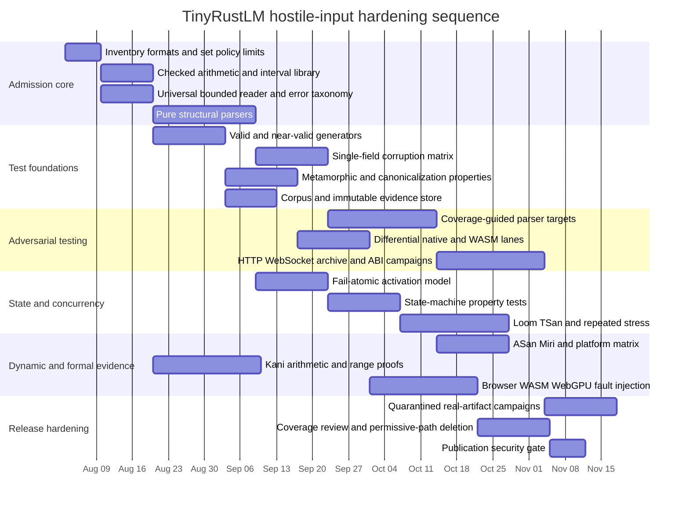

# TinyRustLM Hostile-Artifact Hardening, Fuzzing, Differential Testing, and Formal-Invariant Program

## Executive hardening strategy and assumptions

**Evidence labels used throughout this report**

| Label | Meaning |
|---|---|
| **Observed public fact** | Directly stated in a cited public specification, official repository, advisory, or standard. |
| **Externally sourced fact** | Supported by public evidence but not observed in TinyRustLM itself. |
| **Inference** | A conclusion drawn from the supplied product context and cited external evidence. |
| **Engineering recommendation** | A proposed TinyRustLM design or test requirement. |
| **Assumption** | A premise adopted because private implementation evidence is unavailable. |
| **Local verification required** | A fact that must be confirmed against authorized TinyRustLM source, builds, fixtures, or operational configuration. |

**Scope.** The uploaded engineering brief makes the research topic specific: hardening TinyRustLM against malformed, adversarial, oversized, inconsistent, and resource-exhausting inputs across model files, manifests, receipts, tokenizer data, grammars, networking, browser/WASM boundaries, archives, and native APIs. It also fixes important constraints: safe Rust by default, bounded validation before allocation or execution, no permissive compatibility readers for unpublished formats, privacy-safe diagnostics, immutable failure evidence, and fail-atomic preservation of the last-known-good state. fileciteturn0file0

**Assumption.** No private TinyRustLM source, parser implementations, file-format specifications, binaries, corpora, crash records, CI configuration, or operational limits were available. Consequently, this report defines implementation contracts, harness shapes, invariants, and verification gates, but it does not claim that the present product satisfies them.

**Executive conclusion.** TinyRustLM should treat every byte sequence crossing a trust boundary as hostile, including bytes obtained from “trusted” catalogs, local files, loopback services, same-origin browser messages, package consumers, and previously cached artifacts. Provenance can influence authorization and reputation; it cannot substitute for structural validation. Safe Rust materially reduces classes of memory corruption, but it does not prevent integer-wrap logic errors, unbounded allocation, stack exhaustion, algorithmic complexity attacks, deadlocks, semantic ambiguity, or state corruption caused by valid-but-malicious inputs. Rust’s own reference distinguishes soundness from broader application safety, and its undefined-behavior rules do not purport to prevent denial of service or business-logic failures. citeturn2search2turn2search13

The recommended architecture is a **bounded admission pipeline**:

```text
untrusted bytes
    ↓
transport envelope limits
    ↓
bounded structural preflight
    ↓
canonical representation and exact-consumption check
    ↓
semantic and cross-object validation
    ↓
cryptographic identity and signature verification
    ↓
resource plan and allocation approval
    ↓
quarantined preparation
    ↓
single fail-atomic activation commit
```

No later phase may compensate for a missing earlier bound. Hashing an enormous attacker-selected region is still resource consumption. Verifying a signature over ambiguous serialization does not create a canonical interpretation. Loading tensor data before proving all ranges and dimensions are bounded defeats preflight. Parsing in WebAssembly does not make excessive CPU or memory use acceptable.

**Primary security objectives**

| Objective | Required property |
|---|---|
| Memory and type safety | No out-of-bounds access, invalid references, uninitialized reads, use-after-free, ABI width confusion, or unsafe-code soundness gap. |
| Bounded resource use | Every input has explicit byte, item, nesting, allocation, decompression, CPU-work, wall-clock, and concurrency budgets. |
| Canonical interpretation | One accepted byte sequence has one meaning; duplicate or ambiguous encodings are rejected rather than “recovered.” |
| Fail-atomic state | Candidate parsing, validation, cancellation, or activation failure cannot mutate the active model or its composition-bound caches. |
| Path containment | Imports and archive extraction cannot escape a designated root through textual traversal, links, reparse points, case folding, races, or platform namespaces. |
| Network framing safety | Conflicting message lengths, duplicate framing headers, malformed chunking, ambiguous request targets, and connection-reuse residues are rejected consistently. |
| Diagnostic privacy | Public errors reveal bounded codes and hashes, not raw payloads, prompts, tokens, credentials, paths, or uncontrolled remote names. |
| Evidence integrity | Original failures, minimized reproductions, tool identities, and regression associations are immutable and content-addressed. |
| Cross-runtime equivalence | Native, WASM, scalar, optimized, tokenizer, canonicalizer, and reference implementations must agree within explicitly documented numerical tolerances. |

**Engineering recommendation.** Use a small, independently reviewed admission core containing only byte cursors, checked arithmetic, limit accounting, structural parsers, canonical encoders, and immutable validated descriptors. It should not contain network clients, GPU code, model execution, dynamic dispatch into metadata, archive extraction, or application state mutation. The core should compile for native and `wasm32`, with the same acceptance semantics and the same domain error codes.

**Engineering recommendation.** Keep production dependencies near zero as requested, but explicitly permit test-only tools. `cargo-fuzz` wraps libFuzzer and is the standard Rust-oriented entry point; libFuzzer expects fast, deterministic, narrow, repeatedly callable harnesses and supports corpus minimization, dictionaries, timeouts, and RSS limits. AFL++ and honggfuzz provide useful independent mutation and scheduling behavior, while Miri, Loom, Kani, sanitizers, and deductive verifiers answer different questions. None constitutes a production guarantee on its own. citeturn0search0turn0search12turn10search1turn11search0turn10search2

**Assumptions requiring ratification**

| Assumption | Why it matters |
|---|---|
| `.slm` is unpublished and can still be changed incompatibly. | Strict rejection and deletion of permissive readers are feasible without a legacy-compatibility burden. |
| Parsing can be separated from allocation and activation. | Required for bounded preflight and fail-atomic state. |
| Model metadata contains no intentionally executable program. | Otherwise a separate code-signing, capability, and sandbox threat model is required. |
| All public APIs can return stable domain error codes. | Required for deterministic, privacy-safe differential testing. |
| Native and WASM can share a format-level conformance suite. | Required to stop runtime-specific parser drift. |
| Archive import is optional rather than intrinsic to `.slm`. | The preferred defense is to eliminate extraction when a direct container reader suffices. |
| Model-size, tensor-count, vocabulary, context, grammar, and network limits can be product-configured but not attacker-raised. | Limits must be policy, not fields trusted from the artifact. |

## Attack surface and trust boundaries

The trust boundary is crossed when an attacker can influence **bytes, lengths, ordering, identity, paths, destinations, timing, cancellation, or concurrency**. A same-machine loopback socket, browser worker, package wrapper, or catalog entry is still a boundary because another process, tab, extension, compromised dependency, or stale cache can supply malformed values.

### Attack-surface and trust-boundary matrix

| Surface | Representative hostile inputs | Structural bounds required before allocation | Canonical and semantic objectives | Forbidden effects during parsing |
|---|---|---|---|---|
| `.slm` fixed header | Truncated magic/version, unsupported flags, extreme section counts, inconsistent declared size, polyglot prefix | Fixed minimum and maximum header bytes; known version set; checked declared size; section-count cap | One endianness, one version interpretation, reserved bits zero, exact file-size relation | No tensor allocation, mapping, decompression, GPU creation, or active-state mutation |
| `.slm` tensor directory | Duplicate names, overlapping ranges, gaps, reversed ranges, extreme rank, product overflow, invalid dtype, quantization tails | Maximum tensors, rank, name length, dimensions, total metadata, tensor bytes and total elements | Unique identifiers; sorted or canonically sortable entries; full validated data coverage; dtype/shape/size agreement | No per-tensor buffer creation or kernel dispatch |
| Tensor data and quantization blocks | Short final block, impossible padding, noncanonical NaNs where disallowed, offset aliasing, malicious alignment | Range inside file; checked block count and padding; aggregate byte budget | Exact block layout; no hidden trailing bytes; numerical policy explicit | No SIMD/GPU access until representation is validated |
| Tokenizer vocabulary and merges | Duplicate tokens, invalid UTF-8, huge strings, conflicting IDs, cycles, pathological prefix sets | Vocabulary, token-byte, merge-rule, trie-node, and total-work caps | Stable byte/token mapping, unique IDs, deterministic normalization policy | No generation cache mutation |
| Chat templates and grammars | Deep recursion, catastrophic alternation, unsupported directives, embedded tool requests, enormous literals | Grammar node/depth/transition caps; no unbounded recursive descent; compile-work budget | Pure declarative grammar; deterministic accepted language; no executable metadata | No tool invocation, filesystem, network, or prompt logging |
| JSON or canonical metadata | Duplicate keys, long numbers, exponent extremes, invalid Unicode, key-order ambiguity, canonicalization collision | Input bytes, string bytes, members, number digits, nesting, aggregate work | Reject duplicate properties; define exact Unicode policy; sign canonical bytes rather than parser-dependent objects | No environment-variable interpolation or URI fetch |
| Composition manifests and adapters | Missing base model, adapter cycles, tensor-shape mismatch, conflicting precedence, cache confusion | Maximum components, graph nodes/edges, dependency depth, adapter bytes | Acyclic composition, explicit binding to base artifact hash and compatible schema | No active cache changes before commit |
| Chunk maps and range indexes | Overlap, gap, duplicate chunk, integer overflow, hash mismatch, reordered chunks | Chunk count, individual and aggregate range caps | Exact coverage policy; each chunk bound to artifact identity and index | No sparse allocation based only on remote lengths |
| Signatures | Algorithm confusion, wrapped signed object, duplicate signer, signature over noncanonical representation | Signature count, key ID length, signed-region length | Domain separation; exact bytes signed; algorithm and key policy fixed externally | No trust elevation before full semantic validation |
| Receipts | Replay, duplicate logical operation, timestamp overflow, mutable prior entry, unbounded metadata | Receipt bytes, entries, timestamp and duration bounds | Append-only sequence, operation-id uniqueness, prior-hash linkage | No overwrite of prior failure or success records |
| Grammar and schema files | Reference loops, excessive `$ref`-like expansion, ambiguous alternatives, unknown extensions | Reference count, expansion depth, total nodes and compilation steps | Closed-world schema version; unresolved references reject | No dynamic code generation |
| MemoryEndpoints envelopes | Destination injection, tenant confusion, huge vector/list, nested compression, replay ID | Envelope, field, item, body and decompressed-size caps | Endpoint identity selected by policy; replay-resistant operation IDs | No attacker-selected network destination |
| Catalog metadata | Confusable publisher/model names, stale signatures, unexpected redirects, huge descriptions | Response, field, redirect, URL, and item limits | Identity by hash and verified signer, not display name | No automatic activation |
| HTTP request line and headers | Conflicting `Content-Length`/`Transfer-Encoding`, duplicate framing, obs-fold, oversized fields, absolute-form targets | Request-line, total-header, field-count, field-size, body, chunk and connection-work caps | One framing interpretation; strict target form; deterministic duplicate-header rules | No partial request dispatch |
| HTTP ranges | Reversed or overflowing ranges, excessive multipart ranges, huge suffix ranges | Range count and parsed integer limits; checked inclusive/exclusive conversion | Normalize to validated half-open intervals; coalesce only after authorization | No preallocation from untrusted `Content-Range` |
| WebSocket frames | Invalid opcodes, unmasked client frames, fragmented control frames, huge fragmented message, compression bomb | Frame, message, fragment, decompressed bytes, ratio and work caps | Correct fragment state machine; UTF-8 policy for text; negotiated extension enforcement | No unlimited reassembly |
| Worker and browser messages | Type confusion, cloned huge arrays, stale generation IDs, reordered completion messages | Message bytes, handles, attachments, in-flight requests, generations | Schema-tagged messages; stale generation rejected; transfer ownership explicit | No direct active-model pointer replacement |
| JS/WASM ABI | Pointer-plus-length overflow, stale view after memory growth, invalid handle, wrong alignment, signed conversion | Validate pointer and length in wide integer; current memory size; handle table limits | Copy or borrow only for call lifetime; generation-tagged opaque handles | No unchecked slice creation |
| C ABI | Null/non-null mismatch, width truncation, foreign unwind, unterminated strings, alias violations | Fixed-width lengths; maximum strings; pointer ranges where verifiable | Explicit ownership and lifetime; no unwinding across ABI; stable error struct | No borrowed reference retained after call |
| .NET wrapper | Negative lengths, oversized arrays, disposed handles, UTF-16 confusion, concurrent calls | Checked conversion into fixed-width Rust values; wrapper-side and Rust-side caps | Opaque handles and idempotent disposal; documented thread safety | No exception crossing unmanaged boundary |
| Archives and packages | Absolute paths, `..`, symlink/junction/hard-link escape, devices, ADS, duplicate names, zip bomb | Entries, names, compressed and expanded bytes, ratio, nesting and file-count caps | Destination containment after resolution; regular files only unless explicitly required | No extraction outside fresh staging directory |
| Config files and CLI | Include loops, hostile paths, enormous arguments, repeated flags, response-file recursion | File, line, argument, include-depth and total-token caps | Closed option set; deterministic precedence; secrets redacted | No unbounded glob expansion or remote fetch |

### Boundary-specific objectives

**Binary artifacts.** Every offset is a half-open interval `[start, end)` expressed in a fixed-width unsigned type until proven representable as `usize`. Entries must be nonoverlapping. Whether gaps are allowed must be a format-level decision; for core model data, the safer default is exact coverage so suffix polyglots and concealed secondary payloads are rejected. Safetensors illustrates several useful defensive choices: a length-delimited JSON header, disallowed duplicate keys, explicit tensor offsets, and a requirement that the tensor buffer be fully indexed without holes. Those choices are evidence that a tensor format can remain simple while imposing overlap and coverage invariants, not proof that TinyRustLM should copy the format unchanged. citeturn9view0

**Structured metadata.** RFC 8785’s JSON Canonicalization Scheme requires no duplicate property names and defines a deterministic serialization, but it deliberately preserves string data rather than performing Unicode normalization. TinyRustLM must therefore choose whether identifiers are byte-exact, NFC-normalized before admission, or restricted to a conservative character subset; it must not allow one component to normalize while another signs or compares raw strings. Unicode normalization forms are stable and idempotent for their defined domains, but compatibility normalization can erase distinctions and should not be applied blindly. citeturn4search3turn4search1

**Network framing.** HTTP/1.1 explicitly warns that messages containing both `Transfer-Encoding` and `Content-Length` can facilitate request smuggling when recipients disagree. A strict loopback server should reject the combination and close the connection rather than rely on downstream interpretation. WebSocket receivers must enforce masking direction, fragmentation sequencing, control-frame size, and nonfragmentation rules. Per-message compression adds independent state and memory constraints, including negotiated window and context-takeover parameters. citeturn3search5turn3search1turn3search0

**Paths and archives.** Textual prefix checks are inadequate because absolute paths, `..`, alternate separators, links, reparse points, namespace syntax, and time-of-check/time-of-use races can change the final target. Windows additionally has reserved names, NUL and control restrictions, alternate data streams, UNC and drive-relative forms, and symbolic links implemented as reparse points. CWE-22 recommends canonicalization and containment rather than solely filtering suspicious strings, while Microsoft’s filesystem documentation confirms the platform-specific namespace and link behavior that must be tested. citeturn5search0turn5search2turn5search1turn5search3

### Path and archive admission contract

**Engineering recommendation.** Prefer reading package members directly from a validated container without extracting them. Where extraction is unavoidable:

1. Create a new, private staging directory owned by the operation.
2. Reject absolute, rooted, drive-relative, UNC, device, namespaced, empty, dot, parent, ADS-bearing, reserved-device, and NUL-containing member names before filesystem calls.
3. Convert separators according to a format-defined portable path grammar rather than host interpretation.
4. Reject symlink, junction, reparse-point, hard-link, device, FIFO, socket, and other nonregular entries unless a separately reviewed use case requires them.
5. Open each destination relative to a directory handle using no-follow semantics where supported.
6. After creation, resolve the actual object and verify containment under the staging root.
7. Refuse duplicate normalized paths and case-fold collisions on case-insensitive destinations.
8. Enforce aggregate expanded bytes, file count, directory count, per-file bytes, compression ratio, and CPU budget.
9. Never execute, import, or dynamically load extracted scripts or libraries.
10. Atomically publish only a fully validated staging tree; recursively delete failed staging trees using independent cleanup attempts.

### Network parser test requirements

| Class | Required cases and oracle |
|---|---|
| Message framing | One `Content-Length`; repeated identical values; differing values; comma forms; `Transfer-Encoding` plus `Content-Length`; malformed chunk sizes; trailer overflow; extra bytes after body. Strict mode rejects ambiguity and closes reusable connections. |
| Header syntax | Oversized name/value, excessive count, invalid control characters, prohibited obs-fold, leading whitespace, duplicate singleton headers, mixed case, empty field names. |
| Request target | Origin-form only for loopback APIs unless another form is explicitly required; reject absolute-form authority injection, fragments, backslashes, NUL, malformed percent encoding, decoded dot segments and double-decoding discrepancies. |
| Ranges | `0-0`, suffix zero, open-ended range, maximum integers, start greater than end, inclusive-to-exclusive overflow, overlapping and excessive multipart ranges, inconsistent `Content-Range`. |
| Body types | Multipart boundary absent, boundary prefix collision, enormous preamble/epilogue, nested multipart if unsupported, body arriving slowly, cancellation mid-body. |
| Connection behavior | Pipelined valid and invalid requests, invalid request followed by valid bytes, body shorter or longer than declared, response completion before reuse, idle and total connection deadlines. |
| WebSocket | Mask direction, reserved bits, all length encodings, nonminimal length representation, fragmented text UTF-8 split across frames, control frame in fragments, fragmented control frame rejection, excessive fragments, close-reason UTF-8, compression expansion and context takeover. |

## Universal bounded reader, checked arithmetic, and fail-atomic state

### Bounded-reader contract

**Engineering recommendation.** All binary and structured parsers should consume input through one audited cursor abstraction or equivalent generated pattern. Direct indexing into attacker-controlled buffers should be prohibited in parser modules except inside that abstraction.

```rust
#![forbid(unsafe_code)]

#[derive(Clone, Copy, Debug)]
pub struct ParseLimits {
    pub max_input_bytes: u64,
    pub max_items: u32,
    pub max_string_bytes: u32,
    pub max_nesting: u16,
    pub max_work_units: u64,
    pub max_planned_allocation: u64,
}

#[derive(Clone, Copy, Debug, Eq, PartialEq)]
pub enum ParseCode {
    InputTooLarge,
    UnexpectedEof,
    IntegerOverflow,
    WidthNotRepresentable,
    CountLimit,
    StringLimit,
    NestingLimit,
    WorkLimit,
    AllocationLimit,
    InvalidUtf8,
    InvalidValue,
    DuplicateField,
    Overlap,
    Gap,
    TrailingBytes,
    UnsupportedVersion,
}

#[derive(Clone, Copy, Debug, Eq, PartialEq)]
pub struct ParseError {
    pub code: ParseCode,
    pub stage: u16,
    pub field: u16,
    pub offset_bucket: u32,
}

pub struct Reader<'a> {
    bytes: &'a [u8],
    pos: usize,
    work: u64,
    limits: ParseLimits,
}

impl<'a> Reader<'a> {
    pub fn new(bytes: &'a [u8], limits: ParseLimits) -> Result<Self, ParseError> {
        let len = u64::try_from(bytes.len()).map_err(|_| err(ParseCode::WidthNotRepresentable))?;
        if len > limits.max_input_bytes {
            return Err(err(ParseCode::InputTooLarge));
        }
        Ok(Self { bytes, pos: 0, work: 0, limits })
    }

    pub fn remaining(&self) -> usize {
        self.bytes.len() - self.pos
    }

    pub fn position(&self) -> usize {
        self.pos
    }

    pub fn charge(&mut self, units: u64) -> Result<(), ParseError> {
        self.work = self.work
            .checked_add(units)
            .ok_or_else(|| err(ParseCode::IntegerOverflow))?;
        if self.work > self.limits.max_work_units {
            return Err(err(ParseCode::WorkLimit));
        }
        Ok(())
    }

    pub fn take(&mut self, n: usize) -> Result<&'a [u8], ParseError> {
        self.charge(u64::try_from(n).map_err(|_| err(ParseCode::WidthNotRepresentable))?)?;
        let end = self.pos
            .checked_add(n)
            .ok_or_else(|| err(ParseCode::IntegerOverflow))?;
        let out = self.bytes
            .get(self.pos..end)
            .ok_or_else(|| err(ParseCode::UnexpectedEof))?;
        self.pos = end;
        Ok(out)
    }

    pub fn read_u32_le(&mut self) -> Result<u32, ParseError> {
        let b: [u8; 4] = self.take(4)?
            .try_into()
            .map_err(|_| err(ParseCode::UnexpectedEof))?;
        Ok(u32::from_le_bytes(b))
    }

    pub fn read_len_u32(&mut self, maximum: u32) -> Result<usize, ParseError> {
        let value = self.read_u32_le()?;
        if value > maximum {
            return Err(err(ParseCode::CountLimit));
        }
        usize::try_from(value).map_err(|_| err(ParseCode::WidthNotRepresentable))
    }

    pub fn finish_exact(self) -> Result<(), ParseError> {
        if self.pos != self.bytes.len() {
            return Err(err(ParseCode::TrailingBytes));
        }
        Ok(())
    }
}

const fn err(code: ParseCode) -> ParseError {
    ParseError { code, stage: 0, field: 0, offset_bucket: 0 }
}
```

The public error carries only bounded numeric classifications. A private diagnostic layer may associate the failure with an artifact hash, build ID, target ID, and more precise offset, but must not include raw field contents or paths by default.

**Required reader rules**

| Rule | Contract |
|---|---|
| Cursor monotonicity | `0 ≤ old_pos ≤ new_pos ≤ input_len`; no seek based on unvalidated arithmetic. |
| Remaining length | Derived by subtraction only after maintaining `pos ≤ len`. |
| Checked arithmetic | All attacker-influenced addition, multiplication, shifts, alignment, and inclusive/exclusive conversion use checked operations. |
| Maximum counts | Count checked before conversion, allocation, or iteration. |
| String limits | Length checked before read; UTF-8 validation occurs on the bounded slice; identifier normalization has a separate work bound. |
| Nesting | Prefer iterative stacks; otherwise decrement a hard depth budget before descent and restore it on return. |
| Work budget | Charge per byte scanned, item visited, comparison, graph edge, normalization step, grammar expansion, and decompressed output block. |
| Allocation | Compute aggregate planned allocation first; compare to policy; then use `try_reserve` or `try_reserve_exact` and handle failure. |
| Exact consumption | Core artifacts reject trailing bytes unless the format explicitly defines an extension region with its own length and rules. |
| Determinism | Identical bytes and policy produce the same success descriptor or domain error code independent of host path, locale, hash-map seed, or thread scheduling. |
| No parser side effects | Parsing returns immutable descriptors; it cannot update active model state, caches, receipt logs, network endpoints, or filesystem destinations. |

### Checked-arithmetic invariant library

Rust exposes checked integer methods such as `checked_add` and `checked_mul`; using them explicitly avoids relying on profile-dependent overflow behavior. The key design rule is to retain values as fixed-width format types until bounds are proven, then convert once to the destination width. `usize` differs between native 64-bit and `wasm32`, so successful native conversion is not evidence of WASM representability. citeturn2search10

```rust
#[derive(Clone, Copy, Debug, Eq, PartialEq, Ord, PartialOrd)]
pub struct ByteCount(u64);

#[derive(Clone, Copy, Debug, Eq, PartialEq)]
pub struct FileRange {
    pub start: u64,
    pub end: u64, // exclusive
}

impl ByteCount {
    pub fn checked_add(self, rhs: Self) -> Result<Self, ParseCode> {
        self.0.checked_add(rhs.0)
            .map(Self)
            .ok_or(ParseCode::IntegerOverflow)
    }

    pub fn checked_mul(self, rhs: u64) -> Result<Self, ParseCode> {
        self.0.checked_mul(rhs)
            .map(Self)
            .ok_or(ParseCode::IntegerOverflow)
    }

    pub fn as_usize(self) -> Result<usize, ParseCode> {
        usize::try_from(self.0).map_err(|_| ParseCode::WidthNotRepresentable)
    }
}

impl FileRange {
    pub fn new(start: u64, end: u64, file_len: u64) -> Result<Self, ParseCode> {
        if start > end || end > file_len {
            return Err(ParseCode::InvalidValue);
        }
        Ok(Self { start, end })
    }

    pub fn len(self) -> ByteCount {
        ByteCount(self.end - self.start)
    }

    pub fn overlaps(self, other: Self) -> bool {
        self.start < other.end && other.start < self.end
    }
}

pub fn checked_product(values: &[u64], maximum: u64) -> Result<u64, ParseCode> {
    let mut product = 1_u64;
    for &value in values {
        product = product
            .checked_mul(value)
            .ok_or(ParseCode::IntegerOverflow)?;
        if product > maximum {
            return Err(ParseCode::AllocationLimit);
        }
    }
    Ok(product)
}
```

### Arithmetic proof obligations

| Domain | Required proof obligation |
|---|---|
| File offsets | `start ≤ end ≤ file_len`; conversion to `usize` only after `end ≤ usize::MAX`; slice expression cannot overflow. |
| Tensor elements | `elements = Π dimension`; each multiplication checked; rank and each dimension bounded; zero-dimension semantics defined. |
| Tensor bytes | `bytes = ceil(elements × bits_per_element / 8)` using a checked formula that cannot overflow during rounding. |
| Strides | If stored, each stride is representable and the maximum reachable element offset remains inside the tensor range; otherwise reject nonpacked layouts. |
| Quantization blocks | `blocks = ceil(elements / block_elements)` with checked addition; `blocks × bytes_per_block` equals the declared tensor range after tail rules. |
| Alignment and padding | `aligned = value.checked_add(alignment - 1)?.checked_div(alignment)?.checked_mul(alignment)?`; alignment nonzero and policy-bounded. |
| Chunk ranges | Every range is within artifact size; sorting cannot change identity; overlaps rejected; gap policy explicit; aggregate does not overflow. |
| WASM pages | `page_bytes = pages × 65,536` checked in `u64`; page count also conforms to instantiated memory maximum. WASM memory limits do not excuse application-level overcommit. citeturn6search4turn7search3 |
| Context positions | `past_tokens + requested_tokens + special_tokens ≤ context_limit`; all operands converted to one width before arithmetic. |
| Token counts | Tokenizer output count bounded independently from input-byte count because short inputs can expand into many logical tokens under some schemes. |
| HTTP ranges | Parse decimal digits with checked multiply-by-ten/add; convert inclusive end to exclusive with `checked_add(1)`; reject overflow rather than saturating. |
| Timestamps | Parse into a fixed unit and signedness; reject out-of-policy range; do not subtract untrusted timestamps without checked signed arithmetic. |
| Durations | Convert seconds/milliseconds/nanoseconds with checked multiplication; cap before passing to timer APIs; distinguish deadline from elapsed duration. |
| C ABI lengths | Accept `u64` or an explicitly sized C type, reject values above both policy and `usize::MAX`; never silently cast negative signed lengths. |
| .NET lengths | Reject negative values before conversion; ensure array length and supplied length agree; copy or pin only for the documented call lifetime. |

**Engineering recommendation.** Add model-checking harnesses for each helper over small and boundary domains. Kani can prove assertions, panic absence, and arithmetic-overflow properties within bounded harnesses, but its documentation currently treats concurrency as out of scope; use it for pure arithmetic and parser helpers, not as evidence about activation races. citeturn1search0turn1search4

### Parser phase separation

| Phase | May read | May allocate | May cache | May mutate |
|---|---|---|---|---|
| Envelope gate | Transport-declared size and a fixed prefix | Constant-size stack/local buffers | Nothing persistent | Per-request counters only |
| Structural preflight | Entire bounded metadata and, where necessary, selected bounded data tails | Bounded descriptor vectors after counts are validated | Temporary operation-local parse cache | Operation-local cursor and budget |
| Canonicalization | Validated textual and structural fields | Bounded canonical output | Operation-local canonical bytes | No shared state |
| Semantic validation | Immutable descriptor graph and bounded data samples | Bounded validation workspace | Candidate-local indexes | Candidate object only |
| Identity verification | Canonical bytes and validated ranges | Hash state and bounded signature structures | Candidate hash | Candidate object only |
| Resource planning | Descriptor sizes and product policy | A small allocation plan | Candidate plan | Candidate object only |
| Preparation | Validated ranges and approved plan | Quarantined tensor buffers, mappings, GPU resources | Candidate-local cache | Candidate resources only |
| Activation commit | Prepared candidate and current active-state handle | Ideally none beyond a small state object | New generation-scoped cache | One atomic or lock-protected state swap |
| Post-commit cleanup | Old state exclusively owned after swap | No new unbounded allocations | None | Old-state resource release and append-only receipt |

**Prohibition.** Decompression, if supported, must occur only after a compressed-size cap, declared expanded-size cap, ratio cap, codec policy, and output budget are established. Because a compressed stream can produce far more output than input, the decompressor must write through a bounded sink rather than allocate the declared output optimistically.

### Fail-atomic state model

```text
Bytes
  └──parse──> ParsedCandidate
                 └──validate──> ValidatedCandidate
                                    └──plan──> PlannedCandidate
                                                  └──prepare──> PreparedCandidate
                                                                    └──commit──> ActiveGeneration
```

A type representing an earlier phase must not expose methods belonging to later phases. This typestate pattern prevents accidental activation of merely parsed data, though it does not by itself prove runtime limits or concurrency behavior.

**Required state-machine properties**

| Property | Executable assertion |
|---|---|
| Validation isolation | Hash of active state before validation equals hash after every validation success, failure, timeout, panic containment, or cancellation. |
| Failed activation rollback | Any preparation or commit failure leaves the previous active generation, caches, tokenizer, adapters, and externally visible model identity byte-for-byte or semantically exact. |
| Single commit point | No externally visible partial candidate state exists before one generation swap. |
| Cancellation idempotence | `cancel(cancel(op))` has the same state and result class as `cancel(op)`; cancellation after terminal completion has no secondary effect. |
| Receipt append-only | Existing receipt bytes and hashes never change; a new record references the prior chain head. |
| Replay uniqueness | Reusing one operation identifier cannot create a second logical activation or receipt. |
| Cache generation binding | Every composition-sensitive cache key contains the active model/composition generation or immutable artifact hashes. |
| Cleanup independence | Failure releasing one owned resource does not prevent attempts to release the remaining owned resources. |
| Stale worker rejection | Results include an operation and generation token; a result for a superseded generation cannot publish state. |
| Last-known-good preservation | Any rejected artifact leaves the prior active state available unless an independent fatal platform event makes it unavailable. |

**Engineering recommendation.** Make receipt append a separate, durable finalization operation. If the product must record failed attempts, append the failure record without changing the active-state pointer. If durable receipt append itself fails, expose that as an evidence failure without retroactively reclassifying a successful in-memory activation; the exact product rule needs local ratification.

## Mutation, property-based testing, coverage-guided fuzzing, and differential testing

### Mutation taxonomies

| Family | Mandatory mutations |
|---|---|
| Binary framing | Every single-bit flip in fixed headers; byte substitution; insertion; deletion; truncation at every offset for small seeds; extension at every boundary; repeated magic; alternate endian interpretation; polyglot prefix and suffix. |
| Counts and tables | Zero, one, maximum allowed, maximum plus one, integer maximum; duplicate table; duplicate entry; reordered entries; unsorted but otherwise valid entries; count smaller or larger than supplied entries. |
| Ranges | Start equals end; start greater than end; end equals file length; end one past file; overlap by one byte and full containment; duplicate range; gap; arithmetic wrap; aliased tensor names to same range. |
| Dimensions and tensors | Rank zero, one and maximum; dimensions zero and one; one extreme dimension; multiple dimensions whose product overflows; element count valid but byte count overflows; invalid dtype; unsupported block size; malformed quantization tail; padding with nonzero bytes. |
| Checksums and signatures | Correct checksum on wrong section, swapped checksums, duplicate signatures, changed canonical order after signing, signature wrapper with unsigned outer fields, unknown algorithm, key-ID confusable. |
| Allocation bombs | Small file declaring huge sparse dimensions; enormous count of zero-length entries; many tiny strings; deeply nested but byte-small structures; internally consistent dimensions exceeding policy; high decompression ratio. |
| Structured syntax | Duplicate keys before and after normalization; unknown, missing and null fields; type confusion; long integer and decimal strings; exponent extremes; negative zero; forbidden NaN or infinity spellings; invalid UTF-8; overlong or surrogate-like invalid encodings where applicable. |
| Unicode | NFC/NFD equivalents; compatibility equivalents; combining-mark runs; bidi controls; confusable identifiers; case-fold collisions; separator-like characters; noncharacters if policy rejects them; strings crossing normalization boundaries. |
| Canonicalization | Key reordering; insignificant whitespace; alternate escape spelling; number spelling variants; strings whose normalization policy differs; canonicalization idempotence; sign-then-reencode disagreement. |
| Network | Conflicting lengths, duplicate headers, prohibited folding, malformed chunks, partial reads at every byte, pipelining, connection residue, range overflow, multipart boundary collision, WebSocket fragmentation and compressed expansion. |
| Paths and archives | `/`, `\`, mixed separators, `..`, repeated dots, percent-encoded traversal, absolute and drive-relative paths, UNC and extended namespaces, ADS, reserved devices, trailing dots/spaces, case collisions, link entries, extraction replacement races. |
| ABI and browser | Null pointer with nonzero length; nonnull with impossible length; pointer-plus-length wrap; stale handle; disposed handle; detached view; memory growth during call; wrong thread; worker result after cancellation; duplicated transferable. |

### Property-based generator design

Property-based testing should generate both accepted structures and near-valid rejected structures. QuickCheck established the model of generated inputs and shrinking counterexamples, while later work combines property generation with coverage feedback. TinyRustLM need not make any such library a runtime dependency; generators belong in test-only modules. citeturn12search12turn12search6

**Valid generators**

| Generator | Construction strategy |
|---|---|
| Minimal `.slm` | Start from the smallest legal header, one scalar or empty tensor if permitted, and exact data coverage. |
| Tensor graph | Generate bounded rank/dimensions, compute bytes with the same independent mathematical specification, then place nonoverlapping ranges. |
| Tokenizer | Generate a bijection or documented many-to-one mapping with unique IDs and bounded byte strings. |
| Manifest graph | Generate a directed acyclic graph by selecting edges only from newer to older nodes. |
| Canonical metadata | Generate semantic objects first, then serialize with a reference canonical encoder. |
| Receipt chain | Generate operation IDs, prior hashes, bounded timestamps, and terminal outcomes. |
| HTTP/WebSocket | Generate messages from an independent grammar with configurable read fragmentation. |
| Archive | Generate portable relative paths and regular files inside aggregate quotas. |
| ABI calls | Generate valid handle-table states and pointer/length pairs referencing an owned bounded region. |

**Invalid near-valid generators.** Begin with one valid generated object and violate exactly one named invariant: one duplicate key, one overlapping range, one incorrect tensor byte, one stale generation, one invalid range endpoint, one extra trailing byte, or one cancellation reordering. These generators provide clearer blame and better shrinking than wholly random invalid data.

**Shrink strategy**

| Input kind | Shrinking order |
|---|---|
| Binary | Remove unrelated sections; reduce table entries; shrink values toward `{0, 1, limit, limit+1, max}`; shorten names; move corruption toward earliest necessary byte. |
| Structured | Remove unrelated properties; reduce depth; simplify Unicode while preserving the collision; shorten numbers and arrays; retain duplicate pair. |
| State sequence | Remove operations; shorten concurrency schedule; reduce to two actors; replace unrelated successes with no-ops; minimize to the first invariant violation. |
| Network | Reduce connections, requests, headers, chunks and fragmentation points; preserve the framing disagreement. |
| Archive | Remove members; shorten paths; reduce to one escaping member and the minimum necessary link or separator behavior. |

### Metamorphic and round-trip properties

| Property | Required result |
|---|---|
| Parse–encode–parse | A valid semantic object encoded canonically and parsed again yields the same semantic object. |
| Canonical idempotence | `canon(canon(x)) = canon(x)`. |
| Reordering | Reordering fields declared unordered does not change the semantic descriptor or hash of canonical bytes. |
| Trailing data | Adding any undefined byte to a complete core artifact changes acceptance to a deterministic trailing-data rejection. |
| Chunk partitioning | Feeding identical bytes under every possible bounded read fragmentation produces the same result. |
| Native/WASM | Both builds produce the same acceptance and domain error code for every corpus item. |
| Allocation ceiling | Peak planned and actual operation-owned bytes remain below the configured bound for all generated inputs. |
| Work ceiling | Instrumented parser work units never exceed the budget without returning `WorkLimit`. |
| Failed candidate | For every generated invalid candidate, active-state fingerprint is unchanged. |
| Hash locality | Changing a signed semantic field changes canonical bytes and artifact/signature verification outcome. |
| Receipt replay | Replaying an accepted operation ID creates no second state transition or logical receipt. |
| Cancellation | Cancellation inserted at any yield point preserves the active generation and remains idempotent. |

### Coverage-guided target matrix

libFuzzer guidance recommends narrow, deterministic, fast targets that tolerate arbitrary input, avoid uncontrolled global state, and join any threads before returning. AFL++ guidance similarly favors source-level persistent harnesses and discourages fuzzing real network services when the protocol parser can instead consume an in-memory byte stream. citeturn10search1turn11search3turn11search5

| Target | Entry point | Success-side action | Maximum fuzz input | Special seeds and dictionary |
|---|---|---|---|---|
| `slm_header` | `parse_header(&[u8], limits)` | Re-encode canonical header and compare | Header maximum plus small suffix | Magic, versions, flag masks, endian boundaries |
| `slm_tensor_directory` | `parse_directory(&[u8], file_len, limits)` | Validate sorted ranges and size equations | Metadata maximum | Dtypes, field tags, dimension boundaries |
| `slm_preflight` | Full structural preflight over bounded virtual file | Construct immutable descriptor only | Small campaign and separately large-file campaign | Minimal full files, zero-rank and empty tensors |
| `quant_block_tail` | Validate one tensor’s block layout | Compare scalar size oracle | Small | Block sizes, padding patterns |
| `tokenizer` | Parse tokenizer bytes | Encode/decode bounded sample tokens | Tokenizer metadata maximum | UTF-8 boundaries, merge delimiters |
| `chat_template` | Parse/compile declarative template | Execute only against inert symbolic data with step cap | Template maximum | Directive names and delimiters |
| `json_metadata` | Strict JSON subset parse | Canonical encode with independent encoder | Metadata maximum | Structural tokens, escapes, exponent markers |
| `manifest` | Parse and graph-validate | Topological order and hash binding | Manifest maximum | Component field names and version tags |
| `adapter_map` | Parse adapter descriptors | Shape compatibility oracle | Small | Adapter kinds and tensor names |
| `chunk_map` | Parse range map | Compare interval-set oracle | Small | Range syntax and hash tags |
| `signature_envelope` | Parse signed envelope | Extract exactly signed bytes; no live key use required | Small | Algorithms, key-ID fields |
| `receipt` | Parse and validate receipt chain | Compare append/replay model | Small | Outcome and operation tags |
| `grammar_schema` | Parse/compile with step counter | Enumerate only bounded tiny language | Small | Grammar operators and schema keywords |
| `memory_endpoint_envelope` | Parse payload envelope | Validate destination is policy-selected | Envelope maximum | Field names, operation versions |
| `catalog_metadata` | Parse one catalog record/page | Canonical record hash | Page maximum | URL and identity field names |
| `http_request` | Consume fragmented byte stream | Produce normalized request descriptor only | Header/body test cap | HTTP methods, headers, CRLF, chunk tokens |
| `http_ranges` | Parse `Range`/`Content-Range` | Compare independent interval oracle | Small | `bytes=`, comma, dash, digit runs |
| `websocket_frames` | Frame-state machine over byte chunks | Deliver to bounded sink | Message test cap | Opcodes, mask bits, length sentinels |
| `worker_message` | Decode tagged message | State-model transition only | Message cap | Message tags, generation IDs |
| `wasm_abi` | Validate numeric pointer/length against synthetic memory | Copy bounded bytes to isolated buffer | Small structured input | Width boundaries and handle tags |
| `c_abi` | Decode serialized call description, not real arbitrary pointer | Exercise checked conversion and handle table | Small | Signed/unsigned extrema |
| `dotnet_wrapper_contract` | Model wrapper call sequence | Compare reference lifecycle model | Small | Dispose/cancel/call operation tags |
| `archive_index` | Parse member metadata without extraction | Portable path normalization and collision set | Archive-header cap | Separators, drive and link tokens |
| `config_cli` | Parse bounded argument/config tokens | Canonical configuration object | Small | Option names, quoting and include syntax |
| `parse_to_validate` | Parse then semantic validate | No allocation beyond candidate cap | Per-format cap | Combined corpus |
| `validate_to_plan` | Validated descriptor to resource plan | Assert exact plan equations and ceiling | Structured generator preferred | Limit boundaries |

**Harness rules**

A target must not access a live socket, production catalog, user directory, GPU, cloud memory service, real model execution, environment credentials, clipboard, or prompt history. It must reset operation-local state after every call and have no data-dependent logging. Any required hash key should be a fixed public test key. Time and randomness must derive only from the input or a fixed seed.

**Corpus strategy**

| Corpus tier | Contents |
|---|---|
| Specification seeds | One minimal and one feature-complete valid example for each supported format version. |
| Boundary seeds | Every integer width boundary, empty/one/maximum count, rank, length, range and nesting boundary. |
| Invalid single-field seeds | Exactly one violation per invariant and per public error code. |
| Differential seeds | Every input that ever caused implementations, platforms, optimization levels, or encoders to disagree. |
| Historical regression | Minimized generic reproductions of fixed failures; sensitive originals remain in restricted storage. |
| Cross-engine corpus | Periodically merged and minimized findings from libFuzzer, AFL++, honggfuzz and structured generators. |
| Real quarantined artifacts | Authorized public or synthetic models stripped of private metadata; used only in isolated large-artifact campaigns. |

`cargo-fuzz` supports target execution, input minimization, corpus minimization, and coverage reporting. libFuzzer supports dictionaries, RSS and timeout controls, and reusable corpus directories; AFL++ supports dictionary-assisted campaigns and independent scheduling. Tool versions, compiler versions, target hashes, and corpora should be pinned so evidence is reproducible. citeturn0search0turn10search1turn11search0

### Differential testing and disagreement adjudication

Differential testing compares independent implementations to expose inconsistencies. The oracle is not “whatever most implementations do”: an observed disagreement starts an investigation against the format specification, arithmetic model, and platform semantics. An implementation can be consistently wrong, and two implementations can share a bug.

| Comparison | Inputs | Equality rule | Adjudication |
|---|---|---|---|
| Scalar vs optimized kernels | Bounded valid tensors, boundary quantization tails, NaNs/infinities under policy | Bit exact where specified; otherwise documented absolute/relative/ULP envelope | Scalar is not automatically correct; reduce case and inspect mathematical spec |
| Two canonical encoders | Semantic metadata objects and accepted parsed objects | Byte exact | Reject signing support until one encoder is proved nonconforming and fixed |
| Native vs WASM parser | Entire shared parser corpus | Same accept/reject and same domain error code | Width-dependent acceptance is a security bug unless format explicitly differs |
| Source tokenizer vs Rust tokenizer | Raw strings and byte sequences | Same token IDs, offsets, normalization and decode | Identify Unicode/version/config discrepancy; never silently choose one |
| Public reference model vs `.slm` | Authorized known model and bounded prompts | Tensor-by-tensor import identity plus output tolerance | Separate format conversion, kernel, tokenizer and sampling layers |
| HTTP parser vs standards suites | RFC and established smuggling test vectors | Strictly one normalized framing or rejection | Prefer rejection when the protocol permits strict behavior |
| Archive validation on Windows and Linux | Same member index and synthetic extraction plan | Same portable accept/reject; platform may add stricter rejection | Portable format rules must be at least as strict as either destination |
| Debug vs release | Entire regression and fuzz corpus | Same semantic result and error code | Any overflow/profile dependence is a defect |
| Little-endian hosts and simulated conversion | Generated numeric fields | Same semantic descriptor | Direct host-endian reinterpretation is a defect |
| Browser engines | Worker/WASM/WebGPU failure corpus | Same TinyRustLM state result; browser diagnostics may differ | Normalize only at application error boundary |

**Engineering recommendation.** Maintain an **oracle hierarchy**: written format contract, mathematical invariant, independent simple reference implementation, standards conformance suites, and only then production implementations. Every disagreement record should contain both implementation identities, target and corpus hashes, minimized input hash, outputs, applicable tolerance, and the decision explaining which side changed.

## Formal methods, concurrency, sanitizers, browser, WASM, and WebGPU

### Risk-targeted formal techniques

| Technique | Best TinyRustLM use | Evidence obtained | Important limitation |
|---|---|---|---|
| Exhaustive testing over small domains | Cursor movement, interval overlap, alignment, range conversion, tiny state machines | All values/schedules inside the chosen finite bound were tested | Says nothing beyond the bound |
| Kani bounded model checking | Checked arithmetic, parser helper assertions, panic freedom, option/result transitions | Proof or counterexample for the bounded harness | Concurrent execution is currently out of scope; loop bounds and tool support matter. citeturn1search0turn1search2turn1search4 |
| Loom | Activation commit, cancellation, receipt append, cache replacement, shutdown | Explores many thread interleavings and atomic outcomes under its model | It does not implement the full C11 model and can both raise false alarms and miss certain executions. citeturn2search3 |
| Miri | Unsafe/FFI boundary tests if any, aliasing, invalid values, selected race behavior | Detects many forms of undefined behavior in executed paths | It explores only executions run, has limited platform/FFI/network support, and recommends specialized tools such as Loom for complex atomics. citeturn1search1 |
| ASan and LSan | Native parser harnesses, FFI shims, optimized kernels, C reference code | Detects many memory violations and leaks in instrumented execution | Dynamic and path-dependent; incomplete instrumentation reduces evidence. citeturn0search1 |
| TSan | Native concurrent integration and wrapper tests | Detects many data races in exercised schedules | Requires synchronization visibility and has unsupported constructs such as some fence use; dynamic only. citeturn0search1 |
| UBSan | C/C++ reference parsers, shims or kernels compiled by Clang | Detects selected C/C++ undefined operations | Rust’s documented sanitizer interface does not provide a general `-Zsanitizer=undefined`; do not present C/C++ UBSan as proof about pure Rust. citeturn0search1 |
| Creusot or Prusti | Stable high-value pure helpers and state transitions with contracts | Deductive proof of specified pre/postconditions and invariants | Tool maturity, supported Rust subset, annotation maintenance and specification correctness limit assurance. citeturn12search11turn12search15 |
| Typestate and capabilities | Enforce parse/validate/prepare/activate sequencing and resource ownership | Compile-time exclusion of certain invalid API call sequences | Does not prove bounds, absence of logic defects, or correct external effects |
| Manual proof notes | Format layout, commit protocol and ABI ownership rules | Reviewable argument tied to code and tests | Can become stale; must be versioned and checked in review |
| Parser-combinator proofs | Only if a small stable grammar and proof-capable library are justified | Compositional parsing claims | Likely conflicts with zero-dependency preference and may add maintenance risk |

**Engineering recommendation.** Formalize only high-value, low-churn kernels first:

- `checked_product`, range construction, overlap detection, alignment, and `u64 → usize` conversion.
- Tensor byte-size equations for every dtype and quantization scheme.
- Canonical metadata encoding.
- Receipt-chain append and replay rules.
- Activation generation swap and stale-result rejection.
- WASM and C ABI pointer/length checks.

Avoid attempting whole-product formal verification before the format and state architecture stabilize. Proof effort attached to a changing permissive parser would preserve the wrong design.

### Concurrency and race testing

| Scenario | Actors and schedule points | Required invariant |
|---|---|---|
| Activation versus activation | Two prepared candidates race at precommit, generation allocation and state swap | Exactly one expected winner under policy; loser cannot partially publish |
| Validation versus active reads | Reader holds old active handle while candidate validates and commits | Old handle remains valid for its documented lifetime |
| Cancellation versus preparation | Cancel before allocation, during chunk copy, GPU preparation and immediately before commit | No commit after acknowledged cancellation unless contract explicitly declares commit already linearized |
| Multi-tab coordination | Two tabs acquire, lose and recover a shared model/download lock; one tab crashes | No duplicate logical operation and no permanently orphaned lock |
| OPFS handle lifecycle | Open/read/replace/close interleavings with worker death | No stale file version promoted and no unbounded handle leak |
| Cache replacement | Readers access old cache while new generation publishes replacement | Cache entries are generation-bound; old cache is released only after ownership ends |
| Two P2P lanes | Both read shared immutable chunks while one cancels or reports corruption | Immutable data remains immutable; corruption invalidates the correct artifact identity |
| Receipt append | Two terminal operations append concurrently | Chain remains linear or uses a specified merge structure; no record overwrite |
| Service shutdown | Shutdown races with requests, model switch, receipt append and cleanup | New operations rejected; owned resources all receive cleanup attempts |
| Browser worker result | Worker terminates or replies after page cancellation/restart | Stale result cannot reactivate state |

**Engineering recommendation.** Put synchronization behind a small adapter that can use standard primitives in production and Loom primitives under `cfg(loom)`. Keep model tests to two or three actors and short state sequences so state-space exploration remains tractable. Then supplement deterministic model checking with repeated native stress and TSan runs.

### Native dynamic-analysis matrix

| Configuration | Scope | Frequency | Acceptance criterion |
|---|---|---|---|
| Debug with overflow checks and assertions | All parser, validator and state tests | Every pull request | No panic except tests explicitly asserting panic containment |
| Release with overflow checks explicitly retained for security modules | Parser and arithmetic corpus | Every pull request | Same result as debug |
| ASan plus leak detection | Fuzz targets, FFI, optimized kernels | Nightly Linux x86-64; scheduled arm64 where supported | No sanitizer finding; leak exclusions documented and minimal |
| TSan | Activation, cancellation, wrappers, receipt and shutdown tests | Weekly Linux/macOS supported targets | No unexplained report |
| Miri with multiple seeds and layout randomization where applicable | Small pure and ownership tests | Nightly or weekly | No UB report; unsupported tests separately classified |
| C/C++ UBSan plus ASan | Any reference kernels, shims or differential parsers | Nightly | No report in exercised paths |
| Process memory and CPU limits | Every long fuzz campaign | Every campaign | OOM/timeout reproducer preserved and classified |
| Small stack | Recursive or grammar-related suites | Nightly | Clean bounded rejection rather than stack overflow |
| Windows native tests | Paths, archives, C/.NET ABI, lifecycle | Every Windows CI cycle | Same portable parser result plus platform-strict rejection |
| Linux arm64 | Parsers, scalar/optimized differential, fuzz replay | Nightly or release | No architecture-specific disagreement |

The Rust sanitizer documentation describes ASan and TSan as test/fuzzing tools, lists target-specific support, and notes that sanitizers add overhead and cannot catch every issue. `cargo-fuzz` itself requires LLVM sanitizer support and is documented for x86-64 and AArch64 Unix-like systems rather than Windows, so Windows assurance must include deterministic corpus replay, platform-native tests, and optionally a separate compatible fuzz engine or cross-compiled harness strategy. citeturn0search1turn0search0

### Browser, WASM, and WebGPU test matrix

| Fault | Test injection | Required TinyRustLM behavior |
|---|---|---|
| Pointer-plus-length overflow | Call exported function with endpoints near 32-bit maximum | Reject before constructing a Rust slice |
| Pointer outside memory | Start equal to or greater than current byte length | Stable ABI error; no trap relied upon as normal validation |
| Stale typed-array view | Retain JS view, grow memory, then attempt reuse | Wrapper reacquires current view or rejects generation mismatch |
| Memory growth during operation | Trigger bounded growth between descriptor validation and copy | Operation either owns a copied buffer or revalidates current memory |
| Stale opaque handle | Use freed handle or previous generation handle | Deterministic invalid-handle error |
| Double release | Release the same handle twice | Idempotent bounded error or documented no-op |
| Detached or transferred buffer | Transfer to worker or detach before call | Reject without exposing stale data |
| Worker death | Terminate worker at each state-machine yield point | Active state preserved; candidate resources reclaimed or reaped |
| WASM trap | Inject trap in preparation or kernel test module | Convert to bounded operation failure; preserve prior state |
| Page cancellation | Cancel navigation or operation during fetch, parse and commit | No stale callback publishes candidate |
| Browser process restart | Persist candidate or active metadata, restart, then recover | Only fully committed, hash-verified state is recovered |
| WebGPU validation error | Supply invalid resource parameters through test adapter | Candidate activation fails without poisoning previous model |
| WebGPU device loss | Lose device before and during dispatch | Device resources invalidated; model state either falls back safely or reports unavailable without metadata leakage |
| Oversized host message | Post a huge structured-clone object or fragmented sequence | Host-side envelope rejection before WASM copy |
| Multi-tab race | Simultaneous import, activation and eviction | Operation IDs and generation locks prevent duplicate publication |

WebAssembly memories are page-based and exposed through JavaScript buffers. Memory growth can replace or detach prior fixed-length views, so JS wrappers cannot retain unversioned typed-array views across growth. WebGPU devices can be lost asynchronously; the specification advises applications to handle the loss, notes that resources from the old device must be recreated, and warns that implementation-defined loss messages should not be parsed or disclose unnecessary system information. citeturn6search0turn7search3turn7search0

**Engineering recommendation.** Treat browser error messages and GPU validation text as untrusted diagnostics. Map them to TinyRustLM domain codes and store only a bounded hash or locally restricted detail record. Never return raw implementation-defined GPU or browser strings through public receipts.

## Evidence retention, triage, CI, and staged security TDD

### Resource isolation and campaign controls

**Engineering recommendation.** Long-running fuzzing and adversarial integration tests should execute in disposable child processes or containers with:

- A read-only build and seed corpus.
- A fresh writable artifact directory with no user data.
- No credentials, production endpoints, prompt history, SSH agents, cloud metadata access, or developer home-directory mounts.
- CPU time, wall time, resident memory, address-space, open-file, process, output-size and stack limits.
- Network disabled unless a specific isolated protocol integration test requires it.
- Deterministic locale, timezone, environment, and test keys.
- Crash artifacts named by cryptographic content hash rather than input-derived names.

libFuzzer provides per-input timeout, RSS, single-allocation and total-time controls, while AFL++ recommends explicit memory and timeout limits for pathological inputs. These are harness containment mechanisms, not substitutes for in-product bounds. citeturn10search1turn11search2

### Privacy-safe evidence schema

```text
CampaignRecord
  campaign_id
  tool_name
  tool_version_or_commit
  compiler_version
  target_name
  target_binary_hash
  source_revision
  corpus_manifest_hash
  dictionary_hash
  deterministic_seed
  start_time
  duration
  execution_count
  coverage_summary
  sanitizer_mode
  platform_and_architecture
  configured_limits

FailureRecord
  original_input_hash
  restricted_blob_location
  failure_class
  domain_error_or_signal
  bounded_stack_signature_hash
  target_hash
  first_seen_campaign
  minimized_input_hash
  minimizer_identity
  fix_revision
  regression_test_id
  disclosure_status
```

A bounded stack signature should contain normalized module/function identifiers and a small frame count, not full local paths, command lines, payload fragments, prompts, remote peer names, or environment variables. Public reports should describe the invariant and impact and may omit malicious bytes entirely.

### Triage taxonomy

| Class | Definition | Required action |
|---|---|---|
| Reproducible vulnerability | Input violates a security objective such as memory safety, containment, fail-atomic state, trust binding, or privacy | Preserve original; isolate; assess exposure; fix or rewrite; security review; separately authorize disclosure |
| Resource exhaustion | Input exceeds intended CPU, memory, stack, file, handle or concurrency limits without bounded rejection | Add or correct budget; regression test resource ceiling; rerun adjacent parsers |
| Numerical mismatch | Independent implementations exceed defined tolerance | Reduce; identify conversion, kernel or tolerance defect; block affected release path |
| Parser ambiguity | Two components assign different boundaries, fields or meaning | Treat as security defect; tighten grammar or delete permissive path |
| Expected rejection | Input is invalid and rejected within all budgets with the expected stable code | Add to corpus only if it contributes coverage or boundary evidence |
| Harness defect | Failure arises from illegal harness state, leaked global state or incorrect oracle | Fix harness; rerun all findings produced by affected harness version |
| Flaky infrastructure | Nonreproducible external worker, filesystem, timing or CI failure | Preserve logs and environment hash; do not close as product-safe until classified |
| Tool limitation | Unsupported instruction, API, target or model caused tool failure | Record limitation; use another technique; never reinterpret as a pass |

### Immutable regression workflow

```text
detect
  → content-address original bytes in restricted storage
  → reproduce under pinned target and tool
  → classify preliminary impact
  → minimize a copy, never the original
  → derive a generic nonsensitive regression where possible
  → fix narrowly or replace the parser/design
  → link fix, original hash, minimized hash and regression
  → rerun all invalidated phases and sibling implementations
  → authorize disclosure independently
```

**Engineering recommendation.** Failure records are append-only. A later determination such as “harness defect” adds a superseding classification record; it does not overwrite the original observation. This preserves auditability and satisfies the requirement that rejected artifacts remain traceable by hashes and bounded metadata.

### CI schedule and coverage gates

| Cadence | Workload | Provisional budget |
|---|---|---|
| Every commit | Unit tests, checked-arithmetic exhaustive small domains, parser regressions, canonical round trips, single-field corruptions, native/WASM corpus replay | Minutes; deterministic |
| Pull request | Property tests, state-machine tests, release/debug differential, selected Kani proofs, archive/path matrix for affected code | Roughly one bounded CI job per risk area |
| Nightly | All fuzz targets under libFuzzer, ASan/LSan, browser worker/WASM fault suite, Miri-selected tests | At least 15 minutes per normal target; 60 minutes for top-risk parsers |
| Weekly | AFL++ or honggfuzz cross-engine campaigns, Loom schedules, TSan, Windows path/archive/.NET, Linux arm64, tokenizer/model differential | Approximately 6 hours for high-risk targets |
| Release candidate | Clean corpus rebuild, full minimized regression set, 24-hour campaigns for `.slm`, HTTP, archive, tokenizer and ABI targets, quarantined real artifacts, multi-browser restart/device-loss tests | Dedicated isolated workers |
| Post-format change | Regenerate seeds, mutation matrix and canonical corpus; rerun every parser and differential lane | Mandatory before merge or format publication |

**Provisional parser-module gates**

| Gate | Requirement |
|---|---|
| Invariant coverage | Every written structural and arithmetic invariant has at least one valid and one violating test. |
| Error coverage | Every public parser error code is reached by a deterministic test. |
| Single-field corruption | Every fixed header field and table field is independently corrupted, truncated and boundary-tested. |
| Branch coverage | Target at least 85% branch and 90% line coverage for admission modules, with no unreviewed uncovered input-dependent branch. Numeric thresholds are secondary to branch review. |
| Fuzz target presence | Every untrusted parser and parser-to-validator transition has a pure bounded target. |
| Cross-runtime | Shared corpus produces identical native and WASM admission results. |
| Resource assertions | Tests measure and enforce parser work, allocation plan, nesting and output ceilings. |
| Sanitizer and Miri | No unexplained finding in supported configurations. |
| Differential | No unresolved disagreement. |
| State atomicity | Fault injection at each phase leaves active-state fingerprint unchanged until commit. |

**Stop rules.** A campaign stops when its fixed budget expires, the target or source hash changes, containment fails, or a reproducible finding requires triage. Coverage plateau is a reason to rotate dictionaries, seeds, structured mutators or engines—not evidence that the target is safe. A target with no new coverage for a day should be reviewed for unreachable guarded paths, poor seed quality, excessive rejection before deep logic, or missing structured mutations. AFL++ likewise cautions that full coverage is generally unattainable and that prolonged plateaus may call for a different fuzzer or mutator. citeturn11search3

### Staged security TDD backlog



**Backlog sequence**

| Stage | Required tests before implementation proceeds |
|---|---|
| Arithmetic | Boundary examples first, then implementation, exhaustive small-domain checks, Kani harnesses and cross-width tests. |
| Pure parsers | Minimal valid seed, every truncation, every field corruption, exact-consumption and work-budget assertions. |
| Semantic validators | One invariant at a time, near-valid generator, independent reference calculation, no side effects. |
| Property layer | Valid generation, invalid-near-valid generation, shrinker, canonical and metamorphic properties. |
| Fuzzing | One target per parser, dictionaries, corpus manifest, smoke replay, nightly campaign. |
| State machines | Reference model, operation sequences, cancellation and replay, fault injection before concurrency. |
| Concurrency | Loom for minimal model, repeated stress, TSan, worker and multi-tab tests. |
| Dynamic analysis | ASan/LSan, Miri, C/C++ UBSan where applicable, small stack, process limits. |
| Browser/WASM | ABI widths, detached views, worker death, restart, traps, device loss. |
| Package/archive | Portable path grammar, Windows-specific namespace tests, link and extraction-race tests. |
| Real artifacts | Only after synthetic invariants pass; execute in quarantine; no credentials or user data. |

### Clean deletion rules

Because TinyRustLM is pre-publication, strict redesign should replace permissive readers rather than accumulate fallback modes.

A parsing path must be deleted when any of the following holds:

- It accepts inputs the normative writer cannot produce without a documented extension mechanism.
- It tolerates duplicate keys, overlapping ranges, trailing bytes, ambiguous lengths, unknown executable metadata, or lossy canonicalization.
- It performs allocation, decompression, mapping, GPU work, or state mutation before bounded structural validation.
- It has parser semantics different from native/WASM or from the canonical encoder.
- It exists only for malformed unpublished artifacts.
- Its safety argument depends on provenance rather than bytes.
- Its error path exposes uncontrolled input.

Before deletion, preserve the design decision, relevant failure hashes, test cases, and replacement revision. Delete production code, feature flags, dead tests that assert permissive acceptance, fixtures whose only purpose is compatibility with malformed unpublished output, and documentation suggesting fallback behavior. Retain generic rejection regressions and immutable evidence.

### Recommended visual evidence

The main security dashboard should not emphasize raw execution count alone. A useful chart is a **stacked coverage-and-rejection trend** per parser target: new edges, stable edges, valid admissions, expected bounded rejections, timeouts, OOMs, crashes, and unresolved disagreements by campaign revision. A second useful visualization is an **invariant heat map** with parsers as rows and test techniques—unit, property, fuzz, differential, Kani, Miri, sanitizer, Loom, browser—as columns. A parser with high line coverage but no resource-bound or state-atomicity evidence should remain visibly incomplete.

## Unknowns requiring private inspection and annotated primary-source bibliography

### Facts requiring local or authorized verification

| Unknown | Evidence needed | Security decision affected |
|---|---|---|
| Actual `.slm` byte layout, versioning and extension mechanism | Normative format document, writer and parser source, golden files | Exact bounds, trailing-byte policy, canonical encoding, target dictionaries |
| Tensor dtype and quantization equations | Kernel and packer source, reference math, fixtures | Element/byte invariants and differential tolerances |
| Presence of memory mapping or zero-copy slices | Loader source and platform implementation | Lifetime, alignment, mutation and file-replacement risks |
| Any `unsafe` in workspace or dependencies | `cargo geiger`-style inventory or direct source audit, dependency lockfile | Miri/ASan priority and soundness review |
| Dependency policy in production and test workspaces | Cargo manifests and lockfiles | Pinning, supply-chain review and test-tool isolation |
| JSON parser duplicate-key behavior | Parser configuration and tests | Signature and canonicalization safety |
| Unicode policy for model, tensor, token and publisher names | Product specification and UI requirements | Normalization, confusable and collision rules |
| Signature envelope and signed bytes | Cryptographic specification and implementation | Wrapping and algorithm-confusion defenses |
| Receipt durability and concurrency model | Storage schema and append implementation | Replay, immutability and crash consistency |
| Activation commit mechanism | Runtime state ownership and synchronization source | Fail-atomicity and Loom model |
| Cache key composition | Cache source and invalidation tests | Cross-model data reuse |
| HTTP implementation and proxy exposure | Server/library source and deployment topology | Smuggling and absolute-form risk |
| WebSocket compression configuration | Handshake and frame implementation | Expansion, context and memory limits |
| Browser worker and OPFS architecture | JS/TS and WASM glue source | Stale views, generation, multi-tab and recovery tests |
| WebGPU use and fallback behavior | Adapter/device/resource lifecycle source | Device-loss state contract |
| C and .NET exported signatures | Generated headers, wrapper source, ownership docs | ABI width, unwind and lifetime tests |
| Archive formats and extraction library | Import source and platform code | Link, traversal, race and decompression defenses |
| P2P protocol framing and replay controls | Protocol spec and state-machine source | Target matrix and operation identity |
| Hosted-memory destination selection | Endpoint configuration and authorization source | SSRF/destination-injection controls |
| Operational product limits | Product requirements and benchmark data | Concrete maximum bytes, counts, work and deadlines |
| Existing corpus and incidents | Authorized crashes, bug tracker and telemetry schema | Prioritization and regression preservation |

### Annotated primary-source bibliography

All web sources below were retrieved on **August 1, 2026**. Live documentation and repositories should be pinned to a commit, release, compiler toolchain, or dated specification in TinyRustLM’s evidence manifest.

1. **Rust Reference, “Behavior considered undefined.”** Defines Rust soundness obligations and explicitly notes that `unsafe` does not relax undefined-behavior rules. It should ground any exceptional future proposal to introduce unsafe code. [Official Rust Reference](https://doc.rust-lang.org/stable/reference/behavior-considered-undefined.html). citeturn2search2

2. **Rust standard-library integer documentation.** Documents checked integer operations used by the proposed arithmetic layer. The implementation should pin the actual Rust toolchain and test both 64-bit native and 32-bit WASM targets. [Official `usize` documentation](https://doc.rust-lang.org/std/primitive.usize.html). citeturn2search10

3. **Rust Fuzz Book and `cargo-fuzz`.** Official Rust fuzzing guidance and repository for libFuzzer-based Cargo targets, corpus minimization and coverage. The repository notes Unix-like x86-64/AArch64 and nightly/LLVM requirements. [Rust Fuzz Book](https://rust-fuzz.github.io/book/cargo-fuzz.html) and [`cargo-fuzz` repository](https://github.com/rust-fuzz/cargo-fuzz). citeturn0search12turn0search0

4. **LLVM libFuzzer documentation.** Primary documentation for deterministic in-process targets, corpus operation, dictionaries, timeouts, RSS limits, minimization and fork mode. [LLVM libFuzzer](https://llvm.org/docs/LibFuzzer.html). citeturn10search1

5. **AFL++ documentation and repository.** Primary source for persistent harnesses, corpus minimization, dictionaries, independent scheduling and resource controls. The repository reported release 4.40c in March 2026 when retrieved. [AFL++ repository](https://github.com/AFLplusplus/AFLplusplus) and [fuzzing-in-depth guide](https://aflplus.plus/docs/fuzzing_in_depth/). citeturn11search0turn11search3

6. **honggfuzz repository.** Primary repository for a separate feedback-driven, persistent-capable fuzzer useful as a cross-engine check. [honggfuzz](https://github.com/google/honggfuzz). citeturn10search2

7. **Rust sanitizer documentation.** Documents supported sanitizer modes, targets, instrumentation caveats and the distinction between testing tools and production protections. [Rust Unstable Book sanitizer chapter](https://doc.rust-lang.org/beta/unstable-book/compiler-flags/sanitizer.html). citeturn0search1

8. **Miri repository.** Primary documentation for Rust UB detection, supported checks and limitations regarding FFI, networking, nondeterminism and concurrency exploration. [Miri](https://github.com/rust-lang/miri). citeturn1search1

9. **Loom repository.** Primary documentation for concurrency permutation testing and its incomplete C11 modeling limitations. [Loom](https://github.com/tokio-rs/loom). citeturn2search3

10. **Kani Rust Verifier.** Primary documentation for bounded model checking, panic and overflow checks, contracts and concrete counterexamples; its feature-support page states that concurrency is outside current scope. [Kani book](https://model-checking.github.io/kani/) and [feature support](https://model-checking.github.io/kani/rust-feature-support.html). citeturn1search0turn1search4

11. **Creusot and Prusti documentation.** Primary project sources for contract-based deductive verification of Rust. These are candidates for stable arithmetic and state kernels, not automatic whole-product guarantees. [Creusot User Guide](https://guide.creusot.rs/tutorial.html) and [Prusti repository](https://github.com/viperproject/prusti-dev). citeturn12search11turn12search15

12. **RFC 9112, HTTP/1.1.** Normative treatment of message framing and the security risk of simultaneous `Transfer-Encoding` and `Content-Length`. [RFC 9112](https://www.rfc-editor.org/rfc/rfc9112.html). citeturn3search5

13. **RFC 9110, HTTP Semantics.** Normative URI, request-target, range and semantic framework. [RFC 9110](https://www.rfc-editor.org/rfc/rfc9110.html). citeturn4search0

14. **RFC 6455 and RFC 7692.** Normative WebSocket framing, masking, fragmentation, control-frame and per-message compression rules. [RFC 6455](https://www.rfc-editor.org/rfc/rfc6455.html) and [RFC 7692](https://www.rfc-editor.org/rfc/rfc7692.html). citeturn3search1turn3search0

15. **RFC 8785, JSON Canonicalization Scheme.** Defines deterministic JSON serialization, prohibits duplicate object names for JCS input, and preserves Unicode strings without normalization. [RFC 8785](https://www.rfc-editor.org/rfc/rfc8785.html). citeturn4search3

16. **Unicode Standard Annex on normalization.** Revision 57 for Unicode 17.0.0, dated July 30, 2025, explains canonical and compatibility normalization, stability and conformance tests. [UAX #15](https://www.unicode.org/reports/tr15/). citeturn4search1

17. **WebAssembly specifications.** The core and JavaScript-interface specifications define memory limits, page sizing, memory growth and buffer behavior. TinyRustLM must still impose smaller application-level limits. [WebAssembly core specification](https://www.w3.org/TR/wasm-core-1/) and [WebAssembly JavaScript interface](https://www.w3.org/TR/wasm-js-api-2/). citeturn6search15turn7search3

18. **WebGPU specification.** Defines validation and device-loss behavior, including asynchronous loss and implementation-defined messages. The retrieved current editor’s draft was updated in July 2026, while a dated January 2026 Candidate Recommendation Draft is also available for pinning. [WebGPU specification](https://gpuweb.github.io/gpuweb/). citeturn7search0turn7search2

19. **Microsoft Windows filesystem documentation.** Primary documentation for reserved names, namespaces, NUL and control restrictions, symbolic links/reparse points and alternate data streams. [Naming Files, Paths, and Namespaces](https://learn.microsoft.com/en-us/windows/win32/fileio/naming-a-file), [Symbolic Link Programming Considerations](https://learn.microsoft.com/en-us/windows/win32/fileio/symbolic-link-programming-considerations), and [Alternate Data Streams](https://learn.microsoft.com/en-us/openspecs/windows_protocols/ms-fscc/e2b19412-a925-4360-b009-86e3b8a020c8). citeturn5search2turn5search1turn5search3

20. **MITRE CWE-22.** Authoritative weakness classification and mitigation discussion for path traversal, canonicalization, separator variants and diagnostic leakage. [CWE-22](https://cwe.mitre.org/data/definitions/22.html). citeturn5search0

21. **Safetensors format repository.** A useful primary reference for a data-only tensor format with explicit header length, tensor offsets, duplicate-key rejection and full buffer coverage. It is an architectural comparison, not a substitute for a TinyRustLM specification or independent review. [Safetensors repository](https://github.com/safetensors/safetensors). citeturn9view0

22. **PyTorch security guidance and advisory.** Current PyTorch documentation warns never to load untrusted data with `torch.load`; the official 2025 advisory documents an RCE affecting earlier `weights_only=True` behavior. This supports the rule that model artifacts must remain data-only and that “restricted” deserializers require adversarial testing. [PyTorch `torch.load` documentation](https://docs.pytorch.org/docs/stable/generated/torch.load.html) and [GHSA-53q9-r3pm-6pq6](https://github.com/pytorch/pytorch/security/advisories/GHSA-53q9-r3pm-6pq6). citeturn8search12turn8search1

23. **QuickCheck and coverage-guided property testing.** Foundational and later primary research describing generated properties, shrinking and the complementary relationship between property-based and coverage-guided testing. [QuickCheck publication record](https://www.pls-lab.org/QuickCheck) and [Coverage Guided, Property Based Testing](https://doi.org/10.1145/3360607). citeturn12search12turn12search6

24. **Differential testing.** McKeeman’s foundational work motivates comparing implementations to expose inconsistencies; TinyRustLM should combine this method with a specification-based adjudication process. [Differential Testing for Software](https://www.sciweavers.org/publications/differential-testing-software). citeturn10search0