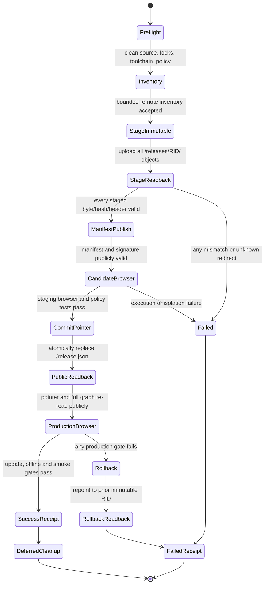
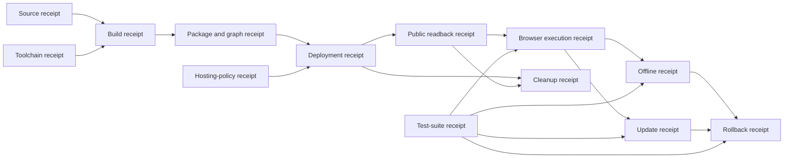
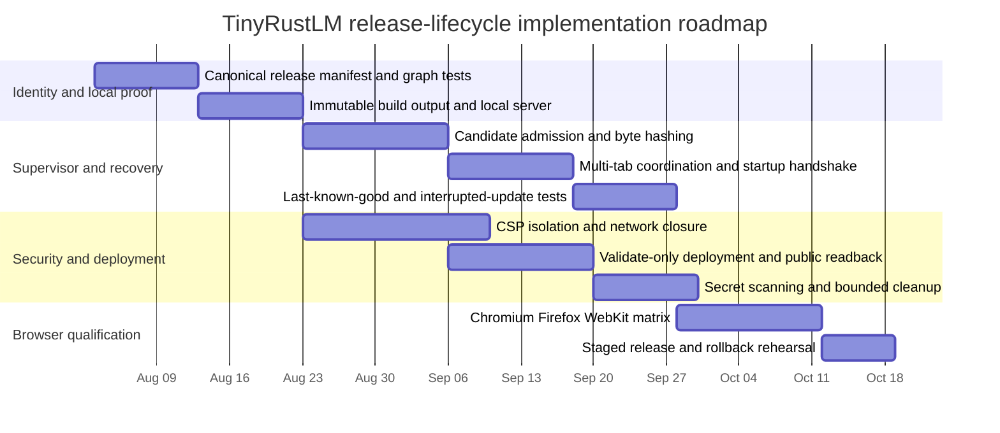

# TinyRustLM Offline Release, Service-Worker Update, and Last-Known-Good Rollback Architecture

## Executive summary

The research topic is **reliable publication and offline lifecycle management for TinyRustLM.com**, as specified in the supplied engineering brief. The governing objective is to ensure that every browser session runs one cryptographically identified application generation, that an explicitly supported offline shell remains usable, and that interrupted or defective releases can be rolled back without combining HTML, JavaScript, workers, WebAssembly, styles, manifests, icons, schemas, or security policies from different releases. fileciteturn0file0

**[PUBLIC-OBSERVED]** Publicly indexed TinyRustLM pages describe browser-local inference, local or peer-provided model files, an optional loopback companion, catalog and peer metadata, and optional MemoryEndpoints connectivity. The public interface also states that prompts are not sent to a project server. These are public product claims, not proof of the deployed implementation or network behavior. A recent crawl showed the root application reporting a ready browser-local runtime, while another recent search snapshot reported a missing WASM runtime; this inconsistency is itself evidence that deployment success must be established through versioned public readback and real-browser receipts rather than screenshots, uploads, or search-engine snapshots. citeturn7view0turn8search0

**[RECOMMENDATION]** TinyRustLM should use a **two-plane lifecycle**:

| Plane | Purpose | Update frequency | Authoritative identity |
|---|---|---:|---|
| Supervisor plane | Minimal root bootstrap, stable `/sw.js`, release verification, cache selection, rollback, update coordination | Rare | Supervisor manifest hash and exact public hashes |
| Application-release plane | Immutable app HTML, JavaScript, CSS, WASM, workers, icons, web manifest, schemas and public metadata descriptors | Every release | Signed canonical release-manifest hash, `RID` |

The central design is a mutable, non-cacheable **release pointer**—for example `/release.json`—that names an immutable, signed release manifest under `/releases/<RID>/release-manifest.json`. Every executable and style resource lives under that immutable release path and uses a content-hashed filename. The pointer is the only normal release commit artifact. Existing clients remain pinned to their currently admitted release until the candidate is completely downloaded, byte-hashed, validated and voluntarily activated; fresh clients may admit the newly committed release. This eliminates the need to pretend that a static host provides whole-site atomic deployment.

**[RECOMMENDATION]** Do not use query strings as the primary version identity. Do not make a service-worker precache list authoritative merely because it contains expected filenames. Do not treat SRI as complete graph verification. The authoritative release identity should be the SHA-256 digest of a canonical release manifest, authenticated by an offline-held deployment signing key. Content-hashed filenames provide dependency immutability; SRI adds browser enforcement for eligible `<script>` and `<link>` resources; the service worker must independently hash the actual response bytes before admitting them to a release cache. SRI currently applies principally to scripts and links, requires appropriate CORS handling for cross-origin resources, and does not by itself cover generic worker creation, arbitrary `fetch()` responses, or an entire transitive WASM application graph. citeturn2search0turn10view3

**[RECOMMENDATION]** The service worker must never call `skipWaiting()` during installation as a default policy, and it must not call `clients.claim()` merely because installation succeeded. Browser lifecycle rules intentionally keep an installed replacement waiting while old controlled clients exist; immediate activation can cause an old page to have later requests processed by new service-worker logic. Chrome’s official PWA guidance explicitly warns about this mixed-version condition. citeturn1search0turn1search4turn1search8

**[RECOMMENDATION]** Keep two locally verified application releases—`active` and `lastKnownGood`—plus at most one `candidate`. Rollback should switch a small local release-selection record, not copy files into an unversioned “current” cache. Server-side rollback should repoint `/release.json` to a prior immutable manifest and issue a signed rollback receipt. A defective application release can therefore be rolled back offline by the stable supervisor. A catastrophically defective supervisor service worker cannot be fully repaired offline; it requires a normal browser service-worker update from the origin, which is why supervisor code must be small, infrequently changed and tested separately.

**[RECOMMENDATION]** The initial production gate should require all of the following: canonical build identity; clean source state; immutable graph validation; staged-object public hash readback; release-pointer commit; Chromium, Firefox and WebKit execution; offline admission and restart; interrupted-update recovery; old-tab/new-tab coordination; local last-known-good rollback; exact security-header verification; model-byte absence checks; network-policy tests; and privacy scanning of source maps, caches, storage, traces, screenshots and deployment receipts. Upload completion is not a release receipt.

The workstreams rank as follows:

| Workstream | Relevance | Delivery feasibility | Failure impact | Priority |
|---|---:|---:|---:|---:|
| Release identity and immutable graph | Critical | High | Critical | Immediate |
| Candidate staging and service-worker lifecycle | Critical | Medium | Critical | Immediate |
| Public publication and readback state machine | Critical | Medium | Critical | Immediate |
| Privacy, CSP and cross-origin isolation | Critical | Medium | Critical | Immediate |
| Browser update, multi-tab and rollback tests | Critical | Medium | High | Immediate |
| Remote cleanup and model-absence proof | High | Medium | High | Before production |
| Receipt graph and reproducibility | High | High | High | Before production |
| Performance optimization and navigation preload | Medium | High | Medium | After correctness |

## Evidence, scope, and architectural conclusions

The report distinguishes six evidence classes:

| Label | Meaning |
|---|---|
| **[STANDARD]** | Behavior required or described by a web standard or Internet Standard |
| **[VENDOR]** | Documented browser-vendor behavior or guidance |
| **[PUBLIC-OBSERVED]** | Information visible through publicly indexed TinyRustLM pages |
| **[INFERENCE]** | A conclusion drawn from cited evidence, not a direct observation |
| **[RECOMMENDATION]** | Proposed engineering design |
| **[VERIFY]** | Requires source access, hosting credentials, browser profiles, logs or authorized deployment |

**Definition and scope.** The release system includes the root bootstrap, application HTML, JavaScript modules, CSS, Rust-generated WASM, dedicated or shared workers, service worker, icons, web app manifest, schema files, public catalog descriptors, hosting policy, security headers, deployment manifest, public readback receipts, and client-side release state. It excludes model bytes from project hosting and excludes private prompts, credentials, pairing codes, MemoryEndpoints keys, enrollment URLs and other user secrets from service-worker caches and deployment evidence. fileciteturn0file0

**Why it matters.** A PWA has several independently retained state layers: open documents, installed windows, active and waiting service workers, Cache Storage, the HTTP cache, back-forward cache, OPFS or IndexedDB, and browser-managed installed-app metadata. HTTP caching rules do not force a browser history entry or application object to update, and a service-worker update does not automatically remove prior Cache Storage entries. Consequently, “all files uploaded” does not imply that a user sees one release. citeturn5search0turn1search4

The main stakeholders and impacts are:

| Stakeholder | Primary risk | Required control |
|---|---|---|
| Users running local inference | Lost generation state, broken offline startup, prompt disclosure | Voluntary activation, explicit state checkpointing, no diagnostic exfiltration |
| Release operators | Partial upload, false success, unsafe cleanup | Dependency-first staging, public readback, bounded deletion |
| Security reviewers | XSS, supply-chain substitution, isolation failure | CSP, immutable identities, response hashing, COOP/COEP/CORP |
| Browser/PWA users | Stale tabs and installed-app divergence | Controller handshake, release coordination and truthful UI |
| Companion, peer and memory operators | Overbroad network access or credential leakage | Exact endpoint classes, network-only handling, redacted receipts |
| Maintainers | Irreproducible rollback and test ambiguity | Versioned receipt graph and deterministic release manifest |

**Current public context.** The indexed public interface contains local-file import, direct peer and loopback-companion concepts, user-entered catalog or peer URLs, MemoryEndpoints fields, run-history controls, and browser-local inference claims. That implies that the application’s legitimate network surface is more complex than a conventional fully static PWA. It also creates a policy conflict: a static CSP can allow exact predeclared origins, but it cannot safely convert arbitrary user-entered peer origins into a new per-session `connect-src` allowlist. The project must therefore choose between a closed, signed peer-origin registry; a fixed loopback companion that performs peer communication; or a deliberately broader CSP on a segregated, reduced-privilege page. Allowing arbitrary `https:` or `wss:` origins in the main application would not satisfy exact network closure. citeturn7view0turn10view0

**Research conclusion.** The highest-priority architectural choice is not a caching algorithm; it is the **trust and commitment model**. TinyRustLM should define:

1. A canonical manifest whose digest is the application release ID.
2. Immutable release URLs that never change after publication.
3. One mutable release pointer whose update is the publication commit.
4. A stable supervisor that verifies candidate bytes before local admission.
5. An explicit client-side active-release record.
6. A separate browser service-worker lifecycle for rare supervisor changes.
7. A receipt graph proving what was built, published, retrieved, executed, cached, updated and rolled back.

Without these elements, cache-first versus network-first decisions merely relocate version-mixing risk.

## Standards and browser-behavior baseline

The W3C Service Workers Editor’s Draft dated July 23, 2026 defines the worker lifecycle, fetch interception and the Cache-like response store. An updated worker is installed separately from the active worker and normally waits until the prior worker no longer controls clients. The browser performs update detection on the service-worker script and relevant dependencies; explicit `skipWaiting()` and `clients.claim()` can override the normal separation, but can cause a replacement worker to control pages that loaded under a different generation. citeturn0search6turn1search4turn1search8

The principal standards and implementation observations are:

| Area | Current reference | Standardized or documented guarantee | TinyRustLM implication |
|---|---|---|---|
| Service worker | W3C Editor’s Draft, July 23, 2026 | Separate installing, waiting and active workers; fetch interception and Cache API | Use waiting as a compatibility barrier; do not equate install with activation |
| Cache API | Service Workers specification | Request URLs are cache keys; query searches are considered unless `ignoreSearch` is deliberately enabled | Never use `ignoreSearch: true` for application assets or secret-bearing URLs |
| Navigation preload | Broad browser availability since approximately April 2022 in MDN baseline data | Can begin network navigation while a service worker starts | Optional optimization only; it must not bypass release selection |
| HTTP caching | RFC 9111, Internet Standard, June 2022 | Freshness, validation, `no-store`, `no-cache`, `Vary`, ETag and cache-key semantics | Use immutable long caching only for content-addressed resources |
| Immutable responses | RFC 8246, September 2017 | `Cache-Control: immutable` indicates that a fresh response will not change | Appropriate for content-hashed release assets, not pointers or root state |
| Web App Manifest | W3C Working Draft, May 7, 2026 | Defines `id`, `scope`, `start_url`, icons and installed-app metadata | Keep a stable app `id`; hash icon URLs so installed metadata can observe changes |
| CSP | W3C Working Draft, July 29, 2026 | Controls resource loading, workers, connections, framing, base URLs and WASM compilation | Deliver CSP as a response header and eliminate inline/event-handler dependencies |
| SRI | W3C Working Draft, July 10, 2025 | Browser verifies eligible resource bytes against integrity metadata | Use for scripts and styles, but not as whole-release proof |
| COOP/COEP | WHATWG HTML living standard | `COOP: same-origin` plus compatible COEP can create cross-origin isolation | Required when WASM threads use shared memory |
| CORP | Fetch integration | Resource response can restrict `no-cors` cross-origin use | Set `same-origin` on project-owned executable and style resources |
| Storage | WHATWG Storage Standard, March 15, 2026 | Quotas and persistence are implementation-defined estimates | Cache admission must handle quota failure and storage eviction |
| OPFS | Browser implementation baseline | Origin-private, quota-governed storage; cleared with site data | Suitable for admitted user model artifacts, not as part of app-release cache |

Sources: citeturn10view1turn6search0turn1search10turn5search0turn5search2turn3search0turn10view0turn2search0turn4search3turn4search5turn5search5turn6search9

**Browser behavior observations.** COEP is documented in the current WHATWG HTML developer edition as supported in current Chromium, Firefox and WebKit-derived engines, with historical entry points of Chrome 83, Firefox 79 and Safari 15.2. Navigation preload, Cache Storage, service-worker registration and controller APIs are broadly available in evergreen browsers. Those historical support thresholds are not substitutes for testing the exact stable versions used at release time. Each browser receipt must record browser name, full version, OS, architecture, installation mode, viewport, feature probes, `navigator.userAgent` or user-agent client hints where available, and `self.crossOriginIsolated`. citeturn4search1turn1search10turn1search6

**[RECOMMENDATION]** Treat the following as interoperability-sensitive rather than assumed identical: service-worker update timing; storage eviction; installed-manifest refresh; background-tab throttling; back-forward cache restoration; mobile PWA restart; loopback and private-network restrictions; CSP reporting; and worker/WASM error surfaces. Web standards define the model, but quotas are explicitly implementation-defined and user agents retain discretion over installed-manifest application and storage persistence. citeturn5search5turn3search0

**[RECOMMENDATION]** Use navigation preload only after the correctness model is complete. If enabled, its response must flow through the same release-pointer and expected-hash checks as a normal fetch; it must never cause the active release to consume a newly published root or app HTML before local admission. Navigation preload improves startup latency but is not a consistency primitive. citeturn1search5turn1search11

## Release identity, immutable graph, and publication state machine

**Canonical identity.** Define a deterministic canonical JSON serialization called `release-manifest.v1`. Its SHA-256 digest is the authoritative release identifier:

```text
RID = "trm-" + lowercase_hex(SHA256(canonical_release_manifest_bytes))
```

A human-readable build label such as `2026.08.01+git.ab12cd34` may accompany the RID but must never replace it as the identity. Timestamps, signatures and deployment-environment data that would make the manifest nondeterministic should be stored in separate attestations or excluded from the hashed canonical payload.

A minimum manifest should include:

```json
{
  "kind": "tinyrustlm.release-manifest.v1",
  "release_id": "trm-<sha256>",
  "source": {
    "repository": "<repository-id>",
    "revision": "<full-commit>",
    "tree_state": "clean",
    "submodules": {},
    "source_date_epoch": 0
  },
  "toolchain": {
    "rustc": "<exact-version>",
    "cargo": "<exact-version>",
    "wasm_bindgen": "<exact-version>",
    "wasm_opt": "<exact-version>",
    "node": "<exact-version>",
    "package_manager": "<exact-version>",
    "lockfile_sha256": "<sha256>"
  },
  "protocols": {
    "supervisor": 1,
    "page_worker": 1,
    "wasm_abi": 1,
    "storage_schema": 1
  },
  "artifacts": [
    {
      "logical_role": "app-html",
      "url": "/releases/<RID>/app.<sha256>.html",
      "sha256": "<sha256>",
      "size": 1234,
      "media_type": "text/html; charset=utf-8",
      "encoding_policy": "identity-hash",
      "cache_policy": "public,max-age=31536000,immutable",
      "dependencies": [
        "bootstrap-js",
        "app-css"
      ]
    }
  ],
  "security_contract": {
    "csp_profile": "isolated-local-inference-v1",
    "coop": "same-origin",
    "coep": "require-corp",
    "corp": "same-origin",
    "permissions_policy_profile": "minimal-v1"
  },
  "network_contract": {
    "application_origins": ["https://tinyrustlm.com"],
    "catalog_origins": [],
    "memory_origins": [],
    "loopback_origins": [],
    "peer_policy": "signed-registry-only"
  }
}
```

**[RECOMMENDATION]** Every artifact record must specify exact URL, SHA-256, decoded byte size, expected media type, allowed `Content-Encoding`, cache policy and dependency edges. Hash the actual file bytes before HTTP content encoding. Public verification should retrieve with `Accept-Encoding: identity` to compare those build bytes directly, then separately test compressed delivery, `Content-Encoding`, `Vary: Accept-Encoding` and decoded behavior.

**Immutable graph.** Use immutable release paths and content-hashed filenames:

```text
/releases/<RID>/app.<hash>.html
/releases/<RID>/bootstrap.<hash>.mjs
/releases/<RID>/app.<hash>.css
/releases/<RID>/runtime.<hash>.wasm
/releases/<RID>/inference-worker.<hash>.mjs
/releases/<RID>/manifest.<hash>.webmanifest
/releases/<RID>/icon-192.<hash>.png
/releases/<RID>/icon-512.<hash>.png
/releases/<RID>/schemas/<name>.<hash>.json
/releases/<RID>/release-manifest.json
/releases/<RID>/release-manifest.sig
```

The URLs `/`, `/sw.js`, `/release.json` and optional human-readable status pages are mutable supervisor endpoints and must not receive immutable caching. All executable imports from an admitted app HTML document must resolve to the same `/releases/<RID>/` subtree. Workers must be created using exact release URLs rather than unversioned `/worker.js`; WASM must be fetched from the exact release path; the web manifest must use content-hashed icon URLs. The Web App Manifest specification notes that browsers may consider an icon updated when its `src` changes, reinforcing the value of immutable icon names. citeturn3search0

**Identity-mechanism comparison.**

| Mechanism | Strength | Limitation | Role |
|---|---|---|---|
| Content-hashed filename | URL identity changes whenever bytes change; works for imports, workers and WASM URLs | Does not independently prove that the server returned matching bytes | Primary dependency identity |
| SHA query parameter | Creates a distinct URL in normal cache matching | Underlying path remains mutable; operators and middleware may ignore or normalize queries | Do not use as authoritative identity |
| SRI | Browser blocks eligible script/style bytes that do not match | Coverage is incomplete; cross-origin use requires CORS; does not define the whole graph | Defense-in-depth for scripts and styles |
| Signed release manifest | Authenticates the complete expected graph and operator intent | Requires protected signing key and a trusted verification key; first-load trust remains rooted in HTTPS/bootstrap | Authoritative graph and deployment attestation |
| Service-worker cache manifest | Convenient install input | A filename/hash declaration proves nothing until actual response bytes are hashed | Derived implementation data only |
| HTTP ETag | Efficient conditional validation | ETag semantics are server-controlled and need not be a cryptographic content hash | Pointer/bootstrap revalidation, not identity |

SRI requires the response bytes to match the supplied digest and treats a failed check as a network error; cross-origin integrity checking relies on CORS. RFC 9111 defines cache validation and ETag behavior, while RFC 8246 supports long-lived immutable caching for version-specific URLs. citeturn2search0turn5search0turn5search2

**Signed manifest model.** Sign the canonical manifest digest with an offline or hardware-protected release key. The signature should be verified by deployment tooling and public-readback tooling. Browser-side signature verification is useful only if the verification key is pinned in the supervisor and key rotation is separately authenticated. A signature does not verify a response unless the client first hashes the received bytes and verifies that digest against the signed manifest. It also does not protect a first-time user from simultaneous compromise of the origin-delivered bootstrap and its embedded trust key; it principally protects the release process, caches, mirrors and post-build mutation.

**Per-artifact atomic publication.** The host is assumed to make individual object replacement atomic but not the whole release. The publication sequence is therefore dependency-first and pointer-last:



The unavoidable mixed-visibility window exists while immutable candidate objects are appearing on the host. It is harmless because no committed pointer references them. After pointer replacement, some caches may still hold the old pointer or old documents, but those clients remain pinned to an old immutable RID. New clients that observe the new pointer can resolve every dependency because all immutable objects were read back before commitment.

The pointer should resemble:

```json
{
  "kind": "tinyrustlm.release-pointer.v1",
  "sequence": 42,
  "release_id": "trm-<sha256>",
  "manifest_url": "/releases/trm-<sha256>/release-manifest.json",
  "manifest_sha256": "<sha256>",
  "not_before": "2026-08-01T00:00:00Z",
  "rollback_of": null
}
```

Serve the pointer with `Cache-Control: no-store`, or at minimum `no-cache, max-age=0, must-revalidate`, and a strong ETag. `no-store` instructs HTTP caches not to retain the response, although RFC 9111 warns that it is not by itself a complete privacy mechanism. citeturn5search0

**Failure and rollback rules.** Before pointer commit, failure leaves only unreachable candidate objects. After commit, any failed production validation immediately repoints the pointer to the previous RID; the candidate remains available for forensic comparison but is no longer selected. Do not delete the failed release in the rollback transaction. Cleanup is a later, bounded and separately receipted operation.

## Service worker, caching, coherent startup, updates, rollback, and offline behavior

**Two lifecycle planes.** Application updates and supervisor service-worker updates should not be conflated.

The **application-release lifecycle** operates inside a stable active supervisor:

```text
DISCOVERED → DOWNLOADING → VERIFYING → CANDIDATE_READY
           → USER_WAITING → COMMITTING_LOCAL → ACTIVE
           → LAST_KNOWN_GOOD or REJECTED
```

The **browser service-worker lifecycle** applies when `/sw.js` itself changes:

```text
installing → installed/waiting → activating → activated
```

The W3C lifecycle and Chrome’s official guidance support keeping a replacement service worker in `waiting` while existing controlled pages are active. Immediate takeover is specifically hazardous where an old page cannot predict new worker behavior. citeturn0search5turn1search1

**Registration and scope.** Register one service worker at `/sw.js` with scope `/` and `updateViaCache: "none"` or the most conservative supported equivalent. The response for `/sw.js` should use `Cache-Control: no-cache, max-age=0, must-revalidate`, an exact JavaScript media type and `X-Content-Type-Options: nosniff`. Keep the script self-contained or use immutable imports whose hashes are supervisor-manifested. A stable script URL is necessary so existing pages continue checking the same registration for updates. The service-worker update mechanism compares fetched script bytes and supports explicit `registration.update()` checks. citeturn1search6turn1search9

**Supervisor installation.** A new supervisor’s `install` event must:

1. Parse its embedded supervisor manifest and version.
2. Retrieve and hash every required supervisor resource.
3. Confirm status, final URL, media type, size and security expectations.
4. Populate a new `supervisor:<SID>` cache.
5. Confirm that the active application RID and last-known-good RID remain readable.
6. Complete installation without calling `skipWaiting()`.

A rejected fetch, digest mismatch, quota error or missing prerequisite must reject the `install` promise, preventing the worker from reaching `waiting`.

**Activation.** Activation occurs only after client agreement or when no prior controlled clients remain. The new supervisor should not automatically claim existing pages. On activation it should migrate only versioned control metadata, retain the current and prior verified application caches, and delete caches only if they match an exact recognized namespace and retention rule. New documents become controlled naturally on navigation. `clients.claim()` is permissible only for a protocol-compatible supervisor change whose page/worker handshake is proven safe; it should not be the default. citeturn1search5turn1search8

**Cache namespaces.**

| Namespace or store | Permitted content | Retention | Service-worker handling |
|---|---|---|---|
| `trm-supervisor:<SID>` | Root bootstrap and supervisor static resources | Current plus previous during migration | Exact cache-only after verification |
| `trm-release:<RID>` | App HTML, JS, CSS, WASM, app workers, icons, web manifest, schemas | Active, last-known-good, candidate | Exact cache-only after admission |
| `trm-public-metadata:<schema>` | Non-secret signed catalog metadata | Size/age bounded | Network-first; visibly stale fallback |
| IndexedDB `release-control` | Active RID, previous RID, candidate status, protocol versions | Persistent | Small transactional records |
| OPFS `models/` | User-admitted model artifacts and derived indexes | User-managed, quota-aware | Never entered into Cache Storage |
| IndexedDB/OPFS conversation state | Prompts or local history only when explicitly enabled | User-controlled | Never read, copied or cached by SW |
| MemoryEndpoints data | Local synchronized records if product requires them | Explicit policy | Never placed in Cache Storage |
| Diagnostics | Redacted in-memory ring buffer; explicit export only | Session-bounded by default | No remote transmission by default |

Cache API matching normally includes the query portion of a URL unless `ignoreSearch` is set. TinyRustLM should never set `ignoreSearch: true` for executable assets, metadata with identity parameters or any request that might include credentials, pairing codes, invitations or user identifiers. citeturn6search0turn6search7

**Resource fetch policies.**

| Resource class | Policy | Correctness rationale |
|---|---|---|
| Active app navigation | Cache-only pinned `app.html` for `activeRID`; repair screen on missing entry | A controlled client never sees server HTML from another generation |
| Immutable release assets | Cache-only after release admission | Prevents opportunistic substitution or partial online repair |
| Candidate assets | Network fetch, full byte verification, then candidate cache | Nothing executes before admission |
| Release pointer | Network-only/no-store; cached value may be displayed only as stale status | Avoid stale pointer becoming an activation instruction |
| Signed public catalog metadata | Network-first with bounded, labeled stale copy | Availability without pretending freshness |
| User model files and OPFS models | File/OPFS access, not HTTP cache | Prevents model bytes entering service-worker caches |
| Peer model transfers | Network-only pass-through; no body inspection, cloning or caching | Preserves privacy and storage boundary |
| Loopback companion | Network-only; exact allowed origin; no cache | A local live service must not be simulated offline |
| MemoryEndpoints | Network-only for authorized operations; no cache | Avoids token and private-data retention in Cache Storage |
| Favicons, app icons and manifest | Immutable release cache | Keeps installed presentation tied to the RID |
| Source maps | Not publicly deployed | Avoids source, path and secret leakage |
| Diagnostics and CSP reports | Disabled remotely by default or explicitly privacy-reviewed | Reports can contain URLs and execution context |

**Byte verification.** `cache.addAll()` is insufficient as the trust decision because it does not compare each body with the application’s expected canonical digest. The installer should `fetch()` with `redirect: "error"` where supported, validate status and metadata, read or stream the complete response, compute SHA-256, compare length and digest, and only then write a newly constructed or safely cloned response to the candidate cache. A service worker can enforce integrity only by checking actual bytes; a manifest hash declaration alone proves nothing.

For WASM, `WebAssembly.instantiateStreaming()` is ideal for performance but conflicts with a simple pre-execution whole-body digest unless the stream is duplicated and one path is completely verified before execution. Because SubtleCrypto’s common digest interface consumes a complete buffer rather than providing a standardized incremental streaming hash, the safest admission path is to download the relatively small runtime WASM into an `ArrayBuffer`, verify it, cache it, and compile only the verified bytes. Model weights are excluded from the application release and should not be routed through this mechanism.

**Coherent startup.** Model activation remains disabled until all of the following match:

```text
app HTML RID
bootstrap module RID
controller-reported active RID
inference-worker RID and protocol
WASM exported build/RID identifier
storage schema version
security isolation requirement
```

The page sends a `HELLO` message containing its RID and protocol version to the controller. The controller returns `activeRID`, `supervisorVersion`, candidate state and whether rollback is available. The page then launches the immutable worker URL and requires the worker to return the same RID before transferring model handles. The WASM module should export a compile-time release identifier or expose an immutable custom-section digest validated by the JavaScript loader.

If any value differs, the application shows a non-destructive **Version repair required** state, blocks new generation, preserves locally held input, and offers one of three actions: finish the pending update, return to last-known-good, or reload from the currently active release. A generic “network error” is inadequate.

A `pageshow` event with `persisted === true` must re-run this handshake because back-forward cache can restore a document whose controller or active-release state changed while it was frozen. Browser history is not governed solely by HTTP cache freshness. citeturn5search3

**Multi-tab coordination.** Use `BroadcastChannel("tinyrustlm-release")` plus service-worker `postMessage()` for advisory coordination. Each tab reports RID, activity state, whether a generation is running, whether local input is dirty and whether it can reload. The supervisor announces `CANDIDATE_READY`; tabs acknowledge `SAFE_TO_SWITCH`, `BUSY`, or `INCOMPATIBLE`.

A second tab opened during deployment behaves coherently:

- If controlled by the old supervisor state, it receives the old pinned shell.
- If it is a fresh uncontrolled client after pointer commitment, it may verify and admit the new release.
- It must not cause existing tabs to switch.
- Once the candidate is selected locally, all tabs either reload into the selected RID or remain blocked from model activation until they do.

A browser does not provide a reliable general mechanism for a service worker to forcibly close arbitrary controlled tabs. “Stale tab closure” should therefore mean disabling sensitive or incompatible actions and requesting reload, not claiming the tab was closed.

**Forced security updates.** Forceful transition is justified only for narrowly defined conditions: a known exploitable application vulnerability, a revoked release-signing key, a privacy-boundary failure, a compromised dependency, or a network policy that can send prompts or model bytes unexpectedly. Even then, the page should stop accepting new prompts, request a generation checkpoint or cancellation, preserve editable input, and move to a blocking update screen. It should not destroy an active generation without a documented state policy.

**Last-known-good rollback.** Store:

```text
activeRID
lastKnownGoodRID
candidateRID
activationSequence
supervisorProtocol
rollbackReasonCode
```

The local activation transaction changes only `activeRID` after the candidate cache and release manifest are fully verified. The prior `activeRID` becomes `lastKnownGoodRID`. On startup failure, repeated worker crash, failed isolation check or explicit user request, the supervisor atomically selects `lastKnownGoodRID`, marks the candidate rejected and reloads clients into the prior immutable shell.

Server-authorized rollback repoints `/release.json` to the previous RID and includes `rollback_of`, reason code, operator signature and sequence. Security rollback must not restore a release revoked for privacy or remote-code-execution reasons. It must never recreate retired model routes or weaker headers.

**Offline capability matrix.**

| Capability | Offline status | Required local state | Truthful UI |
|---|---|---|---|
| Open admitted application shell | Supported | Verified active release cache | “Offline — application ready” |
| Load previously admitted local model | Supported, subject to quota and browser support | File handle or OPFS model and matching schema | “Offline — local model available” |
| Continue local generation | Supported if runtime and model remain resident/available | Active matching RID, worker and model | “Running locally” |
| Import a user-selected local file | Supported | Browser file picker permission | “Local file selected” |
| Retrieve catalog metadata | Unavailable; stale snapshot may be shown | Optional signed snapshot | “Offline — catalog may be stale” |
| Contact direct peer | Not generally available; LAN may still be reachable | Approved peer and reachable network | Distinguish “Internet offline” from “Peer unreachable” |
| Contact loopback companion | Available only if companion is running | Exact local endpoint and consent | “Companion unavailable,” not “offline model unavailable” |
| MemoryEndpoints operations | Unavailable unless network endpoint is reachable | Credentials and endpoint | “Hosted memory unavailable” |
| Download a new model | Unavailable without a reachable approved source | None | “No model available offline” |
| Recover defective candidate | Supported through local last-known-good | Prior verified release retained | “Recovered to previous verified version” |
| Repair defective supervisor | Not guaranteed offline | Origin connectivity and valid `/sw.js` | “Application repair requires network” |

OPFS is origin-private, quota-governed and removed when the user clears site data, so offline availability must never be described as permanent backup. citeturn6search9turn5search5

## Security, privacy, network closure, and cleanup

**Cross-origin isolation.** WASM threads that use shared memory depend on `SharedArrayBuffer`-style capabilities. Current platform guidance requires cross-origin isolation, normally produced by:

```http
Cross-Origin-Opener-Policy: same-origin
Cross-Origin-Embedder-Policy: require-corp
```

The application must then verify `self.crossOriginIsolated === true` in both window and worker contexts before selecting a threaded runtime. Cross-origin resources must opt in through CORS or suitable CORP behavior. citeturn9search1turn9search3turn9search9

Use `require-corp` rather than `credentialless` initially because its explicit opt-in model is easier to audit. Any cross-origin catalog, peer or MemoryEndpoints response loaded into an isolated application must satisfy the relevant CORS/COEP conditions. Third-party JavaScript, styles, fonts and frames should be eliminated.

**Recommended document-header baseline.**

```http
Content-Security-Policy:
  default-src 'none';
  script-src 'self' 'wasm-unsafe-eval';
  script-src-attr 'none';
  style-src 'self';
  img-src 'self';
  font-src 'none';
  object-src 'none';
  base-uri 'none';
  frame-src 'none';
  frame-ancestors 'none';
  worker-src 'self';
  manifest-src 'self';
  connect-src 'self' https://<approved-catalog> https://<approved-memory> http://127.0.0.1:<fixed-port>;
  form-action 'none';
  upgrade-insecure-requests

Cross-Origin-Opener-Policy: same-origin
Cross-Origin-Embedder-Policy: require-corp
Cross-Origin-Resource-Policy: same-origin
Permissions-Policy:
  camera=(), microphone=(), geolocation=(), payment=(), usb=(),
  serial=(), bluetooth=(), display-capture=(),
  cross-origin-isolated=(self)
Referrer-Policy: no-referrer
X-Content-Type-Options: nosniff
Strict-Transport-Security: max-age=63072000; includeSubDomains
```

The exact Permissions Policy token set must be validated against current browser behavior before enforcement. HSTS `includeSubDomains` and preload enrollment should be used only after every relevant subdomain is permanently HTTPS-capable. CSP should be response-header delivered because some directives, including `frame-ancestors`, cannot be fully expressed through a CSP meta element. CSP Level 3 also defines specific integration with WebAssembly byte compilation and worker loading. citeturn10view0turn4search0

`'wasm-unsafe-eval'` should be included only if the selected runtime requires dynamic WASM compilation under CSP; do not add general `'unsafe-eval'`. Remove inline scripts, inline event handlers and mutable third-party dependencies rather than compensating with permissive CSP. If a static host cannot generate per-response nonces, external content-hashed scripts plus SRI and a strict `'self'` policy are preferable.

**SRI limitations.** Apply SHA-384 or SHA-512 SRI to the root app module and stylesheet when loaded through eligible HTML elements. Cross-origin SRI requires CORS. Redirects, CORS mode and the final response influence whether the integrity check can succeed. SRI failure prevents execution, but SRI on one module does not automatically provide a simple universal guarantee over every dynamic import, worker, fetched WASM body and metadata response. The service worker also occupies a privileged interception position: a malicious active service worker can synthesize responses, while a correctly designed service worker can enforce a stronger release-manifest check. The integrity trust boundary must therefore include the service worker itself. citeturn2search0

**Network closure.** Define request classes in the release manifest and enforce them independently in the page and service worker:

| Class | Allow rule | Credential rule | Cache/log rule |
|---|---|---|---|
| Application assets | Exact same-origin release URLs and hashes | Omit | Cache only after verification; log RID only |
| Public catalog | Exact configured origin and schema path | Omit | Bounded signed metadata cache |
| Direct peer | Signed-registry exact origin or companion-mediated | Explicitly omit unless protocol requires otherwise | Never cache body or full sensitive URL |
| Loopback companion | Fixed scheme, host and port; user initiation | Protocol-specific local authorization | Never Cache Storage; redact identifiers |
| MemoryEndpoints | Exact production origin and operation paths | Explicit token header | Never cache; never log token, workspace or agent identifiers |
| CSP reporting | Disabled by default, or same-origin privacy-reviewed endpoint | Omit | Strip full URLs and samples |
| Analytics/error reporting | None by default | None | Prohibited unless separately approved |
| Browser-originated update traffic | Outside page control | Browser-controlled | Document as residual browser behavior |

A static CSP can constrain origins but generally cannot constrain exact URL paths with the same precision as an application-layer allowlist. CSP source matching supports path concepts, but redirect and matching semantics require careful treatment and should not be the sole network-policy control. citeturn10view0

**Arbitrary peer conflict.** A user-entered arbitrary peer URL cannot simultaneously be unrestricted and covered by a strict predeclared `connect-src`. The recommended resolution is one of:

| Option | Security | Usability | Recommendation |
|---|---:|---:|---|
| Signed, release-approved peer-origin registry | High | Medium | Preferred for browser-direct peers |
| Fixed loopback companion handles arbitrary peers | High if companion is trusted | High after installation | Preferred for open-ended P2P |
| Separate reduced-privilege peer-import origin/page | Medium | Medium | Acceptable with strict data separation |
| Main app allows `connect-src https: wss:` | Low closure | High | Reject |

The project domain must not proxy model bytes. A local companion may broker user-authorized P2P traffic without violating that constraint, provided the browser clearly identifies the companion as a live local service and never simulates it while unavailable.

**Prompt and model privacy.** Service-worker code must not clone, inspect, hash for diagnostics, cache or report model-transfer bodies. It must not cache requests containing `Authorization`, cookies, invitation tokens, pairing codes, workspace identifiers or non-public query parameters. Prompts and local conversation history belong in page-owned local storage only when the user enables persistence; they must never be copied into release receipts, CSP reports, screenshots or remote diagnostics.

`Cache-Control: no-store` is useful on sensitive HTTP responses but is not a complete privacy guarantee, so application code and the service worker must also avoid explicit persistence. citeturn5search0

**Remote cleanup.** Cleanup must operate from an exact allowlist generated from:

- the newly committed release,
- retained active and last-known-good releases,
- a finite list of known retired unpublished paths,
- canonical supervisor files, and
- explicitly approved non-release public files.

The cleanup tool must retrieve a bounded remote inventory from the deployment root. Any unknown name, unexpected nested directory, symlink, reparse point, alias, redirect object or unrecognized storage type causes a visible stop. It must not recursively delete the site root or follow links. It may delete only exact names listed in a signed cleanup plan, and it must record pre-delete and post-delete inventory hashes.

**Model-byte absence proof.** Public testing can show only that known routes do not expose models; complete proof requires authorized host inventory. The strongest practical proof combines:

1. Deployment manifest allowlisting every permitted object.
2. Authorized recursive object-store or filesystem inventory without following links.
3. Rejection of unknown objects.
4. Scanning filenames, media types, magic bytes and unusually large files.
5. Negative public probes for known retired model routes and extensions.
6. Verification that redirects do not lead to a project-hosted model location.
7. Confirmation that project access logs show no model-serving routes during tests.

Public negative probes alone cannot prove global absence because unguessable paths may exist.

## Verification, receipts, TDD, and release roadmap

**Public HTTPS readback.** Verification must run from an external network context that does not share the deployment host’s filesystem, CDN control plane or authenticated operator session. For each public object, record:

| Field | Required check |
|---|---|
| Requested and final URL | Canonical HTTPS origin, no unexpected redirects |
| Status | Exact expected status; no soft-404 HTML |
| Entity hash | SHA-256 of full response with `Accept-Encoding: identity` |
| Size | Exact decoded byte count and, where relevant, encoded content length |
| Media type | Exact allowlisted type and charset |
| Content encoding | Identity test plus separately approved compression |
| Cache policy | Immutable for release objects; no-store/revalidate for pointers |
| ETag and Last-Modified | Recorded, but not substituted for content hash |
| CSP and isolation | Exact contract on HTML and relevant worker responses |
| CORP and CORS | Correct for same-origin and approved cross-origin use |
| Redirect policy | No host aliases or downgrade |
| Route concealment | Retired app and model routes return expected negative result |
| Release identity | HTML, manifest, pointer and headers agree on RID/SID |

Verification must read complete response bodies. `HEAD`, object-store metadata and upload checksums are useful preconditions but do not prove what public HTTPS clients receive after CDN transformation or routing.

**Browser matrix.**

| Scenario | Chromium | Firefox | WebKit | Mobile viewport | Installed PWA |
|---|---:|---:|---:|---:|---:|
| Fresh first online load | Required | Required | Required | Required | Where supported |
| Warm controlled load | Required | Required | Required | Required | Required |
| Offline restart | Required | Required | Required | Required | Required |
| Interrupted candidate download | Required | Required | Required | Required | Required |
| Storage quota or cache write failure | Required | Required | Required | Required | Required |
| Stale active supervisor | Required | Required | Required | Required | Required |
| Old tab plus candidate waiting | Required | Required | Required | Required | Required |
| Second tab during pointer commit | Required | Required | Required | Required | Required |
| Update while generating | Required | Required | Required | Required | Required |
| Browser restart during staging | Required | Required | Required | Required | Required |
| Last-known-good rollback | Required | Required | Required | Required | Required |
| Corrupted cache entry | Required | Required | Required | Required | Required |
| Network loss at each state transition | Required | Required | Required | Required | Required |
| Back-forward cache restore | Required | Required | Required | Required | Where applicable |
| Reduced motion and keyboard-only use | Required | Required | Required | Required | Required |
| No duplicate assistant rendering | Required | Required | Required | Required | Required |
| `crossOriginIsolated` and threaded WASM | Required | Required | Required | Required | Required |

Each test must capture exact browser and OS versions, RID, SID, service-worker registration state, controller script URL, cache names, active/last-known-good records, console errors, network request destinations, screenshots with sensitive fields masked, and pass/fail assertions.

**Privacy and secret scanning.** Scan source and built artifacts for credentials, tokens, private origins, invitation URLs, local paths, home-directory names, workspace IDs, source-map comments, embedded `.env` values and private repository references. Scan public JavaScript, WASM strings, manifests, maps, HTML, headers, browser storage, Cache Storage keys, OPFS names, traces, HAR files, screenshots, receipts and authorized hosting logs. Large files and model-format signatures should be separately flagged. Test fixtures must use unmistakably fake secrets, and the scanner must prove that its own fixture detections work.

**Receipt graph.**



Receipt IDs should be hashes of canonical receipt content. The dependency model controls invalidation:

| Change | Rebuild assets | Redeploy | Repeat public readback | Repeat browser/offline/update tests |
|---|---:|---:|---:|---:|
| Source or dependency change | Yes | Yes | Yes | Yes |
| Rust/WASM or frontend toolchain change | Yes | Yes | Yes | Yes |
| Security-header contract change | No, unless embedded | Yes | Yes | Yes |
| Hosting configuration change | No | Yes | Yes | Usually yes |
| Browser test implementation only | No | No | No | Yes |
| Test browser version change | No | No | No | Yes |
| Documentation-only change outside release | No | No | No | No |
| Candidate cleanup rule change | No | Cleanup-only | Cleanup verification | No, unless live paths affected |
| Release-pointer rollback | No | Pointer only | Yes | Rollback smoke required |

This separation prevents a changed browser test from falsely creating a new application build while ensuring that any asset-byte change invalidates deployment and public-readback evidence.

**TDD backlog and stop rules.**

| Phase | Tests written first | Exit criterion | Mandatory stop |
|---|---|---|---|
| Identity | Canonical JSON, deterministic RID, graph closure, media types, clean-tree checks | Same source and tools produce identical manifest and hashes | Nondeterminism, unlocked dependency or missing artifact |
| Local server | Exact headers, immutable routes, pointer semantics, redirects, MIME and isolation | Local browser passes fresh and offline load | Missing header, route alias or MIME mismatch |
| Service-worker fixtures | Install failure, waiting behavior, no premature activation, cache corruption, quota failure | Candidate never becomes active until verified | Any unverified response is served |
| Mixed generation | Old page/new candidate, new tab during commit, bfcache restore, worker mismatch | Model activation always fails closed on RID mismatch | Any old page invokes incompatible new worker |
| Offline and rollback | Restart, last-known-good, missing model, stale metadata | Truthful status and deterministic recovery | Live service is simulated or data is silently discarded |
| Validate-only deployment | Inventory, planned uploads, planned pointer change, no mutation | Signed plan matches build manifest | Unknown remote object or unbounded delete |
| Authenticated staging | Full upload, readback and browser suite | All receipts complete | Hash, header, privacy or network failure |
| Production commit | Pointer-only commit followed by public checks | External readback and core browser smoke pass | Any redirect, identity or isolation discrepancy |
| Cleanup | Exact retired-path plan and model absence inventory | Only approved paths removed | Symlink/reparse point or unknown name |
| Final publication | Remove all superseded unpublished shells, routes, registrations and aliases | One documented canonical lifecycle remains | Legacy path remains reachable without explicit approval |

A proposed implementation roadmap is:



Dates are a proposed sequence, not a delivery claim. Work should stop immediately on release-graph nondeterminism, a public hash mismatch, unknown remote inventory, missing isolation, unexpected third-party network traffic, model bytes on a project origin, a privacy-secret finding, premature activation, inability to return to last-known-good, or inconsistent root and `www` canonicalization.

## Unknowns requiring authorization and prioritized sources

The following facts cannot be established from public pages or standards and require source access, hosting credentials, controlled browser profiles or an authorized staging deployment:

| Unknown | Evidence required |
|---|---|
| Current source revision and clean worktree | Repository access and signed source receipt |
| Exact build toolchains and dependency locks | Build environment and lockfiles |
| Existing service-worker code, scope and registrations | Source plus controlled browser-profile inspection |
| Current cache names and retained generations | DevTools or automated browser storage inspection |
| Actual public headers and CDN transformations | External full-response readback |
| Whole-site or per-object hosting atomicity | Hosting-provider contract and controlled publication experiment |
| Root versus `www` canonical behavior | DNS, redirect, certificate and header checks |
| Current public asset graph and hashes | Build artifacts and public byte reads |
| Whether source maps or private metadata are deployed | Authorized inventory and public probes |
| Whether model bytes exist anywhere under project domains | Complete authorized inventory plus public negative tests |
| Current CSP, CORS, COOP, COEP and CORP compatibility with peers | Staging deployment and endpoint response inspection |
| Loopback companion origin, ports and private-network behavior | Companion protocol documentation and browser tests |
| MemoryEndpoints authorization and URL structure | Authorized integration specification |
| Whether local model data uses OPFS, IndexedDB or handles | Source and browser storage inspection |
| Existing prompt/history persistence | Source, storage and privacy review |
| Hosting logs and diagnostic destinations | Authorized configuration and log review |
| Safe set of retired unpublished paths | Historical deployment inventory |
| Current browser defects affecting the app | Exact-version cross-engine test matrix |

No statement in this report should be read as validation of TinyRustLM’s private source, hosting configuration, deployed headers, service-worker state, browser storage or production privacy behavior.

**Prioritized authoritative sources, retrieved August 1, 2026:**

1. **W3C, [Service Workers Editor’s Draft](https://w3c.github.io/ServiceWorker/), July 23, 2026.** Primary lifecycle, registration, update, fetch interception, Cache API and client-control reference. Most important for install/wait/activate semantics and failure behavior. citeturn0search6turn10view1

2. **W3C, [Content Security Policy Level 3](https://www.w3.org/TR/CSP3/), Working Draft, July 29, 2026.** Primary definition of `script-src`, `worker-src`, `connect-src`, `manifest-src`, `object-src`, `base-uri`, `frame-ancestors`, reporting and WebAssembly integration. citeturn10view0

3. **WHATWG, [HTML Standard — Browsing and Cross-Origin Policies](https://html.spec.whatwg.org/multipage/browsers.html).** Primary living-standard reference for COOP, COEP, browsing-context isolation and the conditions that support cross-origin-isolated execution. citeturn4search3

4. **W3C, [Web Application Manifest](https://www.w3.org/TR/appmanifest/), Working Draft, May 7, 2026.** Primary source for stable app identity, scope, start URL, installed presentation, icons and manifest update semantics. citeturn3search0

5. **W3C, [Subresource Integrity](https://www.w3.org/TR/sri/), Working Draft, July 10, 2025.** Primary source for browser-enforced hash metadata, CORS requirements, integrity failure and current scope limitations. citeturn2search0turn10view3

6. **IETF, [RFC 9111: HTTP Caching](https://www.rfc-editor.org/rfc/rfc9111.html), Internet Standard, June 2022.** Authoritative definition of freshness, cache keys, validation, `no-store`, `no-cache`, `Vary` and cache/application distinctions. citeturn5search0turn5search3

7. **IETF, [RFC 8246: HTTP Immutable Responses](https://www.rfc-editor.org/rfc/rfc8246.html), Proposed Standard, September 2017.** Primary basis for long-lived immutable caching of content-addressed release assets and discussion of corruption risks. citeturn5search2turn5search7

8. **WHATWG, [Storage Standard](https://storage.spec.whatwg.org/), Living Standard updated March 15, 2026.** Primary definition of origin storage architecture, persistence, usage and implementation-defined quota behavior. citeturn5search5turn10view2

9. **Chrome for Developers, [Handling Service Worker Updates with Immediacy](https://developer.chrome.com/docs/workbox/handling-service-worker-updates/).** Vendor guidance illustrating waiting-worker notification, user-controlled activation and the risks of immediate takeover. Its examples should be adapted to TinyRustLM’s stricter release protocol rather than copied as the architecture. citeturn1search0turn1search1

10. **W3C, [Permissions Policy](https://www.w3.org/TR/permissions-policy/), Working Draft, October 6, 2025.** Primary source for reducing access to browser capabilities and constraining cross-origin-isolated capabilities to intended contexts. citeturn4search0