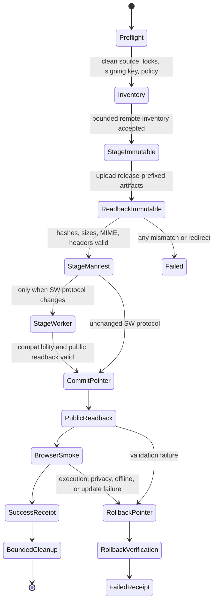
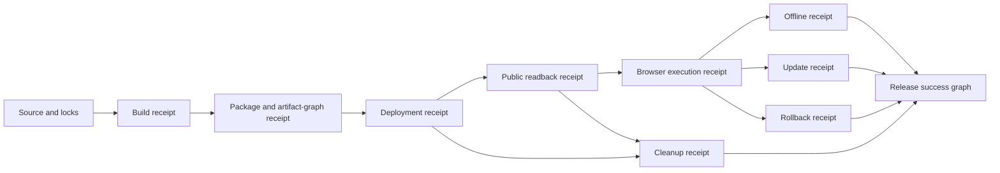

# TinyRustLM Offline Web Application Release, Service-Worker Updates, and Last-Known-Good Rollback

## Executive release and lifecycle recommendation

### Executive summary

**Engineering recommendation.** TinyRustLM should use a **content-addressed, manifest-governed PWA lifecycle** in which:

1. Every executable, stylesheet, worker, WebAssembly module, icon, and release-specific HTML document has an immutable, content-hashed URL.
2. A small, stable root bootstrap and a single canonical service worker manage release discovery.
3. A signed, mutable release pointer selects one immutable release manifest.
4. A candidate release is downloaded into a release-specific cache, byte-hashed, header-validated, dependency-checked, and locally admitted before it can become active.
5. Normal updates remain in `waiting` or staged state until active tabs are idle and voluntarily reload.
6. The current and one prior locally verified release are retained as bounded **current** and **last-known-good** generations.
7. Prompts, model bytes, authorization data, peer invitations, and MemoryEndpoints data never enter Service Worker Cache Storage.
8. A failed install, CDN propagation mismatch, corrupt cache entry, incompatible tab, or defective deployment fails closed to the prior release instead of combining generations.

This report implements the supplied requirements and constraints, including the prohibition on project-hosted model bytes and the requirement for exact public readback and rollback evidence. fileciteturn0file0

**Directly observed public fact.** Publicly indexed TinyRustLM content describes browser-local Rust/WASM inference, says prompts are not sent to a server, and presents local-file, peer, companion, and memory-related functions. The indexed public content also recently exposed a WASM fetch/404 boot error. This is an observation of public indexed content, not a controlled browser validation or evidence about private source code, deployment configuration, or current production state. citeturn8search0turn8search1

**Scope assumption.** TinyRustLM is treated as pre-general-availability despite being publicly reachable. There is therefore no requirement to preserve obsolete URL aliases, old cache names, old scopes, or unpublished application shells.

**Hosting assumption.** The host can atomically replace an individual object but has not demonstrated an atomic multi-object release transaction. CDN nodes, HTTP caches, service workers, browser tabs, and installed windows may consequently observe releases at different times.

**Trust assumption.** HTTPS and the project origin remain primary trust boundaries. A signed manifest materially improves release provenance, rollback authorization, and corruption detection, but a public key embedded only in JavaScript or the service worker cannot by itself defeat a fully compromised origin that can replace both verifier and key.

**Methodology.** The design was derived from the June 8, 2026 Service Workers Candidate Recommendation Draft, the May 2026 CSP and Web App Manifest drafts, the 2025 SRI draft, HTTP Semantics and Caching RFCs, WebAssembly specifications, browser-vendor documentation, and current browser release records. The browser floor used for planning is Chrome 150 stable, Firefox 153, and Safari 26.6 as available by August 1, 2026; Chrome 151 was only in early-stable rollout to a limited population in late July and should not be treated as the baseline. citeturn0search2turn2search0turn2search1turn6search2turn0search1turn4search3turn4search16turn10search0

### Canonical lifecycle

The recommended root architecture is:

```text
/                          Small release-neutral bootstrap document
/bootstrap.<sha256>.js     Immutable bootstrap logic
/sw.js                     One canonical release-manager service worker
/release.json              Mutable, signed deployment pointer
/releases/<release-id>/
    manifest.json          Immutable canonical artifact manifest
    manifest.sig           Detached signature
    app.<sha256>.html
    app.<sha256>.js
    runtime.<sha256>.wasm
    inference.<sha256>.worker.js
    styles.<sha256>.css
    manifest.<sha256>.webmanifest
    icons/...
```

The root bootstrap does not activate inference. It obtains `release.json`, registers the canonical worker at `/sw.js` with scope `/`, asks the worker to stage and verify the selected immutable release, and then enters the release-specific shell. Offline navigation is resolved by the active worker to the current locally admitted release.

This structure leaves only three intentionally mutable artifacts: the root bootstrap document, `/sw.js`, and `/release.json`. Routine application releases change only the release pointer and immutable release tree. Changes to the bootstrap or service-worker protocol are exceptional migrations with their own compatibility gates.

### Decision summary

| Concern | Selected design | Reason |
|---|---|---|
| Authoritative release identity | SHA-256 of canonical release manifest | Binds the complete artifact graph, sizes, media types, dependencies, header contract, and build inputs |
| Runtime asset identity | Content-hashed filenames | Prevents a mutable URL from silently changing generations |
| Deployment commit | Signed `/release.json` pointer published last | Reduces multi-file publication to one logical commit object |
| Service-worker update | Stage, verify, wait, coordinate, activate | Avoids an incomplete worker taking control |
| HTML navigation | Worker serves only its admitted release shell | Prevents old controllers from returning new HTML |
| Immutable assets | Verified cache-only after admission | A cache miss becomes a release defect, not an opportunity to fetch a different generation |
| Last-known-good | One bounded prior immutable release | Enables rollback without unversioned caches |
| Model storage | User file, approved browser storage, or companion; never Cache Storage | Keeps application caching separate from sensitive or very large model data |
| Remote diagnostics | Disabled by default | Preserves the no-prompt-upload privacy boundary |

## Standards and browser behavior matrix

Service workers have explicit `installing`, `waiting`, and `active` lifecycle states. By default, a successfully installed update waits while old controlled clients exist; `skipWaiting()` can accelerate activation, while `clients.claim()` can adopt clients without waiting for a reload. Those APIs are useful but can create generation mixing when applied unconditionally. citeturn0search2turn0search3turn0search6

Service-worker update checks compare script bytes and are subject to `updateViaCache`. Registration with `updateViaCache: "none"` prevents HTTP-cache reuse for the worker and its imported scripts during update checks. Explicit `registration.update()` requests an update check, but it is not a substitute for version admission or public verification. citeturn0search8turn0search10turn1search12

| Capability | Standardized or documented behavior | TinyRustLM rule | Verification browsers |
|---|---|---|---|
| Service-worker install | A rejected `install` promise prevents installation; installation work should be attached through `event.waitUntil()`. citeturn0search2turn1search4 | Installation succeeds only after every required shell response is fetched, bounded, hashed, and validated |
| Waiting state | An installed update normally waits until old controlled pages are gone. citeturn0search3turn1search6 | Preserve waiting for normal updates; do not auto-skip |
| `skipWaiting()` | Requests immediate activation. citeturn0search3 | Accept only an authenticated-in-protocol message after clients quiesce, except signed emergency revocation |
| `clients.claim()` | Allows an active worker to control already open eligible clients. citeturn0search6 | Do not use for routine releases; require reload into the matching shell |
| Cache matching | Query strings participate by default; `ignoreSearch` defaults to false. citeturn5search0turn5search6 | Never use `ignoreSearch: true`; reject credential-bearing and secret-bearing URLs |
| Navigation preload | Runs navigation fetch in parallel with service-worker startup and is broadly available. citeturn7search0turn7search3 | Use only for the release-neutral bootstrap or pointer; never for immutable admitted application assets |
| Web App Manifest | Provides installation metadata, `start_url`, scope, icons, and presentation controls; the May 7, 2026 document remains a Working Draft. citeturn2search0 | Manifest is immutable and release-bound; explicitly set `id`, `start_url`, and `scope` |
| SRI | Verifies eligible script and style responses against declared hashes; cross-origin use requires CORS. citeturn6search2turn6search10 | Apply to HTML-declared scripts/styles where practical, but treat manifest byte verification as broader admission control |
| WASM streaming | `instantiateStreaming()` is optimized and expects `application/wasm`. citeturn6search0turn9search11 | Serve cached verified WASM with exact MIME; prohibit fallback to a mutable or mis-typed URL |
| WASM under CSP | WebAssembly compilation is gated by `'wasm-unsafe-eval'` or the broader `'unsafe-eval'`. citeturn9search0turn9search5 | Permit only `'wasm-unsafe-eval'`; prohibit general JavaScript eval |
| Cross-origin isolation | COOP `same-origin` plus COEP `require-corp` establishes the standard pattern for isolation and shared-memory features. citeturn3search2turn3search6turn3search7 | Require `self.crossOriginIsolated === true` before threaded WASM activation |
| HTTP cache control | A stale response generally cannot be reused when explicit directives prohibit it; validation uses conditional requests and validators. citeturn0search1 | Mutable pointers revalidate; hashed artifacts are immutable; sensitive operations use `no-store` |

The real-browser release gate should pin exact browser builds rather than rely only on family names. As of the report date, representative current builds are Chrome 150.0.7871.186/.187, Firefox 153, and Safari 26.6 build 20624.4.5. Each release receipt must record the actual executable version, operating system, device class, viewport, and automation framework version. citeturn4search3turn4search16turn10search0

## Release identity and immutable asset graph

### Complete identity

Define the release identifier as:

```text
release_id = "trlm-" + hex(
  SHA-256(JCS_CANONICALIZE(release-manifest-v1))
)
```

The manifest must be canonicalized with a documented deterministic JSON scheme. The identifier is not a semantic version, timestamp, ZIP filename, deployment directory name, or Git commit alone.

A minimum manifest record is:

```json
{
  "schema": "tinyrustlm.release-manifest.v1",
  "source": {
    "repository": "public-or-internal-repository-identifier",
    "revision": "40-character-commit-id",
    "worktreeClean": true,
    "submodules": [],
    "sourceDateEpoch": 0
  },
  "toolchain": {
    "rustc": "exact-version",
    "cargo": "exact-version",
    "wasmBindgen": "exact-version",
    "wasmOpt": "exact-version",
    "node": "exact-version",
    "bundler": "exact-version"
  },
  "inputs": {
    "cargoLockSha256": "...",
    "packageLockSha256": "...",
    "buildConfigSha256": "...",
    "hostingPolicySha256": "...",
    "securityHeaderContractSha256": "..."
  },
  "protocols": {
    "bootstrap": 1,
    "serviceWorker": 1,
    "appWorker": 1,
    "wasmAbi": 1,
    "storageSchema": 1
  },
  "artifacts": [
    {
      "path": "/releases/<id>/runtime.<hash>.wasm",
      "sha256": "...",
      "bytes": 123456,
      "mediaType": "application/wasm",
      "contentEncoding": "identity",
      "role": "wasm-runtime",
      "dependencies": []
    }
  ],
  "networkPolicy": {
    "policySha256": "...",
    "approvedOriginClasses": []
  }
}
```

**Engineering recommendation.** Build timestamps, CI run numbers, and operator comments should be attached as receipt metadata rather than included in reproducibility-sensitive artifact inputs unless deliberately normalized. A clean-worktree assertion and exact dependency locks are mandatory. A build performed from dirty source or an unlocked dependency graph cannot receive a releasable identity.

Every import must be static or resolved through the manifest. JavaScript modules, Web Workers, CSS `url()` dependencies, WASM glue, icons, and web manifest URLs must use content-hashed paths. Workers must not be created from mutable names such as `/worker.js`, and WASM glue must not derive the module URL from a mutable query parameter.

### Identity mechanism comparison

| Mechanism | Strength | Limitation | Role |
|---|---|---|---|
| Content-hashed filename | Natural HTTP/cache identity; easy rollback; safe overlap between releases | Requires complete dependency rewriting; truncated hashes need collision policy | **Authoritative runtime URL identity** |
| Exact SHA query parameter | Can distinguish Cache API entries when query matching is preserved | Underlying path is mutable; servers, proxies, application code, or `ignoreSearch` can mishandle it | Do not use for executable identity |
| SRI | Browser-enforced byte check for supported script/style loads | Does not cover every fetch, worker, manifest, WASM-loading pattern, or a compromised navigation document; cross-origin use needs CORS | Defense in depth |
| Signed deployment manifest | Binds release graph and authorizes pointer/rollback operations | Browser-embedded key does not defeat total origin compromise; requires key rotation and canonicalization | Operator provenance and admission metadata |
| Service-worker cache manifest | Enables offline completeness and local verification | Cache names alone prove nothing; Cache Storage may be evicted or corrupted | Local admission and recovery |
| Semantic version | Readable to operators and users | Does not prove bytes | Display metadata only |

SRI validates eligible response bytes rather than merely trusting the URL. It applies primarily through `integrity` attributes and associated fetch integrity metadata; opaque cross-origin responses are not eligible, and cross-origin SRI loads require successful CORS. citeturn6search1turn6search2turn6search10

A service worker does not turn SRI into an origin-level trust anchor. A worker may return a response that is integrity-checked against metadata in an already trusted document, but a malicious worker controlling navigation could also replace the document and its integrity declarations. TinyRustLM should therefore use SRI to detect unexpected resource replacement while relying on HTTPS, controlled deployment, signed receipts, manifest admission, and browser readback as the wider release system.

### Startup coherence contract

Before model activation, the following identities must agree:

```text
HTML embedded release ID
main module compiled release ID
active service-worker release ID
inference worker release ID
WASM exported/custom-section release ID
WASM ABI version
storage schema version
model package schema compatibility
security/isolation state
```

The app must complete a startup handshake:

```text
BOOTSTRAP
  -> RELEASE_POINTER_VERIFIED
  -> SHELL_ADMITTED
  -> SERVICE_WORKER_MATCH
  -> WORKER_MATCH
  -> WASM_HASH_AND_ABI_MATCH
  -> STORAGE_SCHEMA_READY
  -> CROSS_ORIGIN_ISOLATED_IF_THREADS
  -> MODEL_ACTIVATION_ALLOWED
```

A mismatch disables inference and displays a specific state: **“Application components belong to different verified releases.”** Online recovery performs one bounded update check, one release-cache repair, and one reload. It must not enter an infinite reload loop. Offline recovery selects the locally admitted last-known-good release, if available and not revoked; otherwise the application remains in a truthful unavailable state.

## Publication, service-worker, and cache state machines

### Per-artifact atomic publication

The recommended deployment process is:



The deployment sequence is:

| Phase | Required evidence |
|---|---|
| Preflight | Clean source, exact toolchain, lockfiles, reproducibility check, security-header contract, network allowlist, privacy scan |
| Remote inventory | Finite list under authorized release prefixes; no unknown names; no model directories |
| Stage | Upload immutable artifacts dependency-first under `/releases/<release-id>/` |
| Hash readback | Public HTTPS GET with `Accept-Encoding: identity`; stream and hash every artifact |
| Candidate manifest | Upload immutable manifest and signature; verify public bytes |
| Worker migration | Only when protocol changes; old worker must safely reject unsupported pointer |
| Commit | Replace signed `/release.json` last |
| Public readback | Verify pointer, selected manifest, artifact graph, headers, canonical origin, redirects, absence checks |
| Browser smoke | Fresh, warm, offline, update, interruption, corruption, rollback |
| Receipt | Sign or attest complete deployment evidence |
| Cleanup | Delete only explicitly retired allowlisted objects after retention gates |

The mixed-visibility window cannot be eliminated on a per-file host. It is rendered safe because old and new files use distinct immutable paths, the pointer is committed only after readback, and a client that sees a new pointer but cannot validate every selected artifact continues using its prior admitted release. It never substitutes a similarly named old or new asset.

A release pointer should contain a monotonically increasing **deployment sequence**, even when targeting an older release:

```json
{
  "schema": "tinyrustlm.release-pointer.v1",
  "deploymentSequence": 184,
  "releaseId": "trlm-...",
  "manifestSha256": "...",
  "minimumServiceWorkerProtocol": 1,
  "rollback": {
    "authorized": false,
    "reasonCode": null
  },
  "revokedReleaseIds": [],
  "signature": "..."
}
```

A rollback creates a new, signed pointer with a higher deployment sequence and an explicit prior `releaseId`. It is not a blind restoration of an old `release.json`.

### Service-worker lifecycle

Register one worker:

```js
navigator.serviceWorker.register("/sw.js", {
  scope: "/",
  updateViaCache: "none",
});
```

Serve `/sw.js` with `Cache-Control: no-cache, must-revalidate` and no redirect. The worker script carries a `SW_PROTOCOL`, build hash, and migration rules, but routine app release identifiers are selected through the pointer rather than by changing `/sw.js`.

**Install.** Install only the minimal release-manager machinery needed to receive and validate a release. Do not call `skipWaiting()`. For a protocol update, migrate no state during install that cannot be rolled back.

**Candidate staging.** The active or waiting worker fetches the pointer with `cache: "no-store"`, `redirect: "error"`, and same-origin credentials policy. It verifies signature, schema, deployment sequence, revocations, and protocol. It then fetches each release artifact explicitly, rejects non-200 status, redirects, oversized bodies, MIME mismatch, unexpected encoding, and hash mismatch, and writes only verified responses to `tinyrustlm-shell:<release-id>`.

`cache.addAll()` alone is insufficient because TinyRustLM requires explicit digest, size, media-type, and redirect validation before `cache.put()`.

**Waiting.** The new worker announces `UPDATE_STAGED` but remains waiting while existing tabs generate output or hold unsaved local state.

**Activation.** Normal activation occurs after clients voluntarily quiesce and reload. A user-approved message may request `skipWaiting()` only after all responding clients report idle and durable local state. The canonical worker should not call `clients.claim()` for normal releases because immediate adoption of pages loaded from another generation defeats the coherence goal. Vendor guidance explicitly warns that taking control can leave pages whose loaded assets differ from the newly controlling worker. citeturn1search6turn1search8

**Retirement.** Delete an old release cache only when it is neither current nor last-known-good, no known client reports that release, its rollback retention has expired, and an authorized cleanup manifest names it.

**Failure.** A rejected install or failed candidate stage leaves the prior active worker and caches untouched. A failed activation migration records a local redacted failure and leaves model activation disabled until the previous release is selected.

### Cache and storage namespaces

| Namespace | Contents | Policy |
|---|---|---|
| `tinyrustlm-shell:<release-id>` | Verified release HTML, JS, CSS, WASM, workers, icons, immutable manifest | Cache-only after admission |
| `tinyrustlm-bootstrap:<bootstrap-id>` | Minimal offline recovery/bootstrap assets | Bounded and protocol-specific |
| `tinyrustlm-public-meta:<schema>` | Non-sensitive public catalog metadata | Network-first, bounded stale fallback |
| IndexedDB `release-state` | Current ID, LKG ID, deployment sequence, admission state, client acknowledgements | Transactional local metadata |
| OPFS or approved local file storage | User-approved model files and generated model artifacts | Never read or written by the service-worker shell cache |
| IndexedDB `conversation-state` | Optional local prompts/history if the product explicitly supports persistence | Local only, user-cleared, never Cache Storage |
| IndexedDB `diagnostic-ring` | Redacted local diagnostics | Size-bounded, no automatic upload |
| MemoryEndpoints state | Endpoint-specific authorized data | Network-only or endpoint-defined local store; never shell cache |

Storage APIs can estimate usage and quota, but browser-managed storage remains subject to user clearing and platform eviction. “Offline installed” must therefore mean **locally verified and presently available**, not permanently guaranteed. citeturn5search12turn5search13turn1search15

### Resource-specific fetch policy

| Resource class | Fetch strategy | Correctness and privacy rule |
|---|---|---|
| Release shell HTML under active worker | Cache-only from active release | Never return another release’s shell |
| Hashed JS, CSS, WASM, workers, icons | Cache-only after admission | Missing entry is cache corruption; do not network-repair one file in place |
| Root bootstrap, release pointer | Network-first/revalidate with bounded offline fallback | Mutable but non-sensitive; signature and sequence required |
| Public catalog metadata | Network-first with timeout, then bounded stale cache | UI must display retrieval time and “stale metadata” status |
| Local model | File handle or local model store | No network request and no Cache Storage |
| Companion | Network-only to exact approved loopback origin and path | No caching, no URL tokens, no automatic discovery scan |
| Direct peer | Network-only to explicit user-approved peer | Require transport, manifest, size, and digest policy |
| MemoryEndpoints | Network-only authorized operations | No stale replay unless the endpoint protocol explicitly defines it |
| Diagnostics, analytics, CSP reporting | Local only by default | Do not silently transmit URLs, prompts, model names, local paths, or storage identifiers |

Navigation preload may be enabled for the bootstrap path, but a differing preload representation requires correct `Vary: Service-Worker-Navigation-Preload`. It should not be used to bypass release-cache identity. citeturn7search3turn7search5

## Multi-tab updates, offline behavior, and last-known-good rollback

### Client coordination

Use both worker messages and a same-origin `BroadcastChannel`, such as `tinyrustlm-release-v1`. Each page reports:

```json
{
  "releaseId": "trlm-...",
  "clientId": "ephemeral-random-id",
  "surface": "tab-or-installed-window",
  "generationState": "idle|generating|cancelling",
  "localState": "clean|dirty|persisted",
  "canReload": true,
  "protocol": 1
}
```

Client IDs must be ephemeral and never remotely reported.

When a release is staged, each client displays a nonmodal update notice. Idle clients may save local UI state and reload immediately. Generating clients remain on their existing generation until generation completes or the user cancels it. Refreshing a page is not itself sufficient to guarantee that a waiting worker activates, so the UI must observe registration state and `controllerchange` rather than promising that a generic refresh applies the update. citeturn1search6turn1search8

A second tab opened during deployment receives one of three coherent outcomes:

1. The prior signed pointer and prior immutable release.
2. The new pointer and fully admitted new release.
3. The new pointer with an unavailable artifact, in which case it remains on the local LKG or shows a staging failure.

It must never receive root HTML from release A, worker code from release B, and WASM from a mutable common URL.

A stale page cannot reliably be forced to close. It can be marked unsupported, have new model activation disabled, and be navigated after explicit emergency policy, but ordinary releases should preserve user control.

### Forced security updates

A forced update is justified only for a signed release revocation involving a credible confidentiality breach, known exploitable code execution, integrity bypass, destructive storage migration, or a privacy boundary violation. The emergency policy should:

1. Stop accepting new prompts.
2. Request cancellation/checkpoint of current generation.
3. Persist recoverable local UI state without prompts entering Cache Storage.
4. Display the reason category and target release.
5. Activate or select a non-revoked verified release.
6. Reload all clients after a bounded grace period.
7. Record local and deployment receipts.

A forced update must not silently upload the unfinished prompt or generation state.

### Last-known-good model

The local release state contains:

```text
current_release
previous_verified_release
candidate_release
revoked_release_set
deployment_sequence
```

A candidate becomes **locally verified** only after complete byte admission, startup handshake, WASM instantiation, storage-schema check, isolation check when required, and a minimal deterministic runtime self-test. The previous current release then becomes LKG.

The server-side release process separately identifies a publicly verified LKG through deployment and browser receipts. Local LKG and operator LKG may differ when a browser has not yet admitted the latest public release.

Rollback is denied when the target is revoked, requires weaker security headers, references retired model-byte routes, expects an unsupported storage downgrade, or is absent from immutable retained assets. If no safe target exists, TinyRustLM must show a defective-release state rather than restore insecure behavior.

### Truthful offline capability matrix

| State | Application shell | Local inference | Network-dependent features | User status |
|---|---|---|---|---|
| Verified shell and admitted local model | Available | Available within device limits | Unavailable unless network returns | “Offline — local model ready” |
| Verified shell, no model | Available | Unavailable | Catalog, peer, or companion unavailable offline | “Offline — no local model selected” |
| Verified shell, cached public metadata | Available | Depends on local model | Metadata may be viewed but not refreshed | “Offline — metadata last updated …” |
| Companion unavailable | Available | Browser-only model may work | Companion functions unavailable | “Companion not reachable” |
| Peer unavailable | Available | Existing local model may work | Peer import unavailable | “Peer unavailable; no simulated peer response” |
| MemoryEndpoint unavailable | Available | Base generation may work | Hosted memory unavailable | “Memory service unavailable” |
| Candidate release defective, LKG present | LKG available | Available if LKG/model compatible | According to LKG policy | “Update failed — using verified previous release” |
| Cache/storage evicted | Possibly unavailable | Model availability depends on separate storage | Requires network or user re-selection | “Offline files are no longer available” |
| Release mismatch or corrupt active cache | Recovery shell only | Disabled | Recovery operations only | “Application integrity check failed” |

The UI must distinguish network loss, no model, stale catalog, denied file permission, storage eviction, companion failure, peer failure, MemoryEndpoint failure, and defective app release. None may be represented as an apparently live service response.

## Security headers, SRI, network closure, and privacy

### Header contract

A starting header policy for all application HTML is:

```http
Content-Security-Policy:
  default-src 'none';
  script-src 'self' 'wasm-unsafe-eval';
  style-src 'self';
  img-src 'self' data:;
  font-src 'self';
  manifest-src 'self';
  worker-src 'self';
  connect-src 'self' https://approved-catalog.example
              https://approved-memory.example
              wss://approved-peer.example
              http://127.0.0.1:8123 http://[::1]:8123;
  object-src 'none';
  base-uri 'none';
  frame-ancestors 'none';
  form-action 'none'

Cross-Origin-Opener-Policy: same-origin
Cross-Origin-Embedder-Policy: require-corp
Cross-Origin-Resource-Policy: same-origin
Permissions-Policy:
  camera=(), microphone=(), geolocation=(), payment=(),
  usb=(), serial=(), bluetooth=(), hid=(),
  accelerometer=(), gyroscope=(), magnetometer=()
Referrer-Policy: no-referrer
X-Content-Type-Options: nosniff
Strict-Transport-Security: max-age=63072000; includeSubDomains
```

This is a template, not a verified TinyRustLM policy. Exact catalog, peer, companion, and MemoryEndpoint origins require authorized confirmation. CSP source expressions are primarily origin-level controls; an application request broker must separately enforce allowed paths, methods, content types, maximum response sizes, redirect policy, and request-body schemas. CSP Level 3 defines the mechanism for controlling page and worker resource loading, while Permissions Policy can disable unneeded browser capabilities. citeturn2search1turn2search2

`frame-ancestors` must be delivered as a header, not relied upon through a meta CSP. CSP reporting should initially use `ReportingObserver` and local redacted storage. Remote report collection is disabled unless a privacy review proves that document URLs, blocked URLs, source locations, and samples cannot disclose prompts, model names, peer invitations, or local endpoint identifiers. CSP violation structures can contain document, blocked-resource, source-file, and sample information. citeturn2search1

HSTS `includeSubDomains` must not be enabled until every relevant subdomain is HTTPS-compatible. Preload enrollment, if desired, requires a separate domain-wide review.

### Isolation and third parties

Threaded WASM should be enabled only when:

```js
self.crossOriginIsolated === true
```

and the runtime self-test confirms shared memory and required atomics. Cross-origin resources used under `COEP: require-corp` must explicitly participate through CORS or CORP; otherwise they are blocked. This is a strong reason to eliminate third-party scripts, fonts, analytics, and remotely hosted runtime libraries. citeturn3search2turn3search6

Loopback companion behavior must be tested separately in Chromium, Firefox, Safari, installed PWA windows, and mobile environments. The project must verify mixed-content treatment, CORS, private-network restrictions, certificate expectations, COEP interaction, and CSP matching rather than assuming all browsers treat loopback identically.

All same-origin release assets should return `Cross-Origin-Resource-Policy: same-origin`. Approved cross-origin metadata or companion responses should use the narrowest compatible CORS and CORP policy.

### SRI and manual verification boundaries

Use SRI on static HTML declarations such as:

```html
<script
  type="module"
  src="/releases/R/app.ABC.js"
  integrity="sha384-..."
  crossorigin="anonymous"></script>
```

Same-origin SRI remains useful, and `crossorigin="anonymous"` creates consistent request semantics. For cross-origin resources, the provider must permit CORS. SRI defines SHA-256, SHA-384, and SHA-512 metadata and is designed to reject unexpectedly modified eligible resources. citeturn6search2turn6search10

SRI is not the complete solution because:

| Limitation | Required control |
|---|---|
| Generic `fetch()` and application-managed WASM are not universally covered through markup SRI | Digest the actual response bytes before cache admission |
| Worker loading support and bundler behavior vary by pattern | Use hashed worker URL plus manifest verification and browser tests |
| A manifest’s stated hash does not prove response bytes | Stream/read the response and calculate the hash |
| A redirect may change origin or representation | Use `redirect: "error"` and require public no-redirect readback |
| Compression can change transfer bytes | Hash the identity representation and separately verify supported compressed delivery |
| A compromised navigation worker can replace HTML and its SRI declaration | Protect deployment and worker lifecycle; do not treat SRI as independent origin trust |
| Service-worker cache corruption can occur | Re-hash on detected inconsistency or rebuild the entire release cache |

WebAssembly itself provides no built-in integrity or privacy protection; those properties must be supplied externally, such as through HTTPS and application verification. citeturn9search11

### Network closure

The runtime request broker should classify every outbound request before `fetch()`:

```text
APPLICATION_ASSET
PUBLIC_CATALOG_METADATA
USER_APPROVED_DIRECT_PEER
LOOPBACK_COMPANION
AUTHORIZED_MEMORY_OPERATION
DENY
```

An allowed request must match an exact normalized origin, scheme, port, path template, HTTP method, redirect policy, credential mode, body-size limit, response-size limit, and media type. URLs containing credentials, fragments interpreted as secrets, invitation tokens, access tokens, or unreviewed query parameters are rejected or moved to request headers/body according to the endpoint protocol.

The service worker should immediately bypass, without logging sensitive details, approved companion, peer, and MemoryEndpoint operations. It must never cache their requests or responses. Unexpected third-party traffic is denied and recorded only as a redacted category and origin hash in local diagnostics.

Favicons, icons, manifests, module preloads, source maps, and speculative fetches must be explicitly included or absent. Production source maps should either be withheld, access-controlled outside the application origin, or generated without local filesystem paths and secrets.

Browser-level traffic such as browser updates, certificate checks, safe-browsing services, DNS, operating-system telemetry, and extension traffic lies outside page and service-worker control. Public privacy claims must be limited to traffic initiated or handled by TinyRustLM code.

### Privacy and secret scanning

Scan source and artifacts for:

```text
API keys and bearer tokens
private keys and certificates
invitation or enrollment URLs
prompts and generated text
model bytes and model shards
local filesystem paths
developer usernames and home directories
private hostnames and IP addresses
workspace, tenant, or CI identifiers
source-map embedded sources
peer contact cards and endpoint credentials
screenshots and trace bodies
```

The scan set includes source, lockfiles, generated JS, WASM strings/custom sections, HTML, CSS, manifests, icons’ metadata, source maps, Cache Storage, IndexedDB/OPFS inventories in controlled profiles, browser traces, screenshots, deployment receipts, and authorized hosting logs.

No analytics or remote error reporting should ship in the initial publication. An opt-in diagnostic export must display exactly what will leave the device and redact prompt text, generated text, model bytes, local paths, and credentials.

## Verification, cleanup, receipts, and TDD publication plan

### Bounded remote cleanup

Remote deletion operates only from an authenticated, bounded inventory and a signed cleanup allowlist:

```json
{
  "schema": "tinyrustlm.cleanup.v1",
  "deploymentSequence": 184,
  "allowedDeletePaths": [
    "/releases/retired-release-id/app.oldhash.js",
    "/releases/retired-release-id/runtime.oldhash.wasm"
  ],
  "expectedSha256": {
    "/releases/retired-release-id/app.oldhash.js": "..."
  }
}
```

Rules are:

- Unknown remote names cause a visible stop.
- No recursive delete, wildcard delete, “delete everything except current,” or path-prefix inference.
- Logs record category, count, and approved digest, not secret-bearing unexpected names.
- Filesystem/SFTP implementations use `lstat`-equivalent no-follow behavior and reject symlinks, junctions, reparse points, and path traversal.
- Object-storage aliases, redirects, rewrite rules, and CDN functions are inventoried as routing objects even if the storage system has no symlinks.
- Deletion occurs only after current, LKG, rollback, and client-retention gates pass.

Model-byte absence proof requires three distinct receipts:

1. Build/package allowlist proves only approved application artifact types were packaged.
2. Authorized remote inventory proves no model object or model directory exists within the deployment account and configured application roots.
3. Public probes verify known and likely retired model routes return the expected concealed/not-found behavior.

Public crawling alone cannot prove the absence of an unguessable object or an unauthorized private backend. That fact requires hosting credentials and bounded authorized inventory.

### Exact public readback

For each public object, verification records:

```text
Requested URL
Final URL and redirect chain
Status
Canonical origin
TLS result
Identity body SHA-256
Body length
Content-Type
Content-Encoding
Cache-Control
ETag and Last-Modified where used
Vary
CORP
CSP/COOP/COEP where applicable
Release ID
Manifest dependency closure
Retrieval timestamp
Verifier version
```

Immutable assets should normally return:

```http
Cache-Control: public, max-age=31536000, immutable, no-transform
```

The mutable pointer, root bootstrap, and service-worker script should revalidate or use `no-cache`; the pointer may use `no-store` if CDN revalidation semantics are uncertain. HTTP `no-store` directs compliant caches not to intentionally retain a response, but it is not by itself a complete privacy control. citeturn0search1

The readback verifier requests `Accept-Encoding: identity` to compare public representation bytes with build artifacts, then separately tests supported compression. It rejects 3xx responses for release assets, HTML returned as JavaScript, WASM not returned as `application/wasm`, inconsistent `Content-Length` on identity responses, missing isolation headers, unexpected public origins, and unlisted resources.

Root/bootstrap parity and app-shell parity must be explicit. The root is expected to be a release-neutral bootstrap; it is therefore not byte-equal to immutable release application HTML. Any `/app` alias should either be removed or have one documented canonical behavior.

### Real-browser release matrix

| Scenario | Required assertions |
|---|---|
| Fresh online load | One release ID; no unknown requests; SW registered at canonical scope; shell reaches ready state |
| Warm load | Same release and asset hashes; no mutable-asset replacement |
| Offline load | Verified shell opens; truthful model/network status |
| Interrupted candidate install | Candidate not admitted; current release remains intact |
| Stale worker | Update detected; current tab remains coherent |
| Old open tab | Continues old generation; receives update notice; no new worker/ABI use |
| Update during generation | Generation finishes or user cancels; no forced normal update |
| Second tab during deployment | Receives complete old or complete new release |
| Rollback | New signed pointer to prior non-revoked release; visible rollback status |
| Cache corruption | Entire release cache repaired or LKG selected; no one-file mixing |
| Network loss during startup | LKG or precise unavailable state |
| Browser restart | Release state and model permissions revalidated |
| Storage eviction | No false offline-ready claim |
| Reduced motion | No required animated transition |
| Keyboard navigation | All update, rollback, file, and error controls operable |
| Rendering integrity | No duplicate assistant output or replay after worker/controller transition |
| Privacy closure | No prompts, model bytes, local paths, or tokens in network trace |

Run these tests on desktop Chromium, Firefox, and WebKit/Safari, plus mobile viewport emulation and real mobile browsers where installability, storage, worker suspension, or local-file behavior differs. Current-version tests should be complemented by current-minus-one and a documented minimum-supported version.

### Receipt graph and invalidation



Each receipt contains input digests, tool versions, environment class, timestamps, outputs, and parent receipt IDs.

| Change | Invalidated phases |
|---|---|
| Source, dependency, compiler, bundler, or build configuration | Build and every descendant |
| Artifact bytes, filenames, HTML references, manifest, or headers embedded in files | Package and every descendant |
| Hosting policy, redirects, CDN rules, security headers | Deployment and every descendant; build may remain valid |
| Public origin or TLS change | Public readback and browser descendants |
| Browser automation or test assertion change | Browser/offline/update/rollback tests only, provided deployed bytes are unchanged |
| Cleanup allowlist change | Cleanup receipt only |
| Signing-key rotation | Pointer/signature validation and all subsequent deployments; immutable prior artifact bytes need not be rebuilt |

This separation lets a corrected browser test rerun against identical public bytes without pretending a new build occurred, while any asset-byte change invalidates public deployment evidence.

### TDD backlog and stop rules

The implementation sequence is:

1. Canonical manifest serialization, release-ID generation, graph closure, media-type/size checks, clean-worktree gates, and package allowlists.
2. Static local HTTPS server with production-equivalent headers and MIME behavior.
3. Service-worker fixtures for install rejection, waiting, activation, old-client control, cache corruption, and storage eviction.
4. Fault-injected mixed publication in which pointer, manifests, and artifacts become visible in every ordering.
5. Startup identity handshake across page, service worker, worker, WASM, ABI, and schema.
6. Multi-tab generation/update coordination.
7. Offline and LKG rollback tests.
8. Deployment `validate-only` mode with no writes or deletes.
9. Authenticated staging upload, readback, and bounded cleanup simulation.
10. Public HTTPS release, exact readback, and real-browser matrix.
11. Signed success and rollback receipts.
12. Removal of every superseded unpublished route, cache name, alias, and service-worker scope before general availability.

Publication stops immediately for a dirty worktree, non-reproducible output, unsigned or invalid pointer, unknown remote inventory entry, hash/length/MIME mismatch, redirect, missing mandatory header, cross-origin isolation failure for threaded builds, unexpected network destination, prompt/model/token disclosure, absent LKG, rollback failure, duplicate rendering, or any required browser scenario failure.

For prepublication cleanup, enumerate known experimental worker URLs and scopes, run a controlled one-time unregister/cache-cleanup migration in test profiles and any authorized public profiles, verify only `/sw.js` remains registered, and remove the migration and retired routes before the public release. Do not leave permanent no-op legacy workers or aliases.

### Information gaps requiring authorized verification

The following cannot be established from public research:

| Unknown | Required authorized evidence |
|---|---|
| Current source revision and worktree state | Repository and CI records |
| Actual build and dependency toolchain | Lockfiles and build logs |
| Current public artifact hashes | Deployment package and HTTPS streaming readback |
| Hosting atomicity | Provider contract and controlled propagation test |
| CDN cache/purge behavior | Configuration export and multi-region probes |
| Existing service-worker scopes and cache names | Source review and controlled browser profiles |
| Existing remote files and retired routes | Authenticated bounded inventory |
| Header and rewrite configuration | Hosting/CDN configuration |
| Signing-key custody and rotation | Key-management policy and audit evidence |
| Companion origins and protocol | Companion specification and browser tests |
| Peer origin and transport rules | P2P protocol and threat model |
| MemoryEndpoints paths and authorization | Endpoint contract and privacy assessment |
| Model persistence location and quota needs | Product decision and browser-storage tests |
| Storage migration compatibility | Schema code and fixtures |
| Public source maps and logs | Hosting inventory and privacy scan |
| Absence of model bytes outside known public paths | Authorized full deployment-account inventory |
| Accessibility and duplicate-rendering behavior | Real-browser execution |
| Current indexed WASM 404 status | Direct controlled public browser run and network trace |

## Annotated primary-source bibliography

All sources were retrieved on **August 1, 2026**, unless otherwise noted.

| Priority | Source and date | Relevance |
|---|---|---|
| Essential | [W3C Service Workers Nightly, Candidate Recommendation Draft, June 8, 2026](https://www.w3.org/TR/2026/CRD-service-workers-20260608/) citeturn0search2 | Normative lifecycle, registration, install/wait/activate states, Cache API integration, client control, update algorithms, and navigation preload |
| Essential | [RFC 9111, HTTP Caching, June 2022](https://www.rfc-editor.org/rfc/rfc9111.html) citeturn0search1 | Cache freshness, revalidation, stale responses, invalidation, `no-cache`, and `no-store` semantics |
| Essential | [W3C Content Security Policy Level 3, Working Draft, May 5, 2026](https://www.w3.org/TR/2026/WD-CSP3-20260505/) citeturn2search1turn9search0 | CSP directives, header delivery, reporting, worker policy, and the specific `'wasm-unsafe-eval'` control |
| Essential | [W3C Subresource Integrity, Working Draft, July 10, 2025](https://www.w3.org/TR/2025/WD-sri-2-20250710/) citeturn6search2 | SRI hash formats, eligible responses, integrity policy direction, CORS implications, and no-transform guidance |
| Essential | [W3C Web Application Manifest, Working Draft, May 7, 2026](https://www.w3.org/TR/2026/WD-appmanifest-20260507/) citeturn2search0 | PWA identity, installation metadata, scope, start URL, icons, and display behavior |
| Essential | [WHATWG HTML Standard, current July 2026 snapshot](https://html.spec.whatwg.org/multipage/browsers.html) citeturn3search11 | Browsing contexts and Cross-Origin-Opener-Policy processing |
| Essential | [W3C WebAssembly Web API, Candidate Recommendation Draft, March 31, 2026](https://www.w3.org/TR/2026/CRD-wasm-web-api-2-20260331/) citeturn9search11 | `application/wasm` registration and explicit statement that WASM requires external integrity/privacy protection |
| High | [W3C WebAssembly Core Specification, Candidate Recommendation Draft, May 12, 2026](https://www.w3.org/TR/2026/CRD-wasm-core-2-20260512/) citeturn9search4 | Current WebAssembly core standard, portability, validation, streaming, and sandbox design |
| High | [W3C Permissions Policy, Working Draft, October 6, 2025](https://www.w3.org/TR/2025/WD-permissions-policy-1-20251006/) citeturn2search2 | Disabling unnecessary browser capabilities and documenting feature-policy promises |
| High | [MDN, Using Service Workers, updated in 2026](https://developer.mozilla.org/en-US/docs/Web/API/Service_Worker_API/Using_Service_Workers) citeturn0search3turn7search9 | Browser-vendor-neutral practical lifecycle and navigation-preload explanation |
| High | [Chrome for Developers, Handling Service Worker Updates](https://developer.chrome.com/docs/workbox/handling-service-worker-updates) citeturn1search6 | User-visible waiting-worker update patterns and risks of immediate activation |
| High | [Chrome for Developers, workbox-window lifecycle guidance](https://developer.chrome.com/docs/workbox/modules/workbox-window) citeturn1search8 | Practical warnings about controller changes, old page assets, waiting updates, and breaking-version messaging |
| High | [MDN, Subresource Integrity, updated in 2026](https://developer.mozilla.org/en-US/docs/Web/Security/Defenses/Subresource_Integrity) citeturn6search10 | Current implementation-oriented SRI and cross-origin CORS requirements |
| High | [MDN, WebAssembly.instantiateStreaming](https://developer.mozilla.org/en-US/docs/WebAssembly/Reference/JavaScript_interface/instantiateStreaming_static) citeturn6search0 | Streaming compilation behavior, CSP interaction, and MIME requirement |
| Browser baseline | [Chrome Stable Channel releases, July 2026](https://chromereleases.googleblog.com/2026/) citeturn4search2turn4search3 | Exact Chrome stable and early-stable versions used to pin Chromium test receipts |
| Browser baseline | [Mozilla Security Advisory for Firefox 153, July 21, 2026](https://www.mozilla.org/en-US/security/advisories/mfsa2026-68/) citeturn4search16 | Confirms Firefox 153 release and current security context, including worker and WebAssembly fixes |
| Browser baseline | [Apple Safari Release Notes, Safari 26.6, July 27, 2026](https://developer.apple.com/documentation/safari-release-notes) citeturn10search0 | Exact current Safari production version and build for WebKit test receipts |
| Product observation | [TinyRustLM public application](https://tinyrustlm.com/) citeturn8search0turn8search1 | Publicly indexed product statements and current visible application surface; not evidence of private implementation or deployment correctness |