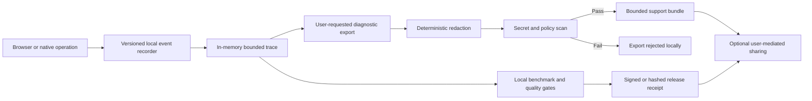
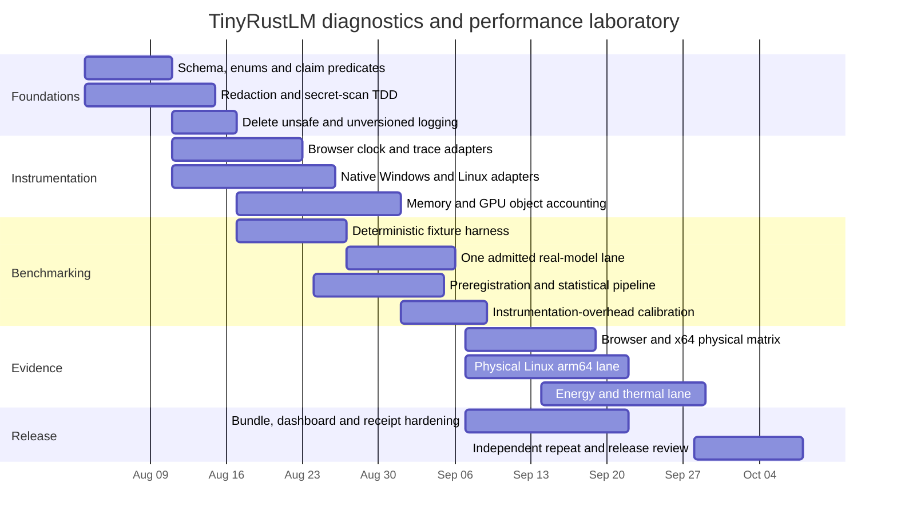

# TinyRustLM Privacy-Preserving Diagnostics and Reproducible Performance Laboratory

## Executive measurement and privacy recommendation

**Research resolution.** The uploaded brief resolves the formerly unspecified research topic: this report addresses the diagnostics, benchmarking, and release-evidence system for TinyRustLM rather than the earlier placeholder topic concerning remote work. The analysis assumes local browser WebAssembly inference, an optional native companion, optional WebGPU, no project-server receipt of prompts or model bytes, and no access during this research to TinyRustLM’s private code, models, telemetry, profiles, test receipts, or execution hardware. fileciteturn0file0

The recommended system is a **local-first, receipt-producing performance laboratory**, not a conventional telemetry pipeline. Full traces remain on the user’s machine. Public or support-facing artifacts are generated only through an explicit export action that applies schema validation, deterministic redaction, path normalization, identifier re-keying, bounded-field enforcement, and secret scanning.



The core recommendation has eight consequences.

| Decision | Required implementation behavior |
|---|---|
| **One schema** | Replace all unpublished or unversioned logging with one event schema and one receipt family. Do not preserve legacy compatibility. |
| **Local detail, bounded export** | Store detailed traces locally; export only allowlisted fields, coarse hardware evidence classes, hashes, bounded counts, status, and error codes. |
| **Phase separation** | Measure acquisition, validation, load, activation, tokenization, prefill, first generation, first render, steady decode, long-context decode, cancellation, switching, free, and cleanup independently. |
| **Evidence-qualified claims** | Every performance statement carries an evidence class; cross-compilation, inspection, emulation, browser execution, and physical native execution are never conflated. |
| **No fabricated metrics** | Unsupported browser memory, GPU residency, free-memory, energy, or thermal metrics are recorded as `unavailable`, with a reason code. |
| **Quality-coupled promotion** | A candidate that is faster but exceeds numerical, output, semantic, privacy, cancellation, or reliability budgets fails promotion. |
| **Distribution-first reporting** | Report medians, quantiles, confidence intervals, paired effect sizes, and failure rates. Never promote from one favorable run. |
| **Preregistered comparison** | Freeze hypotheses, identities, endpoints, sample-size logic, run order, exclusions, and stop conditions before examining comparative results. |

Web timing must be based on monotonic timing domains. High Resolution Time defines a time origin and a current-time mechanism intended not to be affected by wall-clock adjustments; Performance Timeline and User Timing provide the observation and application-marker mechanisms around that clock. Browser timing precision may be reduced for security and privacy, so the observed resolution must be captured rather than assumed. citeturn7search6turn7search0turn7search11

**Evidence-label convention used below**

| Label | Meaning |
|---|---|
| **PF — public fact** | Directly observable in an official specification, API document, or project document. |
| **ES — externally sourced** | Finding or method from a paper, standards organization, or external technical authority. |
| **INF — inference** | Conclusion derived from multiple facts but not directly stated by a source. |
| **REC — recommendation** | Proposed TinyRustLM design or policy. |
| **ASM — assumption** | Necessary assumption in the absence of private implementation evidence. |
| **VERIFY — local verification** | Cannot be established without TinyRustLM code, models, traces, or physical execution. |

The initial deliverable should be treated as complete when TinyRustLM can produce, for one admitted real model, a reproducible local trace, a privacy-safe bundle, a quality-coupled comparative receipt, and physically executed results on at least one Windows x64, Linux x64, and Linux arm64 host plus current Chromium, Firefox, and WebKit lanes. The full release laboratory, including independent repeats and calibrated wall-power measurements, is a subsequent maturity level.

## Claim taxonomy and evidence matrix

A claim is valid only when its subject, workload identity, metric definition, evidence class, environment, sample structure, and uncertainty are explicit. A benchmark artifact should reject claim text that exceeds the underlying evidence level.

| Claim class | Minimum admissible evidence | Required wording | Prohibited wording |
|---|---|---|---|
| **Build-only** | Successful target build; compiler, linker, target triple, flags, source revision, lockfile and artifact hash recorded | “Builds for `linux-arm64` with…” | “Runs on arm64,” “arm64 supported,” or any speed/reliability claim |
| **Static binary inspection** | Build-only evidence plus file format, architecture, imports, sections, symbols, hardening and dependency inspection | “Binary inspection found an AArch64 ELF…” | “Validated on arm64 hardware” |
| **Emulated smoke** | Artifact executes under named emulator or translation layer; emulator version and host architecture recorded | “Completed smoke test under QEMU…” | “Physical arm64 result,” “native arm64 performance” |
| **Real-browser execution** | Named browser version, browser engine, OS, build, backend, workload and successful in-browser run | “Executed in Chromium 1xx on…” | “Cross-browser supported” unless all claimed engines were run |
| **Named-host physical execution** | Physical machine, evidence-safe host class, OS/kernel, CPU class, memory class, build hash, environment and repetitions | “On physical host class H…” | “Generally faster,” “all machines,” or fleet-wide inference |
| **Independently repeated physical execution** | Repetition by a separate operator, lab, or independently provisioned machine with the same preregistration | “Independently reproduced on…” | “Universally reproducible” |
| **Latency claim** | Defined start/end points, clock domain, cold/warm state, workload identity, repetitions, distribution and interval | “Median prefill latency fell 8%, 95% paired CI…” | “Latency improved” without phase or state |
| **Throughput claim** | Token-count semantics, timed interval, output cap, sampling, backend, context and steady-state definition | “Steady decode throughput…” | Using end-to-end tokens/s as if it were engine-only throughput |
| **Memory claim** | Named memory boundary, metric source, peak sampling method and exclusions | “Peak native private bytes…” | “Uses X total memory” when only JS heap or allocation counters are known |
| **Energy claim** | Named measurement level, device/counter, coverage boundary, calibration, idle treatment, duration and thermal controls | “Package energy by RAPL…” or “wall energy by calibrated meter…” | “Browser inference uses X joules” from CPU utilization alone |
| **Quality-neutral claim** | Performance evidence plus all predeclared numerical, deterministic-output, semantic, privacy and reliability gates | “Faster within the registered quality budgets” | “No quality impact” based only on latency or a few examples |
| **Release-wide claim** | Every platform/backend in the claim has qualifying evidence, or the claim explicitly lists exceptions | “Validated in the following lanes…” | Generalization from x64 to arm64, CPU to GPU, or Chromium to other engines |

**REC.** Claim generation should be mechanical. Each receipt should contain `claim_capabilities`, an array computed from evidence, not written by a benchmark operator. The public report generator must refuse adjectives such as “native,” “cross-platform,” “energy-efficient,” “memory-efficient,” or “quality-neutral” unless the receipt satisfies the corresponding predicate.

The WebGPU `"timestamp-query"` capability is optional. The specification notes that timestamp-query values are expressed in nanoseconds but that their determination is implementation-defined, and it discusses deliberate precision reduction because GPU timing can expose high-resolution information. Therefore, GPU timestamps support scoped GPU-pass duration claims only when the feature is present and calibrated; they do not establish CPU/GPU synchronization or whole-operation latency by themselves. citeturn0search2

### Platform evidence requirements

**REC.** The following are minimum promotion requirements, not estimates of statistical sufficiency for every workload. Pilot variance may require more runs.

| Lane | Minimum execution design | Required environment capture | Missing metrics that are acceptable | Non-negotiable limitation |
|---|---|---|---|---|
| **Windows x64 native CPU** | Three clean process starts; at least ten randomized paired baseline/candidate repetitions per start and workload | Windows edition/build, CPU class, logical-core count, memory class, power mode, binary hash, runtime/backend, thread count | PSS; standardized package energy | Do not equate working set, private bytes, committed bytes, and allocator live bytes |
| **Linux x64 native CPU** | Three process or machine-state blocks; ten paired repetitions per block | Distribution, kernel, glibc/musl, CPU governor, cgroup limits, NUMA, binary hash, perf permissions | RAPL on unsupported hardware; GPU residency | Record whether RSS, PSS, private dirty and cgroup memory are available |
| **Linux arm64 physical CPU** | At least two physical arm64 host classes where release scope permits; three starts and ten pairs per host | SoC/CPU class, kernel, governor, thermal zones, PMU access, memory class, binary hash | RAPL; standardized platform energy | Cross-builds, x64 results and QEMU results cannot substitute |
| **Chromium CPU/WASM** | Twenty clean-profile sessions or thirty paired operation runs, whichever is larger | Exact browser build, OS, isolation status, WASM features, worker/thread configuration, cache state | Whole-browser memory on some configurations; direct energy | Chromium-only memory APIs cannot be generalized to Firefox or WebKit |
| **Firefox CPU/WASM** | Same structure as Chromium | Exact Firefox build, OS, profiler-disabled primary runs, supported entry types | User-agent-specific memory; Long Tasks support differences | “Browser result” must remain Firefox-specific |
| **WebKit CPU/WASM** | Same structure as Chromium; use actual Safari/WebKit lane relevant to release | WebKit/Safari build, OS, process model, cache state | User-agent-specific memory; some observer entry types | WebKit result cannot be inferred from Chromium |
| **SIMD** | Paired scalar/SIMD build or runtime feature comparison on every architecture claimed | Feature detection result, compilation flags, dispatch path | Instruction-level counters | SIMD availability does not prove the SIMD path executed; path receipt required |
| **Threads** | Paired single-thread and configured-thread runs; cross-origin isolation and worker count recorded | COOP/COEP state, worker pool, logical cores, affinity policy | Exact per-worker memory in browser | Report total throughput and responsiveness; do not report throughput alone |
| **WebGPU** | Feature-qualified browser/GPU lane; timestamp-disabled primary result plus separately calibrated timestamp result | Adapter class, browser, OS, backend, requested limits/features, shader/pipeline cache state | Free GPU memory, physical residency, whole-device energy | Never infer available VRAM or global GPU utilization from allocated buffer sizes |

Current browser memory interfaces are uneven. `performance.memory` is non-standard and Chromium-specific. `measureUserAgentSpecificMemory()` is experimental, requires a secure cross-origin-isolated context, and its values are implementation-dependent and unsuitable for comparisons across browser families or even unqualified browser-version changes. citeturn2search0turn2search1turn2search2

Firefox’s official profiler supports thread and allocation analysis, while WebKit’s Timelines tooling can organize work by frame and task. Chrome’s Performance panel records runtime activity, frame behavior, CPU work and long tasks. These tools are diagnostic corroboration lanes; they should not remain attached during primary promotion measurements unless their overhead has been separately quantified. citeturn6search3turn6search4turn6search1

## Versioned events, traces, clocks, and performance metrics

**REC.** Adopt `trl.diag.event/1.0.0` as the sole event envelope. JSON is suitable for exchange and diagnostics, but the in-memory recorder may use a compact binary representation. Integer nanoseconds should be serialized as decimal strings when a consumer cannot safely represent 64-bit integers.

```json
{
  "schema_version": "trl.diag.event/1.0.0",
  "event_id": "random-per-run-128-bit-id",
  "operation_id": "random-per-run-128-bit-id",
  "parent_id": "random-per-run-128-bit-id-or-null",

  "event_kind": "span_end",
  "phase": "decode_step",

  "clock": {
    "domain": "browser-performance",
    "origin_id": "random-per-realm-id",
    "monotonic_ns": "18429374000",
    "resolution_ns": "100000",
    "reduced_precision": true,
    "sync_uncertainty_ns": null,
    "discontinuity_epoch": 0
  },
  "duration_ns": "19230000",

  "counts": {
    "bytes_in": 0,
    "bytes_out": 0,
    "bytes_allocated": 4194304,
    "bytes_freed": 0,
    "input_tokens": 0,
    "output_tokens": 1
  },

  "identity": {
    "model_composition_id": "sha256:...",
    "tokenizer_id": "sha256:...",
    "runtime": "tinyrustlm-wasm",
    "runtime_version": "semver-or-revision",
    "backend": "wasm-simd-threads",
    "build_id": "sha256:...",
    "workload_id": "private-local-id"
  },

  "status": "ok",
  "error_code": null,
  "cancelled": false,
  "cancellation_stage": null,

  "optional": {
    "thread_class": "decode-worker",
    "memory_snapshot_id": null,
    "gpu_scope_id": null,
    "quality_receipt_id": "sha256:..."
  }
}
```

### Schema rules and redaction classes

| Field group | Rule | Export class |
|---|---|---|
| Schema, phase, event kind, status | Closed enums; unknown values fail schema validation | **Public-safe** |
| Event/operation/parent IDs | Random, scoped to one run; re-keyed during export; no UUID derived from device, user, path or wall time | **Public-safe after re-keying** |
| Monotonic timestamp and duration | Relative monotonic values; exported timestamps shifted so the first event is zero | **Public-safe after normalization** |
| Counts | Non-negative bounded integers; exact counts may be bucketed where they expose private workload length | **Conditional** |
| Model/composition hash | Exact content-derived hash remains local when it identifies a private model; public release composition IDs may be exported | **Conditional** |
| Tokenizer/runtime/backend/build | Allowlisted release identities and hashes | **Public-safe** |
| Workload ID | Exact prompt hash, token hash, or private fixture identity remains local; export a registered workload-class ID | **Local-sensitive** |
| Error code | Bounded enum such as `MODEL_HASH_MISMATCH`, never raw exception text by default | **Public-safe** |
| Optional paths, URLs, stack strings | Prohibited from the event envelope; local attachments require separate redaction | **Forbidden by default** |
| Prompt, output, token IDs, model bytes, credentials | Must never enter diagnostic events, support summaries, or receipts | **Forbidden** |

**REC.** Permit local-only encrypted attachments for authorized quality investigations, but keep them outside the diagnostics schema and outside normal bundle creation. This prevents an accidental schema evolution from turning payload material into telemetry.

### Operation trace contract

Every operation is a parent span with explicit child phases. An operation is not complete until its terminal status and cleanup disposition are recorded.

| Operation | Required phase boundaries and non-payload evidence |
|---|---|
| **Model acquisition** | Request accepted; cache lookup; peer/network/file source selected; transfer first byte; transfer complete; persisted; byte counts; source class, not URL |
| **P2P import** | Session accepted; handshake result; chunk receipt counts; verification; assembly; persistence; bounded peer error class, never invitation URL or peer identifier |
| **File validation** | File opened; length checked; container parsed; section/table validation; model metadata class; validation result |
| **Hashing** | Hash algorithm/version; bytes hashed; start/end; expected-hash comparison; never bytes or path |
| **Allocation** | Allocator domain; requested bytes; granted bytes; failure code; live and peak deltas |
| **Activation** | Composition resolved; backend selected; tensors mapped/uploaded; runtime ready |
| **Tokenizer initialization** | Tokenizer identity; vocabulary/config validation; initialization time; no vocabulary contents |
| **Context compilation** | Template identity; context token count; cache lookup; compilation or packing duration |
| **Prefill** | Input token count; batch/chunk configuration; backend time; wall time; cache reuse class |
| **Decode step** | Step ordinal or bounded aggregate range; one output-token count; engine duration; no token ID/value |
| **Sampling** | Sampling profile ID; candidate-count bucket if useful; duration; random-seed policy, not necessarily public seed |
| **UI render** | Output-event receipt; scheduling; DOM commit; first paint proxy; batch size; duplicate-event flag |
| **Memory retrieval** | Store class; retrieval count; byte/token-count bounds; trust-policy result; no retrieved text |
| **Tool call** | Tool class; state transitions; bounded result status; timing; no arguments, credentials, URL query or output |
| **Model switch** | Switch requested; old decode quiesced; old resources released/retained; new model loaded/activated; UI ready |
| **Cancellation** | User/system cancellation requested; request observed; decode stopped; output emission stopped; cleanup complete |
| **Free** | Object class and accounted byte count; logical free; allocator-visible free; OS-visible observation if available |
| **OPFS deletion** | Logical entry selected by opaque local ID; delete requested; result; post-delete enumeration; no private path |
| **Process restart** | Restart intent; clean-shutdown result; new process/session ID; state restoration class |
| **Cleanup** | Worker termination; buffer unmap/destroy; cache policy; final leak snapshot; terminal status |

Performance Timeline exposes `PerformanceObserver` so applications can receive new and, for supported entry types, buffered entries without polling. User Timing measures are available in workers and can carry structured detail, but TinyRustLM should place only allowlisted non-payload metadata in that detail. citeturn7search0turn2search8turn2search10

### Clock semantics

| Clock | Permitted use | Forbidden comparison or caveat |
|---|---|---|
| **Wall clock / UTC** | Human-readable bundle creation time, build provenance, correlation with external test orchestration | Never use for phase duration; it can be adjusted |
| **Browser `performance.now()`** | Duration within one browser time-origin domain | Do not directly subtract values from different realms without correlation |
| **Browser `timeOrigin + now()`** | Approximate cross-realm alignment when support and observed precision permit | Record synchronization uncertainty and browser precision reduction |
| **Worker clock** | Worker-local phase durations | Main-thread/worker ordering requires a handshake or message-correlation interval |
| **Native high-resolution monotonic clock** | Native phase and process-local duration | Raw ticks are not wall time; frequency and clock type must be recorded |
| **CPU time** | User/kernel processor consumption and utilization analysis | Not latency; parallel execution can produce CPU time greater than elapsed time |
| **GPU timestamp query** | Duration between timestamp positions in a qualifying GPU queue/pass | Not directly comparable with CPU timestamps without explicit calibration |
| **Cross-process correlation** | Parent-child handshake with repeated timestamp exchanges and uncertainty interval | Do not report a total finer than the synchronization error |
| **Wall-power meter clock** | Energy integration and external run windows | Requires start/stop synchronization error in the receipt |

Windows documents QueryPerformanceCounter as the primary native API for high-resolution interval measurements and distinguishes it from UTC-synchronized wall-clock APIs. Linux monotonic timekeeping similarly distinguishes `CLOCK_MONOTONIC`-style elapsed-time sources from realtime clocks. citeturn8search0turn8search11turn8search12

**REC. Clock correlation algorithm.** Perform at least nine ping-pong exchanges between producer and collector. For each exchange, calculate round-trip time and midpoint offset. Select the minimum-RTT observation as the offset estimate, retain half its RTT plus observed timer granularity as `sync_uncertainty_ns`, and repeat after backgrounding, process migration, suspend/resume, or a long benchmark. Do not merge event ordering across clock domains when uncertainty intervals overlap.

**REC. Discontinuity detection.** Increment `discontinuity_epoch` and terminate or segment the run when any of these occur: a monotonic reading decreases; a delta exceeds a registered suspension threshold; worker correlation offset changes beyond its uncertainty budget; the browser process restarts; the GPU device is lost; or wall-to-monotonic correlation changes sharply. A run crossing discontinuity epochs cannot support one continuous latency claim.

### Latency and throughput definitions

| Metric | Start | End | Required qualifiers |
|---|---|---|---|
| **Cold acquisition** | User/system begins acquisition | Validated bytes available in designated store | Cache-empty definition, source class, bytes |
| **Warm acquisition** | Acquisition requested | Existing artifact accepted | Exact cache layer hit |
| **Hash latency** | First byte submitted to hash | Digest finalized and compared | Bytes and algorithm |
| **Structural-validation latency** | Validated-file open | Structural checks complete | Format/version and checks performed |
| **Load latency** | Runtime begins reading admitted artifact | Required host representation present | Store/cache state |
| **Activation latency** | Backend activation begins | Model ready for context operation | Backend and pipeline-cache state |
| **Prompt-tokenization latency** | Private prompt representation accepted | Token count and internal token sequence ready | Input byte-count bucket and token count; no payload |
| **Context-assembly latency** | Template/context assembly starts | Final model input ready | Context length, memory/retrieval classes |
| **Prefill latency** | First prefill work submitted | Decode state ready | Input tokens, prefix-cache state |
| **Time to first generated token** | Generation request accepted | First output token becomes internally final | Includes or excludes queueing explicitly |
| **Time to first rendered token** | Generation request accepted | First visible committed render associated with the operation | Render observer/proxy and frame state |
| **Inter-token latency** | Output token `i` final | Output token `i+1` final | Report distribution after defined exclusions |
| **Engine decode throughput** | First included steady-state step starts | Last included step ends | Output tokens divided by engine-active time |
| **User-visible throughput** | First rendered output | Last rendered output in interval | Includes batching, message and render delay |
| **Completion latency** | Generation request accepted | Final output rendered and completion state committed | Output-token count |
| **Cancellation response** | Cancellation input timestamp | No further generation/output event can occur | Also report cleanup completion separately |
| **Model-switch latency** | Switch requested | New model is ready and composer is usable | Old/new residency policy |
| **Cleanup latency** | Completion/cancel/switch cleanup starts | Registered resources released or retained by policy | Final memory observations |

Define:

\[
\text{engine tokens/s}
=
\frac{N_{\text{included output tokens}}}
     {t_{\text{last decode end}}-t_{\text{first decode start}}-\text{registered pauses}}
\]

\[
\text{visible tokens/s}
=
\frac{N_{\text{rendered tokens}}}
     {t_{\text{last visible commit}}-t_{\text{first visible commit}}}
\]

Do not remove sampling, garbage collection, scheduling, or rendering time from an end-to-end metric. If an engine-only number excludes these costs, report a second user-visible number.

### Responsiveness measurements

The Long Tasks API is designed to surface UI-thread work that monopolizes the thread for an extended period, while Event Timing exposes input-processing and next-render timing for qualifying interactions. Event Timing durations are intentionally coarsened and have support-specific thresholds, so capability detection and observed granularity belong in each receipt. citeturn7search1turn7search2

**REC.** Record the following without capturing UI text:

| Area | Metric |
|---|---|
| Main thread | Long-task count; total long-task time; p95/p99 task duration; longest task; long animation frames where supported |
| Event loop | Scheduled-probe delay distribution in a dedicated low-rate probe; observer callback backlog |
| Input | Composer key/input delay; send/cancel interaction duration; scroll interaction duration where supported |
| Rendering | Render-commit cadence; generated-to-rendered delay; frame duration or dropped-frame proxy where supportable |
| Worker communication | Send-to-receive latency; queue depth; oldest-message age; dropped/duplicate operation events |
| Composer stability | Focus loss count; disabled-time duration; unexpected layout-shift proxy; input-state preservation |
| Cancellation | Input-to-observed; input-to-decode-stop; input-to-render-stop; input-to-cleanup |
| Backgrounding | Visibility transition; background duration; throttling/discontinuity status; recovery latency |
| Reliability | Duplicate token/output event count; out-of-order event count; terminal-event multiplicity |

Primary responsiveness gates should include: no composer input loss, no post-cancel output, no duplicate output events, no permanent scroll lock, bounded long-task regression, and no substantial deterioration in input-tail latency. Performance work that increases tokens per second while freezing the chat surface fails.

## Memory, energy, state control, and instrumentation overhead

### Memory-accounting model

No single browser or operating-system metric represents “TinyRustLM memory.” The laboratory should expose several non-overlapping accounting views and explicitly identify nested or unobservable components.

| Layer | Component | Preferred measurement | Browser availability |
|---|---|---|---|
| Artifact | Downloaded or imported artifact | Validated logical byte length | Available |
| Artifact | Physical store usage | Store/API-reported usage if attributable; otherwise logical bytes only | Often partial |
| Composition | Logical model composition | Sum of distinct logical component lengths, with deduplication manifest | Available from application metadata |
| Input | Host chunks and transient reads | Application-owned buffer ledger | Available if instrumented |
| JavaScript | JS objects and buffers | Owned-buffer ledger; browser heap estimate only as corroboration | Partial |
| WASM | Reserved linear-memory address space | Runtime memory-page limits and growth events | Usually available |
| WASM | Committed/accessible linear memory | Current pages × 64 KiB, labeled as linear-memory extent | Available |
| Allocator | Live requested bytes | Instrumented allocation/deallocation ledger | Requires implementation |
| Allocator | Peak live bytes | Maximum ledger sum | Requires implementation |
| Model | Tensor storage | Tensor registry by ownership domain | Requires implementation |
| Runtime | Activation and temporary scratch | Allocator tags or arena high-water marks | Requires implementation |
| Context | KV/prefix cache | Dimensions × element width plus allocator overhead where known | Requires implementation |
| Workers | Worker stacks/runtime overhead | Native process tools or profiler attribution | Usually unavailable to ordinary page code |
| Native process | RSS/working set | OS process metrics | Native companion/lab only |
| Native process | Private bytes/commit | OS process metrics | Native companion/lab only |
| Linux process | PSS/private mappings | `/proc/<pid>/smaps_rollup` or equivalent | Native/lab only |
| GPU | Requested buffer and texture bytes | Application registry from object creation/destruction | Available if instrumented |
| GPU | Staging/readback buffers | Application registry | Available if instrumented |
| GPU | Driver allocation, residency, free memory | Vendor/OS tooling where authorized | Unavailable to ordinary WebGPU application |
| Caches | HTTP, service worker, OPFS, compilation, shader caches | Per-cache logical state and controlled reset evidence | Partial |

Linux `/proc` documentation distinguishes virtual size, RSS, high-water RSS and related fields; `smaps_rollup` provides summed mapping information including RSS and proportional-set-size fields. These are process-level observations, not direct tensor or model-ownership measurements. citeturn2search11turn2search4turn2search16

On Windows, `GetProcessMemoryInfo` returns process memory counters, while `GetProcessTimes` and `QueryProcessCycleTime` expose processor-time or cycle information rather than elapsed latency. The receipt must name the exact selected counter instead of relabeling it as total memory or wall time. citeturn1search1turn1search3turn1search12

**REC. Non-overlap formula.**

Let application-owned host categories be disjoint:

\[
M_{\text{owned-host}}(t)=
M_{\text{input}}(t)+
M_{\text{wasm-allocator-live}}(t)+
M_{\text{external-js-buffers}}(t)+
M_{\text{other-tagged}}(t)
\]

Then:

\[
M_{\text{owned-host-peak}}=\max_t M_{\text{owned-host}}(t)
\]

Do **not** add `WASM committed pages` to allocator live bytes if allocator live memory is contained within those pages. Instead report:

\[
M_{\text{WASM-slack}}(t)
=
M_{\text{WASM-linear-extent}}(t)
-
M_{\text{tagged-live-in-WASM}}(t)
\]

where the value is labeled an accounting difference, not necessarily reclaimable memory.

For GPU objects:

\[
M_{\text{GPU-known}}(t)=
\sum_{\text{live buffers}} \text{declared size}
+
\sum_{\text{live textures}} \text{estimated logical footprint}
\]

This is **known requested allocation**, not physical GPU-memory consumption, residency, available VRAM, or driver overhead.

Artifact and runtime memory should remain separate:

\[
F_{\text{deployment}}
=
B_{\text{persisted-artifact}}
\quad\text{and}\quad
M_{\text{runtime-peak}}
\]

A combined “footprint” may be shown only as a visibly labeled sum of unlike storage and runtime concepts.

### Energy and thermal evidence levels

| Level | Method | Claim supported | Main limitations |
|---|---|---|---|
| **E0 — unavailable** | Browser-only execution with no authorized energy source | No energy claim | CPU time/utilization is not joules |
| **E1 — coarse system proxy** | Battery discharge or OS energy estimate | Directional within-machine observation over long runs | Battery controller resolution, charging state, background load and conversion losses |
| **E2 — component counter** | Intel RAPL, platform energy counter, GPU vendor counter, supported ARM platform counter | Named-domain energy on the same platform | Domain coverage varies; counter accuracy and wraparound must be established |
| **E3 — calibrated wall power** | External true-RMS meter and synchronized run window | Whole-system wall energy for a named setup | Includes display, PSU and unrelated system consumption unless controlled |
| **E4 — independent physical repeat** | E3 repeated by another setup/operator | Independently reproduced named-setup result | Still not a universal hardware claim |

Linux powercap exposes power zones and, where supported, Intel RAPL domains through sysfs. Linux’s power-supply class may expose energy, charge and battery properties, but it explicitly allows unavailable properties to be omitted and distinguishes energy from charge and percentage capacity. These interfaces support named-platform evidence, not cross-platform equivalence. citeturn1search14turn5search6

Arm PMUs expose performance events rather than universal joule counters. Counter availability varies by core and platform; Arm’s tooling can combine CPU, GPU, scheduler and hardware-counter observations when the target platform supports them. Therefore, generic PMU events may explain energy changes but cannot by themselves be labeled energy. citeturn1search0turn1search16turn1search19

**REC. Energy protocol.**

\[
E_{\text{net}}
=
E_{\text{active-window}}
-
P_{\text{idle-matched}}\times T_{\text{active-window}}
\]

Report both gross and idle-subtracted energy. Idle subtraction is valid only when the idle run uses the same display state, browser/native process state, model residency policy, network state, power mode, background-service policy and thermal starting band.

The protocol should fix or record: meter model and calibration date; sampling frequency; voltage and meter range; synchronization uncertainty; screen brightness/state; network state; power plan/governor; fan/cooling policy; ambient temperature; initial package/device temperature; battery/AC state; frequency scaling policy; run duration; idle procedure; and post-run thermal state.

SPEC power rules are useful methodological references: they require controlled environmental conditions and, for compliant wall-power work, calibrated measurement devices with specified uncertainty. They should guide TinyRustLM’s method without implying that TinyRustLM results are SPEC-certified. citeturn5search1turn5search0turn5search9

**REC. Thermal controls.** Begin a run only when the selected temperature signals are inside a preregistered band for a minimum stabilization interval. Reject a block if temperature drifts beyond the registered band, sustained frequency falls outside policy, thermal throttling is observed, or the candidate and baseline begin from materially different thermal conditions. Alternate baseline and candidate instead of running all baseline trials first.

### Cold, warm, steady and restart states

| State | Required conditions |
|---|---|
| **Cold acquisition** | No application artifact in HTTP cache, service-worker cache, Cache Storage or OPFS; source must transfer or import bytes |
| **Warm artifact acquisition** | Artifact is already present in the named cache/store, but no model runtime state is resident |
| **Cold process/runtime** | New browser/native process; no workers, model objects, allocator arenas, compiled module instances, tensors or GPU device retained |
| **Warm compiled runtime** | Runtime/module compilation may be cached, but model tensors are not activated |
| **Warm model** | Model tensors/backend are active; no prior prompt KV/prefix state unless separately declared |
| **Warm prefix** | Exact registered prefix state is reusable; prefix identity and reuse length recorded |
| **Steady decode** | Warm-up exclusion complete; model active; predefined token range; no known compilation, pipeline creation or first-allocation events |
| **Long-context steady decode** | Same as steady decode with registered context band and KV-cache occupancy |
| **Post-switch warm** | New model is active following a switch; old model retention policy stated |
| **Background-recovery** | Browser was backgrounded for registered duration and has returned; discontinuity/throttling status recorded |
| **Cold machine** | Machine restarted or otherwise brought to a documented state; OS page cache and thermal state controlled as far as practical |

**Reset mapping**

| State element | Page reload | Browser restart | Fresh profile | Machine restart or privileged reset |
|---|---:|---:|---:|---:|
| Application JS/WASM objects | Usually | Yes | Yes | Yes |
| Worker pool | Usually | Yes | Yes | Yes |
| Model residency/KV cache | Usually | Yes | Yes | Yes |
| OPFS | No | No | Yes or explicit deletion | Yes if profile removed |
| HTTP/service-worker cache | Not reliably | Not necessarily | Usually | Not necessarily |
| WASM code cache | Not reliably | Browser-dependent | More controlled | More controlled |
| OS page cache | No | No | No | Restart may still not be sufficient on every OS; explicit privileged procedure may be needed |
| Shader/pipeline cache | Not reliably | Not necessarily | More controlled | Driver-level persistence may remain |
| GPU clocks/thermal state | No | No | No | Requires stabilization, not merely restart |
| Allocator reuse | Page/process dependent | Yes for process allocator | Yes | Yes |

A receipt must therefore record the reset procedure, not merely the word “cold.”

### Instrumentation-overhead calibration

**REC.** Calibrate the following modes independently:

| Mode | Contents | Provisional admissible overhead |
|---|---|---|
| **Disabled** | Compile-time or runtime fast path with recorder inactive | Reference |
| **Minimal counters** | Operation totals and terminal statuses only | Median ≤1%; p95 phase latency ≤2% |
| **Full local trace** | Every operation span and selected decode events | Median ≤3%; p95 ≤5%; no new responsiveness failure |
| **Performance observers** | Long Task, Event Timing and other supported observers | Incremental overhead measured; no assumption that it is free |
| **GPU timestamps** | Timestamp-query instrumentation and readback | Separate GPU and wall-time deltas; ≤3% target where feasible |
| **Diagnostic export** | Serialization, hashing, compression, redaction and scanning | Excluded from primary operation window; separately reported |

These thresholds are **REC**, not externally established constants. **VERIFY** must confirm they are attainable for TinyRustLM.

Use paired runs with identical workload and state, randomized instrumentation order, and separate effect estimates for latency, throughput, memory and long tasks. For production diagnostics, aggregate repetitive decode events into bounded windows, such as eight or sixteen steps, unless an explicit full-trace diagnostic session is enabled. Full per-step events are appropriate in fixture and laboratory modes, not as an always-on telemetry path.

The WebKit documentation explicitly notes that some timelines can affect inspected-page performance, and browser profiling tools generally change what is observed. This supports requiring profiler-on versus profiler-off calibration rather than treating profiler output as primary benchmark evidence. citeturn6search4turn6search13

## Workloads, preregistration, statistics, and quality coupling

### Workload identity contract

Each benchmark operation must bind to an immutable identity record:

```text
workload_identity_version
model_release_or_private_local_id
model_composition_hash
quantization_and_numeric_tier
adapter_hashes_and_order
tokenizer_hash
chat_template_hash
private_exact_prompt_hash
private_prompt_token_sequence_hash
prompt_token_count
context_token_count_before_request
output_token_cap
sampling_algorithm_and_parameters
seed_or_seed_policy
prefix_and_kv_cache_state
artifact_cache_state
runtime_and_version
backend_and_feature_path
thread_count_and_worker_topology
browser_engine_and_exact_build
operating_system_and_build
build_artifact_hash
measurement_policy_hash
quality_policy_hash
```

The exact prompt hash and token-sequence hash remain in private local evidence. A public receipt substitutes a registered workload-class ID, token-count bucket or disclosed count, context band, and privacy-preserving fixture identity. Hashes should not be assumed anonymous: hashes of low-entropy prompts or private models may permit guessing, so public export should omit or key them unless the underlying object is already public.

### Workload suite

| Suite family | Purpose and required variants |
|---|---|
| **Instrumentation fixtures** | Tiny deterministic tokenizer/model fixture; known byte counts; exact token sequence; forced allocation/free; cancellation at known step; duplicate-event injection |
| **Admitted real model** | One release-intended model/composition exercising genuine load, prefill and decode paths |
| **Short prefill** | Small context and short output; cold and warm |
| **Long prefill** | Registered context bands near realistic and stress ranges |
| **Repeated turns** | Exact prefix reuse enabled and disabled; identical prior-turn structure |
| **Cache miss/hit** | Artifact, compile, pipeline, prefix and model-residency states declared separately |
| **Casual chat** | Ordinary conversational request with private prompt body and fixed evaluation rubric |
| **Ambiguity** | Prompt requiring clarification rather than unsupported assumption |
| **Practical planning** | Multi-constraint planning with stable expected invariants |
| **Source conflict** | Inputs containing conflicting evidence; evaluation checks qualification and conflict handling |
| **Current preference** | Request whose answer depends on a current or user-specific preference; checks uncertainty behavior |
| **Untrusted memory** | Retrieved memory contains instruction-like or conflicting content; checks trust boundaries |
| **Structured JSON** | Schema-valid output, exact field constraints and escaping |
| **Code** | Syntax or compilation checks where authorized; output remains private |
| **Cancellation** | Cancel before prefill, during prefill, early decode, steady decode and long-context decode |
| **Switching** | Resident-to-resident, resident-to-cold and cancellation-during-switch |
| **Memory pressure** | Increasing context/output/model-switch cycles until a registered safe threshold |
| **Cold restart** | Browser/native restart followed by acquisition/load/activation |
| **Offline mode** | Required artifacts present and absent; no unintended network dependency |
| **Reliability soak** | Repeated turns and switches with leak, duplicate-output and cleanup checks |

A workload is inadmissible when its identity cannot be reproduced privately, its quality oracle is undefined, it relies on mutable remote content without a snapshot, or it would expose payload material in a public receipt.

### Preregistration contract

| Item | Must be frozen before comparative results |
|---|---|
| Hypothesis | Directional or equivalence hypothesis and affected mechanism |
| Baseline/candidate | Source revision, lockfile, build flags, artifact hash, runtime/backend configuration |
| Primary endpoint | One principal metric per experiment, such as paired p95 TTFT ratio |
| Secondary endpoints | Other latency quantiles, throughput, memory, responsiveness, energy and reliability |
| Practical threshold | Minimum worthwhile improvement and maximum tolerated regression |
| Sample-size method | Pilot variance source, target power/precision, clustering level and permitted reassessment rule |
| Warm-up | Exact warm-up procedure and exclusion boundary |
| State | Cold/warm/cache/thermal definitions and reset process |
| Randomization | Seeded run-order generator and blocking factors |
| Outlier policy | Mechanical rule based on infrastructure invalidity, not observed favorability |
| Exclusions | Crash, device loss, clock discontinuity, thermal drift, identity mismatch and other registered causes |
| Quality budgets | Numerical, deterministic-output, semantic, privacy, cancellation and reliability margins |
| Hardware matrix | Required physical hosts, browsers, CPU/GPU paths and allowed missing metrics |
| Stop rules | Safety, privacy, instrumentation and instability thresholds |
| Analysis | Estimator, confidence level, bootstrap/blocking strategy and multiplicity correction |

The preregistration and its hash should be written before candidate labels are unblinded in the comparison report.

### Statistical treatment

Performance observations are hierarchically dependent: tokens occur within turns, turns within processes or browser profiles, and processes within physical hosts. Treating every token as an independent replicate would create falsely narrow intervals.

**REC. Experimental unit.** For release decisions, the principal replicate should usually be a paired operation or session within a randomized block, not an individual token. Token-level data may characterize inter-token distributions but should not inflate the number of independent release replicates.

**REC. Run structure.** Use randomized `AB`/`BA` pairs within host-state blocks. For expensive energy tests, use longer alternating blocks and independently measured idle windows. Preserve all valid registered runs.

**REC. Warm-up.** Use fixture and pilot evidence to define the warm-up boundary before comparative analysis. Report startup separately rather than discarding it when startup matters to users.

**REC. Autocorrelation.** Examine run-order plots and autocorrelation of paired residuals. When dependence remains, use block bootstrap or cluster-level aggregation. Do not randomly reshuffle dependent token observations as though they were independent.

**REC. Heavy tails and heteroscedasticity.** Report median, p90, p95 and p99 when sample size supports them; show empirical distributions; estimate paired ratios or differences with bootstrap intervals; and avoid relying only on an arithmetic mean. Use quantile uncertainty or hierarchical bootstrap for tail decisions.

**REC. Multiple comparisons.** Declare one primary endpoint. Apply Holm or another preregistered family-wise procedure to confirmatory secondary tests. Exploratory findings remain labeled exploratory.

**REC. Effect size.** Report both relative and absolute change:

\[
\Delta_{\text{abs}} = M_C-M_B
\]

\[
\Delta_{\text{rel}} =
\frac{M_C-M_B}{M_B}
\]

For latency, a negative value is an improvement; the report should state that direction explicitly. Include confidence intervals and the practical-regression threshold.

Criterion is a useful Rust benchmarking reference but must not be assumed to be TinyRustLM’s adopted harness. Its documented defaults include warm-up, repeated measurement, bootstrap resampling, confidence and significance parameters, illustrating why harness configuration belongs in receipts rather than remaining implicit. citeturn3search3

Systems-benchmarking research warns that nondeterminism, insufficient repetition and favorable-run selection can produce misleading conclusions. Kalibera and Jones emphasize accounting for uncertainty at multiple execution levels, while Georges, Buytaert and Eeckhout show why best-run or otherwise statistically weak methodologies can reverse conclusions in managed-runtime experiments. The exact runtime differs, but the methodological risks apply to browser, WASM, allocator, GPU and process-state variability. citeturn4search3turn4search9turn4academia48

### Promotion and regression decisions

**REC. Provisional default budgets**

| Gate | Default promotion rule |
|---|---|
| Deterministic fixture output | Exact authorized token-sequence and output-hash match |
| Numerical fixture | Candidate remains inside a preregistered absolute/relative tolerance envelope for the numeric tier; no new NaN/Inf |
| Ordinary semantic suite | Lower confidence bound of candidate-minus-baseline pass rate no worse than −1 percentage point, subject to adequate sample size |
| Critical conversational invariants | Zero newly introduced failures for safety, instruction hierarchy, cancellation, untrusted-memory handling and structured-output validity |
| Runtime error rate | No new crash/hang/device-loss class; non-inferiority margin no larger than 0.1 percentage point for recoverable errors |
| Duplicate/post-cancel output | Zero occurrences in valid promotion runs |
| Cancellation latency | No more than 10% p95 regression unless explicitly traded off and approved; no post-cancel generation |
| Memory | No unexplained monotonic growth across soak cycles; peak within registered platform budget |
| Privacy | Zero forbidden-field, secret-scan or redaction failures |
| Instrumentation integrity | Zero invalid event ordering, negative duration, orphan terminal span or identity mismatch |

These values are starting recommendations. **VERIFY** must calibrate them to TinyRustLM’s quality suite and release risk. A statistically detectable improvement below the minimum worthwhile effect does not justify complexity; a statistically uncertain regression whose interval crosses the registered failure threshold does not pass.

Every comparison stores a private quality receipt containing the model identity, private output hash, authorized token-sequence hash where permitted, numeric-tier result, semantic-test result, error counts and cancellation result. Public receipts retain only pass/fail statuses, policy hashes, bounded aggregate counts and approved model/composition identity.

## Privacy-safe bundles, dashboards, stop rules, and implementation plan

### Local diagnostics and export policy

**REC.** Full traces are local, ephemeral by default and user-controlled. There is no implicit upload. Enabling diagnostics changes local retention only; sharing requires a separate explicit action showing the bundle contents and omission report.

Privacy engineering should follow data minimization and purpose limitation: collect only data required to diagnose or substantiate the declared claim, keep payloads outside the observability channel, bound high-cardinality fields, and make retention and sharing explicit. NIST’s Privacy Framework provides a general risk-management structure rather than a TinyRustLM-specific telemetry design, so it should be used as a governance reference, not as proof of compliance. citeturn4search20turn4search16

**Allowed support-summary fields**

| Category | Examples |
|---|---|
| Schema and receipt | Schema versions, policy hashes, receipt IDs |
| Software identity | Build hash, release version, runtime/backend, browser/OS versions |
| Model identity | Approved public composition ID or keyed support hash |
| Workload class | Registered fixture/suite ID, context/output-count buckets |
| Evidence | Evidence class, physical/emulated flag, run count |
| Measurements | Bounded phase distributions, byte/token counts, known memory categories |
| Status | Pass/fail, bounded error code, cancellation and cleanup state |
| Hardware | Coarse CPU/GPU/memory class only when necessary and sufficiently non-unique |
| Omissions | Explicit list of unavailable or redacted metrics |

**Forbidden content**

Prompts, output text, token IDs or token strings, raw model bytes, model excerpts, credentials, cookies, authorization headers, invitation/enrollment URLs, query strings, private absolute paths, browser-storage dumps, hidden tenant/account IDs, persistent device IDs, MAC addresses, serial numbers, exact stable hardware fingerprints, unrestricted exception text, environment-variable dumps, or arbitrary profiler metadata.

### Diagnostic-bundle format

```text
tinyrustlm-diagnostic-bundle/
  manifest.json
  schema/
    event-schema.json
    receipt-schema.json
    redaction-policy.json
  receipts/
    benchmark-receipt.json
    quality-receipt-public.json
    platform-evidence.json
  traces/
    bounded-events.jsonl.zst
  tests/
    summary.json
  tools/
    versions.json
  redaction/
    report.json
    secret-scan-report.json
  notes/
    user-note.txt                 # optional, user-authored and separately warned
  SHA256SUMS
```

`manifest.json` should include bundle schema version, creation-tool version, normalized creation date, file list, file lengths, SHA-256 hashes, evidence class, retention warning and explicit forbidden-content declaration. The manifest must not contain the machine username or original filesystem roots.

**REC. Bounded trace rules**

| Limit | Behavior |
|---|---|
| Event count | Hard cap; use deterministic head/tail plus registered reservoir or phase-stratified sampling |
| String length | Fixed maximum; enums preferred |
| Cardinality | Reject arbitrary keys and unknown attribute names |
| Numeric ranges | Validate counts/durations; retain overflow status rather than wrapping |
| Error details | Map internal errors to bounded codes; optional locally retained detail excluded |
| Timestamps | Shift to zero; omit exact wall time except coarse bundle creation metadata |
| IDs | Re-key all operation/event IDs during export |
| Hardware | Map to an approved class taxonomy; omit when uniqueness threshold is not met |

### Redaction and secret scanning

Export proceeds through these mandatory stages:

1. Parse against the exact schema; reject unknown fields.
2. Delete fields classified as forbidden or local-only.
3. Normalize separators and redact absolute paths, usernames and profile directories.
4. Strip URL query, fragment, user-info and tokens; preferably omit URLs entirely.
5. Re-key event and operation identifiers.
6. Apply count bucketing and hardware-class coarsening.
7. Scan canonical decoded content and compressed/uncompressed members for credentials, cookies, private keys, bearer tokens, known invitation patterns, prompt/output markers and high-entropy suspicious strings.
8. Reparse the completed bundle and compare it to the allowlist.
9. Emit a redaction report containing rule IDs and counts, not the redacted values.
10. Reject export on scan failure, malformed archive, unknown schema, hash mismatch or nondeterministic redaction result.

Run the redactor twice on the same canonical input and require byte-identical output except for an explicitly normalized bundle creation field. This makes the privacy transformation testable and reproducible.

### Dashboard and release receipt

The live local dashboard should show only operational metadata:

| Display area | Content |
|---|---|
| Current operation | Acquisition, validation, load, prefill, decode, cancellation, switch or cleanup |
| Elapsed time | Monotonic operation elapsed time |
| Identity | Approved model/composition label, runtime and backend |
| Progress | Validated bytes, input tokens processed, output tokens completed, or declared indeterminate state |
| Throughput | Display only after the steady-state validity predicate becomes true |
| Memory | Known owned-host peak, WASM extent, known GPU allocation; unavailable fields visibly labeled |
| Cancellation | Requested, observed, generation stopped, rendering stopped, cleanup complete |
| Blockers | Thermal, memory, device loss, quality mismatch, privacy scan or instrumentation status |
| Evidence | Build, emulated, browser, physical, independent-repeat class |
| Receipt | Current run/receipt hash and preregistration hash |

**REC. Stop or reject the run when:**

| Trigger | Required action |
|---|---|
| Thermal drift or throttling | Stop block; cool and restart according to preregistration |
| Memory safety limit or sustained unexplained growth | Cancel safely; collect local bounded diagnostics; reject |
| Output/token/numeric mismatch | Stop candidate promotion block; preserve private quality evidence |
| Crash, hang, repeated device loss or worker instability | Reject lane after registered retry threshold |
| Post-cancel or duplicate output | Immediate quality failure |
| Secret-scan or redaction failure | Do not create shareable bundle |
| Clock discontinuity | Segment or reject timing result |
| Event corruption | Reject affected run; no repair by guessing |
| Wrong build/model/workload identity | Reject before analysis |
| Unsupported metric requested | Record `unavailable`; never synthesize |
| Profiler or instrumentation exceeds overhead budget | Reject instrumented evidence for primary claim |

### TDD backlog and clean logging replacement

| Delivery slice | Tests written first | Implementation outcome |
|---|---|---|
| Schema core | Valid/invalid fixtures, enum closure, numeric bounds, unknown-field rejection | Versioned event and receipt schemas |
| Redaction | Golden forbidden-value corpus, path/URL cases, archive recursion, deterministic-output test | Deterministic export redactor |
| Secret scanning | Credential/key/token fixtures, false-positive policy, compressed member tests | Local export gate |
| Event ordering | Monotonicity, start/end pairing, parent existence, terminal-state uniqueness | Bounded recorder |
| Phase timers | Nested timing, cancellation, error and discontinuity cases | Browser/native span adapters |
| Byte/token accounting | Allocation/free balance, overflow, deduplication and no-payload tests | Accounting ledger |
| Browser adapters | Fake clock, worker correlation, observer support detection, reduced precision | Browser diagnostics layer |
| Native adapters | QPC/monotonic clock, Windows/Linux process metrics, missing-permission cases | Native evidence layer |
| Memory adapters | WASM page growth, allocator tags, Linux/Windows samples, GPU object registry | Multi-view memory model |
| Support bundle | Manifest hashes, tamper cases, size cap, user-note separation | Portable bundle |
| Fixture benchmark | Deterministic model, known timing hooks, cancellation and duplicate injection | Preregistered harness |
| One real model | Model identity, quality hash and phase coverage | End-to-end admitted workload |
| Physical lanes | Host receipt, binary hash, environment and randomized blocks | Release evidence |
| Energy lane | Meter/counter synchronization, idle subtraction, wraparound and thermal rejection | E2/E3 evidence |
| Promotion gates | Effect interval, practical threshold, quality and privacy joint decision | CI release gate |
| Logging deletion | Static scans and runtime tests proving no old logger or network telemetry path remains | Clean replacement |

All unversioned diagnostic formats, arbitrary console serialization of internal objects, payload-bearing logs, hidden analytics hooks and implicit network telemetry paths should be deleted rather than bridged. CI should scan for removed event names, forbidden payload fields, generic “log context” maps, unrestricted URL/path emission and unauthorized network destinations.

### Delivery timeline and estimated effort

The dates below are **REC** planning assumptions beginning Monday, August 3, 2026. Hardware procurement, browser automation maturity and access to release-intended models can extend the schedule.



| Workstream | Estimated effort |
|---|---:|
| Schema, recorder and receipt generator | 2–3 person-weeks |
| Redaction, secret scanning and bundle tooling | 2–3 person-weeks |
| Browser timing/responsiveness adapters | 2–3 person-weeks |
| Native Windows/Linux metrics adapters | 2–3 person-weeks |
| Memory and GPU allocation accounting | 2–4 person-weeks |
| Benchmark harness, statistics and preregistration | 3–4 person-weeks |
| Quality-coupling integration | 2–3 person-weeks |
| Physical platform execution and triage | 3–5 person-weeks |
| Energy/thermal setup | 2–4 person-weeks, excluding equipment lead time |
| Documentation, dashboard and release gates | 2–3 person-weeks |

With parallel engineering, an initial credible laboratory is approximately **eight to ten calendar weeks and twenty to thirty person-weeks**. A smaller first milestone—schema, redaction, deterministic fixture, one browser lane and one native x64 lane—can fit roughly **four to five calendar weeks and ten to fifteen person-weeks**. These are engineering estimates, not observed TinyRustLM delivery rates.

## Research protocol, verification unknowns, and primary-source bibliography

### Reusable research protocol

The uploaded brief supplies the concrete subject, so this filled protocol uses TinyRustLM rather than the earlier remote-work placeholder. fileciteturn0file0

| Protocol element | Reusable template | TinyRustLM application |
|---|---|---|
| Objective | State the decision the research must enable | Decide what evidence is sufficient to promote latency, throughput, memory, responsiveness, energy or reliability changes without exporting private payloads |
| Scope | Define systems, populations, dates and excluded claims | Browser WASM, optional native and WebGPU; Windows x64, Linux x64/arm64, Chromium, Firefox, WebKit; no private implementation validation |
| Key questions | Convert broad topic into falsifiable questions | What is measured, on which clock, in which state, on what hardware, with what quality/privacy budget and uncertainty? |
| Source priority | Primary standards and original research first | W3C/GPUWeb, OS/kernel docs, browser-profiler docs, reproducible-build specifications and benchmarking papers |
| Search strategy | Enumerate concepts, synonyms, APIs and evidence classes | Timing APIs, memory metrics, process counters, power interfaces, statistical benchmarking, redaction and reproducibility |
| Inclusion criteria | Define authoritative, relevant and current evidence | Official specifications/docs; original papers; current revisions; methods applicable to browser/native inference |
| Exclusion criteria | Remove weak or misleading evidence | Vendor benchmark marketing, unexplained aggregate scores, single favorable runs, cross-architecture inference |
| Extraction plan | Predefine fields captured from every source | Version/date, status, supported environment, metric definition, limitations, privacy implications and retrieval date |
| Validation | Triangulate claims and identify contradictions | Compare standards with browser implementation docs and require local capability detection |
| Synthesis | Separate fact, inference, recommendation and unknown | Labeling convention used throughout this report |
| Deliverables | Specify artifacts, not merely narrative | Schema, taxonomy, platform matrix, workload contract, statistical policy, bundle format and implementation backlog |
| Update rule | State how the research remains current | Pin source revision/date in receipts; review browser/API support before each release cycle |

### Unknowns requiring private or physical verification

The following cannot be established through public research:

| Unknown | Evidence required |
|---|---|
| Current TinyRustLM logging and telemetry paths | Private source review, dependency audit and network test |
| Actual phase boundaries and asynchronous ownership | Code inspection and traces |
| Model format, quantization and tokenizer behavior | Release model and tokenizer manifests |
| Numerical tolerance envelope | Golden fixtures and backend-comparison results |
| Semantic-quality baseline | Authorized private evaluation suite and scoring policy |
| Whether model hashes identify private assets | Product/release classification and threat analysis |
| Allocator and tensor ownership boundaries | Runtime instrumentation and memory-map inspection |
| WASM threads/SIMD support and dispatch behavior | Builds and runtime feature receipts |
| WebGPU buffer/pipeline lifecycle | Backend source review and GPU traces |
| Browser cache behavior in the deployed app | Clean-profile experiments in each engine |
| Cancellation correctness | Fault-injection and UI integration tests |
| OPFS deletion semantics and residual artifacts | Browser-specific tests and storage inspection |
| Instrumentation overhead | Disabled/minimal/full paired runs |
| Windows/Linux process-boundary selection | Architecture review and process-tree measurements |
| Physical Linux arm64 performance | Real arm64 hardware execution |
| Energy and thermal behavior | Authorized counters or calibrated physical equipment |
| Hardware coarsening anonymity | Deployment-population analysis; uniqueness testing |
| Secret-scanner coverage | Internal credential formats and adversarial redaction corpus |
| Statistical sample sizes | Pilot variance from the actual workload and hardware |
| Independent reproducibility | A genuinely separate execution environment and operator |

### Recommended visualizations

The release report should generate the same small set of interpretable graphics from receipt data:

| Visualization | Purpose |
|---|---|
| Phase waterfall | Acquisition through cleanup, with separate first-generation and first-render markers |
| Paired baseline/candidate slope chart | Shows per-block direction rather than hiding variability in averages |
| ECDF or violin plot | Displays full latency and inter-token distributions |
| Quantile-ratio forest plot | Baseline/candidate ratio with confidence intervals for median, p90, p95 and p99 |
| Throughput versus context length | Exposes long-context degradation |
| Memory stacked-area chart | Shows non-overlapping owned categories, WASM extent and known GPU allocation |
| Memory-after-cleanup cycle plot | Detects leak-like growth over repeated turns/switches |
| Long-task timeline | Correlates decode, render and input stalls |
| Energy–latency Pareto chart | Prevents optimizing joules while concealing severe latency costs, or vice versa |
| Thermal/frequency trace | Validates stability and identifies throttling |
| Evidence coverage matrix | Shows physical, browser, emulated and missing lanes |
| Quality/performance decision plot | Places effect interval against both performance and quality budgets |

### Annotated primary-source bibliography

All web sources were retrieved on **August 1, 2026**.

| Source and date/revision | Relevance |
|---|---|
| [W3C High Resolution Time, Working Draft, March 2026](https://www.w3.org/TR/hr-time-3/) | Defines browser time origin and monotonic high-resolution time; foundational for browser phase timing and timer-precision disclosure. citeturn7search6turn7search7 |
| [W3C Performance Timeline, Candidate Recommendation Draft, May 21, 2025](https://www.w3.org/TR/performance-timeline/) | Defines `PerformanceEntry`, worker exposure and `PerformanceObserver`; basis for browser-observer integration. citeturn7search0 |
| [W3C User Timing, Candidate Recommendation family](https://www.w3.org/TR/user-timing/) | Defines application-created marks and measures; useful for phase boundaries when metadata remains allowlisted. citeturn7search11turn2search10 |
| [W3C Long Tasks API, Working Draft, March 19, 2026](https://www.w3.org/TR/longtasks-1/) | Primary specification for observing long UI-thread tasks and responsiveness interference. citeturn7search1 |
| [W3C Event Timing API, Working Draft, March 19, 2026](https://www.w3.org/TR/event-timing/) | Defines input-event timing and render-associated duration semantics, including privacy-related granularity. citeturn0search0turn7search2 |
| [W3C Long Animation Frames API, First Public Working Draft, April 28, 2026](https://www.w3.org/TR/long-animation-frames/) | Emerging mechanism for detecting long frames; suitable as an optional capability, not a universal requirement. citeturn7search4 |
| [GPUWeb WebGPU Specification, living draft](https://gpuweb.github.io/gpuweb/) | Defines optional timestamp queries, GPU query semantics and security/privacy qualifications. citeturn0search2 |
| [MDN `measureUserAgentSpecificMemory()`, updated November 30, 2025](https://developer.mozilla.org/en-US/docs/Web/API/Performance/measureUserAgentSpecificMemory) | Documents limited availability, cross-origin-isolation requirements and cross-browser comparability limits. citeturn2search1 |
| [Chrome DevTools: Analyze Runtime Performance, based on Chrome 129](https://developer.chrome.com/docs/devtools/performance) | Official Chrome profiling workflow covering frames, CPU activity, main-thread tasks and long-task diagnosis. citeturn6search1 |
| [Firefox Profiler User Guide](https://profiler.firefox.com/docs/) | Official Firefox profiling and allocation-analysis reference. citeturn6search3 |
| [WebKit Web Inspector Timelines](https://webkit.org/web-inspector/timelines-tab/) | Official WebKit reference for frame/task timelines, exports and profiler-impact cautions. citeturn6search4 |
| [Microsoft: Acquiring High-Resolution Time Stamps](https://learn.microsoft.com/en-us/windows/win32/sysinfo/acquiring-high-resolution-time-stamps) | Distinguishes QPC interval timing from UTC wall clocks and provides native timing guidance. citeturn8search0turn8search5 |
| [Microsoft `GetProcessMemoryInfo`](https://learn.microsoft.com/en-us/windows/win32/api/psapi/nf-psapi-getprocessmemoryinfo) | Primary Windows process-memory API reference. citeturn1search1 |
| [Microsoft `QueryProcessCycleTime`](https://learn.microsoft.com/en-us/windows/win32/api/realtimeapiset/nf-realtimeapiset-queryprocesscycletime) | Defines process CPU-cycle accounting and prevents mislabeling it as wall latency. citeturn1search12 |
| [Linux Kernel `/proc` Filesystem Documentation](https://www.kernel.org/doc/html/latest/filesystems/proc.html) | Defines process RSS, virtual memory, high-water and mapping-related observations. citeturn2search11 |
| [Linux Kernel Power Capping Framework](https://www.kernel.org/doc/html/latest/power/powercap/powercap.html) | Defines powercap zones and interfaces including Intel RAPL exposure where supported. citeturn1search14 |
| [Linux Kernel Power Supply Class](https://www.kernel.org/doc/html/latest/power/power_supply_class.html) | Defines battery/energy/charge properties and explicitly permits unavailable properties to be absent. citeturn5search6 |
| [Linux arm64 `perf` Documentation](https://www.kernel.org/doc/html/latest/arch/arm64/perf.html) | Describes arm64 PMU/perf access, supporting hardware-counter evidence without treating counters as universal energy data. citeturn1search19 |
| [Arm Streamline Performance Analyzer](https://developer.arm.com/tools-and-software/streamline-performance-analyzer) | Official Arm profiling tooling covering CPU/GPU counters and scheduler data on supported targets. citeturn1search16 |
| [SPECpower Run and Reporting Rules, version 1.12](https://www.spec.org/power/docs/1.12/SPECpower_ssj2008-Run_Reporting_Rules.html) | Methodological reference for meter uncertainty, calibration and environmental control; not a claim of SPEC compliance. citeturn5search1 |
| [Reproducible Builds: `SOURCE_DATE_EPOCH` Specification, revision 1.1](https://reproducible-builds.org/specs/source-date-epoch/) | Defines deterministic build-time timestamp handling and supports receipt-to-artifact reproducibility. citeturn3search1 |
| [Criterion Rust API documentation](https://docs.rs/criterion/latest/criterion/struct.Criterion.html) | Records Criterion’s warm-up, bootstrap and confidence defaults; useful methodological reference without presuming adoption. citeturn3search3 |
| [Kalibera and Jones, “Rigorous Benchmarking in Reasonable Time,” ISMM 2013](https://doi.org/10.1145/2464157.2464160) | Original systems-benchmarking methodology addressing uncertainty across repeated executions and experimental levels. citeturn4search3 |
| [Georges, Buytaert and Eeckhout, “Statistically Rigorous Java Performance Evaluation,” OOPSLA 2007](https://doi.org/10.1145/1297027.1297033) | Demonstrates why best-run selection and weak treatment of nondeterminism can produce misleading performance conclusions. citeturn4search4turn4search9 |
| [Kalibera and Jones, “Quantifying Performance Changes with Effect Size Confidence Intervals”](https://arxiv.org/abs/2007.10899) | Develops uncertainty-aware effect-size reporting for ratios of performance measurements. citeturn4academia48 |
| [NIST Privacy Framework](https://www.nist.gov/privacy-framework) | Governance reference for identifying and managing privacy risk; supports minimization and explicit risk treatment without prescribing the event schema. citeturn4search20 |