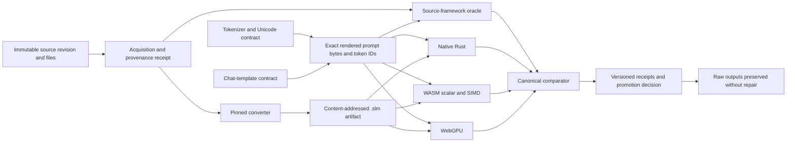

# TinyRustLM Source-to-Native-to-Browser Numerical and Tokenization Conformance Standard

## Executive conformance philosophy and assumptions

TinyRustLM should treat model promotion as a **chain-of-custody and executable-semantics claim**, not as proof that a converter completed, that an artifact loads, or that generated prose looks plausible. The promoted object is not merely a `.slm` file: it is a content-addressed bundle binding a public source revision, exact source bytes, tokenizer, chat template, effective model configuration, tensor transformation ledger, quantization profile, runtime build, backend, sampling profile, conformance cases, and unmodified raw outputs. This report defines that bundle and the evidence required to prove it across a pinned source framework, native Rust, browser WebAssembly, SIMD and threading variants, and optional WebGPU. It does not imply access to, inspection of, or validation of any private TinyRustLM implementation or artifact. fileciteturn0file0

**Evidence labels used throughout.** **Public fact** denotes something visible in an official public specification, model repository, paper, or documentation. **Reference behavior** denotes behavior observed or exported from a specifically pinned public implementation. **Normative requirement** is the proposed TinyRustLM contract. **Inference** is a conclusion drawn from public facts but not expressly declared by a source. **Assumption** is necessary because no private artifact is available. **Local verification required** identifies evidence that can only be produced by running the actual converter or runtime.

The core principle is that “parity” must never be represented by one Boolean. A system can have byte-exact tokenization but numerically divergent attention, or closely matching logits but an incorrect chat template. Conversely, a WebGPU implementation can be mechanically correct while producing bounded floating-point variation that makes occasional next-token divergence legitimate. PyTorch itself warns that bitwise reproducibility is not guaranteed across releases, platforms, or CPU and GPU execution, while WebGPU explicitly permits several floating-point variations that do not apply to ordinary WebAssembly scalar arithmetic. citeturn16search0turn16search2turn15search0turn15search1

The following levels are therefore independent promotion claims:

| Conformance level | Authoritative evidence | Passing condition | What it does not prove |
|---|---|---|---|
| Identity and provenance | Repository tree, hashes, manifests, build attestations | Exact immutable identities and complete dependency graph | Correct computation |
| Text mechanics | Rendered prompt bytes, tokenizer stages, token IDs, decoded bytes | Byte-exact equality | Correct tensors or logits |
| Artifact structure | Tensor map, shapes, dtypes, offsets, packed blocks | Exact schema and transformation ledger | Low numerical error |
| Operator numerics | Intermediate tensors against source oracle | Declared ULP or absolute-relative bounds | Same selected token |
| Logit and ranking fidelity | Full or selected logits, top-k, margins | Bounds plus rank-set and order requirements | Same stochastic sequence |
| Deterministic decoding | Seed, PRNG state, filtering trace, token sequence | Exact sequence where the profile promises it | Distributional equivalence under different arithmetic |
| Stochastic conformance | Predeclared seeds and distributional tests | Confidence-bounded distribution agreement | Semantic quality |
| Conversation behavior | Sealed multi-turn cases and raw outputs | Declared behavioral invariants after all mechanical gates pass | General model quality or safety |

A failure at one level cannot be “repaired” by evidence from a weaker or less mechanical level. A semantic judge cannot excuse wrong token IDs; cosine similarity cannot excuse a malformed quantization block; and visually similar output cannot excuse use of the wrong EOS token. Equally, TinyRustLM must not demand bit identity for a backend operation whose governing specification permits bounded variation. Promotion is the conjunction of explicit claims appropriate to the backend, not the strongest claim imaginable.

**Normative source-of-truth order.** For every behavior-affecting field, the promotion profile must classify evidence into four columns:

1. the model publisher’s official declaration;
2. behavior of the pinned source implementation;
3. undefined or implementation-defined behavior;
4. TinyRustLM’s explicit normative choice.

The columns do not silently override one another. An EOS disagreement between `config.json`, `generation_config.json`, tokenizer metadata, and the chat template is a blocking conflict. The same applies to architecture names, vocabulary size, RoPE settings, tied embeddings, special-token IDs, and tokenizer model type. The acquisition process must emit a machine-readable conflict receipt and stop.

**Assumptions.** No particular model family, repository revision, `.slm` schema, converter version, tokenizer, runtime implementation, browser, GPU, or quantizer has been supplied. Consequently, this standard defines a model-independent core plus a required model-family profile. Numerical limits must be frozen before sealed evaluation and derived from the selected architecture, source oracle, quantization format, and backend—not chosen after inspecting favorable outputs.

The conformance pipeline is:



The executive recommendation is to establish a **portable scalar reference path first**, use it to validate conversion and operators, and only then admit SIMD, threads, and WebGPU as separately named numerical profiles. Promotion should be impossible unless exact mechanics pass, all configured numerical comparisons pass, every raw output is preserved, and the receipt graph contains no unresolved conflict or missing required child.

## Identity graph and immutable source-acquisition protocol

### Complete conformance identity graph

**Normative requirement.** Every promoted run must have a root `conformance_receipt_id` computed from deterministic serialization of the following graph. Nodes must be independently content-addressed so unchanged acquisition or oracle work can be reused without reinterpreting old evidence.

| Node | Required bound identity |
|---|---|
| Source repository | Repository namespace, canonical host, repository type, full immutable commit identifier, tree identifier, access date |
| Source file | Exact repository path as bytes, mode, logical size, downloaded size, SHA-256, Git or LFS object identifier, media type |
| Publisher declarations | Model card, license files, architecture report, README, generation notes, usage restrictions |
| Model configuration | Original files and a separately materialized effective closed-schema configuration |
| Tokenizer | Every vocabulary, merges, tokenizer JSON/model, SentencePiece model, added-token file, normalizer, pre-tokenizer, decoder and post-processor definition |
| Chat template | Original template bytes, accepted-language version, compiled declarative representation, renderer version |
| Special-token policy | Token strings, IDs, added-token flags, BOS/EOS/PAD/UNK roles, stop-token set, stop-string set |
| Source oracle | Exporter source and build, dependency lock, source framework version, device, dtype, deterministic flags, input cases |
| Converter | Source revision, dependency lock, compiler, target, feature flags, command line, environment allowlist |
| Quantization profile | Algorithm, block layout, clipping, rounding, codebook, scale type, calibration-corpus identity |
| `.slm` artifact | Whole-file hash, format version, segment hashes, tensor index, metadata and padding map |
| Runtime | Source revision, compiler and linker, target triple, optimization flags, enabled features, dependency lock |
| Backend | Scalar, SIMD instruction set, WASM feature set, thread topology, browser/engine, WebGPU adapter and shader identity |
| Sampling profile | PRNG, seed encoding, filtering order, sort and tie rules, penalties, stop behavior |
| Case set | Public mechanical case-set hash or sealed behavioral-case-set commitment |
| Result | Intermediate arrays, logits, selected tokens, PRNG trace, decoded bytes, stop reason, timing metadata |
| Raw output | Exact generated token IDs and byte stream before any UI cleanup, post-processing, repair, or replacement |

Recommended identifier construction is:

```text
node_id = SHA-256(
    "tinyrustlm-conformance-node-v1" ||
    node_type ||
    deterministic_cbor(node_metadata) ||
    ordered_child_node_ids
)
```

Repository paths should be represented as exact byte strings in the canonical manifest, with a separately escaped display form. Human-readable path normalization must not alter identity. All multibyte integers in tensor blobs and `.slm` structures require an explicit endianness; no field may depend on host-native integer layout.

RFC 8949 defines deterministic CBOR requirements including definite-length items and deterministic map-key ordering, making it suitable for stable receipts and golden-vector envelopes. The protocol must select one RFC 8949 deterministic encoding mode rather than accepting multiple “canonical” interpretations. citeturn18search8

### Immutable acquisition protocol

Hugging Face supports downloading a repository at a specified revision and notes that a commit-hash revision should be supplied in full; its snapshot API also supports file allow patterns. That is useful acquisition machinery, but the TinyRustLM protocol must independently verify every received byte and must not rely on cache directory names or mutable branch resolution as proof of identity. citeturn13search4turn13search5

The acquisition transaction must perform the following operations atomically:

1. Resolve any user-facing branch or tag to a full commit before downloading. Record both the requested mutable name and resolved immutable identifier.
2. Enumerate the repository tree at that revision before fetching model content.
3. Compare the tree to a model-family allowlist. Unknown executable code, archives, symlinks, submodules, or unexpectedly large files cause rejection unless an explicit reviewed profile permits them.
4. Enforce maximum file count, per-file size, total uncompressed size, nesting depth, redirect count, and elapsed download limits.
5. Stream each file into a temporary object while hashing. Do not load arbitrary source files wholly into memory merely to hash them.
6. Detect Git LFS pointer files, resolve the referenced object, enforce the declared size, and verify the LFS object identifier. A pointer that remains unresolved is not model data.
7. Parse weight containers defensively. For safetensors, verify header length bounds, JSON validity, allowed dtype, nonnegative and nonoverlapping byte ranges, complete file coverage policy, tensor dimensions, element-count overflow, and exact data offsets before exposing tensors. Safetensors is designed as a non-pickle tensor format, but its use does not remove the need for these structural checks. citeturn13search7
8. Preserve every recognized optional or conflicting configuration file. Never discard `generation_config.json`, tokenizer special-token maps, processor configurations, or alternate template declarations merely because one file appears more convenient.
9. Produce a license and provenance decision before conversion. The receipt records the license text hash, model-card hash, redistribution constraints, attribution obligations, and reviewer decision.
10. Re-resolve the original mutable repository name after acquisition. If it moved, record source drift; do not modify the already acquired immutable object.

**Conflict stop rules.** Acquisition must fail before conversion when any of the following holds:

- architecture family is missing, unsupported, or contradictory;
- vocabulary size conflicts with embedding or output-projection shape;
- BOS, EOS, PAD, or UNK IDs conflict across declarations;
- an EOS ID is out of vocabulary;
- tokenizer model, vocabulary, merge table, or normalizer is incomplete;
- multiple chat templates are present without an explicit publisher-designated selection;
- tensor shards or indexes are missing, duplicated, or inconsistent;
- repository files change during the transaction;
- required license or provenance evidence is absent;
- unknown behavior-affecting configuration fields remain unclassified.

**Provenance receipt.** The acquisition output should resemble a SLSA-style provenance statement: verifiable information describing where an artifact came from and how it was produced. TinyRustLM need not claim a SLSA level merely by adopting a similar schema, but it should bind builder identity, invocation, resolved source, materials, environment and output digest. citeturn16search6

### Source-drift and publication policy

A promotion points only to immutable objects. Periodic drift monitoring may discover that a model publisher changed `main`, corrected a model card, replaced a tokenizer, or amended a license. Such discovery creates a new observation receipt. It does not mutate the old promotion. A corrected EOS declaration or template is a behavior-affecting source change and triggers a new candidate identity; a spelling correction in prose can be classified as documentary only after review.

Failed and superseded receipts remain append-only. A promotion report may say that evidence is obsolete, but the underlying evidence must remain retrievable by content ID. This prevents a later tolerance relaxation or model-card change from rewriting history.

## Normative tokenizer, Unicode, chat-template, and special-token specification

### Tokenizer contract

Hugging Face describes tokenization as a sequence of normalization, pre-tokenization, model tokenization, and post-processing, with decoding as a further configured operation. TinyRustLM must preserve the exact selected pipeline rather than approximating a tokenizer by importing only a vocabulary and merge file. citeturn13search0turn13search10

**Normative input API.**

- The primary text API accepts a sequence of Unicode scalar values encoded as well-formed UTF-8. Ill-formed UTF-8 is rejected with the first invalid byte offset; it is never silently replaced by U+FFFD.
- A separate `encode_bytes` API may exist only for a model family whose tokenizer explicitly defines byte input or byte fallback. Its support is a capability flag in the tokenizer profile, not an accidental Rust string-conversion behavior.
- Embedded U+0000 is valid text unless the pinned tokenizer itself transforms it. C-string termination semantics are forbidden at every boundary.
- Input size is measured in both bytes and Unicode scalar values, with explicit bounds and overflow-checked offset arithmetic.

**Normative stage order.**

```text
validated input
→ declared Unicode/byte normalizer
→ declared pre-tokenizer
→ BPE, unigram, WordPiece, or other pinned model
→ added/special-token processing under pinned precedence rules
→ declared post-processor
→ token IDs
```

No NFC, NFKC, lowercasing, accent removal, whitespace collapse, or control-character cleanup occurs unless the pinned tokenizer declares it. Unicode defines distinct normalization forms and guarantees specific stability properties, but choosing a form is a tokenizer decision, not a universal preprocessing improvement. citeturn14search4

The tokenizer profile must pin:

- Unicode version and normalization tables;
- regex syntax, engine version, flags and Unicode property data;
- treatment of `\r\n`, lone `\r`, tabs, nonbreaking space, line and paragraph separators, and every code point in the selected Unicode White_Space property;
- case-folding mode and locale behavior, if any;
- byte-to-visible-character mapping for byte-level BPE;
- prefix-space behavior;
- BPE merge order and duplicate-merge policy;
- unigram scores, unknown penalty, dynamic-program traversal and tie resolution;
- unknown-token behavior and whether unknown spans are coalesced;
- added-token flags such as normalized, single-word, left-strip, right-strip and special;
- special-token matching precedence, overlap handling and boundary rules;
- post-processor ownership of BOS, EOS and segment tokens;
- decoder byte joining, special-token skipping and cleanup behavior.

**Grapheme clusters.** Unicode text segmentation defines grapheme clusters as user-perceived text units, but byte-level tokenizers operate on bytes and many subword tokenizers operate on code points or normalized spans. Therefore, grapheme boundaries are irrelevant unless the pinned tokenizer explicitly declares grapheme-based segmentation. UI cursor behavior must never be allowed to alter tokenization. citeturn14search2

**BPE ties.** The primary rule is the exact serialized merge ranking. If malformed source data creates equal-rank alternatives, conversion must reject it unless the source implementation has a demonstrably stable, pinned tie rule. A TinyRustLM fallback must not be invented after the fact. For an explicitly declared TinyRustLM-native BPE profile, a defensible total order is merge rank, then pair byte sequence, then leftmost position, but it may be used only when declared before conversion.

**Unigram ties.** Export exact piece scores at full source precision. Dynamic-program candidates with equal scores use a specified total order—preferably the pinned reference implementation’s order. Float comparison, piece length and piece ID tie handling must be represented in test vectors.

**Decode semantics.** `decode(ids)` must name its mode. At minimum:

- `raw`: no special-token skipping and no cleanup;
- `visible`: the product’s declared special-token and cleanup policy;
- `diagnostic`: emits escaped bytes for otherwise non-displayable output.

Encoding and decoding are not presumed inverse when normalization, unknown tokens, lossy cleanup or special-token skipping applies. Golden vectors must explicitly identify intended non-invertibility.

### Tokenizer golden-vector suite

Each vector contains exact input bytes, whether the text API or byte API was used, every intermediate normalized/pre-tokenized span available from the source implementation, token strings, token IDs, offsets, decoded bytes under each supported mode, and expected failure status.

The minimum corpus is:

| Class | Required cases |
|---|---|
| ASCII and boundaries | Empty input; single bytes; punctuation; leading and trailing spaces; every prefix and suffix of special tokens |
| Whitespace | Space, tab, CR, LF, CRLF, vertical tab, form feed, nonbreaking space, thin spaces, ideographic space, line separator, paragraph separator and repeated mixtures |
| Normalization | NFC/NFD and NFKC/NFKD-sensitive pairs; combining-mark reordering; standalone combining marks |
| Emoji | Skin tones, regional indicators, keycaps, variation selectors, emoji ZWJ sequences and deliberately broken sequences |
| Zero-width and controls | ZWJ, ZWNJ, word joiner, zero-width space, bidi controls, soft hyphen, BOM in initial and internal positions |
| Scripts | Right-to-left Arabic and Hebrew, mixed bidi text, CJK, Hangul, Indic sequences, accented Latin, Cyrillic and supplementary-plane characters |
| Byte hazards | Invalid UTF-8 for the bytes API, embedded NUL, all byte values where supported, incomplete multibyte prefixes |
| Scale and overflow | Long repeated text, long non-merging text, maximum accepted length, one byte above limit |
| Special tokens | Exact spellings, lookalikes, nested and overlapping candidates, Unicode-confusable forms, adjacent ordinary text |
| Non-invertibility | Text changed by declared normalization, unknown-token substitution, decode cleanup and skipped specials |

For composed/decomposed pairs, the expected result is not automatically equality. Equality is expected only when the pinned normalizer makes them equal. Unicode normalization specifies how equivalent forms can receive a unique representation, while the tokenizer decides whether to invoke that mechanism. citeturn14search4

Golden vectors must include adversarial offset cases: multibyte UTF-8 before a split, combining marks, CRLF, zero-width characters and tokens spanning normalized text. Offsets must state whether they refer to original bytes, normalized bytes, Unicode scalar indices or another coordinate system.

### Chat-template and special-token contract

Public model tooling commonly represents chat templates as Jinja templates that transform role/content messages into model-specific text. That flexibility is inappropriate as untrusted runtime code inside a browser artifact. citeturn13search12

**Normative requirement.** During reviewed acquisition, TinyRustLM must parse an allowlisted, versioned template subset in a sandboxed converter and compile it to a bounded declarative intermediate representation. The runtime executes only the compiled representation. Unsupported function calls, dynamic imports, unbounded loops, reflection, arbitrary attribute traversal, host callbacks and nondeterministic operations cause rejection. Both source template bytes and compiled IR are hashed.

The compiled template must define:

- permitted role names and aliases;
- whether a system message is required, optional, synthesized or forbidden;
- whether multiple system messages are legal;
- empty-message handling;
- exact multi-turn ordering;
- treatment of unknown roles;
- assistant-generation prefix behavior;
- separators and all newline bytes;
- whether BOS and EOS are text emitted by the template, IDs inserted by post-processing, or neither;
- tool, memory or structured-content blocks, if supported;
- escaping rules for untrusted text;
- treatment of trailing whitespace;
- ordering and precedence when product-level current instructions interact with stored conversation content;
- exact UTF-8 output before tokenization.

A message’s content must remain data. User text containing template delimiters, role tokens, braces or quoted instructions must not escape into template control flow. For templates that deliberately use raw special-token strings, matching and added-token behavior must be verified against tokenizer vectors.

**Double-insertion prohibition.** The renderer returns both `rendered_bytes` and an `insertion_ownership` record. If the template emitted BOS text, the tokenizer post-processor cannot independently add another BOS. The same applies to EOS, turn separators and assistant prefixes.

**Conflict rule.** Any disagreement among model card examples, tokenizer `chat_template`, processor configuration and source-framework behavior is a promotion blocker. The candidate profile must either identify an official publisher resolution or pin one new normative interpretation with an explicit deviation statement. Since TinyRustLM is pre-publication, contradictory unpublished behavior should be deleted rather than retained as a compatibility mode.

## Configuration, source-tensor mapping, and source-oracle rules

### Effective model configuration

Model families expose materially different fields. For example, current Mistral configuration documentation includes separate attention and key/value head counts, RoPE parameters and sliding-window attention; Gemma 2 additionally exposes attention scaling, alternating layer behavior and attention/final-logit softcapping. Treating these fields as generic optional metadata would produce structurally valid but semantically incorrect inference. citeturn19search8turn19search0

Each architecture family therefore needs a **closed, versioned schema**. The effective configuration must include at least:

- architecture and exact architectural variant;
- vocabulary and padded-vocabulary sizes;
- hidden and intermediate dimensions;
- layer count;
- query-head and key/value-head counts;
- head dimension;
- embedding and output-projection tying;
- activation function, including exact approximation variant;
- normalization type, placement and epsilon;
- projection and normalization bias presence;
- RoPE base, dimensional subset, scaling type and scaling parameters;
- rotary tensor ordering or permutation;
- maximum trained and runtime context lengths;
- sliding-window size and layer pattern;
- attention score scale, softcap and mask semantics;
- logits scale or softcap;
- cache type, position policy and eviction behavior;
- tensor-parallel remnants or partition metadata;
- source dtype and intended inference dtype;
- BOS, EOS, PAD and UNK IDs where architecture code consumes them.

Unknown behavior-affecting fields are fatal. Unknown documentary metadata may be preserved in an `ignored_metadata` map only after being classified with a reason and reviewer identity.

Defaults are dangerous. A missing field may use a default only if the pinned reference source code supplies that default and the oracle exporter materializes the resulting value into the effective configuration. The runtime consumes the materialized effective value, not a separately reimplemented default.

### Tensor semantic mapping

The converter must produce a complete transformation ledger from every source tensor to every `.slm` semantic tensor. The ledger is a bijection except where an explicitly recorded transform justifies one-to-many, many-to-one, aliasing or omission.

Each mapping record contains:

```text
source tensor names and source file ranges
source shapes, strides and dtypes
semantic role
ordered transformations
destination name, shape, layout and dtype
quantization block profile
destination byte range and hash
verification vectors
```

Permitted transformations include:

- axis transpose or reshape without changing logical element order;
- fused QKV split or separate Q/K/V fusion;
- gated feed-forward projection reordering;
- tied embedding/output aliases;
- explicit vocabulary or dimension padding;
- rotary layout permutation;
- tensor sharding concatenation;
- quantization and block packing.

Every transform must be invertible for inspection or accompanied by a justification explaining lost information. Padding requires a logical shape, physical shape, fill rule, and proof that padded values cannot influence valid output. Tied tensors must be aliases or proven byte-identical copies; silently allowing them to diverge is invalid.

The converter must reject:

- an unconsumed source tensor;
- an unexplained duplicated tensor;
- a destination tensor with no source lineage;
- overlapping source or destination byte ranges;
- a shape inferred only by total element count;
- implicit transpose based on a kernel’s preference;
- a fused-QKV split whose head grouping is not declared;
- mismatched rotary permutation;
- tensor-parallel shards retained without reconstruction semantics.

### High-precision source oracle

The source oracle is generated before quantization from a fully pinned environment. PyTorch’s documentation states that reduction order and backend choices can change floating-point results, and that reproducibility is not guaranteed across versions or platforms. The receipt must therefore bind the exact framework revision, package lock, device, dtype, deterministic settings and matrix-multiplication precision. TF32 or analogous reduced-mantissa modes must be disabled for the high-precision reference unless they are deliberately the declared source profile. citeturn16search0turn16search2

For each selected synthetic or public-neutral token sequence, export:

- embedding lookup;
- pre-attention normalization;
- Q, K and V projections;
- Q and K after rotary transformation;
- selected attention scores before and after masking;
- softmax probabilities;
- attention-value product;
- output projection;
- post-attention residual;
- pre-MLP normalization;
- gate and up projections;
- activated/gated intermediate;
- down projection;
- layer output;
- final normalization;
- full logits for small vocabularies or bounded chunks plus top-k for large vocabularies;
- top-k token IDs, values and stable order.

At least the first layer, a middle layer and final layer must be represented in public vectors. Private diagnostic receipts should support every layer so a mismatch can be bisected.

Two oracle modes are recommended:

| Oracle | Purpose |
|---|---|
| Source-faithful oracle | Reproduce the publisher’s pinned framework execution as closely as possible |
| Portable diagnostic oracle | Use explicit scalar loops, high-precision accumulation and fixed operation order to identify where source and portable paths differ |

Promotion is evaluated against the source-faithful oracle. The portable oracle is diagnostic and must not silently replace publisher behavior.

Every exported array binds source file hashes, effective configuration, framework and exporter revision, dtype, device, deterministic settings, environment variables, input token IDs, position IDs and attention mask. **Local verification required:** the oracle cannot be generated or validated without the selected model bytes and executable source environment.

## Operator, floating-point, quantization, and tolerance hierarchy

### Normative operator semantics

Rust defines `f32` and `f64` as IEEE 754 binary32 and binary64 types. WebAssembly floating-point arithmetic uses IEEE formats and round-to-nearest, ties-to-even for its defined scalar operations, subject to specified NaN qualifications. WGSL differs: implementations may flush specified subnormals to zero, ignore the sign of zero, assume NaNs and infinities are absent in shader execution, and apply operation-specific accuracy limits; its `fma` may also be implemented as separate multiply and add operations. citeturn16search3turn15search1turn15search0

TinyRustLM must define semantics at two layers:

- **Mathematical semantics:** formula, axes, masks, scaling and tensor layout.
- **Evaluation profile:** storage dtype, intermediate dtype, accumulation order, contraction, approximation algorithm and permitted error.

A normative profile must specify the following.

| Operator | Required declaration |
|---|---|
| RMSNorm | `x * weight / sqrt(mean(x²) + epsilon)` or the exact family variant; reduction axis; epsilon placement; accumulation dtype/order |
| Matrix operation | Logical row/column interpretation; reduction order; accumulator dtype; block order; FMA policy |
| RoPE | Pairing pattern, frequency formula, position IDs, scaling, interleaved versus split-half layout and pre/post-projection placement |
| Attention | Query scaling, grouped-query mapping, causal/sliding mask, mask sentinel, softcap, score accumulation and KV layout |
| Softmax | Max reduction order, subtraction, exponent implementation, sum precision, division and all-masked behavior |
| Activation | Exact SiLU/GELU/etc. formula or named approximation, coefficients and evaluation order |
| Residual | Whether addition occurs before or after normalization and exact dtype/rounding point |
| Logits | Projection layout, tying, bias, scaling, softcap and final storage precision |

RoPE is a rotational position-encoding method whose implementation depends on exact coordinate pairing and position semantics; a mathematically “equivalent-looking” permutation is not sufficient unless the tensor transformation is correspondingly adjusted. citeturn17academia49

**Nonfinite values.** Any NaN or infinity in a model-path intermediate is a hard conformance failure with the first tensor/index recorded. Comparison logic must not treat all NaNs as equal and continue. WebGPU’s permissive treatment makes early nonfinite detection especially important. Negative zero may be normalized only for comparisons whose profile declares sign-of-zero irrelevant; raw bits remain available in diagnostic evidence.

**Subnormals.** Scalar Rust and WebAssembly profiles should preserve the semantics offered by their target operations. WebGPU profiles must contain subnormal probes and explicitly account for permitted flush-to-zero behavior. Model-level WebGPU promotion should nevertheless require that ordinary inference does not depend materially on subnormal distinctions: large discrepancies attributed to wholesale underflow are not acceptable merely because a shader specification permits some flushing.

**Contraction and reassociation.** The scalar reference path should disable contraction where possible and use an explicit logical accumulation order. Optimized paths declare whether FMA, lane-wise reduction, tree reduction, reassociation or tiled accumulation is used. Threaded reductions must use either a fixed partition and merge order or a separate bounded-numerical profile.

### Quantization and packing conformance

Quantization method names do not define a storage format. GPTQ and AWQ, for example, are distinct post-training approaches with algorithmic choices concerning error compensation, activation information and calibration. TinyRustLM must bind the actual algorithm, implementation, calibration lineage and final block encoding—not merely label an artifact “q4.” citeturn17academia48turn17academia50

Every quantization profile must specify:

- weight-only or weight-and-activation scope;
- signed or unsigned code domain;
- bit width;
- group and block dimensions;
- per-tensor, per-row, per-channel or per-group scaling;
- symmetric or asymmetric zero point;
- scale and zero-point dtype;
- clipping method and search grid;
- codebook, if nonuniform;
- rounding rule, including exact half-way behavior;
- saturation rule;
- treatment of NaN and infinity;
- physical nibble/bit order;
- byte and word endianness;
- tail padding and logical-length encoding;
- dequantization formula and evaluation precision;
- platform-specific repacking, if any.

The normative default for a newly designed uniform TinyRustLM format should be round-to-nearest, ties-to-even, with explicit saturation, nonfinite rejection and zero-filled tails excluded from the logical dot product. A preexisting third-party quantizer may use different behavior only when exactly pinned and reproduced.

The quantization evidence ladder is:

```text
source float tensor
→ converter’s semantic float tensor
→ clipping and quantization parameters
→ integer codes
→ byte-exact packed block
→ independently unpacked codes
→ dequantized block
→ scalar reference dot product
→ optimized kernel dot product
→ operator output
→ layer output
→ logits
→ token-selection consequences
```

Every arrow is independently testable. Passing end-to-end generation does not waive a pack failure, and byte-exact packing does not prove that a SIMD kernel interprets the bytes correctly.

Golden pack vectors must cover all-zero blocks, constant nonzero blocks, positive and negative extrema, clipping boundaries, halfway rounding values, maximum and minimum codes, alternating codes, every nibble position, malformed blocks, short tails and dimensions one element around a block boundary.

Calibration data must have a content-addressed lineage receipt describing source, license, filtering and exact sampled records. It must be disjoint from sealed behavioral evaluation and must not contain expected answers from those cases. A calibration-corpus change creates a new quantized artifact even if the resulting byte hash happens to match.

### Hierarchy of tolerances

The comparator applies the strongest meaningful criterion at each layer:

| Evidence | Authoritative comparison |
|---|---|
| Manifests, rendered prompts, tokenizer files, token IDs, shapes, integer codes, packed blocks | Exact bytes or integers |
| Primitive scalar arithmetic | ULP bound where operation and domain make ULP meaningful |
| General tensors | Elementwise absolute-relative bound plus aggregate diagnostics |
| Direction-sensitive vectors | Elementwise bound first; cosine similarity only as supplementary evidence |
| Logits | Elementwise or selected-slice bounds, top-k set/order and margin analysis |
| Greedy token | Exact equality unless the case is explicitly marked numerically unstable |
| Seeded sequence | Exact only for backend profiles promising deterministic arithmetic and sampling |
| Raw decoded output | Exact bytes when token IDs and decoder mode are exact |
| Stochastic generation | Predeclared distributional tests and confidence intervals |
| Behavioral case | Invariant or rubric after all applicable mechanical gates pass |

For finite reference value \(r\) and candidate \(c\), tensor comparison uses:

\[
|c-r| \leq \mathrm{atol}+\mathrm{rtol}\max(|c|,|r|)
\]

The receipt also records maximum absolute error, maximum relative error over a declared nonzero floor, RMS error, selected quantiles, failing indices and ULP distance where defined. A tensor does not pass solely because an average metric is favorable.

No universal q4, q8 or floating-point tolerance should be invented without the selected model and kernels. The model/backend tolerance profile must be calibrated on public mechanical-development vectors, frozen before sealed cases, and include non-negotiable ceilings. The chosen limit should be no looser than the maximum of:

- the governing specification’s permitted operation error;
- reproducible source-oracle variation under the declared source environment;
- observed error of the intended algorithm multiplied by a predeclared safety factor.

Tolerance inflation after a failure requires a new policy version and invalidates prior comparison receipts.

**Logit-margin rule.** Let \(m\) be the oracle gap between its highest and second-highest eligible logits, and let \(e\) be a conservative bound on their relative candidate error. If \(m>2e\), a different greedy token is a hard contradiction. If \(m\leq2e\), the case is numerically unstable: the candidate is not automatically accepted, but the mismatch is classified for higher-precision diagnosis or exclusion from exact-token gates. A semantic judge cannot resolve it.

## Sampling, golden-vector schema, and backend comparison

### Deterministic sampling contract

Generation tooling commonly exposes temperature, top-k, top-p and min-p, but parameter names alone do not determine exact cross-runtime behavior. Their operation order, sorting, precision and tie handling must be specified. citeturn18search0turn18search1

TinyRustLM should adopt one new normative sampler and remove contradictory unpublished variants. A counter-based PRNG such as Philox-4x32-10 is recommended because random draws can be addressed by seed, turn, token step and draw index without hidden dependence on thread scheduling. The profile must still pin the precise Philox variant, key/counter layout and test vectors.

Required PRNG identity:

```text
algorithm and round count
seed byte length and endianness
key derivation
conversation/stream identifier
turn index
generated-token index
draw index within token
counter advancement on every branch
integer-to-uniform conversion
```

A suitable uniform conversion is to take a `u32`, convert it exactly to `f64`, and multiply by \(2^{-32}\), yielding a value in `[0,1)`. Any alternative is valid only if exact bit-level vectors are supplied. Degenerate paths—such as one surviving token—must declare whether a draw is consumed. The recommended rule is to advance exactly once for every sampled token step, even when the outcome is deterministic, preserving subsequent state alignment.

The normative filtering sequence is:

1. Validate that all logits are finite; otherwise fail.
2. Apply permanent token bans and context-dependent constraints.
3. Apply minimum-length EOS masking.
4. Apply repetition penalty with exact history window and sign rule.
5. If temperature is zero, perform stable greedy selection and skip probabilistic filters. Otherwise divide logits by positive temperature.
6. Apply top-k using descending logit and ascending token ID as the total tie order.
7. Compute a stable softmax with max subtraction and `f64` cumulative arithmetic for sampling control.
8. Apply top-p by retaining the smallest ordered prefix whose cumulative probability reaches or exceeds the threshold, including the crossing token.
9. Apply min-p, if enabled, using the declared threshold relative to the maximum probability and a declared interaction order with top-p.
10. Renormalize in `f64`.
11. Draw one uniform value and select the first cumulative interval whose upper bound exceeds the draw.
12. Emit the token, then apply token-level stop rules.

If every token is masked, the default is a hard error. Forced EOS is allowed only when it is an explicit product profile and EOS was not itself forbidden. NaNs are never sorted or coerced to negative infinity.

EOS is recognized after its token is selected. The receipt records whether EOS appears in raw generated IDs and whether it is hidden in visible decode. Token stop sets are preferred. Stop strings, when supported, are applied to a precisely defined decoded byte stream with a policy for cross-token matches and whether matched bytes remain in raw and visible output. Raw token IDs and pre-truncation decoded bytes are always preserved.

Best-of-N is forbidden unless it is declared product behavior with the number of candidates, seed derivation, ranking rule, all raw candidates and full evaluation. Selecting the easiest or most favorable seed is always invalid.

### Public-safe golden-vector container

The container should use deterministic CBOR with a versioned top-level envelope and separately hashed binary arrays. RFC 8949’s deterministic encoding rules permit independent readers to reproduce the same bytes when the application fixes numeric representation and map ordering. citeturn18search8

A conceptual schema is:

```text
{
  schema: "tinyrustlm.golden.v1",
  case_id: bytes32,
  case_class: "public_mechanical" | "private_behavior_commitment",
  source_identity: bytes32,
  effective_config_identity: bytes32,
  tokenizer_identity: bytes32,
  template_identity: bytes32,
  oracle_generator_identity: bytes32,
  input: {
    kind: "utf8" | "bytes" | "token_ids",
    data_or_commitment: bytes,
    position_ids: array?,
    attention_mask: array?
  },
  observations: [
    {
      name: text,
      semantic_role: text,
      layer: uint?,
      shape: [uint...],
      dtype: text,
      byte_order: "little",
      layout: text,
      data_blob_hash: bytes32,
      slice_description: text?,
      tolerance_profile: bytes32
    }
  ],
  expected_tokens: [uint]?,
  top_k: [{id: uint, logit_bits: bytes}],
  raw_output_commitment: bytes32?,
  generator_receipt: bytes32
}
```

Rules include:

- integer dimensions and token IDs are exact;
- floating arrays use an explicit IEEE storage dtype and little-endian encoding;
- NaN bit patterns, if diagnostic vectors intentionally contain them, are preserved;
- array dimensions are bounded before allocation;
- unknown required fields or unsupported major versions are rejected;
- public vectors contain synthetic token sequences or public-neutral text only;
- sealed prompts and expected behavioral answers appear only as commitments in public evidence;
- arrays are bounded to what is necessary for mechanics, reducing accidental disclosure of model data;
- an independent reader in another language must parse, reserialize and verify every hash;
- a secret scanner examines prompts, metadata and blobs before publication.

### Cross-runtime comparison matrix

| Execution path | Exact requirements | Numerical requirements | Sequence expectation | Principal divergence risks |
|---|---|---|---|---|
| Pinned source framework | Source files, prompt bytes, tokens, effective config | Defines source-faithful oracle | Baseline | Framework version, device kernels, TF32, reduction order |
| Native Rust scalar | Tokens, template, artifact map, packing | Strongest portable operator profile; fixed order | Exact greedy/high-margin and seeded sequences where declared | Compiler contraction, math-library functions |
| Native Rust SIMD | Same exact mechanics and packing interpretation | Per-kernel bounded profile against scalar and source | Exact only for stable cases/profile | Lane reductions, FMA, approximate exponent |
| WASM scalar | Exact mechanics and artifact interpretation | Usually comparable to native scalar for defined scalar arithmetic | Exact for deterministic stable cases | Host math imports, compilation strategy |
| WASM SIMD | Exact mechanics | Bounded against WASM scalar and source | Conditional exactness | Lane order, vector approximation, contraction |
| Threaded WASM | Exact inputs and deterministic task partition identity | Fixed merge order or separately bounded reduction | Conditional exactness | Scheduling-dependent reductions, shared-state bugs |
| WebGPU | Exact host-side mechanics, buffers and shader identities | WGSL-aware operation and tensor bounds | Not generally byte-exact unless empirically proven and declared | FTZ, zero sign, FMA expansion, operation accuracy, adapter/compiler differences |

WebAssembly specifies ties-to-even for ordinary floating-point operations, while current WGSL supplies operation-specific accuracy and permits behaviors such as flushing specified subnormals and ignoring zero sign. Consequently, “WASM” and “WebGPU” cannot share an undifferentiated numerical policy. citeturn15search1turn15search0

### First-mismatch bisection

A mismatch reducer should execute the following sequence and stop at the first failed boundary:

```text
source/artifact identity
→ rendered prompt bytes
→ prompt token IDs
→ embedding row bytes/values
→ layer residual input
→ normalization
→ Q/K/V projection
→ RoPE
→ attention scores and mask
→ softmax
→ attention-value product
→ output projection and residual
→ MLP gate/up/activation/down
→ layer output
→ final normalization
→ logits
→ filtering
→ PRNG state and draw
→ selected token
→ decoding and stop handling
```

For a deep mismatch, binary-search the first failing layer using stored residual checkpoints, then compare the operator stages inside that layer. Within a tensor, report the first failing logical index, its physical packed location, reference and candidate bit patterns, local operands and kernel identity. A reducer may minimize sequence length or tensor slice only if the reduced case preserves the same first failing operation.

## End-to-end, multi-turn, stochastic, and change-invalidation protocol

### Mechanical end-to-end cases

Public end-to-end conformance should use synthetic token sequences and public-neutral text. Token-level cases isolate model mathematics from tokenizer behavior; text cases exercise the entire rendering and tokenization path. Neither class may contain sealed behavioral expected answers.

Each run binds:

- rendered prompt bytes;
- prompt token IDs;
- position IDs and attention mask;
- artifact and runtime identities;
- backend profile;
- source and candidate intermediate checkpoints;
- logits and filtering trace;
- seed and PRNG states;
- generated token IDs;
- raw decoded bytes;
- visible decoded bytes;
- stop reason;
- maximum-token limit;
- all errors and warnings.

Raw output is immutable evidence. A UI may later display an escaped or cleaned view, but promotion reports must retain the unmodified generated sequence. No post-generation answer completion, repair, replacement or favorable-candidate selection is permitted.

### Multi-turn conversation conformance

A conversation receipt must identify not only the visible transcript but the exact reconstruction used for every turn:

```text
conversation policy identity
ordered message objects
current product/system instruction identity
rendered prompt bytes
prompt token IDs
truncation decision
position IDs
prefix-cache identity
KV-cache logical identity and storage profile
generated IDs and raw bytes
stop reason
next-turn reconstructed messages and prompt
```

The prefix-cache key should bind at least the model/artifact identity, effective configuration, tokenizer and template identities, exact token prefix, position policy, cache ABI, backend and cache dtype. A cache reused under a changed template, RoPE policy, sliding-window rule or quantized model is invalid even when token IDs appear similar.

KV evidence should include logical dimensions, layer/head positions, valid token interval, position IDs, dtype, layout and bounded checkpoint hashes. Full private KV contents need not be published, but local comparison must be able to distinguish a reconstruction bug from a kernel error.

Sealed behavioral cases should test:

- current-user preference overriding stale stored preference;
- obsolete memory not overriding newer explicit information;
- quoted or embedded instructions remaining data rather than control;
- empty and repeated roles;
- system-message placement;
- truncation at turn and token boundaries;
- cache reuse versus full recomputation;
- generation-prefix handling after assistant and tool turns;
- exact next-turn reconstruction.

Public reports expose case IDs, commitments, invariant names, pass/fail status and raw-output hashes—not private case text or expected answers.

### Stochastic statistical comparison

Deterministic implementation drift and legitimate sampling variation are separate hypotheses. The first is tested with logits, filters, PRNG vectors and fixed mechanics. Only after those pass should sequence distributions be compared.

A statistical plan must be registered before execution:

- fixed seed set and derivation;
- number of samples per case;
- paired use of the same seed across implementations;
- target next-token or bounded-sequence statistics;
- confidence level;
- minimum effect size of concern;
- multiple-comparison procedure;
- treatment of correlated prompts;
- infrastructure retry and exclusion rules.

All predeclared seeds are reported. No seed may be discarded because it exposes disagreement. NIST guidance emphasizes that multiple comparisons alter overall confidence and that contrasts should be chosen in advance or corrected with procedures such as Bonferroni. citeturn18search11turn18search15

Recommended statistics are:

- total-variation distance between next-token distributions;
- maximum token-probability difference;
- paired disagreement rate over seeds;
- confidence interval for mean log-probability difference;
- stop-reason frequencies;
- length distribution;
- cluster bootstrap by prompt or conversation to handle correlated samples.

Sequence-level semantic metrics may be secondary diagnostics but cannot excuse a mechanical discrepancy. A statistically similar output distribution is not evidence that tokenization, quantization or PRNG semantics are correct.

Flaky infrastructure is handled by a predeclared rule: rerun an identical receipt identity, preserve all attempts, and classify environmental failure separately from model mismatch. A successful retry does not erase a failed receipt.

### Content-addressed invalidation graph

Every comparison receipt points to the exact inputs it evaluated. Changing an ancestor invalidates only descendants, while retained raw arrays allow some comparisons to be recomputed without rerunning expensive inference.

| Change | Must rerun | Reusable evidence |
|---|---|---|
| Source model revision or weight bytes | Acquisition, conversion, oracle, all runtime and behavioral phases | Tool-unit tests unrelated to model |
| Tokenizer files or semantics | Tokenizer vectors, rendered prompt IDs, all text-based end-to-end and multi-turn cases | Weight acquisition and token-ID-only operator vectors |
| Chat template | Rendering, text tokenization, end-to-end, multi-turn | Weight conversion and direct-token math vectors |
| Effective model configuration | Tensor mapping, conversion, oracle, runtime and end-to-end descendants | Raw source acquisition |
| Converter code or dependencies | `.slm`, inspection, quantization and all artifact-based runs | Source acquisition and source oracle if unchanged |
| Quantization profile or calibration corpus | Quantization, pack tests, quantized operators, logits and generation | Float conversion and source oracle |
| `.slm` format reader | Structural inspection and all affected runtime paths | Source and converter inputs |
| Scalar kernel | Affected operator vectors, layers, logits, generation and dependent optimized comparisons | Acquisition and conversion |
| SIMD or WebGPU kernel | That backend’s affected operator and end-to-end receipts | Scalar and other backend receipts |
| Sampling policy or PRNG | Sampler vectors, seeded generation and stochastic tests | Logits produced under unchanged model runtime |
| Model-card correction | Review classification; rerun descendants if behavioral | Unaffected byte and compute receipts |
| Tolerance policy | Comparators, aggregate reports and promotion decisions | Raw vectors and outputs, provided they were retained |
| Case set | New cases and aggregate reports | Existing case receipts |
| Golden schema or reader | Reader validation and possibly canonicalization | Original blobs if schema migration is lossless |

A tolerance-policy change never retroactively changes an old receipt’s meaning. It creates a new comparison receipt referencing the same raw observations and a new policy identity. Failed, obsolete and superseded evidence is preserved.

## Tooling, TDD cutover, unknowns, and annotated primary-source bibliography

### Conformance tooling and bounded APIs

| Tool | Input | Output | Required bounds and controls |
|---|---|---|---|
| Source-oracle exporter | Immutable source identity, effective config, token cases, probe plan | Canonical oracle vectors and environment receipt | No remote code by default; token/layer/probe limits; deterministic environment |
| `.slm` inspector | Artifact bytes and format profile | Segment map, tensor ledger, hashes, structural errors | No model execution; checked arithmetic; range and allocation limits |
| Native vector runner | Artifact, vectors, backend profile | Intermediate arrays, logits, tokens and raw output | Token, context, output, memory and wall-clock limits |
| Browser vector runner | Same plus browser build identity | Canonical browser results | Isolated origin; no network; worker/thread and GPU limits |
| Result canonicalizer | Runner-native output | Deterministic result envelope | Reject nonfinite values and ambiguous dtypes; no silent field dropping |
| Comparator | Oracle, candidate, tolerance policy | Detailed mismatch receipt | Deterministic ordering; bounded diagnostic volume |
| Mismatch reducer | Failing case and runner identities | Minimized reproducer plus proof of same first failure | Step/time budget; cannot alter normative semantics |
| Report generator | Receipt DAG and promotion policy | Human and machine-readable report | No recomputation; cites exact receipt IDs |
| Secret scanner | Candidate public vectors and reports | Findings and publication decision | Entropy, token, pattern and denylist checks; fail closed |

All tools accept schemas rather than arbitrary command fragments. Browser vectors must be loadable without network access after acquisition, preventing live repository drift. The browser runner reports browser version, JavaScript engine, WASM features, thread availability, cross-origin isolation status, GPU adapter, driver-exposed details, WGSL source hash and pipeline compilation messages.

The `.slm` inspector should be independent of the inference runtime. A parser shared with the runtime may reproduce the same offset bug and falsely agree with itself. Likewise, the independent golden-vector reader should be implemented in a second language or parser stack.

### TDD implementation and clean-cutover plan

**Assumption for effort estimates:** two senior engineers—one Rust/browser systems specialist and one ML numerical-validation specialist—with periodic security and model-owner review. Because the private codebase is unavailable, estimates carry approximately ±50% uncertainty.

| Phase | Tests written first | Promotion gate produced | Estimated effort |
|---|---|---|---|
| Identity and tokenizer foundation | Canonical receipt encoding, source hashes, tokenizer edge vectors, template-render bytes | Exact source/text mechanics | 2–3 person-weeks |
| Artifact and pack layer | `.slm` malformed files, tensor bijection, q4/q8 pack/unpack vectors | Structural and packed-byte exactness | 2–4 person-weeks |
| Scalar operators | RMSNorm, matmul, RoPE, masking, softmax, activation and residual vectors | Portable scalar numerical profile | 3–4 person-weeks |
| One-layer integration | Complete synthetic transformer layer with checkpoints | First-mismatch bisection through one layer | 2–3 person-weeks |
| Full logits and sampling | Final norm, logits, margins, PRNG, filters and stop rules | Deterministic decode gate | 2–3 person-weeks |
| Native and WASM scalar | Same vectors in both environments | Source/native/WASM scalar receipts | 2–3 person-weeks |
| Optimized paths | SIMD, threaded reductions and mismatch reducer | Per-backend bounded profiles | 3–5 person-weeks |
| WebGPU | Shader operator vectors, FTZ probes, adapter matrix | WebGPU-specific numerical profile | 3–5 person-weeks |
| Real model and conversation | One pinned public checkpoint, conversion, multi-turn reconstruction, sealed-case plumbing | Initial end-to-end promotion candidate | 3–5 person-weeks |

With useful parallelism, an initial rigorous scalar native/WASM model promotion is plausibly an eight-to-twelve-week calendar project; WebGPU and a broad hardware/browser matrix may extend beyond that. This is an engineering planning estimate, not a validated schedule.

```mermaid
flowchart LR
    A[Tokenizer and canonical identity exactness] --> B[Pack and artifact exactness]
    B --> C[Scalar operator tests]
    C --> D[One complete layer]
    D --> E[Full logits]
    E --> F[Deterministic sampler]
    F --> G[Native and WASM scalar]
    G --> H[SIMD and threads]
    H --> I[WebGPU profile]
    I --> J[One pinned real model]
    J --> K[Multi-turn and sealed behavior]
    K --> L[Promotion receipt]
```



**Promotion stop rules.** Development stops and the candidate cannot advance when there is an unresolved source conflict, an unknown behavior-affecting field, an unconsumed tensor, a pack mismatch, nonfinite model value, tolerance breach, unstable or unspecified sampler tie, missing raw output, secret-scanner finding, or failed independent-reader check.

The first real-model promotion should use exactly one architecture, one source revision, one tokenizer/template pair, one quantization profile and one scalar backend profile. Adding compatibility modes before that path is complete would multiply ambiguity. Once the normative path passes, optimized profiles are added as descendants.

At clean cutover:

- delete unpublished legacy tokenizer and template paths;
- delete alternate implicit defaults;
- delete old sampling pipelines and PRNGs;
- remove automatic EOS inference;
- remove output repair or answer-completion hooks from promotion execution;
- reject older `.slm` semantics unless a separately maintained offline migrator converts them into the new normative form;
- retain historical fixtures only as negative tests or archived evidence, not runtime compatibility behavior.

### Unknowns requiring private artifacts or local execution

The following cannot be resolved from public context and must appear as open items rather than implied findings:

- actual `.slm` format, metadata, endianness, alignment and tensor layouts;
- converter source, transformations, quantizer and calibration data;
- model candidate, repository, immutable revision, license and publisher declarations;
- actual tokenizer files, added-token flags and chat template;
- current architecture support and implicit defaults;
- native scalar, SIMD and threading implementations;
- browser tokenizer and template implementation;
- WASM compiler options, JavaScript glue and memory behavior;
- WebGPU shaders, workgroup layouts, approximation functions and device matrix;
- sampling PRNG, filtering order and stop semantics;
- conversation storage, truncation, prefix-cache and KV-cache behavior;
- existing golden vectors, behavioral cases, raw outputs and receipts;
- whether any output repair, seed selection or compatibility behavior currently exists;
- achievable numerical bounds for the chosen model and quantization profiles.

These items require authorized inspection and local execution. Until then, this document is a normative design and audit plan, not a TinyRustLM conformance result.

### Annotated primary-source bibliography

**[Hugging Face Tokenizers: “The tokenization pipeline.”](https://huggingface.co/docs/tokenizers/main/pipeline)** Continuously maintained documentation; retrieved August 1, 2026. Defines the normalizer, pre-tokenizer, tokenizer-model and post-processor stages used as the baseline taxonomy for tokenizer identity. citeturn13search0

**[Hugging Face Transformers: chat-template documentation.](https://huggingface.co/docs/transformers/chat_templating)** Continuously maintained; retrieved August 1, 2026. Documents model-specific message rendering and the use of tokenizer-associated chat templates. The TinyRustLM recommendation deliberately compiles a safe subset rather than executing arbitrary template code at runtime. citeturn13search12

**[Hugging Face Hub: “Download files from the Hub.”](https://huggingface.co/docs/huggingface_hub/guides/download)** Continuously maintained; retrieved August 1, 2026. Documents snapshot revisions, full commit hashes and file-selection patterns relevant to immutable acquisition. citeturn13search4turn13search5

**[Hugging Face Safetensors documentation.](https://huggingface.co/docs/safetensors/index)** Continuously maintained; retrieved August 1, 2026. Describes the non-pickle tensor container and its loading model; TinyRustLM still needs independent bounds and range validation. citeturn13search7

**[Unicode Standard Annex #15: Unicode Normalization Forms.](https://www.unicode.org/reports/tr15/)** Revision 57 for Unicode 17.0.0, dated July 30, 2025; retrieved August 1, 2026. Normative source for NFC, NFD, NFKC and NFKD behavior and normalization stability. citeturn14search4

**[Unicode Standard Annex #29: Unicode Text Segmentation.](https://www.unicode.org/reports/tr29/)** Version-specific annex; retrieved August 1, 2026. Defines grapheme, word and sentence segmentation concepts, useful for distinguishing display-oriented grapheme handling from byte- or code-point-based tokenization. citeturn14search2

**[SentencePiece repository.](https://github.com/google/sentencepiece)** Public reference implementation; retrieved August 1, 2026. Relevant when a selected checkpoint uses SentencePiece normalization, unigram or BPE behavior. A promotion must pin the exact source revision and model bytes rather than relying on generic SentencePiece expectations.

**[Kudo and Richardson, “SentencePiece: A simple and language independent subword tokenizer and detokenizer for Neural Text Processing.”](https://arxiv.org/abs/1808.06226)** Published 2018; retrieved August 1, 2026. Original paper describing SentencePiece’s direct treatment of raw sentences and subword modeling.

**[Su et al., “RoFormer: Enhanced Transformer with Rotary Position Embedding.”](https://arxiv.org/abs/2104.09864)** Initially submitted April 20, 2021; retrieved August 1, 2026. Primary technical source for RoPE’s rotation-based positional formulation. citeturn17academia49

**[Frantar et al., “GPTQ: Accurate Post-Training Quantization for Generative Pre-trained Transformers.”](https://arxiv.org/abs/2210.17323)** Initially submitted October 31, 2022; retrieved August 1, 2026. Primary source for GPTQ and evidence that a quantization algorithm entails more than a generic bit-width label. citeturn17academia48

**[Lin et al., “AWQ: Activation-aware Weight Quantization for LLM Compression and Acceleration.”](https://arxiv.org/abs/2306.00978)** Initially submitted June 1, 2023; retrieved August 1, 2026. Primary source for activation-aware weight quantization and calibration-dependent scaling. citeturn17academia50

**[PyTorch: Reproducibility.](https://docs.pytorch.org/docs/stable/notes/randomness)** Created September 11, 2018; last updated October 3, 2025; retrieved August 1, 2026. Official warning that reproducibility is not guaranteed across releases and platforms and that deterministic configuration must be explicit. citeturn16search0

**[PyTorch: Numerical accuracy.](https://docs.pytorch.org/docs/stable/notes/numerical_accuracy.html)** Created October 13, 2021; last updated January 29, 2026; retrieved August 1, 2026. Official discussion of non-associativity, backend variation, overflow and TF32 precision. citeturn16search2

**[The Rust Reference: numeric types.](https://doc.rust-lang.org/reference/types/numeric.html)** Continuously maintained; retrieved August 1, 2026. Defines Rust `f32` and `f64` as IEEE 754 binary32 and binary64 types. citeturn16search3

**[WebAssembly Core Specification: Numerics.](https://webassembly.github.io/spec/core/exec/numerics.html)** WebAssembly 3.0 page dated July 27, 2026; retrieved August 1, 2026. Defines scalar floating-point formats, ties-to-even rounding and NaN qualifications. citeturn15search1

**[W3C WebGPU Shading Language.](https://www.w3.org/TR/WGSL/)** Candidate Recommendation Draft dated June 5, 2026; retrieved August 1, 2026. Normative source for WGSL floating-point accuracy, subnormal flushing, zero-sign treatment, nonfinite assumptions and FMA latitude. citeturn15search0

**[Hugging Face Transformers: Mistral model configuration.](https://huggingface.co/docs/transformers/model_doc/mistral)** Continuously maintained; retrieved August 1, 2026. Illustrates behavior-affecting architecture fields such as key/value heads, RoPE parameters and sliding-window attention. citeturn19search8

**[Hugging Face Transformers: Gemma 2 model configuration.](https://huggingface.co/docs/transformers/model_doc/gemma2)** Continuously maintained; retrieved August 1, 2026. Illustrates additional architecture-specific fields including attention scale, layer patterns and logit softcapping. citeturn19search0

**[Hugging Face Transformers: text-generation configuration.](https://huggingface.co/docs/transformers/main_classes/text_generation)** Continuously maintained; retrieved August 1, 2026. Defines public meanings for temperature, top-k, top-p and min-p, while leaving TinyRustLM to normatively pin exact ordering, sorting, arithmetic and PRNG behavior. citeturn18search1

**[RFC 8949: Concise Binary Object Representation.](https://www.rfc-editor.org/rfc/rfc8949.html)** IETF Standards Track, December 2020; retrieved August 1, 2026. Defines CBOR and deterministic encoding requirements used for canonical receipt and golden-vector envelopes. citeturn18search8

**[SLSA v1.2: Provenance.](https://slsa.dev/spec/v1.2/provenance)** Approved specification; retrieved August 1, 2026. Provides the supply-chain concept of verifiable information describing where, when and how an artifact was produced. citeturn16search6

**[NIST/SEMATECH Engineering Statistics Handbook: Multiple Comparisons.](https://www.itl.nist.gov/div898/handbook/prc/section4/prc47.htm)** Retrieved August 1, 2026. Supports predeclared contrasts and correction for multiple statistical comparisons in stochastic conformance testing. citeturn18search11turn18search15