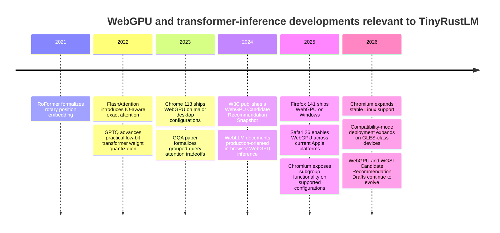
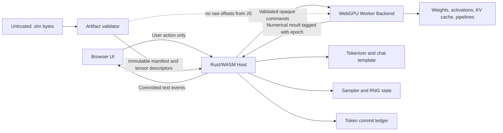
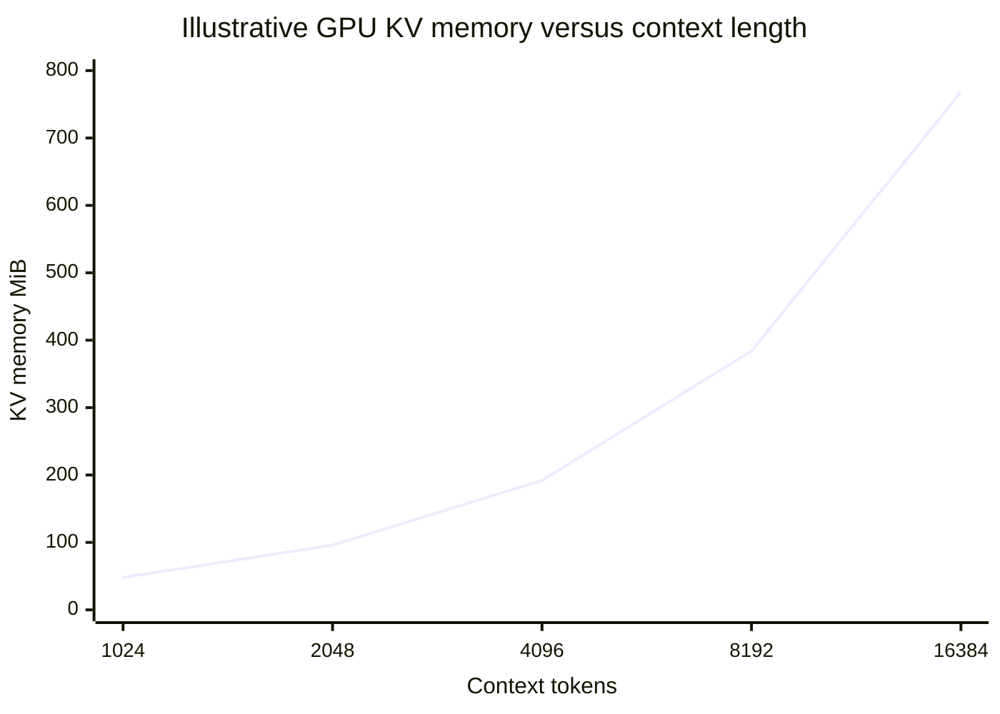
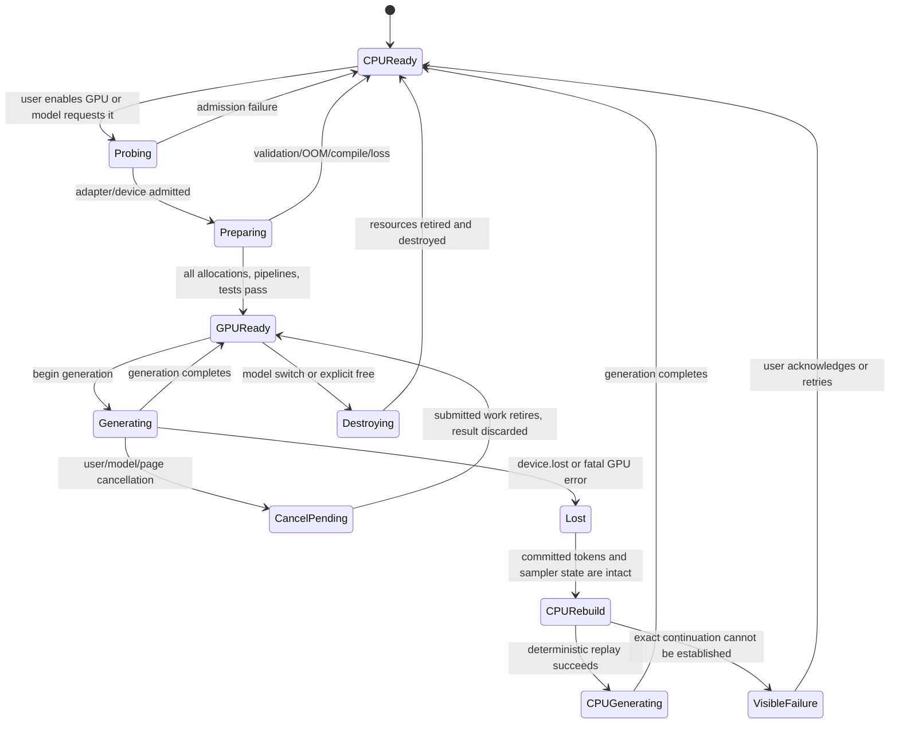

# WebGPU Quantized Transformer Backend for TinyRustLM: Architecture, Admission, Memory Planning, and Recovery

## Executive Summary

The attached technical brief resolves the otherwise unspecified research scope: this report evaluates an **optional WebGPU execution backend for qualified TinyRustLM `.slm` models**, while preserving the existing artifact, tokenizer, chat-template, sampling, model-composition, and behavioral contract shared by native and browser-CPU paths. No private TinyRustLM source code, artifacts, shaders, traces, browser profiles, hardware, or benchmark receipts were available; every TinyRustLM-specific design below is therefore an **engineering recommendation or assumption requiring local verification**, not an observation about the unpublished implementation. fileciteturn0file0

**Adoption recommendation.** TinyRustLM should proceed with WebGPU only as a **strictly admitted, replaceable acceleration backend**, not as an alternative model runtime. The recommended first production scope is deliberately narrow:

1. Retain Rust/WASM control of artifact validation, tokenizer and chat-template processing, prompt-token construction, sampling state, output commitment, cancellation epochs, and user-visible generation state.
2. Give WebGPU ownership only of validated tensor buffers, explicitly planned activation and KV-cache allocations, trusted precompiled shader families, command encoding, and numerical results.
3. Support a conservative `f32`-accumulating path first, followed by q8 and q4 weight-only kernels. Treat `shader-f16` and subgroups as optional optimization tiers rather than prerequisites.
4. Admit a model only after deterministic resource planning, adapter-feature and limit checks, atomic pipeline preparation, bounded operator self-tests, allocation probes, and registration of device-loss and error handling.
5. Make CPU fallback a visible state transition governed by a token-commit ledger. Never race CPU and GPU answers, silently restart a response, or choose whichever output appears more attractive.
6. Delete, rather than preserve, shader variants that cannot meet correctness, security, memory, or end-to-end performance gates.

This recommendation reflects WebGPU’s current maturity: as of August 1, 2026, it is broadly shipped across Chromium on mainstream Windows, macOS, ChromeOS, substantial Android configurations, and selected Linux configurations; Firefox ships it on Windows and Apple-silicon macOS but has narrower stable support elsewhere; Safari 26 ships WebGPU on current Apple platforms. Nevertheless, feature exposure, worker support, limits, drivers, and backend behavior remain browser- and platform-dependent, and WebGPU and WGSL remain W3C Candidate Recommendation Drafts rather than final Recommendations. citeturn14view0turn14view5turn15search2turn15search4

### Prioritized research and implementation workstreams

Scores are on a five-point scale. “Feasibility” estimates implementation tractability without private TinyRustLM evidence; “novelty” measures project-specific research value rather than academic originality.

| Priority | Workstream | Impact | Feasibility | Novelty | Public data availability | Rationale |
|---|---|---:|---:|---:|---:|---|
| Highest | Admission, capability negotiation, and atomic activation | 5 | 5 | 3 | 5 | Prevents unsupported devices, unsafe limits, partial activation, and misleading “WebGPU available” decisions. The specification provides strong primitives for feature negotiation, limits, error scopes, and device loss. citeturn15search0turn15search8turn15search9 |
| Highest | Typed artifact/runtime/backend boundary | 5 | 5 | 4 | 3 | This is the principal defense against JavaScript reinterpreting untrusted offsets, changing model identity, or bypassing validation. Exact design depends on the private `.slm` contract. |
| Highest | Deterministic memory and binding planner | 5 | 4 | 4 | 4 | Browser APIs do not expose trustworthy free-VRAM values; viability therefore depends on exact owned-allocation accounting, limit-aware sharding, lifetime analysis, and bounded allocation failure. citeturn15search0turn15search1turn15search12 |
| High | Quantized GEMV/GEMM and floating-point policy | 5 | 3 | 4 | 4 | Decode performance depends strongly on weight-bandwidth-efficient GEMV, while prefill requires separate GEMM tiling. Numerical behavior must be calibrated across compilers and vendors. citeturn14view14turn15search2 |
| High | Attention, RoPE, GQA, and GPU KV-cache design | 5 | 3 | 4 | 5 | Long-context latency and memory are dominated by KV-cache traffic and attention. Established primary literature provides algorithms, but browser-specific kernels require validation. citeturn14view9turn14view10turn14view11turn14view12 |
| High | Device-loss, cancellation, and explicit fallback semantics | 5 | 4 | 5 | 4 | A mathematically correct kernel is insufficient if device loss duplicates text, corrupts the active model, or fabricates successful continuation. The browser standard defines loss primitives but not product semantics. citeturn15search1 |
| High | Security, conformance, benchmarking, and deletion gates | 5 | 4 | 4 | 5 | Static shaders, malicious-artifact testing, cross-vendor testing, and raw-output conformance are necessary to convert prototype speedups into defensible product evidence. citeturn15search0turn9search5 |

**Principal conclusion.** The project’s greatest risk is not whether a q4 multiply can be written in WGSL. It is whether TinyRustLM can preserve **one validated model identity and one output-commit contract** across asynchronous GPU errors, heterogeneous numerical behavior, browser resource limits, cancellation, and loss. Kernel optimization should begin only after that contract exists.

### Relevant five-year development timeline



The academic milestones are documented by the original RoFormer, FlashAttention, GPTQ, and GQA papers. Browser rollout dates come from the GPUWeb implementation-status record and browser-vendor publications; the timeline should not be interpreted as proof that every optional feature is available on every listed platform. citeturn14view9turn14view10turn14view11turn14view14turn14view0turn14view5turn16search0turn16search1

## Standards, Browsers, Platforms, and Capability Matrix

### Standards baseline and normative implications

**Observed public fact.** The latest retrieved W3C WGSL publication is a Candidate Recommendation Draft dated June 5, 2026. The WebGPU publication history records multiple Candidate Recommendation Drafts through May 21, 2026. These documents are active standards-track specifications, and implementation details can still change; TinyRustLM should therefore pin a backend protocol version, shader-bundle hash, CTS revision, and browser test baseline rather than assuming “WebGPU” denotes one permanently stable implementation. citeturn15search2turn15search4turn15search7

WebGPU is exposed in secure contexts and may be available through both `Navigator.gpu` and `WorkerNavigator.gpu`; worker availability remains a browser-deployment question rather than a universal assumption. Adapter features and limits are deliberately controlled or bucketed by user agents for privacy, and underlying hardware capability does not guarantee that a browser exposes a corresponding feature. citeturn15search3turn15search8turn15search9turn15search15

Optional capabilities relevant to this backend include `shader-f16`, `subgroups`, and `timestamp-query`. They must be discovered from the adapter and explicitly requested when needed; only requested features appear on the resulting device. Unsupported required capabilities cause device creation to fail. citeturn15search0turn15search11turn15search14

WebGPU’s default capability profile includes a 256 MiB `maxBufferSize`, 128 MiB `maxStorageBufferBindingSize`, four bind groups, 256 compute invocations per workgroup, and at least 16 KiB of workgroup storage. Browsers may expose larger values, but applications must use the admitted device’s actual limits and must not assume the physical GPU’s native maximum. citeturn15search0turn15search6turn15search12

### Browser, operating-system, and API-backend matrix

The following matrix records the public implementation status retrieved August 1, 2026. “Runtime-gated” means TinyRustLM must query the adapter and run its self-test rather than infer support from browser name.

| Browser family and platform | Stable WebGPU status | Typical native translation layer | Workers | Optional compute features | TinyRustLM disposition |
|---|---|---|---|---|---|
| Chromium, Windows x86/x64 | Shipped since Chrome 113 on supported configurations | Dawn over D3D12; other implementation paths may exist | Supported where `WorkerNavigator.gpu` is exposed | `shader-f16`, subgroups, and timestamp queries are runtime-gated | Primary target, but require admission and real-GPU testing. citeturn14view0turn15search3 |
| Chromium, macOS | Shipped since Chrome 113 | Dawn over Metal | Runtime/browser-context dependent | Runtime-gated | Primary target; test both Apple GPU generations and Intel-era hardware still in support. citeturn14view0 |
| Chromium, ChromeOS | Shipped since Chrome 113 on supported configurations | Dawn, commonly over Vulkan/OpenGL translation depending device | Runtime-gated | Runtime-gated | Admit by limits and self-test, not device class. citeturn14view0 |
| Chromium, Android | Shipped on Android 12+ for ARM/Qualcomm/Intel from Chrome 121; additional GPU families were added later | Dawn over Vulkan; compatibility mode can target GLES 3.1-class systems with a restricted feature level | Runtime-gated | Especially heterogeneous; compatibility mode may have lower capabilities | Separate “core” and “compatibility” admission profiles; no desktop assumptions. citeturn14view0turn16search13 |
| Chromium, Linux | Stable support is configuration-specific: Intel Gen12+ from Chrome 144 and NVIDIA/Wayland with stated driver conditions from Chrome 147; other paths may remain flag-gated | Dawn over Vulkan, often through ANGLE integration | Runtime-gated | Runtime-gated | Treat distro, compositor, driver, and GPU as independent test dimensions. citeturn14view0turn16search1 |
| Chromium, Windows ARM64 | Public status still identifies flag-dependent deployment | Dawn/D3D12 | Runtime-gated | Runtime-gated | Not a production target until verified on supported stable channels. citeturn14view0 |
| Firefox, Windows | Shipped from Firefox 141 | `wgpu`, normally over D3D12 | Broad contexts, with service-worker caveats in public compatibility material | Runtime-gated | Supported target after Firefox-specific conformance and loss testing. citeturn14view0turn16search0 |
| Firefox, macOS Apple silicon | Stable from Firefox 145 on macOS 26+, broadened in Firefox 147 | `wgpu` over Metal | Runtime-gated | Runtime-gated | Supported target, but retain per-release testing because rollout is newer. citeturn14view0 |
| Firefox, Linux and Intel macOS | Public implementation status identifies Nightly rather than general stable support | `wgpu` over Vulkan/Metal | Experimental/context-dependent | Runtime-gated | Do not advertise production support solely because `navigator.gpu` exists. citeturn14view0 |
| Firefox, Android | Flag-gated in the public implementation-status record | `wgpu`, typically Vulkan-facing | Experimental | Runtime-gated | Exclude from production admission unless the shipping configuration is independently verified. citeturn14view0 |
| Safari 26, macOS | Enabled by default | WebKit WebGPU over Metal | Context-dependent; verify the exact Safari release | Runtime-gated | Primary Apple target, requiring Safari-specific shader, allocation, backgrounding, and loss tests. citeturn14view0turn14view5 |
| Safari 26, iOS/iPadOS/visionOS | Enabled by default | Metal | Context- and lifecycle-dependent | Runtime-gated, with mobile resource pressure especially important | Conservative mobile memory profile; test page suspension and OS pressure. citeturn14view0turn14view5 |
| Headless browser or software adapter | May be available only with special flags or software implementations | SwiftShader or another software path | Varies | Not evidence of hardware behavior | Useful for API and validation tests, never sufficient for performance or cross-hardware claims. |

**Engineering recommendation.** The product compatibility table should contain only broad shipping expectations. The executable source of truth must be the **versioned admission receipt**, because browser features may be withheld even where the hardware supports them, and numeric limits may be privacy-bucketed. citeturn15search8turn15search9turn15search10

### Feature policy

| Capability | Production policy | Reason |
|---|---|---|
| Core WebGPU compute | Required | No backend without an admitted core device. |
| `shader-f16` | Optional optimization | It can reduce storage and arithmetic cost on supported implementations, but it must be explicitly requested and can alter numerical behavior. Chrome’s reported speedups are configuration-specific observations, not transferable guarantees. citeturn10search12turn15search14 |
| Subgroups | Optional kernel tier | Subgroup size can vary by shader and device within the admitted range; kernels must not assume a fixed warp or wave size. citeturn15search6 |
| Timestamp queries | Development and consensual diagnostics only | GPU timestamps improve measurement but add timing and fingerprinting surface. Cross-origin isolation does not isolate the GPU queue timeline. citeturn15search0 |
| Indirect dispatch | Deferred | It can reduce CPU command work for dynamic workloads, but adds state and validation complexity without being necessary for a first decoder implementation. |
| Compatibility feature level | Separate admission tier | A compatibility device can broaden Android reach but must have its own kernel set, limits profile, tests, and product messaging. citeturn16search13 |
| Fallback/software adapter | Reject by default | Software execution may be slower than WASM and is not hardware evidence. Allow it only in explicit diagnostics or testing. |

## Admission, Privacy Receipt, and Typed Runtime Boundary

### Versioned backend-admission algorithm

**Engineering recommendation.** `navigator.gpu` is only the beginning of discovery. Admission should be a transaction in which no GPU session becomes active until the artifact, memory plan, shaders, allocations, pipelines, and numerical self-tests have all passed.

```text
Admission protocol: tiny-gpu-admission-v1

Input:
    ValidatedModelManifest manifest
    BackendPolicy policy
    CancellationEpoch epoch

Output:
    AdmittedGpuSession | AdmissionFailure

Procedure:
    1. Reject if the secure-context WebGPU entry point is absent.
    2. Validate the entire .slm artifact in Rust/WASM:
         - magic/version/checksum
         - tensor type, rank, shape, offsets, lengths, alignment
         - quantization descriptor and every tail block
         - architectural invariants
         - RoPE/GQA/context parameters
         - checked arithmetic for all byte and element counts
    3. Derive immutable:
         ModelIdentity
         ExactGpuRequirements
         DeterministicMemoryPlan
         RequiredPipelineSet
    4. Request one adapter:
         featureLevel = policy.feature_level
         forceFallbackAdapter = false
         powerPreference = absent unless user policy explicitly selects one
    5. Reject null, expired, disallowed fallback, or cancelled adapter.
    6. Compare requirements against adapter.features and adapter.limits.
       Select the lowest capability kernel tier satisfying the model:
         Tier A: f32 baseline
         Tier B: f16 storage with f32 accumulation
         Tier C: admitted subgroup optimization
    7. Request exactly the selected features and required limits.
    8. Immediately register:
         device.lost handler
         uncapturederror handler
         generation/session epoch
    9. Push validation and out-of-memory error scopes.
    10. Allocate all mandatory buffers according to the plan.
        Use bounded upload chunks and no unbounded "find free memory" loop.
    11. Compile every mandatory pipeline asynchronously from trusted WGSL.
    12. Run bounded golden tests:
          buffer addressing and odd tails
          q8 and q4 unpack/dequantization
          f32 and optional mixed-precision dot products
          RMSNorm
          RoPE
          stable/online softmax
          GQA head mapping
          GEMV and small GEMM
          NaN, infinity, signed zero, and cancellation handling
    13. Compare with an independent CPU oracle using versioned tolerances.
    14. Pop all scopes and reject on any captured or uncaptured error.
    15. Atomically publish the session handle only if:
          epoch is current
          model identity is still active
          all resources and pipelines exist
          device is not lost
          every mandatory self-test passed
    16. Emit a privacy-minimized receipt.
```

WebGPU’s design supports this pattern: unsupported required features fail device creation; devices enforce requested limits; allocation failure can generate an out-of-memory error and invalid resource; asynchronous pipeline creation can fail; and the device-loss promise must be handled because a device can be lost at creation or later. citeturn15search0turn15search1turn15search11

### Exact admission outcomes

| Code | Meaning | Product action |
|---|---|---|
| `NO_SECURE_WEBGPU` | WebGPU entry point absent or unavailable in the current context | Keep CPU/WASM active; explain that GPU acceleration is unavailable. |
| `NO_ADAPTER` | No suitable adapter returned | CPU path; do not retry continuously. |
| `FALLBACK_ADAPTER_DISALLOWED` | Only a software/fallback adapter is usable under policy | CPU path; optional diagnostic override only. |
| `MODEL_INVALID` | Artifact, descriptor, dimension, offset, checksum, or architecture invariant failed | Reject the model entirely; never fall back with an unverified artifact. |
| `UNSUPPORTED_FEATURE` | Required feature is absent | Select a lower predeclared kernel tier if one exists; otherwise CPU. |
| `INSUFFICIENT_LIMIT` | A required binding, buffer, workgroup, dispatch, or storage limit is too small | Deterministically reject or select a prevalidated sharded plan. |
| `MEMORY_PLAN_REJECTED` | Owned-byte plan exceeds policy before allocation | CPU path or explicit lower-context/model choice; no speculative allocation loop. |
| `DEVICE_REQUEST_FAILED` | Device creation rejected or returned already lost | CPU path, with at most one controlled re-acquisition. |
| `PIPELINE_VALIDATION_FAILED` | Trusted shader or pipeline configuration failed validation | Disable that shader bundle; do not activate a partial model. |
| `PIPELINE_INTERNAL_FAILED` | Browser/compiler internal pipeline failure | Record coarse failure; CPU path. |
| `GPU_ALLOCATION_FAILED` | Captured out-of-memory or invalid buffer | Destroy candidate resources; CPU path; no claim about exact free VRAM. |
| `SELFTEST_NUMERIC_FAILED` | Kernel result exceeds tolerance or violates an invariant | Quarantine the selected kernel tier and use CPU. |
| `DEVICE_LOST_DURING_ADMISSION` | Loss before activation | Destroy candidate state; CPU path or one fresh attempt. |
| `CANCELLED_OR_STALE` | User cancelled, changed model, closed page, or advanced epoch | Destroy candidate state; never publish it. |
| `ADMITTED` | Complete, tested session atomically installed | GPU may process only commands for its exact model identity. |

### Privacy-minimized capability receipt

**Engineering recommendation.** Keep detailed information in memory for scheduling, but persist only coarse evidence:

```text
CapabilityReceiptV1 {
    backend_protocol_version
    runtime_build_hash
    shader_bundle_hash
    self_test_suite_hash
    model_artifact_hash              // local identity, not transmitted by default
    model_layout_profile             // coarse q4/q8/fp profile
    browser_engine_major_bucket
    operating_system_family_bucket
    feature_level                    // core | compatibility
    enabled_feature_bits             // only features actually requested
    admitted_limit_profile_id        // project-defined bucket, not raw full limits
    fallback_adapter                 // boolean
    outcome_code
    failure_stage
    receipt_day                      // day-level, not high-resolution timestamp
}
```

The receipt must contain no prompts, generated text, token IDs, raw adapter description, driver string, precise device identifier, high-resolution timestamps, exact memory-probe frontier, or shader/compiler diagnostic text. The WebGPU specification deliberately restricts machine-specific capability distinguishability and cautions that device-loss messages should not be parsed or disclose unnecessary system information. citeturn15search0turn15search1turn15search10

### Ownership and command boundary



| Concern | Required owner | Contract |
|---|---|---|
| Artifact authenticity, version, tensor bounds, and architecture | Rust/WASM validation layer | Produces immutable typed descriptors; JS cannot construct or modify tensor offsets. |
| Model identity and composition | Rust/WASM host | Exact artifact hash plus adapter/LoRA/composition identity, if composition is supported. No backend may substitute a different quantization. |
| Tokenizer and chat template | Shared Rust/WASM semantic layer | GPU receives prompt token IDs, never raw prompt strings unless unavoidable. |
| Sampling, RNG, penalties, stopping, and token commitment | Rust/WASM semantic layer | One canonical implementation for CPU, native, WASM SIMD, and WebGPU. |
| Static weights and tensor metadata consumed by shaders | GPU session, derived only from validated descriptors | No arbitrary pointer arithmetic supplied by JavaScript. |
| GPU KV cache | GPU session | Bound to model identity, conversation generation, context policy, and epoch. |
| CPU shadow state | Rust/WASM host | Token history and sampler state are mandatory; a full shadow KV cache is optional but must be counted. |
| Cancellation | Rust/WASM host originates; GPU session observes epoch | Commands and results carry model/session/generation epochs. |
| Raw numerical output | GPU returns to Rust/WASM | Initial implementation returns canonical `f32` logits; optimized top-k readback requires separate proof. |
| User-visible output | Commit ledger only | UI never displays an uncommitted GPU token directly. |

A minimal typed interface should resemble:

```rust
struct ModelHandle(u64);
struct SessionEpoch(u64);
struct GenerationEpoch(u64);
struct SubmissionSeq(u64);

enum GpuCommand {
    LoadValidatedModel {
        model: ModelHandle,
        manifest_hash: [u8; 32],
        plan_hash: [u8; 32],
        epoch: SessionEpoch,
    },
    BeginGeneration {
        model: ModelHandle,
        session: SessionEpoch,
        generation: GenerationEpoch,
        prompt_tokens: Box<[u32]>,
        sampler_checkpoint_hash: [u8; 32],
    },
    PrefillChunk {
        generation: GenerationEpoch,
        start_position: u32,
        tokens: Box<[u32]>,
        submission: SubmissionSeq,
    },
    DecodeOne {
        generation: GenerationEpoch,
        committed_position: u32,
        input_token: u32,
        submission: SubmissionSeq,
    },
    Cancel { generation: GenerationEpoch },
    DestroySession { session: SessionEpoch },
}

enum GpuResult {
    SessionAdmitted { session: SessionEpoch, receipt: CapabilityReceiptV1 },
    PrefillComplete { generation: GenerationEpoch, through_position: u32 },
    Logits {
        generation: GenerationEpoch,
        position: u32,
        submission: SubmissionSeq,
        values: Box<[f32]>,
    },
    Cancelled { generation: GenerationEpoch },
    Failed {
        generation: Option<GenerationEpoch>,
        code: GpuFailureCode,
        last_completed_submission: Option<SubmissionSeq>,
    },
}
```

**Security invariant.** The GPU worker may accept an opaque tensor ID and operation ID, but never a JavaScript-provided byte offset, row stride, quantization block size, dispatch count, or shader fragment.

## Transformer Graph and Kernel Architecture

### Complete decoder-only graph

For each layer, the recommended operation sequence is:

\[
x_0 \rightarrow \operatorname{RMSNorm} \rightarrow
(Q,K,V) \rightarrow \operatorname{RoPE}(Q,K) \rightarrow
\operatorname{KVAppend} \rightarrow
\operatorname{CausalGQAAttention} \rightarrow
W_O \rightarrow \operatorname{Residual}
\]

\[
\rightarrow \operatorname{RMSNorm} \rightarrow
\left[\operatorname{SiLU}(W_{\mathrm{gate}}x)\odot
(W_{\mathrm{up}}x)\right] \rightarrow W_{\mathrm{down}}
\rightarrow \operatorname{Residual}
\]

The final sequence is final RMSNorm, tied or untied output projection, logits extraction, and return to the canonical sampler. RMSNorm, RoPE, and GQA are grounded in the corresponding original publications; FlashAttention and online-softmax work provide the conceptual basis for tiled, numerically stable attention, although a WebGPU implementation should not claim equivalence to any named CUDA kernel without direct evidence. citeturn14view13turn14view9turn14view10turn14view11turn14view12

**Validation rules before dispatch** should include:

\[
d_{\text{model}} = n_Q d_{\text{head}}, \qquad
n_Q \bmod n_{KV} = 0,
\]

plus exact compatibility among every projection matrix, RMSNorm vector, FFN width, vocabulary size, RoPE dimension, context limit, and tied-embedding shape. For GQA, query head \(h_q\) maps to:

\[
h_{kv} =
\left\lfloor
\frac{h_q n_{KV}}{n_Q}
\right\rfloor .
\]

The mapping must be computed from validated unsigned dimensions using checked arithmetic; malformed dimensions must be rejected rather than clamped.

### Prefill and decode require different kernels

| Property | Prefill | One-token decode |
|---|---|---|
| Principal projection shape | \([T,K]\times[K,N]\) GEMM | \([1,K]\times[K,N]\) GEMV |
| Parallelism | Tokens, output tiles, K tiles | Output channels and K reduction |
| Main opportunity | Matrix reuse and tiling | Weight-bandwidth efficiency, low dispatch overhead |
| Attention | Many query positions, triangular causal region | One query against all prior KV entries |
| Useful fusion | RMSNorm + projection; fused QKV; gate/up; tiled attention | RMSNorm + GEMV; gate/up GEMV; online attention; residual fusion |
| Main risk | Excess scratch memory and compile time | Dispatch latency, poor occupancy, rereading weights |
| Command strategy | Chunked prompt batches | Pre-encoded stable sequence of small dispatches where possible |

A single “universal” matrix kernel is unlikely to be competitive. Prefill benefits from two-dimensional output tiling and reuse of both activations and dequantized weight blocks. Decode typically has one input row, so aggressive matrix tiles leave most lanes idle and can spend more time coordinating than computing.

**Recommended fusion boundaries.** Fuse operations only when doing so eliminates a full memory round trip without causing unacceptable registers, workgroup storage, code size, or variant explosion. Good early candidates are residual-plus-RMSNorm, Q/K RoPE after a fused QKV projection, gate-plus-up projection, and online-softmax attention. Avoid a monolithic full-layer shader: it would produce large live ranges, impede cancellation boundaries, increase compiler risk, and complicate numerical localization.

### Quantized tensor descriptors

No universal `.slm` q4 or q8 encoding should be invented. The validator should map each artifact tensor into a canonical descriptor:

```rust
struct QuantTensorDesc {
    tensor_id: u32,
    encoding: QuantEncoding,       // F32, F16, Q8, Q4
    rows: u32,
    cols: u32,
    block_elements: u32,
    block_stride_bytes: u32,
    row_stride_bytes: u64,
    payload_offset: u64,
    payload_length: u64,
    scale_layout: ScaleLayout,     // inline, side array, per-row, per-block
    scale_type: ScaleType,         // f16 or f32
    zero_point_layout: ZeroPointLayout,
    signedness: QuantSignedness,
    nibble_order: Option<NibbleOrder>,
    tail_elements: u32,
    required_alignment: u32,
    content_hash: [u8; 32],
}
```

A q8 block may be modeled generally as integers \(q_i\), scale \(s_b\), and optional zero point \(z_b\):

\[
w_i = s_b(q_i-z_b).
\]

For q4, the descriptor must explicitly identify whether a byte stores low-nibble-first or high-nibble-first values, and whether the four-bit code is offset-binary, signed two’s-complement-like, or interpreted through another artifact-defined map. The final partial block must have an authenticated tail count; padding bits must never be interpreted as weights.

**Storage layout recommendation.** Normalize metadata, not payload semantics. It is acceptable to repack a validated artifact into a GPU-specific buffer layout during loading, provided the operation is deterministic, covered by a checksum, and does not change quantized values or scales. Record both the artifact hash and the normalized GPU-layout hash.

### Quantized GEMV and GEMM families

A viable vendor-neutral family should contain multiple fixed shader variants rather than runtime-generated WGSL:

| Variant | Initial intended use | Typical workgroup concept | Notes |
|---|---|---|---|
| Scalar fallback | Odd tails, small tensors, self-tests | 64 threads | Simple correctness oracle; not expected to win broadly. |
| q8 GEMV | Decode projections | 128 or 256 threads, one to four output rows per group | Vectorized aligned loads; local integer unpack; f32 accumulation. |
| q4 GEMV | Decode projections | 128 or 256 threads | Load packed `u32` words, unpack eight nibbles, reuse block scale. |
| q8 tiled GEMM | Prefill | 2-D tile over tokens and output channels | Stage activation and weight tiles; dequantize near multiply. |
| q4 tiled GEMM | Prefill | 2-D tile with packed-weight staging | Balance unpack cost against workgroup-memory pressure. |
| Subgroup variants | Qualified devices only | Device-reported subgroup behavior | Never assume subgroup size 32 or 64. |
| Low-storage f16 variant | Qualified devices only | Same logical tiles | f16 storage and possibly multiplication, f32 reduction. |

**Load and reduction policy.** Use aligned `vec4<u32>` or equivalent loads only when the descriptor proves alignment. Dequantize as close as practical to multiply-accumulate so that expanded floating-point weights are not written to global memory. Reuse each scale across its block. Accumulate in `f32` by default. Apply bounds masks to rows, columns, and K tails, and guarantee that every workgroup barrier is reached uniformly.

**Workgroup selection.** Start with fixed 64-, 128-, and 256-invocation variants. Admission microtests should choose only among a small allowlisted set; they must not expose arbitrary shader generation. Workgroup-storage demand must remain below the admitted `maxComputeWorkgroupStorageSize`, and invocation dimensions must fit every per-axis and total-workgroup limit. The standards minimum for compute invocations is 256 and for workgroup storage is 16 KiB, but larger values must not be assumed. citeturn15search6turn15search12

**Register pressure and bank behavior.** WGSL does not provide a portable register-count or shared-memory-bank model. Therefore, bank-conflict avoidance and occupancy claims require compiler inspection and physical measurements for each browser/backend family. Keep tile sizes as specialization constants selected from an allowlist, inspect generated backend code where authorized, and maintain a conservative variant with smaller accumulator arrays.

### Floating-point policy

WGSL does not promise cross-vendor bit identity for ordinary floating-point shader arithmetic. Implementations may differ in contraction, intermediate rounding, subnormal handling, NaN representation, and optimization, especially when f16 is enabled. The WGSL standard defines allowed behavior but does not convert heterogeneous GPUs into a single deterministic floating-point machine. citeturn14view4turn15search2

| Operation class | Recommended precision | Expected conformance |
|---|---|---|
| Quantized code unpack, indices, offsets, masks | Integer | Bit-exact |
| Scale load | Artifact-defined f16 or f32 | Bit-exact storage interpretation |
| Projection accumulation | f32 | Numerical tolerance, not cross-GPU bit identity |
| RMS sum of squares | f32 | Numerical tolerance |
| RoPE sin/cos application | f32 unless a qualified mixed path is proven | Numerical tolerance |
| Attention scores and softmax running maximum/sum | f32 | Numerical tolerance and invariant checks |
| KV storage | f16 or f32 according to the exact model/backend contract | Exact format; numerical values may differ after computation |
| FFN activation | f32 initially | Numerical tolerance |
| Logits readback | f32 | Numerical, top-k, token, and sequence-level tests |
| Sampler RNG and probability selection | CPU/WASM canonical implementation | Bit-exact for identical logits; behaviorally tested for tolerated logits |

**Recommendation.** Do not promise bit-exact GPU logits or hidden states. Promise an explicitly versioned hierarchy of numerical and behavioral conformance. Integer unpacking, layout mapping, token bookkeeping, model identity, and commit ordering can and should remain exact.

### RoPE and attention kernels

RoPE parameters—including base frequency, rotary dimension, interleaving convention, position offset, and any context-scaling variant—must be supplied by the validated artifact contract. The backend must not infer a “standard” formula from model dimensions. RoPE can use either a validated precomputed table or on-device generation; table storage improves repeatability, while generation reduces static memory but depends more directly on GPU transcendental behavior. citeturn14view9

For decode attention, use an online stable softmax:

\[
m_j = \max(m_{j-1}, s_j),
\]

\[
l_j =
l_{j-1}e^{m_{j-1}-m_j}
+ e^{s_j-m_j},
\]

while updating the weighted value accumulator with the same rescaling. This avoids materializing an entire score vector and is based on established online-normalizer work; blockwise IO-aware attention follows the same general motivation as FlashAttention. citeturn14view11turn14view12

Every attention dispatch must validate:

- position \(<\) admitted context capacity;
- no addition or multiplication overflow in KV offsets;
- query-to-KV-head mapping within range;
- causal end position and any sliding-window start;
- RoPE table coverage;
- finite or explicitly handled score values;
- dimensions compatible with tile and tail logic.

## KV Cache, Deterministic Memory Planning, and Binding Strategy

### KV-cache layout

Static weights and mutable KV state should never share identity or lifetime assumptions. The first production layout should be **per-layer contiguous K and V storage**, with explicit strides:

\[
\text{KVBytes} =
L \times C \times H_{KV} \times D_H
\times 2
\times B_e
\times B,
\]

where \(L\) is layer count, \(C\) context capacity, \(H_{KV}\) KV-head count, \(D_H\) head dimension, \(B_e\) bytes per element, and \(B\) batch or verification width. Alignment and shard padding must be added separately.

A layer-major layout minimizes binding changes when layers execute sequentially. Within a layer, a recommended logical index is:

\[
[\text{token}][\text{kv-head}][\text{head-element}],
\]

with separate K and V regions or an explicitly interleaved descriptor. Separate regions simplify attention access and sharding; interleaving may reduce binding count but can worsen access locality. The choice requires local profiling.

**Contiguous versus paged.**

| Design | Advantages | Costs | Recommendation |
|---|---|---|---|
| Preallocated contiguous | Simple addressing, few metadata reads, strong validation | Reserves full admitted context; resizing requires migration | First production design for compact models |
| Geometrically grown contiguous | Lower initial reservation | Copies or multiple segments; more failure states | Avoid unless exact growth behavior is proven |
| Fixed-page cache | Incremental allocation, easier truncation and assisted-decoding branches | Page table reads, more bindings or indirection, fragmentation | Second-generation long-context design |
| Ring/sliding window | Fixed memory | Changes composition semantics unless model explicitly supports it | Only when the artifact and product contract declare a window |
| Quantized KV experiment | Potential memory reduction | Alters model numerics and needs new kernels/scales | Separate experimental model/backend profile, never silent |
| CPU-shadowed KV | Fast GPU-to-CPU continuation | Doubles or substantially increases memory and synchronization | Not default; count every byte if enabled |

GPU KV operation should remain readback-free during normal generation. The CPU must retain committed token history and sampler state, but need not mirror the entire KV cache. After device loss, CPU continuation can reconstruct KV by replaying committed tokens; the latency of that replay is product-visible and must be benchmarked.

### Illustrative KV-memory trend

For an illustrative model with 24 layers, eight KV heads, head dimension 64, one batch, and two-byte KV elements:

\[
\text{bytes per token}
=24\times8\times64\times2\times2
=49{,}152\text{ bytes}
=48\text{ KiB}.
\]

This is a computed example, not a claim about any TinyRustLM model, and excludes alignment, paging, staging, activations, weights, metadata, and driver allocations.



The linear trend means context capacity can become the decisive memory term even when q4 substantially reduces static weights. GQA reduces KV storage relative to full multi-head attention by using fewer key/value heads, one reason its exact head count must be included in admission. citeturn14view10

### Deterministic memory planner

The planner should produce one immutable allocation graph before requesting large buffers:

\[
M_{\mathrm{owned,GPU}}
=
M_W + M_{\mathrm{meta}} + M_{\mathrm{KV}}
+ M_{\mathrm{arena}} + M_{\mathrm{scratch}}
+ M_{\mathrm{logits}} + M_{\mathrm{staging,GPU}}
+ M_{\mathrm{readback,GPU}}
+ M_{\mathrm{reserved}}.
\]

CPU claims should be reported separately:

\[
M_{\mathrm{owned,CPU}}
=
M_{\mathrm{artifact}}
+ M_{\mathrm{repack}}
+ M_{\mathrm{upload,CPU}}
+ M_{\mathrm{readback,CPU}}
+ M_{\mathrm{shadow}}
+ M_{\mathrm{runtime}}.
\]

Pipeline objects and browser/compiler internal allocations cannot be precisely sized through WebGPU. The receipt should therefore distinguish **exactly owned buffer bytes**, **known CPU bytes**, and an **unmeasured implementation-overhead category** rather than pretending every byte is observable.

**Activation aliasing.** Construct a liveness interval \([b_i,e_i]\) for every temporary. Two tensors may share a region only if:

\[
e_i < b_j \quad\text{or}\quad e_j < b_i.
\]

The planner should store a machine-checkable proof record naming the producer, final consumer, offset, size, and non-overlap reason. Garbage collection is not a liveness proof.

A typical layer schedule permits reuse of:

- normalized activation space after all Q/K/V projections consume it;
- Q scratch after attention output has been produced;
- score/softmax tile scratch between heads or blocks;
- gate and up intermediate space after elementwise multiplication;
- layer-local projection output after the residual is committed.

**Safety reserve.** Because WebGPU does not expose precise free VRAM and implementations may reject allocations under pressure, TinyRustLM needs a versioned policy reserve plus a bounded allocation test. An initial research value might be:

\[
M_{\mathrm{reserve}} =
\max(64\text{ MiB},\,0.15 M_{\mathrm{owned,GPU}})
\]

for desktop-class trials, with a separately calibrated mobile profile. This is an **assumption for experimentation**, not a standards-derived threshold. Promotion requires physical measurements demonstrating an acceptable allocation-failure rate without excessive false rejection.

### Large tensors and binding limits

A buffer’s total size and a single storage binding’s visible size are separate limits. With default limits, a 200 MiB buffer could fit the default 256 MiB `maxBufferSize` but could not be exposed as one default-size 128 MiB storage binding. citeturn15search0turn15search12

Recommended resolution order:

| Strategy | Use | Constraints |
|---|---|---|
| Output-row sharding | Projection matrices whose rows can be independently computed | Each shard has complete or consistently partitioned K blocks; outputs concatenate deterministically. |
| K-dimension sharding | Tensor remains too large by rows | Requires partial f32 accumulators and a deterministic reduction dispatch. |
| Multiple bind groups | Separate layer/tensor families | Default bind-group count is limited; layout changes can increase pipeline variants. |
| Dynamic storage offsets | Repeated slices in one large buffer | Offsets and sizes must satisfy device alignment and binding-size limits. |
| Storage-buffer binding arrays | Advanced tier only | Support and limits must be runtime-negotiated; do not make a baseline requirement. |
| Staged layer loading | Model weights exceed persistent GPU budget | Counts full CPU-resident weights, staging, and repeated transfer; likely harms decode latency. |
| Native companion backend | Non-browser execution | Separate backend contract, not an escape from browser admission rules. |

Reject the GPU plan if any tensor cannot be represented by a prevalidated combination of these strategies. Do not split tensors dynamically in response to allocation failures, because that would create an untested execution composition after admission.

### Suggested memory and resource metrics

| Metric | Source |
|---|---|
| Exact artifact bytes by encoding | Validated `.slm` manifest |
| Repacked GPU payload and padding | Memory-plan output |
| Static weight, metadata, activation, scratch, KV, staging, and readback bytes | Allocation ledger |
| Peak simultaneously live GPU-buffer bytes | Liveness-plan simulation |
| CPU artifact, staging, readback, and shadow bytes | Host allocator instrumentation |
| Adapter and requested device limits | Runtime WebGPU API, persisted only as coarse profile |
| Allocation failure stage and requested size | Error-scope record, with size bucketed in telemetry |
| Context bytes per token | Formula from validated model dimensions |
| Buffer and resource count | Allocation ledger |
| Bind groups and bindings per dispatch | Pipeline manifest |
| Model load/free residual memory | Browser process measurement where authorized; label as external observation |

## Pipeline Identity, Cancellation, Device Loss, and Security

### Pipeline and bind-group identity

A pipeline-cache key must bind every fact capable of changing shader semantics:

```text
PipelineKey {
    backend_abi_version
    runtime_build_hash
    complete_wgsl_source_hash
    entry_point
    specialization_constant_map
    quant_descriptor_version
    tensor_layout_profile_hash
    enabled_feature_bits
    requested_limit_profile
    feature_level
    browser_engine_major_bucket
    coarse_native_backend_class
    shader_compiler_pipeline_version_if_public
}
```

Do not key only on browser name or model name. Conversely, do not persist raw adapter identifiers that unnecessarily increase fingerprinting. Browser pipeline objects are generally process/device objects rather than portable serialized binaries, so durable caching should focus on model bytes, normalized payloads, shader hashes, and compile-result metadata; pipelines must be recreated for a new device.

Use asynchronous pipeline compilation for all mandatory pipelines. Candidate resources remain isolated until compilation and self-tests complete. `createComputePipelineAsync()` can reject with validation or internal pipeline errors, so a model must never become active merely because some early pipelines compiled. citeturn12search0turn15search1

Bind-group caches require the device identity, pipeline-layout identity, exact buffer-object identity, offset, size, model/session epoch, and buffer generation. A buffer reused at the same JavaScript variable name after model switching is not the same resource.

### Submission and cancellation

WebGPU command buffers already submitted to the queue cannot be preempted by application JavaScript. Cancellation therefore operates at **submission boundaries**, not arbitrary instruction boundaries.

Recommended policy:

- split long prefill into bounded token or layer chunks;
- check the cancellation epoch before encoding, before submission, and after completion callbacks;
- never block every decode token on `queue.onSubmittedWorkDone()` unless needed for lifecycle correctness;
- use mapped staging/readback buffers only in legal states and unmap before GPU reuse;
- tag every result with generation epoch, committed position, and submission sequence;
- explicitly destroy large buffers once no outstanding submission can reference them;
- on worker termination or page closure, abandon user-visible completion and let browser cleanup proceed, while persisting no prompt-bearing diagnostics.

The standard specifies that explicit buffer destruction unmaps the buffer and permits memory reclamation after prior submitted operations complete. Explicit destruction should be preferred over waiting for garbage collection. citeturn15search1

### Device-loss and fallback state machine



WebGPU devices can be lost because the application destroys them, the browser revokes access, the GPU process or driver changes state, or an implementation encounters a serious problem. The loss message is implementation-defined and must not be parsed as a stable error protocol; no new errors are generated from an already lost device. citeturn15search1

**Product semantics by failure point:**

| Event | Permitted response |
|---|---|
| Failure before any response token is committed | Visibly switch to CPU and restart from the exact prompt, RNG seed, and sampler state, if fallback policy allows. |
| Device loss after committed tokens | Pause visibly; reconstruct CPU KV by replaying the exact committed token sequence; continue only from the next uncommitted position. |
| Device loss after GPU computes but before host commits a token | Discard the uncommitted result and replay from the commit ledger. |
| Validation or shader error | Disable the affected shader bundle/session; use CPU. Do not repeatedly retry the same variant. |
| Allocation failure | Destroy candidate resources and reject admission. Do not infer a precise free-memory value. |
| Context overflow | Stop or apply only the context policy already declared by the model/product contract. No silent truncation. |
| User cancellation | Discard late GPU results; do not fall back and continue. |
| Intentional `device.destroy()` | Treat as an application lifecycle event, not a recoverable crash. |
| Unknown loss | At most one controlled device reacquisition; all resources must be recreated. Exact continuation still requires replay. |
| Browser backgrounding or page suspension | Treat delayed completion as stale if epoch/session changed; do not duplicate UI output. |

The output-commit ledger is the central anti-duplication mechanism:

```text
CommitRecord {
    generation_epoch
    token_position
    token_id
    sampler_state_after_token_hash
    raw_text_delta_hash
}
```

Only the Rust/WASM semantic layer may advance the committed position. GPU completion alone never means a token was shown.

### Security and malicious-artifact threat model

WebGPU includes validation, resource initialization, and robust-access protections intended to reduce memory-safety exposure, but these mechanisms are not substitutes for application-level shape and bounds validation. The standard also explicitly recognizes timing, fingerprinting, GPU-memory pressure, watchdog, and denial-of-service concerns. citeturn15search0turn15search1

| Threat | Required control |
|---|---|
| Arbitrary WGSL generated from model metadata | Prohibited. Ship a static trusted shader bundle with bounded allowlisted specialization constants. |
| Malformed tensor offsets or integer overflow | Validate in Rust with checked 64-bit arithmetic before GPU allocation or dispatch. |
| Quantization tail overread | Authenticate tail count, block stride, payload length, and nibble order; test odd tails. |
| Out-of-range RoPE or context index | Reject before encoding commands; shader also masks defensively. |
| Oversized model dimensions causing resource exhaustion | Enforce project maxima and deterministic plan limits before allocation. |
| Excessive dispatch duration and GPU watchdog | Bound prompt chunks, tile sizes, context capacity, and batch/verification width. |
| Prompt leakage in labels or errors | Use generic resource labels; sanitize compiler and loss messages; never attach prompts to telemetry. |
| Prompt-bearing staging/readback retention | Unmap, clear where feasible, and destroy transient resources on retirement. |
| GPU timing/fingerprinting | Disable timestamp queries in normal production; coarsen receipts; gather detailed evidence only with consent. |
| Adapter fingerprinting | Do not persist raw vendor/device/driver strings; use coarse engine and limit profiles. |
| Cross-origin timing assumption | Do not claim COOP/COEP isolates the GPU timeline; it does not. citeturn15search0 |
| Stale command after model switch | Require model handle, session epoch, generation epoch, and submission sequence on every command. |
| JavaScript tensor reinterpretation | JS receives opaque handles, never mutable validated descriptors or offsets. |
| Resource use after destruction | State-machine checks plus buffer-generation identities in bind-group keys. |
| Malicious peer-supplied model | Apply the same complete artifact validation before any activation; peer consent does not imply artifact trust. |

## Numerical Conformance, Benchmarking, Fault Injection, and TDD

### Conformance hierarchy

A WebGPU backend should be promoted only after passing each lower level:

| Level | Compared systems | Required evidence |
|---|---|---|
| Descriptor and unpack | Artifact validator vs independent decoder | Exact bytes, scales, zero points, nibble order, tails, and reconstructed quantized codes |
| Operator | CPU scalar oracle vs WASM SIMD/native/WebGPU | Versioned absolute/relative error, special-value behavior, odd dimensions |
| Layer | Same input hidden state and KV prefix | Hidden-state error distribution, norm drift, KV difference |
| Logits | Same complete prefix | Maximum/mean/RMS error, cosine similarity, rank correlation |
| Top-k | Same logits position | Set overlap, order overlap, boundary margins |
| Next token | Canonical sampler with same seed/state | Exact token agreement |
| Seeded sequence | Same prompt and sampler state | First-divergence position, divergence rate, stop behavior |
| Raw multi-turn output | Same tokenizer/template/model/composition | Exact bytes where expected; otherwise explicitly bounded behavioral divergence |
| Semantic quality | Representative and adversarial suites | Task metrics, safety regressions, instruction compliance, repetition, perplexity where available |

**Bit-exact targets** should include artifact hashes, quantized code unpacking, integer address calculations, tokenization, chat-template bytes, sampler RNG, cancellation epochs, token-commit order, and model identity. Floating-point hidden states and logits should use tolerances.

Suggested **starting**, not production-approved, numerical envelopes are:

| Path | Operator-level starting envelope | Promotion requirement |
|---|---|---|
| f32 storage/f32 accumulation | `atol` around \(10^{-5}\), `rtol` around \(10^{-4}\) for small golden cases | Calibrate by operation size and CPU accumulation order; no unexplained outliers |
| f16 storage/f32 accumulation | `atol` around \(5\times10^{-3}\), `rtol` around \(10^{-2}\) | Model-level logits and sequence budgets must remain acceptable |
| f16 arithmetic in selected operations | No generic guarantee | Separate feature tier and vendor corpus; reject if sequence divergence exceeds budget |
| Softmax | Finite output, nonnegative probabilities, sum close to one, stable shift invariance | Long-context and extreme-score stress tests |
| Final logits | Model-specific threshold | Top-k boundary and seeded-sequence tests dominate simple elementwise tolerance |

These numbers are provisional engineering hypotheses. Final values require actual `.slm` models, CPU-reference outputs, multiple GPU vendors, and representative context lengths.

Adversarial vectors must include all-zero rows, constant rows, maximum and minimum quantized codes, alternating signs, scales near zero, very large scales, NaNs and infinities where the input contract permits them, signed zero, subnormals, odd K dimensions, single-element tails, non-power-of-two head sizes, long positions, and malformed descriptors that must fail before dispatch.

### Benchmark protocol and formulas

Report cold and warm behavior separately:

| Phase | Primary metrics |
|---|---|
| Adapter acquisition | median, p95, failure rate |
| Device acquisition | median, p95, requested capability profile |
| Pipeline compilation | total and per-pipeline cold/warm times |
| Model upload | artifact bytes, repacked bytes, CPU staging bytes, GPU bytes, effective transfer rate |
| First prefill | prompt tokens, latency, tokens/s, shader tier |
| Time to first token | full wall clock from user submission, including admission if cold |
| Steady decode | tokens/s, p50/p95 inter-token latency |
| Long-context decode | latency versus context length and KV bytes read |
| Assisted verification | accepted tokens per verification batch, rejected work, memory overhead |
| Model switch | destroy, allocation, upload, compile, and activation time |
| Device loss | detection latency, discarded submissions, replay time, duplicate count |
| CPU fallback | visible transition latency and continuation correctness |
| Free | explicit-destroy time, post-free owned bytes, repeated load/free stability |

Approximate lower-bound operation and transfer accounting should accompany measured results:

\[
\operatorname{MACs}_{\mathrm{GEMM}}
\approx MKN,
\qquad
\operatorname{FLOPs}
\approx 2MKN
\]

under the conventional multiply-plus-add accounting.

For decode projection GEMV, the weight-read lower bound is approximately the packed tensor payload per token unless cache behavior reduces physical traffic. For attention at context length \(S\), the logical KV read is approximately:

\[
B_{\mathrm{KVread}}
\approx
2 L S H_{KV}D_H B_e
\]

per generated token, excluding caching, padding, metadata, and repeated passes. These are planning formulas, not hardware bandwidth measurements.

All performance claims must state:

- browser and exact version;
- OS version;
- physical GPU and driver where authorized;
- native backend or translation layer if known;
- power mode;
- model artifact hash and exact quantization;
- prompt/context/output lengths;
- cold or warm state;
- shader feature tier;
- all owned CPU, GPU, staging, readback, and shadow bytes;
- whether the adapter is software, integrated, or discrete;
- raw-output identity or measured divergence.

Published WebLLM and Transformers.js projects demonstrate that substantial in-browser LLM inference systems can be built on WebGPU, while llama.cpp documents a WebGPU build path tied to Dawn/Emscripten components. Their results and architecture are useful comparative evidence, but they do not validate TinyRustLM’s artifact, kernels, memory behavior, or output contract. citeturn14view7turn14view8turn6search0turn6search1

### Fault and browser test matrix

| Fault | Injection method | Required outcome |
|---|---|---|
| Missing WebGPU | Disable API or use unsupported context | CPU remains available; no GPU claim |
| Unsupported `shader-f16` | Request model tier on adapter lacking feature | Select f32 tier or reject deterministically |
| Insufficient binding size | Synthetic large tensor descriptor | Planned sharding or exact rejection |
| Insufficient workgroup limit | Force high-demand variant | Lower allowlisted variant selected |
| Shader validation error | Test-only invalid trusted shader | No partial activation; captured failure |
| Asynchronous pipeline failure | Mock/reject compile promise | Candidate session destroyed |
| Allocation OOM | Test hook or bounded oversized allocation | Error captured; no unbounded probing |
| Corrupt q4 tail | Alter tail length/checksum | Artifact rejected before GPU upload |
| Odd dimensions | Golden model/operator fixtures | Exact bounds behavior |
| Context overflow | Decode beyond admitted capacity | Visible stop or declared context policy |
| Late device loss | Destroy/test hook after emitted tokens | No duplicate text; replay from committed tokens |
| Loss before first token | Destroy during prefill | Visible CPU restart or visible failure |
| Worker death | Terminate GPU worker | Generation fails or reconstructs from ledger |
| Stale result | Delay result across model switch | Discard by epoch/model identity |
| Cancellation race | Cancel immediately before/after submit | No later token committed |
| Repeated load/free | Hundreds of cycles | No stale bind groups, monotonic owned-byte leak, or model mix-up |
| Software adapter | Headless/forced fallback | Labeled software; excluded from hardware performance claims |
| Browser GPU-process restart | Controlled browser testing | Loss state entered, resources recreated, no fabricated continuation |
| Page background/suspension | Mobile and desktop lifecycle tests | Stale completions rejected; UI state coherent |
| CPU fallback | Inject every failure stage | Same model identity, visible transition, correct sampler state |

The WebGPU CTS should be run or tracked at a pinned revision for API and shader conformance, but passing CTS is necessary rather than sufficient: it does not establish TinyRustLM model correctness, speed, memory fit, or product recovery semantics. citeturn9search5turn15search5

### Staged TDD backlog and promotion gates

| Stage | Deliverable | Gate |
|---|---|---|
| Artifact foundation | Canonical tensor and quantization descriptors; checked size arithmetic | Fuzzed malformed artifacts cannot reach GPU calls |
| Shader harness | Tiny buffers, upload/readback, error scopes, loss hook | Repeatable on software and real adapters |
| Integer unpack | q8 and q4 golden vectors, all nibble/sign/tail cases | Bit-exact against independent decoder |
| Floating baseline | f32 dot/GEMV | Meets operator tolerances on at least three backend families |
| Quantized decode | q8 then q4 GEMV | Correctness before performance; no unexplained vendor exclusions |
| Core operators | RMSNorm, RoPE, stable softmax, residual, SiLU/gating | Adversarial and odd-dimension vectors pass |
| Prefill | Separate tiled GEMM and multi-token attention | Beats naive GPU path after upload/dispatch costs |
| Complete layer | One full decoder block with KV append | Layer-level tolerance and canary bounds pass |
| Tiny fixture | Fully synthetic miniature model | Exact tokenizer/template/sampler contract and deterministic ledger |
| Real admitted model | One authorized `.slm` model | Raw-output and quality budgets pass |
| Multi-vendor qualification | D3D12, Metal, Vulkan; integrated/discrete; mobile | No single vendor constitutes promotion evidence |
| Browser dogfood | Stable browser matrix and lifecycle faults | Loss, cancellation, switch, free, and fallback pass |
| Production trial | Opt-in cohort with privacy-minimized receipts | End-to-end benefit and failure-rate thresholds met |

**Stop and deletion rules.** Delete a shader path when, after reasonable tuning, it cannot beat the CPU/WASM reference on its declared target cohort after including adapter acquisition, compilation, upload, readback, and fallback overhead; when it exceeds the numerical or behavioral budget; when it requires unbounded device-specific exceptions; when its memory planner cannot provide a deterministic admission proof; or when it cannot survive cancellation and loss without output-contract violations. Because TinyRustLM is pre-publication, these deletions should remove code, cache keys, tests intended solely for that path, and undocumented API surface rather than retaining a “legacy” fallback.

## Unknowns Requiring Private Evidence and Annotated Primary Sources

### Required local or authorized verification

The following facts cannot be resolved from public sources:

| Unknown | Why it matters | Required evidence |
|---|---|---|
| Exact `.slm` tensor and quantization encodings | Determines unpack logic, alignment, scales, tails, and GPU normalization | Versioned format specification plus representative authorized artifacts |
| Architecture variants | Determines graph, kernels, and validation rules | Manifest schema covering RoPE, GQA, FFN, tied embeddings, adapters, and context policy |
| CPU reference accumulation and softmax behavior | Defines numerical oracle | Reference implementation and golden traces |
| Tokenizer, chat template, and raw-output contract | Defines end-to-end equivalence | Canonical test corpus and expected bytes/tokens |
| Sampling algorithm and RNG | Determines exact continuation and fallback | Versioned sampler specification and state serialization |
| Supported model sizes and target context lengths | Determines memory profiles and sharding | Product catalog or planned deployment envelope |
| Target browser and hardware cohort | Determines variant value and stop criteria | Privacy-reviewed aggregate deployment data |
| Acceptable numerical and behavioral budgets | Determines promotion thresholds | Product-quality and model-evaluation decisions |
| Full-logits versus top-k readback policy | Major decode bandwidth/design choice | Performance and conformance experiments |
| Assisted-decoding composition | Determines batch-verification graph and identity | Exact draft/target model contract |
| CPU shadow-KV policy | Changes memory use and loss-recovery latency | Product decision and measurements |
| Peer-to-peer artifact trust model | Determines validation, integrity, and consent UI | Security protocol and threat analysis |
| Browser GPU-process and mobile lifecycle behavior | Cannot be proven from specification alone | Physical-device fault-injection runs |
| End-to-end performance | Public benchmarks do not transfer | Reproducible local benchmark receipts |
| Real memory fit | No standard precise free-VRAM query exists | Bounded allocations and observed failure distributions |

### Recommended deeper-study sequence

The next research cycle should first freeze the `.slm` validation schema and semantic command contract. It should then create a tiny public or internally shareable fixture model, because that fixture enables independent shader work without exposing production weights. The third phase should collect operator golden vectors and memory plans from the CPU reference. Only then should q8/q4 kernels, full layers, and real models enter performance work.

In parallel, build a physical test pool spanning at least D3D12, Metal, and Vulkan; one integrated and one discrete desktop GPU; an Apple-silicon Mac; Android Vulkan and compatibility-mode devices; and Safari on iOS. Browser software adapters and headless execution remain valuable for validation automation but cannot substitute for this pool.

### Short annotated primary-source bibliography

All sources below were retrieved August 1, 2026 unless noted otherwise.

**W3C WebGPU Candidate Recommendation Draft and publication history.** The normative basis for devices, adapters, limits, buffers, error behavior, loss, synchronization, resource destruction, security, privacy, and capability negotiation. The publication history shows continuing 2026 Candidate Recommendation Draft updates. citeturn15search1turn15search4

**W3C WebGPU Shading Language Candidate Recommendation Draft, June 5, 2026.** The primary source for WGSL types, floating-point behavior, shader validation, f16, workgroup rules, and language semantics. citeturn15search2turn14view4

**GPUWeb Editor’s Draft.** The most current consolidated WebGPU text retrieved, including optional-capability negotiation, privacy bucketing, timing risks, robust access, allocation failure, and feature definitions. Because it is an editor’s draft, implementation should pin the exact revision used for each release. citeturn15search0

**WebGPU CTS documentation and sources.** The conformance suite associated with the standards effort, including default limits and shader/API tests. Pin a commit in the project lockfile and record the executed subset. citeturn15search12turn9search5

**GPUWeb implementation-status record, edited May 28, 2026.** Cross-vendor public shipping matrix for Chromium, Firefox, Safari, OS configurations, and implementation libraries such as Dawn and `wgpu`. citeturn14view0

**WebKit, Safari 26 WebGPU documentation.** Vendor evidence that Safari 26 enables WebGPU on macOS, iOS, iPadOS, and visionOS and implements it over Apple’s graphics stack. citeturn14view5

**Mozilla Firefox 141 release material.** Vendor release evidence associated with Firefox’s initial stable Windows WebGPU rollout in July 2025; the GPUWeb status record is more specific about continuing platform coverage. citeturn16search0turn14view0

**Chrome “What’s New in WebGPU” series.** Vendor evidence for subgroup deployment, Linux expansion, compatibility mode, compiler changes, and other Chromium/Dawn developments. Performance figures in these posts should be treated only as observations of the named configurations. citeturn16search1turn16search3turn16search13

**Su et al., “RoFormer: Enhanced Transformer with Rotary Position Embedding,” 2021.** Original paper underlying the RoPE mechanism and its positional formulation. citeturn14view9

**Ainslie et al., “GQA: Training Generalized Multi-Query Transformer Models from Multi-Head Checkpoints,” 2023.** Primary description of grouped-query attention and the relationship among query and KV-head counts. citeturn14view10

**Zhang and Sennrich, “Root Mean Square Layer Normalization,” 2019.** Original RMSNorm formulation used to specify normalization behavior and test oracles. citeturn14view13

**Milakov and Gimelshein, “Online Normalizer Calculation for Softmax,” 2018.** Basis for maintaining a running maximum and normalization term without materializing the entire score vector. citeturn14view12

**Dao et al., “FlashAttention,” 2022.** Primary IO-aware exact-attention work motivating tiled attention and reduction of external-memory traffic. It is an algorithmic reference, not evidence that a WebGPU kernel inherits CUDA performance. citeturn14view11

**Frantar et al., “GPTQ,” 2022.** Primary low-bit post-training quantization reference useful for understanding quantized transformer weight distributions and validation, although TinyRustLM’s `.slm` encoding must be defined independently. citeturn14view14

**MLC WebLLM.** Public open-source evidence of a substantial in-browser WebGPU LLM runtime, useful for comparison of worker integration, model loading, shader compilation, and browser deployment. It does not validate TinyRustLM’s format or results. citeturn14view7

**llama.cpp WebGPU build documentation.** Public implementation evidence for use of Dawn and Emscripten WebGPU tooling in a cross-platform inference project; the documentation’s pinned dependency information illustrates why TinyRustLM should record exact toolchain revisions. citeturn14view8