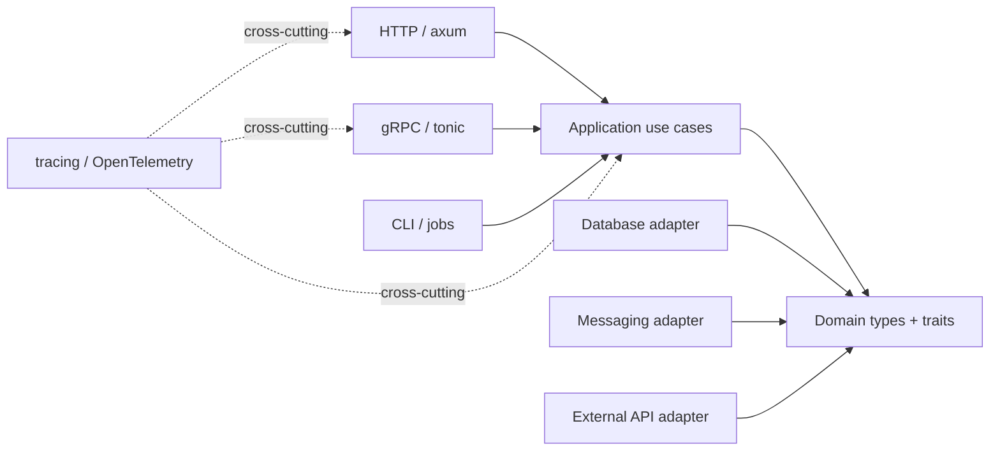
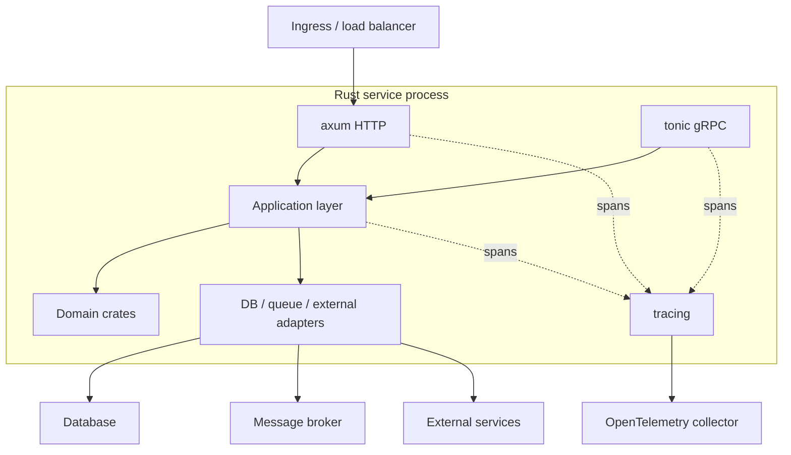
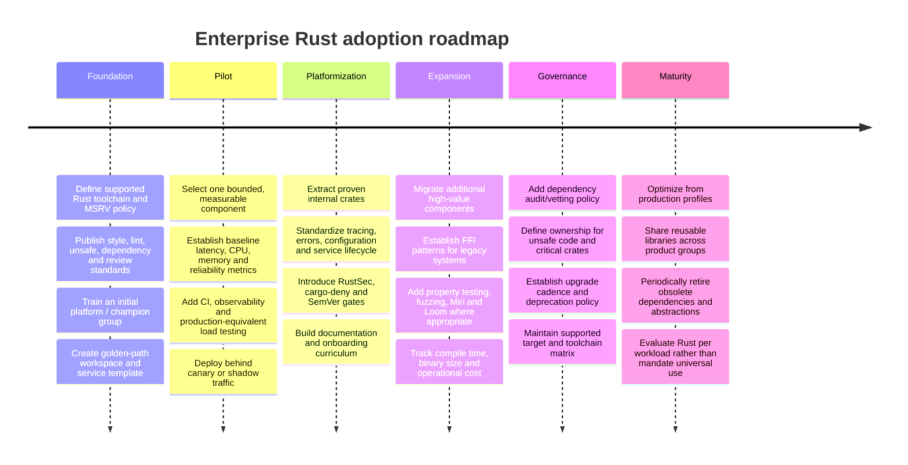

# Enterprise Rust Best Practices for High-Quality, Efficient, Reusable Code

## Executive summary

Rust is a strong enterprise choice when the engineering objective is not merely “make this component fast,” but rather **make performance, resource ownership, concurrency correctness, and API contracts explicit enough that they remain understandable under long-term maintenance**. Rust’s ownership and borrowing model allows memory to be managed without a garbage collector; its `Send`/`Sync` model extends memory-safety reasoning across threads; Cargo supplies a standardized build/dependency model; and the ecosystem provides first-class tooling for formatting, linting, testing, fuzzing, benchmarking, unsafe-code checking, supply-chain auditing, and observability. The Rust API Guidelines explicitly emphasize naming consistency, standard trait implementations, useful error types, documentation, flexibility, type safety, future-proofing, and stable public dependencies. citeturn5view0turn4view3

For enterprise use, the most important architectural principle is:

> **Treat Rust’s type system as an architectural tool, not merely as a compiler constraint.**

Represent validated states with types, borrow instead of copy when ownership is unnecessary, expose small capability-oriented traits rather than framework-shaped abstractions, keep representations private, and make illegal states difficult to construct. Rust’s API Guidelines specifically recommend type-driven validation, newtypes, private fields, sealed traits where downstream implementations would constrain evolution, and avoiding unnecessary generic bounds that later become compatibility liabilities. citeturn5view2turn5view3

Performance should likewise be empirical rather than stylistic. Generic/static dispatch can allow specialization and inlining through monomorphization, while trait objects provide runtime polymorphism and smaller homogeneous machine-code paths at the cost of dynamic dispatch; neither should be selected dogmatically. Release-profile settings such as optimization level, LTO, and code-generation units materially affect generated code, and Cargo itself cautions that a nominally “higher” optimization level does not universally mean faster code. Profile production-like workloads before redesigning APIs around presumed performance characteristics. citeturn5view1turn6view0

For concurrency, **safe Rust should be the default abstraction boundary**. `Send` and `Sync` are unsafe marker traits whose incorrect manual implementations can cause undefined behavior. `Cell` and `RefCell` provide single-threaded interior mutability, while shared multithreaded mutation generally belongs behind locks, atomics, or another synchronization abstraction. Data races are undefined behavior; atomics are low-level primitives rather than a blanket replacement for locks. Complex lock-free code deserves dedicated model testing with Loom plus undefined-behavior checking with Miri. citeturn4view3turn4view6turn4view5turn8view3turn19view3

For services, use asynchronous Rust where the workload is dominated by large numbers of independently waiting I/O operations; do not use async simply because a service is “modern.” Tokio explicitly separates asynchronous core threads from blocking work and recommends `spawn_blocking` for bounded blocking operations and specialized pools such as Rayon for CPU-bound workloads. Rayon is designed to transform sequential data-parallel computations into parallel ones while preserving data-race-free execution. citeturn7view0turn18view1

For quality assurance, an enterprise Rust pipeline should go materially beyond `cargo test`: formatting, Clippy, unit/integration/doctests, property tests, fuzzing, dependency auditing, SemVer checks, targeted Miri/Loom jobs, and benchmark regression tracking should form progressive gates. Rust’s built-in test system supports unit and integration testing; `proptest` adds generated property tests; the Rust Fuzz Book recommends `cargo-fuzz` with libFuzzer; nextest adds process-per-test execution, retries, timeouts, sharding and JUnit output; and Criterion performs statistics-based microbenchmarking. citeturn8view0turn8view1turn8view2turn9view0turn7view3

For dependencies, centralize governance at the Cargo workspace level. Workspaces share a lockfile and target directory and can inherit package metadata, dependencies, and lint settings. Feature flags should be designed as **additive capabilities**, not as hidden configuration switches; Cargo warns that removing a default feature can constitute a SemVer-incompatible change. Supply-chain controls should combine RustSec/`cargo audit`, `cargo-deny`, and, where assurance requirements warrant it, `cargo-vet`. citeturn1view2turn1view3turn9view1turn9view2turn9view3

The strongest migration strategy is incremental. Cloudflare replaced critical proxy infrastructure with its Rust-based Pingora and reported roughly **70% lower CPU and 67% lower memory usage** under the same traffic load, while serving over a trillion requests per day; importantly, Cloudflare attributes the improvement not only to the language but also to architectural changes such as connection reuse and more efficient shared-state access. citeturn14view0turn14view1 Discord similarly migrated one hot-path service from Go to Rust after garbage-collection-related latency spikes; it began with a relatively direct port, profiled the result, optimized data structures and copies, load-tested it, deployed one canary node, and then rolled it across the fleet. Discord explicitly cautioned against rewriting everything merely because Rust exists. citeturn14view3turn14view4turn14view5

**Scope assumptions.** No specific enterprise domain, regulatory regime, CPU architecture, operating system, latency SLO, minimum supported Rust version (MSRV), deployment platform, FFI language, or team size was specified. The recommendations below therefore target general-purpose enterprise libraries, backend services, infrastructure software, CLIs, and performance-sensitive components built primarily on stable Rust. Safety-critical, embedded, kernel, financial low-latency, or regulated environments should strengthen the verification and dependency-governance layers.

| Area | Enterprise default | Escalate when |
|---|---|---|
| API | Borrowed inputs, typed outputs/errors, small traits, private representations | Dynamic plugins, ABI boundaries, highly generic libraries |
| Concurrency | Immutable data → message passing → lock → atomics, in roughly that preference order | Profiling proves synchronization is a bottleneck |
| I/O | Synchronous code when concurrency needs are modest; Tokio when high-concurrency async I/O materially helps | Runtime/ecosystem requirements dictate otherwise |
| CPU work | Ordinary synchronous code; Rayon for measured parallel work | Explicit scheduling/control is required |
| Errors | Typed `std::error::Error`/`thiserror` in reusable libraries; contextual `anyhow` at application boundaries | Stable machine-readable external error protocols |
| Testing | Unit + integration + doctest + property tests | Fuzz/Miri/Loom for parsers, unsafe code and concurrency |
| Dependencies | Workspace-centralized versions/features + RustSec/deny | Audited supply chain with `cargo-vet` |
| FFI | Tiny unsafe boundary wrapped by safe Rust | Existing large C/C++ ABI requires generated bridges |
| Observability | `tracing` + OpenTelemetry at service boundaries | Minimal libraries may depend only on `log` |
| Deployment | Pinned toolchain, locked dependencies, release-profile build, immutable artifact | Cross-compilation or specialized native dependencies |

These defaults align with Rust's API, Cargo, concurrency, testing, and ecosystem guidance. citeturn5view0turn1view2turn4view6turn19view2

## Standards and reusable API design

**Formatting, naming, and layout.** An enterprise Rust organization should minimize local style invention. The official Rust Style Guide frames automatic formatting as a means of reducing argument and cognitive overhead and specifies conventions including four-space indentation, standard comment/doc-comment formatting, and conventional line wrapping. Make `rustfmt` authoritative instead of relying on reviewer taste. Rust API naming should follow ecosystem conventions for case, getters, conversions, and iterators so that unfamiliar internal libraries “feel like Rust” to developers. citeturn3view0turn5view0

A practical repository structure is:

```text
enterprise-platform/
├── Cargo.toml                 # workspace policy
├── Cargo.lock                 # committed for applications/workspace reproducibility
├── rust-toolchain.toml        # organization-approved toolchain
├── crates/
│   ├── domain/                # business/domain types; minimal dependencies
│   ├── application/           # use cases / orchestration
│   ├── persistence/           # DB/storage adapters
│   ├── transport-http/        # axum handlers
│   ├── transport-grpc/        # tonic handlers
│   └── observability/         # tracing/metrics configuration
├── services/
│   ├── billing-service/
│   └── gateway/
├── tools/                     # workspace-native admin/migration tools
└── fuzz/
```

Cargo workspaces are designed to group related packages with a common `Cargo.lock`, output directory, metadata, profile configuration and patch configuration; current workspace facilities also permit inheritance of package metadata, dependency declarations and lint configuration. Modules remain private by default, so `pub` should be treated as an intentional API commitment rather than a convenience modifier. citeturn1view2turn2search1

A useful layering rule is **dependencies point inward**:



The key is not “clean architecture” terminology; it is preventing transport, persistence, and runtime choices from contaminating the reusable domain API.

**Traits and generics.** Prefer traits representing a capability required by the caller, not giant interfaces mirroring an implementation. Prefer generic/static dispatch when the abstraction is performance-sensitive and heterogeneity is unnecessary; use `dyn Trait` when runtime substitution, heterogeneous collections, plugin boundaries, or code-size concerns justify dynamic dispatch. Rust’s API Guidelines emphasize the flexibility gained by generic inputs such as `IntoIterator` while documenting tradeoffs including monomorphized code size and more verbose signatures. citeturn5view1

```rust
use std::time::SystemTime;

#[derive(Debug, Clone, Copy, PartialEq, Eq, Hash)]
pub struct CustomerId(u64);

impl CustomerId {
    pub fn new(value: u64) -> Option<Self> {
        (value != 0).then_some(Self(value))
    }

    pub fn get(self) -> u64 {
        self.0
    }
}

#[derive(Debug, Clone)]
pub struct Customer {
    pub id: CustomerId,
    pub updated_at: SystemTime,
}

/// Capability required by the use case, rather than a database-shaped API.
pub trait CustomerRepository {
    type Error: std::error::Error + Send + Sync + 'static;

    fn find(&self, id: CustomerId) -> Result<Option<Customer>, Self::Error>;
}

pub fn load_customer<R>(
    repository: &R,
    id: CustomerId,
) -> Result<Option<Customer>, R::Error>
where
    R: CustomerRepository,
{
    repository.find(id)
}
```

This example encodes a validated identifier as a newtype rather than passing an unconstrained integer through the system. Rust’s API Guidelines specifically recommend newtypes and static validation where practical. citeturn5view2turn5view3

Avoid adding bounds merely because one current implementation needs them:

```rust
// Less future-proof: every Widget<T> is permanently constrained.
pub struct Widget<T: Clone + Send> {
    value: T,
}

// Better: constrain only operations that actually need the capability.
pub struct Widget<T> {
    value: T,
}

impl<T: Clone> Widget<T> {
    pub fn duplicate(&self) -> T {
        self.value.clone()
    }
}
```

Adding or removing public trait bounds can affect downstream users, and the API Guidelines explicitly recommend avoiding unnecessary bounds on generic type definitions. citeturn5view3

**Ownership in API signatures.** A good enterprise convention is:

```rust
// Observe text: borrow.
fn validate_name(name: &str) -> bool { /* ... */ true }

// Store text: take ownership.
struct User {
    name: String,
}

impl User {
    fn new(name: String) -> Self {
        Self { name }
    }
}

// Accept a sequence without forcing callers to allocate a Vec.
fn ingest<T>(items: impl IntoIterator<Item = T>) {
    for item in items {
        // ...
    }
}
```

The Rust API Guidelines recommend taking ownership when the callee needs ownership and borrowing otherwise; generic iterator-style parameters can avoid forcing a caller into a particular intermediate collection. citeturn5view1

**Error handling.** Reusable libraries should normally expose semantically meaningful error types. `thiserror` generates normal implementations of `std::error::Error` and explicitly does not become part of the caller-visible API mechanism, meaning a crate can later replace the derive with handwritten implementations without creating that dependency in its public contract. It also supports source chains and opaque public error wrappers whose private representation can evolve. `anyhow`, by contrast, provides a convenient erased error type and context attachment suited to application code where callers usually log/report rather than exhaustively pattern-match every failure. citeturn17view0turn17view1turn17view2

```rust
use thiserror::Error;

#[derive(Debug, Error)]
pub enum ParseOrderError {
    #[error("order ID is empty")]
    EmptyId,

    #[error("invalid amount: {0}")]
    InvalidAmount(String),
}

pub fn parse_order(input: &str) -> Result<Order, ParseOrderError> {
    // Parse, validate, return domain-specific errors.
    # unimplemented!()
}

// At the executable / orchestration boundary:
fn run() -> anyhow::Result<()> {
    let config = std::fs::read_to_string("service.toml")
        .map_err(anyhow::Error::from)
        .map_err(|e| e.context("reading service configuration"))?;

    # let _ = config;
    Ok(())
}
```

`anyhow` explicitly recommends adding context so a low-level error such as a missing file can be understood in terms of the application operation that failed. citeturn17view2turn17view3

**Versioning.** Assume every `pub` type, trait method, generic bound, feature, re-export, error variant that callers match, and well-defined representation is part of a compatibility surface. Cargo's SemVer guidance categorizes removal/renaming of public items and changes to well-defined representation as major changes, while recommending deprecation/re-export migration paths for renames. Automated `cargo-semver-checks` can compare a proposed API against a previous crate version or source baseline and report likely SemVer violations. citeturn4view2turn18view2

For long-lived libraries, use private fields and constructor/accessor methods rather than exposing representation directly. Seal extension traits when allowing arbitrary downstream implementations would make future methods or invariants impossible to add safely. citeturn5view3

**API anti-patterns**

| Anti-pattern | Why it hurts | Prefer |
|---|---|---|
| `fn process(v: Vec<T>)` when only reading | Forces allocation/ownership transfer | `&[T]` or iterator/generic input citeturn5view1 |
| Stringly typed IDs/states | Invalid values propagate until runtime | Newtypes/enums citeturn5view2 |
| Public struct fields everywhere | Representation becomes compatibility contract | Private fields + constructors/accessors citeturn5view3 |
| Giant “service” traits | Broad coupling and difficult mocking/substitution | Small capability-oriented traits |
| `Box<dyn Error>` throughout libraries | Callers lose domain semantics | Typed errors; erase at application boundary citeturn17view0turn17view2 |
| Panics for expected failures | Turns ordinary input/environment failures into process-control events | `Result`/`Option` |
| Excessive `.clone()` to appease borrow checker | Often hides unclear ownership and adds work | Redesign ownership/lifetimes, then measure |
| Blanket `Arc<Mutex<_>>` architecture | Hides ownership and can serialize unrelated operations | Explicit ownership/message passing; narrow synchronization |
| Public dependencies re-exported incidentally | Upstream changes can become your SemVer problem | Stable façade types/re-exports intentionally citeturn5view0 |

## Performance, concurrency, and safety

Rust's performance advantage is best understood as **control without requiring unsafe code for ordinary systems programming**. Borrowing permits code to pass references rather than copy data, while generic abstractions can be specialized at compile time. The important enterprise corollary is that abstraction and performance do not have to be opposing goals—but the compiler cannot rescue poor algorithms, unnecessary allocation, pathological synchronization, or bad I/O architecture. citeturn7view6turn5view1

**A practical optimization sequence**

1. Define an observable objective—P50/P95/P99 latency, throughput, allocations/request, CPU/request, RSS, startup time, or binary size.
2. Benchmark representative workloads.
3. Profile before changing architecture.
4. Remove algorithmic problems first.
5. Reduce unnecessary copies and allocations.
6. Improve locality/data layout.
7. Address contention.
8. Only then consider unsafe code, custom allocators, lock-free structures, SIMD, or representation tricks.

Criterion provides statistical benchmarking and persists measurements so regressions can be detected; `cargo-flamegraph` integrates Rust builds with flamegraph profiling. Cargo release profiles provide controls including optimization level, debug information, LTO and code-generation units, and Cargo explicitly notes that the optimal setting is workload-dependent rather than simply “maximum number wins.” citeturn7view3turn7view4turn6view0

**Zero-cost abstractions.** “Zero cost” should be an engineering target, not a blanket claim about every Rust abstraction. Static generics allow monomorphization and optimization for concrete types; `dyn Trait` intentionally performs runtime dispatch. The reusable API decision should reflect whether callers need compile-time specialization or runtime heterogeneity. citeturn5view1

```rust
// Static dispatch: specialized for each concrete implementation.
fn encode<E: Encoder>(encoder: &E, input: &[u8]) -> Vec<u8> {
    encoder.encode(input)
}

// Dynamic dispatch: runtime-selected implementation.
fn encode_dynamic(encoder: &dyn Encoder, input: &[u8]) -> Vec<u8> {
    encoder.encode(input)
}
```

Do not rewrite every `dyn Trait` as a generic or vice versa. Measure hot paths; keep cold administrative/configuration paths simple.

**Memory layout.** `repr(Rust)` does not promise C-compatible field order or a stable binary layout. Use `#[repr(C)]` where ABI compatibility is required, and never serialize ordinary Rust structs by assuming their in-memory representation is stable. The Reference defines `Rust`, `C`, primitive and `transparent` representation families, while the Rustonomicon states that C-compatible struct layout requires `#[repr(C)]`. citeturn4view4turn16view0

```rust
#[repr(C)]
pub struct Header {
    pub version: u32,
    pub flags: u32,
}
```

Even there, `repr(C)` solves layout compatibility, not ownership, lifetime, pointer-validity, or thread-safety problems.

**Allocation strategy.** `Vec<T>` is a contiguous growable array, making it a good default for cache-friendly sequential storage. Reuse buffers and reserve capacity when a reliable size estimate exists rather than repeatedly growing collections. Do not introduce pools or arenas automatically: they add lifetime and reclamation complexity and should be justified by allocation profiles. citeturn7view5

Typical low-risk patterns are:

```rust
fn build_payload(records: &[Record]) -> Vec<u8> {
    let estimated = records.len().saturating_mul(64);
    let mut out = Vec::with_capacity(estimated);

    for record in records {
        record.encode_into(&mut out);
    }

    out
}
```

and APIs that write into caller-owned buffers:

```rust
fn encode_into(record: &Record, out: &mut Vec<u8>) {
    // Reuses allocation owned by caller.
}
```

**Async versus sync.** Tokio's runtime uses core threads for async tasks and separate blocking threads when requested; its documentation directs blocking operations to `spawn_blocking` and suggests a dedicated CPU-oriented pool such as Rayon for substantial CPU-bound work. This distinction is fundamental: async improves utilization while work is *waiting*; it does not magically make computation parallel. citeturn7view0turn18view1

```rust
async fn handle(request: Request) -> Result<Response, Error> {
    let bytes = fetch_over_network(request.key()).await?;

    // Keep expensive CPU work off the async executor.
    let parsed = tokio::task::spawn_blocking(move || parse_large_document(bytes))
        .await??;

    Ok(Response::from(parsed))
}
```

For a sustained CPU pipeline, a dedicated Rayon pool is generally clearer than repeatedly dispatching large CPU jobs onto an I/O runtime. Rayon exposes parallel iterators, fork/join operations and configurable thread pools and guarantees data-race-free execution through its safe API. citeturn18view1

**Runtime comparison**

| Runtime | Strengths | Costs / cautions | Enterprise fit |
|---|---|---|---|
| **Tokio** | Multithreaded async runtime, I/O, timers, synchronization; explicit blocking APIs; tightly integrated with much of the server ecosystem citeturn7view0 | Runtime-specific APIs can leak through architecture; blocking CPU work must be isolated | **Default for high-concurrency backend/network services** |
| **async-std** | APIs modeled around familiar `std` concepts; task, synchronization, channel, I/O and timeout support citeturn7view1 | Smaller ecosystem footprint than Tokio in common service stacks; validate current dependency compatibility before standardizing | Appropriate where its API/ecosystem is specifically desired |
| **smol** | Small meta-runtime composed from focused crates; supports executor and blocking adapters citeturn7view2 | More explicit composition; Tokio-oriented third-party dependencies can require adaptation | Good for small/modular runtimes or specialized applications |
| **No async runtime** | Lowest conceptual/runtime complexity | Thread-per-operation models may not scale to very high numbers of waiting operations | **Best default until workload demonstrates need for async** |

**`Send`, `Sync`, and interior mutability.** `T: Send` means ownership may safely cross thread boundaries; `T: Sync` means shared references can safely be used from multiple threads. Both are unsafe marker traits, normally auto-derived from members. Raw pointers, `UnsafeCell`, `Rc`, and related types intentionally affect auto-derivation, and incorrect manual implementations can create undefined behavior. citeturn4view3

A code review should therefore treat this:

```rust
unsafe impl Send for MyType {}
unsafe impl Sync for MyType {}
```

as a security/soundness-sensitive proof obligation—not boilerplate.

For interior mutability, `Cell`, `RefCell` and `OnceCell` serve single-threaded patterns; `RefCell` enforces borrowing at runtime and can panic when its rules are violated. Shared multithreaded mutation should instead use synchronization such as `Mutex`, `RwLock`, `OnceLock`, or atomics as appropriate. citeturn4view6

**Lock-free programming.** Rust's atomics follow a C++20-like shared-memory model, and data races are undefined behavior. Crossbeam adds concurrent queues, channels, work-stealing structures and epoch-based reclamation for advanced concurrent structures. This is powerful machinery, but “lock-free” should be adopted because profiling and latency requirements justify the correctness complexity, not because a mutex appears aesthetically unsophisticated. citeturn4view5turn18view0

For custom atomic algorithms, add Loom tests. Loom repeatedly executes concurrent code under different valid schedules to expose synchronization bugs that ordinary tests rarely trigger; its own documentation also warns about combinatorial state-space growth. Miri can detect data races, out-of-bounds access, use-after-free, invalid alignment, uninitialized data and some aliasing violations, although it explicitly does not prove soundness and recommends specialized tools such as Loom for complicated atomic behavior. citeturn8view3turn19view3

```rust
use std::sync::atomic::{AtomicU64, Ordering};

pub struct Counters {
    requests: AtomicU64,
}

impl Counters {
    pub fn record_request(&self) {
        // Relaxed is sufficient only because this is an independent statistic;
        // no other memory ordering is being communicated through the counter.
        self.requests.fetch_add(1, Ordering::Relaxed);
    }

    pub fn requests(&self) -> u64 {
        self.requests.load(Ordering::Relaxed)
    }
}
```

The `Ordering::Relaxed` choice above is appropriate only for an independent counter; copying that ordering into synchronization algorithms without proving the required happens-before relationships is an anti-pattern.

**Performance and concurrency review checklist**

- Has a performance requirement been stated in measurable terms?
- Is a benchmark representative of production data sizes and access patterns?
- Are large `.clone()`, `.to_owned()`, `.collect()`, `format!`, serialization, and allocation sites understood?
- Does the API borrow data that it only observes?
- Are collections selected for observed access patterns rather than fashion?
- Is any reliance on `repr(Rust)` layout eliminated? citeturn4view4
- Is blocking code kept off the async executor? citeturn7view0
- Are critical sections narrow and free of unnecessary I/O?
- Does every manual `unsafe impl Send/Sync` contain a reviewable safety argument? citeturn4view3
- Is unsafe code localized behind a safe API?
- Does sophisticated atomic code have Loom/Miri coverage? citeturn8view3turn19view3
- Were release-profile alternatives measured instead of assumed? citeturn6view0

## Testing, QA, and developer workflow

Rust's compiler eliminates important bug classes, but a successful compilation is not evidence that business behavior, distributed-system behavior, unsafe invariants, performance or compatibility is correct. An enterprise QA model should deliberately cover different failure classes.

| Layer/tool | Finds | Strength | Limitation |
|---|---|---|---|
| `#[test]` / integration tests | Deterministic functional regressions | Built in, simple, fast citeturn8view0 | Only cases engineers wrote |
| Rustdoc doctests | Documentation/API drift | Examples become executable tests | Keep examples realistic; nextest does not execute doctests itself citeturn9view0 |
| `proptest` | Broad input-space failures/invariants | Generates and shrinks cases via strategies citeturn8view1 | Requires useful properties |
| `cargo-fuzz` | Parser/decoder/input crashes and unusual states | libFuzzer-backed coverage-guided fuzzing recommended by Rust Fuzz Book citeturn8view2 | Needs good fuzz targets/corpus |
| nextest | Large test-suite execution | Process isolation, retries, timeouts, sharding, JUnit support citeturn9view0 | Doctests require separate `cargo test --doc` |
| Miri | Undefined behavior in exercised code | Detects use-after-free, invalid access, data races, aliasing issues citeturn19view3 | Slow; does not prove soundness; FFI/platform limitations |
| Loom | Concurrency interleavings | Deterministically explores many scheduler executions citeturn8view3 | State-space explosion; code generally needs Loom-compatible primitives |
| Criterion | Micro-performance regression | Statistical benchmark analysis and persisted measurements citeturn7view3 | Microbenchmarks are not production traces |

A property test tends to be more valuable than hundreds of hand-picked examples for codecs, parsers, transformations, state machines and normalization:

```rust
use proptest::prelude::*;

proptest! {
    #[test]
    fn encoding_round_trip(values in prop::collection::vec(any::<u32>(), 0..1_000)) {
        let encoded = encode(&values);
        let decoded = decode(&encoded).expect("our own output must decode");

        prop_assert_eq!(decoded, values);
    }
}
```

`proptest` provides strategies and macros for generated property testing rather than limiting tests to manually selected examples. citeturn8view1

**Recommended CI shape**

```text
Pull request — fast gates
    rustfmt --check
    cargo check
    clippy
    unit + integration + doctests
    selected property tests
    dependency policy checks

Pull request — compatibility/specialized gates
    MSRV build, when promised
    cargo-semver-checks for published libraries
    platform/feature matrix
    nextest
    representative benchmark smoke checks

Scheduled / release
    cargo audit / cargo deny
    longer fuzz campaigns
    Miri for unsafe/sensitive crates
    Loom concurrency tests
    full Criterion regression suite
    cross-platform/cross-target builds
```

Clippy's current lint catalog spans correctness, suspicious constructs, complexity, performance, style, Cargo metadata and more. For suppressions, prefer narrowly scoped exceptions with a reason; Clippy has specific facilities encouraging reasoned lint allowances and `#[expect]` can expose when an expected lint is no longer triggered. citeturn3view1

A useful baseline:

```bash
cargo fmt --all -- --check

cargo clippy --workspace --all-targets --all-features -- \
  -D warnings

cargo test --workspace
cargo test --doc

cargo nextest run --workspace

cargo audit
cargo deny check
```

Do not mechanically use `--all-features` where your features intentionally represent mutually incompatible target/back-end choices; test supported feature combinations explicitly. Cargo features control conditional compilation and optional dependencies and are unified in dependency resolution in ways that API designers need to account for. citeturn1view3

**Code-review checklist**

| Review dimension | Reviewer questions |
|---|---|
| Correctness | Are invalid states encoded in types where practical? Are integer/size/Unicode/boundary conditions tested? |
| Ownership | Is ownership transferred intentionally? Are clones hiding an unclear design? |
| API | Is `pub` necessary? Are naming and standard traits idiomatic? citeturn5view0 |
| Errors | Can callers distinguish actionable errors? Is diagnostic context added at boundaries? citeturn17view2 |
| Concurrency | Is shared mutation necessary? Could ownership/message passing be simpler? Are lock scopes obvious? |
| Async | Are blocking operations isolated? Is cancellation behavior understood? |
| Performance | Is an optimization supported by benchmark/profile evidence? |
| Unsafe | What invariant makes each unsafe operation sound? Is the unsafe surface smaller than before? |
| Dependencies | Is the new crate necessary, maintained, licensed appropriately and feature-minimized? |
| SemVer | Does this alter public types, trait bounds, representations, features or behavior? citeturn4view2turn18view2 |
| Testing | Is the regression represented at the most appropriate level—example, property, fuzz, Miri or Loom? |
| Docs | Do public APIs explain examples, errors, panics and safety obligations? citeturn5view0turn17view4 |
| Observability | Will an operator be able to diagnose this path without reproducing it locally? |

**Documentation and onboarding.** Rustdoc guidance recommends that public APIs be documented and that documentation include copyable examples. It recommends a front-page example showing realistic usage and a `# Panics` section when callers can encounter known panic conditions. The API Guidelines additionally call for documenting errors, panics, safety requirements and examples. citeturn17view4turn17view5turn5view0

A good crate front page should answer, in order:

```rust
//! Domain types and operations for enterprise billing.
//!
//! # Example
//!
//! ```
//! use billing_domain::Money;
//!
//! let amount = Money::usd_cents(1_250);
//! assert_eq!(amount.cents(), 1_250);
//! ```
//!
//! # Design guarantees
//!
//! Monetary values are represented as integral minor units.
//!
//! # Errors
//!
//! Parsing rejects values that cannot be represented exactly.
```

For onboarding, maintain one small **golden-path service** showing the organization's approved workspace layout, error approach, tracing setup, testing conventions, CI, configuration model and deployment structure. Rustdoc should be the reference for APIs; a short architectural tutorial should explain *why* the organization uses its particular patterns. The official rustdoc guidance stresses that users should be able to identify a crate's purpose and see a real-world example immediately. citeturn17view4

## Dependencies and crate governance

Cargo makes large monorepos practical, but an enterprise should distinguish **dependency convenience** from **dependency governance**. Centralize shared versions and lint policy at the workspace root, keep leaf crates focused, and separate public libraries from executable/service crates so that release/versioning rules can differ. Cargo workspaces share a lockfile and support inherited dependency and lint configuration. citeturn1view2

Example:

```toml
[workspace]
resolver = "3"
members = [
    "crates/domain",
    "crates/application",
    "crates/persistence",
    "services/api",
]

[workspace.dependencies]
serde = { version = "1", features = ["derive"] }
tracing = "0.1"
thiserror = "2"

[workspace.lints.rust]
unsafe_code = "deny"

[workspace.lints.clippy]
dbg_macro = "deny"
todo = "warn"

[profile.release]
opt-level = 3
lto = "thin"
```

Cargo documents workspace-level dependency and lint inheritance as well as centralized profile configuration. The `lto` setting above is an example to benchmark, not a universally optimal prescription; Cargo documents both the optimization opportunity and compile-time tradeoff. citeturn1view2turn6view0

**Feature-flag discipline.** Features should normally be additive:

```toml
[features]
default = ["tls"]
tls = ["dep:rustls"]
metrics = ["dep:opentelemetry"]
```

Avoid designs such as `backend-a` versus `backend-b` that become invalid when both are enabled unless there is no practical alternative. Cargo documents optional dependencies and feature unification, and explicitly notes that removing a feature from the default feature set can be SemVer-incompatible because downstream users receive defaults automatically. citeturn1view3

**Supply-chain controls**

| Tool | Primary purpose | Pros | Cons / boundary |
|---|---|---|---|
| `cargo audit` / RustSec | Scan `Cargo.lock` against RustSec advisories | Simple vulnerability gate; RustSec is maintained by the Rust Secure Code WG citeturn9view1 | Vulnerability database is not a full dependency-policy system |
| `cargo-deny` | Advisories, licenses, banned crates/versions, source policy | Central policy suitable for CI citeturn9view2 | Policy requires maintenance and exceptions |
| `cargo-vet` | Record/import human audits of third-party dependency code | Stronger assurance model and shareable audits citeturn9view3 | More organizational effort; project documents active-development considerations |
| `cargo tree` | Inspect dependency graph/features/duplicates | Built into Cargo; `--duplicates` exposes parallel versions citeturn9view4 | Diagnostic, not policy enforcement |
| `cargo-semver-checks` | Detect API compatibility regressions | CI automation against release or VCS baseline citeturn18view2 | Does not claim to detect every possible behavioral compatibility problem |

A sensible policy is to require a reason for every new production dependency: problem solved, maintenance/security assessment, license, default-feature review, transitive-dependency impact, MSRV implications, and a replacement/removal strategy for unusually critical dependencies.

This matters because ecosystem status changes. A particularly important current example is **bincode**: its 3.0.0 documentation states that the project is unmaintained, that development has ceased, and that the final release intentionally does not provide a normal working implementation. As of September 27, 2026, that makes bincode a poor default for new enterprise protocol decisions even if older 2.x deployments remain operational. citeturn10view2

**Serialization comparison**

| Choice | Best fit | Advantages | Concerns |
|---|---|---|---|
| **Serde + serde_json** | HTTP/configuration/interchange JSON | Serde is trait-based without runtime reflection; typed deserialization gives compile-time structure and JSON can also be represented dynamically via `Value` citeturn10view0turn10view1 | JSON size/CPU higher than purpose-built binary formats in many workloads; dynamic `Value` weakens type checking |
| **rmp-serde** | MessagePack interop | Serde integration with compact MessagePack representation citeturn11view6 | Its docs warn that ordinary byte-slice serialization can add substantial overhead unless binary representation is selected |
| **prost** | Protobuf/gRPC schemas | Natural fit with generated protobuf models and tonic-based gRPC stacks citeturn11view9turn11view5 | Schema/code-generation workflow; generated types may deserve translation at domain boundaries |
| **postcard** | Compact Serde-oriented binary encoding | Designed for compact serialization, useful in constrained/protocol settings citeturn11view7 | Validate ecosystem/tooling compatibility with non-Rust consumers |
| **rkyv** | Specialized archived/zero-copy-oriented workloads | Designed around archived representations and avoiding conventional deserialization in suitable workloads citeturn11view8 | More representation/invariant complexity; benchmark and threat-model untrusted inputs carefully |
| **bincode** | Legacy deployments only | Existing ecosystem history | Current 3.0 docs mark project unmaintained; **do not standardize for new enterprise work without an explicit risk decision** citeturn10view2 |

Serialization formats exposed over a service or storage boundary should be treated as versioned protocols, not implementation details. Changing a Rust struct and recompiling every producer and consumer is not a long-term enterprise compatibility strategy.

## Architecture, integration, observability, and deployment

For enterprise systems, Rust works especially well when architecture is divided into a **stable domain/core** and replaceable edges. Keep async runtimes, HTTP frameworks, database clients, generated protobuf types, cloud SDKs and FFI bindings near adapter boundaries. This both improves reusable code and limits the migration cost if an ecosystem choice changes.

For HTTP services, Axum provides routing, handlers/extractors and error handling while integrating with Tokio. For gRPC, tonic provides an HTTP/2-based gRPC implementation using Tokio, Hyper and Tower components. These are complementary rather than competing technologies: an organization can expose REST/HTTP at public boundaries and gRPC internally while sharing domain/application crates beneath both transports. citeturn11view4turn11view5

**Dependency injection.** Rust rarely needs a heavyweight DI container as a starting point because constructors, generics and traits already make dependencies explicit.

```rust
pub trait PaymentGateway: Send + Sync {
    fn charge(&self, request: Charge) -> Result<Receipt, GatewayError>;
}

pub struct Checkout<G> {
    gateway: G,
}

impl<G: PaymentGateway> Checkout<G> {
    pub fn new(gateway: G) -> Self {
        Self { gateway }
    }

    pub fn execute(&self, charge: Charge) -> Result<Receipt, GatewayError> {
        self.gateway.charge(charge)
    }
}
```

| DI approach | Strength | Cost | Recommendation |
|---|---|---|---|
| Explicit constructors + concrete types | Maximum transparency, strongest static reasoning, minimal machinery | More wiring in composition root | **Enterprise default** |
| Constructor + `Arc<dyn Trait>` | Runtime substitution and heterogeneous implementations | Dynamic dispatch and object-safety constraints | Excellent at service/plugin boundaries |
| Generics | Static dispatch and strong compile-time composition | Type signatures/code generation can grow | Performance-sensitive reusable components |
| **Shaku** | Compile-time DI modules, component/provider overrides; thread-safe mode requires `Send + Sync` citeturn19view4 | Macros/container concepts add framework abstraction | Use when dependency graphs/overrides genuinely benefit from a container |

**Logging and observability comparison**

| Tool | Model | Pros | Cons / role |
|---|---|---|---|
| **tracing** | Structured events + spans + subscribers | Captures causal/temporal span context; `#[instrument]`; disabled spans/events can be filtered before construction citeturn11view0 | Requires subscriber configuration; richer model than basic logging |
| **log** | Lightweight logging façade | Libraries can depend on facade while applications choose implementation; simple macros citeturn11view1 | Lacks tracing's native span-oriented execution model |
| **slog** | Explicit structured logging with composable drains | Structured values, modular drains, compile-time filtering and async-output support citeturn11view2 | More explicit logger/drain plumbing |
| **OpenTelemetry Rust** | Traces, metrics and logs across service boundaries | Standardized observability model; traces represent request flow as trees of spans; Rust API includes metrics/log support citeturn19view2 | Exporter/provider lifecycle and telemetry overhead require operational configuration |

For new distributed services, an effective default is `tracing` inside the application with an OpenTelemetry-compatible export layer at process boundaries. For reusable libraries intended for a broad ecosystem, either `tracing` or the lighter `log` façade may be appropriate depending on whether span context is intrinsic to the library. citeturn11view0turn11view1turn19view2

Operational instrumentation should make key identifiers and state transitions structured fields rather than interpolated prose:

```rust
use tracing::{info, instrument};

#[instrument(
    skip(repository),
    fields(customer_id = %id.get())
)]
async fn refresh_customer<R>(
    repository: &R,
    id: CustomerId,
) -> Result<(), RefreshError>
where
    R: CustomerRepository + Sync,
{
    info!("refresh started");

    // ...

    info!("refresh completed");
    Ok(())
}
```

**FFI strategy.** Unsafe foreign APIs should terminate at a narrow boundary and immediately become safe Rust abstractions. The Rustonomicon explicitly recommends wrapping raw C interfaces in high-level safe interfaces; it notes that the compiler cannot validate foreign declarations and that raw pointers fall outside Rust's ordinary safe memory model. citeturn16view0

```rust
mod sys {
    unsafe extern "C" {
        pub fn legacy_checksum(
            data: *const u8,
            len: usize,
        ) -> u32;
    }
}

/// Safe enterprise-facing wrapper.
///
/// Safety proof is localized here:
/// `bytes.as_ptr()` remains valid for `bytes.len()` during the call.
pub fn checksum(bytes: &[u8]) -> u32 {
    // SAFETY:
    // - pointer originates from a live slice;
    // - len exactly matches that slice;
    // - foreign function does not retain the pointer.
    unsafe { sys::legacy_checksum(bytes.as_ptr(), bytes.len()) }
}
```

For existing C/C++ headers, `bindgen` automatically generates Rust FFI bindings. For jointly controlled Rust/C++ boundaries, CXX provides statically checked bridge definitions and describes its bridge as safe Rust/C++ interoperation with zero or negligible boundary overhead for supported types. citeturn19view1turn19view0

At C ABI boundaries, use representation types deliberately. Rustonomicon notes that `#[repr(C)]` is required for C-compatible struct layout and that FFI callbacks invoked from foreign threads require careful synchronization and lifetime/deregistration guarantees. citeturn16view0

**Service and deployment architecture**



Deployment should preserve the same artifact through environments where possible. Build with an explicitly selected release profile, pin the toolchain used in CI/release, test every supported target architecture, and exercise startup/shutdown behavior under the actual process/container supervisor. Cargo profiles make release optimization, debuginfo, LTO, panic behavior and code-generation settings explicit rather than requiring ad-hoc compiler commands. citeturn6view0

For production services, the deployment contract should include readiness, graceful termination, bounded shutdown, telemetry flushing, configuration validation before accepting traffic, and migration/rollback compatibility. Those are system-design requirements rather than Rust-specific language features; Rust's ownership model can help make resource shutdown deterministic, but it does not automatically supply distributed-system lifecycle semantics.

**Architecture anti-patterns**

| Avoid | Why |
|---|---|
| Domain structs deriving every framework/ORM/transport trait | Couples core semantics to infrastructure and makes migrations expensive |
| Tokio types throughout domain APIs | Runtime choice becomes architecture |
| Passing generated protobuf types through all layers | Wire schema becomes domain model |
| Global singleton clients/configuration | Hidden dependencies and difficult isolated testing |
| Async wrappers around inherently CPU-heavy functions | Async scheduling does not make computation parallel citeturn7view0turn18view1 |
| Unsafe blocks spread throughout business code | Soundness reasoning becomes unbounded |
| FFI structs without explicit representation | Rust layout is not a stable C ABI citeturn4view4turn16view0 |
| Free-form log strings only | Poor machine-queryable diagnostics in distributed systems |
| Framework-specific errors as public domain errors | Infrastructure leaks into reusable API |
| “One enormous crate” | Slows conceptual ownership, obscures dependency boundaries and increases accidental coupling |

## Migration, case studies, and adoption roadmap

An enterprise Rust migration should optimize for **learning and risk reduction**, not for percentage of code rewritten. The strongest first targets usually possess at least two of the following properties: measurable performance/resource pain, meaningful memory-safety exposure, isolated boundaries, stable acceptance tests, high operational value, or existing C/C++/Go/Java/Python/JavaScript components whose interface is easier to preserve than their implementation.

**Migration from C/C++.** Do not begin by translating an entire codebase. Put a safe Rust façade around a high-risk or high-change subsystem, preserve the C ABI where necessary, and move the safety boundary gradually. `bindgen` can generate bindings from existing headers, while CXX supports a statically analyzed Rust/C++ bridge for jointly controlled code. Regardless of generator, raw pointer and lifetime invariants remain part of the FFI design and should be hidden behind safe wrappers. citeturn19view0turn19view1turn16view0

Good sequence:

```text
Existing C/C++ application
          │
          │ stable C/C++ ABI
          ▼
┌──────────────────────────────┐
│ Thin FFI / generated binding │  ← unsafe is concentrated here
└──────────────┬───────────────┘
               ▼
┌──────────────────────────────┐
│ Safe Rust wrapper            │  ← ownership/lifetimes validated here
└──────────────┬───────────────┘
               ▼
┌──────────────────────────────┐
│ New Rust implementation      │
└──────────────────────────────┘
```

**Migration from Go/Java/.NET.** Start with services whose resource consumption or tail latency is measurable and whose network/storage contracts are already stable. Preserve the external contract, reimplement behind it, replay/load-test the new service, canary it, and compare latency distributions, CPU, RSS, errors and operational behavior. Discord's Read States migration is instructive precisely because the company did not begin with a massive rewrite: it chose a small, self-contained hot-path service, initially translated it fairly directly, then profiled, optimized and canaried the replacement. citeturn14view3turn14view5

Avoid transplanting garbage-collected architecture mechanically. Patterns such as ubiquitous object sharing and background mutation can often become simpler when ownership is reconsidered instead of simulated with `Arc<Mutex<_>>`.

**Migration from Python/JavaScript.** Retain the high-level control plane where developer velocity dominates, and move CPU-intensive parsers, streaming transforms, protocol handling, sidecars, CLI tooling or resource-intensive services first. A process/service boundary is frequently a lower-risk initial boundary than an in-process native extension because crashes, deployment, observability and rollback remain independently controllable. After Rust skills mature, tighter bindings can be evaluated where call overhead genuinely matters.

**Case study: Cloudflare Pingora.** Cloudflare built Pingora, a Rust HTTP proxy that the company reported as serving more than one trillion requests per day. Compared with its previous proxy service under the same traffic load, Cloudflare reported about 70% lower CPU and 67% lower memory. The technical lesson is not “Rust automatically makes infrastructure 70% cheaper”: Cloudflare explicitly attributes the results to several effects, including removing C/Lua boundary allocations, direct string access, improved shared-state handling and fewer new connections/TLS handshakes. That is exactly why an enterprise migration should combine Rust with architectural redesign and measurement rather than compare languages in isolation. citeturn14view1turn14view0

Cloudflare also reported that, after hundreds of trillions of requests since Pingora's inception at the time of the article, it had not experienced a crash attributable to its service code's memory safety. Cloudflare contrasted this with the difficulty of reasoning about memory safety in its previous C-based environment. citeturn14view0

**Case study: Discord Read States.** Discord's Go implementation of its Read States hot-path service experienced periodic CPU/latency spikes that its engineers associated with garbage collection over a very large LRU cache. Discord chose the component because it was small and self-contained and because the company wanted to validate Rust as a service language. Its first Rust implementation already eliminated the observed spikes; subsequent profiling led engineers to change a `HashMap` to a `BTreeMap`, change a metrics implementation, and reduce copies. Discord then load-tested, deployed a single canary node, addressed edge cases and rolled out fleet-wide. citeturn14view3turn14view4turn14view5

The organizational lesson is as important as the runtime result: select a bounded service, preserve product behavior, create frameworks/libraries the next service can reuse, and make adoption easier on every successive project. Discord explicitly stated that Rust should be used where it makes sense rather than rewriting everything by default. citeturn14view3

**Case study: AWS infrastructure.** AWS reports Rust use in infrastructure including Firecracker—the microVM technology underlying AWS Lambda and other serverless offerings—Bottlerocket, and components of the Nitro System, and reports Rust usage in services including S3, EC2 and CloudFront. This demonstrates a broader enterprise adoption pattern: Rust is particularly attractive in infrastructure components where isolation, resource efficiency and memory safety coexist as priorities. citeturn15view3

These three case studies point to a consistent pattern:

| Pattern | Cloudflare | Discord | AWS |
|---|---|---|---|
| Start from a concrete need | Proxy scalability/efficiency/safety | Tail-latency behavior | Infrastructure safety/efficiency |
| Bounded migration | New proxy platform | Self-contained service | Selected infrastructure components |
| Measurement | CPU, memory, traffic volume | Latency, CPU, memory, load tests | Production infrastructure use cases |
| Rust-specific benefit | Safe shared-memory systems code | Deterministic ownership/no GC behavior | Systems-level efficiency + safety |
| Architecture still matters | Connection reuse/shared-state design | Data structures/copies/runtime | Isolation/platform architecture |
| Enterprise lesson | Redesign hot infrastructure, don't merely transliterate | Canary and reuse acquired expertise | Adopt component-by-component |

Sources: first-party engineering accounts from Cloudflare, Discord, and AWS. citeturn14view0turn14view3turn15view3

**Recommended enterprise adoption roadmap**



The roadmap deliberately postpones sophisticated shared libraries until after the first production pilot. Prematurely creating an “enterprise Rust framework” before teams have operational experience tends to codify assumptions rather than proven patterns. Cloudflare's and Discord's accounts both illustrate that architecture and profiling insights emerged while operating concrete workloads, not from language choice alone. citeturn14view0turn14view3

**Recommended enterprise tool baseline**

| Category | Preferred starting point | Alternatives / specialized tools | Decision |
|---|---|---|---|
| Format | `rustfmt` | — | Mandatory automated formatting citeturn3view0 |
| Lint | Clippy | Workspace custom lints/policy | Mandatory PR gate; exceptions documented citeturn3view1 |
| Errors | `thiserror` library-side; `anyhow` app-side | Handwritten `Error` | Typed contract inside reusable APIs; context at executable boundary citeturn17view0turn17view2 |
| Async | Tokio | async-std, smol | Tokio for mainstream backend/network workloads; retain runtime behind adapters citeturn7view0turn7view1turn7view2 |
| CPU parallelism | Rayon | Explicit thread pools | Parallel data processing, not I/O waiting citeturn18view1 |
| Serialization | Serde/serde_json or Prost according to protocol | MessagePack/postcard/rkyv | Select from interoperability and workload requirements citeturn10view0turn11view9 |
| DI | Constructors/traits | Shaku | Avoid container until graph complexity justifies it citeturn19view4 |
| Logging/tracing | `tracing` | `log`, `slog` | Spans/events for services; facade for generic libraries citeturn11view0turn11view1turn11view2 |
| Telemetry | OpenTelemetry | Backend-specific exporter | Standardize trace/metric semantic conventions at service boundary citeturn19view2 |
| Unit/integration | Built-in test harness | nextest runner | Baseline on every PR citeturn8view0turn9view0 |
| Property tests | proptest | — | Parsers/state machines/transforms citeturn8view1 |
| Fuzzing | cargo-fuzz | — | Untrusted-input and protocol code citeturn8view2 |
| Unsafe validation | Miri | — | Unsafe/core libraries; scheduled CI citeturn19view3 |
| Concurrency model testing | Loom | Miri complementary | Custom synchronization/atomics citeturn8view3turn19view3 |
| Benchmark | Criterion | system profiler/flamegraph | Microbenchmark + production-level profiling citeturn7view3turn7view4 |
| Vulnerabilities | cargo-audit/RustSec | — | Required CI/release gate citeturn9view1 |
| Dependency policy | cargo-deny | cargo-vet for stronger assurance | License/source/version governance citeturn9view2turn9view3 |
| API compatibility | cargo-semver-checks | Manual API review | Published/shared libraries citeturn18view2 |
| C/C++ integration | Safe manual wrapper, CXX, bindgen | Raw FFI for tiny interfaces | Keep `unsafe` boundary auditable citeturn16view0turn19view0turn19view1 |

The resulting enterprise standard can be summarized as: **boring style, explicit ownership, narrow APIs, typed failures, measured performance, safe concurrency, layered testing, controlled dependencies, small unsafe boundaries, observable services, and incremental adoption.** That philosophy follows the Rust project's own API guidance and is consistent with the migration patterns reported by large production users: exploit Rust's stronger guarantees, but continue to treat algorithms, architecture, dependency risk, deployment discipline and production measurement as first-class engineering problems. citeturn5view0turn14view0turn14view3turn15view3