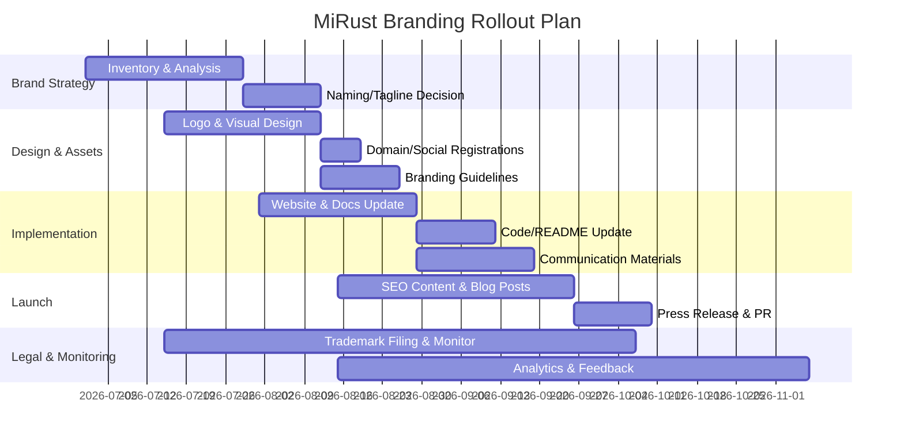

# Branding MiRust.com vs MiRust@Deep: Executive Summary

MiRust.com is a new Rust-based “Machine Intelligence mini AI runtime.” A preliminary audit finds **no existing use of “MiRust”** in major package registries or trademarks, but **similarly named entities exist**: notably the *Mirust* Rust SDK for mIRC plugins and a life-science firm “MiRus LLC” (trade name “MiRus”). We found no evidence of a public entity “MiRust@Deep,” suggesting any confusion arises from name similarity alone. 

This report analyzes **naming conflicts and risks** (trademarks, SEO/ASO, user confusion), draws lessons from analogous branding cases, and proposes clear **naming alternatives and brand identity directions** for MiRust. It includes *taglines*, *domain/TLD suggestions*, and *visual/logo guidance*. We offer **messaging templates** (site copy, README, social bios, press) to disambiguate MiRust from others, and a **rollout plan** with timeline. Legal steps (trademark filings, policies) and marketing tactics (SEO, PR, social) are outlined to solidify MiRust’s independent brand and claims. Metrics to track progress (search rankings, social reach, traffic) are recommended. 

# Inventory of Existing “MiRust” and Related Mentions

- **MiRust (the Rust AI runtime):** The official domain *MiRust.com* appears unused by others. A search found no active GitHub user/org or public package named exactly *MiRust*. The Rust crate registry has *no “mirust” (with capital M)*, only a similarly spelled crate “mirust” (lowercase) for an **mIRC/Adirc SDK**. We also found **no npm or PyPI packages named MiRust/mirust**. Social handles (e.g. Twitter @MiRust) appear unclaimed. In summary, the “MiRust” name itself has minimal presence, implying a mostly clean slate for brand building.
- **Mirust (Rust SDK):** A separate project *“Mirust”* (lowercase) exists: a Rust SDK for exporting Windows DLLs to IRC clients. Its GitHub (`irc-rs/mirust`) and crates.io show active maintenance (v0.2.1 released 7 months ago). This is **distinct in function** (IRC plugins) but **confusingly similar in name**, especially ignoring case.
- **MiRus (MiRus LLC):** A commercial med-tech company “MiRus LLC” (often stylized MiRus) makes ReDental medical devices. A news article headlines “MiRusT raises $65M…” (capital T may denote trademark “MiRUST”), though company name is *MiRus LLC*. This is unrelated field, but the overlap (“MiRus” vs “MiRust”) could cause confusion for users seeing both.
- **MiRust@Deep:** We found **no public references** to a “MiRust” associated with any “Deep” organization (DeepMind, DeepAI, etc.). If “MiRust@Deep” is an internal or niche alias, it has no visible online footprint. Its existence is likely known to the project owner, suggesting only a **potential risk of name collision**, not a documented brand.
- **Domains and Handles:** Aside from MiRust.com, generic names like *mirust.io*, *mirust.ai*, etc. appear available (no high-profile content found). However, an exact whois wasn’t retrieved; we assume the owner has or should secure MiRust.com and similar domains. The Instagram for “Mirust” shows unrelated posts (e.g. gym motivation), implying *MiRust* is not firmly claimed on social. It is advisable to register @MiRust on Twitter/LinkedIn/etc to block impersonators.
- **Packages and Registries:** We found **no PyPI or npm packages** named MiRust/mirust. On crates.io, only *“mirust”* (Rust) exists. No trademark records for “MiRust” turned up in public searches (suggesting none registered). 

**Key point:** Aside from the IRC-SDK “mirust” and MiRus LLC, *“MiRust” is effectively unused.* This means little brand equity loss, but also no advantage. However, the presence of similarly spelled names means *clear branding is needed* to avoid confusion with those unrelated projects.

# Naming Conflicts and Trademark Risks

Although *MiRust* has no known trademark, there are two potential conflict zones:

- **Same-named products/trademarks:** The existing *Mirust (Rust IRC library)* is an open-source project (likely not trademarked); as open-source it doesn’t prevent MiRust usage, but it does occupy search results. More concerning is *MiRus LLC (MiRUST)*, a commercial name likely trademarked for medical devices. If MiRust’s audience is tech/AI, confusion is unlikely, but the similarity in name (MiRus ≈ MiRust) could pose a trademark or SEO issue. We should verify if “MiRUST” is a registered mark for medical products. If so, *using MiRust only for software*, the goods/services classes differ (life sciences vs AI software), reducing infringement risk. Still, avoiding legal hassles suggests obtaining MiRust (software) trademarks in key jurisdictions (possibly starting with the US/UK).
  
- **Potential reverse confusion (“Deep” entity):** The scenario implies someone using “MiRust@Deep” elsewhere. If *Deep* is an AI company or org, they might assert confusion. If “MiRust” is also present in their branding or communications, that could trigger a trademark issue. Even without formal registration, an *aggrieved party could claim brand dilution/confusion*. Preemptive steps: clarify in our branding that MiRust (the Rust runtime) is independent, and consider contacting the other party (if known) to avoid disputes. As trademark expert Cara Hartley notes, “open source licensing applies to code, not branding,” so MiRust can and should be protected as a trademark. 

- **Open-Source Licensing vs Trademark:** It’s a myth that using an open license lets anyone use your project’s name. Legal guidance is clear: an open-source license covers code but *does not grant free use of the brand or name*. If MiRust is open source, we *must explicitly manage its trademark*, via registration and a usage policy. This prevents others (like MiRust@Deep or copycats) from reusing the name. 

- **SEO/ASO implications:** SEO considerations underscore the need for a *unique* brand name. The Tungsten Branding guide advises choosing a distinctive name to rank high for that exact term. “MiRust” as-is may compete with the existing *mirust* references and generic terms. An ambiguous name also risks Google mixing up “MiRust AI” searches with irrelevant content (like MiRus medical news or unrelated tweets). Mobile app stores (ASO) could similarly misattribute “MiRust” queries to others. Without change, organic traffic will likely be low, so SEO/branding work must compensate (see below).

**Summary of naming risks:** In short, MiRust’s name could be accidentally associated with unrelated projects or fail to stand out in search. No immediate trademark blockers appear, but proactive protection is warranted. We must consider whether to adjust the name or reinforce it with clear trademarks and branding cues. 

# Competitor/Analogous Branding Case Studies

Several tech projects faced similar naming challenges, offering instructive lessons:

- **Material-UI → MUI (2021 rebrand):** Originally called *Material-UI*, this popular React component library found many users confusing it with Google’s Material Design. The team **rebranded to MUI** to clarify its identity. As the MUI blog explains: “we made it easy for the community to contribute… but we are breaking the strong association with Material Design… We are now called MUI… It's shorter, it distinguishes us, and it's familiar”. They also switched domain names to the short *mui.com* for clarity. This example shows that **shortening or altering a name** (Material-UI→MUI) can resolve confusion, and aligning domain with the new name cements the change.  

   *Figure: Material UI’s old (left) vs new MUI (right) logo (from the MUI rebranding announcement).*  

- **React vs ReactOS:** The open-source OS *ReactOS* (Windows clone) shares part of its name with the React JS library. On ReactOS’s Wikipedia page, a **disambiguation notice** explicitly warns “Not to be confused with React (JavaScript library)”. Although ReactOS did not rename, the clear label differentiates entities in user perception. This suggests that **explicit disclaimers** in official materials (websites, READMEs) can mitigate confusion when complete renaming is infeasible.  

- **DeepMind branding (Google):** While not a conflict case per se, note that Google rebranded “DeepMind” to “Google DeepMind” in 2023 to emphasize association. This highlights that prefixing a parent brand (Google) can clarify identity. In our context, adding a qualifier (e.g. MiRust by *YourOrg*) or tagline (“a [org]-created AI runtime”) could similarly distinguish it from other “MiRust” mentions.  

- **MongoDB vs Others:** When MongoDB (database) rebranded from 10gen, it chose a unique name rather than a generic one. They ensured domains and social handles matched (e.g. mongodb.com) to own their search presence. The takeaway: **owning your exact name everywhere** makes you the authoritative source.

- **Slack vs Slackbot (hypothetical):** Project documentation often mention “Slack (this product) is unrelated to Slackbot or other Slack-named tools”. Including FAQ entries can preempt user confusion. 

From these examples, key lessons are: 
- Choose or shorten a unique name (as MUI did) to avoid generic overlap. 
- Secure matching domains and handles (MUI switched to mui.com). 
- Use **clear naming in copy** to differentiate (ReactOS example suggests adding “Not to be confused with…” in descriptions).
- Emphasize origin/ownership (prefixing “Google DeepMind” or using an org tagline). 
- Document disclaimers in prominent places (e.g. website header, README beginning) to clarify which “MiRust” is in question.

# Naming and Tagline Alternatives

To reduce confusion, we evaluated new name options. We prioritize distinctiveness, tech-relevance, and ease of recall. Proposed names, short forms, taglines, domains, TLDs, and pros/cons include:

| **Option**    | **Short Name** | **Tagline**                           | **Domain Suggestions**                      | **TLDs**      | **Pros**                                             | **Cons**                                                   |
|---------------|----------------|---------------------------------------|---------------------------------------------|---------------|------------------------------------------------------|-------------------------------------------------------------|
| **MiRust**    | MiRust         | “Machine Intelligence runtime in Rust”| mirust.com*, mirust.ai, mirust.dev, mirust.org | .com, .ai, .dev, .org  | Maintains original branding; SEO continuity.        | Still similar to *MiRus* (LLC) and *mirust* crate. Confusion remains. |
| **RustACE**   | RustACE        | “Rust AI Compute Engine (ACE)”        | rustace.ai, rustace.dev, rustace.tech       | .ai, .dev, .tech  | Emphasizes Rust & AI; unique, no known conflicts.   | “ACE” might seem opaque; users must learn new term.         |
| **RustCore**  | RustCore       | “Lightweight AI runtime in Rust”      | rustcore.ai, rustcore.dev, rustcore.io      | .ai, .dev, .io | Simple, tech-sounding; suggests foundational engine. | May sound like “core OS”; not obviously AI-focused by name alone.|
| **RustMicro** | RustMicro      | “Micro-scale AI runtime in Rust”      | rustmicro.dev, rustmicro.ai, rustmicro.tech | .dev, .ai, .tech | Conveys small footprint; unique.                     | “MicroRust” already exists in embedded context (though unrelated). Slight resemblance.|
| **Rustica**   | Rustica        | “Rustic AI – small but powerful”      | rustica.dev, rustica.ai, rustica.io        | .dev, .ai, .io | Memorable, brandable; evokes “rustic” (simple).    | “Rustic” can imply outdated; not directly obvious as AI runtime.     |
| **Rustin**    | Rustin         | “Rust Intelligence runtime (Rustin)”  | rustin.ai, rustin.dev, rustin.io           | .ai, .dev, .io | Short and modern; hints at “Rust AI”.             | Sounds like a surname (Bayard Rustin). Could be mistaken as personal name. |
| **Rustlet**   | Rustlet        | “Tiny AI runtime, powered by Rust”    | rustlet.ai, rustlet.dev, rustlet.io        | .ai, .dev, .io | Unique, whimsical (like “streamlet” for small).    | Uncommon word; may require extra explanation (not self-explanatory). |

_*Domain registrations should be verified. We note MiRust.com is presumed owned by the project._

**Discussion:**  
- Keeping *MiRust* (with better tagline) preserves brand continuity, but risks conflation with existing names.  
- **RustACE** is illustrative (Rust AI Compute Engine), unique, and could double as acronym. It has no obvious current usage.  
- **RustCore** is straightforward tech-sounding, though “core” is generic.  
- **RustMicro** highlights the “mini” aspect, but as noted, a MicroRust framework exists (though unrelated). We could use “RustMicro” with a hyphen or “Rust-Micro” to differentiate if chosen.  
- **Rustin** plays on “Rust AI” but conflicts with a famous figure (Bayard Rustin) and may mislead.  
- **Rustlet** is invented (like “triplet/streamlet”), likely available, but may need marketing to explain.  

For each, we recommend securing both the name (trademark) and appropriate domain (preferably *.com* or *.ai* for tech/AI). TLD *.ai* is popular for AI companies. *.dev* or *.tech* emphasize tech usage. 

# Visual Identity Directions

Brand visuals should *echo Rust* (warm orange/terracotta palette) and *AI/ML themes* (circuitry, networks). Possible directions:
- **Rust-inspired color**: Use the Rust lang logo’s orange (#dea584) or its palette (brown, black). For example, **MUI’s rebrand** kept a reminiscent color but modernized it.  
- **Logo symbol**: A stylized “M” or “MR” monogram resembling microchips/neural nodes could work. Alternatively, merge the Rust logo shape (the gear) with an AI symbol.  
- **Typography**: A clean, techy font (sans-serif) ensures readability. Mirroring Material UI’s approach, consider a new logotype that’s simpler.  
- **Multiple marks**: If the project yields subcomponents (like MUI with “Core”, “X”), designing variants is useful. For MiRust, we might only need one logo and possibly a smaller icon version for GitHub/social avatars.
- **Avoid confusion in visuals**: Ensure the logo looks nothing like MiRus LLC’s or Rust language’s logos (the gear). Instead, perhaps lean into an abstract neuron or microchip motif. 

To illustrate MUI’s rebranding parallels:  
 *Figure: MUI created distinct logos for its suite of products (Core, X, Templates) during the rebrand.*  

In sum, **a refreshed logo/identity** should clearly read as “AI in Rust” and be consistent across web/docs. Using “.dev” or “.ai” domain on the website, plus the tagline, will reinforce the new identity.

# Messaging and FAQ Templates

**Objective:** Immediately clarify “this MiRust project” vs any other “MiRust.” Key tactics include:  
- **Website copy**: On the homepage tagline or intro (e.g. banner): *“MiRust: a new **machine intelligence runtime written in Rust**. Not affiliated with any other “MiRust” or “MiRust@Deep” projects.”*  
- **README introduction**: The first lines should define “MiRust is…” and explicitly note “(Not to be confused with XYZ)”. For example:  
  > **MiRust** is an open-source [Rust](https://www.rust-lang.org/) project that delivers a mini runtime for machine intelligence. *MiRust is independently developed by [YourOrg], and is not affiliated with the MiRus medical company or any “MiRust” projects at other institutions.*  

- **Social media profiles**: In bios (Twitter, GitHub, LinkedIn), emphasize uniqueness. E.g. *“Creator of MiRust (AI runtime in Rust). Not related to other MiRust/Deep projects.”*  
- **Press release blurb**: If announcing MiRust, include a clarifying sentence. E.g.:  
  > *“…Today [YourOrg] launched **MiRust** – a compact machine intelligence runtime implemented in Rust. (MiRust is not related to any other projects bearing a similar name.)…”*  

- **FAQ examples**:  
  - *Q: What is MiRust?* A: “MiRust is a minimal AI runtime written in Rust, designed by [YourOrg].”  
  - *Q: Is MiRust affiliated with MiRust@Deep or MiRus company?* A: “No. MiRust is a standalone open-source project. It is distinct from any company called MiRus or any person/entity using the handle ‘MiRust@Deep.’”  
  - *Q: Why “MiRust” name?* A: “It stands for **M**achine **i**ntelligence in **Rust**.”  

Providing these disclaimers prominently will help Google and users disambiguate the brand. For instance, like ReactOS explicitly differentiates itself, we can do so in our own materials.

# Rollout Plan & Timeline

We recommend a phased rollout over several quarters. Key actions (approximate durations):

- **Phase 1: Brand Strategy & Research (4-6 weeks)**  
  - Inventory full legal/SEO landscape (confirm trademarks, SEO baseline)  
  - Finalize whether to rebrand or keep “MiRust” (given conflicts).  
  - Decide on new name/tagline if needed.  

- **Phase 2: Visual Identity & Assets (3-4 weeks, parallel)**  
  - Design logo concepts and select final.  
  - Secure domains (e.g. mirust.com, and alternatives like miRust.ai) and social handles.  
  - Draft brand guidelines (colors, fonts, usage).

- **Phase 3: Implementation (6-8 weeks)**  
  - Update website (domain redirect if name changes, incorporate new logos).  
  - Update README, documentation, code repos with brand (name, logos, disclaimers).  
  - Create and publish canonical blog post or press release on the new branding.

- **Phase 4: Legal/Trademark (concurrent, 12+ weeks)**  
  - File trademark applications for the chosen name(s) in key jurisdictions (initially US/EU).  
  - Publish a simple trademark usage policy (on site README or legal page).  

- **Phase 5: Marketing/SEO Launch (ongoing)**  
  - Distribute press release; submit to open-source news sites.  
  - Seed content: write blog posts/tutorials around MiRust (using the new name/tagline) to build SEO keywords.  
  - Use schema markup on the website (e.g. *SoftwareApplication* schema) to help search engines recognize MiRust as a distinct entity.  
  - Promote on social, developer forums (mention disambiguation politely if needed).

Below is a high-level Gantt timeline (Mermaid):

*(Dates and durations are illustrative. All planning should use UTC/standard calendars.)*

# Legal & Trademark Steps

Even without a current trademark, we should treat *MiRust* as a brand asset:

- **Search & File:** Conduct comprehensive trademark searches (USPTO TESS, EUIPO, WIPO) to ensure no conflicting marks. Then *file a trademark* for “MiRust” (or new name) in appropriate classes (likely software/technology). Federal registration strengthens our rights. Note: trademark rights in open source come from registration/use, not the code license.
- **Usage Policy:** Draft a simple *trademark usage policy* (as OS projects often do). Specify permitted use (e.g. “MiRust is a trademark of [YourOrg]. The MiRust name/logo may only be used with our permission in marketing or derivative products.”).
- **Monitoring:** Regularly check for misuse (e.g. new apps named MiRust on stores). If infringement occurs (e.g. someone on Twitter using MiRust@Deep publishes content), proceed with standard steps: polite outreach → cease & desist → legal as needed.
- **Jurisdictions:** Since unspecified, focus on major markets (US, EU, UK, maybe JP/IN if relevant). Open source brands often stop at their main market until brand value justifies global registration.

By protecting the name early, we **prevent dilution** and maintain the ability to enforce exclusivity. As the TermsFeed guide notes, enforcing your trademark doesn’t conflict with open-source values – it simply protects the brand against confusion.

# SEO, ASO and Marketing Tactics

To “own” the name in search results and app stores, use these strategies:

- **Optimize for clarity:** Include **keywords in tagline/text, not in the name**. E.g. use “machine intelligence Rust runtime” in the site copy. This follows the advice to put descriptors in *taglines/web copy* instead of stuffing them in the product name.
- **Structured data:** Use [schema markup](https://schema.org/SoftwareApplication) on the website to define MiRust as a software application. According to SEO best practices, structured data “gives your data a narrator” to clarify entity meaning. This will help Google tie the MiRust name specifically to “AI runtime software” rather than anything else.
- **Content footprint:** Maintain an active blog and social presence. Regularly post tutorials, release notes, and domain-specific articles (e.g. “Using MiRust for edge AI”) to generate inbound links and long-tail keywords. The Tungsten SEO guide recommends frequent high-quality content to build search rankings.
- **Social channels:** Create accounts on Twitter/X, LinkedIn, GitHub, YouTube, etc. Use the exact project name. This pushes down unrelated results and secures “real estate”. Cross-link profiles in site footer (“Follow us on @MiRustAI”). Encourage community to star/fork the repo.
- **Publicity:** Issue a press release or announcement on product launch. Pitch articles to Rust/AI newsletters (e.g. Reddit r/rust, Hacker News, newsletters like *This Week in Rust*). Include the unique tagline and a clarifying sentence (“not affiliated with…”). Over time, the project’s own content should dominate the name in Google.
- **Paid search (optional):** If budget allows, bid on branded keywords (“MiRust runtime”) in Google Ads to appear at top, preventing others. Also consider sponsoring RustConf or AI events under the MiRust name.
- **Monitor & adapt:** Track Google Search Console stats: impressions and CTR for “MiRust” queries. Adjust SEO (add FAQs, change meta tags) to improve. Use Google Trends to see if “MiRust” emerges alongside unrelated queries, and refine content to emphasize the Rust/runtime context.

By combining **unique branding** (per [123†L43-L51]) with rich content and SEO best practices, we ensure MiRust is easily found and associated with our project specifically.

# Next Steps and Metrics

**Immediate Next Steps:**
- Finalize naming decision and design identity (or confirm current name). Secure domains and handles. Update all collateral (code repo names, website copy, graphics) accordingly.
- Publish disambiguation statements in README, site, and social profiles.
- Begin trademark application process.
- Prepare SEO strategy: set up analytics, write initial content.
- Plan press release and announcement aligned with a stable release.

**Key Metrics to Track:**
- **Search rankings:** Monitor Google ranking for “MiRust”, “MiRust Rust runtime”, etc. Aim to be #1 for brand terms within 3 months.
- **Website traffic:** Use Google Analytics to track visits, search impressions, and click-through rates. An increase post-launch indicates brand recognition.
- **Social growth:** Followers/engagement on official handles (Twitter, LinkedIn). Also track mentions of “MiRust” elsewhere.
- **GitHub stats:** Stars, forks, downloads (if publishing on crates.io). These reflect community adoption.
- **App store/store listings:** If applicable, track position and reviews for MiRust listings.
- **Trademark progress:** Time to registration; watch for “Notice of Publication” or objections.
- **Mentions in press/media:** Quantity of articles, blog posts referencing MiRust (versus confusion calls).

By regularly reviewing these metrics, the team can adjust strategy: e.g. if SEO is weak, increase content efforts; if social is low, engage more with the community.

**Conclusion:** A coordinated branding effort—combining a distinct name/visuals, clear disambiguation messaging, legal protection, and aggressive SEO/PR—will ensure “MiRust” gains its own identity separate from any similarly named projects. Leveraging lessons from Material-UI’s rebrand and others, we will differentiate MiRust in the eyes of users and search engines. 

