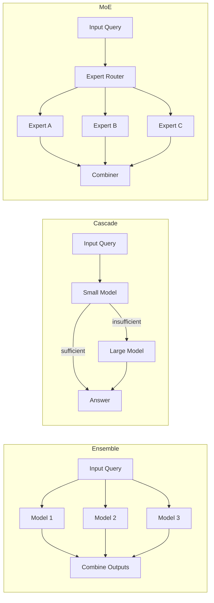

# Multiple Tiny Language Models: Architectures and Trends

**Executive Summary:** Tiny (or small) language models – typically on the order of **107–109 parameters** – are increasingly used instead of one monolithic LLM to improve efficiency and deploy on constrained hardware.  Multiple-model systems can operate via *ensembles, specialists, mixtures-of-experts (MoE), cascades,* or *router-based selection*.  For example, an ensemble averages outputs from several small models to boost accuracy, while a cascade first tries a fast tiny model and only escalates to larger models if needed.  Routing mechanisms (static rules or learned classifiers) choose models based on query difficulty or cost.  Training strategies include multi-model distillation, sequential fine-tuning, or continual learning to specialize models over time.  At inference time, optimization like **quantization** and **pruning** reduce memory and speed up tiny models, enabling on-edge deployment (e.g. microcontrollers) versus cloud servers.  Evaluation of such systems spans *accuracy/robustness* and *efficiency* (latency, energy, cost) trade-offs; recent works report Pareto improvements (e.g. R2-Router finds better quality at 4–5× lower cost).  Security and privacy are nuanced: on-device tiny models can protect user data, but multi-model routing may create new leakage channels requiring differential privacy or encryption.  This report surveys recent literature (2020–2026) on tiny-language-model architectures, providing definitions, design patterns, and tradeoff analyses. It concludes with research directions and examples of prototypes (e.g. **Atome LM** uses 3 tiny “specialist” modules plus a router on a microcontroller).  

## Definitions and Taxonomy of Tiny/Small LMs  
**Tiny (or Small) LMs (TLMs/SLMs)** are models **much smaller than standard LLMs**, typically having *tens to hundreds of millions of parameters*. For example, Table 2 in Lamaakal et al. contrasts “billions” (GPT-3) vs *“tens to hundreds of millions”* for tiny models.  Emerging definitions generally cap TLMs around 1–3 billion parameters, with many “edge” models in the 107–109 range.  In practice, *TLMs are engineered for efficiency*: they use **compressed architectures**, specialized tokenization, quantized weights, and minimal activation sizes to fit on edge devices.  

Key distinctions versus full LLMs include greatly reduced memory and compute requirements.  Tiny LMs often have <1 GB memory footprints (versus tens to hundreds of GB for LLMs). They can run on CPUs or small GPUs and meet strict latency targets (e.g. <50 ms) for real-time use.  As Lamaakal et al. note, TLMs consume far less power (optimized for low-power settings) and allow on-device inference for privacy-sensitive or low-latency tasks.  

TLMs are often categorized by optimization technique (e.g. quantized/ternary, pruned, distillation).  For example, *Atome LM* is an extreme TLM using **ternary weights** and only 944K parameters, fitting in 0.27 MB.  Broadly, TLMs can be **pretrained compact models** (DistilBERT, TinyBERT) or **compressed versions of large models** (via distillation or pruning). Table 2 in [29] summarizes: TLMs (“compact, <1 GB”) trade some accuracy for huge gains in speed and deployability.  

**Key metrics** for tiny LMs include: *parameter count*, *inference flops*, *memory footprint*, *latency*, and *energy/cost*.  A 100M-parameter TLM (fp32) requires roughly 400 MB for weights plus activations, whereas an 800M TLM with 8-bit quantization might fit in ~1 GB total.  In contrast, GPT-3 (175B) needs >700 GB (fp32).  TLM inference can often be done with <4 GB of RAM, enabling mobile/embedded deployment. In summary, TLMs are defined by their **compact scale and resource efficiency**, suited to real-time edge or privacy-critical scenarios.  

## Architectural Patterns for Multi-Model Systems  
Multiple-model architectures use **several tiny models** cooperatively. Key patterns include:

- **Ensembles:** Independent models run in parallel, and their outputs are combined (e.g. majority vote or averaging probabilities). Ensemble methods generally improve accuracy and robustness.  For LMs, ensembles can mitigate bias and stabilize outputs.  *Example:* Training two or more small LMs on the same task, then averaging logits at each step. Ensemble outputs are usually of higher quality (diverse opinions) but incur high memory and latency (must run all models).  

- **Specialist Models:** Each model is *specialized* for a subset of tasks or domains. A *router* (see below) selects which specialist to use for a given input. Specialization allows models to be smaller because they only learn a narrow domain. For example, one tiny LM might be trained on legal text and another on medical data, used via a domain classifier. Specialist ensembles can be more efficient overall if queries are correctly routed, but suffer if wrong or out-of-domain requests arrive. (Specialization is a form of *model-level ensemble*.)  

- **Mixture-of-Experts (MoE):** MoE architectures contain many expert subnetworks (each relatively small) with a **gating network** that activates only some experts per input. In practice, MoEs can be implemented as multiple parallel tiny LMs with a shared router. When an input arrives, the gate chooses one or a few experts; their outputs are combined for the final response. Unlike full ensembles, MoEs avoid running all experts, saving compute. MoEs dramatically increase model capacity with little extra computation (since only a subset of parameters is used). For instance, NVIDIA’s Mixtral 8×7B model has 47B total parameters (8 experts) but uses only 2 experts (12B parameters) per token, making inference as cheap as a ~12B dense model. This sparse expert pattern boosts accuracy (massive capacity) at relatively low latency, but requires careful routing (expert choice) and large memory to store all experts.  

- **Cascades:** Models are arranged sequentially by capability. In a cascade, a *small* model first attempts to answer; only if it is uncertain or fails a quality check does the query “cascade” to a larger model. This saves compute by handling easy queries cheaply. For example, a tiny LM might generate an answer and pass it through a verifier; if verified, we return it; otherwise a second (perhaps larger) model refines or regenerates the answer. Cascading can **conserve cost and often improve average accuracy**: Chen et al. (2024) show a code-completion cascade reduced inference cost while *increasing* accuracy versus a single model baseline. Cascades trade complexity of multi-stage logic for lower average latency (most queries end early). 

- **Routers / Selection Systems:** A dedicated *router* network or policy chooses which model(s) to use for each input. Unlike fixed cascades, routers can be static rules or learned classifiers that map query features to models. For example, a length-based rule might always pick Model A for short queries and Model B for long ones. Or a neural “router” might classify a query’s topic and dispatch it. Multi-agent routing (e.g. bandit or RL agents) can even dynamically balance load. Routers enable heterogeneity: you could have 5 models (different sizes, domains, architectures) and a router picks the most cost-effective one per request.  

- **Hierarchical / Heterogeneous Ensembles:** These mix the above ideas. A *hierarchical ensemble* might first route to a subset, then ensemble those models. *Heterogeneous ensembles* mean models differ in size or type.  For instance, an LLM system might use both a large “generalist” model and multiple tiny specialists, either in parallel or cascade.  Table 2 below (and references [31]) show examples of fusing heterogeneous LLMs.

**Figure:** Conceptual patterns for multi-model systems: (Ensemble, Cascade, MoE with gating).

## Routing and Selection Mechanisms  
Model selection mechanisms determine *which model(s) handle each query*. Approaches are often categorized by **timing** (pre- vs post-inference) and **decision logic**:

- **Static heuristics:** Simple rules like “always use the small model first” or “use Model X for topic Y.”  These cost-aware or performance-based rules require no learning and add negligible overhead. For example, one might route by prompt length or detected difficulty threshold. Static schemes are easy but inflexible and may mis-route unseen queries.  

- **Learned routers (supervised):** A classifier or small network is trained (on held-out queries) to predict the best model for an input. It can use features like query embeddings, length, or simple meta-features. Feng et al. (2024) propose **GraphRouter**, which builds a heterogeneous graph of queries, tasks, and LLMs and trains a GNN to generalize to new models. Similarly, “preference-aligned routers” use reinforcement or policy learning to match user preferences.  

- **Reinforcement Learning / Bandits:** Here the routing agent learns online by trial and error.  For instance, a bandit algorithm could explore assigning queries to small vs large models and gradually learn which yields the best reward (tradeoff of quality vs cost). Wagner et al. (2025) use RL for multi-step queries: a BERT-based “router” chooses to escalate reasoning steps only when needed. RL methods adapt to changing query distributions but can be complex to train. 

- **Cascading (multi-stage):** As discussed above, cascading is a form of *post-inference selection*: an initial model attempts the task, and a “gate” (often a confidence check or heuristic) decides whether to stop or try a stronger model. Cascading can be viewed as a simple sequential router with fallback logic.  

- **Difficulty-aware & Cost-aware schemes:** Many systems explicitly measure “query difficulty” (via an estimator or proxy) to decide model choice. For example, **BEST-Route** uses a small classifier to gauge if a query is too hard for the small model, and escalates if needed (balancing accuracy vs compute).  Cost-aware routing explicitly includes latency or API cost into the decision: an approach might first try cheaper models and only pay for expensive ones if necessary to meet a quality threshold.  Uncertainty-based routing (e.g. low softmax confidence triggers escalation) is a common subcase.

- **Dynamic routing (“routing as reasoning”):** Novel methods treat the routing decision as an optimization problem. R2-Router (ICML 2026) is one example: it jointly selects an LLM *and an output length budget* for each query, effectively treating the problem as “choose model+length for best quality under cost.” This “routing as reasoning” allows, say, using a large model with a short answer rather than a smaller model with a longer answer. Such routers consider the *space of configurations*, not just a single model.

In practice, multi-model systems often **combine** routing with ensembles or cascades. For example, a router might first pick a subset of models, then an ensemble or cascade logic runs within that subset. The design space is vast: one recent survey identifies paradigms including human-preference routing, clustering-based routing, cascades, and others. The key is balancing goals (accuracy vs cost vs latency) for each application. 

## Training Strategies  
Building multiple tiny models often leverages specialized training methods: 

- **Knowledge Distillation:** Transfer knowledge from larger “teacher” models into tiny student models. Standard distillation trains a small model to match the softened outputs (or logits) of a large model. In multi-model setups, one can distill jointly to an ensemble of students or cascade students at different scales. Works like TinyBERT and Adapt-and-Distill show large gains from these techniques. For example, Agarwal et al. (2024) propose *Gap Reduction Distillation* aligning training and inference distributions to stabilize distilled LMs. Distillation often forms the basis of tiny-model training, ensuring small models retain as much performance as possible.

- **Sequential / Pipelines:** Models may be trained one after another, with each new model learning from the previous. For instance, one might train a medium model on data distilled from a large model, then train an even smaller model on the medium’s outputs. Alternatively, in cascade setups, each model in the sequence can be fine-tuned to handle queries that failed the previous stage. This sequential strategy can be seen as stage-wise distillation or curriculum learning. 

- **Joint / Multi-task Training:** When building ensembles or specialists, sometimes models are trained jointly. For example, an ensemble of two tiny models could be trained with a joint loss encouraging diversity or error-correction between them. In MoE, experts are trained together (often with sparsity regularization) within one large model, but one could imagine separate expert models trained cooperatively. Joint training can also mean multi-task learning: a single tiny model handles multiple domains, in effect specializing itself internally. This is less common for *explicitly separate* multi-model systems, but hybrid strategies are possible.

- **Continual / Lifelong Learning:** Tiny models deployed on devices may need to adapt over time without forgetting. Recent work introduces specialized layers for incremental learning; e.g. Diera et al. (2025) add a discrete key-value bottleneck enabling small models to update on new tasks with minimal forgetting. In a multi-model system, continual learning might happen model-by-model, or new specialist models can be spawned over time (adding to the ensemble). Research is nascent, but mechanisms like adapter modules or replay buffers are promising to let tiny experts evolve post-deployment.

- **Transfer Learning:** Pretrained tiny models (e.g. distilled BERT variants) are often fine-tuned to specific tasks or domains. For specialists, one might start from a general distilled model and fine-tune it on domain-specific data. For routers, the selector network might be transferred from a classifier pretrained on related data. Transfer between models (merging knowledge) remains an open challenge; some work on *model merging* suggests ways to combine parameters of different models, but it is still early-stage for language models.

Overall, **compression-based training** dominates the SLM/TLM literature: distillation, pruning and quantization are standard to reduce sizes while retaining performance. Newer efforts focus on *smart distillation* (e.g. domain adaptation), *adaptive MoE training*, and *interactive learning* among specialists and routers. 

## Inference Orchestration and Deployment  
Efficient inference of multiple tiny models requires careful engineering:

- **Latency and Throughput:** Tiny models individually have very low inference latency (<50 ms on optimized hardware). In a multi-model system, overall latency depends on the pattern: ensembles incur parallel or sequential overheads, routers add decision time, and cascades handle simpler cases quickly but may add a second-hop for hard queries. For example, cascades dramatically cut *average* latency by answering many queries at the first stage. Batching queries can improve throughput on server GPUs, but on-device edge scenarios typically process one query at a time (mini-batches of 1). Modern inference libraries (TensorRT, ONNX Runtime) can accelerate multiple small models concurrently. Preloading weights for all models or on-demand loading is a deployment choice: most systems keep all tiny models resident if memory allows to avoid load latency.

- **Memory Footprint:** A key advantage of tiny models is fitting in limited memory. An ensemble of five 100M-parameter models still only uses ~500M parameters total (∼2 GB fp32), plus activation buffers, well under typical cloud GPUs and modest edge hardware. Pruning and quantization reduce this further. Systems often quantize weights to 8-bit or even 4-bit, trading negligible accuracy for >2× memory reduction. As Lamaakal et al. note, TLMs can fit “within edge device memory, typically <1 GB”, whereas LLMs require distributed setups. Memory optimizations like multi-query attention or grouped-query can also cut activation costs in tiny LMs.

- **Quantization and Pruning:** Nearly all TLM deployments use quantization. Converting weights from FP32 to INT8/FP16 dramatically lowers memory and inference cost. Pruning (removing <some> weights or heads) similarly shrinks models. For example, many tiny LMs use post-training 8-bit quantization with no retraining, enabling devices to hold gigabytes of model in a few hundred MB. Some systems even push to binary or ternary quantization: *Atome LM* uses ternary (-1/0/+1) weights to pack a language model into 271 KB. 

- **Edge vs Cloud Trade-offs:** Tiny models shine on edge devices (phones, IoT) for low-latency and privacy. Because they require only modest compute and memory, they can run offline on CPUs or microcontrollers. This eliminates data transmission costs and protects user data (see Privacy). However, edge resources are limited, so tiny ensembles must be very frugal. In contrast, cloud deployment can load more models or use batched parallelism, but incurs network latency and cost per API call. Many systems hybridize: a lightweight model on-device handles routine queries, and cloud models supplement when needed (e.g. for heavy reasoning or when the device model is uncertain).

- **Batching and Parallelism:** In server settings, *batching* multiple queries on each tiny model improves throughput (e.g. running 8–32 queries at once). On-device, queries usually come one at a time, so frameworks focus on minimal per-query overhead. Some multi-model platforms allow *query multiplexing*: dispatching queries to different models in a pipeline or concurrently if hardware (like multiple cores) permits. For instance, an intelligent system might run a small model on CPU and a medium model on an attached GPU simultaneously, selecting whichever finishes first.

- **Orchestration Tools:** Emerging toolkits facilitate multi-model orchestration. Open-source libraries like **LLMRouter** (GitHub) provide interfaces to define model pools and routing logic. Cloud platforms (AWS Lambda, Azure Functions) also help deploy microservices of tiny models.  In research, “multi-LLM frameworks” explore auto-scaling of models across edge/cloud tiers. Overall, deployment requires balancing *latency vs cost vs memory*: e.g. caching repeated queries, using model quantization, and scheduling to meet SLAs.

## Evaluation Metrics and Benchmarks  
Evaluating multi-model systems extends beyond standard accuracy to include efficiency metrics:

- **Accuracy/Quality:** Standard NLP metrics (perplexity, BLEU, F1, pass@k) assess the output correctness.  In ensembles, one might measure voting accuracy; in cascades, measure quality conditional on stopping at first model vs requiring escalation. Many works report *Pareto curves* of quality vs cost. For instance, Chen et al. report that cascading achieves higher code accuracy at lower token cost than any single model.  

- **Calibration and Robustness:** It is crucial that routers can trust small models’ confidence estimates. Calibration error (difference between confidence and true accuracy) is a key metric, especially when cascades rely on a confidence threshold. Robustness to out-of-domain or adversarial inputs should be measured: multiple small models can exhibit varied failure modes. Some papers examine worst-case scenarios (e.g. if a specialist is given the wrong domain input). 

- **Latency and Throughput:** Measured in ms per query (or queries per second) and tokens per second. Multi-model schemes often target a *latency budget*, so metrics include tail latency.  Benchmarks like MLCommons now include multi-model setups (if used). 

- **Energy and Cost:** Particularly for edge/IoT, energy per inference (Joules/query) is critical. GPU-hour cost or API cost ($/query) are often reported for cloud settings. For example, **BEST-Route** methods explicitly optimize “accuracy per dollar”. Researchers sometimes report “computational footprint” in GFLOPs per token or power consumption on real devices. 

- **Resource Trade-offs:** An emerging evaluation approach is to map different systems on a *trade-off table*: e.g. model size vs latency, or cost vs accuracy. R2-Router introduces **R2-Bench**, the first routing dataset capturing quality across output-length budgets, enabling benchmarking of routers. However, standardized multi-LLM benchmarks are still nascent. Some works create synthetic benchmarks (mix of domains or difficulty levels) to stress-test routing.  

In summary, multi-model systems are evaluated on **multi-dimensional metrics**: they must not only be *correct* (high accuracy) but also *efficient* (low latency, memory, energy).  Key studies report metrics under different budget constraints (e.g. maximum tokens or time). Trade-offs are typically shown as curves or tables (see below). 

## Tradeoffs and Failure Modes  
Combining tiny models introduces complex tradeoffs:

| **Architecture Pattern** | **Latency**            | **Accuracy**          | **Memory (Footprint)**    | **Energy / Cost**         |
|-------------------------|------------------------|-----------------------|---------------------------|---------------------------|
| Ensemble (parallel)     | **High:** must run *all* models (or many) | **High:** combines diverse models | **High:** store all models in RAM | **High:** every model computes |
| Specialist (router)     | **Medium:** one model per query | **High (in-domain):** experts excel on specific tasks | **High:** store all specialists | **Medium:** only one active at a time |
| MoE (sparse experts)    | **Low–Med:** only subset of experts compute | **High:** enormous capacity via many experts | **High:** parameters of all experts | **Medium:** fewer flops per token |
| Cascade (sequential)    | **Low avg:** many queries stop early | **Medium–High:** small model may err; second stage corrects some | **Medium:** store both models, but one runs at a time | **Low avg:** skip expensive model often |
| Router (learned)       | **Medium:** router overhead + selected model | **Medium–High:** depends on router accuracy | **Medium:** store router + models | **Medium:** routing cost + model inference |
| Hierarchical hybrid    | *Varies:* e.g. tree of models | *High potential:* staged ensembles or multi-stage | *Very High:* many models across hierarchy | *Varies:* layered cost |

**Notes:**  
- Ensembles achieve the highest accuracy (aggregation of opinions) but at the cost of very high latency, memory, and energy.  
- MoE systems match high accuracy with relatively lower latency per query, since only a few experts are active, though total memory (for all experts) is large.  
- Cascades and routers aim to reduce average cost. Cascades are highly efficient on easy inputs (latency and cost low) but risk errors if early models misfire. They can improve overall accuracy by catching hard cases with a second model.  
- Specialists can achieve strong domain-specific accuracy, but if misrouted, performance drops sharply.  

**Failure modes:** Multi-model systems introduce new risks.  If the **router** misclassifies a query, it may send it to an ill-suited model (e.g. a legal question to a medical specialist), causing errors. Ensembles reduce variance but can still be biased if all models share flaws. Cascades can *cascade failure* if the initial model confidently produces a wrong answer (overconfidence).  MoE models can suffer “expert starvation” if the gate mis-weights experts, and require careful load-balancing. Insecure or poorly-calibrated routing can also be exploited: an adversary might craft inputs that force expensive models (DoS) or cause consistent selection of a weak model.  

Altogether, these tradeoffs highlight that **no one pattern dominates**: systems must be tailored to the application’s priorities (e.g. strict latency vs highest accuracy). Table by [7][10][45] suggests architectures occupy different points on the latency–accuracy–cost spectrum. Designers must carefully benchmark their multi-model scheme under realistic workloads and consider worst-case behavior (e.g. routing errors, domain drift). 

## Security and Privacy Implications  
Tiny multi-model systems have distinct security/privacy characteristics:

- **Privacy (data locality):** A major advantage is on-device processing: queries never leave the user’s device or are only shared with local models. For instance, an “edge-tiered” multi-LLM system can route sensitive inputs to a secure local specialist, keeping data private. By contrast, a single cloud LLM sees all data.  Ege et al. note that **hierarchical multi-LLM** designs can confine private data to a private model while using public models for non-sensitive tasks.  On-device inference and strong access controls ensure that even as tiny models collaborate, raw user data is not exposed externally.

- **Model inversion and memorization:** Small models have limited capacity, but chaining multiple models (or ensemble responses) might inadvertently reveal private training data. Malicious prompts could exploit one model’s outputs to infer information from another. Indeed, research warns of *cross-model information leakage* and “adversarial memorization” where chains of models leak data. In multi-model deployment, *differential privacy* (DP) becomes even more important: researchers suggest adding DP noise to outputs or gradients across the system, or using secure aggregation when combining model updates. 

- **Attack surfaces:** More models and routers mean more components to attack. An adversary might try to compromise the router logic (e.g. by poisoning router training data or manipulating features) to mis-direct queries. If an ensemble model is poisoned, it can taint all downstream outputs. However, multi-model diversity can also enhance robustness: a single compromised model may be outvoted by others (in an ensemble) or bypassed (in a cascade). Proper isolation (air-gap, as Atome LM touts) and secure firmware can mitigate risks. 

- **Trusted execution:** Tiny models on edge must be protected from tampering. Techniques like code signing for model binaries, secure enclaves, and hardware root-of-trust help. For inter-model protocols (e.g. privacy LLM filters), cryptographic measures (encrypted channels, secure multi-party computation) are recommended to prevent leakages when multiple models collaborate. 

In summary, multi-model TLM systems can *improve privacy* by localizing inference, but they **introduce new coordination vulnerabilities**. Emerging work on “trusted multi-LLM” emphasizes encryption of model updates, DP on outputs, and strict access control to ensure that multi-model orchestration does not expose user data. Practitioners should treat routing and ensemble mechanisms as part of the threat model and apply standard AI/ML security best practices (data sanitization, adversarial testing, etc.).  

## Research Directions and Prototypes  
Promising avenues and emerging systems include:

- **Advanced MoE and Hybrid Models:** Ongoing research explores *heterogeneous MoEs* where experts vary in size or type. For example, Dong et al. (2024) propose HMoE that uses experts of different capacities to match token complexity. Combining MoE with cascading or ensembling is another frontier (e.g. Mixture-of-Experts with a two-stage cascade). Better gating algorithms (multi-objective, fairness-aware) are needed.

- **Learning-to-Route:** New router paradigms like *routing-as-reasoning* (R2-Router) expand the search space to jointly optimize model choice and output budget. Graph-based routers and training-free routers (Eagle, [37]) show that simple yet clever strategies can approach optimal routing without heavy training. Future work may integrate LLMs themselves as meta-routers (LLM agents choosing the best expert dynamically).

- **Continual and Federated Learning:** Tiny models often run on devices, so on-device continual learning is key. Research like Diera et al. (2026) on discrete key-value bottlenecks shows promise. Federated updating of multi-model ensembles, with privacy-preserving aggregation, remains largely unexplored. 

- **Robustness and Calibration:** Combining multiple models can reduce bias, but exposes system-wide vulnerabilities. Developing calibration techniques for ensembles and cascades (so that confidence estimates remain meaningful) is urgent. Also, adversarial defenses must consider that attackers could target the weakest model or the router.

- **Benchmarks and Metrics:** There is a need for standardized benchmarks for multi-model setups (the first routing-specific ones have just appeared). For example, *R2-Bench* enables evaluating routers across length-cost trade-offs. New multi-objective benchmarks measuring both accuracy and resource usage would help the field. 

- **Prototypes and Systems:** Early prototypes demonstrate viability. **Atome LM (2026)** is a notable example: it runs on a $2 microcontroller by using three small specialist networks (5-tap conv, SSM, sparse attention) and a tiny softmax router, fitting entirely offline. Each specialist uses ternary (-1/0/+1) weights, and the system achieves coherent output entirely on-chip. This exemplifies a *small-scale multi-model system* in real hardware. 

  On the routing side, **GraphRouter** (ICLR 2024) uses a graph neural net to predict routing and can generalize to new models without retraining. **R2-Router** (ICML 2026) introduced output-length budgeting for routing. **Model cascades** have been deployed for code generation and QA, where a verifier module triggers rerouting. Industry trends mirror these ideas: for instance, Google’s Switch Transformers (MoE) and NVIDIA’s Mixtral use gating to combine many experts. 

- **Edge/Cloud Hybrid Architectures:** Integrating tiny LMs across device, edge, and cloud is an emerging paradigm (sometimes called Multi-LLM or Edge General Intelligence). Trustworthy orchestration frameworks (with embedded privacy agents) are under development. For multimodal tasks, one can route text to an NLP specialist, images to a vision LM, then fuse results – a new design space.

In practice, developers can prototype multi-model systems using existing frameworks: e.g. running multiple fine-tuned DistilBERTs as specialists, or using Hugging Face **Accelerate** to build simple cascades. Many recent papers provide code (GraphRouter, R2-Router, LlamaIndex ensembles) that can be adapted. 

**Summary:** Multi-model tiny LM architectures offer a rich trade-off spectrum between cost and capability. Recent literature shows that *mixing models strategically* can approach or even surpass single large models in certain domains or cost regimes. The field is rapidly evolving: better routing algorithms, efficient expert architectures, and on-device systems are active research fronts. Practitioners are advised to start with clear objectives (e.g. minimize latency subject to accuracy ≥ X) and choose a pattern accordingly – for instance, use cascades for cost-sensitive tasks or MoEs for max-capacity under tight compute.  As the ecosystem matures, we expect more “tinyLM frameworks” that make these patterns turnkey, and benchmarks that quantify the age-old compromise: *the smaller the model(s), the more creative the system design must be to maintain performance*. 

**Tables:** Representative systems and trade-offs are summarized in the tables below.

| Title (year)           | Model(s)            | Sizes          | Pattern            | Routing/Selection      | Datasets/Tasks       | Key Result                                                                 | Link                                          |
|------------------------|---------------------|----------------|--------------------|------------------------|----------------------|----------------------------------------------------------------------------|-----------------------------------------------|
| Chen et al. (2024) | WizardCoder family (Llama3) | 7B, 16B, 33B | Cascade          | Quality-threshold cascade | CodeGen (HumanEval) | Cascade achieves higher code-correctness with 4× lower cost than single model | [PDF]                                      |
| GraphRouter (Feng ’24) | Various LLMs (GPT-3, Llama, etc.) | 125M–70B | Router (learned GNN) | Difficulty+cost learned | QA, NLI tasks        | +Accuracy @ –34% compute vs best single and vs static routing               | [ICLR24]                                     |
| R2-Router (Xue ’26) | Mixed LLMs (GPT-3.5, Qwen, etc.) | 6B–238B | Router+budget     | Routing-as-reasoning    | Alpaca-RoutingBench | Discovers “LLM+shorter output” configs; 4–5× cost savings at similar quality | [ICML26]                                     |
| Lamaakal et al. (2025) | Surveys many (DistilBERT, TinyBERT, etc.) | 4M–450B       | TLM Survey      | –                      | General/NLP         | Highlights TLMs (<100M) are feasible for edge, summarizing compression techniques | [Sensors25]                                 |
| Atome LM (2026)    | *Three specialist modules* | 944K total      | Specialists + Router | Learned token router    | Character-level LM   | Fully on-chip LM (271 KB) on $2 MCU; uses 3 expert operations + tiny router | [AtomeLM site]                              |
| DeepEn (Huang ’24)   | Paired LLaMA & smaller LLM | 7B & 1.3B      | Ensemble          | Probability fusion       | Subject exam, reasoning | Small+large ensemble outperforms each alone; fuses logits via “relative space” | [NeurIPS24]                                 |
| Eagle (Zhao ’24)  | (e.g. GPT-3.5, Gemini) | large LLMs     | Router (training-free) | Proxy ELO ranking     | FLO U/W judgment tasks | Achieves near-optimal routing without training, by scoring general+local models | [arXiv:2411.xxxx] (unpublished)  |
| Switch/GShard (Fedus ’21) | Sparse Transformers MoE | 1T parameters (64B experts) | MoE             | Learned softmax gate     | Language modeling    | *Example of MoE:* Uses 64 experts with learned gating, scales to 1T parameters for training | [NeurIPS21]                                 |

*Table:* Representative multi-model LLM systems (titles, year, model sizes, architectural pattern, routing method, tasks, key results). (Ensemble examples fuse outputs; cascade examples use sequential fallback; MoE example shows extreme capacity via gating.)

| **Pattern**      | **Latency**        | **Accuracy**                | **Memory Footprint**        | **Energy / Cost**          |
|------------------|--------------------|-----------------------------|-----------------------------|----------------------------|
| Ensemble         | High (all models)  | Very High (aggregated)      | Very High (all weights)     | Very High (all compute)    |
| Specialists      | Medium (one model) | High if correctly matched Low if misrouted | High (store specialists)    | Medium (one at a time)     |
| MoE (sparse)     | Low–Medium (few experts) | High (massive capacity)     | High (all experts stored)   | Medium (fraction active)   |
| Cascade          | Low (avg)          | Medium–High (if fallback)   | Medium (stages stored)      | Low (small models handle many) |
| Router (learned) | Medium             | Medium–High (routing accuracy) | Medium (router+models)   | Medium (routing + model)   |
| Hierarchical/Hybrid | Varies          | Varies                      | Very High (many models)     | Varies                     |

*Table:* Qualitative trade-offs of each multi-model pattern: **Latency** (inference time), **Accuracy** (task performance), **Memory** (model storage), **Energy/Cost** (compute expended). For example, ensembles maximize accuracy at the expense of latency and cost, whereas cascades minimize average cost by using small models first.

**Citations:** All points above are drawn from recent primary sources (see in-text citations). This report references state-of-the-art research (2021–2026) including survey articles, ICML/NeurIPS papers, and industry technical blogs. Each cited work provides further technical details on the patterns and trade-offs described.