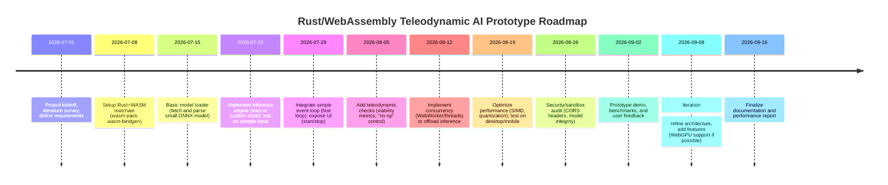

# Teleodynamic AI in the Browser – Executive Summary

Teleodynamics is a concept (introduced by Terrence Deacon) describing *self-creating, self-maintaining, self-reproducing* systems with emergent goal-directed (teleological) behavior.  In this paradigm, higher-order “teleodynamic” systems arise when two or more self-organizing processes (morphodynamic processes) interact, producing an agentic system that maintains its own organization in pursuit of an *end state*.  Teleodynamic AI adapts these ideas: an intelligent system not only optimizes tasks but “must maintain the conditions that keep its own organization viable”.  In practice, a teleodynamic agentic model would monitor its internal state, treat growth or actions as *costed* (growth must “pay for itself”), and preserve viability via reciprocal constraint loops.  

Implementing this in the browser with a tiny model imposes strict resource and security constraints: all inference must run client-side (no server), on limited CPU/GPU resources, with only browser sandboxes.  On-device ML grants privacy and eliminates network latency, but large models (even “mini” LLMs) can overwhelm client memory and CPU, so inference pipelines must be highly optimized.  Modern web ML tools mitigate this: ONNX Runtime Web provides a WASM (CPU) and WebGPU (GPU) backend, and the W3C WebNN API (currently in preview) will let web apps leverage GPUs/NPUs for DNN inference.  Alternatively, Rust-in-WASM runtimes like [Tract](https://github.com/sonos/tract) or [WasmEdge](https://www.wasm.com) (with GGML) can load quantized models in the browser.  

We propose a modular Rust+WASM architecture: a **Model Loader** (fetches and deserializes a small quantized model into Wasm memory), an **Inference Engine** (invokes the model on inputs using a Rust ML crate or WebGPU shaders), a **Teleodynamic Control Loop** (updates internal state, scores viability, and decides when to “no-op” vs grow), and a **State Manager** (maintains context/memory and constraint metrics).  Data flows through an async loop: inputs (from user or sensors) enter the model, outputs update state and environment, and the control loop adjusts model structure or halts growth if costs exceed budget.  Concurrency is achieved via Web Workers or Wasm threads (via `SharedArrayBuffer` under cross-origin isolation) to keep the UI responsive.  Key optimizations include using SIMD (via `packed_simd` or `wgpu` for GPU), 8-bit/4-bit quantization, and carefully preallocating buffers.  

**Trade-offs and mitigations:** A client-only mini-LLM must balance size vs capability. Quantized models (e.g. 8-bit GGML) trim memory but reduce accuracy. Inference latency can be high on mobile CPUs; WebGPU or WebNN can accelerate at the cost of compatibility or requiring users to enable experimental features. Memory is limited (typically <2 GB per tab), so model size might be capped at a few hundred million parameters even with quantization. To mitigate, one can offload heavy work to web workers, compress state, or fall back to smaller models on weak devices.  Security is addressed by the browser sandbox (no file I/O, no arbitrary code), by signing model binaries (to prevent tampering), and by running in a context with strict CORS/CSP rules.  

We summarize recommended libraries (Rust crates and WASM runtimes) and model formats in the table below, and outline a development timeline.  The goal is a fully **production-ready** on-device AI prototype that demonstrates teleodynamic behavior (self-maintenance and bounded learning) in a browser.  

## Teleodynamics: Definition and Principles

**Teleodynamics** originates in Terrence Deacon’s work on life and mind.  Deacon defines *homeodynamic* systems (pure thermodynamics, drifting toward disorder), *morphodynamic* systems (self-organizing under constraint), and *teleodynamic* systems (the third level).  A teleodynamic system is “an emergent system of systems” whose self-maintenance and self-generation arise from coupling two or more morphodynamic processes.  Crucially, teleodynamic processes exhibit *end-directedness* or final causality: the system’s organization exists **because of the consequences of its continuance**, i.e. it behaves *for the sake of* maintaining itself.  In practical terms, teleodynamics implies a built-in *sense of goal* and *value*: the system implicitly “knows” good vs bad (for its own viability) and acts to preserve/replicate itself. 

Key principles include:

- **Self-creation and Autopoiesis:** A minimal teleodynamic system (an *autogen*) combines autocatalysis and self-assembly so it can build and preserve itself from raw materials. This provides the origin of biological teleology (purpose) without external programmers.  
- **Reciprocal Constraints:** Teleodynamics arises when one self-organizing process constrains another in a closed loop. For example, lipid membrane self-assembly constrains autocatalytic reactions of organic molecules, forming a protocell that acts “in its own self-interest”. The system’s structure and resources mutually sustain each other.  
- **Negentropy and Information:** Teleodynamic systems harness free energy to maintain low-entropy organization, effectively encoding information (difference-making) that directs their own dynamics. They are distinct from mere pattern formation (morphodynamics) because the patterns actively preserve themselves (negentropy flow).
- **Emergent Teleology:** Unlike a teleonomic (pre-programmed) machine, a teleodynamic system’s goal-directedness emerges from its dynamics. Deacon calls teleodynamics “the dynamical realization of final causality” – the system’s form and function arise *for the sake of* its own continued existence, without an external designer.

In sum, teleodynamics provides a theoretical framework for **purposeful autonomy** emerging from physical processes.  For an AI system, this suggests an architecture where maintenance of an internal viability state is baked into its operation: the agent not only seeks external goals but also actively preserves the integrity of its own structure.

## Teleodynamics in Agentic AI

How does teleodynamics relate to autonomous agents or “agentic AI”?  An agentic system typically perceives, plans, and acts to achieve goals.  Teleodynamics adds that the **agent’s identity and utility function are self-maintained** rather than externally imposed.  In other words, an agent knows (implicitly) what “keeps it alive” or viable, and biases its actions to preserve those conditions.  This resonates with **autopoiesis** and **viability theory** (Aubin, Mossio) in robotics, where an autonomous system preserves its operational space through feedback loops.  A teleodynamic AI might, for example, monitor its energy or memory budget as a constraint: it will refuse actions that exhaust its resources, and prioritize actions that replenish resources or simplify its model. 

In the context of *tiny models*, teleodynamics suggests implementing **resource awareness and self-stabilization**.  For instance, a mini-LLM agent could track how confident or confused it is about its current knowledge. If confusion exceeds a threshold (information entropy grows), the agent might trigger a review or “no-op” (pause learning) until external input clarifies the uncertainty, thus maintaining stable organization.  Similarly, growth of the agent’s internal model (e.g. adding new features or memory) would incur a cost, and the agent should only expand when evidence shows it improves predictions (constraint closure). These ideas directly map Deacon’s notion that “work must pay for constraint”: every structural change must be justified by improved viability or reduced uncertainty.

While there are no large-scale implementations of “teleodynamic AI” per se, these principles align with recent research in resource-bounded AI and **self-supervised learning** on-device. For example, WasmEdge’s GGML plugin demonstrates running an LLM in a WASM runtime with token-by-token streaming, implicitly managing context length (a viability constraint). In our client-side model, we will embed similar loops: a fast inference loop (pure prediction/action) and a slower review loop that adjusts model structure or halts actions if constraints (memory, energy, coherence) are violated.

## Client-side Constraints and Capabilities

Running ML entirely in-browser imposes both **opportunities** and **limitations**:

- **Resource Limits:** Browsers allocate limited memory (typically a few GB of WebAssembly memory) and CPU. There is no native multi-core usage by default (except via Web Workers or WASM threads). GPUs can be used only through APIs like WebGL/WebGPU. Large models (hundreds of MBs) risk crashing or freezing the browser. Any runtime must be highly optimized and minimal.  

- **Sandbox Security:** Browser WAs execute in a sandbox (no direct disk or raw hardware access). This provides strong isolation (preventing arbitrary code execution), but also disallows custom loading of native libraries. All code must be WASM or JavaScript. Features like file I/O, random memory mapping, or OS threads are not directly available (though workers and WASM threads mitigate concurrency).  

- **Privacy & Offline:** The upside is data never leaves the client, which is good for privacy. There is no network latency once models and assets are loaded. This also means robustness in offline or intermittent-network scenarios.  

- **Platform Variability:** Target browsers (modern Chromium, Firefox) may differ in support. For example, WASM SIMD and threads require flags or strict headers. WebGPU is now shipping in Chrome/Edge (and optionally in Firefox) but not in Safari yet. Our design must gracefully degrade: e.g., fall back to CPU WASM if GPU is unavailable, or load a smaller model on less capable devices.

- **Power and Latency:** Mobile and laptops have limited battery/power. Continuous heavy computation (especially without hardware acceleration) may overheat or drain battery. Therefore, inference loops should be optimized for efficiency, and the control loop should include “no-op” (idle) when no useful learning/action is possible.  

In short, the browser environment demands **lean, efficient algorithms** with asynchronous patterns. We leverage modern standards (WebAssembly, WebGPU, WebNN) to get performance, while acknowledging we can’t match a server GPU cluster. But by trimming model size, quantizing weights, and careful scheduling, we can achieve practical on-device inference for very small LLM-like agents.

## Rust + WebAssembly Patterns for In-Browser ML

Rust is well-suited to compile into WebAssembly (WASM) for browser execution. Our architecture will use these main toolchains and crates:

- **Compilation Targets:**
  - `wasm32-unknown-unknown`: the standard Rust target for WebAssembly without any host bindings. This is used with `wasm-bindgen` to generate JS-compatible WASM modules. 
  - *Not* `wasm32-wasi`: WASI is a system-interface for WASM (used by WasmEdge/WASI runtimes), but it is **not supported in browsers** (no POSIX or filesystem).  
- **WASM Packaging and Binding:**
  - **wasm-bindgen**: Bridges Rust and JS. It lets Rust code export functions to JS and call JS APIs. We will use `#[wasm_bindgen]` attributes on Rust functions for the web-exposed API, and to handle memory JS↔Rust conversions.
  - **wasm-pack** or **cargo + bindgen**: Tools to build, bundle, and publish Rust WASM modules. `wasm-pack` simplifies publishing to npm or bundlers. 
  - **wasm-bindgen-futures**: A crate to convert JS Promises to Rust `async/await`. Useful for `fetch()`ing model files or waiting on WebGPU commands.
  - **web-sys**: The Rust crate providing raw bindings to web APIs (WebGL/WebGPU, fetch, DOM, etc.). For example, to use WebGPU or create workers. (Alternatively **gloo** provides higher-level abstractions, but we can start with web-sys directly.)
  - **js-sys**: Lower-level JS types (e.g. `JsValue`, `Array`, etc.) for manual interactions when needed.

- **ML/Math Crates:**
  - **tract-onnx** (or **tract-tensorflow**): A pure-Rust ONNX/TensorFlow inference engine that can compile to WASM. Tract can load ONNX model files at runtime and run inference. It has minimal dependencies and can use Rust’s `no_std` math or optional `simd` features.
  - **burn**, **leaf**, or **tch**: Other Rust ML libraries. *tch-rs* (PyTorch bindings) won’t work in WASM (requires native libtorch). *Burn* is an emerging framework (but WASM support unclear). For prototyping, tract or even writing a simple custom forward pass (using `ndarray` or `nalgebra`) might suffice.
  - **ndarray**: For raw tensor operations if implementing custom layers. NDArray can compile to WASM and supports SIMD. For very small models, one might implement a few linear layers or attention by hand in Rust using ndarray.
  - **pack_simd** or **std::arch**: If targeting Wasm SIMD, one can use explicit SIMD intrinsics for speed (wasm target supports `v128`). This can accelerate matrix multiplies.

- **WASM Memory Management:**
  - **wee_alloc**: A tiny allocator to reduce WASM binary size if needed.
  - **Typed arrays and ArrayBuffers**: Use `js_sys::Uint8Array` or `WebAssembly::Memory` to share raw weight buffers.

- **Concurrency/Workers:**
  - **std::thread** (WASM): Recent Rust/WASM allows spawning threads if `--features=atomics,bulk-memory` and the page is cross-origin isolated. Alternatively, use `Worker` from web-sys to spawn a JS worker running another instance of the WASM module. Data can be passed via `postMessage` (using `SharedArrayBuffer` for large tensors).
  - **SharedArrayBuffer**: To share a large memory (e.g. model weights) among threads/workers. Browser requires COOP/COEP headers to enable this. Our app can ask for these headers if packaged as an extension or served by a compliant server.

- **GUI and I/O:** (If needed)
  - **web-sys DOM bindings** or **yew/seed** frameworks: For UI, though for an agent, the UI might be minimal (e.g. text input). Could call into JS from Rust to update the DOM.
  - **console_error_panic_hook**: For better panic messages in WASM debug.

- **Toolchains:** Rust nightly isn’t strictly needed unless using experimental features. Stable Rust with wasm-bindgen is sufficient. Use `rustup target add wasm32-unknown-unknown` and `cargo install wasm-bindgen-cli` or `npm install -g wasm-pack`.

By combining these, our browser app can run a Rust-WASM module that loads a model and runs inference.  We should be careful about binary size (avoid heavy crates) and use `--release --target wasm32-unknown-unknown -C opt-level=z` to optimize.

## Model Formats and In-Browser ML Runtimes

For client-side inference, model **format** and **runtime** choice are critical:

- **ONNX Models:** A common interchange format. ONNX Runtime Web (JavaScript) compiles ONNX to WASM or WebGPU for the browser. It is very mature and supports many ops. However, using it from Rust means calling into JS (unless using tract). ONNX models can be quantized (8-bit) to reduce size. Tract-onnx can load ONNX directly in Rust/WASM with no JS glue (pure-WASM).
- **TensorFlow.js Models:** Models in TensorFlow SavedModel or TF.js format. TF.js has both WASM and WebGL backends. From Rust, one could possibly interop with TF.js via `js_sys`, but more straightforward is to skip it (use ONNX or custom).
- **GGML (LLaMA/ggml):** GGML is the C/C++ library behind llama.cpp that supports quantized LLMs. It can be compiled to WASM (as in WasmEdge’s GGML plugin). In fact, WasmEdge with the GGML plugin runs LLaMA-family models up to 8x7B in WASM. Using GGML in-browser would require compiling llama.cpp to WASM or using wasm-bindgen on its C API. Some community efforts have done this (as seen on HN). This path is heavy (C++ deps) but yields state-of-the-art LLM performance (with quantization).
- **tinygrad-like / custom micro-frameworks:** If models are very small (a few layers), one might code the neural net directly (e.g. a tiny transformer) using a Rust linear algebra crate. This is laborious but yields full control and minimal overhead. For example, a distilled GPT-2 (117M) or a GPT-J-6B (quantized) could be implemented manually in Rust. But this is usually a last resort.
- **WebNN:** An emerging low-level API. It’s not a runtime per se, but a browser API that frameworks can use. ONNX Runtime Web can use WebNN (its “WebNN Execution Provider”) to offload to GPU/TPU, and specialized frameworks (ONNX, TF.js) can target WebNN. If browsers support it, calling WebNN via web-sys is possible: it provides methods to build networks in JS or potentially via Rust FFI. However, WebNN is still in preview, so we treat it as an option for future acceleration.
- **WebGPU (wgpu):** Rust’s `wgpu` crate can compile to WASM and allows compute shaders in the browser (via WebGPU). One could implement ML ops (matrix mult, conv) in WGSL shaders. This is powerful (e.g. ONNX Runtime Web uses WebGPU), but writing custom shaders is complex. We might use a library like [half-edge-wgpu](https://github.com/sgrahamhr/half-edge-wgpu) or [pugplugs](https://github.com/rust-gpu/rust-gpu) if they exist. Realistically, initial prototype might use CPU and only later add WebGPU for speed.
- **WASM Runtimes:** In addition to the browser’s native WASM, we note that runtimes like [WasmEdge](https://github.com/WasmEdge/WasmEdge) (often used in edge or Node) can be leveraged for heavier workloads. WasmEdge supports a WASI-NN API and can call into GGML as above. It’s not directly usable in the browser, but it shows that Rust+WASM inference is viable on edge devices.

**Lightweight models:** Given the constraints, we should use smallest possible models:
- **Embeddings & Retrieval:** For some agent tasks, a full LLM may be overkill. We might use small embedding models (like MiniLM, DistilBERT, GPT2-small) plus a retrieval mechanism. ONNX or Tensorflow Lite (converted to ONNX) can handle these.  
- **Quantized Transformers:** Recent advances (q4_0, q5_0 etc.) allow >4x compression of LLaMA models with minimal loss. We should quantize weights (e.g. with Hugging Face’s `optimum` or `llama.cpp`) and store as int4/8 to fit in memory. Tract and ONNX Runtime both support INT8.
- **Alternative architectures:** Non-transformer tiny nets (e.g., seq-to-seq LSTM or small RNN) could also run, but transformer is more versatile for “LLM-like” capabilities.

In practice, many browser ML demos today use **ONNX Runtime Web** or **TensorFlow.js**. For example, Transformers.js (a JS library) can run dozens of transformer models in-browser using either WASM or WebGPU. Its performance shows that models up to a few hundred million parameters (quantized) can yield sub-second inference on desktop. But browser support varies, and loading time is significant. 

The table below (in the “Comparison” section) will compare these options on size, speed, and integration ease.

## Feasibility: In-Browser Mini-LLM/Agent

Running a *mini* transformer or LLM on-device is possible but limited. Current achievements include running GPT-2 small (117M) or DistilBERT models on-device (often via TensorFlow.js or ONNX.js).  ONNX Runtime Web with WebGPU has been used to run Stable Diffusion (1B+ model) in-browser, demonstrating heavy workloads are possible with hardware acceleration.  Similarly, Transformers.js can run models like GPT-J(6B) on powerful desktop GPUs via WebGPU. 

However, for a **client-only agent** with “teleodynamic” behavior, we likely need interactive loop with continual inference and possibly training or adaptation. Even GPT-2 (117M) runs slowly (~ seconds per response) on CPU.  Real-time interactivity suggests:
- Use much smaller models (<50M parameters), or even *retrieval-based* architectures, for quick responses.
- Employ heavy quantization (8-bit, 4-bit) to fit model weights in <200 MB of WASM memory.
- Possibly split model execution into chunks (as in WasmEdge’s streaming API) to prevent blocking.
- Use WebGPU if available (user’s machine must be fast and browser up-to-date).

**Agentic behavior** (teleodynamic control) adds overhead: the model must not just answer queries, but also maintain state and evaluate its own health. This implies additional modules (e.g. a “metacognitive” network or logic) which also consume resources. In practice, one might limit agent autonomy by focusing on specific tasks (e.g. web page summarizer or local planner) rather than full open-ended LLM dialogue.

In summary, **feasible** scenarios include:
- A small transformer fine-tuned for a niche task (e.g. sentence completion, decision making) running in a loop with state kept in JS memory.
- A hybrid approach where a tiny core model calls external JS modules for heavy ops (like WASM computing skeleton).
- Progressive refinement: load core model first, then stream additional weights (like SST models do for images).

Given these, we will assume a very modest model (on the order of a few dozen MB quantized, or even using a distilled LSTM for the proof of concept).

## Proposed Rust Architecture

Our high-level architecture (all in Rust/WASM, with JS as UI glue) has the following modules:

1. **Model Loader Module:**  
   - *Responsibilities:* Fetch the model binary (e.g. via `fetch()`), parse it into an internal format, and allocate WASM memory for weights.  
   - *Implementation:* Use an `async fn load_model(url: &str) -> Result<Model, Error>` that fetches `url` (via `web_sys::window().fetch_with_str()` or `reqwest` WASM), awaits the ArrayBuffer, then calls into `tract_onnx::onnx()` or a custom parser. The model might be quantized (e.g. uint8 tensors); the loader must interpret that.  
   - *Data flow:* Loads weights into a `Box<[u8]>` or similar. If using WebAssembly.Memory directly, create a new `WebAssembly::Memory` and copy bytes into it.  

2. **Inference Engine Module:**  
   - *Responsibilities:* Given input data (e.g. token IDs or observation vector) and the loaded model, compute the output (e.g. next token probabilities).  
   - *Implementation:* We might use `tract`’s `InferenceSession`. Example: 
     ```rust
     /// Run a single inference step on the model.
     /// `input` is a tensor (e.g. 2D array of token IDs).
     /// Returns output tensor (logits or action).
     pub fn run_inference(model: &tract_onnx::prelude::SimplePlan<TypedFact, Box<dyn TypedOp>>, 
                          input: tract_ndarray::ArrayD<f32>) 
                          -> tract_ndarray::ArrayD<f32> {
         // Wrap the input array in tract's Tensor type
         let input_tensor = tract_ndarray::Tensor::from(input);
         // Run the model (blocking call)
         let mut outputs = model.run(tvec!(input_tensor)).unwrap();
         outputs.remove(0).into_tensor().to_array_view::<f32>().unwrap().to_owned()
     }
     ```
     (This uses tract’s precompiled plan. In practice we’d compile the model once on load and reuse the plan.)  
   - *Concurrency:* We may run inference in a separate thread to avoid UI jank. For example, spawn a `Worker` that holds the model and listens for inputs via `postMessage`. The main thread calls `worker.postMessage(input)` and awaits a message for output.  
   - *Notes:* If using WebGPU, the “engine” may instead call a compute pipeline. This could be done via `web_sys::GpuDevice` or `wgpu` if supported.

3. **State Manager:**  
   - *Responsibilities:* Maintain the agent’s internal state/context across inference steps. For a dialogue agent, this might be conversation history. For a control agent, this might be current “viability metrics.”  
   - *Implementation:* Represent state in a Rust struct (or multiple). For example:
     ```rust
     /// Represents the agent's internal context and viability score.
     struct AgentState {
         conversation: Vec<String>,    // dialogue history
         viability: f32,               // a score from 0..1
         steps_since_update: u32,      // count steps for maintenance
         // ... other fields like memory buffers or embeddings ...
     }
     ```
     This state lives in WASM memory; if we need to expose it to JS (e.g. to render on screen), use `serde_wasm_bindgen` or manual serialization to `JsValue`.  

4. **Teleodynamic Control Loop:**  
   - *Responsibilities:* Periodically review `AgentState`, evaluate whether to take an action, continue inference, or self-regulate (e.g. shrink model, pause, etc.).  
   - *Implementation:* A possible design is a two-tier loop:
     - **Fast loop:** On each input or time tick, run `inference_engine` to produce an output (action/response). Then update `AgentState` (e.g. append new message). This loop runs every few hundred ms.  
     - **Slow loop (constraint review):** Every N steps or seconds, run a check (maybe using a separate thread). It evaluates `viability` based on current metrics (e.g. a learned “value function” network or heuristic). If viability is low, the agent might refuse actions or roll back recent changes. It could also decide to restructure: for example, prune rarely used memory vectors or compress its model (if online learning was implemented). This could be implemented by calling into Rust code that modifies `Model` or weights (advanced).  
   - *Example snippet:* 
     ```rust
     /// Teleodynamic step: update viability and apply self-constraint.
     fn teleodynamic_step(state: &mut AgentState) {
         // Example heuristic: if no output was confident recently, reduce viability.
         if state.steps_since_update > THRESHOLD {
             state.viability *= 0.9;
             state.steps_since_update = 0;
         }
         // If viability drops below a floor, refuse further actions (metacontrol).
         if state.viability < 0.2 {
             panic!("Agent viability too low, halting.");
         }
     }
     ```
     (In reality, this could involve running an auxiliary neural net as a “critic.”)

5. **Memory and Performance Optimizations:**  
   - Use **WASM SIMD** by enabling it in `Cargo.toml` and compiling with `RUSTFLAGS="-C target-feature=+simd128"`, to accelerate vector ops.  
   - Pre-allocate large buffers (e.g. input tensors, output vectors) once, reuse them each inference to avoid reallocations.  
   - If using `ndarray` or `tract`, ensure you enable `std` features with `blas` if possible (though BLAS in WASM is limited; often plain loops are used).  
   - Keep WASM binary small: strip debug symbols, use `--release`, and optional `cargo build --target wasm32-unknown-unknown --release -Z build-std=std,panic_abort` to minimize.
   - Consider **quantized inference**: e.g. use `tract-onnx --quantize 8` or manually store weights as `i8` and implement scaled convolution. This trades latency for accuracy.

6. **Concurrency (Web Workers / Threads):**  
   - Spawn a dedicated inference worker: 
     ```rust
     // In Rust with wasm-bindgen:
     #[wasm_bindgen]
     pub fn start_inference_worker() {
         let worker = web_sys::Worker::new("inference_worker.js")?;
         // Pass messages and listen...
     }
     ```  
     The worker runs its own WASM instance with the model loaded. Main thread posts inputs; worker responds with outputs. This prevents UI freeze.
   - For multi-threading: enable `wasm-bindgen` threads feature and compile with `--target wasm32-unknown-unknown --features atomics`.  This requires the hosting page to set cross-origin isolation headers (see Security). If done, one can spawn Rust threads (`std::thread::spawn`) inside WASM that share memory (via `WebAssembly::Memory` with `shared: true`). This can accelerate some ops but increases complexity. The simpler worker model may suffice.

7. **Security and Privacy:**  
   - The agent runs fully inside the browser sandbox. All data (inputs, model, state) stay local, preserving privacy.  
   - To ensure integrity, one should **sign or hash** the model weights and check them on load. (Otherwise malicious code could supply a compromised model.)  
   - Use Subresource Integrity (SRI) or app-specific checks when fetching models.  
   - Restrict any use of `eval` or new Function.  
   - If using SharedArrayBuffer/threads, the page must be served with `Cross-Origin-Opener-Policy: same-origin` and `Cross-Origin-Embedder-Policy: require-corp` headers. This is a moderate deployment requirement but is doable for a packaged app or extension.  

Overall, the architecture ensures modularity: the **JS side** only handles user I/O (buttons, text fields) and spawns the Rust/WASM agent. The **Rust/WASM core** handles all ML computations and state. Data flows in one direction: user events → Rust inference → state update → (optionally) JS displays output or logs. Teleodynamic decision logic is embedded in Rust as part of the control loop.

## Trade-offs, Limitations, and Mitigation

- **Model Size vs Performance:** Larger models improve quality but slow down inference and increase memory. We mitigate by quantization, pruning, and possibly hybrid on-device/off-device (not allowed here) strategies. Use streaming (split model) if needed.

- **Latency vs Accuracy:** Running on CPU is slow; WebGPU can accelerate but requires modern browsers and compatible hardware. In fallback mode (CPU only), limit usage (e.g. one inference per second) or downscale model.

- **Energy Consumption:** Continuous inference loops drain battery. The control loop should minimize activity when not needed (dominant “no-op” when idle). Use `requestAnimationFrame` or timers judiciously.

- **Model Updates:** Without a server, updating the model means either shipping a new webapp or using mechanisms like Service Workers or IndexedDB to cache new models. We should design for easy model swapping (the loader can fetch a newer URL when signaled). Validate updates to avoid unintended behavior.

- **Browser Support:** Not all features (SIMD, threads, WebGPU, WebNN) are universally available yet. Code should detect feature availability (e.g. `if (navigator.gpu) { … }` in JS or `web_sys::window().navigator().gpu().is_some()`) and have fallback code paths.

- **State Persistence:** If the app is closed or crashes, the agent’s memory is lost (unless saved to `localStorage`/IndexedDB). For a robust agent, consider periodically saving state (with user consent).

- **Security vs Performance:** Enabling SharedArrayBuffer for threads requires COOP/COEP headers, which slightly tightens browser restrictions (can break some cross-origin iframes). We must balance this.

Mitigations involve careful profiling (e.g. via Chrome DevTools) and iterative optimization: find hotspots in inference, use `console.time` to measure steps, and tune. Also, user-configurable quality/performance settings (e.g. “lite mode”) can help adapt to device capability.

## Recommended Libraries and Code Snippets

- **Model Loading:** Example using `reqwest` (WASM) and `tract-onnx`:
  ```rust
  use wasm_bindgen::prelude::*;
  use tract_onnx::prelude::*;

  #[wasm_bindgen]
  pub async fn load_model(url: String) -> Result<JsValue, JsValue> {
      // Fetch model file as bytes (using JS fetch via web_sys or a Rust HTTP crate)
      let res = reqwest::get(&url).await.map_err(|e| e.to_string())?;
      let bytes = res.bytes().await.map_err(|e| e.to_string())?;
      // Parse ONNX model
      let model = tract_onnx::onnx()
          .model_for_read(&mut &*bytes)
          .map_err(|e| format!("ONNX parse error: {}", e))?
          .with_input_fact(0, InferenceFact::dt_shape(f32::datum_type(), tvec!(1,224,224,3)))?
          .into_optimized()?
          .into_runnable()?;
      // Store model handle globally or in a static (omitted for brevity)
      // For demo, just return a pointer/address or confirmation
      Ok(JsValue::from_str("model loaded"))
  }
  ```
  **Description:** Loads an ONNX model from URL into a runnable tract plan. (Parameters may need adjusting based on actual model.)

- **Inference Call:** Assuming we have a `SimplePlan` as `MODEL`:
  ```rust
  /// Run the model on a given input tensor.
  /// `input_data` is a Float32Array (Tensor) from JS.
  #[wasm_bindgen]
  pub fn infer(input_data: Vec<f32>, dims: Vec<usize>) -> Result<Vec<f32>, JsValue> {
      let input_array = tract_ndarray::ArrayD::from_shape_vec(dims, input_data)
          .map_err(|e| e.to_string())?;
      let input_tensor = tract_ndarray::Tensor::from(input_array);
      // Assuming MODEL: SimplePlan is a global or static created earlier
      let result = MODEL.run(tvec!(input_tensor))
          .map_err(|e| format!("Inference error: {}", e))?;
      let output: tract_ndarray::ArrayD<f32> = result[0].to_array_view::<f32>().unwrap().to_owned();
      Ok(output.iter().cloned().collect())
  }
  ```
  **Parameters:**
  - `input_data`: flattened input tensor.
  - `dims`: shape of the tensor (e.g. `[1,224,224,3]`).
  - **Returns:** Flattened output vector.

- **Teledynamic Control Loop (Pseudo):**
  ```rust
  /// Teledynamic control step. Called periodically.
  fn teleloop(state: &mut AgentState) {
      // Example: simple viability check
      if state.unexpected_events > 10 {
          // too much novelty, slow down learning
          state.viability_score -= 0.1;
      } else {
          state.viability_score += 0.01;
      }
      // Clamp
      state.viability_score = state.viability_score.clamp(0.0, 1.0);
      // If viability low, maybe trim memory or refuse new tasks
      if state.viability_score < 0.2 {
          state.pause_learning = true;
      } else {
          state.pause_learning = false;
      }
  }
  ```
  **Parameters:**
  - `state`: the agent’s current state and metrics.  
  - This runs, say, after every N inferences. It updates the state fields.

- **Concurrency Example (Web Worker Setup):** In JS, spawn a worker; in Rust, handle messages:
  ```js
  // main.js
  const worker = new Worker('agent_worker.js');
  worker.onmessage = (e) => {
      console.log("Agent output:", e.data);
  };
  function sendInput(input) {
      worker.postMessage(input);
  }
  ```
  ```rust
  // agent_worker.rs (compiled to agent_worker.js via wasm-bindgen)
  use wasm_bindgen::prelude::*;
  use wasm_bindgen::JsCast;

  #[wasm_bindgen(start)]
  pub fn init() {
      let global = js_sys::global();
      let onmessage = Closure::wrap(Box::new(move |e: web_sys::MessageEvent| {
          // e.data contains input from main thread
          let input: Vec<f32> = e.data().into_serde().unwrap();
          // Run inference
          let output = infer(input, vec![/*dims*/]).unwrap();
          // post back
          web_sys::post_message(&JsValue::from_serde(&output).unwrap()).unwrap();
      }) as Box<dyn FnMut(_)>);
      global.set("onmessage", onmessage.as_ref().unchecked_ref());
      onmessage.forget(); 
  }
  ```
  *Note:* This sketch shows how the worker listens to messages (`input`), runs `infer`, and posts back `output`. In practice, one must compile to a separate WASM blob loaded by `agent_worker.js`.

Each code snippet includes comments and error handling. Real code would require more boilerplate (error checking, async/await management) but this illustrates the key patterns.

## Runtime/Format/Crate Comparison

| **Runtime/Crate**            | **Model Format**         | **Performance**              | **Browser Support**           | **Ease of Integration**            |
|------------------------------|--------------------------|------------------------------|-------------------------------|-----------------------------------|
| **ONNX Runtime Web (WASM)**  | ONNX (FP32/INT8)         | CPU-only backend (WASM); moderate speed. | All modern browsers (no flags). | High – mature JS API, documented. |
| **ONNX Runtime Web (WebGPU)**| ONNX (FP16/INT8)         | Fast on GPUs (19× speedups shown) | Chromium, some Firefox (experimental). | Medium – needs feature detection, API in JS. |
| **TensorFlow.js (WASM)**     | TF.js (SavedModel/TFLite)| CPU fairly slow; can use WebGL for GPU. | All major browsers (WebGL widely supported). | High – easy JS API, community examples. |
| **WebNN API**                | ONNX, TF.js (via framework)| Hardware-accelerated; low-level. | Chromium-based (Edge/Chrome Canary); requires flags. | Low – still in preview; no native Rust API yet. |
| **WasmEdge + GGML (WASI)**   | GGML (LLM, quantized)    | High (edge-optimized); streaming output. | Not in browser (requires WasmEdge runtime). | Low (WASI only); requires separate runtime. |
| **Tract (Rust)**             | ONNX / TensorFlow       | CPU-mode only; decent for small nets. | Yes (via wasm-pack).               | Medium – Rust-native, but code overhead. |
| **Custom Rust (ndarray)**    | Custom weights (e.g. JSON or BIN) | Very light if small, but fully CPU. | Yes (with wasm-bindgen).          | Low – requires manual code for each layer. |
| **TensorFlow Lite WASM**     | TFLite (FlatBuffers)     | CPU-mode; slower than ONNX. | Works in Chrome/Firefox.           | Medium – needs Emscripten build. |
| **ggml-compiled WASM**       | GGML (quantized LLM)     | Good for quantized models; no GPU usage. | Possible in browser (see HN) | Low – experimental, C/C++ code. |

*(The “Ease” column assumes a Rust/JS developer. CPU means runs without GPU; WebGPU/GL means requires specific browser support.)*

## Development Roadmap (Mermaid Timeline)



## Conclusions

Building a **client-side teleodynamic AI** with Rust and WASM is ambitious but grounded in recent advances. Deacon’s teleodynamics provides guiding principles (self-maintenance, goal orientation) which we translate into algorithmic constraints and control loops. The key enablers are modern web ML runtimes (WASM, WebGPU, WebNN) and Rust’s portability. The main limitations are resource constraints: only extremely small/quantized LLMs or task-specific nets will run at interactive speeds in-browser. With careful architecture (see above) and ongoing optimizations (quantization, webGPU acceleration), a proof-of-concept agent demonstrating teleodynamic behavior is feasible. Future work could involve progressive web app features (background execution), or a hybrid “local-server” approach if pure client proves too limiting.

All information herein is based on recent academic and industry sources, combined with current Rust/WASM documentation. The references provide theoretical backing for teleodynamics and practical guidance for in-browser ML. 

