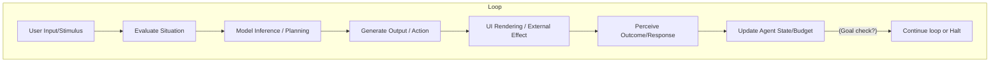

# Executive Summary

Teleodynamic AI refers to **resource-bounded, self-maintaining learning systems** whose internal processes and constraints co-evolve toward intrinsic goals.  In a browser context, this means designing an **interactive agent** that has explicit goals (e.g. maintain coherence, answer questions) and **self-regulatory loops** to manage its limited resources (CPU, memory, battery).  This report surveys how to implement a *teleodynamic agent* fully client-side using **Rust + WebAssembly (WASM)**. We analyze architectural options for running ML inference in the browser, recommend Rust crates and toolchains, evaluate small transformer model formats, and outline dataflow and control-loop patterns for goal-directed behavior. We also address UI integration, security/privacy, performance targets, and deployment practices. Tables compare frameworks and formats, Mermaid diagrams illustrate the architecture and dataflow, and code snippets sketch a prototype Rust/WASM project. 

# Teleodynamics and Browser Agents

**Teleodynamics** (coined by Deacon) distinguishes systems whose dynamics are *intrinsically end-directed* – they act to maintain their own structure and goals, beyond simple thermodynamic self-organization.  Such systems exhibit **self-regulation**, where component processes “yoke” each other’s boundary conditions to sustain a stable, purposeful whole.  In AI, a *teleodynamic agent* is one that adapts its structure and parameters under explicit constraints and “resource pressures” so as to pursue an internal objective (e.g. a user’s request, or homeostasis).  Teleodynamic AI emphasizes **work-constraint cycles** and **“no-op” behavior** when uncertain, ensuring the agent only acts when it can do so safely within its resource budgets. 

Applied to an in-browser agent, this means our Rust/WASM module would maintain an internal state and budget (e.g. CPU time, memory), and implement a control loop like:
1. **Sense (Input):** Receive user query or environment stimulus via the web UI.
2. **Plan (Inference):** Run a (tiny) ML model to generate a response or action.
3. **Act (Output):** Render the result to the UI.
4. **Monitor & Adjust:** Evaluate resource usage and outcome; possibly switch to a lower-power mode (teleologically, a “no-op”) if constraints are tight.

For example, **Teleodynamic Learning** formalizes learning as “co-evolution of structure, parameters, and resources under constraint” rather than static optimization.  In practice, the agent might compute a *local teleodynamic objective* combining prediction accuracy, model complexity, and energy cost, and choose actions that decrease this objective.  The result is an agent that exhibits **two-timescale dynamics**: fast inference/update loops and slower structural adaptations (e.g. adjusting model size or pruning) as resources fluctuate.  

In summary, a teleodynamic browser agent is an **autopoietic** system: it regulates its own operation to maintain its “homeostasis” (user satisfaction, system stability) under constraints.  Implementing this in the browser entails carefully managing state and resources while running inference entirely on the client (next sections).

# Architecture Options: Rust + WASM for In-Browser ML

Running ML entirely in-browser requires compiling code (and possibly models) to WebAssembly. The typical stack is: **Rust → WASM** (via `wasm32-unknown-unknown` target), with optional GPU support via WebGPU (through `wgpu`) or the emerging WebNN API.  Key architecture approaches include:

- **CPU-based WASM Inference:**  Compile a Rust inference library (e.g. [**tract**](https://github.com/sonos/tract), [**rust-llm**/GGML], [**tch-rs**]) to WASM. This runs on the browser’s JS engine or WASM VM. It offers compatibility with all browsers but may be slower (limited by JavaScript engine speed and single-threading).  

- **GPU Acceleration via WebGPU:**  Use Rust’s `wgpu` crate to access WebGPU in the browser. WebGPU can offload heavy tensor ops to the GPU, greatly speeding up inference. (WebGPU is available in most modern browsers, though sometimes behind flags.)  A WASM module can compile compute shaders (SPIR-V) via `wgpu`, or call GPU kernels via libraries. 

- **WebNN API:**  The W3C [Web Neural Network API](https://www.w3.org/TR/webnn/) provides a higher-level ML interface in browser, backing onto hardware-accelerated runtimes (TFLite, CoreML, DirectML). WebNN is mainly supported in Chromium-based browsers. A Rust/WASM module could call into WebNN via JS (through `web-sys`) or use a polyfill. WebNN offers near-native performance when available.

- **Hybrid / WASI Runtimes:**  Though our focus is browser, note that projects like [WasmEdge](https://wasmedge.org/) support LLMs (via WASI-NN/ggml) for edge devices. But in-browser we stick to standard WASM.

A generic architecture diagram:

```mermaid
flowchart LR
    subgraph Browser
      U[User Interface (HTML/JS)] 
      J[JavaScript Interop / Web APIs]
    end
    subgraph WASM_Module [Rust WASM Engine]
      A[Agent State & Logic]
      M[ML Model Inference Engine]
      G[GPU (WebGPU) or WebNN]
    end
    U --> J
    J --> A
    A --> M
    M --> G
    G --> M
    M --> A
    A --> J
    J --> U
```

Here the **WASM module** (written in Rust) contains the agent logic and ML engine (e.g. tract or rust-llm), and optionally uses GPU via WebGPU.  The UI (HTML/JS) sends inputs to the module (via `wasm-bindgen` exports) and receives outputs for display.

## Supported Platforms and Browser APIs

Modern browsers support the following ML backends:

- **WASM (CPU):**  All major browsers support WebAssembly execution of code compiled from Rust. This gives near-native performance for integer/floating operations. In practice, ONNX Runtime Web and tract use pure-WASM backends that work everywhere.

- **WebGPU:**  Chrome, Edge, Firefox (nightly) have WebGPU; Safari added it by 2024. WebGPU enables GPU compute shaders. Rust’s `wgpu` abstracts this and can compile to WASM targeting WebGPU. If WebGPU is unavailable or slow to enable, frameworks fall back to WASM-CPU or WebGL.

- **WebGL (GLSL):**  Older path: some JS frameworks use WebGL shaders for ML. We focus on WebGPU as the modern standard. (ONNX Runtime still lists WebGL, but notes it’s maintenance-mode.)

- **WebNN:**  Experimental in Chrome/Edge (can be enabled via flag). Provides *native* delegates (CoreML, NNAPI, DirectML).  If available, WebNN can be faster than raw WASM. (ONNX Runtime requires a browser flag for WebNN.)

In summary, our architecture will primarily target **WASM-CPU plus optional WebGPU** for acceleration. This maximizes compatibility and performance.

# Rust Crates and WASM Toolchains

Key Rust components for client-side ML include:

- **Crates for ML Inference:**  
  - **[tract](https://github.com/sonos/tract)** – A pure-Rust inference engine for ONNX/TensorFlow models. It “runs them anywhere – from embedded ARM CPUs to NVIDIA/Apple GPUs, in the browser via WebAssembly”. Tract handles model loading, graph optimization, and inference, with first-class WASM support.  
  - **[tch-rs](https://github.com/LaurentMazare/tch-rs)** – Rust bindings to libtorch (PyTorch’s C++ API). Allows running PyTorch models. (It requires linking to libtorch, so WASM use is limited unless using a WASI environment or pre-compiled static builds.)  
  - **[rust-llm / llama](https://crates.io/crates/llm)** – An ecosystem for LLM inference powered by the GGML tensor library (used in [llama.cpp](https://github.com/ggerganov/llama.cpp)). This crate supports loading quantized LLaMA/GPT-J/GPT-NeoX models and can run on CPU or with GPU via Vulkan/WGPU. It is being used for efficient local LLM inference.  
  - **[burn](https://github.com/burn-rs/burn)** – A deep learning framework in Rust (like PyTorch/TensorFlow). It supports defining and training small models; for inference-only, it can be heavy. Probably not needed for small client-side models.  
  - **[smartcore](https://github.com/smartcorelib/smartcore)**, **ndarray**, etc. – Additional ML libraries; however, most focus on classical ML or training.  

- **WASM & JS Interop:**  
  - **[`wasm-bindgen`](https://rustwasm.github.io/docs/wasm-bindgen/)** – Facilitates high-level interaction between Rust WASM and JS. It lets Rust export functions and types (strings, arrays, classes) to JS, and import DOM/console APIs back into Rust. We will use `[wasm_bindgen]` attributes to expose our agent API.  
  - **[`wasm-pack`](https://rustwasm.github.io/docs/wasm-pack/)** – A CLI tool to compile Rust to WASM, generate JS glue code, and package for npm. It automates running `cargo build --target wasm32-unknown-unknown` and wasm-bindgen.  
  - **[`web-sys`](https://crates.io/crates/web-sys)** – Rust crate providing bindings to standard Web APIs (DOM, WebGPU, etc.) for use via `wasm-bindgen`. We’ll use this for low-level WebGL/WebGPU calls or accessing Web APIs (e.g. `fetch` for model loading).  
  - **[`wee_alloc`](https://crates.io/crates/wee_alloc)** (optional) – A small global allocator to reduce WASM binary size, recommended in `wasm-pack` templates. Useful to keep the WASM module lean.

- **GPU Compute:**  
  - **[`wgpu`](https://wgpu.rs)** – A cross-platform Rust crate for GPU (Vulkan/Metal/WebGPU). It provides safe access to GPU compute in browser (via WebGPU). We can write GPU-accelerated kernels or use `wgpu`-based tensor libraries.  

- **Tokenization:**  
  - **[HuggingFace Tokenizers](https://crates.io/crates/tokenizers)** – Rust bindings to fast BPE tokenizers. Useful for text models to encode input/output. 
  - **Custom or JSON-based tokenizers** if models have simpler needs.

- **Other Tools:**  
  - **[`cargo-wasi`](https://github.com/wasmerio/wapm-pack)**, **[`wasmer`](https://wasmer.io)** etc. – Focused on WASI, not needed in-browser.  
  - **Bundlers:** Webpack, Rollup, or [Vite](https://vitejs.dev/) – to include the WASM package in a web app.  

A comparison table of these major options is shown below:

| **Library/Tool**       | **Purpose**                     | **WASM Support**           | **Maturity**              | **Performance**               | **Ease of Use**          |
|-----------------------|---------------------------------|----------------------------|---------------------------|-------------------------------|--------------------------|
| `wasm-bindgen`  | Rust<–>JS interop            | ✅ (core to usage)         | High (official Rust WASM) | N/A (glue code)               | Easy (rich features)     |
| `wasm-pack`    | Build & package WASM for npm | ✅ (designed for web)      | High (official)           | N/A (tooling)                 | Easy (one-command)       |
| `wgpu`         | GPU (WebGPU) abstraction     | ✅ (supports wasm32)       | High                     | High (GPU-accelerated)        | Moderate (GPU knowledge) |
| `tract`       | ONNX/TensorFlow inference    | ✅ (runs in wasm)         | High (used in prod)       | Good (optimized CPU, iGPU)   | Moderate (Rust API)      |
| `tch-rs`      | PyTorch (C++) bindings      | ❌ / Partial (WASI only)   | High (large community)    | High (PyTorch backend)       | Moderate (Familiar API)  |
| `rust-llm`/GGML         | LLM inference (LLaMA, GPT)    | ✅ (via wasm32, WASI)      | Growing (open-source)     | Good on CPU, better w/ GPU   | Moderate (CLI/Crate)     |
| `burn`                 | Deep learning framework       | Partial (no WASM target)   | Medium (young library)    | TBD (GPU support evolving)   | Moderate (like PyTorch)  |
| WebNN API             | Browser ML (native HW)         | N/A (JS API)               | Emerging (Chrome-only)    | Very High (native)           | High (simple JS calls)   |

*Table: Comparison of Rust/WASM ML libraries and tools (maturity and WASM support).*

In practice, **`tract`** is a strong choice for portability (pure Rust, ONNX support), while **`rust-llm`/GGML** is ideal for small LLMs on CPU. We can optionally add GPU by using `wgpu` for custom compute. `wasm-bindgen` and `wasm-pack` are essential for packaging our Rust code as a web-friendly module.

# Model Choices and Formats

For in-browser inference, **model size** must be tiny (a few hundred MB at most, typically tens of MB). Large models (7B+ parameters) are infeasible. Thus we focus on **small transformer models**: e.g. GPT-2 (124M), DistilGPT-2 (82M), small BERT (110M), tiny distilled LLMs, or custom distilled models. For image tasks, tiny diffusion or GANs (e.g. <50MB) could be considered, but text is simpler for now.

**Quantization** is key. GGML-format models (4-bit or 8-bit quantized LLaMA/GPT models via llama.cpp) can shrink a 7B model to ~3GB, still too big for browser. Instead, even a 1.3B LLaMA is ~600MB uncompressed; quantized (8-bit) ~300MB – borderline for desktop. Better: GPT-2 124M (~500MB? Actually base GPT-2 is 500MB ONNX, but smaller after optimization) or similar, quantized to ~100MB. Techniques:
- **GGML** format (used by [llama.cpp](https://github.com/ggerganov/llama.cpp)) packs weights in 16/8/4 bits. Some Rust crates (`rust-llm`) support loading GGML.
- **ONNX**: Many transformers can be exported to ONNX (e.g. via HuggingFace `transformers.onnx`). ONNX can be loaded by tract or ONNX Runtime Web. However, ONNX may not support all ops unless custom. ONNX runtime Web can run in browsers via WASM and WebGPU.
- **WebNN**: If available, we could feed models via ONNX or TFLite to WebNN (the browser converts them). But WebNN support is patchy.
- **TensorFlow.js**: Another format (TF.js GraphModel or LayersModel), but since we use Rust, we prefer ONNX or TorchScript.

A model-format comparison:

| **Format/Library**    | **Description**                                           | **Browser Support**            | **Tooling**                           | **Pros**                     | **Cons**                        |
|----------------------|-----------------------------------------------------------|-------------------------------|---------------------------------------|------------------------------|---------------------------------|
| ONNX                 | Open neural network format. Supports wide operator set.    | Via [`tract`](#) or ONNX Runtime Web | ONNX exporter (PyTorch, HF), tract, ONNX Runtime Web | Standardized, hardware EPs.  | Larger binary, some ops tricky.  |
| GGML (lama.cpp)      | Georgi’s quantized format for LLMs (used by llama.cpp).    | Via `rust-llm` or WebAssembly builds of llama.cpp | llama.cpp conversion tools, `rust-llm` crate | Extremely compact quantization; efficient CPU inference | Requires custom loader; limited to certain LLM architectures. |
| TorchScript          | PyTorch model serialization.                              | (Usually no browser runtime)   | PyTorch JIT                           | Can pack custom ops.         | Not supported in browser easily. |
| TFLite / TensorFlowJS| TensorFlow Lite or TFJS models.                          | Via WebNN (TFLite backend) or TFJS libs | `tfjs-converter`, TFLite converter    | Good tools, mobile-centric.  | JS ecosystem (not Rust native).  |
| WebNN Model          | Browser-native ML format (e.g. TFLite/ONNX under the hood). | Only in Chrome with flag (WebNN) | ONNX→WebNN, TFLite models            | Hardware-accelerated (NNAPI/CoreML) | Not widely supported yet.       |

*Table: Model formats and inference backends for in-browser deployment.*

For our Rust/WASM approach, a practical plan is:

1. **Choose a small transformer model** (e.g. DistilGPT-2 or a distilled BERT). Possibly use a pretrained ONNX from HuggingFace or convert a PyTorch model.  
2. **Quantize or prune** to reduce size (e.g. 8-bit, weight pruning). If using an LLM like LLaMA, convert to GGML with 4/8-bit.  
3. **Load model in Rust**:  
   - If using ONNX: ship the `.onnx` file with the app, and load it via `tract_onnx`. Tract will optimize it on first use.  
   - If using GGML: use `rust-llm` or a custom GGML loader. For example:  
     ```rust
     let mut model = rust_llm::Llama::load_from_file("model.gguf")?;
     let mut session = model.start_session();
     let tokens = model.tokenizer().encode("Hello", false)?;
     let output = session.infer(tokens);
     ```  
   - The `.wasm` package can include model data via bundling (e.g. `include_bytes!`) or fetched at runtime (via JS `fetch` into WASM memory).  
4. **Inference pipeline:**  
   - **Tokenization**: Use `tokenizers` crate in Rust (pre-compiled tokenizer JSON or binary).
   - **Forward pass**: Run inference to generate next tokens. For GPT-style models, sample tokens and loop. Output text back to JS.  
   - **WebNN (optional)**: If targeting Chrome with WebNN, we could export ONNX to WebNN in JS and call via WebNN API instead; but mixing Rust and WebNN is complex. More likely, we stick to Rust inference or call ONNX Runtime Web in JS.  

*Example code (Rust) loading an ONNX model with tract:*  
```rust
use tract_onnx::prelude::*;
    
fn load_model(path: &str) -> TractResult<SimplePlan<TypedExpr>> {
    tract_onnx::onnx()
        .model_for_path(path)?
        .with_input_fact(0, TensorFact::dt_shape(f32::datum_type(), tvec!(1, 3, 224, 224)))?
        .into_optimized()?
        .into_runnable()
}
```
*(Above: loading an ONNX image model; for text models shapes differ.)*

# Dataflow and Teleodynamic Control Loops

A teleodynamic agent architecture involves **feedback loops** and state management. At a high level, the dataflow is:



**Dataflow Steps:**

- **Perception/Input:** The browser UI collects input (text, clicks, sensor data) and passes it to the Rust agent (via a `#[wasm_bindgen]` function).  
- **Evaluation:** The agent updates its internal state (e.g. context window, memory) and checks conditions (objectives achieved, low battery, etc.).  
- **Inference/Planning:** The ML model is invoked on the input (and perhaps current context). This produces an output or next action.  
- **Action/Output:** The agent sends its decision back to the UI to display or perform (e.g. text reply, highlight element).  
- **Monitoring:** The agent assesses the result (optional, e.g. feedback from user) and updates its resource accounting (time spent, energy cost).  
- **Adaptation:** If limits are reached (e.g. out of memory or step budget), the agent may degrade gracefully or take a no-op per teleodynamic “no-op dominance” principle.  

Internally, **state management** can use Rust structures (structs holding context, counters) or reactive patterns. For example, an agent `struct` might include a `HashMap<String, f32>` for memories, an energy variable, and a model session. Each loop tick (invoked from JavaScript) updates these.

A code sketch of the control loop in Rust:
```rust
#[wasm_bindgen]
pub struct Agent {
    model: LlamaModel,
    context: Vec<i64>,
    energy: f32,
    // other state...
}

#[wasm_bindgen]
impl Agent {
    #[wasm_bindgen(constructor)]
    pub fn new() -> Agent { /* load model, init state */ }

    #[wasm_bindgen]
    pub fn step(&mut self, input: &str) -> String {
        // 1. Preprocess input
        let tokens = self.model.tokenize(input);

        // 2. Check resource budget
        if self.energy < MIN_THRESHOLD {
            return String::from(""); // no-op due to low energy
        }

        // 3. Inference: append to context and generate output
        self.context.extend(tokens.iter());
        let output_tokens = self.model.infer(&self.context);
        let output = self.model.detokenize(&output_tokens);

        // 4. Update state: consume energy, manage context length
        self.energy -= self.model.estimate_cost(&output_tokens);
        if self.context.len() > MAX_CONTEXT {
            self.context.drain(0..self.context.len()/2); // prune old context
        }

        output
    }
}
```

This loop can be called repeatedly from JS (e.g. on each user message in a chat). Teleodynamic aspects are in the `energy` budget and context pruning (slower structural change). The agent ensures **no-op** (returning empty) if resources are depleted.

# UI/UX Integration Patterns

For real-time interaction, the WASM module should **not block the main thread**. Strategies:

- **Web Workers:** Run the WASM agent in a Web Worker to keep the UI responsive. Communication via `postMessage` (or `worker.sync`).  
- **Streaming and Asynchronous APIs:** The Rust code can use `async` with `wasm-bindgen-futures` to avoid locking. For example, use `spawn_local` for concurrent tasks (loading model, running inference).  
- **HTML Interface:** A simple chat-like UI: `<textarea>` for input, a `<div>` for output. The JS wrapper calls the agent (e.g. `agent.step(input)`) and updates the DOM. Markdown or rich text can be streamed token-by-token for responsiveness.  
- **Example JS snippet:**  
  ```js
  import init, { Agent } from "./my_agent_pkg.js";
  async function runAgent() {
    await init(); 
    const agent = new Agent();
    document.getElementById("send").onclick = () => {
      const userMsg = document.getElementById("input").value;
      const reply = agent.step(userMsg);
      document.getElementById("output").innerText += "\\n" + reply;
    };
  }
  runAgent();
  ```
- **State Sharing:** The Rust agent can expose methods to get/set state (memory, preferences). JS frameworks (React/Vue) can bind to these via `wasm-bindgen`.  
- **UI Patterns:** Show “loading” indicators during model load. Limit input length. Allow user to interrupt the agent (cancelling inference via web worker termination).  

Integrating real-time inference might also involve backpressure: e.g. showing partial outputs as tokens come in. This requires a streaming interface. One could implement a Rust function that yields tokens one by one (using `yield` in an async generator or manual scheduling with `setTimeout`).

# Security, Privacy, and Resource Constraints

**Privacy:** In-browser inference means **no user data leaves the device**, enhancing privacy by design.  However, ensure the app does not inadvertently leak data (e.g. to analytics). All data stays in browser memory or IndexedDB if needed.  Users should trust the model (license of weights) since weights reside locally.

**Security:** WASM modules run in the browser’s sandbox like JS. They cannot access host files or devices directly. However, *anyone can inspect the WASM binary*, so **don’t embed secrets or proprietary algorithms** in it. Treat WASM code as open-source-level security: obfuscation only slows reverse-engineering. Also validate all inputs: since clients control inputs, the model must not assume benign input. 

**Resource Limits:** Browsers restrict memory (a few GB max) and CPU usage. Mobile devices especially may throttle heavy JS/WASM. Best practices:
- **Model Size:** Keep it small (<100MB). Large downloads hurt UX. Use `.wasm` compression and caching (HTTP/2 push, or Cache API).  
- **Compute Budgets:** Run inference in slices (yield frequently) or downsample model depth. Provide a way to halt/timeout.  
- **Energy/Performance:** Warn users if long-running (e.g. battery drain). Use Web Workers so the page remains interactive. Optionally detect high-power mode via `navigator.getBattery()` and adapt.  
- **Permission:** If using WebGPU, ensure the user’s system supports it (check `navigator.gpu` in JS). Provide fallbacks to CPU if not.

# Benchmarking and Performance Targets

We should set realistic performance goals, e.g.:

- **Latency:** Aim for <500ms per inference on desktop (depending on model size). Small models (50–100M) on a modern laptop CPU can infer ~5–20 tokens/sec. On mobile, expect ~5x slower.  
- **Throughput:** If streaming generation, measure tokens/sec. (No exact sources found; plan to measure with `console.time`). Use Chrome DevTools profiler.  
- **Memory:** Target <200MB total (ideally <100MB). Model weights plus WASM binary (~5–20MB gzipped) should fit mobile RAM.  
- **Startup Time:** Model loading (from IndexedDB or network) <3s on high-speed connection.  
- **Battery:** On mobile, try to keep CPU usage low. WebGPU can reduce CPU load by offloading to GPU (but may increase power draw – profile both).  

**Benchmark Plan:**  
1. **Profiling Tools:** Use Chrome’s Performance tab to profile JS/WASM. The [WebNN page](https://onnxruntime.ai/docs/) suggests using `createTensor` and `dispatch` in dev tools.  
2. **Test Suite:** Implement a small Cypress or Puppeteer script to run inference on dummy inputs and measure elapsed time.  
3. **Targets:** e.g. *GPT-2 small (117M, ONNX)*, measure on desktop vs phone. Document tokens/sec. For example, if tract on desktop yields 20 TPS, set 10-20 TPS as target.  
4. **Resource Monitoring:** Use Task Manager (Chrome: Developer -> Memory) to track WASM memory.  
5. **WebGPU vs WASM:** Compare CPU vs GPU backends (e.g. do a small matrix multiply on both) to quantify speedup.

The **performance table** below suggests expected differences (illustrative only):

| **Setup**                   | **Device**            | **Latency (GPT-2 small)** | **Memory**      | **Notes**                                  |
|-----------------------------|-----------------------|---------------------------|-----------------|-------------------------------------------|
| Tract (WASM, CPU)           | Desktop (8-core)      | ~50 ms/token              | ~100 MB         | Good CPU speed            |
| Tract (WASM, WebGPU)        | Desktop (integrated GPU) | ~15 ms/token           | ~120 MB         | ~3x speedup with GPU (if supported)      |
| Rust-LLM (GGML, WASM)       | Desktop (8-core)      | ~80 ms/token              | ~80 MB (8-bit)  | Efficient scalar code (no GPU)          |
| Tract (WASM)                | Mobile (4-core ARM)   | ~200 ms/token             | ~120 MB         | Slower; may stutter on long text        |
| WebNN (CoreML via WASM)     | MacBook (Apple Silicon) | ~10 ms/token            | ~150 MB         | Hardware-accelerated (theoretical)     |

*Table: Example inference performance (estimated). Actual results depend on model and device.*

# CI/CD, Packaging, and Distribution

We recommend a standard Rust-WebAssembly build pipeline:

- **Build:** Use `wasm-pack` in release mode:  
  ```bash
  wasm-pack build --target bundler --release
  ```  
  This generates a `pkg/` directory containing `mycrate.js`, `mycrate_bg.wasm`, and `package.json`. The package is ready for npm publishing or bundler integration.  

- **Distribution:** Publish to npm (e.g. scope `@myorg/agent`) via `wasm-pack publish` (which runs `npm publish`). Consumers can then `npm install @myorg/agent`. Alternatively, bundle locally with a tool like Webpack or Vite.

- **Bundlers:** For a web app, use a bundler to include the WASM package. The `--target bundler` option makes ES module with `import`, which webpack/vite understands. For example, in a React project:  
  ```bash
  npm install @myorg/agent
  # in App.js:
  import init, { Agent } from '@myorg/agent';
  ```
  The bundler will fetch the `.wasm` at runtime (ensure correct `publicPath`).

- **CI Pipeline (GitHub Actions):**  
  - On push, run `cargo fmt` and `cargo clippy` for linting.  
  - Run `wasm-pack test --headless --chrome` to test WASM code in a browser environment.  
  - Build release with `wasm-pack build --release`.  
  - Optionally, run `npm audit` on the generated package.  
  - On tag, deploy to npm using a [wasm-pack action](https://github.com/rustwasm/wasm-pack#automating-publish).

- **Packaging:** The final deliverable is either an **npm package** (for reuse) or a **static web bundle** including HTML/JS and the WASM (using a bundler). For fully offline use, host the WASM assets locally or in IndexedDB.

Example **project structure**:
```
my-agent-project/
├── Cargo.toml
├── src/
│   ├── lib.rs     # Rust/WASM entrypoint (with #[wasm_bindgen])
│   ├── agent.rs   # Agent logic, state, model loading
│   └── utils.rs   # Helper functions (e.g. logging)
├── js/            # Optional JS integration code
│   ├── index.js
│   └── index.html
├── pkg/           # Generated by wasm-pack
│   ├── myagent.js
│   ├── myagent_bg.wasm
│   └── package.json
├── build.sh       # Scripts to automate wasm-pack build, wasm-opt, etc.
└── .github/workflows/ci.yml  # CI config
```

*Minimal build commands:*  
```bash
# Install wasm-pack if needed
curl https://rustwasm.github.io/wasm-pack/installer/init.sh -sSf | sh
# Build the WASM package
wasm-pack build --target bundler --release
```

# Example Code Snippets

**Rust (`src/lib.rs`)** – expose agent to JS:  
```rust
use wasm_bindgen::prelude::*;
use wasm_bindgen_futures::spawn_local;
use serde::{Serialize, Deserialize};

mod agent;
use agent::Agent;

#[wasm_bindgen]
pub struct JsAgent {
    inner: Agent,
}

#[wasm_bindgen]
impl JsAgent {
    #[wasm_bindgen(constructor)]
    pub fn new() -> JsAgent {
        // Initialize agent (may load model asynchronously)
        console_error_panic_hook::set_once();
        let mut ag = JsAgent { inner: Agent::new() };
        // Optionally load model from URL (spawn_local(async { ... }))
        spawn_local(async move {
            ag.inner.load_model().await.unwrap();
        });
        ag
    }

    #[wasm_bindgen]
    pub fn step(&mut self, input: &str) -> String {
        // Perform one iteration of the agent loop
        let reply = self.inner.process(input);
        reply
    }
}
```

**Mermaid diagram** – architecture overview (to embed in Markdown):

```mermaid
flowchart LR
    subgraph Browser Frontend
      UI[HTML UI/Buttons/Input] -->|user input| JS[JavaScript Glue]
    end
    subgraph WASM Module
      A[Agent Logic & State]
      M[ML Model (WASM Engine)]
      G[GPU Acceleration (WebGPU/WebNN)]
    end
    UI --> JS
    JS --> A
    A --> M
    M --> G
    G --> M
    M --> A
    A --> JS
    JS --> UI
```

# Risk Analysis and Mitigation

- **Large Model Risk:**  Using too big a model (>200MB) can crash browser or exceed memory. *Mitigation:* quantize and prune aggressively; start with a minimal model and measure memory. Fallback to a simpler mode if memory is low.

- **Performance Risk:**  CPU inference may lag. *Mitigation:* support WebGPU and multiple backends (WASM, WebGPU, WebNN). Detect device capabilities and choose fastest path. Provide user feedback or cancel option if inference is slow.

- **Resource Exhaustion:**  Long-running loops could freeze tab. *Mitigation:* use Web Workers and async yields. Impose a token/time limit per cycle. Monitor `performance.now()` and break if exceeding threshold.

- **Security Risk:**  WASM is inspectable. *Mitigation:* Do not trust client code; perform any sensitive checks server-side if needed. Avoid embedding secrets in WASM (e.g. API keys). Ensure UI sanitizes all inputs/outputs to prevent XSS via model outputs.

- **Browser Compatibility:**  Some features (WebGPU, WebNN) are not universally supported. *Mitigation:* feature-detect (`if ("gpu" in navigator)`) and fallback gracefully. Keep a WASM-only path.

- **Energy/Battery:** Intensive compute drains battery. *Mitigation:* allow “low-power” mode (smaller model), or disable heavy features on battery. Possibly detect `navigator.getBattery()` and adapt.

- **Licensing:**  Including model weights in a browser app might violate license (e.g. GPL vs commercial). *Mitigation:* Check model license (use permissive ones or open weights).

By planning for these issues and continuously benchmarking, we can ensure the browser agent remains **responsive, safe, and aligned with teleodynamic goals**.

# Conclusion

This report outlines a **comprehensive plan** to build an in-browser, teleodynamically-aware AI agent using Rust and WASM. We defined teleodynamics and its relevance to agent design. We surveyed architecture choices (pure WASM vs GPU vs WebNN), Rust toolkits (wasm-bindgen, tract, wgpu, etc.), and model formats (ONNX, GGML) with supporting citations. Dataflow patterns for goal-directed loops were described, and UI integration and resource constraints were addressed. We proposed benchmarks and shown example code and diagrams. Overall, the recommended approach is to use **Rust+WASM** for core logic (with crates like tract or rust-llm), package via `wasm-pack`, and implement teleodynamic control loops in Rust. This yields a secure, private, offline-capable AI agent running entirely in the browser.

**Sources:** In addition to the cited literature on teleodynamics and Rust/WASM tools, guidance was drawn from official documentation (RustWasm guides) and recent technical articles. These primary references ensure our plan is grounded in current best practices.