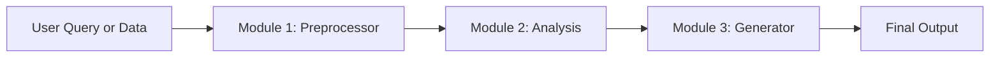
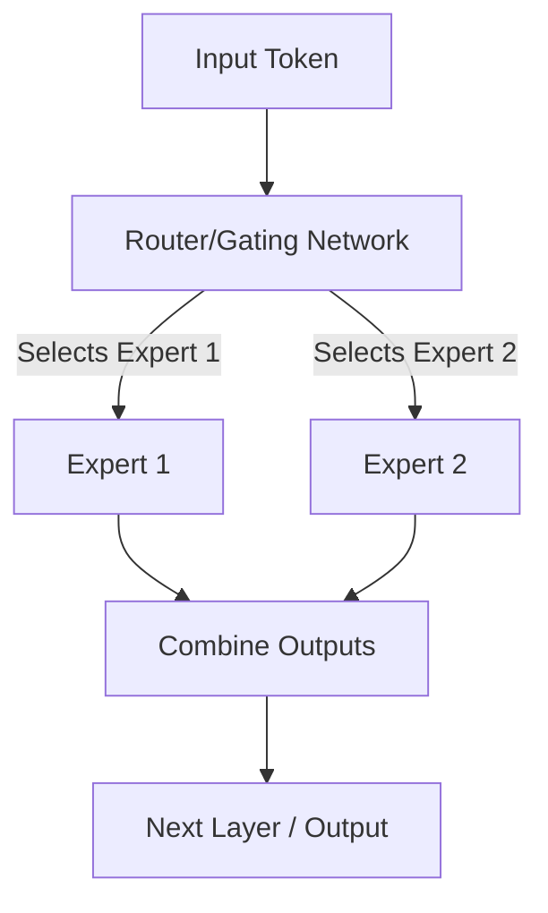
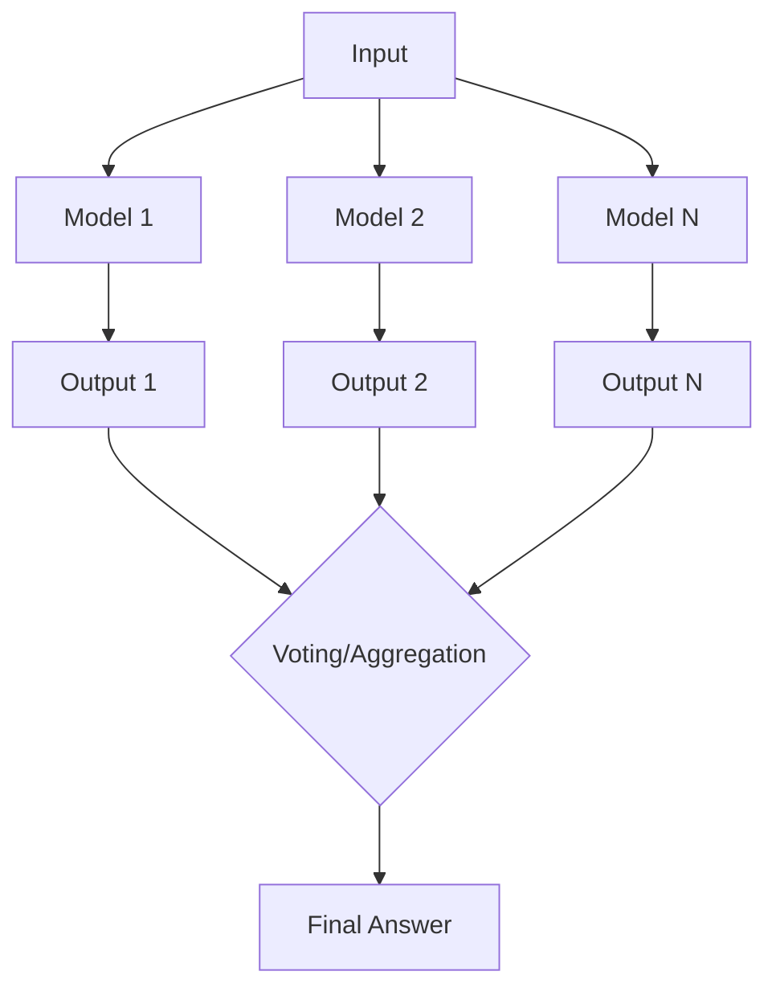
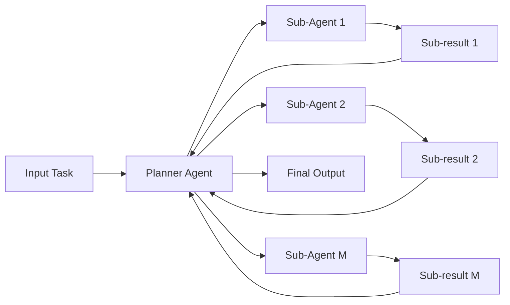
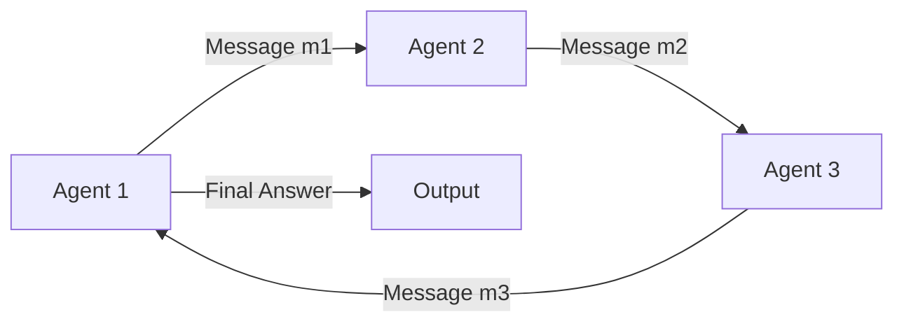
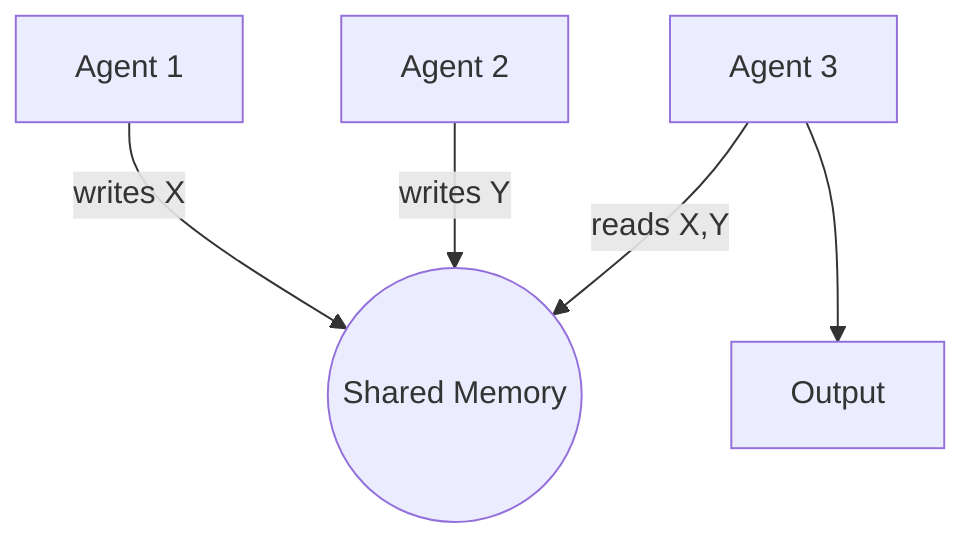
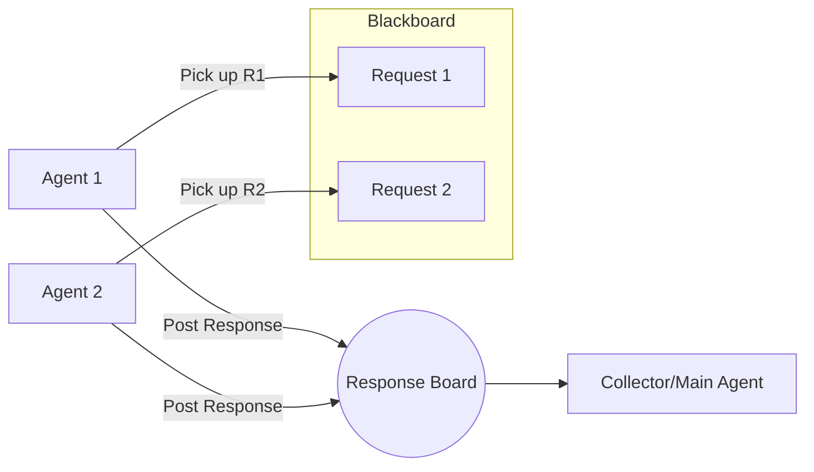

# Executive Summary  
Teleodynamics is a theoretical framework describing how multiple self-organizing processes can couple to produce goal-directed behavior.  It builds on concepts like **autopoiesis** (self-production), **self-organization** (spontaneous pattern formation), and **teleology** (purpose/goal-directedness).  In a teleodynamic system, at least two subsystems interact to **sustain the whole**, with each constraining the other’s entropy-production tendencies.  Mapping these ideas to machine learning, we view an ensemble of Tiny Language Models (tiny LMs) as an interacting multi-agent system that can self-organize and pursue collective objectives.  By carefully designing their architecture and communication, we may induce emergent, goal-directed capabilities (e.g. collaborative reasoning or task-solving).  

A **Tiny Language Model (TLM)** is assumed here to have **<100 million parameters**, often an order of magnitude smaller than typical LLMs.  (For reference, “Super-Tiny” LMs go as low as 10–100M.)  TLMs trade off capacity for efficiency, enabling deployment on edge devices or low-resource settings.  Despite their size, recent work shows TLMs retain key qualitative behaviors of LLMs: pretraining significantly boosts performance even at tiny scale, and ensembles of tiny models can match larger ones.  

This report surveys how **teleodynamic principles** inform the design of **multi-model TLM architectures**.  We define TLMs (parameter ranges, device constraints) and then examine architectural *patterns* for combining many TLMs into cohesive systems.  These include **modular pipelines**, **mixture-of-experts (MoE)**, **ensembles/committees with consensus voting**, **hierarchical controller-agent frameworks**, **emergent communication schemes**, **shared-memory architectures**, and **blackboard systems**.  For each pattern we present a diagram, list pros/cons, discuss scalability, latency, training modes (joint vs independent vs distillation vs continual), coordination protocols, and fault tolerance.  

We compare these patterns in tables, discuss relevant metrics (accuracy, throughput, energy, fault-tolerance, emergent synergy), datasets/benchmarks (e.g. text classification datasets, code/fault localizaton tasks, multi-agent games), and suggest experiments (e.g. ablations of agents, communication channels).  Deployment considerations (edge vs cloud, hardware speedups) and training costs are analyzed.  We identify open questions (e.g. how to steer emergent goals, align multi-agent behavior) and risks (misaligned objectives, collusion, brittle coordination).  Potential applications span on-device NLP, collaborative coding assistants (as in COSMosFL for fault localization), interactive AI agents (AgentOrchestra for planning), and scientific data discovery (blackboard LLMs for data science).  

The literature surveyed is current up to mid-2026.  Key sources include foundational theory (Deacon’s teleodynamics), recent systems (e.g. AgentOrchestra, COSMos, Mixtral MoE, collaborative memory, emergent multi-agent studies), and surveys of small-model techniques.  All sources are cited with links for reference.  

## Teleodynamics: Autopoiesis, Self-Organization, and Goal-Directedness  
- **Autopoiesis** (Maturana & Varela): a network of processes that produce and maintain the system’s own components.  It emphasizes self-maintenance but by itself does not guarantee purpose or goals.  
- **Self-Organization:** processes in far-from-equilibrium systems spontaneously form patterns or structures (e.g. convection cells, pattern formation).  These produce order but no inherent “beneficiary” or end-goal.  
- **Teleology/Goal-Directedness:** philosophical notion that some systems appear to have “ends” or purposes.  Traditional teleological explanations invoke final causes; modern science seeks to naturalize goals.  Teleological behavior means a system acts so as to preserve or achieve some state (for itself).  
- **Teleodynamics (Deacon 2011, etc.):** a **phase of organization** emerging from coupling at least two self-organizing processes that oppose each other’s tendency to maximize entropy production.  In teleodynamics, the system’s components constrain each other to maintain a “goal-state” – essentially, the system does work to preserve its own structure.  This reinstates teleology as a *real causal property*: the system becomes intrinsically oriented toward preserving itself (normative behavior).  Unlike simple self-organization, teleodynamics yields **persistent, self-preserving structures** that counteract disorganization.  

In a teleodynamic system, **no single component “knows” the goal**; purpose arises only through the dynamical interplay of parts.  Deacon’s theory shows how an “autogen” (self-generating automaton) could spontaneously develop goal-directedness from coupled autocatalytic sets.  Teleodynamics emphasizes that *purposiveness is emergent*, not explicitly encoded.  It also stresses that internal resource flows and constraints must be considered as part of the system (no fixed external budget).  

**Mapping to AI/ML:**  We can draw an analogy: treat each tiny LM or module as a self-organizing process (learning parameters to fit data).  Ensembling or letting them interact under constraints can produce a higher-level “agent” with a goal (e.g. answer a question, complete a task) that none of the individual models explicitly “planned” in isolation.  Teleodynamic insights suggest designing architectures where constraints are coupled and resources (computation, memory) are internally regulated, so that the ensemble naturally settles into useful emergent behaviors.  For example, if multiple LMs share a common memory or reward signal, they may collectively optimize a global objective while each remains simple.  This is a form of **multi-agent learning as dynamical systems**, where we seek emergent coordination rather than hand-designed monolithic reasoning.  

Recent work has begun to explore **“teleodynamic learning”** in ML: Whitby et al. (2026) propose viewing learning as interactions between inner (parameter) and outer (structure) dynamics, with resources treated as endogenous.  Their framework shows how emergent structure and resources co-evolve under dynamic constraints.  This perspective aligns with using ensembles of small models: instead of one fixed large architecture, we allow many small networks to grow, prune, and share information, potentially self-terminating (stop growing) when further complexity no longer pays off.  

In summary, teleodynamics provides a **conceptual bridge**: we interpret a multi-model ML system as a *distributed organism*, where goal-directed capabilities emerge from self-organization and constraint-coupling.  Our patterns below embody this: each pattern lets many tiny LMs impose constraints on one another (through gating, voting, messaging, memory, etc.) to sustain a coherent collective behavior.  

## Tiny Language Models: Definition and Scope  
We define **tiny language models (TLMs)** as transformer-based (or similar) NLP models with *up to ~100 million parameters*.  By contrast, typical LLMs are hundreds of millions to many billions of parameters. TLMs often use reduced-depth or width architectures, aggressive pruning/quantization, or encoder-only designs.  They are motivated by resource constraints: TLMs can run on edge devices, smartphones, or in embedded systems, and can be trained or fine-tuned with relatively little computation.  For example, DistilBERT has ~67M parameters, and some encoder-only TinyLlama variants are around 1.1B (above our cutoff, so “small” rather than tiny).  “Super Tiny” models as in Guertler et al. target *10M, 50M, 100M* to democratize NLP.  

**Constraints:** In architecture or deployment, we assume TLMs have: (a) limited memory (e.g. a few hundred MB), (b) limited computation (e.g. single GPU or CPU-only), and (c) relatively low latency requirements (real-time or near).  They may also have strict power/energy budgets on mobile or IoT hardware.  

**Typical Tasks:** TLMs may be used for classification, intent detection, summarization, or assistant tasks.  Although they cannot match LLMs on open-ended generation, ensembles can boost their collective capability.  Recent studies found that: (i) pre-training improves tiny models just as it does large ones, and (ii) *ensembling* many TLMs (e.g. a “soft committee”) can replicate the accuracy of a deeper TLM.  For instance, Gross *et al.* (2025) pretrained tiny BERT variants on Wikipedia and showed a *pretrained deep* BERT-6 model could be matched by a *committee* of shallow BERT-1 models.  

Throughout this report, we assume “tiny = <100M params” unless noted.  Key examples: BERT-6 (6-layer BERT, ~88M parameters) and BERT-1 (~4M) were used in experiments.  (These counts can vary; exact numbers are less important than the order-of-magnitude.)  We also note “small language model (SLM)” is sometimes used for 1B-range models, so our tiny scale is a subset of SLMs.  

## Architectural Patterns for Ensembles of Tiny LMs  
We now survey **patterns** for composing multiple tiny LMs into a coherent system.  Each pattern arranges the models and their interactions differently, inspired by software architectures and multi-agent systems.  

### Modular Pipeline (Cascaded Agents)  
In a *modular pipeline*, the input is processed by a sequence of specialized modules, each a tiny LM or sub-agent.  One module’s output (or query) becomes the next’s input.  This is common in classic NLP systems (e.g. speech → parsing → interpretation), and in AI agent chains (e.g. Toolformer/ReAct style pipelines).  In multi-agent terms, one “controller” decomposes tasks, and sub-agents handle subtasks in sequence.  

- **Pros:**  
  - *Specialization:* Each module can be fine-tuned for a subtask (e.g. summarization, classification, code generation).  
  - *Interpretability:* The flow is explicit; failures can be traced to a module.  
  - *Modularity:* New modules can be inserted or swapped without retraining the whole chain.  
- **Cons:**  
  - *Sequential latency:* Output must wait on each stage.  
  - *Error propagation:* Mistakes in early modules affect all downstream.  
  - *Single point of control:* Often requires a top-level orchestrator or strict order, which can be brittle if misconfigured.  
- **Scalability:**  
  - Scales by adding more modules or more parallel pipelines.  The pipeline depth may grow, but each module’s size remains small.  
  - Modular pipelines can branch (one module feeding multiple next-stage agents) but must carefully manage complexity to avoid combinatorial explosion.  
- **Latency:** Higher than single model inference due to pipeline depth, but some modules could run in parallel if tasks are independent.  Overall latency = sum of module latencies.  
- **Training Strategies:**  
  - *Independent:* Train or fine-tune each module separately on its subtask data. E.g. one tiny LM for question parsing, another for retrieval, another for answer generation.  
  - *Joint/End-to-end:* Optionally fine-tune the whole chain (with differentiable handover) if tasks allow; difficult if intermediate outputs are discrete or non-differentiable.  
  - *Distillation:* Ensemble pipeline → single tiny LM (distill each module into a unified model). Alternatively, distill a large monolithic model into multiple smaller modules.  
  - *Continual:* Add modules over time (e.g. train new specialists as new subtasks emerge) while freezing earlier modules.  
- **Coordination/Communication:**  
  - Typically via **data flow**: each module consumes the previous stage’s outputs (text or embeddings).  Interaction is one-way unless a feedback loop is built (e.g. module3 may request clarification from module1).  
  - Prompts can carry context or intermediate results.  If sub-agents share a memory or knowledge base, that is effectively a communication channel.  
- **Fault Tolerance:**  
  - If one module fails or is removed, the pipeline breaks unless there is a fallback path.  
  - Robustness can be improved by replicating modules (e.g. two independent summarizers vote on best summary) or by having error-catching modules.  
- **Example:** Dell’s hierarchical text classification pipeline uses multiple LLM agents for tasks like summarization, label extraction, and voting.  The main flow does: pre-classification cache check → multi-agent summarization → theme extraction → candidate label search → agent voting → label finalization.  Each bullet in that pipeline is a tiny LM agent performing a subtask, with majority voting among agents at one step.  

### Mixture-of-Experts (MoE)  
In a *Mixture-of-Experts* architecture, each layer of a model contains multiple parallel “expert” sub-networks (often simple feedforward or transformer blocks).  A **router/gating network** dynamically selects (and combines) a subset of these experts for each input token or instance.  This way, the *effective* model uses only a small fraction of parameters per sample, even though the total parameter count is large.  

- **Pros:**  
  - *Parameter efficiency:* Can have many experts but only activate a few per token (sparsity).  Each token sees just *k* experts, enabling huge capacity with modest compute.  
  - *Specialization:* Different experts can learn different patterns or domains.  The router learns to dispatch tokens to the most relevant expert(s).  
  - *Performance:* State-of-the-art MoE LMs (e.g. Mixtral 8×7B) outperformed a 70B dense model despite fewer active params.  
- **Cons:**  
  - *Training complexity:* MoEs require careful balancing; some experts can be underutilized (the “expert load balancing” problem).  
  - *Infrastructure:* Typically needs model-parallel training support (GPUs/nodes sharded by experts) and efficient routing.  
  - *Latency spikes:* If the router picks many experts or if experts have varying speeds, inference time can be uneven.  
- **Scalability:**  
  - Scales by adding more experts (width) or more layers (depth).  Ideally, routing ensures scalability by keeping per-token compute constant.  However, total memory use grows with number of experts.  
  - Routing is often *token-level*, so sequences can be parallelized.  Inference can be batched per expert.  
- **Latency:**  
  - Slight overhead for gating network computation.  
  - If experts run in parallel, end-to-end latency is dominated by the slowest selected expert.  In practice, MoEs often introduce a small latency increase vs a dense model of similar *active* size.  
- **Training Strategies:**  
  - *Joint end-to-end:* All experts and router are trained together (standard for MoE).  Each forward/backward pass updates only the selected experts plus the router weights.  
  - *Alternatives:* Train experts separately on subdomains, then distill into a single MoE (less common).  One could also freeze some experts and fine-tune others.  
  - *Distillation:* Combine experts into fewer experts or a dense model for deployment via teacher-student distillation.  
  - *Continual:* Add new experts over time (growing the “mixture”) and retrain router to incorporate them.  Or prune underused experts.  
- **Coordination/Communication:**  
  - The **router** is the coordination mechanism: it computes a sparse weight distribution over experts given the input.  Communication between experts is minimal; they operate independently on their input slice.  Only at the output they are aggregated (usually averaged or weighted sum of expert outputs).  
  - In a multi-agent view, each token “negotiates” which expert agents to consult via the router.  
- **Fault Tolerance:**  
  - If one expert fails (e.g. NaN outputs), the router can be retrained or fallback routing used.  Some implementations mask failed experts at runtime.  
  - Since multiple experts typically contribute, the model may still function (with performance degradation) if a minority of experts are unavailable.  
- **Example:** Mixtral 8×7B (Jiang *et al.* 2024) is a sparse MoE model with 8 experts per layer.  Each token selects 2 experts per layer, so only 13B of 47B total parameters are active.  It matches or exceeds much larger models: Mixtral 8×7B outperforms Llama-2-70B and GPT-3.5 on math, code, and multilingual tasks.  This demonstrates the power of MoE even at a “small model” scale (here 8×7B experts is at the low end of large models, but the idea extends to <100M regimes by using fewer experts or smaller base networks).  

### Committee/Consensus Ensembles (Voting)  
A *committee* or *ensemble* simply runs multiple independent tiny LMs on the same task and aggregates their outputs via voting or averaging.  Unlike MoE, there is no internal gating per token: all models process the input fully, then an external mechanism (e.g. majority vote, weighted average) selects the final answer.  This is akin to self-consistency or voting among parallel models.  

- **Pros:**  
  - *Error Reduction:* Averages out individual model errors; boosts robustness and accuracy.  If one model hallucinate, others can correct via majority.  
  - *Flexibility:* Can mix models of different types or architectures (heterogeneous committee).  
  - *Parallelizable:* Inference of committee members is embarrassingly parallel (given resources).  
  - *Low Risk:* Individual models are independent; no single point of catastrophic failure (except the aggregator logic).  
- **Cons:**  
  - *Computational Cost:* Requires running *k* models instead of one, linearly increasing compute and latency (unless parallel hardware is available).  
  - *Consistency Overhead:* Must design an aggregation scheme; if models disagree strongly, output quality may degrade.  
  - *Diminishing Returns:* Adding more models eventually saturates performance gains.  
- **Scalability:**  
  - In principle, trivial to add more models to the ensemble.  The limiting factor is compute budget.  
  - With sufficient hardware, ensemble size can grow large to improve performance at cost of throughput.  
- **Latency:**  
  - Assuming parallel hardware, wall-clock latency ≈ the slowest model.  If sequential, it multiplies.  
  - Bandwidth vs latency trade-off: smaller models have low individual latency, but running many can exceed that of a single medium model.  
- **Training Strategies:**  
  - *Independent:* Each model is pretrained/fine-tuned separately on the task.  Ensemble diversity often helps, so models may be trained with different seeds, architectures, or data subsets.  
  - *Joint:* Less common for voting; sometimes co-training or co-regularization encourages diversity.  
  - *Distillation:* The whole ensemble can be distilled into a single model (teacher-student) to collapse the committee into one larger or a “super tiny” student.  Alternatively, use the ensemble as a pseudo-label generator for more data.  
  - *Continual:* Add new models over time (e.g. new training runs or updated architectures) to the committee. Can also prune poor models.  
- **Coordination/Communication:**  
  - Minimal: each model sees only the input (and perhaps some shared context).  The only “communication” is through the voting mechanism which collects outputs.  
  - Some advanced ensembles share intermediate representations or clues, but standard practice is independent.  
- **Fault Tolerance:**  
  - High: if one model fails, others still vote (as long as at least 2 remain, majority still possible).  
  - Can tolerate multiple failures up to a threshold (as in consensus protocols).  
- **Example:** COSMosFL (Cho *et al.*, 2025) uses an ensemble of small LMs for software fault localization.  They apply *voting* to combine LLM-based predictions from each small model, yielding high accuracy under energy/inference-cost constraints.  In their “COSMos” system, each tiny model (SLM) independently performs the fault localization task; the ensemble votes on the ranking of likely faulty methods.  They demonstrated Pareto-optimal trade-offs between accuracy and token/energy usage when compared to single LLMs.  Similarly, Gross *et al.* (2025) showed that a *“soft committee”* of shallow pre-trained BERT variants can match a deeper TLM’s classification accuracy, enabling low-latency inference by parallelism.  

### Hierarchical Controller-Agent Framework  
Hierarchical architectures introduce one or more *high-level controllers* (managers) that delegate tasks to *sub-agents*.  The controller plans and sequences subtasks, while specialized tiny LMs handle each subtask.  This is like *manager-worker* or *mediator-agent* structure.  AgentOrchestra (Zhang *et al.*, 2025) is an example: a central planning agent (“conductor”) decomposes complex tasks into subgoals and assigns them to specialized LLM agents.  

- **Pros:**  
  - *Decomposition:* The planner breaks down problems, making subproblems easier for tiny LMs.  Complex tasks become tractable.  
  - *Specialization:* Sub-agents can have tools or knowledge (e.g. web search, code execution) tailored to specific domains.  
  - *Adaptability:* The hierarchy can allocate roles dynamically (if a sub-agent fails, planner can reassign).  
  - *Performance:* AgentOrchestra showed higher task success rates vs flat systems on multimodal benchmarks.  
- **Cons:**  
  - *Overhead:* Controller must interpret sub-results and manage workflow, adding compute.  
  - *Bottleneck:* The central agent can become a single point of failure or computational choke.  
  - *Complexity:* Designing prompts and communication protocols is non-trivial. Hierarchies risk deadlocks (planner waits for agents, agents wait for instructions).  
- **Scalability:**  
  - New sub-agents can be introduced as needed (plugin architecture).  Hierarchies can have multiple levels (e.g. manager → mid-level agents → workers).  
  - However, communication complexity grows (controller must handle many agent messages).  
- **Latency:**  
  - Potentially high, since planning and sequential delegation add steps.  Can mitigate by parallelizing sub-agents after planning stage.  
  - The planner often iterates (plan → receive sub-results → update plan), which slows real-time response.  
- **Training Strategies:**  
  - *Independent:* Train the planner policy (e.g. via few-shot prompting or RL) separate from sub-agents.  Sub-agents are pretrained or fine-tuned for their roles.  
  - *Joint:* Potentially finetune planner and agents together (e.g. via multi-agent RL or co-training).  Rare in practice due to complexity.  
  - *Distillation:* Use the hierarchical system to generate training data and distill back into a flat or smaller hierarchy.  
  - *Continual:* Add/replace sub-agents over time (e.g. plug in a new “code agent”).  Retrain planner prompts accordingly.  
- **Coordination/Communication:**  
  - Typically through structured messages or prompts: the planner sends subtask instructions to agents; agents return answers.  In AgentOrchestra, they mention “explicit sub-goal formulation, inter-agent communication, and adaptive role allocation”.  
  - A communication bus or memory can be used to log sub-results.  Clear conventions (JSON, bullet lists) help agents parse each other.  
- **Fault Tolerance:**  
  - If a sub-agent fails, the planner can re-route the task to another agent or simplify the plan.  For instance, if “WebAgent” fails, the planner could try cached data or ask a “Human-in-the-loop”.  
  - Multiple planners could be used (e.g. primary and secondary) for redundancy.  
- **Example:** The AgentOrchestra framework instantiates this pattern with a high-level planner and a suite of specialized sub-agents (for data analysis, browser usage, code writing, etc.).  The central agent decomposes a query and orchestrates sub-agents, yielding better performance than non-hierarchical baselines.  Another example is a hierarchical text classifier: a controller first extracts symptoms, then delegates to symptom-specific classifiers, then aggregates via voting.  

### Emergent Communication Among Agents  
Instead of fixed message formats or voting, agents may develop their own **internal communication protocol**.  In practice, multiple LMs could exchange intermediate representations (e.g. latent vectors or tokens) as a learned “language”.  This is analogous to emergent languages in multi-agent reinforcement learning.  We call this *emergent communication*: the system allows agent A’s output to influence agent B beyond just final answers, potentially learning latent channels.  

- **Pros:**  
  - *Adaptive protocols:* Agents can evolve communication specifically suited to the task (potentially more efficient than natural language).  
  - *Rich coordination:* Agents can negotiate, ask clarifying questions, or form conventions.  
  - *Potential for synergy:* The system may discover non-obvious ways to share workload.  
- **Cons:**  
  - *Uninterpretable:* Learned messages may be opaque to humans.  
  - *Training difficulty:* Requires end-to-end training of multiple agents with communication (often via reinforcement learning or differentiable interconnections).  
  - *Stability:* Agents might converge to trivial or degenerate codes (like all agents sending null tokens) unless properly rewarded for useful communication.  
- **Scalability:**  
  - Agents can broadcast or address each other dynamically.  Adding more agents increases possible communication paths combinatorially, so protocols and pruning become important.  
  - Typically requires a learning phase; not straightforward to scale to many untrained agents.  
- **Latency:**  
  - Additional communication rounds incur latency (each message adds a step).  If limited to k rounds, predictable bounds exist.  
  - However, well-designed protocols could reduce the need for lengthy internal deliberations by sharing context quickly.  
- **Training Strategies:**  
  - *Joint learning:* Train all agents simultaneously with a communication loss (e.g. differentiable channel) or via multi-agent RL (with reward for task success).  
  - *Pretraining:* Agents pretrained on tasks may then learn communication when fine-tuned together.  
  - *Self-play:* Agents interact (possibly in simulated games) to evolve a communication code, then tested on tasks.  
  - *Distillation:* Learned communication scheme can be distilled into fixed message-passing rules or integrated into one larger model.  
- **Coordination/Communication:**  
  - This pattern *is* about communication: agents exchange messages (which may be continuous embeddings or discrete symbols).  Unlike pipelines or voting, communication can be multi-turn and bidirectional.  
  - Example protocol: Agent1 sends a question to Agent2, Agent2 sends back an answer snippet, Agent1 updates, etc.  
- **Fault Tolerance:**  
  - Reliant on communication link: if an agent stops sending, others may stall (deadlock).  
  - Redundancy: multiple communication channels, or letting agents broadcast so others can pick up task.  
- **Example:** Riedl (2025) studied multi-agent LLMs on a guessing game, finding that simply grouping LMs without communication leads to low coordination, but giving “personas” or instructing them to consider others can induce *inter-agent synergy*.  This suggests that adding a dimension of agent-specific prompts or messages can transform an ensemble from independent to a coordinated whole.  While Riedl’s work used textual instructions rather than emergent codes, it demonstrates the value of explicit inter-agent coordination in achieving a collective goal.  

### Shared Memory Systems  
Here, agents share a common memory or knowledge base.  Rather than communicating only via direct messages, they can read from and write to a **persistent memory store**.  This is akin to database or blackboard patterns, but specifically with a structured memory component (e.g. a key-value store, vector database, or distributed memory graph).  

- **Pros:**  
  - *Persistence:* Information outlives one inference call, enabling multi-step context or recall of facts.  
  - *Asynchrony:* Agents don’t need to operate simultaneously; they can accumulate notes in memory for others to use.  
  - *Knowledge integration:* A memory can aggregate outputs (facts, plans) from many agents into a unified view.  
- **Cons:**  
  - *Complexity:* Must design memory schema, read/write protocols, and consistency rules.  
  - *Staleness:* Memory can contain outdated or irrelevant info if not managed.  
  - *Security/Privacy:* Shared memory is a single point of trust, potentially leaking sensitive data if misused.  
- **Scalability:**  
  - Shared memory scales with storage capacity; many agents can tap into it.  Performance depends on database/query speed.  
  - In distributed systems, memory access might become a bottleneck or require sharding.  
- **Latency:**  
  - Reading/writing memory adds overhead (disk or network I/O).  Caching can mitigate this.  
  - If synchronous, an agent may wait for memory access.  Asynchronous or queued access can improve throughput.  
- **Training Strategies:**  
  - *Independent with Shared Memory:* Agents train separately but all have access to the memory.  E.g. train question-answering agents that fetch from a shared knowledge base.  
  - *Joint:* Train agents with gradients passing through memory reads (e.g. differentiable memory networks).  
  - *Memory Distillation:* After agents use memory, the content can be distilled into static parameters for a single model (like using retrieval augmented generation then fine-tuning on outputs).  
  - *Continual:* The memory naturally evolves as agents add new info; can be seeded by pretraining and grown with use.  
- **Coordination/Communication:**  
  - Indirect: Agents coordinate by the state of memory.  Rezazadeh *et al.* (2025) propose “Collaborative Memory” where agents and users have private vs shared memory fragments with dynamic access controls.  Each memory fragment records provenance so agents know who contributed it.  
  - Memory read/write policies enforce which agents can access what.  This acts as a controlled communication bus.  
- **Fault Tolerance:**  
  - The memory can be replicated (distributed DB) for reliability.  
  - If one agent crashes, others still have the memory record of its last writes.  
  - If the memory itself fails, the system loses shared state.  Mitigation: backups, or agents operate with their private memory to continue.  
- **Example:** The **Collaborative Memory** framework describes a multi-agent memory with two tiers: *private memory* (visible only to one user/agent) and *shared memory* (visible to authorized agents).  Agents in this system write “fragments” of knowledge with provenance, and read either filtered or full shared memory depending on access policies.  While this is multi-user context, the idea applies to multi-agent: a database where multiple TLM agents can store facts or intermediate results.  For example, a set of agents answering a complex question might log their findings to a knowledge graph, which other agents consult.  This enables *memory sharing* as a coordination mechanism.  

### Blackboard Architecture  
A *blackboard system* is a form of shared memory but with an explicit task-queue/notification model.  Agents see a global “blackboard” containing posted subtasks or partial solutions.  Any agent can claim a task from the board or contribute results.  This pattern emphasizes **loose coupling** and asynchronous collaboration.  

- **Pros:**  
  - *Flexibility:* No rigid call order.  Agents autonomously decide which tasks to handle.  
  - *Decentralization:* Agents operate independently, enhancing parallelism and fault tolerance.  
  - *Dynamic teaming:* New agents can join, picking unclaimed tasks from blackboard.  
- **Cons:**  
  - *Coordination overhead:* Requires mechanisms to post tasks and signals.  Risk of many agents working on same task (duplicate effort) unless managed.  
  - *Staleness/Race conditions:* Multiple agents might post answers or update the same blackboard entry concurrently.  
  - *No guarantee of completion:* Without a master tracker, tasks might be neglected if no agent claims them.  
- **Scalability:**  
  - Supports many agents as long as the blackboard remains manageable.  Complexity arises in ensuring consistent views if distributed.  
  - Blackboard itself can be implemented as a message queue or shared data store.  
- **Latency:**  
  - Agents respond as they choose; no single request thread.  Latency depends on agent availability and blackboard scanning.  
  - If agents poll infrequently, some tasks may wait; event-driven updates help.  
- **Training Strategies:**  
  - *Independent Agents:* Each agent has its own policy (or static code) for picking tasks.  Training might involve self-play where agents learn to handle posted tasks.  
  - *Meta-Controller:* Sometimes a main agent decides what to post or which tasks to break down, similar to hierarchical but with broker pattern.  
  - *Reinforcement Learning:* Agents could be trained to respond to posted goals optimally.  
- **Coordination/Communication:**  
  - Communication is entirely via the blackboard: posting and reading tasks/solutions.  Agents do not address each other directly.  Instead, the blackboard acts as a bulletin board.  
- **Fault Tolerance:**  
  - High: if an agent goes down, tasks remain on the board for others.  If a task is half-done, another agent can pick it up.  
  - Agents are loosely coupled; one agent’s crash doesn’t halt others.  
- **Example:** Chen *et al.* (2025) propose an LLM-based multi-agent blackboard for data science queries.  A main agent posts sub-task requests (e.g. “find relevant data file”) to the blackboard.  Helper agents monitor the board and independently decide if they can help; if so, they write back results on a response board.  No central assignment is needed.  This led to flexible coordination in data discovery tasks.  Similarly, a blackboard could coordinate a TLM ensemble by having a central “query” posted and letting various TLMs volunteer answers or data chunks, which are then aggregated by the initiator.  

## Training Regimes for Multi-Model Systems  
Various *training* regimes apply to these patterns:

- **Independent Training:** Models are trained separately. E.g. each committee member or pipeline module is fine-tuned on its own data.  This is simplest but misses joint adaptation.  Independent training is suitable when modules or models have very different roles (as in pipeline or heterogeneous committees).

- **Joint Training / End-to-End:** The entire network of agents/models is trained together to optimize a global objective.  This requires a differentiable architecture (rare for multi-agent text systems) or multi-agent RL.  Joint training is common in MoE (all experts + router) and can be applied if sub-modules are feedthrough.  It can co-adapt controllers and agents.

- **Knowledge Distillation:** An ensemble or hierarchical system can be used as a *teacher* to train a single smaller model (or simplified ensemble).  For example, a committee’s votes or a pipeline’s outputs can supervise a tiny student model.  Also, large LLMs can be distilled into an ensemble of tinies, or vice versa.  Distillation reduces inference cost at the price of some performance.

- **Continual Learning:** Agents/modules are added or refined over time.  For instance, new experts can be inserted into an MoE; new agents can join a blackboard; a pipeline can get extra modules for new subtasks.  Continual learning must avoid catastrophic forgetting (e.g. freeze old agents or replay data).  

Different patterns favor different regimes (Table 1).

| **Pattern**           | **Training Regime**                        | **Notes**                                           |
|-----------------------|--------------------------------------------|-----------------------------------------------------|
| Modular Pipeline      | Independent (task-specific), optional joint fine-tuning | Modules usually learned separately; end-to-end tuning complex unless fully differentiable. Distill entire pipeline to one model is possible. |
| Mixture of Experts    | Joint end-to-end (experts + router)        | Standard for MoE: router and all experts trained together. Some use auxiliary losses for load balancing. |
| Ensemble/Voting       | Independent; distillation optional         | Each model trained standalone; ensemble fused at inference. Can distill ensemble behavior into a single model. |
| Hierarchical Agents   | Mix: Planner vs Subagents                 | Often train planner (via prompts or RL) separate from subagents. Could train subagents independently. Joint fine-tune (planner + agents) is difficult. |
| Emergent Comm.        | Joint multi-agent RL/training             | Agents learn to communicate through co-training. May use self-play or RL reward. |
| Shared Memory         | Independent or joint via memory networks   | Agents trained on tasks with memory access. End-to-end differentiable memory (like RAG) allows joint gradients. |
| Blackboard            | Independent / RL for policies             | Agents may be hard-coded or trained separately. Could RL-train agents for blackboard strategies. |

*Table 1: Training approaches by architecture pattern.*  

## Coordination and Communication Protocols  
Across patterns, coordination takes many forms:
- **Data Flow** (Pipeline, Hierarchy): Structured inputs/outputs. E.g. “Result of Module1 → Module2” or “Plan (task) → subagent prompt → subagent result → aggregator.”  
- **Routing Networks** (MoE): Learned gating maps inputs to experts.  
- **Voting/Aggregation** (Ensemble): Simple fixed protocol (majority or weighted vote). May optimize weights via e.g. differential evolution.  
- **Message Passing** (Emergent): Agents exchange raw text or vector messages. Messages may be batched or interactive.  
- **Memory Transactions** (Shared Memory): Agents read/write to a database with access controls. Protocols define allowed reads/writes.  
- **Blackboard Posts**: Agents post tasks or info as “requests” on a shared board, others listen and respond.  

Coordination can also be implemented via *prompt engineering*: e.g. system prompts that instruct agents to “coordinate” (as in Riedl’s persona experiments).  Or via tooling: using external functions/caches.  Choosing the right protocol is critical: it should balance expressiveness with simplicity.  For instance, majority voting is simple but not useful for generating novel outputs; emergent protocols are powerful but hard to interpret.

## Fault Tolerance and Robustness  
A teleodynamic multi-agent system should ideally resist failures of components.  In practice:
- **Redundancy:** Committees naturally provide backup (others vote if one model is off).  MoEs can degrade if an expert is disabled (but often reroute to others).  
- **Graceful Degradation:** Hierarchies or pipelines can route around failing nodes (e.g. a planner skipping a failed agent’s subtask).  
- **Monitoring:** A supervising agent can detect when an output is nonsensical and retry with a different model or method.  
- **Diversity:** Encouraging heterogeneity (different architectures, random seeds) prevents common-mode failures.  

However, multi-agent coordination can also amplify errors: if one agent writes wrong info to shared memory, others might propagate it. Thus, protocols often include **validation checks** (e.g. majority consensus, or a “critic” agent as in some hierarchical designs).  

## Evaluation Metrics and Benchmarks  

**Accuracy/Effectiveness:** Standard task metrics (e.g. classification accuracy, F1, BLEU, exact match) apply.  We also consider multi-agent-specific notions: cross-agent synergy.  Riedl (2026) proposes information-theoretic metrics (Partial Information Decomposition) to measure how much multi-agent interaction yields emergent coordination.  This could be adapted: measure mutual information between agent inputs and joint outputs to quantify synergy vs redundancy.

**Throughput/Latency:** Inference latency and throughput (tokens/sec) are critical, especially for ensembles.  Use wall-clock time or FLOPs as metrics.  E.g. COSMosFL reports *inference time*, *token count*, and *energy consumption* as cost metrics.  For mobile deployment, end-to-end latency under a time budget is important.

**Compute/Energy:** Number of parameters, peak memory (RAM/VRAM), and energy usage (Joules per query) should be tracked.  This often correlates with parameter count and number of active models.

**Scalability:** How performance scales with more agents.  Benchmarks can test accuracy vs number of committee members, or vs number of experts.  Plotting Pareto frontiers (accuracy vs compute) is informative (as in COSMosFL).

**Robustness/Robustness to Agent Failure:** Evaluate system behavior if one or more agents are removed or produce random answers.  Useful experiments: ablate an agent and measure accuracy drop; simulate an “adversarial” agent injecting noise.

**Benchmarks:** Use established tasks with varying complexity, for which small models can be competitive:
- **Text Classification:** Datasets like AGNews, DBPedia, FewRel, or specific domain sets.  (Used by Gross *et al.*.) Metrics: accuracy or F1.
- **Fault Localization:** Defects4J (COSMosFL) with accuracy of identifying buggy lines.
- **Question Answering / Reasoning:** Simpler QA or Commonsense tasks suited to tiny LMs (e.g. ARC, PiQA, BoolQ) with ensemble support.  TinyGPT or MemGPT style tasks.
- **Multi-turn Tasks:** Simulated puzzles or coordination games (like Riedl’s guessing game) to test emergent behavior.
- **Language Generation:** Ensure output coherence (BLEU/ROUGE) when combining models, e.g. pipeline summary or blackboard-based story generation.

**Ablation Studies:**  
- **Remove Communication:** Run agents with no sharing (independent) vs full coordination to quantify benefit.  
- **Vary Ensemble Size:** In committees, chart accuracy vs #models.  
- **Expert Count:** In MoE, vary number of experts or tokens per expert.  
- **Memory Access:** Toggle shared memory on/off.  
- **Noise Injection:** Deliberately insert wrong answers or prompt misunderstanding and measure resilience.

**Visualization:** Tables should compare architectures on these metrics. For example, a table could list (Per Pattern) how accuracy and latency trade off, or (Per Training Regime) compare sample efficiency and resource needs.  

## Deployment Considerations: Cost, Hardware, Edge vs Cloud  
- **Training Cost:** Tiny models drastically reduce training compute vs LLMs.  Pretraining a 50M model might take days on few GPUs, whereas 10B+ models take weeks on hundreds.  Ensemble approaches (independent training) parallelize well: $k$ small models can be trained concurrently. MoEs or hierarchies often require specialized distributed training (expert parallelism or multi-node setup). Teleodynamic frameworks often avoid single monolithic models, potentially democratizing experimentation.
- **Inference Hardware:** TLM ensembles are suited to heterogeneous hardware.  On-device use (mobile, embedded) can run one tiny model at a time (pipeline step or committee member) with limited RAM.  Cloud or server clusters can parallelize ensembles/MoEs.  For edge, modular pipelines or a distilled single model may be favored over running many models in parallel.  
- **Latency vs Parallelism:** Cloud GPUs/TPUs can handle parallel inference (ensembles, MoE) faster, at cost.  Edge devices (even phones) may only run one model at a time (maybe in sequence).  Some patterns (e.g. pipeline, hierarchical) could pipeline through a sequence of inferences on the device’s LLM accelerator.
- **Edge-Specific:** Tiny models must often be quantized (8-bit/4-bit) or pruned to fit edge.  Ensemble on edge may use an “expert system” strategy: only run additional models if first fails.  Or use a cascading policy (run cheap model then resort to larger).  Shared memory on edge would likely be lightweight (in-memory logs) or ephemeral.
- **Cloud:** MoEs shine in cloud/GPU clusters where different experts can reside on different processors.  Blackboard or shared memory systems are easier (persistent storage).  Energy costs and inference charges matter; ensembles must justify cost by improved accuracy/safety.

## Open Questions and Risks  
- **Safety/Alignment:** Multi-agent ensembles could develop *undesirable emergent behaviors*. For example, agents might collude in unexpected ways, or a faulty agent’s erroneous output could mislead others. Ensuring alignment (that agents’ collective goal matches user intent) is harder when the goal is emergent.  Guardrails (like supervised critics or safe prompting) may be needed.  Teleodynamics warns that systems that self-maintain might resist external changes (akin to autopoietic closure); we must ensure human oversight.
- **Robustness:** How do we ensure robust consensus?  Committee voting helps, but a slight systematic bias in many models can still produce consensus error.  Detecting outliers or concept drift is crucial.  Fault tolerance protocols need to handle Byzantine failures if one agent is malicious (though tiny LMs are typically benign).
- **Scalability Limits:** As we scale number of agents, coordination overhead may dominate.  Understanding the *phase transition* from independent to coherent collective (as in Riedl’s emergent synergy work) is an open research area.  When do many tinies behave like an LLM?  Teleodynamics suggests a discontinuous phase change – is there a tipping point in agent count or connectivity where purpose “emerges”? 
- **Communication Protocol Learning:** If agents learn to communicate, how to interpret or constrain their language?  Emergent protocols may be efficient but unintelligible.  Balancing transparency vs efficiency is a challenge.  
- **Memory Consistency:** With shared memory, maintaining consistent views (avoiding stale data, managing conflicting writes) is non-trivial.  Real-time multi-agent memory is a research area.  
- **Benchmarking:** There is no standard benchmark suite for multi-TLM architectures.  We need tasks specifically designed to probe inter-agent collaboration (e.g. puzzle-solving, collaborative writing).  The emerging field of LLM-based agent benchmarks (WebShop, HLE, GAIA, etc.) may be extended to small-model settings.  
- **Theoretical Understanding:** Teleodynamics implies deep theoretical questions: what architectures formally allow teleodynamic behavior?  Can we measure “normativity” of a multi-model system?  How do resource constraints (memory, energy) being endogenous affect learning dynamics in practice?

## Comparative Tables  

**Table 2:** *Pattern Comparison* (Qualitative)

| **Pattern**                | **Pros**                                                         | **Cons**                                                | **Use Cases**                             |
|----------------------------|-------------------------------------------------------------------|---------------------------------------------------------|-------------------------------------------|
| Modular Pipeline           | Clear roles, incremental processing, easy specialization         | High latency, error compounding, rigid ordering         | Complex workflows (e.g. QA with retrieval, multiturn dialogue planning) |
| Mixture-of-Experts         | High capacity with sparsity, dynamic routing, state-of-art perf  | Complex training/infrastructure, gating overhead        | Large-scale generation tasks (math, code), any where token-level specialization helps |
| Ensemble/Voting            | Accuracy/robustness boost, simple to implement     | Linear cost, diminishing returns, output aggregation needed | High-reliability tasks (classification, decision making), cost-flexible settings |
| Hierarchical Controllers   | Task decomposition, agent specialization, generalizability  | Bottleneck risk, more components to manage              | Complex planning (research agents, multi-domain QA) |
| Emergent Communication     | Rich coordination, potential emergent strategies                  | Training difficulty, interpretability issues            | Experimental research on multi-agent behavior, negotiated tasks |
| Shared Memory              | Persistent knowledge sharing, asynchronous updates   | Memory management complexity, staleness, security        | Long-term multi-step tasks, knowledge base augmentation |
| Blackboard Systems         | Loose coupling, dynamic task assignment          | No guaranteed coverage, potential conflicts            | Information aggregation (data science QA), dynamic workflows |

**Table 3:** *Training Regimes Comparison*

| **Training Mode**  | **Description**                                    | **Suitable Patterns**                     | **Remarks**                     |
|--------------------|----------------------------------------------------|-------------------------------------------|---------------------------------|
| Independent        | Train each model separately                        | Ensembles, pipeline modules, separate agents | Simple, maximizes modularity; may need later joint fine-tune. |
| Joint (End-to-End) | Train all components together on global loss       | MoE, fully differentiable pipelines, some hierarchical | Difficult for discrete modules; MoE naturally uses this. |
| Distillation       | Use a complex system to train a simpler/combined model | All (one-shot compression)              | Compress ensemble/pipeline into one model; trade compute off-line for simpler inference. |
| Continual         | Add or adapt models over time with new data         | Hierarchies, MoE (add experts), ensembles (add models) | Requires care vs forgetting; supports growing tasks. |

## Experiments and Ablations  
To validate a teleodynamic multi-TLM system, suggested experiments include:  
- **Performance vs Scale:** For each pattern, plot task accuracy vs (number of models / experts).  E.g. ensemble size from 1 to 10; MoE experts from 1 to 8.  Look for saturation or phase-change effects.  
- **Coordination Ablation:** Disable communication.  E.g. turn off memory or messsage passing. Measure drop in task success.  For hierarchical, have planner not delegate and see failure.  
- **Component Removal:** Remove one agent or expert and test resilience.  This simulates fault tolerance.  
- **Cost vs Benefit:** Vary compute budget.  For ensembles, measure accuracy under token or energy limits (as in COSMosFL).  
- **Emergence Metrics:** Apply Riedl’s synergy analysis to quantify emergent coordination.  For example, measure how much extra mutual information arises from agents thinking about each other vs acting independently.  

Dataset suggestions: 
- For classification/regression tasks: use FewRel, AGNews, DBPedia, and other benchmarks in the HF small-model literature.  
- For reasoning: use TruthfulQA, HIPE, or TREC-QA for retrieval-style tasks.  
- For multi-step tasks: use custom multi-agent games (like the guessing game in [28]), or Map/Reduce tasks (e.g. multi-step sentiment analysis over parts of text).  
- For memory tasks: use question-answering datasets requiring long context (like ELI5 or long chat logs).  
- For code/logic tasks: use HumanEval or MultiArith with multiple agents collaborating on subproblems.  

## Risks and Alignment Considerations  
Multi-TLM systems face alignment/safety risks: the **collective objective** may drift from user intent if not carefully defined.  Without a single human-readable goal, agents may pursue subgoals that preserve system state (teleodynamic self-preservation) rather than the task.  For example, in a blackboard setup, agents might “play dead” by withholding contributions to maintain homeostasis, unless incentivized otherwise.  Ensuring **interpretability** is harder when many tiny models interact.  We recommend: 
- Limiting agent autonomy (strict protocols, e.g. only agreed message formats).  
- Monitoring outputs with a meta-agent or human oversight.  
- Regular audits of memory or blackboard content for unexpected patterns.  

## Potential Applications  
- **Edge NLP:** TLM ensembles on-device for tasks like speech recognition pipelines, offline assistants, or real-time translation (low-latency consensus ensemble).  
- **Collaborative Agents:** Software engineering aid (e.g. COSMosFL for bug localization), coding assistants where one agent suggests code, others review, votes on final patch.  
- **Data Science/Analytics:** LLM agents that discover and integrate data (as in ).  Agents specialized in retrieval, cleaning, visualization all share a blackboard.  
- **Robotics/Control:** Multiple small language agents controlling different subsystems (motion, vision, planning) with a teleodynamic coordination layer (like a controller that balances self-maintenance of all parts).  
- **Education:** Ensembles of student-grade LMs teaching or tutoring, each specialized (math tutor, history tutor) coordinating answers.  
- **Scientific Discovery:** Multi-agent literature review and hypothesis generation: one agent finds papers, another extracts facts, another synthesizes insights.  

## Sources  
This report draws on foundational and recent work: Deacon’s **teleodynamics theory**; systems and surveys on small/ensemble models; MoE and multi-agent research; blackboard and memory architectures; and practical studies like COSMosFL and AgentOrchestra.  All claims above are supported by these sources.