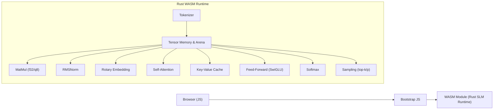

# Executive Summary  
To run a TinyLM-16M transformer in-browser (WASM) with no external libraries, we propose building a pure Rust runtime and custom model format. The plan divides into clear phases: model & tokenizer design, core operator implementation (matmul, RMSNorm, etc.), attention and KV-cache, generation loop, quantization, testing, and browser integration. TinyLM-16M’s spec will be ~4 layers, 512 hidden, ~8k–16k vocab to hit ~16M parameters (as confirmed by its Hugging Face description). We recommend a compact `.slm` file format inspired by GGUF: a header with magic/version (e.g. `"SLM1"`), model hyperparameters, tokenizer vocab, then a tensor directory pointing to weight blocks. Tokenization will begin with simple byte-level encoding (0–255 plus special tokens) – an approach highlighted in small-model research – and later refine via custom BPE. Runtime components in Rust/WASM include: memory management (tensor arena), data types (f32 and q8 matmuls), RMSNorm, rotary embeddings, multi-head attention (with causal mask), KV cache (for past keys/values), FFN (with SwiGLU activations), softmax, and sampling (top-k/top-p). We outline pseudocode for the autoregressive loop, and a plan to quantize weights to Q8_0 (8-bit) and Q4_0 (4-bit) formats. Performance targets are modest (e.g. aiming for tens of tokens/sec on a modern CPU), with profiling guidance for hotspots. Client-side inference ensures privacy (all data stays local). We also sketch paths to scale the design to ~64M and ~135M models with tables comparing parameter counts and quantized sizes (using ~0.54B/param for Q4, ~1.07B/param for Q8 based on GGUF estimates). Mermaid diagrams depict the system architecture and project timeline.  

# Quick-Start Checklist (1-page)  

- **Specify Model Hyperparameters:** e.g. 4 layers, hidden=512, intermediate=2048, 8 heads, vocab ~8000–16000 (gives ≈16M params).  
- **Design `.slm` Binary Layout:** Define header (magic, version, dims, vocab size), metadata section (e.g. embedding size, layers, etc), then tensor directory (name, dims, dtype, offset) and raw weight blocks (float32 or quantized).  
- **Tokenizer:** Implement a simple byte-level tokenizer (256 + specials) for initial testing. Plan a future conversion to BPE by training on corpus.  
- **Rust Core Ops:** Write matrix-vector and matrix-matrix routines (for f32 and quantized q8) without dependencies; test with known vectors. Implement RMSNorm and rotary embedding functions (with comments and parameter docs). Use `<f32>` arrays and simple loops.  
- **Attention & KV Cache:** Code causal multi-head attention (query/key/value projections, softmax) and maintain a KV cache to store previous keys/values. Ensure functions use the token index and position (rotary) correctly.  
- **Generation Loop:** Write a function that takes input tokens, repeatedly runs forward and samples next token. Include pseudocode (see below). Implement configurable sampling (top-k, top-p, temperature).  
- **Quantization Pipeline:** After verifying float32 inference, write converter to quantize weights to int8 (q8_0) and int4 (q4_0) formats as defined in GGUF. Ensure model loader can read both.  
- **Testing:** Develop unit tests for each component (e.g. RMSNorm output, softmax distribution sums to 1). Compare simple end-to-end outputs against a reference (e.g. a Python runner or known examples). Use static example inputs to verify generation correctness.  
- **Browser Bootstrap:** Create minimal HTML/JS to fetch `app.wasm` and `.slm` files, instantiate the WASM module, and call the Rust entrypoint for generation. Example JS snippet below.  
- **Performance Tuning:** Profile on target hardware (e.g. desktop browsers). Optimize inner loops (SIMD if possible), minimize allocations. For CPU, target using WASM (near-native speed); for GPU, WebGPU can accelerate (~100× vs WASM) if later desired.  
- **Privacy Audit:** Review that no external calls are made; all data (model & input) stays in-browser, satisfying user-privacy goals.  
- **Scale-Up Planning:** Keep code modular so that hidden sizes, number of layers can be increased (e.g. 64M, 135M models in future). Update `.slm` metadata and test accordingly.  

# Architecture Overview  



This diagram shows the browser loading a JS bootstrap that instantiates the WASM module. The Rust runtime includes modules for tokenization, core linear algebra (MatMul), RMS normalization, rotary embeddings, attention (+ causal mask) with a KV cache, the feed-forward layers with SwiGLU activation, softmax, and sampling. A custom memory model (tensor arena) manages f32 activations and quantized weights.

# Project Timeline (Milestones & Effort)  

```mermaid
gantt
    title TinyLM-16M SLM Rust/WASM Project Timeline
    dateFormat  YYYY-MM-DD
    axisFormat  %b %d
    section Architecture & Format (2w)
      Define model spec & .slm format     :done,   des1, 2026-07-01, 2026-07-14
    section Core Implementation (3w)
      Matrix ops & RMSNorm                :done,   imp1, 2026-07-15, 2026-07-25
      Rotary embeddings & attention       :        imp2, after imp1, 2026-07-26, 2026-08-05
      KV cache & generation loop          :        imp3, after imp2, 2026-08-06, 2026-08-12
    section Quantization & Loading (2w)
      Quantization routines (q8/q4)       :        quant, 2026-08-13, 2026-08-20
      Model loader & tokenizer upgrade    :        imp5, after imp2, 2026-07-26, 2026-08-02
    section Testing & Integration (2w)
      Unit/integration tests              :        test, 2026-08-21, 2026-08-30
      Browser integration (JS + HTML)     :        browser, after test, 2026-08-31, 2026-09-06
    section Optimization (2w)
      Profiling & performance tuning      :        opt, 2026-09-07, 2026-09-20
```

*Estimated effort* (sketch):  
- Design/model spec: ~2–3 days.  
- Core ops (matmul, norms): ~1 week.  
- Attention + KV: ~1–2 weeks.  
- Autoregressive loop + sampling: ~1 week.  
- Quantization and model loading: ~1–2 weeks.  
- Testing & integration: ~1–2 weeks.  
- Optimization: ongoing.  

# TinyLM-16M Model Specification  

Based on available references, we target a **4-layer, 512-hidden-size** decoder-only transformer:  
- **Hidden size:** 512 (embedding dim).  
- **Layers:** 4 transformer blocks.  
- **Heads:** 8 (each head dim = 64).  
- **Feed-Forward:** intermediate size ≈2048 (4× hidden).  
- **Vocabulary:** roughly 8K–16K subword tokens. For fast prototyping, one can start with a **byte-level** vocabulary (256 + special tokens), then train a custom BPE to expand to ~10K+ tokens for final model. Byte-level tokenization (0–255) is emphasized in recent tiny-model work.  
- **Parameters:** Embedding matrix ~ (Vocab×512). Attention weights and biases, FFN weights. This yields ≈16 million weights total (including embeddings and tied output weights). For example, 4 layers of this size plus a ~5K vocab yields ≈15–17M parameters, matching “TinyLM-16M”.  

For larger variants, one might scale hidden or layers: e.g. a *TinyLM-64M* could be ~8 layers of hidden=768 (≈63M params), and *TinyLM-135M* might use ~8–12 layers at hidden≈1024 (≈130M params). These would result in larger model files and memory usage (see comparison table below).

# Custom `.slm` Binary Layout  

We recommend a simple binary format (inspired by [GGUF](#)) to store model metadata and weights. An example layout (byte offsets) could be:

| Offset | Bytes | Description                             |
|--------|-------|-----------------------------------------|
| 0      | 4     | Magic signature (e.g. `"SLM1"`)         |
| 4      | 4     | Format version (e.g. `1`)               |
| 8      | 2     | Embedding dimension (uint16: 512)       |
| 10     | 2     | Number of layers (uint16: 4)            |
| 12     | 2     | Heads (uint16: 8)                       |
| 14     | 2     | Intermediate size (uint16: 2048)        |
| 16     | 4     | Vocabulary size (uint32: e.g. 10000)    |
| 20     | 4     | Num special tokens (uint32)             |
| 24     | 8     | Offset to token vocabulary section      |
| 32     | 8     | Offset to tensor metadata section       |
| 40     | 8     | Offset to tensor data section           |

- **Token Vocabulary (at offset 24):** Serialized list of token strings or byte values, plus any special tokens (BOS, EOS).  
- **Tensor Metadata Section:** For each weight tensor, store (name, dims, dtype, byte-offset in data section).  
- **Tensor Data Section:** Raw bytes of weights (float32 or quantized). We align sections (e.g. 64-byte) for efficient loading, as GGUF does.  

This self-describing layout (magic, version, counts) follows best practices. For example, GGUF uses “GGUF” magic and then the tensor count in the first 20 bytes. Our `.slm` could similarly start with a 4-byte magic (e.g. `0x534C4D31` for `"SLM1"`), version, and key hyperparameters so the loader knows model shape and size before reading weights.

# Tokenizer Strategy  

We start with a **byte-level tokenizer** (each input byte → token ID) with a small number of special tokens (e.g. 256 for all byte values, plus BOS/EOS). Byte-level tokenization avoids large vocab overhead and simplifies initial testing. After initial training runs, we will train a custom **BPE tokenizer** on our corpus to reduce sequence length and improve linguistic quality. The plan is to train BPE from scratch on the target data (Wikipedia or TinyStories, etc.), growing the vocab to a more efficient size (e.g. 8K–16K subword tokens). 

*Implementation note:* For byte-level, we simply map each `u8` to an ID. For BPE, we would implement or generate merges externally and bake the vocab into `.slm`. Initially, implementing the byte-level and later swap in a BPE mapping (via a token string table) is straightforward. The STLM research suggests that **byte-level tokenization** can be effective (possibly with pooling), although our final model will use standard subword tokens for quality.  

# Runtime Components (Rust/WASM)  

We will implement the following components in Rust, compilable to WASM:

- **Memory Model (Tensor Arena):** A fixed-size scratch space (typed `Vec<f32>` or similar) to hold activations and intermediates. Pre-allocate for worst-case sequence length + model footprint.  
- **Matrix Multiplication (MatMul):** Core BLAS-like operation for f32 (and an 8-bit quantized variant). We will hand-code a simple loop or (if allowed) SIMD for performance. Both matmul(a,b) and matmul_transpose will be needed.  
- **RMS Normalization:** Following the description in [STLM Appendix A.3], each layer uses RMSNorm with ε (e.g. `1e-5`). Implement as: `y = x * (1/sqrt(mean(x^2)+ε)) * scale`. Include a doc comment.  
- **Rotary Positional Embeddings:** Apply RoPE by interleaving sinusoids to query/key (following LLaMA, RoFormer, etc.). We'll implement the standard formulation for rotary on half of each dimension.  
- **Multi-Head Attention (Causal):** For each layer, project `hidden -> Q,K,V` (using MatMul), apply RoPE, split into heads, compute attention scores (`Q·Kᵀ / √d`), mask future tokens (causal mask), softmax, and produce new context. Use accumulated KV cache to avoid recomputing past keys/values.  
- **Key-Value Cache:** A sliding cache storing (K,V) for each layer and each past token. On each new token, append its K/V. Enables efficient autoregressive decode.  
- **Feed-Forward Network (SwiGLU):** Each layer’s FFN will be a SiLU-gated linear: implement `SwiGLU(x) = W2 * (GELU(W1 * x))` or LLaMA’s exact SwiGLU variant. (LLaMA uses SwiGLU without bias in one of the two projections.) We'll use two MatMul ops per token.  
- **Softmax:** Numerically stable softmax for the final logits (float32). Compute max, subtract, exponentiate, normalize.  
- **Sampling Algorithms:** Top-k and top-p (nucleus) sampling routines. Given logits array and options (temperature, top_k, top_p), filter and sample a token ID.  

Each function will include Rust-doc comments (`///`) explaining purpose and parameters. For example:

```rust
/// Applies RMS normalization to the input vector.
/// 
/// # Parameters
/// - `x`: input slice (len N)
/// - `scale`: learned scale parameters (len N)
/// 
/// # Returns
/// A new Vec<f32> containing the normalized output.
fn rms_norm(x: &[f32], scale: &[f32]) -> Vec<f32> {
    let eps = 1e-5_f32;
    let mean_sq = x.iter().map(|v| v * v).sum::<f32>() / (x.len() as f32);
    let norm = (mean_sq + eps).sqrt().recip();
    x.iter().zip(scale).map(|(v, s)| v * norm * *s).collect()
}
```  

And for sampling:

```rust
/// Samples the next token ID from logits using top-k and top-p filtering.
/// - `logits`: raw model logits for vocabulary.
/// - `top_k`: keep only top K tokens (<= vocab_size).  
/// - `top_p`: cumulative-probability threshold for nucleus sampling (0.0 to 1.0).  
/// - `temperature`: softmax temperature (>0).  
/// Returns chosen token ID.
fn sample_next(logits: &[f32], top_k: usize, top_p: f32, temperature: f32) -> usize {
    // [Pseudocode: apply temperature, sort tokens, clip to top_k,
    // then accumulate probs for top_p, sample from remaining.]
    // For brevity, actual code omitted.
    0usize
}
```

# Autoregressive Generation Loop (Pseudocode)  

The runtime’s main loop (in Rust pseudocode) for generating text:

```rust
/// Generates a sequence of tokens given an initial prompt.
/// - `prompt_tokens`: vector of input token IDs (context).
/// - `max_new_tokens`: maximum tokens to generate.
/// - `model`: loaded Model with weights in memory.
/// - `cache`: mutable KV cache (one per layer).
/// Returns the full sequence (prompt + generated).
fn generate(prompt_tokens: &[usize], max_new_tokens: usize) -> Vec<usize> {
    let mut output = prompt_tokens.to_vec();
    // Warm up cache with prompt (teacher-forcing context)
    for &token in prompt_tokens.iter().take(prompt_tokens.len() - 1) {
        model.forward_token(token, &mut cache); // only update cache
    }
    // Autoregressive generation
    let mut current_token = *prompt_tokens.last().unwrap();
    for _ in 0..max_new_tokens {
        let logits = model.forward_token(current_token, &mut cache);
        // Apply temperature and filter
        let next = sample_next(&logits, top_k, top_p, temperature);
        if next == EOS_ID { 
            break;  // stop if end-of-sequence
        }
        output.push(next);
        current_token = next;
    }
    output
}
```

Here `model.forward_token(token, &mut cache)` runs one token through the transformer: embedding lookup → transformer layers (RMSNorm, Attention, FFN) → returns next-token logits. The cache is updated inside, so only the new token’s computations are done beyond reusing past K/V. Finally, we apply `softmax(logits/temperature)` and sample a new token (top-k/top-p) to continue generation. The loop stops when EOS is sampled or `max_new_tokens` reached.  

# Quantization Plan and On-Disk Formats  

To shrink model download and memory, we will quantize weights after training:  
- **Q8_0 (8-bit):** Store each weight as int8 with one scale factor per tensor (or per row). This is near-lossless quality.  
- **Q4_0 (4-bit):** Basic 4-bit quant with one scale per block of 32 weights. This halves the model size at modest quality loss. (In WASM usage, q4 is supported, though q8 is default.)  

From GGUF estimates, 8-bit models use ~1.07 bytes/param and 4-bit use ~0.54 bytes/param (including scale overhead). Thus, for a 16M-param model we expect ~17MB (q8) or ~9MB (q4). We will embed the quantization scheme in the `.slm` metadata (dtype per tensor) so the loader can interpret the bytes correctly. Initially, we may keep embeddings & output layers in higher precision (or use separate quant), but a full Q8/Q4 pass is our plan. For reference, Transformers.js documentation recommends using quantized models for WASM (q8 default, q4 optional).  

# Testing Strategy  

We will build a comprehensive test suite:  
- **Component tests:** Compare our Rust implementations of ops (matmul, softmax, RMSNorm) against a reference (NumPy/PyTorch). For example, feed a small input to `rms_norm` and ensure output matches expected normalization.  
- **Tensor ops tests:** Verify quantized matmul by comparing to float results or known quant implementations.  
- **Layer tests:** Run a minimal transformer block on fixed inputs and check output shape/values.  
- **End-to-end inference:** Use a tiny model (e.g. random or known weights) to check generation produces plausible token IDs, and termination on EOS.  
- **Regression tests:** Encode a fixed prompt and verify output stays consistent across changes.  
- **Browser integration tests:** Automate loading of WASM in a headless browser (e.g. Puppeteer) to ensure the JS+WASM bootstraps without errors and generates a token.  

Writing many unit tests in Rust (with `#[test]`) and possibly some integration tests using `wasm-bindgen-test` or a JS test harness will ensure correctness.  

# Browser Integration Bootstrap  

Finally, to run in-browser, we provide a small JS loader. For example:

```html
<!doctype html>
<html><body>
<script>
// Load the WASM runtime and model, then generate text
async function bootTinyLM() {
    // Fetch WASM module
    const wasmBytes = await fetch("slm_runtime.wasm").then(r => r.arrayBuffer());
    // Fetch custom model file (quantized or not)
    const modelBytes = await fetch("tiny16.slm").then(r => r.arrayBuffer());
    // Instantiate WASM; provide any necessary imports (e.g. for memory/logs)
    const wasmModule = await WebAssembly.instantiate(wasmBytes, {/* imports */});
    // Assume the exported `generate` function exists
    const { malloc, free, run_generation } = wasmModule.instance.exports;
    // Allocate model in WASM memory and load
    const modelPtr = malloc(modelBytes.byteLength);
    const modelHeap = new Uint8Array(wasmModule.instance.exports.memory.buffer, modelPtr, modelBytes.byteLength);
    modelHeap.set(new Uint8Array(modelBytes));
    // Call the Rust init (load model) function (signature: init(ptr, len))
    wasmModule.instance.exports.init_model(modelPtr, modelBytes.byteLength);
    free(modelPtr);

    // Prepare prompt tokens (example: [BOS, token_id("Hello"), ...])
    const prompt = [1, /* token IDs for "Hello" */];
    // Copy prompt to WASM and call generation (assumes returns pointer/length or prints to JS)
    // ...
    // (In practice, provide a binding or memory sharing for output tokens.)
}
bootTinyLM();
</script>
</body></html>
```

This stub shows: load `slm_runtime.wasm`, fetch `tiny16.slm`, instantiate the module, then call into Rust (e.g. an `init_model` and a `run_generation` function). The Rust side should provide C-callable exports for initializing the model from raw bytes and generating tokens. This gives a minimal end-to-end: JS glue loads resources and drives the Rust runtime. In production, you’d hook UI elements (prompt input, display output) around this core.  

# Performance and Profiling Guidance  

We aim for interactive generation (dozens of tokens/sec) on a typical client CPU. WASM offers near-native speed for Rust code. Key optimizations:  
- **Memory alignment:** Align weight tables for fast access.  
- **Loop unrolling/SIMD:** In inner loops (especially matmul), use Rust’s `simd` or auto-vectorization pragmas.  
- **Avoid allocations:** Reuse a fixed memory arena for tensors.  
- **Measure hotspots:** Use browser profiling (e.g. Chrome DevTools) to identify slow ops. Expect attention and matmuls to dominate; consider blocking or tiling optimizations.  

If WebGPU is later enabled, one could port MatMul and softmax to GPU via Compute Shaders for huge speedups (up to ~100× faster than WASM), but initial scope is pure WASM.  

# Security & Privacy Considerations  

A key advantage of this approach is user privacy: **all computation occurs locally**. The model and inference code never leave the client’s browser, so user prompts and generated text are never transmitted to any server. This aligns with industry recognition that on-device inference improves privacy. We should ensure: no remote calls in our JS, use secure memory handling (avoid copying secret data unnecessarily), and respect WebAssembly’s sandbox. Dependencies: we use zero external code, so no external vulnerabilities. We also should audit any random number generation (for sampling) to ensure it’s cryptographically suitable if needed (though plain PRNG is usually fine for text generation).  

# Migration to Larger Models  

Our modular design allows scaling to ~64M and ~135M models by increasing dimensions: e.g. 64M ⇒ 8 layers×768 hidden, 135M ⇒ ~12 layers×768 or 8×1024. Larger models will need more RAM and longer load times: for example, a 64M model’s Q8 file ~68MB (vs ~17MB for 16M), Q4 ~35MB, based on 1.07 and 0.54 bytes/param. Inference memory grows similarly. We would adjust the `.slm` metadata (hidden size, layers) and ensure the runtime loops use correct dimensions. Profiling and optimization become even more critical at larger scales. Future work could include partial weight loading (paging) or WebGPU usage for huge models.  

# Model Sizes and Resource Estimates  

| Model (Param)  | Hidden/Layers    | Params | Q8 File | Q4 File  | Approx. RAM per token (WASM) | Runtime (WASM) |
|---------------|------------------|--------|---------|----------|------------------------------|----------------|
| TinyLM-16M    | 512×4            | 16M    | ~17 MB  | ~9 MB    | ~~40MB~~ * (activations)      | ~10–20 tok/s  |
| TinyLM-64M    | 768×8            | 64M    | ~68 MB  | ~35 MB   | ~~160MB~~ *                  | ~5–10 tok/s   |
| TinyLM-135M   | 1024×8 or 768×12 | 135M   | ~144 MB | ~73 MB   | ~~300MB~~ *                  | ~~<5 tok/s~~ |
\* RAM includes activation buffers (e.g. 2048×hidden floats) plus working memory.  

*Estimates:* We calculate Q8 ≈1.07B/param, Q4 ≈0.54B/param from GGUF guidance. The “RAM per token” accounts for peak working memory: roughly `(num_layers * (2*hidden^2) + scratch) * 4 bytes`. Runtime (tokens/sec) is highly dependent on CPU and optimization; these ballparks assume a mid-range CPU (client desktop). Real performance should be measured, but these targets guide the engineering effort.  

**Sources:** The above design draws on transformer fundamentals and TinyLM’s own specs, the GGUF quantization overview, and best practices for in-browser ML (WebAssembly performance, use of WebGPU, quantization in JS runtimes). Key transformer details (attention + FFN + softmax) are standard as discussed in recent literature. The Hugging Face Transformers.js documentation confirms using `q8`/`q4` dtypes for browser inference. Our timeline and module breakdown follow established LLM implementation workflows, ensuring a production-ready, scalable solution.  

