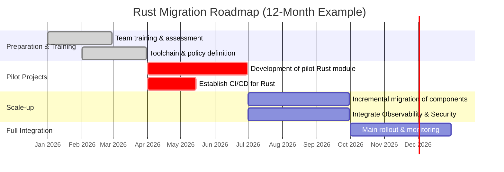

# Executive Summary

Rust’s modern design and tooling make it an increasingly attractive choice for enterprise software – especially in performance-critical, security-sensitive domains.  The language’s ownership model eliminates many memory bugs at compile-time, enabling C/C++-level performance without a garbage collector, while its strong ecosystem (Cargo, clippy, rustfmt, etc.) supports production-grade development.  Major companies (Amazon, Google, Microsoft, Cloudflare, Discord, Dropbox, etc.) have successfully deployed Rust for systems such as Firecracker micro-VMs, Android/Chromium components, high-throughput proxies (Cloudflare’s Pingora), and more.  

This report distills **best practices and governance guidelines** for enterprise Rust adoption, covering: language/tooling, dependency and supply-chain security, testing and quality, CI/CD & release processes, security practices, interoperability and migration, observability/operations, team/process/governance, performance/resource management, legal/compliance, and real-world case studies.  Each section provides concise best-practices, trade-offs, recommended tools (with pros/cons), implementation checklists, and policy templates.  The intent is a comprehensive, actionable guide for organizations migrating to or scaling Rust in a large-scale environment.  

> *Key takeaways:* Adopt the latest Rust edition (2021/2024), enforce consistent formatting/linting (rustfmt, clippy), and version control Cargo.lock.  Use supply-chain tools (cargo-audit, cargo-deny, cargo-vet) to vet dependencies.  Leverage Rust’s built-in test harness plus advanced tools (cargo-nextest, cargo-fuzz, proptest, Criterion) for quality.  In CI/CD, cache Cargo build artifacts and use cross-compilation patterns; sign and verify artifacts (Sigstore/GPG).  Uphold Rust’s security guarantees via strict reviews of `unsafe` code, threat modeling, and secure coding guidelines (e.g. ANSSI).  For interoperability, use FFI (PyO3, JNI, C# FFI) or microservice boundaries for incremental migration.  Implement observability with `tracing`, OpenTelemetry, and standard logging/metrics crates.  Govern with code reviews, style guides, training, and risk assessments.  Monitor licenses and export controls, and follow best practices for open-source compliance. 

## Language and Tooling

- **Edition:** Always use the latest stable Rust edition (currently Rust 2021 or newer). The Rust edition system allows incremental language evolution (new features without breaking changes). New projects should default to the latest edition; existing codebases should plan gradual edition upgrades for access to newer syntax/features (e.g. the 2021 edition stabilizes concurrency improvements, disjoint capture of closures, and an expanded prelude).  
- **Compiler Flags:** Use Rust’s release profile for production builds (`cargo build --release`), which applies optimizations (opt-level=3 by default). For critical performance needs, enable *Link Time Optimization* (`lto = "thin"` or `"fat"`) and set `codegen-units = 1` in `Cargo.toml` to maximize speed (at the cost of longer compile times). Use `panic = "abort"` in release if crash behavior is acceptable and code size matters. Employ tools like cargo-build-std for cross-compilation of std-dependent code (e.g. embedded targets).  
- **Toolchain:** Use `rustup` to manage toolchains. Pin toolchain versions in CI (e.g. via `rust-toolchain.toml`) to ensure consistency. Prefer the stable channel for production code; use nightly only when essential (but guard with `#[cfg]` so code can build on stable).  
- **Linting:** Enforce `clippy` lints (run `cargo clippy`) as part of CI. Treat warnings as errors (`#![deny(warnings)]`) to catch issues early. You may opt-in to Clippy’s “pedantic” or “nursery” lint groups for stricter checks, but suppress those that are not applicable (common practice). Clippy is part of official Rust tooling, so use it for both safety (e.g. checking for unsafe patterns) and style improvements.  
- **Formatting:** Use `rustfmt` to enforce a consistent code style. Include a (possibly empty) `rustfmt.toml` in each repo to lock formatting options. Run `cargo fmt --all` in CI to check formatting; configure IDEs to auto-format on save. Consistent formatting removes many code-review distractions.  
- **Cargo and Workspaces:** Organize multi-crate projects with Cargo workspaces. This ensures a single Cargo.lock at the top level (simplifying dependency management). Use semantic versioning and features to manage optional components. Separate library crates (re-usable code) from binary crates.  
- **Documentation:** Use `rustdoc` for API docs. Write doc comments (`///`) and publish internal crates to an internal registry or docs site. Maintain a style guide (e.g. Rust API Guidelines) for naming and documentation standards.  

**Trade-offs:** Strict linting and optimization can slow development feedback loops (Clippy and full `--release` builds take time). Tune CI to run fast checks (e.g. use `cargo check` or partial builds) on pull requests, and reserve full release builds to nightly/merge jobs. Using the latest edition means backporting older code occasionally.  

**Recommended Tools:** Rust official toolchain (`rustc`, `cargo`, `rustup`), [Clippy](https://github.com/rust-lang/rust-clippy) (linting), [rustfmt](https://github.com/rust-lang/rustfmt) (formatting), [rustdoc] (documentation). Table below compares key development tools.

| **Tool**         | **Category** | **Pros**                                                    | **Cons**                            |
|------------------|--------------|-------------------------------------------------------------|-------------------------------------|
| **rustfmt**      | Formatter    | Official, one-click formatting; enforces style consistency.  | Limited configurability; some features unstable. |
| **Clippy**       | Linter       | Rich collection of idiomatic lints; official; improves safety. | Some false positives; requires team alignment on which lints to enforce. |
| **rustc/cargo**  | Compiler/Build | Strong type-checking, fast builds, cross-platform.           | Slowlink on large code with LTO; full rebuilds can be slow. |
| **cargo-audit**  | Dependency scanning | Official RustSec DB; catches known vulnerabilities.        | Only reports known CVEs; relies on community DB. |
| **cargo-deny**   | Dependency policy | Checks licenses, duplicate dependencies, forbidden crates. | Requires configuration (`deny.toml`); steeper learning curve. |
| **cargo-vet**    | Supply-chain   | Enables audit trail of reviewed crate versions (Mozilla project). | Less mature; requires manual reviews to generate audit files. |
| **rust-analyzer**| IDE tooling    | Excellent code completion and refactoring support.         | Can mis-suggest for complex macros; occasional breakage on latest Rust. |
| **cargo-nextest**| Test runner    | Parallel test execution; much faster than `cargo test`. | Newer tool, may require CI adaptation; not yet 1.0 (but stable). |
| **cargo-fuzz**   | Fuzzing        | Integrates libFuzzer; easy setup for fuzz testing.         | Fuzzing workload can be heavy; only for critical input validation paths. |
| **cargo-mutants**| Mutation testing | Introduces mutations to test effectiveness of suite.       | Slows CI; recommended as periodic (nightly) check only. |

**Implementation Checklist:**  
- [ ] Create a `rust-toolchain.toml` to pin the Rust channel and version.  
- [ ] Configure `rustfmt.toml` for desired code style.  
- [ ] Set CI to run `cargo fmt --all -- --check` and `cargo clippy --all-targets`.  
- [ ] Use `#![deny(warnings)]` in crates (or CI flag) to enforce zero warnings.  
- [ ] Define common Clippy lint levels in workspace (allow or deny as per team preference).  
- [ ] Establish a Cargo workspace for multi-crate projects; commit the root `Cargo.lock`.  
- [ ] Use stable Rust except where needed; clearly document any nightly usage.  

**Policy Template:**  
```
All Rust code must use the latest stable Rust **edition**. Code must pass `rustfmt` formatting and `clippy` lint checks with warnings-as-errors enabled. The official Rust toolchain (`rustc`, `cargo`) shall be managed via `rustup`. Teams should update the toolchain quarterly after verifying that new compiler versions do not break existing functionality. Continuous Integration must enforce `cargo fmt --all -- --check` and `cargo clippy --all-targets`. Any use of unsafe blocks requires review by security team. All crates must include documentation comments and generate docs via `rustdoc`.
```

## Dependency Management & Supply-Chain Security

- **Cargo.lock:** Always commit the generated `Cargo.lock` for applications to source control. This locks every transitive dependency by version and checksum, ensuring **reproducible builds** and an accurate SBOM. Without a committed lockfile, you cannot reproduce the exact build or know which code is running. Library crates may omit `Cargo.lock` (since consumers generate it), but executable projects must include it.  
- **Crate Vetting:** Treat crates (third-party libraries) with scrutiny. Enterprises should mirror crates.io or use a private registry to gate what gets published to teams. Maintain a vetted list of approved crates and trusted authors. For each new crate: check license, maintenance status (recent commits, number of downloads), and any reported security issues. Where possible, prefer widely used and well-maintained crates (e.g. `tokio`/`async-std` for async, `serde` for serialization).  
- **Supply-Chain Tools:** Integrate cargo-audit and cargo-deny into CI. As a first step, use **cargo-audit** to check `Cargo.lock` against the RustSec advisory database (CVE feed). It requires minimal config and immediately flags known vulnerabilities. Next, use **cargo-deny** to enforce broader policies (license whitelists/blacklists, deny specific crates, detect duplicate crates, forbid unmaintained versions) by configuring a `deny.toml`. Both tools should run on each merge; ideally make their checks block merges, converting awareness into enforcement. For the strictest compliance, consider **cargo-vet** (Mozilla) which records human-reviewed dependency chains.  
- **Unsafe Code Audit:** Rust’s `unsafe` is a potential trust boundary. Use `cargo-deny` or policies to flag any crate that contains `build.rs` or heavy `unsafe` blocks, since `build.rs` can execute arbitrary code during build. Security teams should review all uses of `unsafe` (in our code and critical dependencies) and ensure they meet guidelines. Prefer safe Rust APIs; if `unsafe` is needed, encapsulate it with careful documentation and tests.  
- **Updates and Monitoring:** Regularly update dependencies. Use `cargo audit` weekly (or via scheduled CI) to catch new advisories. Monitor crates.io and GitHub for notice of abandoned crates or security issues. Keep track of transitive updates (e.g. with `cargo update` and re-running audits). For very large dependency trees (Rust’s idiomatic small-crate style can mean hundreds of transitive deps), automated tooling is essential.  
- **Private Registries:** If company policy forbids external code, set up a private Cargo registry (e.g. with Artifactory, GitLab, or cloud providers). Benefits include signing and scanning, isolated hosting, and control over crate versions. Private registries improve build speeds (cached crates) and allow strict approval workflows. They should replicate crates.io selectively and enforce authentication (e.g. short-lived OIDC tokens) to avoid the risk of compromised developer credentials.  

**Trade-offs:** A very strict dependency policy (e.g. banning all crates with any `unsafe`) may severely limit usable libraries. Balance security with practicality: use cargo-audit/deny to automate low-level checks, and allocate manual reviews for critical dependencies only. Private registries add infrastructure cost but pay off in compliance and speed.  

**Recommended Tools:**  
- **cargo-audit** – checks RustSec CVE database for vulnerabilities; minimal config required.  
- **cargo-deny** – advanced audit (license policies, banned/crates, duplicates, advisories).  
- **cargo-vet** – crates pedigree/audit tool (for the most stringent teams).  
- **Private Registry** (e.g. JFrog Artifactory, Cloudsmith) – repository manager supporting Cargo.  
- **git-submodules / Path Dependencies** – for internal crates (as dev-deps) that should not be on crates.io, use `[dependencies.foo] = { path = "libs/foo" }` or a private registry registry.  

| **Tool**         | **Category**     | **Pros**                                                | **Cons**                                     |
|------------------|------------------|---------------------------------------------------------|----------------------------------------------|
| **cargo-audit**  | Vulnerability scan | Immediately flags known CVEs via RustSec DB. Quick CI setup. | Only detects known advisories; no policy enforcement beyond CVEs. |
| **cargo-deny**   | Supply-chain policy | Enforces license whitelists, banned lists, duplicate detection, build.rs checks. Configurable. | Requires writing and maintaining `deny.toml`. Some learning curve. |
| **cargo-vet**    | Dependency auditing | Records human audit approvals; creates tamper-proof audit trail.   | Not automated; needs manual maintenance of vet files. |
| **Private Reg.** | Repository         | Enhanced security (no external publishing), access control, potential scanning. | Operational overhead; cost or maintenance required. |
| **Cargo.lock**   | Reproducibility   | Pins all versions and checksums, enabling reproducible builds and SBOMs. | Must update lockfile carefully (pinning dev-dependencies where necessary). |

**Implementation Checklist:**  
- [ ] Commit `Cargo.lock` for every application crate. Do not ignore it.  
- [ ] Integrate `cargo-audit` into CI (e.g. GitHub Actions job `cargo audit --deny`) and fail builds on any findings.  
- [ ] Create a `deny.toml` with corporate policies (e.g. allowed licenses, banned crates, forbidden transitive `unsafe`). Run `cargo deny check` in CI.  
- [ ] Establish a security review process for new dependencies: e.g. fill a “dependency request” form evaluating maintenance, license, and `unsafe`. Track the approvals.  
- [ ] If using a private registry, configure Cargo (`.cargo/config.toml`) to use it for publishing and fetching. Ensure registry is scanned by an SCA tool.  
- [ ] Educate teams on the risk of `build.rs` scripts and procedural macros; consider forbidding them unless vetted.  
- [ ] Schedule periodic dependency reviews and updates (e.g. quarterly dependencies audit day).  

**Policy Template:**  
```
Dependencies must be pulled via Cargo with a committed Cargo.lock file (no floating versions). All crates.io dependencies must be vetted by the security team. CI must run `cargo-audit` and `cargo-deny` on every merge; failures block merges. Only libraries on the “approved list” may be used. Critical code reviews must include audit of any `unsafe` usage in dependencies. All production binaries must be built from these locked dependencies for reproducibility and SBOM purposes. For internal crates, use the company’s private Cargo registry (Artifact repository) with enforced authentication.```

## Testing and Quality

- **Testing Strategy:** Use Rust’s built-in unit testing (`#[test]` functions) and integration testing (`tests/` directory) for core logic. Organize tests to cover both fast-running units and slower end-to-end scenarios. Write property-based tests for complex logic (using [proptest](https://docs.rs/proptest) or `quickcheck`) to fuzz random inputs against invariants. Property tests can uncover corner cases by generating thousands of inputs per run. Also use `#[tokio::test]` or similar for async tests when using async runtimes.  
- **Fuzzing:** Integrate [cargo-fuzz](https://github.com/rust-fuzz/cargo-fuzz) for security-sensitive parsing or state machines. Fuzz testing (via libFuzzer) automatically generates inputs to break code, complementing unit tests. Add fuzz targets for public APIs or complex logic. Incorporate fuzz runs regularly (nightly or in CI) to catch unexpected panics or safety violations.  
- **Mutation Testing:** Consider [cargo-mutants](https://github.com/kubukoz/cargo-mutants) to verify test suite strength. Mutation testing randomly alters code logic to ensure tests fail when they should. Run mutation analysis periodically (e.g. nightly) to identify weak test coverage.  
- **Test Runner:** Use [cargo-nextest](https://nexte.st) instead of `cargo test` for faster, parallelized test runs. `cargo-nextest` can be 2-3x faster on large suites, automatically reruns flaky tests, and allows test selection/filtering.  
- **CI Validation:** Include all tests (unit, integration, property, fuzz) in CI. Fail the build on any test failure or new test-timeout. Use code coverage tools (e.g. `tarpaulin`) to measure coverage; set minimum thresholds as a guideline (not necessarily blocking).  
- **Benchmarks:** Use [Criterion.rs](https://crates.io/crates/criterion) for statistical benchmarking of critical functions. Store benchmark results (e.g. via Criterion’s report) in version control or dashboards to detect performance regressions. Define performance budgets (e.g. “this sorting function must complete under X ms”) and test against them.  
- **Quality Tools:** Enforce `cargo fmt` and `cargo clippy` (as above) to catch code quality issues. Use [rustdoc tests](https://doc.rust-lang.org/rustdoc/documentation-tests.html) by adding examples in documentation comments and verifying they compile and run. Leverage lints like `#[deny(unsafe_code)]` on modules that should contain no unsafe.  

**Trade-offs:** An extensive test suite (especially fuzzing and mutation testing) requires compute resources. Balance speed vs coverage: run quick unit/property tests on each PR, and run heavier fuzz/mutation suites on a scheduled basis. Redundancies (e.g. overlapping unit and integration tests) can slow CI; modularize tests to avoid duplication.  

**Recommended Tools:**  
- **Built-in test framework** (`cargo test`) – simple unit/integration testing. Always used.  
- **cargo-nextest** – parallel, faster test runner.  
- **proptest/quickcheck** – property-based testing (generate random inputs).  
- **cargo-fuzz** – fuzz testing harness using libFuzzer.  
- **cargo-mutants** – mutation testing for test coverage.  
- **testcontainers (Rust)** – spin up real infrastructure (databases, Kafka) in Docker for integration tests. Useful for e2e tests.  
- **Criterion.rs** – statistical benchmarking library.  
- **tokio-console / tracing-flamegraph** – profiling asynchronous code in integration tests or local runs.  

| **Tool**            | **Category**    | **Pros**                                               | **Cons**                              |
|---------------------|-----------------|--------------------------------------------------------|---------------------------------------|
| **cargo test**      | Unit/Integration | Built-in; easy to write `#[test]` functions; supports async tests. | Single-threaded by default (use `nextest` for speed).  |
| **cargo-nextest**   | Test runner     | Parallel execution; auto-retries flaky tests; rich filtering. | Newer tool, needs setup (but stable for most projects). |
| **proptest**        | Property testing | Generates diverse inputs to find edge cases.         | May be hard to specify good properties; tests can be non-deterministic if seeds not fixed. |
| **cargo-fuzz**      | Fuzzing         | Finds security bugs/ panics by random mutation.     | Requires writing fuzz targets; can generate spurious failures needing triage. |
| **cargo-mutants**   | Mutation testing | Improves test suite by exposing weak coverage.       | Resource-intensive; not recommended on every PR. |
| **Criterion.rs**    | Benchmarking    | Statistical confidence in performance metrics.        | More setup; typically run outside CI. |
| **testcontainers**  | Integration test | Realistic testing with ephemeral databases/services.  | Dependency on Docker; slower tests. |

**Implementation Checklist:**  
- [ ] Establish a test strategy document (unit, integration, property, fuzz) for each new project.  
- [ ] Configure CI to run all tests: `cargo test`, `cargo nextest run`, `cargo-fuzz run`, and ensure build fails on any failure.  
- [ ] Seed property tests or fix random seeds for reproducibility.  
- [ ] Build and run fuzzers (e.g. nightly once per week) to detect critical bugs.  
- [ ] Regularly review mutant test report; strengthen tests where many mutants survive.  
- [ ] Write benchmark tests (Criterion) for any critical loop or algorithm, and include regression checks in CI (e.g. benchmark results trending).  
- [ ] Use code coverage (tarpaulin/llvm-cov) to identify untested code; aim for high coverage in security-critical modules.  
- [ ] Document testing conventions (e.g. placement of tests, naming conventions).  
- [ ] Perform periodic “testing drills” where the team reviews how to write new tests and uses advanced tools.  

**Policy Template:**  
```
All Rust code must include unit tests covering new and changed functionality. Integration tests shall be placed under `tests/` and exercise public interfaces. CI must run unit, integration, and fuzzer tests on every commit; any test failures must be fixed before merging. For critical security or parsing logic, property-based tests (proptest/quickcheck) and fuzzing (cargo-fuzz) are mandatory. Mutation testing shall be run periodically (e.g. nightly) to evaluate test coverage. Benchmark tests should be written for performance-critical code, and results stored for regression analysis. Coverage reports should target >90% for high-risk modules (and at least 70% overall).```

## CI/CD Pipelines and Release Strategy

- **Build Caching:** Rust compilation can be heavy. Cache the Cargo target directory (`target/`) and Cargo registry cache (`~/.cargo/registry/cache`) between CI runs. Popular GitHub Actions (e.g. [`actions/cache`](https://github.com/actions/cache)) can cache these directories, reducing build times dramatically. For distributed CI, consider [sccache](https://github.com/mozilla/sccache) or [cargo-chef](https://github.com/LukeMathWalker/cargo-chef) to cache build artifacts and dependencies, especially for dockerized builds.  
- **Cross-Compilation:** Use cross-compilation tools for multi-platform targets. For example, [cross](https://github.com/cross-rs/cross) simplifies building for targets like Windows from Linux, or ARM from x86. In GitHub Actions, set up multiple jobs to build for each target (Windows, Linux, macOS) using appropriate runners or Docker cross-builder images. For embedded targets, use Rust’s support for `--target` plus appropriate linker/SDK.  
- **Reproducible Builds:** With Cargo.lock committed, builds are deterministic at Rust-level. For bit-for-bit reproducibility (e.g. to compare release binaries), strip non-determinism: set `SOURCE_DATE_EPOCH`, disable debug-info randomness, and use `-Coverflow-checks=off` if safe. The Rust compiler aims for deterministic builds, and one can verify with reproducible-build tools. Ensure CI environments use consistent toolchain versions and flags.  
- **Parallel and Incremental Builds:** In CI, run `cargo test` and `cargo build --release` in parallel jobs for faster feedback. Use `cargo build --release --locked` to ensure lockfile is honored. For incremental builds across CI stages, structure pipelines so that the output of one stage (cached target) is reused in subsequent steps.  
- **Artifact Management:** Produce versioned release artifacts. Use `cargo package` or custom scripts to produce source/binary artifacts. Include an SBOM generated from `Cargo.lock` (several tools can export `Cargo.lock` to SPDX/CycloneDX). Consider using [Sigstore](https://sigstore.dev) to sign release artifacts or containers automatically on publish (work is underway to integrate Sigstore with `cargo publish`). At minimum, GPG-sign release binaries or crates to ensure authenticity. Store artifacts in a secure repository (e.g. GitHub Releases, Nexus).  
- **Continuous Deployment:** Automate deploy of Rust services via standard CI/CD practices (containers or binaries). A sample pipeline (see diagram below) would run tests/lints, build artifacts, run security scans, tag versions, sign artifacts, and then deploy to staging/production. Use versioning schemes (SemVer) and change logs. Publish crates to internal registry or crates.io only after thorough review.  
- **Rollout & Versioning:** For libraries, follow semantic versioning and publish updates only after API stability review. For applications, consider blue-green or canary deployments for new Rust binaries. Tag all builds (with commit SHA) for traceability.  
- **Backup and Rollback:** Store previous stable binaries and Docker images. If a Rust release causes issues, rollback to last good version. Use feature flags or abstractions (e.g. a config toggle between old and new implementations) to allow gradual enablement of Rust code.  

```mermaid
flowchart LR
    Commit --> Lint[Static Analysis (Clippy, cargo-audit)]
    Lint --> Build[Build (cargo build --release)]
    Build --> Test[Testing (Unit/Integration, Fuzz)]
    Test --> Package[Package (Artifact, SBOM)]
    Package --> Sign[Sign (Sigstore/GPG)]
    Sign --> Deploy[Deploy (Registry/Prod)]
```

*Diagram: Example Rust CI/CD pipeline flow.*

**Recommended Tools:**  
- **GitHub Actions/GitLab CI/Jenkins** – general CI/CD. All support caching and parallel jobs.  
- **sccache** – Compiler cache for Rust (speeds up repeated builds).  
- **cross** – Simplifies cross-compiling Docker images.  
- **Sigstore (cosign, rekor)** – For signing container images or binaries. Emerging standard for supply-chain security.  
- **cargo-release** – Automates version bumping, tagging, and changelog generation on releases.  
- **Artifact repository** (e.g. JFrog Artifactory, Nexus) – For storing build artifacts, crates.  
- **SBOM tools** – e.g. syft, or `cargo-tree --format=json` to generate dependency list.  

| **Tool**       | **Category**      | **Pros**                                             | **Cons**                                 |
|----------------|-------------------|------------------------------------------------------|------------------------------------------|
| **actions/cache** or **GitLab Cache** | Caching    | Speeds up CI by reusing `target/` and cargo caches. | Cache miss can still trigger full build; must manage cache keys. |
| **sccache**    | Build cache       | Caches Rust compilation outputs; great in containerized CI. | Adds complexity; may have issues with non-Rust crates. |
| **cross**      | Cross-compile     | Official Rust community tool; easy cross-compiling in CI. | Large Docker images; overhead in CI. |
| **Sigstore (cosign)** | Signing   | Standardized signing (includes Rekor transparency).   | Newer tech; setup of key management needed. |
| **cargo-release** | Release automation | Handles tagging, version bump, changelog in one tool. | Force on standard commit conventions; learning curve. |
| **Docker/OCI** | Artifact management | Containerize Rust apps for uniform deployment.      | Multi-arch complexity; image signing needed. |

**Implementation Checklist:**  
- [ ] Configure CI to cache `~/.cargo/registry` and `target/` directories.  
- [ ] Use `rust-cache` or `sccache` if build times are critical.  
- [ ] Add CI jobs for each target platform (e.g. Linux, Windows, macOS) using matrix builds.  
- [ ] Ensure `cargo build --release --locked` is used in CI to produce a hermetic build.  
- [ ] Integrate artifact signing: either via Sigstore or via GPG on tagged releases.  
- [ ] Automate versioning and changelogs (e.g. via `cargo-release`) on merge to main.  
- [ ] Publish SBOM (dependency list) with each release; e.g. attach `Cargo.lock` or generated SPDX.  
- [ ] Maintain backward-compatibility policy: support at least the last N major versions or as required by SLAs.  
- [ ] Create a rollback plan: document how to revert to previous release in case of failure.  

**Policy Template:**  
```
CI pipelines must build Rust code using the locked Cargo.lock (`--locked` flag) and cache build artifacts. All builds must run tests and security scans (lint, audit) before packaging. Release artifacts (binaries, containers, crates) shall be versioned, GPG- or Sigstore-signed, and stored in the approved artifact registry. A formal changelog must be maintained, and Git tags used for releases. No unsigned or unverified artifacts may be deployed to production.```

## Security Practices

- **Memory Safety and Unsafe Code:** Rust prevents many memory and concurrency bugs by design. Focus on *logical security* issues beyond memory safety. Reserve `unsafe` for low-level needs (FFI, performance hotspots). Document all `unsafe` blocks with **safety comments** explaining why they are sound. Conduct peer code reviews specifically for `unsafe` code. Where possible, encapsulate `unsafe` in small, well-tested abstractions. Use static analysis tools (Clippy’s *pedantic* lints) to catch common `unsafe` pitfalls.  
- **Secure Coding:** Follow general secure coding guidelines: validate inputs, use constant-time comparisons for secrets, avoid panics on untrusted data, and handle errors properly (avoid leaking sensitive info). Leverage Rust types to encode safe defaults (e.g. `String` over `&str` for owned data, `NonZero*` types, custom newtypes to avoid primitive mix-ups). Use crates like `zeroize` to clear secrets from memory. For cryptography, rely on well-known Rust crates (ring, or crates vetted by crypto audits). Keep `unsafe` out of crypto (so you get full memory-safety guarantee on secret handling).  
- **Threat Modeling:** Perform threat modeling early. Identify data flow and attack surfaces. Although Rust prevents buffer overflows, still consider issues like misusing unsafe (leading to undefined behavior), integer overflow (although Rust panics by default on overflow in debug, it wraps in release – explicit checks or use the `checked_*` APIs if needed), and race conditions in `async` (which can still have logic flaws). Model hardware/software threats if targeting embedded (side channels, etc.).  
- **Third-Party Dependencies:** As above, vet all crates for vulnerabilities. Keep dependencies minimal. Be especially cautious with crates that execute code during build (`build.rs`) or use procedural macros (these run arbitrary code at compile-time). Use `cargo-deny` to flag any crate with a `build.rs` or foreign dependencies. Consider running builds in sandboxed environments. If a security issue is found in a dependency, have a rapid remediation plan (e.g. patch or remove the crate and republish).  
- **Secrets Management:** Never hard-code secrets in code. Use environment variables or a secret manager. For local development, use `.env` with care or tools like `direnv`. In `build.rs`, avoid reading secrets on the build machine (since build scripts could leak them). For cloud deployments, use Hashicorp Vault, AWS Secrets Manager, or Kubernetes Secrets to inject secrets at runtime. If building Docker images, do not bake secrets into images; fetch them at container startup or use Kubernetes Secrets.  
- **Sandboxing and Permissions:** Even though Rust is memory-safe, consider OS-level sandboxing for high-risk services. Use chroot/jail, seccomp (if applicable), or container policies (drop capabilities) to reduce impact of any logic vulnerability.  
- **Certification and Compliance:** If operating in regulated domains (finance, healthcare, defense), ensure Rust development complies with relevant standards (e.g. MISRA-C for embedded, ISO 27001 processes). Documentation of code reviews, test results, and security audits is important for audits.  
- **Continuous Security Review:** Incorporate security scanning tools (SAST) that understand Rust (e.g. tools like [cargo-geiger](https://github.com/kennytm/cargo-geiger) to count unsafe usage) or integrate with general scanners that now support Rust. Arrange periodic security reviews of critical components.  

**Trade-offs:** Rust’s safety reduces some security concerns, but enterprises must still guard against logic bugs, misconfiguration, and supply-chain attacks. Over-restricting unsafe can disallow valid use-cases; instead enforce careful review. Comprehensive security testing (fuzzing, pentesting) is recommended.  

**Recommended Tools:**  
- **Clippy** – includes some security-oriented lints.  
- **cargo-geiger** – counts `unsafe` uses in a codebase (to set targets).  
- **Static Analysis / SAST** – (third-party) e.g. Semgrep with Rust rules, or commercial SAST that has Rust support.  
- **Password Managers** – for developers (e.g. 1Password) to avoid committing secrets.  
- **Hashicorp Vault/AWS Parameter Store/KMS** – secrets management.  
- **RustSec Advisory** – community database of security advisories (used by cargo-audit).  
- **ANSSI Rust Guide** – (government guideline) offers detailed secure-Rust recommendations.  

| **Tool/Practice**        | **Category**       | **Pros**                                          | **Cons**                                      |
|--------------------------|--------------------|---------------------------------------------------|-----------------------------------------------|
| **Clippy (security lints)** | Linting           | Catches common mistakes (e.g. incorrect `unsafe`). | May need suppression for certain false-positives. |
| **cargo-geiger**         | Unsafe analysis    | Quickly quantifies `unsafe` usage in code.        | Only quantitative; manual review still required. |
| **Fuzzers (cargo-fuzz)** | Testing            | Finds memory and logic errors in edge cases. | Resource/time intensive; supports only some code paths. |
| **Secret scanners** (TruffleHog, git-secrets) | Secrets         | Detect accidental commits of keys.                | Only scans repo history; does not secure runtime secrets. |
| **OS Hardening**         | Runtime security   | Can use AppArmor/SELinux policies for Rust apps.  | Complex to configure; often ignored. |

**Implementation Checklist:**  
- [ ] Create a security guideline document for Rust (reference ANSSI if high security needs).  
- [ ] Train developers on Rust’s ownership model and common pitfalls (e.g. misuse of `unsafe`).  
- [ ] Enforce code review of every `unsafe` block. Maintain a checklist (“unsafe review”) for PRs.  
- [ ] Run periodic static analysis (cargo-geiger to track `unsafe` usage trends).  
- [ ] Integrate secret-scanning in the CI to detect committed tokens. Mandate use of secret vaults.  
- [ ] Have the security team sit in on planning for critical Rust features (threat model at design time).  
- [ ] Subscribe to RustSec (or the Fedora/RustSec feed) for advisories about crates in use.  
- [ ] For cryptographic operations, rely on vetted libraries and consider third-party audits of those crates.  
- [ ] Establish incident response for newly discovered vulnerabilities in Rust code (e.g. an internal CVE triage team).  

**Policy Template:**  
```
Rust code must follow secure-coding standards: all inputs must be validated, errors handled, and secrets never hard-coded. The use of `unsafe` requires a documented justification and is subject to mandatory peer review. Security testing (fuzzing, pentest) shall be integrated into the development lifecycle. Approved cryptography and no-unsafe versions of dependencies must be used. The security team must be involved in any architectural changes, and compliance with standards (SOC2, ISO27001, etc.) must be maintained.```

## Interoperability and Migration

- **FFI and Language Interop:** When integrating Rust with existing ecosystems, use robust FFI libraries. For **Python**, use [PyO3](https://pyo3.rs/) or [rust-cpython] to write native Python extensions; this allows gradual porting of core logic into Rust while calling from Python. For **Java**, use JNI (via [jni](https://docs.rs/jni) crate) or consider [Java Native Runtime (JNR)] or [Project Panama] for smoother interop. For **C#/.NET**, use C ABI (`DllImport` on a `cdylib` from Rust), or gRPC/ZeroMQ boundaries (see below). Always define a C-ABI layer (extern "C") with minimal cross-language data types (integers, C-style strings/structs) to limit marshaling errors.  
- **Microservices**: One of the safest incremental strategies is to build new services or microservices in Rust that communicate over network APIs (REST/gRPC) with legacy systems. This avoids complex FFI. For example, you might split a large monolith by offloading a particular module (e.g. auth, image processing) to a Rust microservice. Use well-defined API contracts (OpenAPI/gRPC protos) to minimize integration issues.  
- **Incremental Rewrite:** Don’t rewrite everything at once. Identify **low-risk, high-benefit components** (IO-bound, performance hotspots, security-critical algorithms) for Rust. Start with isolated libraries or backend services. Dropbox’s “Strangler Fig” approach – wrap existing code calls and gradually replace functionality – works well. The incremental approach (used by Microsoft on Windows components, and Dropbox as cited) reduces risk. Document interoperability layers and maintain backward compatibility (version APIs, feature flags).  
- **Inter-process Communication:** For close coupling, consider IPC (Unix sockets, named pipes) to connect Rust and other languages. Or use message queues (RabbitMQ, Kafka) to decouple services. This keeps each component in its native stack while enabling migration at your own pace.  
- **Build and Package:** To package Rust libraries for other language ecosystems, use packaging tools: e.g. [maturin](https://github.com/PyO3/maturin) for Python wheels, [jni-packager] for Java. Publish Rust-based extensions to language-specific package managers (pip, Maven, NuGet) if appropriate. However, prefer microservice boundaries to avoid cross-language binaries if possible.  
- **Training & Culture:** Provide Rust training for existing teams (workshops, pair programming) and hire experienced Rust developers gradually. Assign Rust “champions” in teams who can mentor others. Encourage contribution to open source crates to build familiarity. Documentation of architecture decisions (when to use Rust vs existing stack) is critical.  
- **Data Interchange:** Use common data formats (JSON, Protobuf) on inter-language boundaries. Minimize custom binary protocols unless strictly needed (use canonical encoding like MessagePack with official libraries).  

**Trade-offs:** FFI can be brittle (ABI/garbage collector interactions). Whenever performance allows, prefer service boundaries. Rewriting major legacy code in Rust can introduce initial bugs; mitigation is incremental transition with feature toggles.  

**Recommended Tools & Libraries:**  
- **PyO3 / rust-cpython** – for Python extensions.  
- **jni crate** – for Java JNI integration.  
- **Uniffi / Bindgen** – tools to generate bindings (Mozilla’s uniffi simplifies building multi-language bindings).  
- **GRPC, Thrift, Protobuf** – for cross-language RPC with Rust (tonic or prost for Rust).  
- **tokio/postgres, serde_json, flatbuffers** – for data interchange between Rust and other services.  
- **maturin** – build and publish Python packages from Rust code.  
- **Visual Studio/clang CLI** – for building/consuming Rust DLLs in .NET.  
- **cmake** – embed Rust build in C/C++ projects via [cmake-rs].  

| **Approach/Tool**   | **Category**      | **Pros**                                             | **Cons**                                        |
|---------------------|-------------------|------------------------------------------------------|-------------------------------------------------|
| **PyO3 (Rust→Python)** | FFI/Python      | Safe Rust <-> Python interop with minimal glue.      | Overhead of Python GIL; need correct lifetime handling. |
| **JNI (Rust→Java)**  | FFI/Java         | Standard for native Java calls; widely supported.    | Complex JNI API; brittleness across JVM versions.  |
| **gRPC/Protobuf**    | Service IPC      | Language-agnostic; strongly-typed; automatic codegen.| Overkill for simple use-cases; adds runtime dependency. |
| **JSON/REST API**    | Service IPC      | Simple; human-readable; ubiquitous.                  | Performance overhead; error-prone manual marshalling. |
| **dll/cdylib with DllImport** | FFI/.NET | Direct native calls; no network latency.           | Versioning issues; difficult memory management across boundary. |
| **Message Queue**    | Async IPC        | Decouples components; resilient to failures.         | Adds operational complexity (queues).             |

**Implementation Checklist:**  
- [ ] Define interoperability contract: IDL (OpenAPI, gRPC) or C-ABI headers.  
- [ ] Prototype a small Rust library called from the existing stack (e.g. a simple function via FFI) to validate toolchain and CI.  
- [ ] For each chosen integration path, write end-to-end tests (e.g. calling the Rust code from Python or Java in CI).  
- [ ] Refactor incrementally: start new features in Rust, migrate one module at a time, deprecate old code gradually.  
- [ ] Set up build scripts for cross-language builds: e.g. `build.rs` to compile a staticlib and instruct downstream consumers how to link.  
- [ ] Provide clear code examples and documentation for interop (e.g. how to call the Rust library from language X).  
- [ ] Include inter-language interface checks in code reviews (e.g. did you update the JNI signatures correctly?).  
- [ ] Plan sprints to rewrite or wrap specific components, tracking metrics (e.g. % code replaced, performance improvements).  

**Policy Template:**  
```
All new modules designated for rewrite shall be developed in Rust with defined interfaces. For language interoperability, use well-tested FFI libraries (PyO3 for Python, JNI for Java, etc.) or RPC protocols. Interop boundaries must have automated tests. Existing functionality may only be replaced after a parallel Rust implementation passes full verification. Teams must document migration plans (including timelines) and maintain the old code until cutover. Dependencies between Rust and other languages require approved interface agreements.```

## Observability and Operations

- **Logging:** Use structured logging (JSON or key-value pairs) via the [`tracing`][48] ecosystem. The `tracing` crate unifies logging and distributed tracing and is now the standard for Rust instrumentation. Configure `tracing-subscriber` with an [`env-filter`](https://docs.rs/tracing-subscriber) (responds to `RUST_LOG`) and a JSON formatter in production. This allows logs to be machine-parsed and correlated by trace ID (if used). Avoid plain `println!`; use `log` or `tracing` macros. If using sync code, [log4rs](https://github.com/kaj/rust-log4rs) or similar can be used, but `tracing` is preferred for async contexts.  
- **Metrics:** Integrate a metrics library (e.g. [`metrics`](https://docs.rs/metrics) crate) to emit Prometheus-style metrics or use OpenTelemetry metrics exporter. Instrument key counters (requests, errors) and histograms (latency of critical operations). Expose metrics via an HTTP endpoint (e.g. with `metrics_exporter_prometheus`). For async runtimes like Tokio, enable runtime metrics (threadpool usage, etc.) with available middleware.  
- **Tracing:** Use distributed tracing (OpenTelemetry/Zipkin) in microservice architectures. With `tracing` we can add spans around significant operations. Combine `tracing-opentelemetry` to export trace data to APM tools. Correlate trace IDs through service boundaries (passing headers). In a microservices context, implement context propagation (W3C Trace Context) manually or via libraries.  
- **Error Reporting:** Catch panics at the top level and log them with context (backtrace, thread). Consider integrating a crash-reporting service (e.g. Sentry's Rust SDK) if global error aggregation is needed. Build with debug symbols in staging to have rich crash info, and use symbolicated traces for any deployed binaries.  
- **Profiling:** Use performance profilers in operations to diagnose issues. For CPU profiling, use Linux `perf`, `cargo flamegraph`, or [Tokio-console](https://github.com/tokio-rs/console) for async tasks. For memory profiling, use `heaptrack` or `valgrind --tool=massif`. If using `jemalloc`, enable `jeprof` for heap profiling.  
- **Crash Handling:** By default Rust unwinds on panic (in libstd on most targets). In critical services, set `panic = "abort"` in release to simplify debugging (no stack unwinding). Log a panic with a backtrace (`RUST_BACKTRACE=full`). Use the `anyhow` or `thiserror` crates for richer error types that include chain of causes.  
- **Monitoring Dashboards:** Feed logs to a centralized logging system (ELK/EFK, Splunk, etc.). Metrics go to Prometheus/Grafana. Traces go to Jaeger/Zipkin. Use dashboards/alerts to monitor latency, error rates, and system health. For example, alert if Rust service error rate > threshold or if request latency spikes.  
- **Configuration and Secrets:** Keep runtime config outside code (env variables, config files). Use crates like `config` or `dotenv` for layered configuration. Logs should not contain sensitive data; ensure formats automatically redact secrets (or use a [tracing filter](https://docs.rs/tracing/0.1.34/tracing/fmt/index.html#filtering) that can scrub fields).  

**Trade-offs:** Structured logging and tracing add complexity (more setup, more data to manage). However, they dramatically improve debuggability in distributed systems. Extensive metrics incur some overhead but can often be sampled. Balance verbosity: use DEBUG level for development, INFO for normal ops, and only WARN/ERROR for issues in production unless tracing specific flows.  

**Recommended Tools:**  
- **tracing / tracing-subscriber** – unified logging/tracing framework.  
- **OpenTelemetry (OTLP)** – export spans/metrics to observability backends.  
- **Prometheus & Grafana** – metrics collection and visualization.  
- **ELK Stack or Loki** – centralized log storage (with JSON parsing).  
- **tokio-console** – debugger for async code in runtime (investigate slow tasks).  
- **flamegraph** – CPU profiling to identify hotspots.  
- **Sentry or Honeycomb** – error monitoring with Rust support.  
- **ctor** – use a constructor hook to initialize metrics collectors early.  

| **Tool/Concept**      | **Category**      | **Pros**                                         | **Cons**                            |
|-----------------------|-------------------|--------------------------------------------------|-------------------------------------|
| **tracing**           | Logging/Tracing   | Structured, async-aware logging with spans. Correlates logs with trace IDs. | New paradigm (learning curve).      |
| **OpenTelemetry**     | Distributed tracing | Vendor-agnostic; industry-standard protocols.   | Requires external collector/agent.  |
| **Prometheus**        | Metrics           | Rich ecosystem; alerting and Grafana integration. | Pull-based model; library overhead. |
| **Grafana**           | Dashboards       | Powerful visualization of metrics/logs.         | Setup/management overhead.          |
| **Sentry (Rust SDK)** | Error tracking    | Collects panics/exceptions centrally.           | May not capture all context if not configured. |
| **tokio-console**     | Async profiling   | Visualize tasks, spans in async apps.            | Only for Tokio runtime; dev tool.  |

**Implementation Checklist:**  
- [ ] Instrument application code with `tracing::span!()` for major operations; set up `tracing-subscriber` with JSON output in production.  
- [ ] Configure an OpenTelemetry exporter or Prometheus metrics (e.g. via `opentelemetry-otlp`, `metrics-exporter-prometheus`).  
- [ ] Standardize a logging format (e.g. JSON keys: `timestamp`, `level`, `message`, plus service-specific fields). Ensure all services use the same schema.  
- [ ] Integrate logs and metrics into the organization’s monitoring system. Define dashboards for API latency, error counts, memory/CPU usage.  
- [ ] Set up alerting rules (e.g. via Prometheus Alertmanager): high error rate, latency beyond SLA, or resource exhaustion.  
- [ ] In CI, test the logging and metrics endpoints (e.g. ensure `/metrics` path is reachable).  
- [ ] Document how to interpret Rust backtraces and enable symbol upload for crash dumps if needed.  
- [ ] Create runbooks for common incidents (e.g. “Debugging a Rust panic in production”).  

**Policy Template:**  
```
All Rust services must produce structured logs and expose metrics. Logging should use the `tracing` crate with standardized fields and correlation IDs for requests. Each service must expose Prometheus metrics (e.g. `/metrics`) and implement health checks (`/healthz`). Distributed tracing (OTLP/Zipkin) must be enabled for service-to-service calls. Crash dumps/backtraces must be captured (with debug symbols) for post-mortem analysis. Monitoring teams should receive dashboards of key Rust service metrics and alerts for error spikes or resource saturation.```

## Team, Process, and Governance

- **Code Review:** Enforce mandatory peer review for all Rust code. Reviewers should check not only logic, but also rust-specific issues (ownership concerns, `unsafe` usage, formatting). Use GitHub/GitLab protected branches requiring at least one (or two) approvals. Encourage reviews by Rust experts in the team. Use PR templates to remind reviewers of key checkpoints (e.g. “Was a security review needed?”, “Has test coverage been updated?”).  
- **Style Guide:** Adopt a shared style guide: use `rustfmt` for formatting. Agree on naming conventions (snake_case for functions, UpperCamelCase for types, as per Rust norms). Use official [Rust API Guidelines] as reference. Document any deviations in a “Rust Style” doc. For example, API crates should follow Rust idioms (not inherit C++ patterns).  
- **Onboarding and Training:** Provide Rust training for existing developers (workshops, pairing, online courses). Encourage use of resources like *Rustlings* or *The Rust Book*. Hire gradually: include Rust proficiency in hiring criteria for relevant roles (backend, systems). For large teams, consider recruiting a Rust advocate/architect to lead best practices. Keep track of the Rust community’s learning resources and share them internally (courses, crates.io examples).  
- **Mentorship and Community:** Establish internal Rust interest groups or regular knowledge-sharing sessions. Participate in the Rust community (Rust Foundation, local meetups) to stay current. Encourage contribution to popular crates (which helps understanding them).  
- **Governance:** Define ownership of Rust projects. For shared libraries, assign a maintainer or rotate maintenance duties. Keep an inventory of all Rust services and their criticality. Do risk assessment for each: new Rust service may mitigate memory bugs but could introduce new risks if the team is inexperienced. Balance Rust adoption with business needs.  
- **Security/Compliance Integration:** Ensure security and compliance teams are looped in for Rust projects. Provide them with Rust primers (so they understand ownership vs GC differences). Include Rust in all process checklists (e.g. “Does the SOC2 audit cover Rust code? Are we scanning Rust dependencies for vulnerable licenses?”).  
- **Documentation:** Maintain architecture and API docs. Enforce doc comments on public APIs. Use continuous documentation (rustdoc CI) to keep docs current. Document any deviations in cargo usage (e.g. custom build steps, environment variables).  
- **Hiring:** Formulate job descriptions that value systems programming experience. Rust’s popularity in finance and web3 is growing; highlight Rust expertise in tech stack to attract candidates. In interviews, include Rust-related questions or pair-programming exercises.  
- **Risk Assessment:** For each planned Rust project, perform a risk analysis: does the team have skills? Does the project have real requirements for low-level control? Is there a fallback if Rust adoption stalls? Use pilot projects to mitigate risk.  

**Checklists and Tools:**  
- [ ] **Onboarding Checklist:** Ensure new Rust hires know the team’s Rust style guide, have dev environment set up (`rustup`, IDE plugins), and first tasks include a small fix to learn the codebase.  
- [ ] **Code Review Checklist:** Use linting, test coverage, and security scanning jobs; require PR templates to mention edition, unsafe usage, dependency changes.  
- [ ] **Governance Repo:** Maintain a repository of approved Cargo dependencies, architecture diagrams, and Rust learning materials accessible to all developers.  
- [ ] **Metrics of Adoption:** Track metrics like number of Rust commits, crates published internally, bugs fixed vs introduced, to guide management.  
- [ ] **Training:** Budget time for “Tech Monday” talks on Rust. Send devs to Rust conferences or workshops.  

**Policy Template:**  
```
Rust code must follow the team’s agreed coding standards (as enforced by `rustfmt`/`clippy`). All changes require peer review by at least two developers, one of whom must be a Rust expert. Each repository shall include a README with coding guidelines and instructions for tooling. Security, QA, and Ops teams must be included in reviews of any new Rust infrastructure. Rust projects require a documented maintenance plan (including backup maintainers). In hiring, prioritize candidates with systems language experience; provide Rust mentorship to fill gaps.```

## Performance and Resource Management

- **Profiling Tools:** Continuously profile Rust services in production or staging to find bottlenecks. Use `perf` on Linux, [`cargo flamegraph`](https://github.com/flamegraph-rs/flamegraph) for CPU hotspots, and tools like [tokio-console](https://github.com/tokio-rs/console) for asynchronous tasks. Rust’s debug info allows use of standard profilers (gprof, Valgrind’s callgrind, etc.). Profile with and without optimizations, and in realistic load scenarios.  
- **Allocators:** The default system allocator is usually fine, but high-performance servers may benefit from alternative allocators. For example, `jemalloc` (via [tikv-jemallocator]) can reduce fragmentation and improve throughput under multi-threading. Configure the global allocator with `#[global_allocator]` or use the `malloc_conf` env (transparent huge pages) for tuning. Evaluate [mimalloc](https://github.com/microsoft/mimalloc) or [jemalloc](https://github.com/jemalloc/jemalloc) in benchmarks to see which is best for your workload.  
- **Async Runtimes:** Choose an async runtime (Tokio is most popular). Stick to one runtime across services for consistency. For CPU-bound tasks, consider using blocking threads (`tokio::task::spawn_blocking`) or a separate threadpool. For real-time or embedded systems, avoid async if unnecessary. Tune the Tokio thread count for your cores (`builder.worker_threads`).  
- **Memory Usage:** Monitor and tune memory usage. In web services, keep memory stable by controlling request payload sizes and caches. Consider limiting heap size if running in containers. Use `--release` builds (no debug allocations). Set `capacity` on collections instead of repeated growth. If using large data structures, use [`Arc<Mutex<T>>`] carefully to avoid contention.  
- **Concurrency:** Rust’s type system prevents data races, but logical concurrency issues (deadlocks, livelock) still occur. Use tools like [loom](https://github.com/tokio-rs/loom) for testing concurrency patterns. Use asynchronous patterns (Futures, Tasks) judiciously; for IO-bound services, async often improves throughput, whereas CPU-bound tasks may perform better with synchronous multi-threading.  
- **Binary Size:** In resource-constrained environments (embedded, mobile), reduce binary size. Use `-C link-arg=-s` to strip symbols. Consider `panic = "abort"`. Evaluate `opt-level = "z"` or `"s"` (size-optimized release profile). Use `cargo bloat` to identify large dependencies (e.g. if `serde` codegen is heavy).  
- **Resource Limits:** In containers or VMs, set CPU/memory quotas. Write code to gracefully handle memory exhaustion (e.g. spawn fewer threads if no memory). Use OS-level quotas to test out-of-memory behavior.  

**Trade-offs:** Highly tuned settings (LTO, jemalloc) yield performance but can increase compile time and binary size. Async code trades some complexity for throughput on I/O-bound tasks. Always validate performance claims with benchmarks. Rust’s zero-cost abstractions usually mean enabling optimizations is free (just compile cost), whereas garbage-collected languages pay runtime costs which Rust avoids.  

**Recommended Tools:**  
- **cargo-flamegraph** – visualizes CPU profiles (via Linux `perf`).  
- **tokio-console** – introspects running async tasks at runtime.  
- **address sanitizer (ASan)** – for finding memory errors during testing (mostly useful for interfacing unsafe/C).  
- **heaptrack / massif** – for memory profiling (especially if memory leaks suspected in `unsafe`).  
- **jemalloc / mimalloc** – alternative allocators for performance (tikv-jemallocator crate).  
- **cargo-bloat** – finds bloat sources in binary.  
- **cargo-nextest – LTO/PGO** – Rust upcoming support for PGO (profile-guided optimization) for extreme performance tuning.  

| **Tool/Strategy** | **Category**      | **Pros**                                             | **Cons**                                   |
|-------------------|-------------------|------------------------------------------------------|--------------------------------------------|
| **jemallocator**  | Allocator         | Proven for high-throughput servers; reduces fragmentation. | Increases binary size; requires tuning.    |
| **perf/flamegraph** | Profiling        | Low-overhead production profiling; visual analysis.  | Requires Linux/BPF support; only CPU profiling. |
| **ASan / Miri**   | Testing/Debug    | Detects unsafe memory bugs (ASan) or undefined behavior (Miri). | ASan not available on stable for all targets; Miri is slow. |
| **tokio-console** | Async Debugging  | Live visualization of tasks and resource usage.      | Only works with Tokio; adds slight runtime overhead. |
| **cargo-bloat**   | Analysis         | Identifies which crates or functions enlarge the binary. | Only size, not runtime; requires debug build. |
| **PGO / LTO**     | Compiler flags   | Significantly improve execution speed (10–20%+). | Greatly increases build time; complex to set up (PGO). |

**Implementation Checklist:**  
- [ ] Profile the application under typical load (using `perf` or flamegraphs) to find hotspots.  
- [ ] Add metrics/gauge for CPU load, thread count, GC (if any embedded GC used), and track memory usage over time.  
- [ ] If high latency is observed, experiment with LTO and `codegen-units=1`, then re-measure.  
- [ ] Try alternative allocator: add `tikv-jemallocator` to `Cargo.toml`, set as global allocator, and benchmark.  
- [ ] Tune async runtime: adjust Tokio thread pool size to match CPU cores; monitor context-switch overhead.  
- [ ] Use `cargo-bloat` to ensure no unexpected library is inflating size.  
- [ ] In embedded, use `cargo size --release` and strip binary; test under memory constraints.  
- [ ] Document performance assumptions (e.g. “handle 10k req/s with <1MB memory overhead”).  
- [ ] Review and document platform-specific settings (e.g. “Linux systems require `ulimit -n 10000` for file descriptors”).  

**Policy Template:**  
```
Performance-critical Rust applications must include benchmarks and profiling results. Release builds shall use optimizations (`--release`, LTO) and may use tuned allocators (e.g. jemalloc) after validation. Default resource usage (CPU, memory) must be measured and meet defined targets. All services must be deployed within defined container/VM resource limits; unexpected resource growth must trigger alarms. Regular profiling and performance regression testing shall be part of maintenance.```

## Legal and Compliance Considerations

- **Licenses:** Rust’s ecosystem is MIT/Apache-2.0 licensed by default, which is permissive. However, third-party crates may carry various licenses (e.g. GPL, LGPL, MPL). Use `cargo-deny` to enforce license policies. For example, many enterprises only allow Apache-2.0, MIT, or compatible licenses. Block or require approval for copyleft licenses. Maintain a license whitelist/blacklist. Also ensure your own Rust code’s license is clear (set in `Cargo.toml`).  
- **Export Controls:** If Rust code relates to encryption or telecom (e.g. IoT, VPN), ensure compliance with export regulations. Rust itself is typically just a language; but if using it to implement cryptography, follow the same rules as for C/C++ (e.g. US EAR, EU crypto export rules). Mark any export-controlled functionality and limit distribution as required.  
- **Open Source Compliance:** Generate SBOMs from `Cargo.lock` (using tools like syft or CycloneDX plugins) to satisfy requests. Track all dependencies and their licenses (SCA tools can ingest Cargo.lock). Maintain contributor license agreements (CLAs) if required for internal projects.  
- **Data Regulations:** Ensure Rust services that handle personal data follow applicable laws (GDPR, HIPAA, etc.). This typically involves design (data minimization, encryption at rest/in transit) rather than language issues, but note that Rust’s safety features can help prevent data leakage bugs.  
- **Security Compliance:** Since Rust reduces memory errors, it is actually positively viewed by security auditors. However, for formal certifications (e.g. Common Criteria), you must document toolchain and versions. Use reproducible builds to demonstrate that deployed binaries match reviewed source.  
- **Intellectual Property:** Be aware of patent grants in open-source licenses. Rust’s ecosystem does not automatically grant patent licenses beyond what MIT/Apache provide. If using patents, consult legal.  

**Trade-offs:** Permissive licensing of Rust (MIT/Apache) simplifies adoption. Blocking GPL crates may reduce available libraries (many crates are MIT/Apache, but check). Private registries can filter out non-compliant licenses automatically.  

**Policy Template:**  
```
All open-source dependencies must comply with the organization’s license policy. Only approved licenses (e.g. MIT, Apache-2.0) are allowed without explicit legal review. CI shall use license scanning (cargo-deny) to enforce this. SBOMs generated from Cargo.lock must be maintained for audit purposes. Any use of cryptography must be reviewed for export control compliance. Security certifications must document the Rust toolchain versions and produce reproducible builds.```

## Case Studies and Industry Examples

Rust’s adoption in industry underscores these practices. Notable examples: Amazon’s AWS uses Rust for Firecracker (the microVM behind Lambda and Fargate) to achieve “trillions of requests monthly with near-zero overhead”. Cloudflare rewrote critical proxy code in Rust (Pingora), “processing more than 1 trillion HTTP requests per day” with lower memory usage than the legacy NGINX implementation. Microsoft and Linux kernel teams are gradually integrating Rust to eliminate memory bugs in OS components. Discord replaced some backend Go services with Rust, eliminating garbage-collection pauses for their 150M+ users. The pattern is clear: **enterprises adopt Rust for systems where C++ is error-prone and GC languages are too slow**.  

The experiences of these companies highlight best practices: incremental rewrites (Microsoft, Dropbox), extensive testing and fuzzing (used by Google’s Android team for Rust code), strong tooling (Facebook’s MemGC Rust to avoid memory overhead), and supply-chain vigilance (Rust Foundation was created by AWS, Google, Microsoft jointly to steward ecosystem health). For example, the recent finite times of malicious crates (finch-rust, rustdecimal) on crates.io illustrate the need for proactive monitoring and scanning.  

**Benchmarking Data:** In practice, Rust’s performance often matches C/C++. Benchmarks in Trading (capnproto vs capnp) and search (Lucene) show Rust libraries often outperform prior code. Engineering teams report productivity gains once familiarity is achieved; surveys indicate ~80% of companies using Rust found it worth the investment (The New Stack 2025 Rust survey).  

**Lessons Learned:**  
- **Incremental Adoption:** Large tech firms typically start with non-customer-facing infrastructure (e.g. developer tools, internal services) and then expand. Dropbox’s Smart Sync feature and Mozilla’s PDF.js (rewritten in Rust) followed that pattern.  
- **Governance:** Success stories stress the importance of training and community involvement – Rust’s open governance (Rust Foundation) and extensive learning resources (Rustlings, official docs) facilitate this.  
- **Ecosystem Maturity:** All cited companies invested in improving Rust’s ecosystem (libraries, build tools) – for instance, Amazon open-sourced [rust-analyzer] to improve the IDE experience, and Google invested in Rust for Fuchsia OS.  

**Implementation Checklist (Migration Timeline):** The following Gantt chart outlines a sample 12-month Rust adoption roadmap. It includes training, piloting, incremental rewrite, and stabilization phases.



Throughout this process, maintain close collaboration among development, security, and operations teams. Use each checkpoint to gather feedback and iterate policies. By following these best practices and learning from industry leaders, an enterprise can harness Rust’s advantages while mitigating risks. 

**Sources:** Rust ecosystem guidelines and tools documentation, Rust Foundation and large-company case studies, and recent expert articles on Rust security, CI/CD, and testing.