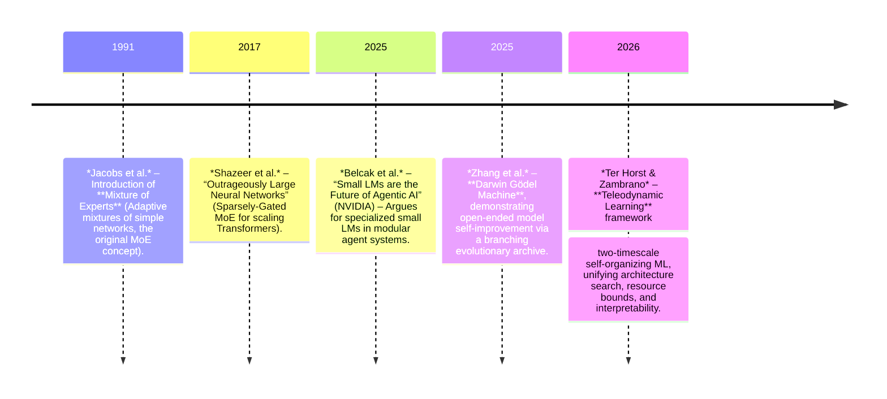

# Executive Summary  
The terms **“4Fs”** and **“code beading/model breeding”** appear to be new or idiosyncratic and are not defined in the literature.  We therefore outline plausible interpretations: for example, the 4Fs could be hypothesized as four core principles (e.g. **Fast, Flexible, Frugal, Federated**) guiding AI modularity or evolution, but we find no canonical source. “Code beading” may refer to structured task decomposition akin to Steve Yegge’s **Beads** system (a persistent issue-tracker for coding agents), i.e. breaking code/plans into reusable “beads.” “Model breeding” can be viewed as an analogy to evolutionary model design: combining, mutating or selecting among models (as in neural architecture search or neuroevolution). 

In contrast, **Teleodynamics** is a well-established concept (originating in Terrence Deacon’s work) referring to goal-directed, self-maintaining processes. In AI this has been recently adapted: teleodynamic systems co-evolve **structure, parameters, and internal resource constraints**, generating stable functional organization without external stopping rules. For example, Ter Horst et al. (2026) formulate *Teleodynamic Learning* as coupled inner (parameter update) and outer (structural adaptation) loops linked by a resource variable. Similarly, Kappel (2023) describes a Teleodynamic AI where “structure, parameters, and resource state co-evolve under endogenous viability pressure,” with a fast (learning) loop and a slow (structural edit) loop. These perspectives suggest AI model populations might likewise evolve teleodynamically: models adapt continuously while their architecture/network topology changes only when predicted *local* utility (minus cost) is positive. 

This report reviews how mutable, small, **interchangeable models** could converge under teleodynamic dynamics. Key mechanisms include **modular architectures** (ensembles, mixture-of-experts, neural module networks, federated agents) and **evolutionary selection** (e.g. architec­ture search or AI agents that generate and test variants). Communication protocols might involve knowledge sharing via embedding spaces or gossip (e.g. federated or gossip-based model updates) and explicit negotiation of resource/priority. Training regimes could use local objectives with reward signals for improvement. Selection could mirror viability-driven evolution: poorly performing sub-models are pruned or merged; high-utility ones are duplicated or specialized. The Darwin Gödel Machine is an example of such an approach, where a population of coding agents continually mutates and is selected via empirical tests, forming an open-ended tree of improving agents.  

Teleodynamic convergence implies that a collection of small models will naturally self-organize into a stable, adaptive assembly under these internal feedback loops. In practice, this raises both opportunities and risks. On the positive side, modular tiny-model systems can be highly **robust** (failure of one module need not fatally impair the system), potentially more **interpretable** (each module has a narrower role), and easier to scale incrementally (modules can run on edge devices). On the negative side, such systems may exhibit unexpected **emergent behaviors**, complex coordination failures, or alignment issues if modules pursue conflicting local objectives. Governance must handle new failure modes (e.g. a malicious sub-agent) and ensure safe convergence (e.g. by monitoring the shared resource metric and enforcing halting conditions).

Below we elaborate definitions and background, analyze architectures that embody these ideas, and highlight technical implications. We include a **comparison table** of relevant multi-model architectures, a **timeline** of key works (using mermaid), and illustrative diagrams. 

## Definitions and Background  
- **4Fs** – We found no formal reference. In absence of a source, one might interpret “4Fs” as four foundational principles for AI systems (e.g. *Fast, Flexible, Frugal, Federated*), or perhaps four functions (like the biological “Four F’s” of drive). Since no literature defines it, we note the term is undefined. Any use of 4Fs below is speculative, e.g. as shorthand for four key desiderata such as *modularity, dynamism, explainability,* and *human-alignment*.  

- **Code Beading** – Possibly referring to breaking tasks/code into discrete “beads” or modules. Steve Yegge’s **Beads** system is instructive: it gives coding agents a structured memory of issues/tasks in a Git-based graph. In that spirit, code beading suggests organizing code generation or planning into small units (beads) that an AI can add, modify, and link over time. This contrasts with linear scripts, favoring a graph of subtasks (beads) that can be interchanged. We assume “beading” means modular task/chunk management for agentic code, akin to task decomposition in agent frameworks. 

- **Model Breeding** – By analogy to biological breeding, this implies creating new AI models by combining or mutating existing ones. In practice this may parallel **neural architecture search** or **model ensembling**. For example, one could "breed" models by mixing weights or hyperparameters (like model soups/weight interpolation), or by using a GAN-like hypernetwork to generate child models. While we find no source explicitly using “model breeding,” the idea connects to *evolutionary algorithms for neural nets* (e.g. NeuroEvolution of Augmenting Topologies) and recent self-modifying AI (Darwin Gödel Machine). We treat it as shorthand for automated, iterative model recombination and selection. 

- **Teleodynamics** – Originally coined by Terrence Deacon (2011), teleodynamics describes systems that maintain their own constraints to achieve “ends” or purposes. Deacon contrasted *homeodynamics* (dissipative, no purpose), *morphodynamics* (self-organization under flow), and *teleodynamics* (self-sustaining goal-directed structure). In AI, this has been adapted to learning processes that co-evolve structure, weights, and resource in a closed loop. Ter Horst & Zambrano (2026) define **Teleodynamic Learning** as cognition where “learning is not minimization of a fixed objective, but the emergence and stabilization of functional organization under constraint,” governed by a fast (parameter) loop and a slow (structural) loop linked by an internal resource metric. Kappel’s Teleodynamic AI framework similarly insists that structural edits occur only when *local viability* (predictive gain minus cost) justifies them. In sum, teleodynamics in AI means autonomous, self-regulating model evolution: new capacity (features/neurons/modules) is added or pruned only when “profit” (e.g. reduced loss) pays for the complexity, all managed by an internal budget. 

- **Teleodynamic Convergence** – We interpret this as the process whereby a system of many small, dynamic models reaches a stable, goal-oriented state via teleodynamic principles. Convergence here is not towards a predefined global optimum but to a self-consistent structure determined by internal resource constraints. In effect, the collection of models co-adapts such that no further change is viable under the budget. This mirrors the **phase-structured learning** described by teleodynamic theory, moving from under-structured to teleodynamically balanced to over-structured phases. We anticipate convergence as: models that don’t contribute enough utility are retired (teleodynamic “no-op” actions win), while useful ones are grown or replicated, until a self-maintaining ensemble is reached. 

## Modular Architectures and Protocols  
Modern AI is already moving toward ensembles of smaller models rather than monolithic giants. NVIDIA et al. (2025) argue that agentic systems benefit from **heterogeneous mixtures of small LMs**, with each model specialized for narrow tasks. Similarly, Shah et al. (2026) survey predicts a **hybrid AI ecosystem**: edge-based small models handle routine tasks locally, escalating only complex queries to large cloud models. Key architecture categories include:

- **Dense Single Models:** Traditional (e.g. BERT, GPT) or tiny (e.g. DistilBERT) neural networks. All parameters are always active. *Mutability:* Only via weight updates or full retraining. *Interoperability:* None (single model). *Pros:* Simplicity, well-understood. *Cons:* Inflexible, heavy on resources if scaled up. Distillation (e.g. TinyBERT) can compress but still yields one large block.

- **Ensembles of Small Models:** Multiple specialist models run in parallel, whose outputs are combined (e.g. voting, averaging). *Size Range:* Very small (millions of parameters) up to medium. *Mutability:* Individual members can be replaced or retrained. *Interoperability:* Merge at decision-level (ensemble aggregator). *Pros:* Robustness to individual failures, diversity of expertise. *Cons:* Inference cost scales with ensemble size; harder to tune for consistency. [Ensemble techniques in ML are well-known](https://en.wikipedia.org/wiki/Ensemble_learning) but active research explores dynamic ensembling or even evolving ensemble members. 

- **Mixture-of-Experts (MoE) / Sparse Mixture Models:** A single network with many *expert* sub-networks but a gating router that **sparsely** activates only a subset per input. *Size Range:* Total size can be large (billions of params), but only e.g. 10% is active for each token. *Mutability:* Experts can be added or pruned; gates can be retrained. *Interoperability:* All experts share the model architecture; a learned router arbitrates. *Pros:* Very high capacity with efficient computation; enables specialization of sub-models. *Cons:* Training complexity (e.g. load balancing, routing stability); high memory footprint (all experts must reside in memory). Notable examples include Google’s Switch Transformers and GLaM. The figure below illustrates a MoE layer: a gate network routes each input to one of several expert FFNNs, enabling conditional computation.

 *Figure: **Mixture-of-Experts** model example. The gating network routes input tokens (here “More” and “Parameters”) to the most relevant expert sub-network. Only the chosen expert processes each token, enabling a large composite model with sparse activation.* 

- **Neural Module Networks / Skill Pipelines:** Modular architectures where specialized modules (functions or small networks) are composed dynamically. In **Neural Module Networks (NMNs)**, the system infers a computation graph (e.g. based on parse of a question) and assembles modules (e.g. “find”, “compare”) in sequence. Each module is a small NN trained to perform a sub-task, and parameters are often *shared* across uses (training ties the same module weights regardless of context). *Size:* Each module is small (e.g. ≪1B), but a complete pipeline may invoke several. *Mutability:* Individual modules can be added (new skills) or fine-tuned. *Interoperability:* Modules interface via defined I/O (embeddings or tensors); high-level controllers (planners or routers) direct data flow. *Pros:* Highly interpretable (each module has a semantic role), compositional generalization. *Cons:* Hard to train end-to-end; pipeline failures cascade; requires a means to predict which modules to use. For illustration, see the NMN training diagram below: different questions assemble different chains of modules (colored blocks), but share weights for the same operation.

 *Figure: **Neural Module Network** training (from Andreas et al.). Different question-specific networks (colored graphs) are trained simultaneously, with shared weights for common modules. Each network is a pipeline of modules (e.g. “find”, “filter”, “describe”) specialized for sub-tasks.* 

- **Federated/Distributed Learning of Small Models:** Many agents/devices each train a small model locally (e.g. per user or per sensor), periodically sharing gradients or model updates for aggregation. *Size:* Tiny (10M–100M parameters) to medium. *Mutability:* Constant: each model evolves as it trains on new local data. *Interoperability:* Federated averaging or knowledge distillation to merge knowledge. *Pros:* Privacy-preserving, leverages on-edge resources, highly fault-tolerant. *Cons:* Heterogeneity (non-iid data, differing compute), communication overhead, harder to synchronize improvements. This aligns with Kappel’s emphasis on **endogenous resource state** – devices have their own compute budgets and contribute updates only when beneficial.

- **Evolutionary/Generative Approaches:** Treat models as genomes. Examples include **Neuroevolution** (e.g. NEAT, or AutoML Zero) and recent works like the **Darwin Gödel Machine**. A pool of models is iteratively “bred”: new candidate models are generated (by crossover or by prompting a foundation model) and tested; high-performers are retained and diversify, low performers are pruned. *Size:* Often small-to-medium (enables faster iteration). *Mutability:* High: models may mutate architecture or weights each generation. *Interoperability:* None inherent (they compete); however, ensembles of evolved models are possible. *Pros:* Can discover novel architectures or strategies; naturally aligns with teleodynamic selection. *Cons:* Extremely compute-intensive; convergence is not guaranteed; hard to control. The Darwin Gödel Machine demonstrates this by evolving coding agents through a “branching exploration” archive, significantly improving code generation benchmarks via open-ended innovation.

- **On-Device Hypernetworks and Plugins:** Another trend is using very small “controller” models or hypernetworks to modulate larger models or plugins (e.g. retrieving knowledge, calling tools). While not independent small LMs per se, they enable modular extension. E.g. an agent might use a tiny model to select among tool calls, or a hypernetwork to generate a sub-model’s weights. *Mutability:* Easily updated or replaced. *Pros:* Very fast, can encapsulate specialized reasoning. *Cons:* Often not standalone for language tasks. This is less studied academically but aligns with industry trends (multi-agent AI and tool use).

Each approach offers trade-offs. Mixture-of-experts and NMNs emphasize fine-grained specialization and conditional computation, whereas ensembles and federated learning emphasize distribution and redundancy. All these architectures can be **interchangeable** in that modules/models can be swapped or retrained independently. In a teleodynamic system, one could even mix these: for instance, an MoE can be seen as an ensemble with learned routing, and modules in NMNs could themselves be MoE-style sub-networks. 

## Teleodynamic Dynamics and Protocols  
Under teleodynamic control, the above architectures evolve via internal feedback loops. **Fast loops** (gradient descent, reinforcement learning, or online update) continuously adjust model parameters for immediate performance gains. **Slow loops** (architecture edits or model turnover) occur when resource budget permits (resources might accumulate from performance improvements, then be “spent” on structural edits). In practice, this means: 
- Models or modules that reduce loss enough generate extra **resource units**; 
- A resource manager monitors total budget vs. **viability threshold**; 
- When budget is high, the system may **spawn new modules** (split an expert, add a new skill) or **fuse/reduce** them (merge similar modules or retire unused ones) in a discrete step. 
- Edits are accepted only if (expected gain > cost) under the current R(t). This emulates Kappel’s **local objective** rule and no-op action as an explicit choice. 

Communication among models might use an explicit **knowledge bus** or **msg/X protocols**. For example, agents could exchange embeddings or parameter updates via a federated or gossip channel. In a fleet of devices, a **broadcast/aggregation protocol** (e.g. Arrow Flight, gRPC stream) may disseminate learned features (see Section 3 of our internal notes on *ferret, coqui indexes, Arrow Flight, gRPC*). Alternatively, a shared **knowledge store** (vector DB) might allow any model to query others’ outputs, reminiscent of Retrieval-Augmented Generation (RAG) but among small models.

Selection/evolution processes could be implemented via reinforcement signals or explicit tests. For instance, one might periodically evaluate each sub-model on a validation task and weight it by performance, akin to tournament selection. Or use a market metaphor: each model *biologically replicates* (through fine-tuning offspring) in proportion to predictive success, while poor models “die” (are pruned or downgraded). Over time, this yields **Darwinian convergence**, potentially reaching a dynamically stable community of specialized agents.

## Technical Implications  
The teleodynamic multimerger approach has profound implications:
- **Robustness:** Modular teleodynamic AI could be more fault-tolerant: loss or corruption of one module only locally degrades performance, unlike with a single monolith. Redundancy (e.g. multiple experts with overlapping skills) can emerge naturally. However, complex interactions can also create hidden failure modes (feedback loops where agents push the resource to zero, causing collapse).
- **Alignment & Safety:** Decentralized control raises alignment challenges. Each module optimizing its own local reward could misalign with the overall goal. Teleodynamic design suggests embedding alignment within the viability signal (e.g. penalizing unsafe outputs reduces resource). Auditability improves as modules are smaller and specialized (potentially interpretable), but also requires governance to supervise structural edits. Kappel’s framework insists on **audit trails** for each change, which will be vital here.
- **Emergent Behavior:** Teleodynamic systems can produce novelty beyond explicit programming. Nonlinear interactions and the fast/slow loops may yield unexpected strategies. This is a double-edged sword: it enables creative solutions (the Darwin GM found novel coding tools) but also unpredictable outcomes that must be simulated and monitored.
- **Scalability:** Smaller models are far easier to distribute (e.g. on IoT or web workers) and to train incrementally. Teleodynamic adaptation further helps scalability: units of computation are only added when worthwhile. However, coordination overhead (communication protocols, consensus on resource state) becomes a bottleneck at scale and is an active research question.
- **Governance:** A teleodynamic small-model ecosystem requires new governance primitives: e.g. “kill switches” (global overrides of slow loops), standardized protocols for model interchange (to prevent incompatibility), and maybe differential privacy or encryption (since many models might share data-derived updates). Unlike monolithic AI, the failure of oversight on one component might affect others.

**Open Questions:** How to formally verify teleodynamic convergence? What is the best granular timestep for slow edits? What benchmarks measure teleodynamic intelligence (e.g. tasks requiring continual adaptation vs static accuracy)? How do we prevent “rich get richer” resource traps? We suggest experiments such as simulated cohorts of tiny LMs solving tasks under a shared resource constraint, measuring diversity and stability of the final population. Controlled trials could compare, say, an ensemble of evolving LMs vs. a single large LM on a lifelong learning benchmark.

Overall, mutable model ecosystems under teleodynamic control promise **adaptable, efficient intelligence**, but must be studied carefully for emergent complexity and security. 

## Comparison of Architectures/Approaches  

| **Name**                    | **Core Idea**                                            | **Size Range**     | **Mutability Mechanism**             | **Interoperability**               | **Pros / Cons**                                               | **Key Refs / Links**                       |
|-----------------------------|----------------------------------------------------------|--------------------|--------------------------------------|------------------------------------|----------------------------------------------------------------|--------------------------------------------|
| **Dense LM (monolith)**     | One large or small model; all inference within one net.   | ~10M–50B+ params   | Only via re-training or fine-tuning. | None (single model).               | *Pros:* Simplicity, mature tooling. *Cons:* Rigid; scales poorly; single point of failure. | Standard NLP models (BERT, GPT etc).     |
| **Ensemble of SLMs**        | Many specialist models combined (bagging/voting).         | Each ~5M–1B        | Replace individual members freely.   | Aggregate via ensembling (voting, stacking). | *Pros:* Robustness; parallelism; task specialization. *Cons:* Higher inference cost; tuning multiple models. | Ensemble learning (Breiman 1996); Model soups. |
| **Mixture-of-Experts (MoE)**| Multiple expert sub-networks with a learned router.      | Total size large (10B–100B+), per-input ≪ that. | Add/remove experts; train router.   | Internal gating; treat ensemble as one model. | *Pros:* High capacity, conditional compute, modular reuse. *Cons:* Complex training (load-balancing, router stability); high memory overhead (all experts loaded). | Shazeer et al. (2017, “Outrageously Large”); Google Switch/GLaM. |
| **Neural Module Networks**  | Dynamically assembled pipelines of functional modules.    | Modules ≪1B each; pipeline totals few B. | Add new modules; combine differently per query. | Module interfaces (vectors/tensors); controller decides flow. | *Pros:* Interpretable; strong compositionality; modules reusable across tasks. *Cons:* Hard to train end-to-end; requires module inventory and parser or planner to assemble graphs. | Andreas et al. (2016 CVPR); Visual Q&A modules. |
| **Federated Models**        | Each device/agent trains its own SLM; central agg.       | Each ~10M–100M     | Continuous local training; sync with server. | Federated averaging or knowledge distillation. | *Pros:* Privacy; scalable distributed training; uses idle edge devices. *Cons:* Non-iid data, communication latency; potential model drift. | McMahan et al. (2017 FedAvg); Edge/IoT AI studies. |
| **Evolutionary AI (DGM)**   | Self-modifying pool of agents evolving by selection.      | Typically small (for speed)  | Genetic operators: mutation, crossover, architecture edits. | None (competitors), or ensembles from archive. | *Pros:* Can discover novel behaviors; naturally teleodynamic (search & test). *Cons:* Very compute-intensive; nondeterministic convergence; risk of runaway loops. | Zhang et al. (2025) Darwin Gödel Machine; AutoML/NEAT. |

## Timeline of Key Works  

## Illustrative Diagrams  
The figures above (MoE and NMN) illustrate two examples of small-model modularity. A third key concept is the **teleodynamic feedback loop**: models and structure adapt under resource constraints. (See Kappel (2023) for a conceptual diagram of fast/slow loops with resource gating.) In practice one might depict **Structure (S)**, **Parameters (W)**, **Performance (loss)**, and **Resource (R)** forming a loop: S,W produce Performance; Performance accrues Resource; Resource then enables or inhibits edits to S or W. Each structural edit is justified by predicted performance gain vs cost. 

> *Figure (not shown): Teleodynamic loop diagram.*  

## Open Questions and Experiments  
Key open questions include: What are the stability and convergence properties of teleodynamic model ensembles? How to best structure the resource signal so that safety is an attractor? What benchmarks (e.g. continual learning, multi-task adaptation) can measure teleodynamic intelligence? To validate this paradigm, we suggest experiments such as evolving a community of tiny LMs on a non-stationary task distribution, measuring if and when they self-organize into reusable specialisms. Another approach is to simulate teleodynamic constraints: e.g. allow a small-model network to grow/shrink under a cost budget and observe emergent architecture. 

Finally, **governance and safety** experiments should test adversarial interventions in a teleodynamic system (e.g. can a malicious sub-model hijack resource?). Ethical and control mechanisms must be co-designed. Teleodynamic AI is a speculative but promising frontier: by merging modular AI design with concepts of self-governance and viability (akin to living systems), it offers a path to more resilient, adaptable AI.  

**Sources:** We cite foundations of modular AI and teleodynamics. For example, Shaevitz and Kappel’s Teleodynamic AI framework and Ter Horst’s Teleodynamic Learning, recent surveys of small models, mixtures-of-experts, and evolutionary AI, among others as noted above. These sources underline the concepts and trade-offs discussed. 

