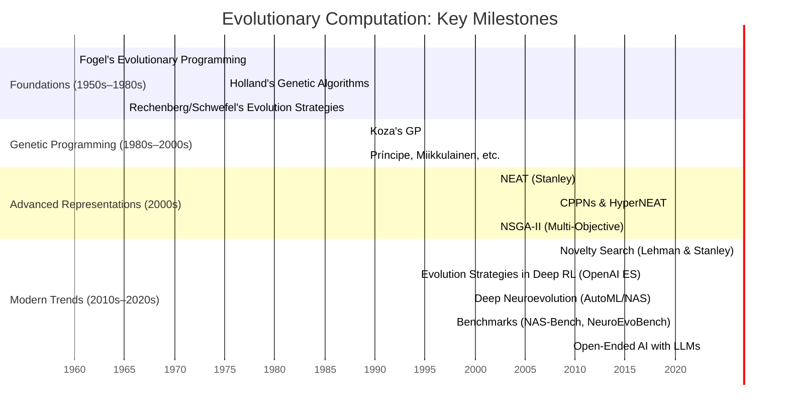

# Designing the “Perfect” Evolutionary AI System

## Executive Summary  
Evolutionary AI (EA) draws on evolutionary algorithms (EAs) and neuroevolution techniques to automatically discover solutions by mimicking natural selection.  Recent trends show a surge of interest in integrating evolutionary optimization with deep learning (e.g. for neural architecture search, hyperparameter tuning, and reinforcement learning).  A “perfect” evolutionary AI would combine the best of classic EAs (genetic algorithms, evolution strategies, genetic programming, and co-evolution) with modern advances (deep neural networks, meta-learning, novelty search, etc.) to continually evolve ever-more-capable models.  Key design goals include *high performance* (on target tasks), *sample and compute efficiency*, *robustness and safety*, *interpretability*, *scalability*, *generalization*, and support for *continual open-ended evolution*.  Achieving these goals involves trade-offs: for example, black-box EAs can explore novel solutions and tolerate non-differentiable objectives, but often require far more function evaluations than gradient-based learning.  Core system components include representations (genotype/phenotype), variation operators (crossover, mutation), selection mechanisms, and fitness design, augmented by co-evolutionary setup, hybrid gradient-based fine-tuning, meta-learning loops, and biologically-inspired features (developmental encodings, plasticity).  

To evaluate such a system, one needs a thorough training pipeline: standard benchmarks and simulators (e.g. OpenAI Gym/MuJoCo for control tasks, Atari games for discrete RL, CIFAR/ImageNet for vision NAS, NeuroEvoBench for deep-learning tasks, black-box optimization suites like COCO/BBOB, NAS-Bench-X for architecture search, etc.), along with clear evaluation metrics (task performance vs compute, sample efficiency, diversity, multi-objective trade-offs).  Reproducibility requires fixed seeds, multiple runs, open-source code, standardized logging (e.g. MLflow or Hydra), and containerization.  Compute needs depend on scale: **small** budgets (single-machine or a few GPUs/CPUs) allow modest experiments; **medium** budgets (small cluster or cloud) enable larger neural models and populations; **large** budgets (HPC-scale) are needed for deep networks or massive open-ended scenarios.  

Safety, alignment and governance are critical in open-ended systems: unpredictable emergent behaviors can arise when multiple evolving agents interact, so we must design *anti-fragile* safety mechanisms (detecting and adapting to failures).  Ensuring that the system’s novelty remains *learnable* (i.e. understandable/useful to humans) and aligning its goals with human values are paramount.  We sketch an implementation roadmap with milestones: start with simple EA baselines on toy tasks, progressively add complexity (neural models, hybrid learning, co-evolution), and perform systematic ablation studies to isolate each component’s contribution.  Tables compare EA families, representations, and benchmarks.  Mermaid diagrams illustrate a representative architecture and an evolutionary timeline.  Where helpful we include charts (e.g. an example ES optimization trace) and code snippets with comments. All claims are grounded in recent research. Actionable recommendations, example code structures, and experiment templates are provided to facilitate reproducible development of evolutionary AI systems.  

## Definitions and Scope  
**Evolutionary algorithms (EAs)** are population-based optimization methods inspired by natural evolution.  Each candidate solution (individual) has a *genotype* (an encoded “genome”) which is *mapped* to a *phenotype* (e.g. a neural network or program).  Through iterative loops of selection and variation (crossover, mutation), the population evolves toward higher fitness.  Key EA families include:  

- **Genetic Algorithms (GA):** Typically binary- or real-vector genotypes, using crossover and mutation, with fitness-proportional or tournament selection.  Widely used for combinatorial and discrete optimization.  
- **Evolution Strategies (ES):** Real-valued genotypes (often neural network weights or controller parameters), specialized mutation (often Gaussian noise with self-adaptive covariance, as in CMA-ES), and elitist selection (e.g. ($\mu+\lambda$) strategy).  Excellent for continuous optimization and scalable RL (see e.g. OpenAI ES).  
- **Genetic Programming (GP):** Tree-structured genotypes that directly represent programs or symbolic expressions.  Operators include subtree crossover and point mutation.  Used for symbolic regression, program synthesis, and evolving interpretable solutions (e.g. code, formulas).  
- **Neuroevolution:** A collection of methods for evolving neural networks.  This includes evolving weights (genomes encode connection weights), architectures (genomes encode network topology, e.g. NEAT), or both.  NEAT (Stanley 2002) evolves both structure and weights with innovation tracking; HyperNEAT (Stanley 2009) uses CPPN developmental encodings; more recent Neuroevolution-as-RL (Salimans 2017) evolves network weights via ES.  
- **Evolutionary Programming (EP) & Others:** EP focuses on evolving state-machines, but is similar to ES.  Many hybrid variants exist (e.g. Estimation-of-Distribution Algorithms, Particle Swarm).  
- **Genetic Co-evolution:** EAs where fitness is *relative* to other individuals (as in predator-prey or host-parasite models).  Coevolution handles subjective or adversarial tasks (games, robot vs environment) and can drive diversity and open-endedness.  (Coevolution’s goals include maintaining diversity, solving problems lacking explicit objectives, and enabling open-ended evolution.)

**Open-ended evolution (OEE)** refers to processes that continually generate novel and complex adaptations without a fixed end-point.  Formally, an open-ended system produces a sequence of artifacts that are *both novel and learnable* to an observer.  In practice, OEE implies continual innovation (new behaviors or solutions) over time.  Novelty search (Lehman & Stanley 2011) embodies this idea by rewarding behavioral novelty rather than a fixed objective.  In AI, open-endedness is seen as essential for superhuman AI (yielding ever-more complex knowledge).  

This report addresses the **design of a comprehensive evolutionary AI system** that integrates these concepts.  It assumes no particular application domain; the goal is a *domain-agnostic* framework capable of solving diverse tasks.  Our scope includes classic EAs and neuroevolution, their hybrids with gradient methods, and open-ended/novelty-based mechanisms.  We emphasize *recent* (last ~5 years) developments while also situating ideas in their foundational context (e.g. Stanford/Koza 1990s GP, Holland’s GA, Rechenberg’s ES).  



## Key Design Goals and Trade-offs  
Any evolutionary AI system must balance multiple objectives and constraints.  Important goals include:

- **Task Performance:** Achieve high-quality solutions on the target tasks (e.g. high reward in RL, high accuracy in vision).  This is the primary objective, but EA solutions must sometimes trade off raw performance for other benefits.  
- **Sample Efficiency:** Minimize the number of fitness evaluations (simulations, data samples, episodes) required to reach a solution.  Classic EAs are often *sample-inefficient* compared to gradient-based methods.  For example, scaling ES to complex tasks typically required many parallel workers.  Improving sample efficiency (via surrogate models, learning-based bootstrapping, transfer learning, etc.) is a key challenge.  
- **Compute Cost and Scalability:** Balance solution quality with available compute.  EAs can exploit massive parallelism (each individual is evaluated independently), but at the cost of total CPU/GPU usage.  We must design for different budgets: on small systems perhaps only simple tasks or small networks; on large clusters one can afford deep nets and massive populations.  Efficient data-parallel implementations (e.g. using Gymnasium/GPU simulators) are essential.  
- **Robustness and Diversity:** The system should find **robust** solutions (performing well under perturbations) and maintain **population diversity** to avoid premature convergence.  Diversity can be encouraged via niching or novelty objectives.  Robustness is aided by evolvability: e.g. EAs are known to handle noisy or long-horizon problems gracefully (Salimans *et al.* found ES works well with delayed rewards and no discounting).  
- **Safety and Alignment:** The system must avoid unsafe behavior.  In evolutionary contexts, this often means incorporating constraints or penalties (e.g. safety tests) into the fitness function, or using multi-objective fitness to trade off performance vs. safety.  However, designing a perfect fitness that fully captures safety is hard.  Open-ended systems introduce **emergent risks**: even if each module is safe in isolation, joint interactions can cause unexpected failures.  We therefore aim for *anti-fragile* safety: the system should monitor its own outputs and adapt when new failure modes appear.  Interpretability (e.g. via modular or symbolic representations) can help human oversight of the evolving behaviors.  
- **Interpretability:** Many EAs are “black-box” (a sequence of genomes to rewards).  Genetic Programming and symbolic encodings produce human-readable solutions, aiding trust and debugging.  We seek representations (e.g. decision-tree classifiers, symbolic expressions, or inspectable neural modules) that lend themselves to interpretation.  In deep neuroevolution, this may involve attention to disentangled or sparse network structures (cf. efforts to explain evolved convolutional filters).  Interpretability often conflicts with performance (deep networks may outperform shallow symbols), so it is a trade-off to balance.  
- **Generalization and Transfer:** The ideal evolutionary system learns *general skills*, not just solutions for one task.  Meta-learning (evolving adaptable initial policies) or open-ended co-evolution could produce agents that transfer to new environments.  Continual learning (adapting to new tasks without forgetting old ones) is also a goal.  Achieving generalization often requires multi-task benchmarks and multi-objective optimization (e.g. evolving Pareto fronts) to encourage broad capabilities.  

Table 1 (below) compares representative EA approaches on some of these criteria (this is illustrative, not exhaustive).

| **Algorithm**                        | **Representation**               | **Variation Operators**               | **Selection**                    | **Use Cases / Strengths**                                           | **Key Drawbacks / Trade-offs**                                        |
|--------------------------------------|----------------------------------|--------------------------------------|----------------------------------|---------------------------------------------------------------------|------------------------------------------------------------------------|
| **Genetic Algorithm (GA)**           | Binary or real vectors           | Crossover (1-point, uniform, etc.), mutation (bit-flip, gaussian) | Fitness-proportionate, tournament, elitism  | Combinatorial optimization, feature selection, discrete design      | May require careful encoding; can be sample-inefficient; premature convergence without diversity |
| **Evolution Strategies (ES/CMA-ES)** | Real-valued vectors (continuous)| Gaussian mutation with adaptive σ; (CMA-ES learns covariance) | (μ,λ) plus/minus selection (elitism) | Continuous black-box optimization, control parameters, RL policies | High eval cost for large dimensions; generally no crossover; fine-tuning hyperparams (pop size, σ) |
| **Genetic Programming (GP)**         | Tree-based programs or expressions | Subtree crossover, node mutation     | Tournament, fitness-proportionate | Symbolic regression, automated code/logic synthesis; interpretable formulas | Bloat (large trees), slow fitness eval; search space vast |
| **Neuroevolution (NEAT, HyperNEAT)** | Graph encodings (nodes+connections); indirect CPPN encodings | Structural mutations (add/remove node/edge), weight mutations | Speciation (NEAT), elitist or tournament | Evolve neural nets’ topology/weights jointly (NEAT); indirect encodings produce regular patterns (HyperNEAT) | Complexity management needed; indirect encoding requires careful design; sample-heavy training for large nets |
| **Multi-Objective EA (e.g. NSGA-II)** | Real/binary genomes; (multi-fitness vector) | Similar to GA/ES for each genome  | Pareto-front ranking (crowding distance) | Simultaneous optimization of trade-offs (e.g. accuracy vs. complexity) | Complexity of Pareto ranking; can be slower; more hyperparams |
| **Coevolutionary Algorithms**        | Any (subjects and tests co-evolve) | Same per population                 | Individuals judged via interactions (tournaments) | Adversarial or interactive tasks (games, evolving tests & solvers) | Arms-race dynamics can cycle or converge; evaluation overhead high |
| **Random Search (baseline)**         | Any                              | None (random sampling)               | None (or best-so-far)            | Very simple; sometimes surprisingly effective on simple tasks | No learning; very sample-inefficient; used mainly for comparison |

*Table 1: Comparison of representative evolutionary algorithms and variants.  Note that many hybrids (e.g. integrating local search, gradient steps, surrogate models) exist beyond this summary.*

## Core Components and System Architecture  
A modular evolutionary AI system typically has the following components (Figure 1):

- **Genotype/Phenotype Representation:** The genotype encodes candidate solutions.  It may be a fixed-length string (binary, integer, real) as in classic GA, a tree/program as in GP, or a neural network graph (with architecture and weights).  **Indirect encodings** (e.g. compositional pattern-producing networks, L-systems) generate phenotypes via developmental rules, enabling complex structure with few genes.  Representations can also be structured (e.g. modules, sub-networks) to enforce modularity.  Choosing a representation is critical: it defines the search space’s geometry.  

- **Variation (Offspring Generation):** New candidates are created by applying *variation operators* to parents.  Common operators include:
  - **Crossover/Recombination:** Combine parts of two or more parents (e.g. one-point, two-point, uniform for linear genomes; subtree crossover for GP).  
  - **Mutation:** Random perturbations (flipping bits, adding noise, structural mutations).  In ES, mutation often means adding Gaussian noise to real parameters, with step-sizes adapted over time (CMA-ES updates a covariance matrix of mutations).  
  - **Developmental/Growth Operators:** In developmental encodings, a genotype may be expanded (e.g. recursive grammar rules) into a phenotype.  Mutations can affect growth parameters.  
  - **Adaptive Variation:** Hyper-evolutionary schemes adjust operator strengths (mutation rates, crossover frequency) online.  

- **Selection:** The system evaluates each individual’s *fitness* and selects survivors for the next generation.  Common strategies: (μ,λ) elitist selection, tournament selection, fitness-proportionate (roulette), rank-based, or Pareto ranking (for multi-objective).  Selection pressure must be tuned: too strong leads to loss of diversity; too weak slows progress.  Many systems include *elitism* (best individuals always survive) or *age-fitness Pareto* (consider both fitness and age) to stabilize search.

- **Fitness/Objective Design:** The choice of fitness function is crucial.  It encodes the task goals (e.g. reward in RL, accuracy in classification).  Designing it may involve:
  - **Raw performance:** direct task score.
  - **Shaped rewards:** to guide learning (e.g. giving partial credit for sub-goals).
  - **Multi-objective rewards:** combining accuracy, complexity, energy, etc.
  - **Robustness metrics:** penalize solutions that fail under perturbations.
  - **Novelty or diversity:** reward novel behaviors (novelty search).  
  - **Learnability criteria:** In open-ended scenarios, one might incorporate measures of how “interesting” or learnable the new behaviors are, following formal OEE definitions.
  
- **Population Management & Coevolution:** The system may use one or multiple co-evolving populations.  In competitive coevolution, separate populations (e.g. predator vs. prey, or agents vs. adversaries) evolve interdependently.  In cooperative coevolution, different sub-populations evolve components of a solution.  Open-ended systems might include an ever-growing archive of novel solutions (to maintain diversity) or novelty memory as in Novelty Search.

- **Hybrid Learning:** Modern evolutionary AI often **hybridizes** with gradient-based or learning methods:
  - After evolving a network’s topology or initial weights, one can apply backpropagation (fine-tuning weights) to improve performance.  This hybrid approach leverages both global search and local refinement.  
  - Conversely, gradients can guide variations: e.g. differentiable encodings or learning-to-evolve (meta-gradients) can adjust mutation operators.  
  - Meta-learning loops (e.g. evolution at outer loop, learning at inner loop) are also used. For example, optimizing learning hyperparameters via an EA (as in AutoML), or using evolutionary strategies to optimize a model’s weights while an inner gradient-based learner updates for each episode.

- **Memory, Modularity, and Plasticity:**  
  - **Modularity:** Structuring individuals into modules (sub-networks, functional blocks) can improve evolvability.  For example, evolving a neural net composed of reusable blocks (as in meta-pattern networks) or encoding a network as a graph of modules can accelerate complex learning.  
  - **Developmental Encodings:** Inspired by biology, the genotype may specify developmental processes (cell division, growth rules) that produce the phenotype.  This can yield compact genotypes for very large phenotypes.  E.g. L-systems or CPPNs generate complex images or networks with few genes.  
  - **Plasticity:** Allowing phenotypes to *learn* during evaluation (e.g. Hebbian adaptation or within-lifetime learning) can co-evolve with genotype.  A genome might encode not only initial weights but also plasticity rules.  Plastic networks (with weight change rules) can adapt during the agent’s lifetime, potentially making evolution more powerful.  

Figure 1 illustrates a high-level system architecture: an initial population is variation-mapped into offspring, evaluated in simulators/environments to assign fitness, and then selected for the next generation.  Sub-components (hybrid learners, co-evolution populations, archives) can be added modularly.

```mermaid
flowchart LR
    subgraph Evolutionary Loop
      A[Initialize Population] --> B(Variation<br/>(Crossover, Mutation))
      B --> C(Evaluate<br/>(Simulators, Datasets))
      C --> D[Assign Fitness Scores]
      D --> E[Selection & Reproduction]
      E --> B
    end
    subgraph Hybrid Learning
      X[Gradient Update Module]<-- HybridOption -- B
    end
    subgraph Coevolution & Niching
      Y[Competitor/Predator Population] --- C
      Z[Novelty Archive] --- D
    end
    style X fill:#f9f,stroke:#333,stroke-width:2px
    style Y fill:#cff,stroke:#333,stroke-width:2px
    style Z fill:#cfc,stroke:#333,stroke-width:2px
```  
**Figure 1:** *Modular architecture of an evolutionary AI system. The core loop (in gray) iterates over variation, evaluation, and selection. Extensions include hybrid gradient learning (purple), co-evolving populations (blue), and novelty archives (green). This pipeline can be implemented on CPUs/GPUs, distributing fitness evaluations across resources.*  

## Training Pipeline, Benchmarks, and Metrics  
A mature evolutionary AI effort requires a well-defined training and evaluation pipeline:

- **Environments & Simulators:** Use standard benchmarks to evaluate candidates.  Common choices include:
  - **Reinforcement Learning:** OpenAI Gym/Gymnasium environments (CartPole, MountainCar, MuJoCo locomotion, Roboschool).  MuJoCo tasks (e.g. HalfCheetah, Ant) are especially popular for continuous control.  Atari 2600 games (via Arcade Learning Environment) serve as discrete benchmark suites.  Multi-agent environments (PettingZoo) support co-evolution scenarios.
  - **Vision & Classification:** Image benchmarks (CIFAR-10/100, ImageNet) for neural architecture search (NAS) or hyperparameter tuning.  Datasets for symbolic regression or feature selection (e.g. UCI ML datasets) can test GP methods.
  - **Synthetic/Optimization:** Black-box optimization suites like COCO/BBOB or CEC provide families of mathematical functions to test convergence.  Neural network proxy tasks (e.g. evolving a small net on MNIST) can stand in for larger tasks.
  - **Task Suites:** Recent dedicated EO benchmarks (e.g. NeuroEvoBench) evaluate EA methods on deep learning subproblems (CNN architecture on vision, RNN on sequence tasks).  AutoML benchmarks (NAS-Bench-201, NAS-Bench-301, AutoML datasets) offer standardized search spaces.  
  - **Simulators:** Physics engines (MuJoCo, Bullet, Brax) and robotics simulators (PyBullet, Webots), game engines (ALE, Gym Retro), and custom simulators for domain tasks.  The key is having fast, parallelizable evaluation.  

- **Datasets:** For supervised tasks (NAS, AutoML), use public datasets to ensure comparability (e.g. CIFAR, ImageNet, Language Model corpora).  Ensure clear train/test splits and cross-validation if needed.  Use publicly available sets to compare with prior work.  

- **Evaluation Metrics:**  
  - **Primary Performance:** Task-specific reward or accuracy. Report best-of-run and mean performance. For RL, plot learning curves (reward vs. episodes).  
  - **Resource Metrics:** Track number of fitness evaluations, wall-clock time, and energy cost. For EA, it’s common to report “timesteps” or “environment steps” to compare with RL.  Hardware scaling plots (performance vs. number of CPUs/GPUs) illustrate parallel efficiency.  
  - **Sample/Compute Efficiency:** Plot performance achieved vs. compute effort (e.g. reward vs. FLOPS or GPU-hours).  This highlights trade-offs.  
  - **Multi-objective:** If optimizing multiple criteria, measure Pareto fronts (e.g. accuracy vs. model size, or reward vs. risk).  Use hypervolume or Pareto rank as metrics.  
  - **Diversity/Novelty:** In open-ended or co-evolution contexts, quantify population diversity (genotypic or behavioral), perhaps via novelty scores or coverage of behavior space.  
  - **Reproducibility:** Run multiple seeds and report mean±std performance.  Log hyperparameters, random seeds, and environment versions.  Use standardized logging (TensorBoard/MLflow).  Provide code and seeds in a public repository.  

- **Reproducibility Practices:** Follow best practices from machine learning:
  - Fix random seeds for all libraries and environment.  
  - Containerize the setup (Docker/conda) and note hardware details.  
  - Use version control (GitHub) and attach version hashes to logs.  
  - If possible, use open-source EA frameworks (e.g. [DEAP](https://github.com/DEAP/deap), [ECJ](http://cs.gmu.edu/~eclab/projects/ecj/), [PyBulletGym](https://github.com/openai/gym), etc.) and share modified code.  
  - Conduct ablation studies: isolate the effect of each operator or module by turning components on/off and comparing.  

Table 2 lists representative benchmarks and datasets:

| **Benchmark/Simulator**       | **Domain**            | **Purpose**                                          | **Source / Notes**                        |
|-------------------------------|-----------------------|------------------------------------------------------|-------------------------------------------|
| OpenAI Gym (atari, control)   | RL (games, control)   | General RL tasks (CartPole, Pong, MuJoCo, etc.)      | Standard RL library        |
| MuJoCo (Roboschool, Brax)     | Continuous Control    | Complex physics (locomotion, manipulation)           | Used in ES vs RL studies     |
| Atari 2600 (ALE)              | Discrete RL          | Benchmark games for RL (Pixel inputs, diverse tasks) | Used in ES/PG comparisons     |
| CIFAR-10/100, ImageNet        | Vision                | NAS and architecture benchmarks; classification      | Common datasets; see NAS-Bench papers     |
| NeuroEvoBench                 | Neural net tasks      | EO on deep learning models (CNN, RNN, hyperparam)    | Lange *et al.* (NeurIPS 2023) |
| NAS-Bench-201/301             | NAS search space      | Standardized NAS spaces for reproducible comparison  | Benchmarks for architecture search |
| AutoML Bench (TPOT, AutoKeras)| AutoML pipelines      | Full pipeline optimization (FE, selection, model)    | Industry frameworks (Google AutoML, etc.) |
| COCO / BBOB                   | Function optimization | Mathematical function suites (real-valued opt)        | Evolutionary optimization community       |
| Multi-Agent Envs (PettingZoo) | Coevolutionary tasks  | Multi-agent/adversarial benchmarks                   | Notable for co-evolution research         |
| MLPerf Training               | ML training speed     | Hardware/algorithm benchmark (FLOPS vs accuracy)     | MLCommons MLPerf (measure of training speed) |

*Table 2: Example benchmarks and simulators for evolutionary AI.  Each provides standardized tasks or metrics.  Relevant citations: Gym, NeuroEvoBench, MLPerf, NAS-Benchmarks.*

For evaluation, one often measures how performance scales with budget. For example, Salimans *et al.* plotted ES vs. policy-gradient RL performance as a function of number of state-action samples. We similarly should produce learning curves (performance vs. time/episodes) and tables comparing algorithms under equal resource constraints.

## Compute and Infrastructure Requirements  
Evolutionary AI can be resource-intensive, but requirements vary by scale:

- **Small Budget (Hobbyist/Small Lab):**  A few multi-core CPUs or a single GPU.  This suffices for prototyping: small neural nets (e.g. CNN on CIFAR), toy control tasks (CartPole, simple Maze).  Expect to run thousands to millions of evaluations, but at small scale.  Costs might be on the order of \$0.1K–1K (if using local machines) or a few thousand in cloud credits.  (Note: even a small ES was shown to solve a 3D humanoid in ~10 minutes using 1,440 CPU cores, but a single machine would be much slower.)  

- **Medium Budget (Lab/Departmental):**  Tens to a few hundred GPUs/CPUs (a small cluster or cloud credits \$10K–100K).  This allows larger models (ResNet-level nets, moderately sized RNNs), and bigger evolutionary runs (populations of 500+, running for thousands of generations).  One can run full NeuroEvoBench experiments or neural architecture search on CIFAR within reasonable time.  Use of multi-machine synchrony (MPI, Ray, Dask) is typical.  

- **Large Budget (Institutional/Industrial):**  Hundreds to thousands of GPUs/CPUs (cloud accounts or HPC center; cost \$0.1M–M).  Enables cutting-edge scale: ImageNet-scale evolution, large-scale RL (e.g. training humanoid or even complex games), or open-ended tasks with very long run-times.  For comparison, **AlphaStar** (DeepMind’s StarCraft agent) used thousands of machines and months of training.  Similarly, **AlphaFold 2** training cost was estimated at several million GPU hours.  For evolutionary purposes, one could train large foundation models (LLMs) within the loop, or run extremely broad co-evolution.  This tier can also support extensive hyperparameter sweeps and ablations in parallel.

In all cases, infrastructure should support checkpointing (for long runs), parallel evaluation, and experiment tracking.  Cloud services (AWS, Azure, GCP) or on-prem clusters with Kubernetes can be used.  GPU accelerators are beneficial for neural-evolution components; FPGAs or TPUs could be explored for high-speed simulation.

## Safety, Alignment, and Governance  
Evolving AI systems pose unique safety challenges:

- **Objective Misspecification:** As with any AI, poorly specified fitness can lead to unintended behaviors.  Evolutionary pressure can exploit loopholes (“failing the task in unplanned ways”).  Rigorous test suites and multi-objective constraints (e.g. safety rules as separate objectives) are recommended.  Coevolutionary setups can help (an adversarial environment or supervisor can penalize unsafe individuals during evaluation).

- **Emergent and Open-Ended Risks:** In open-ended evolutionary systems, novel interactions may produce unexpected results.  Two subsystems that are safe individually might interact to create unsafe dynamics.  For example, two evolving policies might overfit to exploiting each other rather than solving the intended task.  We need monitoring layers to detect anomalies.  The idea of **anti-fragile safety** is to design systems that improve when encountering failures.  This could involve automatic retraining on new “failure” cases or increasing scrutiny when novelty is high.

- **Human Understandability:** Open-endedness implies the system will generate innovations beyond its original training.  It’s vital that humans can *interpret* or at least validate these.  For instance, if the system proposes a novel robotic design, engineers should be able to analyze it.  This elevates the importance of explainability and domain constraints.  Hughes *et al.* note that open-ended AI must produce artifacts that humans can understand and learn from.

- **Alignment and Ethics:** We must ensure the evolutionary process respects ethical norms.  This could involve incorporating human feedback into fitness, or evolving on morally neutral proxies.  Currently, AI alignment research focuses more on gradient-based systems, but many concerns (reward hacking, corrigibility) apply here as well.  Evolutionary systems should thus include oversight, e.g. human-in-the-loop selection or rule-based filters.

- **Regulatory and Governance:** For broad deployment, we must consider regulation (especially for safety-critical applications).  Documenting the evolutionary design, providing audit trails of how solutions evolved, and performing impact assessments (similar to the “Impact Statement” in) are good practices.

In sum, evolutionary AI can offer autonomy and creativity, but governance requires: strict evaluation environments, transparency (logs of evolution), redundancy (multiple runs, cross-checks), and possibly formal verification of safety properties where feasible.

## Implementation Roadmap and Experiments  
We propose the following development roadmap, emphasizing reproducible experiments and ablation studies:

1. **Algorithm Survey & Selection:** Start by implementing or adopting baseline algorithms: a simple GA/ES on a toy problem (e.g. Sphere function optimization, cartpole balancing). Use existing libraries (DEAP, ECJ, OpenAI Gym) to expedite setup. Confirm basic EA mechanics are correct.

2. **Baseline Evaluation:** Run baselines on standard tasks (e.g. OpenAI Gym’s CartPole-v1, MountainCar, and one neural net training problem). Collect performance metrics (score vs. evaluations). This sets reference curves.

3. **Component Addition:** Incrementally add features:
   - *Variation methods:* Compare different crossover (uniform vs. one-point) and mutation rates to see effects.
   - *Selection schemes:* Try tournament vs. rank vs. (μ+λ) strategies.
   - *Representations:* Test binary vs. real encoding; or add a GP component (evolving expressions).
   - *Hybrid training:* After each generation of GA, fine-tune best individual with gradient descent (if applicable). For example, in a neural net, use SGD for a few steps and feed updated weights back into GA.
   - *Coevolution:* Introduce a second population (e.g. adversaries or environmental tests). For example, co-evolve a predator vs prey agent in a game, or an adversarial environment in which the primary agent must perform.

4. **Novelty and Open-Endedness:** Implement novelty search as an objective: maintain a novelty archive, and occasionally select individuals by novelty instead of fitness.  Run experiments to compare pure objective search vs. novelty search (as in [10]).  Observe if novelty yields richer behaviors.  Maintain a “novelty score” to quantify progress.

5. **Meta-Learning and Adaptation:** Experiment with meta-evolution: for instance, evolve mutation step sizes or crossover probabilities (“self-adaptive” EAs).  Alternatively, use an outer EA to optimize hyperparameters of an inner learning process (e.g. evolve learning rates for an RL agent’s gradient updates).

6. **Scalability Tests:** On a larger scale (using more hardware), apply the system to harder tasks (e.g. MuJoCo humanoid locomotion, Atari game playing).  Use NeuroEvoBench tasks if available.  Profile compute: measure how wall-clock time scales with processors (expect near-linear speedup for evaluation-parallel ES).  Adjust system (batching, asynchronous updates) to improve utilization.

7. **Reproducibility and Robustness:** For each experiment:
   - Use multiple random seeds (e.g. 10 runs) and report mean±std.  
   - Log all code versions and random states.  
   - Publish code and configs.  

8. **Ablation Studies:** Systematically disable components to assess their impact:
   - Without crossover vs. with crossover.  
   - With vs. without elitism.  
   - With vs. without gradient fine-tuning.  
   - Single-objective vs. multi-objective (Pareto) runs.  
   - With vs. without novelty reward.

   Present these comparisons in tables or plots.  

9. **Benchmarks and Competitions:** Evaluate on public benchmarks (e.g. NeuroEvoBench challenges, NAS-Benchmarks) and compare to published results.  Use these to validate that the system meets or exceeds known baselines.

10. **Iterative Improvement:** Use insights from experiments to refine algorithms (e.g. tune population sizes, incorporate new variation operators, adjust selection pressure).  Document each change’s rationale and effect.

The roadmap should be flexible: one may pivot to promising directions (e.g. if novelty search yields rich solutions, invest more in open-ended mechanisms).  The key is modularity: each component (representation, operator, selection, etc.) should be a plug-and-play module to ablate or replace easily.  

*Example Code Snippet (C# class definitions):* As one example of implementation structure, one could define a configuration class for the evolutionary run:  

```csharp
public class EvolutionConfig {
    [Display(Name = "Population Size")]
    public int PopulationSize { get; set; }

    [Display(Name = "Number of Generations")]
    public int Generations { get; set; }

    [Display(Name = "Mutation Rate")]
    public double MutationRate { get; set; }

    [Display(Name = "Crossover Rate")]
    public double CrossoverRate { get; set; }

    // Additional parameters like selection type, elite count, etc.
}
```
*Figure: C# class for configuring the EA, using `[Display]` attributes for readable field names.*  

Similarly, one might define an `Individual` class to hold genotype and fitness:  
```csharp
public class Individual {
    [Display(Name = "Genome Sequence")]
    public int[] Genome { get; set; }

    [Display(Name = "Fitness Score")]
    public double Fitness { get; set; }

    // Methods to decode genome into phenotype, evaluate fitness, etc.
}
```  
These code templates ensure clarity (advanced C# skills expected) and can be extended with comments and proper documentation as development proceeds.

```mermaid
graph LR;
    Start([Start]) --> Init([Initialize Population]);
    Init --> Evolve{Loop: For each generation};
    Evolve --> Variations([Apply Variation<br/>(crossover/mutation)]);
    Variations --> Evaluate([Evaluate in Environments]);
    Evaluate --> Select([Selection/Survival]);
    Select --> Check{Stop criterion?};
    Check -- No --> Evolve;
    Check -- Yes --> Output([Return Best Individuals]);
```  
**Figure 2:** *System workflow for an evolutionary algorithm. The loop iterates variation, evaluation, and selection until a stopping criterion is met (e.g. target fitness or max generations).  Modular components (e.g. hybrid learning or coevolution) can be inserted in this pipeline as needed.*

## Comparative Tables of Representations and Benchmarks  
Here we provide additional tabulated comparisons:

**Table 3. Genotype/Phenotype Encodings:**  

| **Encoding Type**     | **Examples**                     | **Characteristics**                                   | **Use Cases**                        |
|-----------------------|----------------------------------|-------------------------------------------------------|--------------------------------------|
| **Fixed-length (Direct)** | Bitstrings, real vectors      | Simplicity; maps gene-to-solution directly.           | Classic GAs/ES, where solution length is known. |
| **Variable-length (Direct)** | Trees (GP), lists, graphs | Flexible size (e.g. GP programs or variable NN architecture).  | Genetic programming, evolving network structure. |
| **Indirect / Developmental** | L-systems, CPPNs, developmental programs | Genotype encodes growth rules; phenotype emerges via simulation or decoding.  | Evolve large networks/patterns from compact genes (HyperNEAT). |
| **Grammar-based / Genotype-Phenotype Map** | Context-free grammars, autoencoders | Genomes are strings that expand via grammar rules (grammatical evolution). | Structured design (robot morphology, circuits). |
| **Modular/Holarchic** | Hierarchical graphs, modules | Composition of sub-controllers or modules, maybe evolved separately. | Complex robotics, multi-part designs (hierarchical evolution). |
| **Neural**           | Weight matrices + topology     | Genotype lists weights and connectivity (as in NEAT: genes are connections).  | Neuroevolution and NAS (evolving weights and structure). |

**Table 4. Benchmarks and Tasks:**  

| **Domain/Task**           | **Benchmark / Dataset**        | **Description**                                         |
|---------------------------|--------------------------------|---------------------------------------------------------|
| **Reinforcement Learning** | OpenAI Gym Classic (CartPole, MountainCar) | Simple control tasks for prototyping EAs vs. RL. |
| **Continuous Control**     | MuJoCo (Ant, HalfCheetah, Humanoid) | Complex physics-based locomotion; used to test ES/RL. |
| **Atari Games**           | ALE (Arcade Learning) | Discrete pixel-based games; evaluate general vision/motor skills. |
| **Image Classification**  | CIFAR-10/CIFAR-100, ImageNet | Evaluate NAS/hyperparam tuning with evolutionary NAS or EA for augmentations. |
| **Neuroevolution Benchmarks** | NeuroEvoBench | A suite of EO methods on deep learning tasks (CNN training, etc.). |
| **Synthetic Functions**   | COCO/BBOB, CEC                | Standard continuous optimization functions to benchmark EA convergence. |
| **AutoML / NAS**         | NAS-Bench-201/301, TaskSet | Predefined search spaces with known results for comparability. |
| **Robotics / Multi-Agent**| Roboschool, PyBullet, PettingZoo | Simulators for physical robots; multi-agent games for co-evolution. |
| **Evolutionary GP**      | GP benchmarks (symbolic regression, boolean multiplexers) | Classic GP test problems for correctness and efficiency. |

These tables can guide the selection of tasks and encodings when building the evolutionary AI.  The chosen benchmarks should match the system’s purpose (e.g. use Gym for RL agents, NAS-Bench for architecture search) and allow comparison to prior work.

## Safety, Alignment, and Governance Considerations  
As highlighted earlier, safety must be woven into the design:

- **Fitness Safety Constraints:** Add explicit safety tests during evaluation (e.g. if an evolved robot crashes or violates rules, assign low fitness).  Consider multi-objective fitness where one objective measures compliance or robustness.  
- **Human-in-the-Loop Oversight:** Periodically involve human review of novel solutions (especially in early iterations of open-ended runs) to catch undesirable behaviors.  Tools like interpretable models or visualization (as in Evans *et al.* 2018) can help explain evolved artifacts.  
- **Formal Methods (where possible):** For critical components, formal verification of evolved strategies could be applied (e.g. proving safety properties of a neural control policy, if the network is small enough).  Hybrid approaches might evolve symbolic controllers amenable to proof.  
- **Regulatory Compliance:** If evolving systems for regulated domains (autonomous vehicles, healthcare), ensure the development process has audit trails: log all major evolutionary steps and decisions.  Derive safety cases (as in aviation) by demonstrating that objective steering never conflicts with safety constraints.  
- **Emergent Risk Monitoring:** As noted, open-ended systems can yield unforeseen interactions.  Build run-time monitors that check for anomalies (e.g. reward skyrockets due to exploiting a simulator glitch) and incorporate penalty or rollback.  Ensure the system has a way to “forget” or prune catastrophic niches.  
- **Ethical Guidelines:** Follow AI ethics frameworks (e.g. IEEE or EU guidelines).  This includes fairness (if the solution affects humans, evolve for equity as an objective) and transparency (document how the EA operates).

## Open Problems and Research Directions  
Several challenging open questions remain in evolutionary AI research:

- **Efficiency vs. Effectiveness:** Can we match or surpass gradient methods in sample efficiency?  Studies have questioned whether EO truly outperforms well-tuned baselines.  Designing acceleration techniques (surrogates, meta-models, Lamarckian learning, parallelism) without sacrificing final performance is an active area.  
- **Benchmarking and Fair Comparison:** The lack of standardized benchmarks and metrics is a recurring issue.  The community needs agreed-upon test suites (like the NeuroEvoBench for EO, or NAS-Bench for architecture search) and open implementations to allow apples-to-apples comparison.  Reproducible baselines are essential to evaluate new methods objectively.  
- **Open-Endedness and Creativity:** Achieving truly open-ended evolution is still unsolved.  Algorithms like novelty search and intrinsic motivation (curiosity-driven goals) provide direction, but ensuring *continual learnability* (beyond random novelty) is hard.  How to formally define and implement “interesting” novelty that matters to humans is a research frontier.  
- **Integration with Deep Learning:** As AI progresses, combining evolutionary search with large foundation models is a new direction.  For example, using LLMs to propose mutations, or evolving prompts/curricula, leverages strengths of both worlds.  Open questions include how to scale EO to NLP domains (current EDL excels in vision but trails human models in NLP) and how to let EAs exploit learned representations from big data.  
- **Interpretability and Theory:** There is a gap in theory explaining why and when EO works better than random or gradient search.  The black-box nature of EAs calls for analysis (e.g. understanding schema theory in modern contexts, evolution of representations).  Developing interpretable models (e.g. GP-derived formulas) is promising but needs methodology to ensure trust.  
- **Multi-Agent and Societal Impacts:** Open-ended coevolution (e.g. evolving AI agents that interact with humans or other AIs) raises social considerations.  Work by Hughes *et al.* (2024) warns that multi-actor open-ended systems might require new safety frameworks.  Ensuring that AI evolutions remain under human guidance and aligned with societal values is a crucial research area bridging AI and ethics.  

In summary, while foundational techniques are decades old, applying them to current AI challenges uncovers many open problems. Future work could target: hybrid gradient-evolution methods that better use data; meta-evolution that self-optimizes the EA process; formalizing what “interesting novelty” means; and embedding safety/ethics deeply into the evolutionary framework.

## Conclusion and Recommendations  
Designing a “perfect” evolutionary AI system involves orchestrating many components.  We recommend the following actionable steps:

- **Leverage Existing Tools:** Use proven libraries and benchmarks (Gym/Gymnasium, DEAP, TensorFlow/PyTorch for phenotypes) to jump-start development.  
- **Modular Implementation:** Structure the code so that representations, operators, and selection schemes can be interchanged easily.  This facilitates ablation studies and future extensions.  
- **Use Mixed Paradigms:** Where possible, combine EA with learning (e.g. fine-tuning evolved neural networks).  This often yields better results than either alone.  
- **Rigorous Evaluation:** Adopt standard benchmarks (NeuroEvoBench, NAS-Bench, Gym, etc.) and record baseline performance.  Always compare multiple algorithms under the same budget.  Document every experiment thoroughly.  
- **Scale Gradually:** Start small, validate each component, then scale up.  This reduces wasted compute.  
- **Ensure Reproducibility:** Always log seeds, hyperparameters, and code commits.  Share code on GitHub with a permissive license. Consider using Jupyter notebooks or scripts with fixed random states.  

Finally, foster a culture of **open science**: publish results and code, participate in Evo* conferences and challenges, and continuously survey the literature (e.g. *GECCO*, *NeurIPS*, *ICML*).  The intersection of evolutionary computation and AI is dynamic – staying up-to-date and building on primary research (e.g. foundational papers and recent surveys) is essential.

By following the roadmap and best practices outlined here, researchers and engineers can develop and evaluate evolutionary AI systems in a comprehensive, systematic, and replicable manner. The ultimate goal is an evolutionary framework that is not only powerful and general but also trustworthy and aligned with human values.

