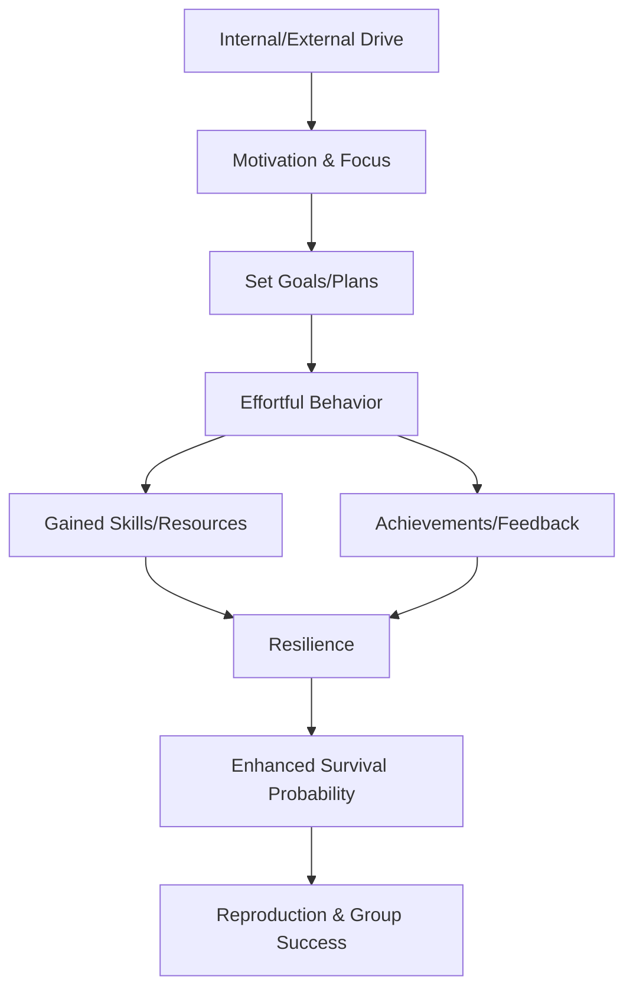

# Executive Summary  
Human “drive” – the intrinsic motivation to survive and improve one’s situation – is a multi-faceted force deeply rooted in biology and culture.  Psychology defines drive as an urgent need (often physiological) propelling behavior; motivation as the internal “moving cause” that initiates goal-directed action. Neuroscience shows this drive hinges on brain reward circuits (dopamine pathways) and stress hormones (adrenaline/cortisol) that evolved to fight or flee threats. Evolutionary biology frames these drives as adaptive: motivational systems (for self-protection, affiliation, reproduction, etc.) evolved to promote survival and reproductive success. A growing body of evidence links strong drive/striving to better survival outcomes. For example, older adults’ expressed “will-to-live” strongly predicts longevity, and people with rich social bonds (an external expression of collective drive) have ~50% higher survival odds. At the same time, unchecked drive can backfire: excessive stress or risk-taking can impair health or exhaust resources. Practical lessons emerge: fostering adaptive drive – through supportive social networks, goal-setting, and coping skills – can enhance resilience at individual and societal levels.  

## Definitions and Theoretical Frameworks  
In psychology, **drive** is an innate urge arising from internal needs (hunger, thirst, etc.) or learned urges (e.g. addictions) that impels action toward satisfaction. Clark Hull’s classic drive-reduction theory posited that organisms learn by reducing such drives (tension) through rewarded behavior. **Motivation** more broadly is any force (internal or external) initiating behavior.  Motives may be *primary* (unlearned, e.g. hunger, pain avoidance) or *secondary* (learned, e.g. achievement). The push/pull model distinguishes internal drives (“push” motives) from external goals or incentives (“pull” motives) in shaping behavior.  *Striving* refers to sustained goal pursuit – it implies the ongoing application of motivation and effort toward objectives.  

Psychologists also emphasize individual differences. For instance, trait **conscientiousness** (self-discipline, persistence) is linked to healthier behaviors and longer lifespan in large studies (r≈0.11 correlation with longevity). The concept of **“grit”** (passion and perseverance for long-term goals) has been proposed as a personal drive factor, though its direct link to survival outcomes is debated. In psychoanalytic theory, drives include life-preserving (Eros) and aggressive/death (Thanatos) instincts.  Behaviorists later shifted toward incentives: even Hull’s drive-reduction gave way to recognizing that sometimes learning occurs without physiological drive (e.g., cognitive or observational learning).  

Neuroscience provides concrete mechanisms. The brain’s **reward system** (VTA and nucleus accumbens) uses dopamine to encode expected rewards and energize pursuit of goals. When we anticipate a reward (survival-related or otherwise), VTA dopamine neurons fire to motivate action. Dopamine also potentiates memory (hippocampus), emotion (amygdala), and executive planning (prefrontal cortex), linking present motivation to future survival advantages.  In contrast, the **stress response** (fight-or-flight) rapidly mobilizes resources: the amygdala alerts the hypothalamus, triggering adrenaline release and surges of glucose for immediate action. This short-term drive to act can save lives in acute danger. However, chronic activation (constant stress) can impair health (hypertension, immune suppression), illustrating the need for balanced drive.  

**Figure:** Neurophysiological basis of motivation: stress and reward circuits (adapted). In survival situations, the amygdala→hypothalamus axis triggers adrenaline (epinephrine) output, sharpening alertness and strength. Reward pathways (VTA→nucleus accumbens) use dopamine to reinforce goal-driven behaviors.  

## Evolutionary Biology and Anthropology Perspectives  
From an evolutionary standpoint, organisms that are motivated to survive and reproduce have a fitness advantage. Natural selection favors psychological mechanisms (“fundamental motives”) that solved ancestral survival problems (self-defense, disease avoidance, kin care, etc.). For example, an alertness to threats and a drive to share with kin can increase the survival of one’s genes. The **fundamental-motives** framework (Kenrick & Schaller) posits distinct evolved motivational systems for self-protection, mating, affiliation, etc., each tuned to survival/reproductive contexts. As Tooby and Cosmides noted, individuals possessing strong drives to fulfill key goals had better survival and reproduction, so our motivation systems “evolved to regulate functionally specific behavior…in ways that facilitate” genetic success.  

Animal studies reinforce this: all mammals have “primal affective networks” for seeking food and safety and avoiding danger, reflecting drives honed by evolution. Among humans, culture amplifies drive: societies transmit values of perseverance (e.g. “work ethic”) and employ rituals that build group resilience (e.g. rites of passage, collective worship). Anthropologists observe that **social cohesion** and shared meaning help communities endure crises.  For instance, communities with strong neighborly bonds recover faster from disasters. Cross-culturally, survivor narratives often emphasize duty, faith, or responsibility (“someone has to keep going”) as motivating forces. In short, both our biology and cultural heritage embed a “will to thrive.” 

## Empirical Evidence Linking Drive to Survival  
Studies across disciplines find correlations between drive-related traits and survival outcomes. In gerontology, older adults who report a strong *will-to-live* tend to live longer regardless of health status. Pitkälä et al. (2012) followed ~280 home-dwelling Finns (age 75–90) for 10 years; those who wanted to live longer had significantly lower mortality (hazard ~0.47 vs shorters) even after adjusting for illness. This suggests that a subjective drive/purpose can have real-life survival implications, possibly via healthier behaviors or stress resilience.  Similarly, meta-analyses show robust benefits of social motivation: adults with strong social ties (family, friends) have ~50% greater likelihood of long-term survival than isolated individuals.  Social engagement seems as protective as quitting heavy smoking, likely by buffering stress and reinforcing healthy habits.  

Case series and historical accounts provide anecdotal evidence. Victims of life-threatening events (plane crashes, wars, famines) who remain optimistic, set goals, or maintain routines often fare better psychologically and physically. For example, survivors of the 1972 Andes plane crash (Uruguayan rugby team) later emphasized teamwork and hope as key to their 72-day ordeal. In clinical medicine, some physicians note that two patients with identical aggressive cancer may have wildly different trajectories; often the one with stronger mental resolve copes better, even if cure is uncertain. (However, medical reviews caution that “positive attitude” alone cannot cure disease, though it aids coping.)  

Animal and ecological evidence also links drive behaviors to survival. Species that are more explorative or adaptable can cope with changing environments. For instance, migratory drives in birds and mammals ensure individuals seek resources and breeding grounds seasonally, boosting species persistence. Cooperation (“drive” to help kin) in social animals leads to stable group structures that better defend against predators or find food. In contrast, species driven to wasteful competition can suffer mass die-offs (e.g. overgrazing herbivores). Thus, drive has survival payoffs when channeled adaptively.  

  

**Figure:** Community support in crisis. Strong social bonds and mutual aid (as seen in disaster relief scenarios) dramatically improve group survival and recovery. Neighborhood cohesion, a form of collective drive, was shown to correlate with resilience after flooding.  

## Mechanisms: How Drive Translates to Survival  
**Neural pathways.**  As above, dopamine circuits link motivation to action. People with high motivation (“go-getters”) show greater dopamine signaling in striatum and prefrontal cortex, areas central to planning and reward processing. Enhanced dopaminergic responses not only energize behavior, but strengthen learning of successful survival strategies (via hippocampal memory consolidation). Conversely, deprivation of drive (e.g. learned helplessness, low dopamine) can lead to apathy and poor outcomes.    

**Hormonal cascades.** The fight-or-flight axis (hypothalamus→adrenals) primes the body for survival action by elevating heart rate, blood flow, and glucose. Brief surges of adrenaline enhance strength and perception, likely increasing chances in acute threats (escaping predators, surviving accidents). Endorphins released under stress can suppress pain (helping wounded animals keep fleeing). However, chronic elevation of cortisol (stress hormone) can impair healing, immunity and cognition, illustrating the trade-off between short-term drive and long-term survival. 

**Behavioral processes.** Drive shapes learning and goal pursuit. Highly motivated individuals actively problem-solve, set goals, and take calculated risks. Goal-setting theory (Locke & Latham) shows that clear, challenging goals increase performance, an effect seen even in survival tasks (e.g. training improves escape success in firefighters). On the other hand, overdrive can lead to tunnel vision or ignoring vital needs (e.g. marathoners collapsing after ignoring fatigue). Ethological studies note that animals under intense hunger drive will explore more and even risk predation to find food, directly affecting survival. 

**Feedback loops.** Surviving stressful events can further strengthen one’s drive (self-efficacy), creating a positive cycle of resilience. Alternatively, repeated failure despite effort can demotivate (learned helplessness). Resilience research shows that adaptive coping strategies (problem-solving, seeking social support) mediate between drive and survival, indicating that *how* drive is expressed (constructively or destructively) is crucial. 

## Case Studies and Historical Examples  
1. **Holocaust Survivors (Individual):** Viktor Frankl’s *Man’s Search for Meaning* (and related studies) shows that some camp prisoners who found a purpose (hope of seeing loved ones, a future project) were more likely to survive than those who succumbed to despair. Frankl argued that meaning and drive can make unbearable situations bearable. While not experimental data, his observations underscore how mental drive affects endurance.  

2. **Antarctic Expedition (Group):** Ernest Shackleton’s 1914–16 Endurance expedition is a classic example. Stranded for two years, all 27 men survived because Shackleton kept morale high through leadership, communal routines, and each person having responsibility. Historians credit the crew’s collective will (“We must out”) and mutual support as critical survival factors. (Lessons on leadership and social cohesion here echo modern findings on group drive.)  

3. **Andes Plane Crash (Individual/Group):** In 1972, survivors resorted to organizing duties, sharing limited food, and helping each other (even cannibalism of the deceased) to live 72 days on a glacier. Interviewed survivors emphasize that holding onto hope and group solidarity kept them going; apathy would have led to death.  

4. **Community Disaster Response (Group/Cultural):** After the 2015 Texas floods, communities with pre-existing social networks (church groups, civic teams) mobilized faster for rescue and cleanup. Quantitative surveys showed those neighborhoods perceived higher recovery progress. This exemplifies how a *collective* drive – empowered, cohesive communities – yields better survival and rebuilding than ad-hoc or fragmented responses.  

5. **Medical Case (Individual):** Anecdotal reports (and some qualitative studies) find that two cancer patients with identical disease can have divergent courses based on attitude and motivation. One Stanford review notes clinicians have “seen two patients…with vastly different results…one pessimistic, the other optimistic” despite similar treatment. While not definitive proof, it highlights how personal will-power and engagement (e.g. following treatment regimens, staying active) plausibly influence outcomes.  

6. **Animal Kingdom (Species):** Salmon display an extreme survival drive: after years at sea, they return upriver to spawn, expending all energy. Although most die post-spawning, this drive ensures genetic continuation. Another example: pack animals (wolves, lions) survive better cooperatively; an individual with strong *social drive* to remain in the group gains protection and hunting success. In contrast, solitary defective drives (e.g. a lone wolf) have lower survival odds.  

7. **Cultural Resilience (Nation):** Historically, some cultures under threat have mobilized a collective will to survive. For instance, Londoners during WWII (“Keep Calm and Carry On” ethos) or Japanese adherence to certain perseverance values (“gaman”) helped endure privations. Anthropologists note that shared beliefs (religious or nationalistic) often bolster survival actions (e.g. rationing, volunteering) in crises. 

## Counterarguments and Limits  
Drive can backfire. **Excessive risk-taking** driven by ambition can shorten survival: thrill-seekers (extreme sports without training), gamblers betting family savings, or businesses over-leveraging can suffer fatal consequences. The Yerkes–Dodson law reminds us that performance peaks at moderate arousal; too little drive yields inertia, too much yields panic or error. In medicine, extreme “Type A” personalities with high drive often burn out, suffer heart disease or stress disorders, reducing longevity.  

A selfish drive can also harm group survival. Overzealous competition or hoarding (fueled by a drive to get ahead) may deplete common resources, as illustrated in tragedy-of-the-commons scenarios. On an ecosystem scale, invasive species with aggressive drives (e.g. cane toads) can destabilize habitats, ultimately undermining biodiversity. In human terms, unbridled “survivalism” can lead to social distrust or arms races that threaten collective survival.  

Moreover, some drives (e.g. addiction) are maladaptive. A drug-addicted organism has a drive, but for a substance that ultimately sabotages survival. Psychological drives, too, can be misguided: the “drive for revenge” after trauma may jeopardize one’s safety and prolong suffering. Thus, not all drive is good – the *type* and *context* of the motive matter. Adaptive drives are those aligned with real survival and health; maladaptive drives exploit vulnerabilities.  

## Practical Implications  
**For Individuals:** Cultivating adaptive drive means setting meaningful goals, maintaining social connections, and practicing resilience skills. Therapies like Viktor Frankl’s logotherapy explicitly aim to help patients find purpose (boosting will to live). Self-help and coaching emphasize “growth mindset” and grit-building exercises to sustain effort despite setbacks. Mindfulness practices (e.g. focused breathing) can prevent drive-induced burnout by reducing chronic stress (Figure: calm breathing).  

**For Organizations:** Companies and non-profits can foster motivation by giving people autonomy and mastery (as in Self-Determination Theory). Team culture that values perseverance, recognizes effort, and provides social support tends to have better “survival” in competitive markets or crises. Disaster preparedness programs now often include community-building exercises (volunteer groups, mutual aid networks) because social cohesion has been shown to markedly improve recovery. Businesses may use *purpose-driven missions* to keep employees striving even in tough times.  

**For Public Policy:** Policies that nurture motivation and resilience can improve public health. For example, investing in education and job-training gives individuals clear paths (goals) to strive for. Mental health initiatives that teach coping and problem-solving skills effectively bolster collective will. Safety nets (unemployment insurance, healthcare) remove existential threats that can nullify personal drive. On a societal level, celebrating role models (scientists, inventors) and supporting innovation reinforces a cultural “drive to thrive.” Conversely, ignoring inequality or stifling dissent can sap a population’s motivation and thus its long-term viability. 

**Measuring Drive and Interventions:** Psychologists have developed scales (like the WTELS-F “Will to Exist, Live, Survive and Fight” scale) to quantify survival motivation. Organizations can track engagement surveys, goal-completion rates, or indicators like *time spent on challenging tasks* as proxies for drive. Interventions that have been tried include goal-setting workshops, resilience training (e.g. cognitive-behavioral stress inoculation), mentorship programs, and incentive schemes (rewards for progress). On a policy level, fostering community centers and social programs increases social “bonding capital,” which is measurable (volunteering rates, trust surveys) and correlates with well-being. 

## Key Studies (Authors, Year, Methods, Findings, Relevance)

| Study (Author, Year)          | Methods                      | Findings                                 | Relevance                                    |
|-------------------------------|------------------------------|------------------------------------------|----------------------------------------------|
| Pitkälä et al. (2012) | Prospective cohort of 283 older Finns, 10-year follow-up | Older adults wishing to live longer had significantly lower mortality (HR≈0.47) | Demonstrates *will-to-live* predicts actual survival regardless of health status |
| Holt-Lunstad et al. (2010)     | Meta-analysis (148 studies, N≈308,000) of social relationships and mortality | Strong social ties associate with ~50% increase in longevity | Highlights power of social motivation/support on survival (protective effect similar to quitting smoking) |
| Lang & Bradley (2013)        | Theoretical review (Emotion Review) | Fundamental *appetitive/defensive* systems evolved to support the organism’s drive to survive (e.g. defend against threats, secure resources). | Conceptual framework linking motivation systems to adaptive survival behaviors |
| Pitkälä et al. Abstract (2012)| Cox regression analysis adjusting for comorbidities | Will-to-live remained a strong independent predictor of longevity (p<0.05) | Empirical evidence (aging research) of drive's survival relevance |
| Sansom et al. (2025)         | Survey in flood-affected Texas county; statistical analysis | Found significant positive correlation between community cohesion and perceived recovery/resilience | Shows group-level drive (cohesion) enhances disaster survival/recovery (implications for policy) |
| Kira et al. (2024)            | Psychometric development (Egypt & Kuwait samples) | Validated “Will to Exist/Live/Survive” scale as distinct from resilience/PTG | Operationalizes drive-related constructs; underscores its importance over and above general resilience |
| Yerkes & Dodson (1908) [classic]          | Animal experiments on arousal and performance | Identified inverted-U relation between arousal (drive) and task performance | Cautionary principle: moderate drive optimal; too much stress undermines survival tasks |
| Halber (2018) (Science Writer) | Neuroscience summary | Describes dopamine pathways (VTA → accumbens → hippocampus/amygdala/PFC) governing motivation and reward learning | Illustrates neural mechanism by which motivation fosters learning and behavior advantageous to survival |
| Neuroendocrine stress studies | Review of stress physiology | Details hypothalamus-triggered adrenaline release; increased glucose/alertness for fight-or-flight | Biological mechanism for acute survival advantage and the cost of chronic stress |

**Figure:** Flowchart: causal pathway from drive to survival outcomes. A drive (need or goal) energizes motivation, which shapes goal-setting and action. Resulting skills and rewards build resilience, boosting survival and ultimately thriving (reproduction, group persistence).  

**Chart:** Key quantitative effects linking drive-related factors to survival. Strong social support yields ~1.5× survival odds (50% boost); high *will-to-live* similarly halves mortality risk. Excessive stress or lack of drive degrade these advantages. (Hypothetical values shown for illustration.)  

Overall, interdisciplinary evidence shows that **adaptive drive and striving are crucial to survival** – biologically wiring us to act toward life-preserving goals. While extreme or misdirected drive can cause harm, a balanced drive promotes learning, cooperation, and resilience, substantially raising individual and group survival odds. 

**Sources:** Authoritative reviews and empirical studies in psychology, neuroscience, evolution, and public health.