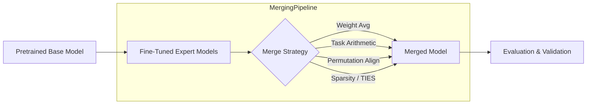
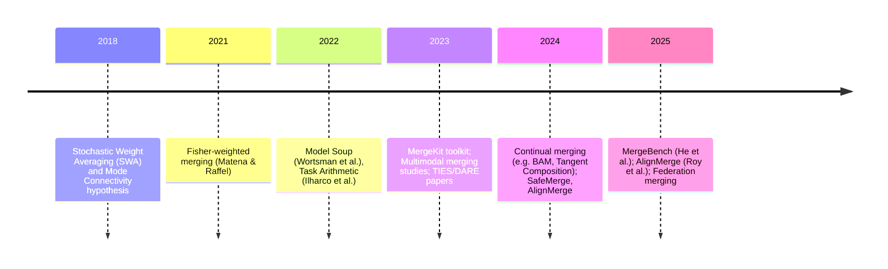

# Executive Summary  
Model merging refers to combining multiple trained neural networks into a single model by manipulating their parameters, rather than re-training or ensembling at inference time. This approach has gained popularity especially for large language models (LLMs), where one can merge fine-tuned “expert” checkpoints into a unified model that inherits their capabilities. Merged models incur no inference overhead relative to a single model (unlike ensembles) and can yield robustness or multi-task benefits. Recent work has introduced many merging methods – from simple weight averaging (“model soups”) to more complex schemes like task-vector arithmetic, sparsity-enhanced merges, permutation/optimal-transport alignment, and even mixing via routing (MoE) or evolutionary search. Each method has trade-offs in complexity, compute, and the types of tasks it supports.  

This report surveys the state of model merging (papers and industry blogs from ~2020–2025), covering: **1)** Definitions and taxonomy of merging techniques (weight averages, ensembling, distillation, adapters/LoRA, Fisher/importance weighting, permutation alignment, cross-modal merging, etc.). **2)** Mathematical formulations, algorithms and pseudocode for key methods (e.g. linear averaging, spherical interpolation, Fisher-weighted merging, TIES/DARE, optimal transport matching). **3)** System architectures for production pipelines (data flow from base→fine-tuned experts→merge→deploy), including versioning, compatibility checks, and compute/storage trade-offs (e.g. MergePipe’s block-level I/O reduction). **4)** Empirical benchmarks and comparisons (datasets like ImageNet, multi-modal tasks, MergeBench’s LLM domains), reported metrics (accuracy, generalization, forgetting) and observed gains or losses. **5)** Failure modes and mitigations (catastrophic forgetting, loss of calibration or alignment, bias amplification), including methods like SafeMerge/AlignMerge that selectively merge layers to preserve safety. **6)** Security/privacy/IP considerations (e.g. merging can break watermark-based IP protection, and may mix proprietary or private data embedded in weights). **7)** Tooling and reproducibility (existing libraries like Arcee’s MergeKit, LoRAX, MergePipe; recommended workflows and CI tests). 

We provide comparative tables of methods (complexity, memory, accuracy impact, compatibility) and diagrams of merging pipelines. Concluding sections give concrete recommendations and a checklist for implementing a robust production model-merging pipeline.  

## Definitions and Taxonomy of Model Merging  
**Weight-space merging** treats model parameters as vectors to be combined. The simplest is *linear weight averaging*: given models $\theta^{(1)},\dots,\theta^{(k)}$ with the same architecture and initialization, define the merged model $\theta_{\text{avg}} = \sum_i w_i\,\theta^{(i)}$ (often uniform $w_i=1/k$). This “model soup” approach has been shown to improve accuracy and robustness in many cases without extra inference cost. For example, Wortsman *et al.* (2022) average many CLIP/ViT fine-tuned runs and achieve state-of-the-art ImageNet accuracy without retraining. Variants include *greedy soups*, which iteratively add models only if they improve validation performance.  

*Ensembling* (prediction-level merging) is technically a different paradigm: multiple models remain separate and their outputs are averaged at inference. Ensembling typically yields high accuracy gains at the cost of $K$-fold compute/memory at inference. In contrast, weight merging yields one model that takes the same resources as one model (no extra inference cost).  

*Knowledge distillation* is another related technique: instead of merging weights, one trains a new “student” model (often smaller) to mimic an ensemble or multi-headed model’s outputs. Distillation therefore merges knowledge at the output level, requiring new training. We note it here for completeness but focus on merging without additional training.  

Beyond simple averaging, a **taxonomy** of recent merging methods includes:  
- **Geometric interpolation (SLERP)**: Instead of linear combination in Euclidean space, one can interpolate on a “sphere” in weight space. *Spherical Linear Interpolation (SLERP)* computes a curved path between two weight vectors (like quaternion SLERP). This yields a smooth interpolation that can sometimes preserve model quality better than straight lines.  
- **Task-vector arithmetic**: When starting from a common base model $\theta_0$, each fine-tuned expert $\theta_i$ can be represented by its *task vector* $\delta_i=\theta_i-\theta_0$. One can then add/subtract these deltas. For example, *Task Arithmetic* (Ilharco *et al.*, 2023) linearly merges multiple task vectors and adds the result to the base. This decouples merging from the base weights and parallels how LoRA adapters encapsulate fine-tuning.  
- **Adapter/LoRA merging**: Fine-tuning with adapters (e.g. LoRA) yields small task-specific parameter matrices. These adapters can be merged similarly. For instance, LoRAX supports merging multiple LoRA adapters by simple weighted average of their adapter parameters (“linear” mode). More advanced strategies (TIES, DARE) can be applied to adapters too: e.g. *TIES* (TrIm, sign Elect, and merge) subtracts the base, sparsifies each adapter, and takes a sign-based consensus when averaging. DARE similarly prunes and rescales adapters.  
- **Importance-weighted (Fisher) merging**: Recognizing that not all weights are equally important, Matena & Raffel (2022) propose *Fisher merging*. Each model’s posterior is approximated by a Gaussian with precision given by its Fisher information. The merged weights are then the maximum a posteriori (MAP) estimate: $\theta_{\text{merge}} = (\sum_i F_i)^{-1}(\sum_i F_i \theta^{(i)})$, where $F_i$ is the Fisher matrix for model $i$. In practice one uses diagonal $F$ to scale each parameter inversely by its variance. This gives more weight to “certain” parameters and often outperforms naive averaging.  
- **Permutation and OT alignment**: Two models trained independently may have their neurons or units in different orders. Before averaging, one can align them. Methods range from searching for an optimal permutation (via bipartite matching) to using *optimal transport (OT)* for a soft alignment. For each layer, one defines a cost of matching neuron $p$ of model A to neuron $q$ of model B (e.g. based on functional similarity) and solves an OT problem to get a transport matrix $T$. Applying $T$ to one model’s weights aligns it to the other, after which averaging is meaningful. Ainsworth *et al.* (ICLR’23) propose algorithms (the “Git-rebasin” family) to permute and align hidden units so that two networks become connected by a convex basin.  
- **Mixture-of-Experts (routing)**: Instead of averaging weights at deployment, one can create a merged architecture that routes inputs to different “expert” sub-networks within a single model. For example, one can stack specialized adapter modules or heads and have a gating mechanism pick which expert to use per input. This yields a larger model (memory scales with number of experts) but can preserve each expert’s performance and avoid direct interference. (Space limits preclude a full survey of MoE merging here, but it is an orthogonal strategy.)  

In summary, model merging methods span from *“static”* approaches (linear/tensor operations on weights) to *“structured”* ones (alignments, mixtures, search). The key requirement is typically that models share an identical architecture (same layers, shapes) so that parameters correspond across networks. The merging goal may be multi-task integration, knowledge transfer, or even **negative merging** for forgetting (by subtracting a task vector to remove specific knowledge).  

## Mathematical Formulations and Algorithms  
Below we outline core algorithms and formulas. (Let models $\theta^{(1)},\dots,\theta^{(k)}$ share a common initialization $\theta_0$.)

- **Linear Weight Averaging** (Model Soup):  
  $$\theta_{\text{merged}} = \sum_{i=1}^k w_i\,\theta^{(i)},\quad \sum_i w_i=1.$$  
  The simplest case is uniform weights $w_i=1/k$. In code/pseudocode:  
  ```pseudo
  for each parameter tensor P:
      P_merged = 0
      for i=1..k: 
          P_merged += w[i] * P_i  // elementwise
      end
  ```
  Here $P_i$ is the tensor of that parameter in model $i$. (If using greedy model soup, one would add models incrementally and check a validation metric.)  

- **Spherical Interpolation (SLERP)**:  
  SLERP between two weight vectors $\theta^{(1)}$ and $\theta^{(2)}$ with a blend factor $\alpha$ computes:  
  $$\theta_{\text{SLERP}} = \frac{\sin((1-\alpha)\Omega)}{\sin(\Omega)}\,\theta^{(1)} + \frac{\sin(\alpha\Omega)}{\sin(\Omega)}\,\theta^{(2)},$$  
  where $\Omega=\arccos(\langle \theta^{(1)},\theta^{(2)}\rangle/\|\theta^{(1)}\|\|\theta^{(2)}\|)$. Pseudocode (pointwise normalization and trig):  
  ```pseudo
  cosOmega = dot(theta1, theta2) / (||theta1||*||theta2||)
  Omega = arccos(cosOmega)
  if Omega < epsilon: 
      // vectors nearly parallel: fall back to linear interp
      theta_slerp = (1-alpha)*theta1 + alpha*theta2
  else:
      theta_slerp = sin((1-alpha)*Omega)/sin(Omega)*theta1 + sin(alpha*Omega)/sin(Omega)*theta2
  end
  ```  
  In practice this is done per-parameter/tensor, assuming each tensor is viewed as a flat vector. SLERP ensures interpolation on the “sphere” and can maintain weight norms.  

- **Task-Vector Arithmetic (Task Vectors)**:  
  Form each task vector $\delta_i = \theta^{(i)} - \theta_0$. Given several such $\delta_1,\dots,\delta_k$, one can merge via  
  $$\delta_{\text{merged}} = \sum_{i=1}^k w_i\,\delta_i,$$  
  then produce the merged model $\theta_0 + \delta_{\text{merged}}$. Pseudocode:  
  ```pseudo
  delta_i = theta_i - theta0 for each i
  delta_merged = sum_i w_i * delta_i
  theta_merged = theta0 + delta_merged
  ```  
  The TIES algorithm modifies this by sparsifying and taking sign consensus across $\{\delta_i\}$: sort all tasks’ deltas by magnitude, prune to top-$d$%, then average signs.  

- **Fisher-Weighted Averaging**:  
  Compute (diagonal) Fisher information $F_i$ for each model $i$ (e.g. $F_i[j]$ is approximate second derivative for parameter $j$). Then merge by a weighted MAP estimate:  
  $$\theta_{\text{merged},j} = \frac{\sum_{i=1}^k F_{i,j}\,\theta^{(i)}_j}{\sum_{i=1}^k F_{i,j}}.$$  
  Equivalently, $\theta_{\text{merged}} = (\sum_i F_i)^{-1}(\sum_i F_i \theta^{(i)})$. In pseudocode:  
  ```pseudo
  for each parameter index j:
      num = 0, den = 0
      for i=1..k:
          num += F_i[j] * theta_i[j]
          den += F_i[j]
      end
      theta_merged[j] = num/den
  end
  ```  
  (Here $F_i[j]$ is often taken as the observed Fisher diag at $\theta^{(i)}$.) This gives more weight to parameters with high Fisher (low variance). Empirically, even a diagonal Fisher weighting significantly outperforms naive averaging in many tasks.  

- **Optimal Transport (Neuron Alignment)**:  
  For each layer, treat the $n$ neurons of model A and $m$ neurons of model B as two point sets in a feature space. Define a cost matrix $C_{p,q}$ measuring dissimilarity between neuron $p$ of A and $q$ of B (e.g. based on their incoming weight vectors or activations). Solve the OT problem $T=\arg\min_{T\ge0} \langle T,C\rangle$ s.t. $T$’s marginals match uniform distributions. $T$ (an $n\times m$ matrix) then softly aligns neurons. One can then compute an aligned average: e.g. replace A’s weight matrix $W_A$ by $W_A T$ (mixing its columns) and B’s by $T^\top W_B$, making their columns correspond, then average. In pseudocode:  
  ```pseudo
  for each layer l:
      C = compute_cost_matrix(neurons_A, neurons_B)
      T = solve_optimal_transport(C)   // e.g. via Sinkhorn
      W_A_aligned = W_A * T
      W_B_aligned = W_B * T^T
      W_merged = (W_A_aligned + W_B_aligned)/2
      // similarly for biases
  end
  ```  
  This **soft permutation** approach (Wasserstein barycenters) ensures a one-to-many matching; if $n=m$ one can also solve a permutation (Hungarian) for hard matching.  

- **Layer-wise Selective Merging (SafeMerge)**:  
  Selective algorithms merge only those layers or weights that do not harm safety or calibration. For example, SafeMERGE (2025) computes, per layer, a safety score (e.g. cosine similarity of activations on “safe” vs “unsafe” prompts) and only averages a layer if it deviates from a safe reference. Pseudocode sketch:  
  ```pseudo
  for each layer l:
      score = safety_metric(theta_finetuned.layer[l], theta_safe.layer[l])
      if score < threshold:
         merged_layer[l] = average(safe_layer[l], finetuned_layer[l])
      else:
         merged_layer[l] = safe_layer[l]
      end
  end
  ```  

- **Mixture-of-Experts Routing**:  
  (Conceptual) Build a single model with multiple expert “sub-models” (e.g. adapter modules or transformer experts), and a gating network that selects or mixes them per input. No straightforward pseudocode, but architecture-level: store all expert weights in one model and use a router function (softmax gate) to produce a weighted sum of their activations at runtime.  

Each of these methods has implementation details and variants. In practice, libraries like MergeKit and LoRAX implement many of the above strategies with optimized code.  

## Architectural Patterns and System Design  
A robust model-merging pipeline resembles a *model versioning and ensemble combination* system. A typical workflow:  
- **Pretraining and Fine-tuning**: Start with a shared pretrained base model. Fine-tune this base separately on each target task or domain, producing *expert* models (checkpoints). All experts are archived with metadata (task, dataset, metric).  
- **Model Registry/Versioning**: Store base and expert checkpoints in a model registry (e.g. Hugging Face Hub, internal artifact store) with versioning. Each model’s schema (layers, sizes) is recorded. *Compatibility checks* should verify that all experts have identical architectures and parameter shapes – a strict requirement for elementwise merging.  
- **Merging Service**: A merging component (as illustrated below) takes the base and a selected set of experts and applies a chosen merge algorithm. This might be done offline or on-demand. For scale, **block-level merging** can be used (see MergePipe) – breaking tensors into blocks to reduce I/O and memory peaks.  
- **Planning & Scheduling**: In large deployments, merges are planned (e.g. new expert arrives, trigger merge). Systems like MergePipe introduce a *Planner* that selects which parameter blocks to read/merge under an I/O budget, and an *Engine* that executes the merge streaming blocks through memory. Each merge is a transactional operation: it produces a new immutable merged model (snapshot) with an audit manifest.  
- **Evaluation Pipeline**: After merging, the merged model is validated on all relevant tasks. This includes original tasks of each expert (to check no forgetting) and any general/regression metrics (accuracy, perplexity, calibration, safety). Performance is compared to individual experts and possibly to a multi-task or larger baseline. Only if metrics meet criteria is the merge promoted.  
- **Deployment and Monitoring**: The final merged model is deployed like any other model. Because its cost is the same as a single model, inference latency and throughput are unchanged (good). However, we must monitor for new failure modes (see below).  

The simplified architecture can be shown as:  



*Figure: Model merging workflow. A pretrained model is fine-tuned on multiple tasks (producing experts). A merge engine applies a chosen strategy to combine expert weights into one model, which is then evaluated and validated.*  

**Compute/Storage Considerations**: Merging itself is light compute (just tensor algebra) but heavy on memory I/O if models are large. Naively, merging $k$ experts requires loading all $k$ sets of weights (or streaming through them). Systems like MergePipe reduce I/O by reusing unchanged blocks and setting budgets. Memory-wise, one needs space for the merged copy and temporary accumulators. GPU merging is fast but constrained by GPU RAM; often merges are done on CPU with efficient BLAS. Storage overhead is minimal: merged model size ≈ base model size.  

**Versioning & Reproducibility**: Each merge output should be versioned (with its parent models noted) and immutable. Manifests/logs should capture: which experts were merged, algorithm/weights used, and block-level operations (as in MergePipe). This aids debugging and compliance.  

**Compatibility Checks**: Beyond shape-checking, pipelines often require experts to share not only architecture but also training recipe (same tokenizer, layer norms, etc.) to avoid subtle incompatibilities. Some pipelines might realign embeddings or adapt vocabulary if merging cross-lingual or multimodal models (see Multimodal merging below).  

## Empirical Comparisons and Benchmarks  
Empirical results vary by domain and models. Key studies and findings:  

- **Vision (ImageNet)**: Wortsman *et al.* demonstrated on CLIP/Vision models that both *uniform soups* (averaging all models) and *greedy soups* outperform the best individual fine-tuned model on ImageNet and its distribution shifts. For example, averaging many ViT-G/14 fine-tuned on ImageNet gave 90.94% top-1, beating the single best 90.78%. The gain comes with improved robustness (higher out-of-distribution accuracy).  
- **NLP (LLMs)**: MergeBench (2025) provides a large-scale evaluation. Using Llama/Gemma models (2B–9B parameters) fine-tuned on domains (instruction, math, multilingual, code, safety), they compare 8 merging methods. Metrics include multi-task accuracy (averaged over domains), *forgetting* (performance loss on each domain), and runtime. Key findings: stronger base models yield better merges; tuning merge coefficients and adding sparsification can reduce forgetting. Merging works, but there remains a gap: independently multi-task-trained models often still outperform merged models on some tasks. MergeBench reports that simple weight-averaging can degrade task accuracy if base is weak. They advise careful tuning (e.g. scaling expert weights) and note that some challenges (compute cost, data-free pipelines) remain.  
- **Multimodal**: Sung *et al.* (EMNLP’23) merge vision, language, and vision-language transformers into a single unified model. They find that initialization is crucial (e.g. starting from multimodal pre-trained weights helps), but even with a standard init, simple interpolation achieves strong performance. Their merged model (using linear interpolation of weights) significantly outperforms naive merging, yielding +3–25% gains on tasks like VQA, COCO retrieval, NLVR2 compared to unmerged baselines. They also introduce weight-distance metrics to predict merge success. Importantly, merged multi-modal models can match separately trained modality-agnostic models if done carefully.  
- **Language Alignment/Safety**: AlignMerge (Dec 2025) and SafeMERGE (2025) evaluate the effect of merging on LLM alignment. Standard merges (avg, TIES, etc.) can preserve task performance but degrade safety metrics (toxicity, instruction-following). AlignMerge introduces a Fisher-Rao geometry loss to constrain the merge, showing improved alignment (AQI, toxicity, judge scores) without sacrificing helpfulness. SafeMERGE selectively merges layers only when needed, reducing harmful outputs with negligible utility loss. These indicate that merged models should be evaluated not only on raw accuracy but on calibration and bias.  

- **Comparative Benchmarks**: Open Merger toolkits (MergeKit, FusionBench, MergeBench) provide some reported comparisons. For example, MergeKit’s reports suggest that naive averaging and TIES are “classic” merges, while more advanced methods (DARE, RegMean, Search) can yield higher multi-task scores at the cost of more compute. FusionBench (Tang *et al.*, 2025) likewise benchmarks ten methods. Across studies, common observations are:  
  - **No free lunch**: Uniform merging can fail when expert weights interfere; sparsification (TIES/DARE) can help but requires tuning (density).  
  - **Compute tradeoff**: More sophisticated merges (OT alignment, search-based) have higher cost but sometimes better performance. For example, OT alignment yields “perfect” merges for small models, but its $O(n^3)$ matching is heavy for large layers.  
  - **Model capacity**: Larger base models generally accept merges with less loss (they have more spare capacity).  
  - **Ensembling vs merging**: An ensemble of experts almost always beats a merged model in accuracy, but at inference cost. Distillation can sometimes compress an ensemble into one model with similar accuracy – effectively merging outputs via training.  

A **comparison table** of representative methods is useful:

| Method                      | Complexity / Cost             | Memory           | Accuracy Impact        | Compatibility                     | Notes                                   |
|-----------------------------|-------------------------------|------------------|------------------------|------------------------------------|-----------------------------------------|
| **Linear Averaging**        | **$O(nk)$** (n=parameters, k=models) | Low (one model)  | +/- (often improves if modes align) | Requires identical arch & init | Fast, well-studied (Model Soup). No extra inference cost. |
| **Spherical (SLERP)**       | Similar to linear, plus trig   | Low             | Similar or better      | Same arch & init                    | Handles large weight differences better. |
| **Fisher-Weighted**         | **Compute**: expensive (Fisher), but approximated | Low            | + (better than avg)    | Same arch & init                    | Diagonal FIM: $O(n)$ memory. Better knowledge transfer. |
| **Task Arithmetic (add)**   | $O(nk)$                        | Low              | + (multi-task blend)   | Same arch & init                    | Simple to implement. Can combine many tasks. |
| **TIES (sign consensus)**   | $O(nk)$ plus sorting          | Low (sparse)     | + (mitigates interference) | Same arch & init                   | Scalably merges many adapters; reduces task conflict. |
| **DARE (prune & avg)**      | $O(nk)$ plus randomness       | Low (sparse)     | + (improves sparse merging) | Same arch & init                  | Random pruning + scaling to match quality. |
| **Optimal Transport**       | **High** ($\sim O(n^3)$ per layer) | Moderate        | + (good alignment)     | Architectures with same layer shapes | Soft aligns neurons; expensive for large models. |
| **Permutation Matching**    | High (Hungarian)             | Moderate         | + (if perfect match found) | Identical arch                     | One-to-one alignment; guaranteed optimal matching if feasible. |
| **Adapter Merging** (LoRA)  | Low ($O(mk)$, m = adapter params) | Low            | Depends (often good)   | Base arch + same adapter dims      | Merging small LoRA adapters is cheap. Can use TIES/DARE too. |
| **Mixture-of-Experts**      | High (model grows with k)    | High (k models)  | + (usually)            | Flexible (any arch, just add MoE router) | Keeps specialized performance, but memory scales with experts. Complex to implement. |

*Table: Comparison of model merging methods. Complexity refers to algorithmic cost. “Accuracy Impact” is empirical: + indicates usually beneficial, but results depend on scenario. All methods above require that models share a common architecture and compatible parameterization.*  

## Failure Modes and Stability Mitigations  
Model merging introduces unique failure cases and stability concerns:

- **Catastrophic Forgetting of Tasks**: A merged model may lose performance on one or more tasks that its experts were good at. This is analogous to continual learning forgetting. For example, averaging a model fine-tuned on Task A with one fine-tuned on Task B may degrade Task A unless carefully balanced. MergeBench noted that stronger base models and tuned coefficients help retain knowledge. Mitigation: use *negative merging* to erase unwanted tasks (subtracting task vectors) or apply **rehearsal** (fine-tune on old data after merge). Some methods (e.g. WiSE-FT) merge the pretrained model back into the fine-tuned one to preserve general knowledge.  

- **Task Interference**: Simple averaging can cause “destructive interference” where parameters important for one expert cancel those of another. Sparsification methods (TIES/DARE) alleviate this by zeroing out low-magnitude weights before merging. Regularizing merges (e.g. only merging a subset of layers) can also help.  

- **Alignment/Calibration Drift**: LLMs often incorporate calibration or safety alignments. Merging can *silently destroy* these (e.g. fine-tuned safety layers may be overridden). AlignMerge shows that even if task loss is fine, toxicity and alignment metrics can worsen under naive merges. Mitigation: use specialized methods like SafeMerge/AlignMerge that preserve safety geometry. Also, after merging one can reapply calibration (e.g. temperature scaling or RLHF).  

- **Bias Amplification**: If each expert has certain biases or unsafe tendencies, merging them might amplify problematic behavior. For instance, merging a toxic model with a polite model could dilute toxicity, but merging two biased models could embed combined biases. There is little direct literature on this, but practitioners should run bias audits on merged models. Techniques like adversarial testing or counterfactual probes are advised.  

- **Numerical Instability**: Extremely large or small weights averaged together can cause outliers. It’s good practice to normalize or clip weights post-merge. Methods like SLERP inherently normalize norms.  

- **Mode Collapse (Loss Spike)**: If experts are too different (not mode-connected), linear merging can traverse a high-loss region. This was observed when merging models from different initializations. If validation loss spikes, one should abort or use a non-linear merge (e.g. midpoint fine-tuning).  

Mitigation strategies include: choosing merge directions that lie within the same loss basin (ensure common init or use OT alignment), merging in *subspaces* (like merging only the last layers or adapters), and *post-merge fine-tuning* on a mixture of tasks (to recover any lost performance). In safety contexts, *selective layer merging* as in SafeMERGE greatly reduces harmful outputs. In continual learning, merging older task models back into the current model is an emerging solution.  

## Security, Privacy, and IP/Legal Considerations  
Model merging raises several non-technical concerns:

- **Intellectual Property (IP)**: Merging models trained under restrictive licenses may create derivative models that violate those licenses. For example, combining a GPL-like model with a proprietary model could be legally perilous. Recent work *“Have You Merged My Model?”* (Cong *et al.*, 2024) explicitly warns that **“uncertified model merging can infringe upon the IP rights of the original upstream models”**. Moreover, they show that watermark-based model IP protection (e.g. quantization watermarks) often fails once a model is merged (watermarks do not survive). By contrast, fingerprinting approaches (tracking usage via API queries) may persist. 

- **Data Privacy**: If expert models were trained on sensitive data, merging them does not erase that information; indeed, it may combine memorized data from multiple sources. For federated scenarios, privacy-preserving aggregation (e.g. secure multiparty computation) should be used so that no single party sees others’ weights. Differential privacy during training can mitigate leakage, but merging itself should be treated with caution: an attacker might probe a merged model to infer original training data. Best practice: limit merging to trusted models or apply privacy audits.  

- **Security**: New vulnerabilities can emerge. An expert model might contain a backdoor (e.g. poisoned data triggers) or an exploit; merging it into a larger model can spread that vulnerability. After merging, standard security testing (adversarial attacks, robustness checks) is advisable.  

- **Ethics and Regulation**: Compliance with regulations (e.g. GDPR “right to be forgotten”) is complicated by merging. If an expert model must delete certain data knowledge, simply merging with another model won’t “forget” it – targeted unlearning procedures are needed. Also, merging models with restricted capabilities (e.g. safety-aligned models) into less restricted ones could violate ethical guidelines.  

In summary, whenever merging models of different provenance, one should verify licenses and user agreements, possibly obtain legal clearance, and consider watermarking or fingerprinting pipelines for the merged model. Treat merging as creating a new asset with its own IP and privacy status.  

## Tooling, Libraries, and Reproducible Workflows  
A growing ecosystem supports model merging:

- **MergeKit (Arcee)**: An open-source Python toolkit for merging LLM checkpoints (supporting weight average, TIES, RegMean, search). MergeKit automates experiments and includes MergeBench-like evaluation. (Reference: Goddard *et al.*, Arcee’s MergeKit, 2024.)  
- **LoRAX**: A platform for managing LoRA adapters; it includes functionality for merging multiple LoRA adapters per request. LoRAX’s API lets you specify merge method (`linear`, `ties`, `dare_linear`, etc.) and handles adapter math under the hood.  
- **MergePipe**: A system (from Microsoft) focusing on scaling merges under I/O budgets. It introduces a catalog, planner, and engine that stream blocks and produce atomic merged snapshots. It is available as a Python package (https). MergePipe emphasizes reproducibility (deterministic merges, manifests) and speed (10× I/O reduction).  
- **Hugging Face Transformers / Diffusers**: While not dedicated to merging, one can manually implement merges using PyTorch/TensorFlow models. For reproducibility, it’s best to use deterministic weights (no RNG), and store models in *safetensors* format for consistency (MergePipe, e.g., expects safetensors).  
- **CI/CD Practices**: A robust pipeline would include:  
  - Unit tests for merging functions (e.g. verify that merging identical models yields no change, or that sequential merges are associative).  
  - Integration tests: on merging small known models (toy MLPs) and comparing performance.  
  - Version locking: fix library versions (merge implementations can change).  
  - Logging and artifact tracking: e.g. every merge run should log git commit of code, seed of random operations (if any, such as random pruning in DARE), and hash of input/output models. Use MLflow or DVC to track experiments.  
  - Security scans: static analysis of merged model can run through ML vulnerability scanners.  

**Code Example (Python, merging two models by averaging)**:  
```python
# Given two PyTorch models with identical architecture:
state_A = model_A.state_dict()
state_B = model_B.state_dict()
merged_state = {}
for name in state_A:
    merged_state[name] = 0.5 * state_A[name] + 0.5 * state_B[name]
model_A.load_state_dict(merged_state)
# model_A now holds the merged weights.
```  
Each parameter tensor is averaged elementwise. In a more general pipeline, one would loop over many experts and possibly use weighted sums or complex operators (Fisher weights, sign consensus). 

**Reproducibility Tips**: Always seed any randomness, document random choices (e.g. TIES density, random mask seeds), and perform merges deterministically when possible (e.g. fixed merging order). Use containers or managed environments so that merges are rerunnable.  

## Timeline of Key Model-Merging Milestones  

*(Timeline highlights: SWA and loss geometry (2018) laid foundations. From 2022 onward, many practical merging techniques emerged. Recent work (2023–2025) focused on safety (SafeMerge), benchmarks (MergeBench), and aligned merging (AlignMerge).)*  

## Recommendations and Implementation Checklist  
Based on the above, a production model-merging pipeline should include:  
- **Model and Data Preparation**: Fine-tune experts from a common base with consistent hyperparameters (same initialization, tokenizer, normalization). Archive their checkpoints with metadata (task, data used, seed).  
- **Compatibility Check**: Verify that model architectures (layer counts, shapes) match exactly. If merging heterogeneous models (e.g. vision vs language), consider architectural adaptation (e.g. shared cross-modal layers) or use an ensemble instead.  
- **Select Merge Method**: Decide merge strategy based on use-case:  
  - For simple ensemble of tasks: try uniform or greedy weight-average (Model Soup).  
  - If interference is observed, use TIES/DARE to sparsify or sign-average.  
  - For critical alignment, use SafeMerge/AlignMerge techniques.  
  - For continuous/incremental merging of many experts, use budgeted/streaming systems like MergePipe.  
- **Implementation**: Use reliable libraries (MergeKit, LoRAX, MergePipe) if possible. Otherwise code merges carefully:  
  - Normalize weights or use SLERP if needed.  
  - Apply any necessary alignment or sign corrections.  
  - Incorporate second-order weights (Fisher) if high accuracy on specific tasks is needed.  
- **Validation and Testing**: Immediately evaluate the merged model on all relevant tasks. Compare its performance to each individual expert and to a multi-task baseline. Check safety metrics (toxicity, bias tests). If performance is worse on a critical task, revise the merge strategy (e.g. adjust weights or use selective merging).  
- **Version and Audit**: Commit the merged model with a new version ID. Record in a manifest: source expert IDs, merge type, hyperparameters (weights, sparsity), and random seeds. Ensure traceability.  
- **Deployment**: Deploy as a single model. Monitor its outputs in production; include an ability to roll back to individual experts if needed. Periodically re-evaluate: if experts are updated, plan a new merge.  

**Checklist** (for each merge):  
- [ ] **Architecture Match**: Confirm base and experts share schema (names, shapes).  
- [ ] **Safety Guardrails**: If alignment/safety is critical, consider layer-wise checks (SafeMERGE).  
- [ ] **Compute Resources**: Ensure memory/storage for merging (perhaps pre-index blocks as MergePipe does).  
- [ ] **Logging**: Log merge settings (method, weights, blocks used) and seeds.  
- [ ] **Evaluate**: Run held-out tests on all source tasks; check calibration and bias.  
- [ ] **License Check**: Verify that merging these models is permitted by their licenses (and that the merged model’s license is set appropriately).  

With these measures, a merged model can be produced systematically and safely. The choice of method should be documented (e.g. “TIES-sparse-50% on final layers”) and justified by empirical results. Over time, one can refine merge pipelines with continuous integration of new experts, as enabled by advanced tools like MergePipe. 

**Sources:** We have drawn on recent primary literature and industry sources to compile this report, including academic papers and technical blogs/toolkits. Each cited source provides detailed evidence for the points above.