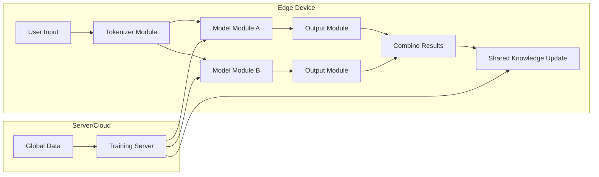

# Executive Summary  
The 4Fs framework—**Fast, Flexible, Frugal, Federated**—describes next-generation AI systems built from many tiny, modular models rather than one monolith.  These systems achieve **low latency** (Fast) and **adaptability** (Flexible) by chaining or ensemble-connecting small specialist models (“beads”) that can be composed or swapped at runtime.  They are **frugal** in compute and power usage (suitable for edge/IoT) through model compression, sparsity or specialized hardware, addressing sustainability.  They are often **federated** (distributed across devices or organizations) to leverage local data while preserving privacy.  We survey recent work on modular model architectures (e.g. *Configurable Foundation Models*), federated learning with heterogeneous clients (FedFA, HeteroFL), and on-device small-model agents. We examine design goals (latency vs. accuracy vs. resource trade-offs), orchestration strategies (e.g. Edge–Cloud pipelines, FL algorithms), and deployment patterns (edge vs. cloud vs. hybrid). A comparison table summarizes representative systems (papers/projects) by approach, size, speed, accuracy and use case. We recommend evaluation metrics (latency, throughput, energy per inference, accuracy, DP-privacy budgets, etc.) and benchmarks (e.g. MLPerf-Edge) to validate 4Fs systems. A practical roadmap lists key components (model libraries, serving frameworks, FL toolkits, container orchestration, security modules). Finally, we highlight open problems: standardizing modular interfaces/protocols, reliable model composition and evaluation, security in heterogeneous settings, and hardware-software co-design for tiny models.

## 4Fs: Fast, Flexible, Frugal, Federated – Definitions and Taxonomy  
- **Fast (Low-Latency Inference):** Systems must respond in real time or near-real-time.  Fast AI prioritizes minimizing inference latency and maximizing throughput.  Techniques include model compression, quantization, caching, and light-weight runtimes.  For example, Google’s on-device inference runtime LiteRT-LM achieves ~2,000 tokens/sec prefill on a Pixel phone for a 270M-param model. Fast systems often trade off some accuracy for speed.  
- **Flexible (Modular & Adaptable):** Systems can be reconfigured or extended on-the-fly.  Flexibility means supporting heterogeneous model architectures, dynamic composition of components, and easy re-training or replacement of parts.  In practice this implies plug-and-play “modules” or “bricks” that encapsulate capabilities.  For instance, *Configurable Foundation Models* organize an LLM into functional “bricks” (sub-models) that can be retrieved, merged, updated or grown dynamically.  Flexible FL methods (FedFA) allow clients to use different sub-model widths/depths tailored to their resources.  Adaptable APIs (e.g. plugin frameworks) let developers swap modules (tokenizers, adapters, small specialist models) without downtime.  
- **Frugal (Resource-Efficient/Sustainable):** Systems use minimal compute, memory, and energy.  Frugality covers small model size (TinyML), low-power hardware, and efficient data usage.  It emphasizes sustainability: reducing carbon footprint and making AI affordable on constrained devices.  Examples include TinyML networks with aggressive pruning/quantization and edge-optimized accelerators.  Frugality can also mean algorithmic efficiency (Green AI): as Arga et al. note, **efficiency metrics should be reported alongside accuracy**.  In design, frugality implies choosing just enough model capacity for the task, minimizing data movement, and reusing intermediate outputs.  
- **Federated (Distributed/Privacy-Preserving):** Learning or inference is spread across many nodes (e.g. mobile devices, IoT sensors, organizations) that keep data local.  Federated systems coordinate updates or aggregate models without centralizing raw data.  Federated AI addresses privacy and bandwidth limits: clients (phones, sensors) train small local models and only share gradients or distilled updates (Flower’s FL framework highlights that *only model updates* are sent, preserving privacy and reducing bandwidth).  Federated strategies range from classical FedAvg to flexible variants (FedFA) that handle client heterogeneity.  Taxonomy includes **cross-device FL** (many edge devices), **cross-silo FL** (fewer but powerful clients), and **hybrid federations** (multi-tier/cloud-Edge) depending on scale and trust.  

## Code Beading / Model Breeding (Modular Tiny Models)  
**Concept:** “Code beading” and “model breeding” refer to constructing AI functionality from many small, replaceable model components.  Imagine each small model as a “bead” – a lightweight neural network that performs a specific sub-task or skill. These beads can be strung together in sequences (pipelines) or ensembles, and even spawn new variants (breeding) via fine-tuning or evolutionary search. This contrasts with a monolithic “one big model” approach.  

- **Architectural Patterns:** Common patterns include **pipeline chaining**, **mixture-of-experts (MoE)**, and **adapter-based composition**.  For example, Google’s on-device AI demonstrated chaining two specialized tiny models (speech recognizer + text-polisher, each a few hundred M parameters) in series to achieve cloud-level transcription accuracy.  In MoE systems (e.g. Switch Transformer), each input is routed through a subset of “expert” subnetworks, exploiting sparsity. Configurable LLMs treat sub-networks as reusable “bricks” that can be retrieved or merged. Another pattern is **LoRA/adapters** in Transformers: small trainable adapters breed new capabilities when inserted into a large frozen model.  

- **APIs and Runtime:** An interchangeable-component system exposes modular APIs. For instance, Hugging Face’s MAX library separates *Module* (model definition/weights) from *Pipeline* (inference orchestration). The pipeline handles tokenization, batching, caching, etc., while modules register their architecture and weights. This decoupling allows swapping modules transparently. Other examples: TensorFlow Hub and ONNX give reusable model components; microservices architectures (gRPC/HTTP endpoints per model) let services call different small models. Runtime patterns include **dynamic dispatch** (choose modules at runtime via routing logic) and **model docking** (loading/unloading models on demand).  

- **Mutable Tiny Models:** These systems support *online evolution*. E.g., federated distillation or co-training can produce new small models on the fly (model breeding). Techniques like **Neural Architecture Search (NAS)** can generate client-specific sub-models based on data (as in FedFA where ZiCo NAS tailors architectures for each client). Also, generating synthetic data with a large model and fine-tuning a small local model (as done with Function Gemma) is a form of model breeding. The key is interchangeability: any small model can be updated, replaced, or composed without rewriting the whole system.  


*Figure: Example modular pipeline on an edge device. A tokenizer routes input to multiple small model modules in parallel; their outputs are combined. On-device modules can be updated from a server asynchronously.*  

## Key Design Goals, Constraints, Trade-offs  
Building a 4Fs system involves balancing conflicting objectives:

- **Latency vs. Accuracy:** Smaller models run faster, but may sacrifice generalization. Ensembling many tiny models can recover accuracy at the cost of extra orchestration overhead. Techniques like cascade classifiers or early-exit models (Fast and Flexible AI) allow quick answers for easy cases, deeper models only when needed. Designer must decide acceptable accuracy drop for given speedup (e.g., Function Gemma accepted 46%→90% accuracy boost via fine-tuning while remaining fast).
  
- **Resource Use vs. Capability:** Frugality demands minimal memory and energy. This favors model compression (pruning, quantization) and hardware accelerators. But extremely frugal models may lack capacity; modular design mitigates this by loading only relevant modules per request. For example, *Configurable Models* only activate needed bricks for a task, saving compute. The trade-off is added complexity in the system (module management).  

- **Privacy vs. Utility:** Federated architectures preserve data privacy but incur communication overhead and potential accuracy loss due to non-IID data. Techniques like secure aggregation and differential privacy can mitigate privacy risks, but add noise/latency. For instance, FedFA shows robustness to heterogeneity (and some backdoor attacks) by careful aggregation. Designers must trade off privacy guarantees (e.g. DP epsilon) against model performance and training speed.  

- **Modularity Overhead:** Breaking models into interchangeable parts adds metadata and invocation costs. There’s runtime overhead to route inputs and merge outputs. Excessively fine-grained modularity can slow down inference (tail effects). A balance is needed on granularity of modules (e.g. layer-level vs whole sub-model).  

- **Security/Trust vs. Openness:** Using many small components (potentially from different vendors) raises governance issues. One must ensure modules are authenticated, compatible, and free of backdoors. Open-source libraries ease composition (e.g. ONNX standard), but verifying each module’s security is a challenge.  

## Orchestration and Federation Strategies  
4Fs systems require sophisticated orchestration to schedule models and data across devices:

- **Centralized vs. Hierarchical:** Classic federated learning uses a central aggregator (FedAvg). Scaled-up federations may use *hierarchical* aggregation (edge-server-cloud tiers) to reduce communication. For example, in IoT, edge gateways might aggregate nearby devices before sending to the cloud.  

- **Client Selection:** Selecting which devices/models participate in each round (based on connectivity, battery, etc.) is crucial. Frameworks like Flower support pluggable selection policies. Strategies include synchronous rounds (wait for all) or asynchronous updates (partial overlap).  

- **Model Update Protocols:**  Advanced FL like FedFA use *layer grafting* – aligning local sub-models to a global template during aggregation. Other methods (HeteroFL) simply embed small models into a larger global model using pruning structures. Split learning is another strategy: models are split across client and server, but this is orthogonal.  

- **Data and Knowledge Exchange:** Aside from parameter averaging, some systems use **distillation** or **knowledge graph syncing**. For example, distilled gradients or shared representations (semantic embeddings) can align models with less data movement.  

- **Orchestration Frameworks:** Tools like Kubeflow, KubeEdge or Ray Serve can run small models as microservices across a cluster. Flower, FedML or TensorFlow Federated provide APIs for federated optimization. For RL-style orchestration, Google Coral or NVIDIA Isaac might manage on-device pipelines.  

## Security and Governance  
- **Secure Aggregation:** In federated settings, employ cryptographic aggregation (e.g. Secure Multiparty Computation) so the server cannot see individual updates. Differential Privacy can be added on top.  

- **Robustness:** As FedFA notes, heterogeneous aggregation creates “weak points” vulnerable to malicious clients. Techniques include anomaly detection on updates, Byzantine-resilient averaging, and client attestation.  

- **Model Provenance and Auditing:** Maintain a model registry or blockchain of module versions and sources. Each small model (“bead”) should have a verified signature. Model Cards and data lineage tools help govern quality and compliance (e.g. EU AI Act).  

- **Access Control:** Run sensitive models in trusted execution environments (Intel SGX, ARM TrustZone) on-device. Enforce authentication for module updates and use encrypted channels (TLS) for communication.  

- **Ethical Constraints:** Governance frameworks must include human-in-the-loop review for critical modules. For instance, a medical diagnosis module may require certification before deployment, even if small.  

## Deployment Patterns (Edge, Cloud, Hybrid)  
- **Edge-only:** Entire inference pipeline runs on-device with pre-loaded small models. This maximizes privacy and latency but limits model size. Example: a smartphone voice assistant using only on-device Gemma models. Tools: TensorFlow Lite, PyTorch Mobile, ONNX Runtime, or specialized runtimes like LiteRT-LM (Google).  

- **Cloud-only:** Large models run on servers; devices send data for inference. This allows huge models but incurs latency and privacy risk. Not “frugal”, but sometimes necessary (e.g. complex video analysis).  

- **Edge-Cloud Hybrid:** A key deployment is hybrid: run latency-sensitive components on edge, and fall back to cloud for heavy tasks. For example, do initial vision processing on device, but send embeddings to cloud for final analysis. Federated learning typically uses an “edge-cloud” loop: devices compute updates locally, cloud aggregates.  

- **Fog/Federated Infrastructure:** Between cloud and edge, fog nodes (on-prem servers or local gateways) aggregate multiple edge devices. This is common in industrial IoT. Federated learning can occur at each level: device→fog, fog→cloud, enabling multi-tier model refinement.  

```mermaid
graph TB
    subgraph Edge_Network
        E1[Device 1] -->|Inference+Train| Fog
        E2[Device 2] --> Fog
        E3[Device 3] --> Fog
    end
    subgraph Fog_Cluster
        Fog[Local Aggregator (e.g. Gateways)] -->|Aggregate Models| Cloud
    end
    subgraph Cloud_Cluster
        Cloud[Central Server] -->|Global Model| Fog
    end
```
*Figure: Federated edge-cloud deployment. Edge devices train/update local tiny models, send to a fog gateway for partial aggregation; the cloud server coordinates global updates.*  

## Representative Systems/Projects/Papers (Comparison Table)  

| Name                       | Year | Approach                          | Model Size           | Latency/Throughput     | Accuracy                | Use Case                  | Source                                        |
|----------------------------|------|-----------------------------------|----------------------|-----------------------|-------------------------|---------------------------|-----------------------------------------------|
| **FedAvg** (Federated Avg) | 2017 | Federated training (weight average) | e.g. 100M params      | N/A (server-based)    | Baseline (global model) | Keyboard LM, mobile apps | [FedAvg](https://arxiv.org/abs/1602.05629) |
| **HeteroFL**              | 2020 | Heterogeneous FL (width-flexible) | Varies (subnetworks) | Reduced (smaller local nets) | Comparable to FedAvg   | Mobile/IoT clients (variable compute) | [HeteroFL](https://arxiv.org/abs/2010.01264) |
| **FedFA**                 | 2024 | Flexible FL (width+depth)   | Mixed (e.g. ResNet up to  millions) | Similar to FedAvg (shallow nets) | Matches or exceeds prior FL | Heterogeneous edge devices (military, healthcare) | [FedFA](https://arxiv.org/abs/2406.09877) |
| **Switch Transformer**    | 2021 | Sparse Mixture-of-Experts    | up to 1T params      | ~7× faster training (vs. dense) | Outperforms dense of similar compute | Large-scale LLM pretraining (multi-lingual) | [Switch](https://arxiv.org/abs/2101.03961) |
| **Configurable LLM**      | 2024 | Modular LLM (“bricks”) | e.g. 8B backbone + small bricks | On-demand (parts of LLM) | Similar to full LLM (task-specific) | Task-adaptive LLMs (chatbots, agents) | [Configurable](https://arxiv.org/abs/2409.02877) |
| **Function Gemma**        | 2024 | Tiny LLM with functions (on-device) | 270M params         | 2,000 tok/s prefill, 140 tok/s decode (Pixel 7) | 46%→90% on function calls after finetuning | On-device agents (voice command to apps) | *Google I/O talk (transcript)* |

(**Notes:** “Model Size” indicates typical parameter count. “Latency” often measured as tokens/sec or FPS on a reference device. Accuracy/use-case drawn from cited sources.) 

## Evaluation Metrics and Benchmarks  
For comprehensive assessment, combine **performance metrics** with **system metrics**:

- **Accuracy/Utility:** Task-specific scores (accuracy, F1, BLEU, word error rate, etc.) on relevant benchmarks (ImageNet for vision, GLUE/SuperGLUE or PaLM evals for NLP, LibriSpeech for speech). Also measure topological generalization (e.g. cross-device consistency in FL).  

- **Latency/Throughput:** Inference time per query (ms) and throughput (inferences/sec, tokens/sec) on target hardware (mobile CPU/GPU or NPU). For pipelined systems, measure end-to-end latency including data transfer. Example: Function Gemma on Pixel achieved ≈140 tokens/sec decoding.  

- **Model Size & Memory:** Total parameters and peak RAM usage. Smaller is better for edge.  

- **Energy & Resource Use:** Joules per inference or power draw under load (measured with profilers). For federated scenarios, measure communication volume (bytes per round) and rounds to converge.  

- **Privacy/Security:** Metrics like differential privacy epsilon, or empirical leakage tests. Robustness measures: accuracy drop under adversarial/noise or byzantine clients.  

- **Frugality/GreenAI:** CO₂-equivalent emissions or training/inference cost. KDD’s *Green AI* suggests reporting FLOPs and energy alongside accuracy.  

- **Benchmarks:** Use standard suites (e.g. MLPerf Inference/Edge, TinyML benchmarks). Also domain-specific: eg. MLCommons Speech/IoT benchmarks. For FL, federated benchmarks like LEAF or Fed-Dirichlet synthetic data gauge real-world performance under non-IID distributions.

## Practical Implementation Roadmap and Example Stack  
A step-by-step deployment roadmap might be:

1. **Model Development:** Use PyTorch or TensorFlow for initial training. Incorporate parameter-efficient tuning (e.g. adapters/LoRA). Libraries: Hugging Face Transformers, PyTorch Lightning, ONNX for export. Include support for both large foundation models and small modules.  

2. **Model Composition API:** Design interfaces (via protobuf/JSON schemas or an adapter registry) to load interchangeable modules. For example, define a *module registry* where each model “bead” is identified and versioned. Use frameworks like ONNX or TF SavedModel so different parts interoperate.  

3. **Edge Runtime Setup:** Choose inference runtimes: e.g. ONNX Runtime, TensorRT (for Nvidia), TFLite, or specialized (LiteRT-LM for LMs). Ensure support for quantized models (8-bit) for frugality. Containerize if needed (e.g. lightweight Docker on Jetson).  

4. **Orchestration & Serving:** Deploy on Kubernetes or KubeEdge for edge clusters. Use model-serving tools (KServe, BentoML, or Ray Serve) to host each module as a microservice with REST/gRPC APIs. Or use Hugging Face’s MAX pipeline as inspiration.  

5. **Federation Layer:** Integrate a federated learning framework: Flower (Python-based) or FedML. Implement client code on devices that trains local modules and sends updates; run a central aggregator (on cloud or edge gateway). For secure aggregation, use PySyft or Google’s TensorFlow Federated with DP.  

6. **Monitoring & Management:** Set up telemetry (Prometheus/Grafana) to track latency, resource use and model performance. Use MLflow or a feature store (Hopsworks) to log datasets and model versions.  

7. **Security & Governance:** Establish CI/CD pipelines with vulnerability scanning for each module image. Employ mutual TLS between services. Use a permissioned ledger (e.g. Hyperledger) to record which model versions were deployed where for audit.  

8. **Client Application:** On the device (mobile, IoT), embed the inference engine (e.g. PyTorch Mobile) and a light-weight scheduler (possibly in TypeScript or Swift) to call local modules. For example, a hybrid mobile app could use JavaScript/TypeScript with React Native, communicating with a native module that loads the TinyML models (explain TS: use async/await to call native APIs, and note any type differences).  

No single cloud vendor is required: this stack can run on AWS Greengrass, Azure IoT Edge, Google Edge TPU, or open-source hardware.

## Research Gaps and Open Problems  
Important unsolved issues include:  
- **Modular Interfaces and Standards:** Lacking a universal “plug-and-play” interface for model modules. Protocols for how modules expose capabilities (inputs/outputs) and metadata (versioning, resource cost) are needed. *Configurable Foundation Models* notes the need for “brick construction protocols” and standardized operations.  

- **Evaluation Frameworks:** How to benchmark and compare modular systems fairly? For instance, what end-to-end tasks best capture benefits of code-beading? Existing ML benchmarks focus on monolithic models. We need new metrics for composability and mixed-model performance (accuracy-per-resource).  

- **Security in Heterogeneous Environments:** As FedFA warns, mixing models can introduce new attack vectors. Research is needed on robust aggregation when clients run diverse architectures, and on preventing malicious modules from creeping into the system.  

- **Efficient Search and Adaptation:** Methods to automatically select which modules to deploy or how to split models (e.g. NAS for sub-models) remain nascent. Optimizing over architecture *and* which data goes to which module is combinatorial.  

- **Hardware/Software Co-Design:** Tiny model inference on constrained devices needs hardware accelerators (NPUs, DSPs) and compiler support (TVM, Glow) tailored to dynamic, branching pipelines. Bridging the gap between ML research and embedded systems hardware is ongoing work.  

- **Governance and Explainability:** Modular AI may be harder to interpret (many components), and governance frameworks must evolve. Tracking provenance of decisions when multiple sub-models vote or pipeline their outputs is an open challenge.  

In summary, 4Fs systems blend recent advances in distributed AI (federated learning), TinyML, and model modularity. They promise low-latency, adaptive intelligence for edge and hybrid environments, but require innovation in architectures, APIs, and evaluation. Continued research – especially on unifying standards and ensuring robustness – will be critical to realize their full potential.  

