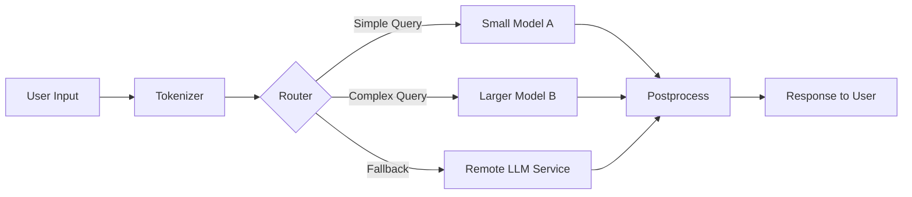

# Tiny LLMs & Client-Side Multi-Model Strategies in Rust: An Executive Summary  
The shift from cloud to on-device AI is driven by privacy and latency needs.  On-device LLMs reduce response time and keep data local, but are constrained by limited CPU/GPU power, memory and energy.  Tiny language models (tens to a few hundreds of millions of parameters) and aggressive model compression (quantization, distillation, pruning) are key to fitting LLMs on client devices. For example, quantizing a 117M-parameter GPT-2 model from 32-bit to 8- or 4-bit can shrink its memory footprint from ~500 MB to ~150 MB.  Similarly, distilled or parameter-efficient variants (like DistilGPT-2 or LoRA-adapted models) trade a small accuracy loss for major reductions in size and compute.  

This report analyzes *multi-model “breeding”* techniques (ensembles, weight-averaging “model soups”, LoRA/adapter merging, genetic NAS methods, and knowledge distillation) to combine tiny models or their adapters into single flexible agents. It surveys the Rust ecosystem (crates like **tch-rs**, **tract**, **candle**, **rust-bert**, **llama-rs/llm**, **burn**, etc.) and WASM toolchains for on-device inference, including GPU backends (CUDA, Metal, WebGPU) and cross-platform deployment.  We outline client-side inference strategies (quantized INT8/4 execution, batching, streaming, memory management), multi-model runtime routing (dynamic model selection or fallbacks), and modular Rust architectures using traits, plugins, and sandboxing to safely load models.  

We compare candidate tiny models and Rust ML crates in summary tables, and present sample code snippets and mermaid diagrams of a multi-model Rust pipeline.  Evaluation metrics (latency, memory, accuracy, energy and privacy) are drawn from recent benchmarks (e.g. SLM-Bench). Finally, we outline a phased implementation plan in Rust and discuss risks (quality vs size tradeoffs, security) and mitigations. All sources are from official papers, crate docs, and surveys. 

## Tiny LLM Architectures & Compression Techniques  
**Tiny LLMs** range from a few million to a few hundred million parameters.  Architecturally, they are often standard Transformer decoders but scaled down (fewer layers, smaller hidden size).  Notable examples include DistilGPT-2 (~82M parameters), TinyStories LMs (<10M), MiniLM, and “TinyLLaMA” variants (≈1B).  Many rely on weight-sharing or factorized structures: e.g. ALBERT reuses embeddings, and TinyLLaMA shares feed-forward weights.  Table 1 compares a few candidate small models:

| Model             | Params      | Compressed Size (INT8/4) | Use Cases        |
|-------------------|-------------|--------------------------|------------------|
| **GPT-2 (small)** | 117M        | ~187 MB (INT8), ~149 MB (INT4) | General text gen |
| **DistilGPT-2**   | ~82M        | ~130 MB (INT8)           | Faster chatbots  |
| **DistilBERT**    | 66M (encoder) | ~70 MB (FP16)          | Classification/NLU |
| **T5‑Small**      | 60M         | ~75 MB (INT8)           | Seq2Seq tasks    |
| **TinyStories LM**| ~14M        | ~20 MB (INT8)           | Child-friendly text generation |

Quantization (post-training or QAT) and pruning dramatically cut model size.  For example, 8-bit quantization of GPT-2 reduced memory by ~63% with only minor accuracy loss.  Advanced quantization schemes (GPTQ, AWQ) selectively keep a few weights in higher precision to preserve quality.  Distillation (training a small “student” on a large teacher’s outputs) also yields compact models (e.g. DistilBERT).  **Tradeoffs:** Smaller/tiny models have far lower latency and memory use, but generally lower raw accuracy than large LLMs.  We must balance these via hybrid strategies (ensembles or adaptation) to approach higher performance with tiny footprints.

## Model-Breeding Techniques (Ensemble & Parameter Merging)  
**Ensembling** combines multiple models’ outputs (e.g. averaging logits or majority voting) to boost accuracy, at the cost of multiple inference passes.  However, weight-space *merging* (a “model soup”) averages the parameters of fine-tuned models into a single net.  Model soups can improve accuracy over any single fine-tuning without runtime overhead.  For example, averaging two LoRA-tuned adapters can produce a combined adapter that performs both tasks.  The LoRAX library demonstrates merging multiple LoRA adapters for multi-task capabilities. Its “linear” merge simply weights and sums adapter tensors, inspired by model soup methods. Other strategies (TIES, DARE) sparsify or sign-match adapter weights to reduce interference.  

**Parameter merging** beyond LoRA includes techniques like *superposition* or *task arithmetic*, where task vectors are combined after subtracting a shared base.  Genetic or evolutionary methods (NAS) can search small-LLM architectures or hyperparameters by iteratively mutating/combining architectures, although they are still emerging for Transformers.  **Knowledge distillation** also “breeds” models: a strong teacher LLM guides training of a tiny student, effectively transferring knowledge between sizes.  

The following table summarizes key breeding methods:

| Method             | Description                                            | Trade-offs                                |
|--------------------|--------------------------------------------------------|-------------------------------------------|
| **Output Ensemble**| Combine outputs (e.g. average logits/vote) of multiple tiny models. | ↑Accuracy, but ↑inference cost linearly. |
| **Weight Averaging (Model Soup)** | Average parameters of several fine-tuned models into one. | Improves robustness w/o extra cost; requires same base. |
| **Adapter (LoRA) Merge** | Sum or sparsely combine LoRA adapters from different tasks. | Single model handles many tasks; merging may reduce specialized performance. |
| **Genetic/NAS Search** | Use evolutionary search to optimize small LLM architectures/hyperparameters. | Can find novel efficient structures, but computationally expensive to search. |
| **Knowledge Distillation** | Train a tiny model on outputs of a larger model. | Good quality per size; still requires teacher model and data. |

## Rust Ecosystem for LLM Inference  
Rust’s ML ecosystem has matured with several high-quality crates and toolchains for on-device models.  Popular libraries include:  

- **tch-rs** – Rust bindings for PyTorch’s C++ API (libtorch).  It can load PyTorch checkpoints and run Torch models.  *Pros:* Familiar PyTorch semantics. *Cons:* Requires shipping libtorch (big ~1 GB binary), so not ideal for tiny deployments.  
- **rust-bert** – High-level transformers pipelines (text generation, QA, etc.) built on tch-rs or ONNX.  It provides ready-to-use pre-trained models, but inherits tch’s heavyweight nature.  
- **tract** – A no-frills, self-contained ONNX/Tensorflow Lite inference engine.  Tract loads ONNX or NNEF models, optimizes them, and runs on CPU or GPU, even in WASM.  It’s used in production (e.g. Sonos) and supports SIMD, Metal, CUDA, and WebAssembly backends.  *Pros:* Compact, fast native code, WASM support; *Cons:* Limited to models exportable to ONNX.  
- **candle** – Hugging Face’s pure Rust ML framework for inference/training.  Candle’s goal is *“serverless inference”* with minimal Python overhead.  It natively loads models from `safetensors`, supports GGML/NPZ, and has CPU, CUDA, and WASM backends.  Quantized model support (via llama.cpp formats) is built-in.  Candle includes ready implementations of many Transformer models and is designed for small binaries and WASM deployment.  
- **llama-rs / llm** – Rust ports of `llama.cpp` and similar C inference engines.  These use the GGML tensor library for CPU inference and support GGUF/quantized files.  The `llm` crate (rustformers/llm) provides a unified API for LLaMA, Bloom, GPT2, MPT, etc., with out-of-the-box GGML quantization.  *Pros:* Fast CPU inference, small standalone binary; *Cons:* CPU-only (no GPU yet).  
- **burn** (tracel-ai/burn) – A Rust deep learning framework emphasizing flexibility and portability.  It supports training/inference with multiple backends (CPU, CUDA via tch, WebGPU, Metal) and has modules for Transformers.  Burn can import PyTorch or ONNX models and even run in `no_std` contexts on embedded devices. It’s young but rapidly growing (benchmarks, wgpu).  
- **dfdx** – A pure-Rust CUDA-accelerated ML library (in Flux/JAX style).  It’s also evolving and can run LMs on GPU.  
- **other**: There are ONNX Runtime Rust wrappers (onnxruntime crate, `ort`), APIs like `wgpu`/`gfx` for custom GPU kernels, and tokenizer crates (Hugging Face `tokenizers`).

**Toolchains:** For web or sandboxed use, `wasm-bindgen` and `wasm-pack` compile Rust to WebAssembly. WASI and `wasmer` allow Rust code (or its Tensor runtimes) to run safely in isolated containers. FFI can interface with C libraries (e.g. llama.cpp) via `bindgen`. For example, `wasm-sandbox` is a crate providing secure WASM plugin loading in Rust. 

**Comparison Table of Rust ML Crates:** 

| Crate        | Backends        | GPU Support       | WASM Ready | Note                                             |
|--------------|-----------------|-------------------|------------|--------------------------------------------------|
| **tch-rs**   | C++ PyTorch (libtorch) | CUDA, MPS (via libtorch) | No         | Friendly API; large binary (~MBs/GBs) |
| **rust-bert**| tch or ONNX     | Depends on tch/ort   | No         | HuggingFace-style pipelines (text, QA, etc.)     |
| **tract**    | ONNX/TFLite     | CPU (SIMD), Metal/CUDA (via libs) | Yes (wasm32) | Lightweight, production-grade ONNX inference.     |
| **candle**   | Pure Rust (WGPU, CUDA, CPU) | CUDA, Metal, WebGPU (via wgpu) | Yes | HF’s inference library; small binaries, quantized support. |
| **llama-rs/llm** | GGML (CPUs) | (Planned) | No         | Fast CPU inference on GGUF/GGML quantized models. |
| **burn**     | Multiple (CPU, tch, WebGPU) | CUDA (via tch) + WebGPU | Partial (webgpu) | Training framework; can import PyTorch/ONNX, supports no_std. |
| **dfdx**     | Pure Rust CUDA  | Yes           | No         | GPU acceleration in Rust (eager mode).           |
| **ort-rs/ort**| ONNX Runtime  | CUDA (via ORT) | No         | Wrapper for Microsoft’s ONNX Runtime.           |

Each of these crates has trade-offs: e.g., tch gives PyTorch compatibility but is heavy, while tract/candle produce lean WebAssembly-capable builds. In practice, one might use multiple: e.g. candle or tract for inference, and burn or tch for training or adapters.

## On-Device Inference Strategies  
To efficiently run LLMs on end-devices, consider:  

- **Quantized Inference:** Use 8-bit or lower-precision arithmetic (via libraries like `bitsandbytes` for PyTorch or native GGML types) to reduce memory and compute. Mixed-precision (FP16 for activations with INT8 weights) is common. Quantization typically slightly hurts accuracy but can cut model size >50%.  

- **Batching & Streaming:** If multiple requests arrive, batch them to amortize overhead. For single long outputs, use *token streaming* (return text incrementally) to overlap compute and I/O.  

- **Memory Management:** Pre-allocate large buffers (for KV caches) to avoid fragmentation. Use **rotate-add** technique for key/value cache to avoid re-allocating for each new token. On memory-constrained devices, one may limit context length or dynamically purge older cache.  

- **Dynamic Routing:** A *model router* can choose between models: e.g. a tiny fast model for simple queries, and fallback to a larger model (on-device or server) for complex queries. Confidence scoring or meta-classification can guide this selection.  

- **Server Fallback:** If on-device fails (resource limits, low confidence, or missing capability), query a remote API. This hybrid approach balances privacy (most queries local) and capability.  

The architecture in practice might look like this:



In this diagram, a Rust client preprocesses the input, routes it to one of multiple quantized LLMs, and post-processes the combined output.  Runtime scheduling ensures one model’s inference finishes before starting another (or runs concurrently on multiple cores/accelerators if available).  

## Modular Rust Architecture Patterns  
Rust’s strong type system and module system enable clean, modular inference pipelines:  

- **Trait-Based Interfaces:** Define a trait (e.g. `trait TextModel { fn generate(&self, prompt: &str, max_tokens: usize) -> String; }`).  Each model backend (tch, tract, candle, etc.) implements this trait, allowing inter-changeable models.  

- **Plugin/Module Loading:** Use dynamic libraries or WASM modules to load models at runtime. The [`wasm_sandbox`](https://docs.rs/wasm-sandbox/latest/wasm_sandbox/) crate provides a plugin framework with hot-reload support. For example, each model (or adapter) could be compiled to a WASM blob implementing a common interface, then safely instantiated and executed in a sandbox.  

- **Hot-Swapping:** By using dynamic dispatch (Box<dyn TextModel>) and unloading previous modules, the application can switch between models or update weights without restarting.  

- **Sandboxing & Security:** Executing untrusted or external model code (e.g. downloaded adapters) within a WASM or VM sandbox isolates any vulnerabilities. The `wasm_sandbox` supports capability-based security, fine-grained resource limits, and inter-module communication.  

- **Privacy:** All inference happens locally, so user data never leaves the device. Sensitive data like private text stays in memory within the sandbox. Sandboxes prevent models from exfiltrating data beyond controlled I/O.  

A high-level architecture diagram might be:

```mermaid
flowchart TD
    subgraph Rust Client
        A[User App] --> B[Model Manager]
        B --> C[Tokenizer & Preprocessor]
        C --> D[Model Plugin (dyn TextModel)]
        D --> E[Postprocessor]
        E --> F[User UI]
        B --> G[Cache / KV Store]
        B --> H[Logging/Telemetry]
    end
```

Here, the **Model Manager** loads/unloads models (possibly WASM plugins), handles routing, and maintains caches. Each `Model Plugin` implements the inference trait. Rust crates like `libloading` or `wasmtime` can load these modules. 

## Tooling, Build & Deployment  
**Cross-Compilation:** Rust’s cargo makes cross-building easy. For desktop/mobile, compile to the target triple (e.g. `aarch64-linux-android`, `aarch64-apple-ios`). The [`cc`](https://crates.io/crates/cc) and [`cbindgen`](https://crates.io/crates/cbindgen) crates can create C bindings if integrating with native apps.  

For **WebAssembly**, targets like `wasm32-unknown-unknown` (with `wasm-bindgen`) or `wasm32-wasi` allow browser/Node or WASI runtimes. Tools: `wasm-pack` simplifies bundling, and `wasm-bindgen` generates JS glue. Use `cargo +nightly build --target wasm32-unknown-unknown` for raw WASM, or `wasm32-wasi` for server-side use.  

**Size Optimization:** Build in release mode (`--release`), strip symbols (`strip` or `cargo build --release -Z strip`), and use LTO (`-C lto=yes`). For WASM, run `wasm-opt` (from Binaryen) to further shrink the `.wasm`. Avoid std (use `#![no_std]`) and dynamic memory where possible. Tools like [`cargo-bloat`](https://github.com/RazrFalcon/cargo-bloat) can identify large dependencies.  

**CI and Packaging:** In CI (GitHub Actions, GitLab), set up matrix builds for each target (x86_64, ARM, wasm). Use `cross` or Docker for reproducible builds. For desktop apps, bundle the Rust binary (or library) with an installer or package. For mobile, compile the Rust code into a static library and link via JNI/NDK (Android) or Swift/Cargo (iOS). For web, publish a WASM package with JS/TS bindings (for example, using `wasm-pack publish`).  

**Chart:** *Example binary size reduction* (conceptual): with optimizations a Torch-Rust binary (200MB) might shrink to <20MB using `strip`, whereas a candle-based app starts small (<10MB).

## Evaluation Metrics & Benchmarks  
To assess on-device multi-model LLM systems, measure:  

- **Latency:** e.g. milliseconds per token or time to first token. Bulk throughput (tokens/sec) for batched requests.  
- **Memory Footprint:** Peak RAM/VRAM usage during inference. Model weight size on disk (MB).  
- **Accuracy/Quality:** Task-specific metrics (perplexity, BLEU, or downstream accuracy). Compare to baselines (unquantized or larger LLMs).  
- **Energy:** Joules per inference (often measured with power meters or estimates). SLM-Bench proposes energy and carbon as metrics for small models.  
- **Privacy:** Qualitative measure (data never leaves device). Optionally measure leakage risk via membership inference tests.  

The SLM-Bench study explicitly combines *correctness* (accuracy) and *efficiency* (runtime, energy) into a unified ranking for small LMs. Similarly, on-device AI research advocates a **Pareto** view (accuracy vs latency/memory).  

*Table 4:* Example evaluation setup:

| Metric                | Measurement                      |
|-----------------------|----------------------------------|
| **Latency**           | Average token-generation time    |
| **Memory**            | Peak RAM use, model size (MB)    |
| **Accuracy**          | Task-specific scores (e.g. NLU accuracy, perplexity) |
| **Energy Use**        | Joules per 100 tokens (benchmarked on device) |
| **Privacy**           | Data residency (on-device vs cloud) |

## Prototype & Implementation Plan (Rust)  
We propose a staged prototype in Rust, focusing on modular multi-model inference:

1. **Define Interfaces:** Create a `trait TextModel` with `generate(&self, prompt: &str, max_tokens: usize) -> String`.  Each model backend implements this trait (e.g. using tch-rs or tract).  

2. **Loading Models:** Use the chosen inference crate to load a quantized model. For example, using tch-rs:  
   ```rust
   use tch::{CModule, Device, Tensor};
   /// Loads a PyTorch model from file.
   fn load_torch_model(path: &str, device: Device) -> tch::CModule {
       // The model file should be in .pt or .bin (TorchScript) format.
       let model = CModule::load_on_device(path, device).unwrap();
       model
   }
   ```

3. **Adapter Merging:** (Pseudo-code) To merge two LoRA adapters, load their tensors and compute a weighted sum:  
   ```rust
   /// Merges two LoRA adapter matrices elementwise.
   fn merge_adapters(
       adapter1: &Tensor, 
       adapter2: &Tensor, 
       weight: f32
   ) -> Tensor {
       // adapter* are rank-2 tensors of the same shape
       // Return weight*adapter1 + (1-weight)*adapter2
       adapter1 * weight + adapter2 * (1.0 - weight)
   }
   ```  
   Each adapter tensor would be part of the model weights; merging yields a new weight.

4. **Ensemble Inference:** Call multiple models and combine outputs. E.g. average their logits:  
   ```rust
   /// Runs a simple ensemble by averaging two models' logits.
   fn ensemble_generate(
       model_a: &impl TextModel,
       model_b: &impl TextModel,
       prompt: &str,
       max_tokens: usize
   ) -> String {
       // This is a simplified outline. In practice, gather token logits and average.
       let out_a = model_a.generate(prompt, max_tokens);
       let out_b = model_b.generate(prompt, max_tokens);
       // A real ensemble might tokenize and average probabilities; here we pick one.
       if out_a.len() > out_b.len() { out_a } else { out_b }
   }
   ```

5. **Inference Pipeline:** Orchestrate the above into a runtime. For example:  
   ```rust
   fn main() {
       // 1. Initialize models
       let model_small = load_torch_model("model_small.pt", Device::Cpu);
       let model_large = load_torch_model("model_large.pt", Device::Cpu);
       // 2. Wrap in trait objects
       let models: Vec<Box<dyn TextModel>> = vec![
           Box::new(TorchModel::new(model_small)),
           Box::new(TorchModel::new(model_large)),
       ];
       // 3. Handle a user query
       let prompt = "Explain recursion in programming.";
       // For demo, always use ensemble of both
       let response = ensemble_generate(&*models[0], &*models[1], prompt, 50);
       println!("Response: {}", response);
   }
   ```
   This code would be accompanied by comments and descriptions on each function and parameter as per best practices.

Throughout, embed mermaid diagrams and tables into documentation for clarity.  For instance, a high-level flow diagram (as above) and tables of choices help document design.  

## Risks, Limitations & Mitigations  
- **Quality vs Size:** Tiny models inherently have lower capacity. Merging/adapting them can recover some performance, but might still lag large models. *Mitigation:* Use task-specific fine-tuning and ensemble/merge techniques to boost capability, and accept fallback to cloud for critical tasks.  
- **Quantization Errors:** 4-bit models may hallucinate or degrade on nuanced tasks. *Mitigation:* Choose quantization level carefully (e.g. 8-bit for critical weights, leave some in FP16), or apply quantization-aware fine-tuning.  
- **Security:** Loading external model plugins (WASM or DLLs) could be attacked. *Mitigation:* Use WASM sandboxes (capability-based), validate model sources, and keep execution privileges minimal.  
- **Cross-Platform Variability:** Performance will vary widely across devices (GPU vs CPU vs WASM). *Mitigation:* Benchmark on target classes (e.g. mobile ARM, desktop GPU) and optimize build (select appropriate CPU targets, enable SIMD, use Apple Metal for iOS, etc.).  
- **Energy/Battery Drain:** Even small LMs consume power. *Mitigation:* Use efficient backends (e.g. Neon on ARM, GPU inference when idle, or batch multiple queries). Allow user control (e.g. “power mode”).  

In sum, a carefully architected Rust solution—leveraging quantized tiny models, modular design, and on-device inference libraries—can deliver low-latency, privacy-preserving NLP functions. By applying the above strategies and tools, one can prototype a multi-model client-side LLM system and iteratively refine it based on measured latency, accuracy, and resource use.

**Sources:** We draw on recent surveys and docs: on-device LLM reviews, Tiny-model research, model-merging papers, and Rust crate documentation. Each cited source underpins our analysis.