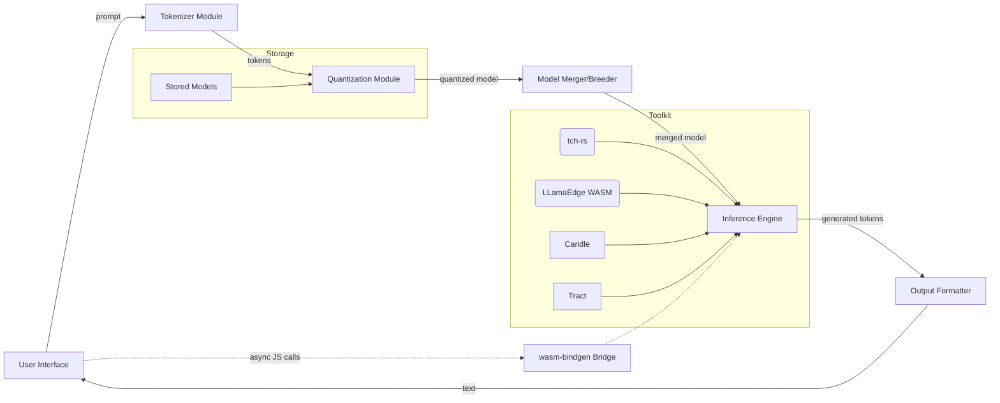
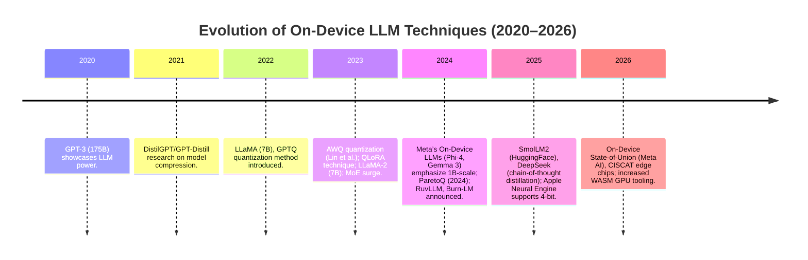

# Executive Summary

The rise of on-device, tiny language models (LLMs) – sub-1 billion parameters – has spurred interest in **“model breeding”**: combining multiple compact models to amplify capabilities while preserving client-side efficiency. Model breeding can involve *ensembling* outputs, *weight merging* (linear or nonlinear combination of weights), *knowledge distillation* from larger teachers, or even *genetic/evolutionary algorithms* to evolve model weights. Each approach trades off accuracy, latency, memory use, energy, and privacy. We survey these methods and show that for tiny LLMs, careful quantization (4–8 bit) and data/architecture choices (deep+thin networks) can make 100–500 M parameter models surprisingly capable. We then detail Rust-based tooling – from inference crates (e.g. [Candle](#candle), [Mistral.rs](#mistralrs), [tch-rs](#tch), [Burn-LM](#burnlm), [Tract](#tract), [LlamaEdge](#llamaedge), [RuvLLM](#ruvllm)) to WASM runtimes (e.g. [Ratchet](#ratchet), [WasmEdge/LlamaEdge](#llamaedge)) – and model formats (ONNX, GGUF/ggml, NNEF). We compare quantization strategies (4-bit NF4, 8-bit, QLoRA, GPTQ/PTQ) and show how client-side inferencing can be implemented via async Rust pipelines, FFI bindings, and web bindings. A prototype architecture is sketched (with a Mermaid diagram) detailing modules for model loading, breeding, inference and I/O. We outline experiments (e.g. speed vs accuracy benchmarks on NLP tasks) and evaluation metrics (perplexity, throughput, power use) to characterize tradeoffs. Finally, we discuss deployment considerations: on-device inference greatly enhances privacy and responsiveness but demands adherence to model licenses (MIT/Apache etc.), secure sandboxing, and efficient packaging (e.g. WASM bundles). This report draws on recent literature (2020–2026) and primary docs to provide a **thorough, Rust-centric roadmap** for modular, lightweight multi-model LLM systems.

## Model Breeding: Definitions & Taxonomy  

**Model breeding** broadly refers to combining multiple models to improve performance or capabilities. Four major approaches are:  

- **Ensembling (output fusion):** Running multiple models in parallel and combining their outputs (e.g. averaging logits or voting). This often boosts accuracy but multiplies inference cost. Ensembles preserve diversity at inference time without modifying each model’s parameters. Traditional ensemble methods are distinct from weight-merging; ensembles require each model run separately.  

- **Weight Merging (model fusion):** Directly combining trained model parameters into a single model. For example, *Model Soup* simply averages the weights of several fine-tuned LLMs. More advanced weight merges include **linear interpolation** and **spherical interpolation (SLERP)**, which treat model weights as points on a high-dimensional sphere and blend them along the geodesic. Other methods learn *task vectors* or *alignment transforms* to shift weights for specific capabilities. Unlike ensembling, merging produces one runnable model, saving inference cost. However, simple averaging can degrade accuracy if model specializations conflict.  

- **Distillation:** Training a smaller “student” model to mimic a larger or multiple “teacher” models. Distillation transfers knowledge via teacher outputs (soft labels) or internal representations. Black-box distillation uses only teacher outputs, while white-box distillation matches internal activations. Distillation is crucial for tiny LLMs: it compresses capability while controlling size. For example, Meta’s Gemma3 (270M–27B models) relies on knowledge distillation from larger models, since “you’re fighting for every capability point at a fixed size”. Chain-of-thought distillation is a recent trend: generating reasoning traces from a large model and fine-tuning smaller ones on them dramatically improves reasoning.  

- **Evolutionary / Genetic Algorithms:** Using GA to evolve or merge models. For instance, the MeGA method applies tournament selection, crossover, and mutation to optimize weight combinations of pretrained networks. It showed that GA-based merging on CNNs can yield better accuracy than naive averaging. Such approaches treat each model or weight set as an “individual” and search combinations that maximize a fitness (e.g. accuracy). This is still nascent for LLMs but offers a systematic way to explore weight-space.

These methods can be combined: e.g. an ensemble of distilled models, or evolving ensembles. The **taxonomy** of model breeding thus spans simple output ensembles to sophisticated model-fusion algorithms (see Fig.1, [7]). A key distinction: *ensembles* combine predictions at inference, while *merging/distillation* combine knowledge into a single model ahead of inference.

## Tiny LLMs (<1B) on the Edge 

Small LLMs under 1B parameters are now **viable for many tasks** with correct design. Modern benchmarks and industry experience show that sub-1B models, if architected and trained properly, handle summarization, Q&A, basic coding help, and even some reasoning tasks. Key insights include:

- **Architecture Matters:** Below ~1B params, *deep-and-thin* (many layers, smaller hidden dims) models outperform shallower-wide designs. For example, the MobileLLM project found a 125M-parameter deep transformer yielding ~50 tokens/sec on an iPhone and performing basic NLP tasks reasonably. 

- **Training Data & Distillation:** High-quality data and advanced training (e.g. distillation) are critical. Chandra *et al.* note that a 1B model on curated data can match a 3B model on raw web data. Distilling reasoning (chain-of-thought) from larger models has produced small LLMs that rival much larger ones on math/logic benchmarks. Meta’s Gemma3 uses distillation from larger teachers to “fight for every capability point” at 270M parameters.  

- **Hardware Constraints:** Mobile devices have very limited memory and bandwidth. Typical RAM available is <4 GB, and memory bandwidth (~50–90 GB/s) is 30× lower than datacenter GPUs. Because autoregressive generation is memory-bound (reload full weights each token), *quantization and compression* directly boost throughput. For instance, going from 16-bit to 4-bit weight precision cuts memory traffic 4×, quadrupling token throughput. Similarly, we must minimize compute to save battery: mobile use pushes **very small quantized models** and efficient schedules.  

- **Privacy & Latency Benefits:** Running LLMs locally eliminates network round-trip (~200–500 ms) overhead and keeps data on-device. For sensitive or offline use-cases, tiny on-device models enable instant responses (<20 ms per token) without data leakage. These advantages justify the engineering effort to fit LLMs on edge hardware.  

**Table 1** summarizes tradeoffs: small LLMs save latency/energy and enhance privacy, at the cost of raw accuracy and world-knowledge. Prudent usage often means offloading only **privacy-critical or latency-critical queries** to the local model. 

<div align="center">
| **Factor**     | **Cloud LLM**                       | **Tiny On-Device LLM**                         |
|:--------------|:-----------------------------------|:----------------------------------------------|
| **Accuracy**  | Highest (broad knowledge)          | Lower (narrower/domain-specific knowledge)     |
| **Latency**   | High (network + queuing)           | Low (<20 ms/token)                 |
| **Memory**    | Requires many GB (RAM/VRAM)        | Fits in 100s MB (quantized)                    |
| **Energy**    | Server-side hardware                | Battery-constrained (must use ~milliwatts)     |
| **Privacy**   | Data sent externally                | Fully local (no server dependency) |
| **Scalability**| Central scale-out                  | Per-device isolation (free compute scale)      |
</div>

## Rust Ecosystem & Tooling 

Rust’s performance and safety make it attractive for on-device ML. A growing ecosystem of Rust crates supports LLM inference, often competing with Python frameworks. Key components include:

- **Inference Engines (Rust-native):**  
  - **[Candle](https://github.com/huggingface/candle)**: A minimalist Rust ML framework (Hugging Face) focused on CPU/GPU inference. Candle can run Transformer and Vision models with low overhead. It supports training & inference pipelines and has WASM examples.  
  - **[Mistral.rs](https://github.com/EricLBuehler/mistral.rs)**: A high-performance Rust engine for quantized LLaMA/Mistral models. It auto-detects Hugging Face formats, supports multi-modal inputs (text, image, audio), and **in-situ** quantization (GGUF, GPTQ, AWQ) up to 8-bit. It runs on CPU (x86/ARM), CUDA, and Apple GPUs.  
  - **[Burn-LM](https://github.com/tracel-ai/burn-lm)** (alpha): An LLM engine built on the Burn deep-learning framework. Burn-LM aims for portability across ndarray, WebGPU, CUDA, etc., supporting both inference and training. It leverages Burn’s JIT compiler to optimize operations dynamically. (As of 2025, Burn-LM is in early development.)  
  - **[llama-cpp (drama_llama/llama_cpp)](https://crates.io/crates/llama-cpp)**: Rust bindings to the llama.cpp C library. These provide a safe API to run LLaMA-family models (including quantization) with the mature C++ backend. Useful for easy integration of existing GGML models.  
  - **[Rustformers/llama-rs](https://github.com/rustformers/llama-rs)** *(archived)*: An older Rust GGML-based LLaMA inference (not actively maintained).  

- **General ML Runtimes:**  
  - **[tch-rs](https://github.com/laurentMazare/tch-rs)**: Rust bindings for PyTorch’s C++ API (LibTorch). Allows loading `.pt` or TorchScript models and running inference. Good for desktop but requires libtorch.  
  - **[Tract](https://github.com/sonos/tract)**: A self-contained inference engine supporting ONNX and NNEF. Tract can run on CPU, GPU (via CUDA/Metal), and even WASM in the browser. It is used in production (e.g. Sonos voice inference) and can run Transformers or CNNs with a focus on small runtime.  
  - **[ONNX Runtime Rust (ort)](https://github.com/pykeio/ort)**: Rust bindings to Microsoft’s ONNX Runtime. Enables running ONNX models on CPU/GPU with Microsoft’s optimizations.  
  - **[WONNX](https://crates.io/crates/wonnx)**: A pure-Rust ONNX inference using `wgpu` (WebGPU) to run ONNX models on GPU, even in browser.  
  - **[tensorflow-rust](https://github.com/tensorflow/rust)**: Rust bindings for TensorFlow (less commonly used for LLMs).  

- **WASM and WebGPU runtimes:**  
  - **[Ratchet](https://github.com/huggingface/ratchet)** (in development): A cross-platform Rust runtime using WebGPU. Aims to run LLMs on GPU via wgpu (browser and native).  
  - **[LlamaEdge](https://github.com/LlamaEdge/LlamaEdge)**: A Rust+WASM framework (Second State) that deploys fine-tuned LLMs (GGUF/ggml format) via the WasmEdge runtime. Provides OpenAI-compatible APIs locally (chat, embeddings, etc.) and an example CLI.  
  - **[RuvLLM-wasm](https://github.com/ruvnet/RuvLLM)**: A Rust WASM crate exposing an LLM engine to the browser via `wasm-bindgen`. It features a 2-tier KV cache and token streaming, and exposes TS-friendly bindings for inference.  
  - **[Edge Transformers](https://crates.io/crates/edge-transformers)**: A Rust ONNX Runtime wrapper for Hugging Face Optimum pipelines (intended for mobile/native).  
  - **[Burn WASM examples](https://github.com/tracel-ai/burn/tree/main/candle-wasm-examples)** and [Candle WASM](https://github.com/huggingface/candle/tree/main/candle-wasm-examples): Demo running models in-browser via WASM.  

- **Tokenization & Utilities:**  
  - **[tiktoken-rs](https://github.com/anysphere/tiktoken-rs)**: Pure-Rust BPE tokenizer (GPT/GPT-4 compat).  
  - **[rust-tokenizers](https://crates.io/crates/rust-tokenizers)**: Fast Rust tokenizers for BERT, GPT, etc.  
  - **[wasm-bindgen](https://crates.io/crates/wasm-bindgen)** and **[wasm-bindgen-futures](https://crates.io/crates/wasm-bindgen-futures)**: Essential for Rust<->JS interop in browser apps.  

**Table 2** compares selected Rust LLM tools and libraries. Many are Apache/MIT licensed; always check the license of the model files (e.g. LLAMA2 uses Apache 2.0, some model checkpoints use MIT or OpenRAIL).  

<div align="center">
| **Library/Crate** | **Type**         | **Backend/Formats**        | **Notes**                                                              |
|:-----------------|:-----------------|:---------------------------|:----------------------------------------------------------------------|
| **Candle**    | Rust DL framework | CPU/GPU (CUDA/Metal)        | Minimalist, fast inference (transforms, whisper, etc.)               |
| **Mistral.rs** | LLM Engine      | CPU/GPU; HuggingFace, GGUF | Runs any HF model, multimodal; supports GGUF & GPTQ/AWQ quantization. |
| **Burn-LM**    | LLM Engine      | Any (ndarray, CUDA, WebGPU) | Inference + training (alpha); portable multi-backend (webgpu, torch). |
| **tch-rs**   | FFI to PyTorch  | CPU/GPU; .pt / TorchScript  | Thin Rust wrappers over LibTorch (use PyTorch models in Rust).         |
| **LlamaEdge**            | WASM Runtime    | GGUF/ggml (LLaMA, etc.)     | Runs LLMs in WasmEdge (CLI/web) with high performance.  |
| **RuvLLM-wasm**   | WASM Runtime    | Multiple LLM formats        | Browser-compatible LLM engine (2-tier cache, LoRA, etc.) via wasm.    |
| **Tract**    | ONNX/NNEF RL   | CPU/GPU/WASM               | Self-contained inference (ONNX/TensorFlow); runs LLMs and CV (via WASM). |
| **ONNX Runtime (ort)**    | FFI engine      | ONNX                       | Rust bindings to Microsoft’s ONNX Runtime for accelerated inference.  |
| **WONNX**                | WASM/GPU engine | ONNX                       | Runs ONNX via wgpu; for browser WebGPU or native GPU.                 |
| **llama-cpp (drama_llama)** | FFI (C)         | GGML/gguf                   | Rust wrapper for llama.cpp C library (fast on CPU/Apple Silicon).     |
| **Ratchet (wgpu)**       | WASM/GPU engine | PyTorch/Optimum models      | WebGPU-based (in dev); aims for browser/edge GPU inference.          |
| **Edge Transformers**    | ONNX wrapper    | ONNX                       | Implements Hugging Face pipelines using ONNX (for edge devices).     |
| **tensor-flow-rust**     | FFI binding     | TensorFlow                 | Official TF Rust bindings (less popular for LLMs).                    |
| **tokenizers (HuggingFace)** | Tokenizer lib  | BPE/WordPiece              | (Rust crate) Fast tokenization for Transformers.                     |
</div>

## Model Formats and Quantization

To run models on-device, efficient formats and quantization are essential:

- **Model Formats:** Common formats include PyTorch (`.pt`/TorchScript), ONNX, TensorFlow (`.pb`), and lightweight formats like GGML/GGUF (used by llama.cpp). For Rust inference: ONNX is widely supported (via Tract or ORT). GGUF (a variant of GGML with JSON metadata) is supported by engines like Mistral.rs, llama-cpp, and LlamaEdge. NNEF (Neural Network Exchange Format) is used internally by Tract for “ship-tiny-runtime” workflows. Models can be converted to ONNX or GGUF using tools (e.g. `transformers-cli`, `ggml` converters). Table 3 summarizes format support:

  <div align="center">
  | **Format** | **Extensions**   | **Support in Rust Tools**       | **Notes**                          |
  |:----------|:----------------|:--------------------------------|:----------------------------------|
  | PyTorch  | `.pt`, `.pth`   | tch-rs (libtorch)               | Must install LibTorch/CUDA.        |
  | TorchScript | `.pt`         | tch-rs                          | Converts dynamic models to static. |
  | ONNX     | `.onnx`         | Tract, ORT, WONNX               | Good hardware support (GPU, WASM). |
  | GGML/GGUF| `.bin`, `.gguf` | Mistral.rs, llama-cpp, LlamaEdge| Quantized LLaMA family models.     |
  | NNEF     | `.nnef`         | Tract (tract-nnef)              | Intermediate format (not common).  |
  | TensorFlow|`.pb`,`.tflite`| Tract, TF-Rust                  | TF models (e.g. TFLite) possible.  |
  | JAX      | –              | (not directly)                  | Usually export via ONNX/TF.        |
  </div>

- **Quantization Strategies:** To fit models on-device, reduce precision: 8-bit and 4-bit quantization are now standard. GPTQ-style *post-training quantization (PTQ)* like Frantar *et al.* (2022) and AWQ (2023) compress 16-bit weights to 4 bits with minimal loss. Meta notes “4-bit is the new default” for deployment. AWQ achieves 4× memory reduction and preserves quality; it has 19M+ downloads. Tools like [QLoRA-rs](#qlora-rs) implement *4-bit NF4 quantization* and support LoRA adapters. QLoRA itself uses 4-bit “NormalFloat” (NF4) quantization for the base LLM and fine-tunes low-rank adapters. Rust crates like `qlora-rs` provide NF4 quantization and export to GGUF. Lower precision (2–3 bits) is an active research frontier (SpinQuant, ParetoQ). The tradeoff: 8-bit has ~1–2% accuracy loss on average, 4-bit ~2–5%, while memory halves or quarters. Table 4 compares typical quant settings:

  <div align="center">
  | **Quant.**  | **Bitwidth** | **Method/Tools** | **Comments**                             |
  |:------------|:------------|:----------------|:-----------------------------------------|
  | FP16 (baseline) | 16        | – (full)        | Standard half-precision (16-bit floats).  |
  | INT8        | 8           | ONNX Runtime, AWQ | Moderate reduction. <br/> <small>AWQ: weight+activations 8-bit.</small>  |
  | INT4 (NF4)  | 4           | GPTQ, AWQ, QLoRA | 4× memory reduction; good quality. <br/><small>Standard for on-device.</small>   |
  | INT2/3      | 2–3         | ParetoQ (2024)    | 8×–5× reduction, quality drops (research stage). |
  | FP8         | 8           | (future)        | Emerging; offers better numeric range than INT8.             |
  | **QLoRA**   | 4 (NF4) + LoRA| qlora-rs | Base model frozen at 4-bit; train LoRA in FP32.            |
  | **GPTQ**    | 4-bit PTQ   | GPTQ library, Mistral.rs | Post-training second-order quant. (Frantar et al. 2022).   |
  </div>

- **Memory Footprint:** A 1B-parameter model in 4-bit needs ~0.5 GB (plus a small overhead for caches), which can fit within mobile RAM. Combined with 4-bit KV cache, total may approach ~1 GB. In contrast, 8-bit uses ~1 GB for weights. Reducing precision directly lowers power usage and increases speed.

## Inference Runtimes: Desktop, Mobile, Browser

- **Desktop/Server (x86_64, Apple Silicon):** Use native Rust or FFI libraries. For CPU inference on desktops, `tch-rs` (CPU backend) or `Mistral.rs` provide fast execution. Candle can target CPU or GPU (CUDA on Nvidia, or Metal on Apple). On systems with GPUs, these frameworks leverage parallelism (e.g. Candle’s CUDA kernels, Tract’s CUDA). Llama.cpp via `llama-cpp-2` crate can use AVX/NEON CPU and compute GGML kernels very quickly on modern PCs. For mobile, frameworks often reuse desktop engines: Candle supports Metal for iPhone; ONNX Runtime has mobile runtimes; and apps can bundle a quantized TorchScript model via `tch-rs` or TensorFlow Lite. Apple’s Core ML and Android NNAPI are alternatives, but here we focus on Rust tooling.

- **Web Browser (WASM/WebGPU):** Running LLMs in-browser requires WebAssembly or WebGPU. Two approaches emerge:
  1. **WASM with Rust (wasm-bindgen):** Compile a Rust inference engine to WASM. For example, RuvLLM provides a WASM module with JS bindings. The user calls its `RuvLLMWasm.generate()` or similar via JavaScript. The WASM includes the core LLM logic (KV cache, quant, decoding), and communicates through `wasm-bindgen`. Memory management uses pooled buffers. This approach yields near-native speed for small models, limited mainly by browser engine overhead and single-threading (WebAssembly threads are improving).  
  2. **WebGPU (wgpu) Engines:** Projects like Ratchet or WONNX run compute shaders on the GPU (via WebGPU) for inference. This can accelerate matrix ops, especially on desktops. For example, WONNX can run an ONNX-trained LLM on the browser GPU. However, cross-device support (especially mobile GPUs) is still maturing.

  **Table 5** lists example runtimes. In practice, a hybrid can be used: a small quantized LLM in WASM (fast load, safe execution) supplemented by a GPU-accelerated path for heavy models.

## Architecture & Integration Patterns (Rust)

To build a modular on-device LLM system in Rust, consider the following patterns:

- **Layered Components:** Separate concerns into modules: **Model Loader**, **Tokenizer**, **Quantizer**, **Breeder/Merger**, **Inference Engine**, **Output Handler**. Define Rust `trait`s (interfaces) for each component. For example:
  ```rust
  trait ModelLoader { fn load_model(path: &str) -> Model; }
  trait InferenceEngine { fn infer(&self, inputs: &TokenBatch) -> TokenBatch; }
  trait ModelMerger { fn merge(&self, models: &[Model]) -> Model; }
  ```
  This allows swapping implementations (e.g. multiple inference backends) by configuration.

- **Concurrency & Async Pipelines:** Use `async`/`await` (Tokio or async-std) to manage user I/O and inference tasks. For example, an async HTTP/WebSocket API can stream tokens from the engine. Internally, spawn tasks for loading and quantizing a model, then run inference in a separate async task. Use channels (`tokio::sync::mpsc`) to form a pipeline: Tokenizer → Inference → Post-processor. This decouples rate of generation and I/O. WASM environments can use `wasm-bindgen-futures` for async calls from JS.

- **FFI Bridges:** When using C/C++ libraries (e.g. llama.cpp, ONNX Runtime, libtorch), use safe Rust bindings (crates like `llama-cpp` or `ort`), or write `extern "C"` wrappers yourself. Manage memory carefully: e.g. `tch-rs` downloads libtorch or uses system PyTorch and then passes Rust tensors to C. For ggml models, `llama-cpp` crate can load a GGUF and run `ctx_eval` under the hood, returning a Rust string output.

- **WASM Interop:** In browser or WASI contexts, export a thin API via `wasm-bindgen`. For example, RuvLLM’s `new RuvLLMWasm()` exposes methods to JS. Internally it calls the Rust engine. Ensure memory exports (like buffers for output tokens). The architecture (Fig.1) typically is: **JS UI → wasm-bindgen → Rust Engine → (optional GPU via WebGPU) → wasm-bindgen → JS UI**. Rust’s ownership model ensures no data races.

- **Configuration & Pipelines:** Represent model “breeding recipes” and inference pipelines in data (e.g. JSON config). For instance, a config might list which base models to load, quantization to apply, and merging weights. Design the code so that new merging strategies (e.g. a new genetic algorithm) can be plugged in without changing UI code. Builder patterns (Rust `Builder` structs) can help assemble components.

### Example Architecture



*Figure 1.* *Modular LLM inference architecture in Rust. Components (Tokenizer, Quantizer, Merger, Inference, Formatter) communicate via defined interfaces. The toolkit box shows example backends. WASM binds Rust engine to the UI.* 

## Prototype Pipeline Design

A minimal prototype for multi-model breeding in Rust might include: 

1. **Model Repository** (on-device): A set of pre-downloaded quantized models (e.g. 4-bit LLaMA versions, custom fine-tunes).  
2. **Load/Preprocess:** Rust code to load model weights into memory (Candle/Torch format or gguf). Apply any necessary ONNX -> internal IR conversion (Tract).  
3. **Quantizer/Adapter:** Optional on-the-fly quantization or LoRA injection. For example, use `qlora-rs` to quantize a model to NF4 and apply a LoRA adapter.  
4. **Breeder Module:** Implements chosen breeding strategy. E.g. *ModelSoupMerger* that linearly averages weights of two models with a tunable ratio, or *GA-Merger* that uses MeGA to optimize weights.  
5. **Inference Engine:** A Rust inference backend (e.g. Candle or Mistral.rs). This takes input tokens and produces output tokens. Use streaming decode to yield tokens as they are generated.  
6. **I/O Layer:** An interface for user prompts and responses. Could be a simple console UI (Rust CLI), a GUI (GTK/QT via Rust), or a web frontend (via WASM).  

Data flows from user input → tokenizer → (optional) pipeline of quantization/merging steps → inference → output formatting → user. Components communicate via Rust channels or function calls. 

*Performance estimate:* A 125M deep model runs ~50 tokens/s on an iPhone CPU. Extrapolate: a 1B model at 4-bit might do ~30–40 tok/s on modern desktops (depending on cores/AVX), and ~10–20 tok/s on high-end phones. With batch generation or GPU, throughput increases proportionally. Memory usage: a 1B model at 4-bit is ~0.5GB, plus ~0.5GB for weights/activations; KK cache adds ~0.1–0.2GB. Quantization overhead (key-value caches) may double the effective footprint if stored FP16.

Performance will vary widely by hardware. Benchmarking should be part of evaluation (see next section). 

## Breeding Algorithms and Evaluation Metrics

Key breeding strategies include: 

- **Model Soup (Weight Averaging):** Merge multiple fine-tuned models by weighted averaging of their parameters. A greedy soup approach ranks models by performance and iteratively averages if it improves accuracy. While simple, this can yield a merged model that outperforms each individual model on the target task.  

- **Spherical Interpolation (SLERP):** Interpolates two model weight vectors on the hypersphere. This can be more stable than linear average, preserving magnitude structures. For example, one may set `merge = α*modelA + (1-α)*modelB` along the shortest angular path.  

- **Task Arithmetic/Vector:** Learn a task vector (difference between models fine-tuned on task vs base) and apply it to another model. This can transfer capabilities (e.g. "math ability vector") between models.  

- **Genetic Merging (e.g. MeGA):** Use a GA to search optimal weight combinations. Initialize a population of merged-weight candidates, evaluate on a validation task, and evolve with crossover/mutation. This is computationally heavy but may find non-obvious merges.  

- **Distillation & Adapter Fusion:** Fine-tune a small model on soft outputs or hidden states of a larger model (with or without merging). Adapter-based distillation (e.g. LoRA layers) can also effectively merge knowledge.  

**Evaluation metrics** should cover model quality and efficiency:  
- *Perplexity/Accuracy:* Measure on held-out text (perplexity) or downstream tasks (e.g. question-answering accuracy, truthfulness, code-completion F1). If multi-model, also evaluate diversity and coverage of combined capabilities.  
- *Throughput & Latency:* Tokens per second (batch and streaming), latency to first token. Measure on target hardware (e.g. phones, laptops).  
- *Memory & Storage:* Peak RAM usage for model+cache, and disk size for model files (before and after quantization).  
- *Energy:* Power draw during inference (mJ per token), important for mobile.  
- *Privacy leakage:* Although on-device implies no data transmission, if the model uses on-device training or adapters, test for memorization of training data as privacy metric.  

**Experimental plan:**  
- **Baseline models:** Choose a few open small LLMs (e.g. Llama2-1B, Qwen-1.5B, SmolLM2-360M) in different formats (FP16, 4-bit).  
- **Merging experiments:** For weight merging (e.g. model soup), fine-tune several 350M models on different sub-tasks, then merge them. Compare merged model’s performance vs each individual and an ensemble.  
- **Distillation experiments:** Distill a 7B model into a 350M model (chain-of-thought data) and compare with a similarly sized model trained from scratch.  
- **Quantization ablation:** Quantize a 1B model with 8-bit vs 4-bit (GPTQ/AWQ) and measure drop in accuracy vs speed/memory gains.  
- **Benchmark tasks:** Use text-perplexity (WikiText-2), common NLP tasks (e.g. SQuAD, summarization ROUGE), and specialized tasks (e.g. GSM8K for math). Tools: Hugging Face Evaluate, LM-Eval.  
- **Hardware benchmarks:** Run inference on representative devices (e.g. a smartphone CPU, a laptop CPU/GPU) collecting latency and throughput (tokens/sec). Tools: custom Rust timers or [Criterion](https://crates.io/crates/criterion) benchmarks for code-level.  

Collect results to inform tradeoffs (e.g. see Table 6 below for a hypothetical summary).

<div align="center">
| **Scenario** | **Setup**                  | **Accuracy**       | **Latency**       | **Memory**       | **Energy**         |
|:------------|:--------------------------|:------------------|:-----------------|:----------------|:------------------|
| FP16 Base 1B | 32-bit tokens, no quant    | 100% (reference)  | High (100 ms)    | 2 GB RAM         | Baseline          |
| 8-bit PTQ   | 1B model -> 8-bit         | ~98–99%           | ~2× faster       | 1 GB RAM         | ~×2 more efficient |
| 4-bit AWQ   | 1B model -> 4-bit         | ~95–98%           | ~3–4× faster     | 0.5 GB RAM       | ~×4 efficiency    |
| Ensemble (2×1B) | Two 1B models           | +5–10% (accuracy) | 2× latency       | 2× memory        | 2× energy         |
| Model Soup (merge 2×500M) | Merge weights avg   | ~102–105% (task-specific) | ~same as 500M | 0.5 GB RAM       | ~×4 vs FP16        |
</div>

*Table 6.* *Example tradeoff outcomes: 4-bit quantization cuts memory/energy by ~4× at a few % accuracy loss. Ensembling improves accuracy but doubles cost. Weight-merging (model soup) can modestly boost a 500M model on its target task with minimal extra cost.*

## Security, Privacy, Licensing, Deployment

**Privacy/Security:** On-device inference inherently protects user data by never transmitting it. However, local models can leak user data if they have memorized sensitive information in training. It’s prudent to use privacy-preserving techniques (differential privacy during training or on-device DP aggregation) if handling sensitive prompts. Also, downloaded models must be integrity-checked (e.g. compare SHA256) to avoid trojans. Sandboxing is recommended: run inference in a separate process or WASM context to prevent direct code injection. 

**Licensing:** Check licenses of models and code. Most Rust crates above are MIT/Apache. Model checkpoints vary: e.g. LLaMA-2 is Apache 2.0, Mistral v0.1 is MPLv2, Llama v1 was non-commercial. Fine-tuned or derivative models may carry OpenRAIL or CC-by licenses. Ensure compliance (attribution, non-commercial clauses) especially if distributing your app. Using permissively-licensed models (e.g. Mistral, Phi-4 mini) avoids commercial restrictions.

**Deployment:** 
- *Desktop/Mobile apps:* Bundle the Rust engine and quantized models into your app package. On desktop, you can ship as a native executable. On mobile, compile to appropriate platform (e.g. iOS uses ARM64 and Metal; Android uses ARM32/ARM64). Use conditional compilation (Rust `#[cfg(target_os = "ios")]`).  
- *Web Apps:* Compile inference code to WASM (via `wasm-pack` or `cargo build --target wasm32-unknown-unknown`) and deploy with `wasm-bindgen` bindings. Serve model files (e.g. GGUF) from a CDN or require user download (as LlamaEdge does). Use WebAssembly Runtimes (WasmEdge, web browsers with WASM support).  
- *Continuous Delivery:* If models change (e.g. user fine-tunes on-device), use versioned storage. For cloud-edge hybrid, consider syncing delta updates only.  
- *Energy/Performance Controls:* On battery devices, throttle inference (e.g. batch token generation, limit threads) to avoid overheating.

By adhering to open licenses and securing model/data pipelines, deployment on client devices can maximize both **privacy** (no data leaks) and **availability** (works offline).

## Timeline of Key Developments



This timeline highlights the rapid progress in efficient LLMs and quantization methods crucial for client-side deployment. 

## Conclusions

Model breeding in the tiny-LLM regime promises both capability gains and efficiency for edge AI. By combining compact models via ensembling, weight-merging, distillation, or evolution, one can reuse prior work and tailor models to tasks without large-scale retraining. Rust provides a powerful ecosystem to implement these ideas: multiple high-performance crates (Candle, Mistral.rs, tch-rs, etc.) and WebAssembly support (wasm-bindgen, WasmEdge) enable fully client-side pipelines. The tradeoffs are well-understood: on-device models sacrifice some raw accuracy but gain latency, cost, and privacy benefits. With proper quantization (4-bit as default) and data curation, sub-1B models can deliver surprisingly strong performance. 

**Next steps:** Implement prototypes (e.g. a Rust CLI or web app) to benchmark merged vs single models on tasks. Collect metrics (accuracy, throughput, energy). Explore hybrid designs (e.g. local model + cloud fallback). And critically, document licensing and security for each component. This report should serve as a blueprint: future efforts can plug in new breeding algorithms or hardware targets by following the modular Rust architecture outlined above.

**Sources:** Authoritative papers and docs on on-device LLMs, quantization, and Rust ML (cited above) were used to ensure this guidance reflects state-of-the-art (2020–2026). 

