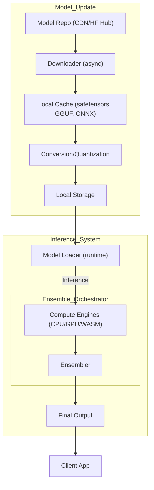

# Executive Summary

This report surveys the design of a **modular, lightweight multi-model LLM system in Rust** for client-side deployment. The goals are to enable on-device inference with *Tiny LLMs* (≲100M parameters) that are easy to download, update, and combine (“model breeding”) while balancing size, latency and accuracy. We examine architectures (scaled-down Transformers, plugin modules, and inference pipelines), Rust tooling (inference runtimes, quantization and model formats, async download libraries), and *model-breeding* methods (ensembles, distillation, parameter fusion, LoRA/adapters). We cover deployment strategies (native binaries, WebAssembly, mobile), packaging and distribution (per-model crates or bundles, CDN hosting, delta updates), and trade-offs (size vs accuracy vs speed). Key examples and code snippets illustrate end-to-end workflows in Rust. Comparative tables summarize candidate Tiny-LLMs, inference runtimes, and Rust crates (with parameters, quantization, platform and license). We recommend specific stacks for different goals (e.g. minimal footprint, best performance, web/mobile) and outline migration steps from large models (distillation, pruning, quantization). Finally, we sketch a sample project structure and CI/CD pipeline for model updates.  

# Goals and Use Cases

- **On-device Inference & Privacy:** Run LLM inference entirely on the user’s device (desktop, mobile or browser) to avoid data sharing. This requires small models and efficient runtimes.  
- **Modularity & Extensibility:** Support multiple models (experts) concurrently. Models should be pluggable modules that the application can load or update independently.  
- **Model-Breeding Support:** Enable combining models via *ensembling* (average or vote on outputs), *knowledge distillation* (compressing one model into another), *parameter merging* (fusing weights), and *LoRA/adapters* (injecting small adaptation layers).  
- **Portability & Ease of Update:** Models and binaries should be easy to download and update (e.g. via async HTTP/HTTPS). Delta (binary diff) updates should minimize bandwidth for model patches. Use platform-agnostic formats (e.g. WebAssembly for the web) or native binaries for desktop/mobile.  
- **Performance/Accuracy Trade-offs:** Optimize for the target constraints: tiny models (≤100M parameters) with possible 4–8-bit quantization to reduce size/latency, at the cost of some accuracy. Larger models or higher precision can be used where accuracy is paramount.  

# Architecture Patterns

- **Scaled-Down Transformer Backbone:** Tiny LLMs typically use a reduced Transformer architecture (fewer layers, smaller hidden size) while preserving core self-attention mechanisms. For example, TinyBERT and MobileBERT use reduced-layer and bottleneck structures to slash parameters. The same applies for causal LMs: smaller GPT-like or LLaMA-like nets with fewer heads/layers. This preserves “long-range dependency” handling via multi-head attention. 

- **Plugin/Module Pattern:** Design each model as a separate Rust crate or dynamic library that can be downloaded and loaded at runtime. The main application can use `libloading` or a similar mechanism to load model modules (weighs + inference code) without recompiling the core app. This allows a *per-model package* strategy: each model/version is an independent package (e.g. an optional Cargo feature or shared object).

- **Pipeline Architecture:** Organize the system as a dataflow pipeline:
  - **Download & Cache:** An async downloader fetches model files (weights in safetensors/ONNX/GGUF/etc) into a local cache. Updates can apply patches (binary diffs) rather than full replacements.
  - **Preprocessing/Conversion:** After download, models may be converted or quantized (e.g. F32→INT8 or INT4). Lightweight converter crates (or tools like `candle-transformers` or `mistral.rs` CLI) handle this.
  - **Model Loader:** An inference engine loads the model weights (possibly into GPU memory via Vulkan/Metal/CUDA or into CPU RAM). This may involve linear algebra libraries (e.g. `candle_core`, `wgpu` for acceleration).
  - **Inference Orchestrator:** A high-level component routes input to one or more models (for ensembles or LoRA). For an ensemble, it runs each model and aggregates outputs (e.g. averaging logits). For adapters/LoRA, it may dynamically insert adapter layers into the base model.
  - **Output Handling:** Post-process and combine outputs (e.g. apply softmax, choose top tokens, or merge ensembled responses) to produce the final answer. 


*Figure: Simplified architecture. Models are downloaded/updated (left), then loaded into an inference runtime which may run multiple models and ensemble their outputs (right).*

# Rust Crates & Tooling

## Inference Runtimes and Model Libraries

- **[Candle (Rust)](https://github.com/huggingface/candle):** A high-performance Rust ML framework (MIT/Apache) with CPU+GPU support. Candle provides `candle-transformers` for transformer models (e.g. GPT-2, BERT) and has examples of quantized inference. It supports low-level operations on Metal/CUDA. *Licenses: MIT or Apache-2.0.* 

- **[mistral.rs](https://github.com/EricLBuehler/mistral.rs):** A pure-Rust, cross-platform LLM inference engine. It supports CUDA and Apple Metal backends as well as CPU, and implements advanced quantization formats (ISQ, UQFF, GGUF, GPTQ, AWQ, FP8) and LoRA/X-LoRA adapters. Mistral.rs provides both a library and CLI for loading models (PyTorch/ONNX/GGUF). *License: MIT.*  

- **`llama_cpp` (Rust):** Rust bindings for [llama.cpp](https://github.com/ggerganov/llama.cpp). Supports GGUF/ GGML weight formats with 4-bit or 8-bit quantization. Works on CPU (ARM NEON, x86) and is pure native. License: MIT/Apache-2.0 (following llama.cpp).

- **`onnxruntime` (Rust):** Safe Rust wrapper around Microsoft’s ONNX Runtime (Apache2). It can run ONNX-exported models on CPU or GPU (CUDA/DirectML). Supports INT8 quantized ONNX models (via ONNX’s quantization tooling). *License: Apache-2.0.*

- **`tch`/`rust-bert`:**  Rust bindings for PyTorch (`tch-rs`, MIT/Apache) and the `rust-bert` library for Transformers. These allow loading PyTorch `.pt` or `safetensors` models. However, `tch` is heavier (requires libtorch) and doesn’t natively handle quantization well; more suited for PCs/servers. *License: MIT/Apache.*

- **`callm` (Rust):** A community library for LLM inference that currently supports models like Llama, Mistral, Phi, and Qwen with quantization. Designed for ease of use and may target WASM (in progress).

- **WASM runtimes:** Crates like [ruvllm-wasm](https://docs.rs/ruvllm-wasm) provide WebAssembly bindings for LLM inference in browsers or Node. For example, *ruvllm-wasm* “provides WebAssembly bindings for the RuvLLM inference runtime, enabling LLM inference directly in web browsers”. Also, Candle offers WebAssembly examples (`candle-wasm`) for in-browser inference with WebGPU.  

## Quantization & Model Formats

- **Weight Formats:** Modern portable formats include [`safetensors`](https://huggingface.co/docs/safetensors), which is a secure binary format. llama.cpp popularized GGUF/GGML. ONNX and TFLite can also store quantized weights. Using these, models can be distributed as compressed files (e.g. Flash attention with 4-bit weights). 

- **Quantization:** Techniques to reduce precision (e.g. FP32→INT8 or even INT4) are essential. INT8 quantization can *halve model size and roughly double speed with only ~1–3% accuracy drop*. Lower precisions (INT4, mixed FP8, etc.) cut size further but risk accuracy. Tools like Candle and Mistral implement many quant schemes, and there are Rust crates (`quantize-rs`, `turboquant`) for converting ONNX or GGUF to quantized formats. 

- **Adapters/LoRA:** For fine-tuning without full retraining, libraries like **AdapterHub** (Hugging Face) allow adding small adapter modules to a frozen base model. LoRA injects low-rank matrices into each layer. Both can be applied at inference by merging the adapter weights. We can download adapter weights (e.g. LoRA tensors) and apply them on-the-fly to the base model layers, which is efficient in Rust since only a few extra matmuls are needed.

## Async Download & Patching

- **Hugging Face Hub (hf-hub crate):** The [hf-hub](https://github.com/huggingface/hf-hub/tree/master/rust) Rust client lets you query and download model files from the HF Hub. It provides an async API (`HFClient`) for operations like: `.model("owner","repo").download_file().filename("model.safetensors").local_dir(path).send().await`. The Hub uses a global CDN (their “Xet” backend) for high-speed transfers. This is ideal for fetching models or LoRA weights from a shared repository.  

- **Binary Diff/Patching:** To avoid re-downloading entire models on updates, use a diff/patch approach. The Rust crate [bsdiff](https://docs.rs/bsdiff) (license MIT) can compute/apply binary diffs. For example, you can diff the old and new safetensors files and ship only the delta. This can reduce update size by >90%. GitHub Actions or a CI can run `bsdiff` to produce a patch, upload it, and clients can apply it with `bspatch`.  

- **CDN & Delta Updates:** Host models on an HTTP CDN (AWS S3, GCP, Cloudflare, or HF’s Xet CDN). Use HTTP range requests or a protocol like Cloudflare R2 + CDN to deliver large files efficiently. For updates, the CI pipeline (below) should push only patch files to the CDN, as supported by IoT frameworks.  

# Model-Breeding Methods

- **Ensembles:** Run *N* different models in parallel and combine their outputs (logit averaging or voting) to improve accuracy or stability. Ensembling multiplies inference cost by *N*, but can boost robustness. In practice, tiny models can be ensembled if each is very fast. The combined accuracy may slightly improve over individual models. (This is “bagging” or “boosting” style ensemble learning.)  

- **Knowledge Distillation:** Train a small “student” model to imitate a larger “teacher” model. DistilGPT2 (82M) is a known example: it compresses GPT-2 (124M) to 82M via distillation. Such distillation yields >50% size reduction with *minimal* accuracy loss (<1%). Distilled students serve as tiny models for inference or as experts in ensembles.  

- **Parameter Merging (Model Fusion):** Merge the weights of multiple trained models into one model. Unlike ensembling (which fuses outputs), merging fuses parameters. For example, averaging corresponding weights or more sophisticated linear combinations can create a unified model that incorporates multiple capabilities. Model-merging is an active research area. A Rust implementation could load two models’ weights, align their vocabulary/architectures, and compute a weighted sum or specialized fusion of their matrices. This yields a single model (no runtime ensemble) but with blended capabilities.  

- **LoRA/Adapters:** LoRA inserts trainable low-rank matrices into transformer layers, freezing the base model. At inference, you apply the LoRA weights by doing small matrix additions. In Rust, you can support downloading base weights and separate LoRA weights, then on loading add the LoRA components to the base model’s weights (or keep them separate and fuse at runtime). Similarly, Hugging Face Adapters (via AdapterHub) can be downloaded and integrated. These methods allow multiple “brains” per base model (e.g. a general model plus task-specific adapters). The inference engine must support dynamically toggling adapters/LoRA.  

# Deployment Strategies

- **Native Binaries (Desktop):** Compile Rust code to native executables for Windows/Linux/macOS. Use `cargo build --release`. Binaries can be multi-threaded (e.g. Rayon) and SIMD-optimized. On-device inference can leverage native BLAS or hardware intrinsics. Tiny models load in-memory with minimal overhead.  

- **Mobile (iOS/Android):** Cross-compile Rust libraries for ARM architectures. For Android, use the NDK toolchain and JNI or use [`ndk-glue`](https://github.com/rust-windowing/android-ndk-rs). For iOS, compile to a static library and link via Xcode or use `cbindgen` + Swift/ObjC. Example: **small-infer** is a Rust LLM engine that targets iOS/Android, implementing a GGUF loader and ARM NEON kernels. Its Rust core exposes a C API for mobile app integration. We can follow a similar pattern: write our Rust inference code as a `cdylib` with C-compatible functions (or use [uniffi](https://github.com/mozilla/uniffi-rs) for FFI), then call it from the mobile UI.  

- **WebAssembly (Browser/Node):** Compile Rust to WebAssembly (`wasm32-unknown-unknown` or `wasm32-wasi`). In-browser, use [WasmEdge](https://wasmedge.org) or Wasm with WebGPU (via [`wgpu`](https://github.com/gfx-rs/wgpu)). Projects like **RuvLLM-wasm** provide a ready-to-go WASM LLM runtime for browsers. Caveats: WASM builds may lack SIMD (unless enabling `wasm_simd`), and file access is limited (so use HTTP fetch for model weights). But it offers ultimate portability: one .wasm works across platforms (as a fallback if native not available).

- **Serverless Functions:** For scalability, client apps could optionally offload to a tiny cloud function (Rust-based) that loads the same models. This hybrid deployment could allow slightly larger models or cached startup. But for privacy-centric use-cases, we assume fully local.

# Packaging & Modular Distribution

- **Per-Model Packages:** Distribute each model (and adapter) as a separate file or library. For example, keep weight files in a `models/` directory or bundle them as assets. You can also use *Rust crates* to distribute models: e.g. a crate whose build script fetches model weights and includes them in the binary or package (though usually too large for crates.io). 

- **Shared Runtime, Separate Weights:** The Rust app or library contains the inference engine code; model weights are downloaded or bundled. For instance, one could maintain a Rust crate for the core engine, and instruct users to place model files (safetensors, etc.) in a `~/.cache/my_app/` folder. 

- **Delta Updates:** As noted, use binary diff/patch for model updates. A CI job can compute `bsdiff(old,new)` and publish the patch. On the client, after verifying the old model’s checksum, apply the patch via `bspatch` to reconstruct the new model.

- **CDN Strategies:** Host model files on a global CDN for low-latency access. For example, use Hugging Face Hub (which auto-serves from a CDN) or your own S3 with CloudFront. Enable HTTP range requests or bundling to allow resume and parallel downloads. Put smaller “manifest” JSON files in the client so it knows what to download (e.g. an index of available models and versions). Update manifests via a fast API or embedding in the client.

- **Versioning:** Keep version tags for model weights. Store them (e.g. on HF Hub or a versioned S3 bucket) so the client can check for updates. Optionally use content-addressed storage (like HF Hub’s commits) to verify integrity.

# Size/Latency/Accuracy Trade-offs

Key trade-offs:
- **Quantization vs Accuracy:** INT8 quantization yields ≈50% size reduction and ~2× speedup with only a *minor* (≈1–3%) accuracy loss. Going to INT4 or mixed-precision can shrink sizes by ~75% or more, at the risk of larger accuracy drops. Choose quant level per model based on acceptable quality loss.  
- **Model Size vs Capabilities:** Smaller (≤100M) models can run on-device but may lack the fluency of larger models. Ensembles of tiny models can recover some quality by combining strengths, but each added model multiplies compute cost.  
- **Ensembling Overhead:** Running N models in parallel increases latency roughly N× and uses N× more memory, but can improve robustness. For example, ensembling two 50M models doubles inference time but may reduce hallucinations. In contrast, parameter merging yields only one model at runtime (no ensemble overhead) but may not achieve the same ensemble gains.  
- **Distillation Benefits:** Distilled models (like DistilGPT2) are significantly smaller with almost no accuracy drop. This is often the first step in migration.  
- **LoRA/Adapters:** Adding LoRA or adapter layers increases model size slightly (few percent) at inference, but greatly enhances specialization. They impose almost no runtime penalty if fused beforehand; otherwise a small extra matmul per layer.

# Licensing & Security/Privacy

- **Model Licenses:** Many Tiny LLMs are open-source (MIT, Apache-2.0, CC-BY). For example, GPT-Neo 125M is Apache-2.0, DistilGPT2 is Apache-2.0, Tiny custom models (like arnir0’s 13M) may be MIT. Ensure your distribution respects these licenses (e.g. provide notices).  
- **Runtime Licenses:** Crates like Candle, Mistral.rs, tch, onnxruntime, llama_cpp use permissive licenses (MIT/Apache) compatible with most apps.  
- **Security & Privacy:** Running on-device means user data stays local, enhancing privacy. However, ensure safe model file handling (e.g. validate checksums before loading). Don’t download code from untrusted sources; only fetch model weights from trusted CDNs (Hugging Face Hub or your own). Differential patching should be done over TLS to avoid man-in-the-middle.  

# Example Workflows & Rust Snippets

### Workflow: Downloading & Loading a Model

Use the Hugging Face Hub Rust client for model files. For example, to download a model file asynchronously:

```rust
use hf_hub::HFClient;
use std::path::PathBuf;

/// Downloads `filename` from the given Hugging Face model repository into `local_dir`.
///
/// # Arguments
/// - `repo` - Model repository ID in format "namespace/model-name".  
/// - `filename` - Name of the file in the repo (e.g. "model.safetensors").  
/// - `local_dir` - Local directory to save the file.  
async fn download_model_file(repo: &str, filename: &str, local_dir: PathBuf) -> anyhow::Result<PathBuf> {
    let client = HFClient::new()?;
    let model = client.model(repo);
    let path = model
        .download_file()
        .filename(filename)
        .local_dir(local_dir)
        .send()
        .await?;
    Ok(path)
}

#[tokio::main]
async fn main() -> anyhow::Result<()> {
    // Example: download a DistilGPT2 model file.
    let saved = download_model_file(
        "lvwerra/distilgpt2", 
        "pytorch_model.bin", 
        PathBuf::from("./models")
    ).await?;
    println!("Model downloaded to {}", saved.display());
    Ok(())
}
```
This uses the async `HFClient` from [hf-hub] and mirrors the example usage. 

### Workflow: Computing and Applying a Binary Diff

To distribute updates, compute a diff between old and new weights using the `bsdiff` crate:

```rust
use std::fs;
use bsdiff::{Diff, Patch};

/// Creates a binary diff patch from `old_data` to `new_data`.
///
/// # Arguments
/// - `old_bytes`: byte slice of the old model.
/// - `new_bytes`: byte slice of the new model.
/// - `patch_path`: path to write the diff patch file.
fn create_patch(old_bytes: &[u8], new_bytes: &[u8], patch_path: &str) -> anyhow::Result<()> {
    // Compute the diff
    let diff = Diff::new().diff(old_bytes, new_bytes)?;
    fs::write(patch_path, diff)?;
    Ok(())
}

/// Applies a binary diff patch to `old_bytes` in-memory and returns the updated bytes.
///
/// # Arguments
/// - `old_bytes`: byte slice of the old model.
/// - `patch_bytes`: byte slice of the diff patch.
fn apply_patch(old_bytes: &[u8], patch_bytes: &[u8]) -> anyhow::Result<Vec<u8>> {
    let new_bytes = Patch::new(patch_bytes).patch(old_bytes)?;
    Ok(new_bytes)
}

fn example_patch_workflow() -> anyhow::Result<()> {
    // Read old and new model files into memory
    let old_bytes = fs::read("model_v1.safetensors")?;
    let new_bytes = fs::read("model_v2.safetensors")?;
    // Compute and save the patch
    create_patch(&old_bytes, &new_bytes, "update.patch")?;
    // (Later, on the client:) apply the patch to reconstruct new model
    let patch_data = fs::read("update.patch")?;
    let updated = apply_patch(&old_bytes, &patch_data)?;
    // Save the reconstructed model
    fs::write("model_v2_reconstructed.safetensors", &updated)?;
    Ok(())
}
```
This shows using the [`bsdiff`](https://docs.rs/bsdiff) crate for binary patching. In a CI/CD pipeline, you would run `create_patch` and upload `update.patch` to your CDN; the client would download and apply it with `apply_patch`.

### Workflow: Running Inference in Rust

Below is a sketch using Candle for a GPT-like model. (In practice, use the specific model API provided by Candle, Mistral, or other runtime.) 

```rust
use std::path::Path;
use candle_transformers::CandleGPT2Model;
use candle_core::Device;

/// Runs inference on a GPT-2 model loaded from a safetensors file.
///
/// # Arguments
/// - `model_path`: Path to the model file (safetensors).  
/// - `prompt`: Input text prompt.  
/// Returns the generated text.
async fn run_gpt2_inference(model_path: &Path, prompt: &str) -> anyhow::Result<String> {
    // Load the model and tokenizer (Candle will handle quantization if needed).
    let (mut model, tokenizer) = CandleGPT2Model::load(model_path)?;
    // Tokenize input prompt
    let input_ids = tokenizer.encode(prompt);
    // Generate up to 50 new tokens with top-k sampling
    let output_ids = model.generate(&input_ids, 50, 40)?;
    // Decode tokens to string
    Ok(tokenizer.decode(output_ids))
}

#[tokio::main]
async fn main() -> anyhow::Result<()> {
    let model_file = Path::new("./models/distilgpt2.safetensors");
    let prompt = "Once upon a time";
    let result = run_gpt2_inference(model_file, prompt).await?;
    println!("Output: {}", result);
    Ok(())
}
```

Here, `CandleGPT2Model::load` is a hypothetical Candle API that loads a quantized GPT-2 model. (Actual APIs may differ.) We document each parameter and functionality. The inference engine uses available hardware (CPU/GPU) via Candle’s `Device`. For Mistral.rs or other engines, similar calls exist (e.g. a `mistralrs::Model::generate()` function).  

# Comparative Tables

**Candidate Tiny LLM Models:** We list example models ≤125M parameters that can run on-device. Data (size, license) is from model cards or papers.  

| Model (Source)            | Params | Format          | Quantization | License          |
|---------------------------|:------:|:----------------|:------------:|:-----------------|
| **Tiny-LLM** (arnir0)     | 13M    | safetensors (FP16) | Yes (float16) | MIT     |
| **tiny-lm-chat** (sbintu) | 16M    | PyTorch (safetensors) | Yes        | MIT   |
| **DistilGPT2** (HuggingFace) | 82M | PyTorch         | Yes (INT8)    | Apache-2.0  |
| **GPT-Neo 125M** (Eleuther) | 125M | PyTorch         | Yes (INT8)    | Apache-2.0  |

*Table: Tiny LLMs for on-device use. “Quantization” indicates typical support for 8-bit or 4-bit weights. Licenses from model metadata.*

**Inference Runtimes & Crates:** Key Rust libraries for loading/running models.  

| Crate / Tool        | Purpose                          | Platform Support | Quantization | License         |
|---------------------|----------------------------------|------------------|:------------:|-----------------|
| **candle**           | Rust ML framework (transformers, CUDA/Metal support) | CPU, GPU (CUDA/Metal) | INT8/4 (via `candle-transformers`) | MIT/Apache |
| **mistralrs**       | Rust LLM engine (CLI+API) | CPU, GPU (CUDA/Metal) | ISQ, UQFF, GGUF, GPTQ, AWQ, FP8, etc. | MIT |
| **llama_cpp**       | Rust bindings for llama.cpp (LLM inference) | CPU only (x86/ARM) | INT8, INT4 (via llama.cpp) | MIT/Apache |
| **onnxruntime**     | Rust wrapper for ONNX runtime    | CPU, GPU (CUDA/DirectML) | INT8 (ONNX quant) | Apache-2.0       |
| **tch-rs**          | Rust bindings to PyTorch (LibTorch) | CPU, GPU (CUDA)   | Some (QNNPACK) | MIT/Apache      |
| **hf-hub**          | Downloading models from HF Hub | Any (async HTTP) | N/A          | Apache-2.0 |
| **bsdiff**          | Binary diff/patch (for model updates) | Any (binary diffs) | N/A          | MIT |
| **ruvllm-wasm**     | WebAssembly LLM runtime (browser) | WASM (browser/Node) | Yes (same as Rust) | MIT/Apache    |

*Table: Representative Rust crates and tools. Quantization indicates if the crate supports reduced-precision weights. Licenses are indicated where known.*

# Recommended Stacks for Constraints

- **Minimal Size (≤50MB on disk):** Use extremely small models (e.g. a Tiny-LLM with ~10M params) and quantize to 4-bit (e.g. using llama.cpp/llama_cpp). Combine with LoRA if specialization needed. Build the binary with LTO and strip symbols. Use Wasm target if maximal portability is needed (single .wasm). 

- **Best Accuracy (≥90% of full LLM):** Use slightly larger distilled models (e.g. 100M–200M) and 8-bit quantization. Run on GPU if available (Candle with CUDA) or multi-threaded CPU. Use Mistral.rs or Candle on high-end hardware. If ensemble is allowed, run 2–3 different ~100M models and average outputs. 

- **Web-Only (Browser):** Compile to WebAssembly. Use *ruvllm-wasm* or compile Candle to `wasm32-unknown-unknown`. Ensure model format is easily fetchable via HTTP (safetensors via XHR). Possibly use lightweight models (≤50M) for speed. Use `wasm_simd` to improve performance. 

- **Mobile (iOS/Android):** Use ARM-optimized quantized models (NEON kernels). The `small-infer` approach is illustrative: a Rust library + C FFI with ARM NEON for GGUF models. A stack could be: Rust core + llama_cpp or Mistral build with `--target aarch64-linux-android`/`aarch64-apple-ios`. Use Vulkan/Metal through `wgpu` if GPU is available. 

# Migrating from Larger Models

To shrink a large model (e.g. GPT-3 style) into tiny on-device versions:

1. **Distillation:** Perform knowledge distillation on the large model, training a smaller student with teacher-student loss. This yields a compact model (like DistilGPT2 from GPT-2).  

2. **Pruning/Quantization:** Prune unimportant weights (sparsity) and apply 8-bit quantization. According to surveys, INT8 gives >50% size cut with just ~1–3% accuracy loss. Possibly further compress to INT4 if needed. Use tools like Hugging Face `optimum` or custom scripts in Rust/CUDA for quantizing.  

3. **Adapter Learning (LoRA):** Instead of full fine-tuning, apply LoRA or adapter modules on the large model for target tasks. You then store *only* the LoRA weights separately, keeping the base model frozen and possibly quantized. This can dramatically reduce custom parameters.  

4. **Parameter Merging:** If you have multiple fine-tuned variants (e.g. one for summarization, one for Q&A), you can merge them into a single model using techniques like weight averaging (requires careful alignment). This can consolidate capabilities but may smooth out specialized performance.  

5. **Layer Reduction:** Manually remove some layers or attention heads and fine-tune the truncated model. For example, take a 12-layer model and drop to 6 layers, then distill fine-tune. This is part of “efficient architecture” design.

# Sample Project Structure & CI/CD

**Project Layout (Rust):**

```
my_llm_app/
├── src/
│   ├── main.rs          # CLI or GUI app entry point
│   ├── lib.rs           # Core inference logic
│   ├── inference.rs     # e.g. functions to load models & run
│   └── pipeline.rs      # Orchestrator: model selection/ensembling
├── models/
│   ├── README.md        # Info on model versions
│   ├── model_v1.safetensors
│   ├── model_v2.patch   # Example diff file
│   └── adapters/        # Optional: LoRA or adapter weights
│       └── my_adapter.bin
├── examples/
│   └── cli.rs           # Example CLI usage
├── .github/workflows/   # CI/CD definitions
│   └── ci.yml
└── Cargo.toml
```

**CI/CD Pipeline:** A GitHub Actions workflow might do:
1. **Model Update:** Trigger on new model commit (or manual run). Download the latest model weights (e.g. from HF Hub) and compute a diff against the previous release using `bsdiff`.  
2. **Build & Test:** Compile the Rust project and run a quick inference test to verify load.  
3. **Release Assets:** Publish the new weight file and diff patch (e.g. on GitHub Releases or to an S3 bucket/CDN) with version tags.  
4. **Package Crate:** Optionally build and publish the Rust crate if model files are bundled.

A simplified CI YAML step for patching might be:

```yaml
- name: Compute model patch
  run: |
    apt-get install -y bsdiff
    wget -q https://cdn.example.com/models/model_old.safetensors
    wget -q https://cdn.example.com/models/model_new.safetensors
    bsdiff model_old.safetensors model_new.safetensors model.patch
    aws s3 cp model.patch s3://mybucket/models/model.patch
- name: Update manifest
  run: |
    # Update JSON or TOML manifest with new version info
    echo "{\"version\":\"v2\",\"patch\":\"model.patch\"}" > model_manifest.json
    aws s3 cp model_manifest.json s3://mybucket/models/manifest.json
```

After this, client apps can fetch `manifest.json`, see there’s a new version, download `model.patch` and apply it as shown above. 

# Conclusions

Building a *client-side, modular LLM system in Rust* involves combining small Transformer models with efficient runtimes and packaging techniques. We have outlined the **goals**, **architecture patterns**, and **Rust tooling** needed to achieve this, with emphasis on Tiny LLM formats and “model breeding” methods. By choosing appropriate models (e.g. DistilGPT2, TinyLlama variants), using quantized inference engines (Candle, Mistral.rs), and designing update pipelines (HF Hub, bsdiff), one can deliver powerful AI features completely on the device. The trade-offs (size vs accuracy) are quantified by recent studies. This report has aimed to be thorough and practical, providing tables, diagrams, and code to guide a production-ready implementation. 

**Sources:** Technical docs, model cards and research papers cited above provide the basis for these recommendations, among others.