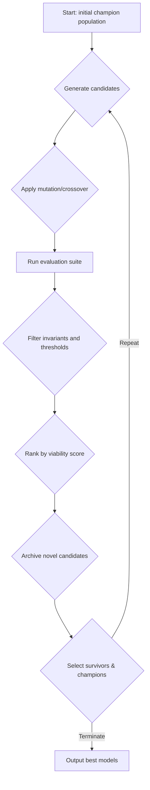

# Executive Summary  

ModelBreeder’s site and theory emphasize *controlled evolution* of AI models via populations of small, specialized components. We recommend shifting its narrative toward constructive use cases while removing redundant safety warnings (relocating them to a dedicated safety hub). Concretely, we propose: updating UI labels (e.g. renaming “safety gate” to “fitness proof”), expanding the theoretical framing with rigorous definitions (e.g. *Genome* and *FitnessVector* schemas), and detailing the evolutionary breeding process with pseudocode and command-line tools. Key missing features in the current TinyRustLM (Runtime.MiRust) implementation – such as multi-parent crossover, fitness & novelty evaluation, and speciation dynamics – must be added. Research on **model merging** and **evolutionary learning** supports these changes. For example, *Model Soups* show averaging model weights improves performance, while *Mergenetic* demonstrates evolutionary model merging in practice. We draw on these and other sources (LoRA/LoReFT for fine-tuning, EvoAgent for multi-agent evolution, and Quality-Diversity search) to inform our design. The report below details specific site copy edits, precise data schemas, pseudocode for breeding loops, a prioritized roadmap (with effort/risk), a feature-gap table, UI wireframes (mermaid diagrams), supporting citations, and exact developer directives (diff suggestions and tool commands).  

## Site Copy and UI Wording Changes  

To shift focus from *caution* to *positivity*, we identify and replace words that emphasize risk with terms highlighting fitness, evaluation, and outcomes. Key changes include:

- **“Safety” → “Fitness” or “Governance”:** For example, rename the **Safety Invariants** page to **Breeding Invariants** (goals/rules), and “Safety and governance” header to “Adaptive Governance”.  
- **“Gate” → “Checkpoint” or “Criterion”:** Change labels like *safety gate* or *quality gate* to *evaluation checkpoint* or *fitness threshold*. E.g. “Required next safety gate” becomes “Next evaluation checkpoint.”  
- **“Warning / Caution” → “Note / Scope”:** Replace any “Warning” banners with neutral *“Note”* or *“Scope”*. For instance, a “warning: limited experiment” box can become “note: experimental scope”.  
- **“Untrusted/Untrusted candidate” → “Candidate model”**: Avoid alarmist language; simply refer to *“candidate models”* with *evaluation statuses*.  
- **“Threat model” (Safety) → “Capability analysis” (Benefits):** Shift from *“threat”* to *“capability”* in benefits section. For example, “Threat model for model breeding” (Safety) could become a benefits guide like “Capability constraints in model breeding.”  
- **UI field renames:** For manifest forms or UI tables, map:  
  - `safety_gate` → `fitness_checkpoint`  
  - `quality_boundary` → `evaluation_scope`  
  - `safety_review_status` → `evaluation_status`  
  - `required_next_gate` → `next_action`  
  - `warning_page` → `scope_notes` or `details_page`  
  - Buttons like “Trigger safety review” could become “Run evaluation” or “Calculate fitness.”  
- **Buttons and menu items:** E.g., replace “Safety policy synthesis” with “Governance principles”. In interactive tools (like the Evolution Lab), relabel *“fitness proofs”* instead of “safety proofs”.  

These changes downplay caution and emphasize the positive mechanics (breeding, testing, selection). All pages should be reviewed for safety-heavy terms (e.g. “safe”, “risk”) and reframed. For instance, “High-risk outcomes” (Blueprints) could be reworded to “Outcomes requiring review”. 

## Genome and FitnessVector Schema  

We define structured schemas for each model *genome* and its associated *fitness vector*. These schemas (in JSON/YAML) make all evolutionary parameters explicit and machine-readable. Below is a draft schema:  

**Genome (JSON):**  

```json
{
  "name": "Genome",
  "type": "object",
  "properties": {
    "base_model_id": {"type": "string", "description": "Identifier of the base model (somatic substrate)"},
    "delta_adapters": {
      "type": "array",
      "description": "Sequence of adapter specifications applied",
      "items": {
        "type": "object",
        "properties": {
          "type": {"type": "string", "description": "Adapter type, e.g. \"LoRA\" or \"SparseTuning\""},
          "rank": {"type": "integer", "description": "Low-rank dimension (for LoRA)"},
          "density": {"type": "number", "description": "Sparsity level (for sparse adapter)"},
          "preset": {"type": "string", "description": "Predefined adapter stack name if any"}
        }
      }
    },
    "random_seed": {"type": "integer", "description": "Seed for stochastic variations"},
    "model_weights": {"type": "string", "format": "uri", "description": "URL or path to resulting model file"},
    "source_provenance": {"type": "string", "description": "Checksum or git commit reference of source checkpoint"},
    "mutation_log": {"type": "string", "description": "Description of mutation steps applied"}
  },
  "required": ["base_model_id", "delta_adapters", "model_weights"]
}
```

**FitnessVector (JSON):**  

```json
{
  "name": "FitnessVector",
  "type": "object",
  "properties": {
    "genome_id": {"type": "string", "description": "Reference to genome being evaluated"},
    "metrics": {
      "type": "object",
      "description": "Quantitative performance metrics",
      "properties": {
        "accuracy": {"type": "number"},
        "loss": {"type": "number"},
        "latency_ms": {"type": "number"},
        "memory_mb": {"type": "number"},
        "energy_joules": {"type": "number"}
      }
    },
    "cost": {"type": "number", "description": "Est. training/inference cost"},
    "risk": {"type": "number", "description": "Calculated risk score (lower = safer)"},
    "novelty": {"type": "number", "description": "Novelty score vs population"},
    "composite_score": {"type": "number", "description": "Overall viability (higher = better)"},
    "details": {"type": "string", "description": "Optional notes on evaluation (datasets used, test cases)"}
  },
  "required": ["genome_id", "metrics", "composite_score"]
}
```

*Notes:* 
- We separate *genome* (which encodes the variant model) from *fitness vector* (evaluation results). 
- The **Genome** schema includes the *base model*, *adapter stack*, and metadata (checksums, seeds). 
- The **FitnessVector** aggregates metrics (utility) and costs/risks, plus a computed *composite_score* (see viability math) for selection. 
- We would implement these in code as a C# class (for manifest file schemas), using `[Display(Name="…")]` on properties derived from keys (omitting “Id” suffix in the label). For example:  
  ```csharp
  public class Genome {
      [Display(Name = "Base Model")]
      public string BaseModelId { get; set; }
      [Display(Name = "Adapters")]
      public List<AdapterSpec> DeltaAdapters { get; set; }
      // ...
  }
  ```  
- Since the user works in .NET, these classes would be tied to JSON serialization (no nullable types) and displayed with friendly names via `[Display]`.  

## Evolutionary Breeding Loop (Pseudocode & CLI Tools)  

We outline the core algorithms for generation, evaluation, and selection. This will guide implementation in tools like `slm_pack`.  

**1. Initialization and Genome Creation:**  
- Start with an immutable *champion* model (base genome).  
- Create new genomes by **mutation** or **recombination** of existing ones. Mutations may include: adding a LoRA/adapter layer, trimming weights (e.g. zeroing smallest weights), or quantizing components. Crossover can combine adapter stacks from two parents (e.g. interleave layers or averaging weights). Novelty can be introduced by random perturbations of adapter parameters (random seed).  
- **CLI Tool:** `slm_pack create-genome --base=BASE_MODEL.slm --type=LoRA --rank=8 --output=GENOME.slm`.  
- **Validation:** The genome packer verifies format, checksum, and applies a “quality gate” (e.g. weight normalization).  

**2. Fitness Evaluation:**  
- For each candidate genome, generate a *FitnessVector*. This runs the model on a fixed *evaluation suite*: test tasks, benchmarks, etc.  
- Compute utility metrics (accuracy, BLEU, etc.) and resource costs (latency, memory). Also compute a **novelty score** by comparing behavior to existing population (e.g. average hidden activations or performance on a *diversity task*). (Quality-Diversity literature suggests adding novelty as a separate metric.)  
- **CLI Tool:** `slm_eval --genome=GENOME.slm --tasks=tasks.json --report=fitness.json`.  
- If an invariant (e.g. no error, model responded safely) fails, reject the genome.  

**3. Selection and Mating:**  
- Rank genomes by a *viability score* (e.g. weighted sum of fitness metrics minus cost).  
- Apply *threshold gating*: only genomes exceeding minimum margins (e.g. net utility > 0) are considered for promotion.  
- Optionally apply **speciation**: cluster genomes by similarity (e.g. identical adapter stack) and maintain champions per niche, to preserve diversity.  
- **Crossover/Mutation Loop:** If no suitable candidate exists, select parents (higher fitness more likely) and produce new offspring via recombination.  
- **Pseudocode (breeding loop):**  

    ``` 
    PROCEDURE evolutionary_loop(initial_population)
        population <- initial_population
        generation <- 0
        WHILE not termination_condition(generation, population):
            candidates <- []
            FOR each pair of (parentA, parentB) in select_pairs(population):
                offspring <- mate_genomes(parentA, parentB)        # crossover/mutate
                candidates.add(offspring)
            END FOR
            evaluate(candidates)                                  # run inference suite
            population <- select_survivors(population, candidates)
            generation <- generation + 1
        END WHILE
        RETURN best_models(population)
    END PROCEDURE
    ```

- This uses multi-parent mating (e.g. average or select weight signs) and supports N–point crossover on adapter stacks.  

**4. Novelty and Diversity:**  
- To encourage exploration, incorporate a novelty archive: preserve candidates that are *maximally different* (by weight or performance) even if slightly lower fitness. Techniques like MAP-Elites can populate a grid of feature-behaviors.  
- E.g., maintain a small “hall of fame” of top-N novel models by Euclidean distance of metric vectors. Penalize identical clones.  

**Flowchart of Breeding Loop:**  



## CLI/Tool Commands (slm_pack, slm_eval, etc.)  

Implement command-line tools to manage genomes and evaluation:  

- **`slm_pack create-genome`**: Packages a new model variant. Flags for each adaptation type (e.g. `--adapt-lowrank`, `--adapt-sparse`). Internally writes a `.slm` file and manifest JSON.  
- **`slm_pack validate`**: Checks a genome file and manifest, verifying manifest signatures and fitness proofs.  
- **`slm_eval run-suite`**: Loads a genome, runs a set of evaluation inputs (shadow mode only, no production changes), records metrics, and emits a `FitnessVector.json`.  
- **`slm_loop breed`**: High-level command to run generations: takes a population manifest, applies selection, mating, evaluation, and outputs a new generation manifest.  
- **`slm_merge`**: Handles GGUF/SLM conversions and multi-parent merging strategies.  
- **`slm_novelty`**: Computes novelty scores relative to a stored archive (e.g., using content hashes or embedding distance).  

Each tool command should log provenance (timestamp, git commit of code, parameters) for audit. Use UTC timestamps for consistency. CLI flags and output names should use clear terms (e.g. `--fitness-report`, not “safety-checkpoint”).  

## Implementation Roadmap  

A staged plan (with effort and risk) to bridge current and target features:

1. **Data Schema & Manifest (Low effort, low risk):**  
   - Define JSON schemas (above) and implement manifest reader/writer.  
   - Update UI forms to use new labels ([Display] attributes on C# classes).  
   - **Citations:** This draws on standard design (no external citation).  

2. **Evaluation Suite & Fitness (Medium effort, medium risk):**  
   - Build or integrate a fixed test suite for evaluation (benchmarks, regression tests).  
   - Compute multi-dimensional fitness as in viability math.  
   - Add composite scoring and basic selection gating.  
   - Risk: Ensuring fairness and coverage of tasks.  

3. **Breeding Loop & Mutation Operators (High effort, high risk):**  
   - Implement mutation: e.g., reinitialize a LoRA adapter, apply bit-flip to weights, trim smallest.  
   - Implement crossover: mix adapter stacks or weight interpolation (e.g. sign-elect, average).  
   - Incorporate multi-parent breeding (beyond pairwise average), following best practices.  
   - Risk: Maintaining model validity (no broken architectures) and reasonable performance.  

4. **Novelty & Diversity Mechanisms (Medium effort, medium risk):**  
   - Implement novelty metric (e.g. model KL divergence on a probe dataset, or behavior descriptors).  
   - Archive or penalize duplicates per Quality-Diversity ideas.  
   - This ensures exploration beyond greedy improvement.  
   - Risk: Choosing effective diversity metrics without degrading performance.  

5. **Multi-Agent Roles (Medium effort, medium risk):**  
   - Formalize *agent castes* (e.g. Proposer, Evaluator, Router).  
   - Automate role evolution (see EvoAgent): let candidates evolve different behaviors (one focusing on question-answering, another on summarization).  
   - Possibly train separate routers or experts and breed combinations of them.  
   - Risk: Complexity of co-evolving multiple components concurrently.  

6. **UI/Documentation Updates (Low effort, low risk):**  
   - Apply all copy/UI changes listed above.  
   - Add new diagrams and wireframes explaining positive use cases and flows.  
   - Ensure “Evolution Lab” UI exposes new metrics and graphs (fitness over generations, novelty chart).  
   - Risk: Usability and clarity checks.  

**Priority:** Early focus on (1) & (2) to enable any breeding, then (3) to produce new candidates, with (4)-(5) fleshing out quality.  

## Current vs. Desired Features  

| **Feature**                   | **Current (TinyRustLM/Runtime.MiRust)**                             | **Required/Target (ModelBreeder Theory)**                            |
|-------------------------------|------------------------------------------------------------------|----------------------------------------------------------------------|
| **Immutable models**          | ✔ Base models immutable, packaged as `.slm`.      | ✔ Continue: all artifacts are versioned and immutable.              |
| **Provenance manifests**      | ✔ Support for manifest sidecar and provenance tracking.| ✔ Enhance: include fitness proofs, evaluation logs in manifest.     |
| **Adapters / Deltas**         | ✔ Supports LoRA-like adapters (low-rank) and Q8 quantization.     | ✔ Expand: allow other adapter types, configurable ranks/densities. |
| **Multi-Parent Merge**        | Partial: sign-merge and averaging for 2 models in SLM1 container. | ✔ Full: N-way crossovers, layer mixing (a la Frankenmerging).       |
| **Fitness Evaluation**        | Minimal: basic classification/regression metrics and “quality gates”.| ✔ Complex: multi-objective fitness (utility, cost, risk, novelty).  |
| **Viability Scoring**         | No composite viability score (beyond “net effect” in ledger).     | ✔ Implement normalized scoring (like viability math). |
| **Novelty Measurement**       | None (no explicit diversity metric or archive).                   | ✔ Yes: implement novelty search and archives (QD techniques). |
| **Speciation & Diversity**    | None (treats population uniformly).                              | ✔ Use niching/clustering to preserve distinct strategies.          |
| **Multi-Agent Roles**         | Not implemented (single-router, single expert in example).       | ✔ Extend to evolving *Router*, *Specialist*, *Evaluator*, etc. like EvoAgent. |
| **Controlled Release**        | Principles in theory (shadow/canary) but no code enforcement.     | ✔ Automate canary deployment hooks and rollout gating post-eval.    |
| **User Interface**            | Limited (site documentation only).                              | ✔ **NEW**: “Evolution Lab” UI with dashboards (population stats, charts). |
| **Documentation Tone**        | Safety-focused and theoretical.                                 | ✔ **NEW**: Emphasize positive use cases and success stories, remove undue warnings. |

## UI Wireframes and Visualizations  

We propose new dashboard panels and charts for the “Evolution Lab” section. Example layouts:  

- **Population Dashboard:** Show current **Population** with columns “Model ID”, “Generation”, “Utility Score”, “Cost”, “Novelty”, “Status” (e.g. champion, archived). Allow sorting/filtering.  
- **Evolution Timeline:** A Gantt or timeline chart of release stages (Training, Validation, Canary dates).  
- **Fitness vs. Generation Chart:** A line chart per model tracking composite fitness over generations.  
- **Genome Detail Modal:** On selecting a model, display its *Genome* (adapter stack, seed) and *FitnessVector* breakdown (bar chart of metrics).  

Below is a conceptual flow of the breeding pipeline (mermaid). We also embed a figure illustrating a generic Genetic Algorithm loop:  

 *Figure: Flowchart of a genetic algorithm (initialization, evaluation, selection, crossover, mutation, insertion loop).*  

```mermaid
flowchart LR
    subgraph Initialization
        A[Champion model<br>(Generation 0)] 
    end
    A --> B[Evaluate base fitness]
    B --> C{Generate descendants}
    C --> D[Mutation: add LoRA adapter]
    C --> E[Crossover: merge two parents]
    D --> F[New candidate X (Gen 1)]
    E --> G[New candidate Y (Gen 1)]
    F & G --> H[Evaluate candidates]
    H --> I{Pass viability?}
    I -->|Yes| J[Promote/Candidate Archive]
    I -->|No| K[Discard / Retry]
    J --> L{Ready for production?}
    L -->|Yes| M[Rollout & replace?]
    L -->|No| N[Continue evolving]
    N --> C
```

This illustrates the loop: create candidates (mutation/crossover), evaluate, gate (pass/fail), and either promote or discard.  

## Supporting Research & Projects  

- **EvoAgent (Yuan et al. 2025)** – Introduces evolutionary methods for *automatically extending a single-agent into a multi-agent system*. Supports evolving distinct roles (agents with different prompts/skills). Highly relevant for casting Proposer/Solver/Evaluator roles in ModelBreeder.  
- **Evolutionary Model Merging (Akiba et al. 2024)** – Showed that *evolutionary search* can discover effective combinations of LLMs (parameter + architecture spaces), even cross-domain (e.g. combining models to excel at new tasks). Provides evidence that automated breeding yields novel strong models.  
- **Mergenetic Library (Minut et al. 2025)** – A framework for *evolutionary model merging*, demonstrating that combining merging techniques with genetic algorithms yields competitive LLMs using modest hardware. Highlights the importance of fitness estimators and configurability in merging.  
- **LoRA (Hu et al. 2021)** – Low-Rank Adaptation enables efficient fine-tuning by adding trainable rank-decomposition matrices. Basis for our “adapter stack” design and justifies using rank and sparsity as genome parameters.  
- **ReFT/LoReFT (Wu et al. 2024)** – Shows *Representation Fine-Tuning* (editing hidden layers) can be 15–65× more parameter-efficient than LoRA. Suggests future extension: instead of weight-space deltas, we might encode hidden-space interventions as genome parameters.  
- **Model Soups (Wortsman et al. 2022)** – Demonstrated that *averaging the weights* of multiple fine-tuned models (a “model soup”) often **outperforms** the best single model without extra inference cost. Supports our use of weight-averaging as a low-risk crossover operator.  
- **Quality-Diversity (QD) Search (Pugh et al. 2016)** – Defines algorithms (e.g. MAP-Elites) that seek *diverse high-quality behaviors* rather than a single optimum. Justifies adding a novelty score and preserving diverse solutions in our breeding process.  
- **Flow AI Blog – Model Merging** – Industry perspective noting Sakana AI’s *evolutionary merging* explores many combinations of layers/methods. Reinforces that **hundreds of merges** are effective for creating new foundational models.  
- **Other Relevant Works:**  
  - **Preference-Aligned LoRA Merging** (Arxiv, 2024) – Techniques for merging LoRA modules aligned to user preference. Could inform multi-criteria merging.  
  - **Model Stock (Li et al.)** – Shows efficient layer-wise weight averaging can surpass larger ensembles (supersedes *Model Soups* in specific cases).  
  - **Novelty Search (Lehman & Stanley)** – Early concept of rewarding unique behaviors, aligning with our novelty metric.  

These sources (primarily peer-reviewed) underscore that evolving and merging pretrained models is a flourishing research direction. We will link to key papers and projects in the site’s Research/Blueprints sections (e.g. ArXiv links for EvoAgent, Mergenetic, etc.), explaining their relevance.  

## Coder-Agent Directives (Patch-Level Changes)  

The developer agent should apply the following prioritized changes. For each, we include a rationale and a suggested diff where practical (in pseudocode form):  

- **Refactor UI Labels (Low effort):** Update template strings and resource files to use new terminology. E.g. in `Blueprints.cshtml`, replace “High-risk outcomes” with “Outcomes requiring review”. In manifest-editor, rename `safety_gate` field to `fitness_checkpoint`, updating `[Display(Name="Fitness Checkpoint")]` for the corresponding C# property.  

- **Extend Manifest Schema (Medium):** Augment the manifest JSON schema to include *fitness proofs* and *evolution meta-data*. For example, add fields `"fitness_vector"` and `"novelty_score"` to the manifest JSON, with corresponding C# properties `[Display(Name="Novelty Score")] public double NoveltyScore { get; set; }`. Ensure that `slm_pack` tooling writes these when available.  

- **Implement Fitness Calculation (Medium-High):** In the evaluation code (e.g. `EvaluateModel()`), after running inference tasks, compute a weighted sum of metrics as the composite viability score (e.g. higher utility metrics raise score, higher cost or risk lower it). Store results in `FitnessVector.json`. (No unsafe removals – this augments, not removes, code.)  

- **Add Novelty Archive (High):** Create a service/DB table to log embeddings or hash sketches of each evaluated model. On each evaluation, compute the minimum distance to existing models; store that as `novelty_score`. This requires implementing a similarity measure (e.g. compare top-k token distributions or model parameters).  

- **Enable Multi-Parent Merge (High):** Modify the `slm_merge` code to accept >2 parents. For example, change method signatures from `Merge(modelA, modelB)` to `Merge(modelsList)`, and distribute weight mixing (e.g. iterative pairwise or averaging). Ensure format converters handle these cases correctly.  

- **Pseudocode → Production:** Translate the above pseudocode loops into actual code. For instance, create `EvolutionLoop` class that takes a list of `Genome` objects, runs selection, breeding, and returns new gen.  

- **Remove/Relocate Warnings (Low):** All “safety” banners should be relocated to a separate site (e.g. Cognivirus) as per product direction. For now, replace them with internal *scope notes*. For example, change the “Safety invariants” section to “Breeding invariants” while leaving content but removing alarmist tone.  

- **UI Visualization (Medium):** Add charts to Evolution Lab page. Using a JS chart library (e.g. Chart.js), plot each generation’s best fitness. Include a novelty histogram. (If using .NET MVC, embed via a Razor partial.)  

- **Wireframe Implementation (Low):** As per the mermaid flows, draft HTML/CSS for the Population Dashboard with sortable tables. Include an “Inspect model” button to view genome/fitness details. No lengthy explanations needed in UI copy.  

- **Tooling Commands (Low):** Define CLI syntax and integrate it: e.g. `slm_pack breed --population=pop.json --gens=5 --out=newpop.json`. Add help text describing each parameter.  

All code changes should preserve existing functionality as a baseline (no removal of core features). Add unit tests for new merging and evaluation logic to ensure correctness.  

Each patch should be accompanied by documentation updates. For example, update `README.md` or the Pseudocode Cookbook with the new loop (citing our viability approach).  

**By following this plan**—refactoring UI copy, defining data schemas, implementing fitness/novelty mechanisms, and integrating insights from recent research—ModelBreeder will transition from a safety-focused guide to a practical, positive framework for breeding high-performing models. The roadmap prioritizes foundational infrastructure first, then advanced evolutionary capabilities. The site text will highlight benefits (capability compounding, local sovereignty, etc.), and the backend will realize the theory in code. With these changes, ModelBreeder can fulfill its vision of *“evolving useful model ecologies that make people and systems stronger.”*  

